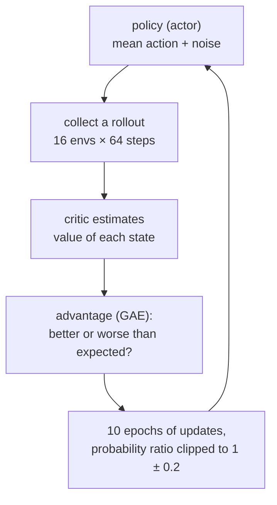

# 33 · PPO for continuous control

<!-- meta -->
| | |
|---|---|
| **Part** | [8 · Reinforcement learning for robots](README.md) |
| **Run type** | CPU · Mac or Colab CPU |
| **Prerequisites** | [32](32-rl-environment.md) |
| **Learn first** | [Policy Gradient — REINFORCE from Scratch](https://aiengineeringfromscratch.com/lesson?path=phases/09-reinforcement-learning/06-policy-gradients-reinforce) · [Actor-Critic — A2C and A3C](https://aiengineeringfromscratch.com/lesson?path=phases/09-reinforcement-learning/07-actor-critic-a2c-a3c) · [Proximal Policy Optimization (PPO)](https://aiengineeringfromscratch.com/lesson?path=phases/09-reinforcement-learning/08-ppo) |
| **Time** | ~75 min |
| **Code** | [`experiments/33-ppo/experiment.py`](../experiments/33-ppo/experiment.py) |
| **Status** | ✅ done |
<!-- /meta -->

> PPO itself is a few lines of math. On a robot, most of the work is choosing the time scales around it.

## The problem

In [lesson 32](32-rl-environment.md) a random policy reached the target in 1 of 200 episodes and a scripted IK controller, which reads the Jacobian from the model, in all 200. Can a policy learn the same reach from reward alone, on a CPU, in about a minute per run? One training run is not a result, so we report success over fixed evaluation episodes with a Wilson 95% interval ([lesson 25](../part-7-learning-from-demonstration/25-evaluating-policies.md)) for three seeds.

## Core idea

### In plain words

PPO (Proximal Policy Optimization) learns from its own attempts while refusing to change too much at once. The policy tries the task many times with a little noise on its actions, and after each batch asks for every action: "did this turn out better or worse than I usually do from here?" That difference is the **advantage**; "what I usually get" comes from a second network, the **critic**. Actions with a positive advantage become a bit more likely, the others a bit less.

"Not too much at once" makes it stable. The batch was collected by the old policy, so it says something reliable only about policies close to it, the way a benchmark of last week's build tells you little about a rewrite. PPO ignores any gain from making an action more than 20% more (or less) likely than before: the **clip**.

On a robot one more knob has physical meaning: the **discount** $\gamma$, how much a reward one step later counts. A step is 20 ms of real time, so $\gamma$ silently sets how many seconds ahead the policy cares.

### One PPO iteration



### PPO, as code

```python
# One iteration, simplified (the full version is experiments/33-ppo/ppo.py)
batch = collect(policy, envs, steps=64)     # obs, actions, rewards, log-probs under the OLD policy
values = critic(batch.obs)                  # expected future reward from each state
adv = gae(batch.rewards, values, gamma=0.95, lam=0.95)   # better (+) or worse (-) than expected
for epoch in range(10):
    ratio = policy.prob(batch.actions) / batch.old_prob  # how much more likely each action is now
    clipped = ratio.clip(1 - 0.2, 1 + 0.2)               # changes beyond 20% earn nothing
    loss = -mean(min(ratio * adv, clipped * adv))        # raise good actions, lower bad ones
    optimize(loss + 0.5 * critic_loss)

horizon_s = dt / (1 - gamma)                # 0.02 / (1 - 0.95) = 0.4 s of look-ahead
```

| Piece | Formula |
|---|---|
| Gaussian policy | $a \sim \mathcal N(\mu_\theta(o), \mathrm{diag}\,\sigma^2)$ |
| TD error, GAE | $\delta_t = r_t + \gamma (1-d_t) V(s_{t+1}) - V(s_t), \quad \hat A_t = \sum_{l \ge 0} (\gamma\lambda)^l \delta_{t+l}$ |
| clipped surrogate | $L = -\mathbb E\big[\min(\rho_t \hat A_t,\ \mathrm{clip}(\rho_t, 1-\epsilon, 1+\epsilon)\hat A_t)\big] + c_v (V_\phi(s_t) - \hat R_t)^2 - c_e\, \mathcal H[\pi_\theta]$ |
| horizon | $\tau \approx \Delta t/(1-\gamma)$ |

$\mu_\theta(o)$ is the actor's mean action for observation $o$ and $\sigma$ its learned noise; $d_t$ is 1 where an episode ended; $\lambda$ trades bias for variance in the advantage $\hat A_t$; $\rho_t = \pi_\theta(a_t|s_t)/\pi_{\theta_{\text{old}}}(a_t|s_t)$ is the probability ratio and $\epsilon$ the clip; $\hat R_t$ is the critic's target, $c_v$ and $c_e$ weight the value loss and the entropy bonus $\mathcal H$; $\Delta t$ is the policy period.

<details>
<summary>Math details: the four continuous-control pieces</summary>

The policy-gradient, actor-critic and PPO derivations are on AIEFS; here are only the parts that matter for continuous control.

**Gaussian policy.** The actor outputs the mean of a diagonal Gaussian; $\log\sigma$ is a learned vector independent of the observation. The environment clips $a$ to $[-1, 1]$, but the log-probability is computed for the unclipped sample, so $\rho_t$ stays consistent.

**GAE** (Schulman et al., [arXiv 1506.02438](https://arxiv.org/abs/1506.02438)). $\lambda = 0$ uses only $\delta_t$ (low variance, biased by the critic); $\lambda = 1$ sums all real rewards (unbiased, noisy). The paper treats $\gamma$ the same way, as a variance-reduction parameter.

**Clipped surrogate** (Schulman et al., [arXiv 1707.06347](https://arxiv.org/abs/1707.06347)). $\rho_t \hat A_t$ estimates the new policy's improvement from the old one's samples (importance sampling), trustworthy only near $\rho = 1$; the minimum with the clipped term removes any incentive to leave $[1-\epsilon, 1+\epsilon]$ (Build it, Step 4).

**Truncation is not termination.** At the 1.6 s limit the last reward gets the bootstrap $r_T \leftarrow r_T + \gamma V(s_{T+1})$, then the episode is cut ($d_t = 1$); a true terminal state (lesson 35) gets none.

**Why $\Delta t/(1-\gamma)$.** The weights $\gamma^l$ sum to $\sum_{l\ge0}\gamma^l = 1/(1-\gamma)$ steps; multiplied by the step length that is a time. At 50 Hz, $\gamma = 0.99$ means 2 s and $\gamma = 0.95$ means 0.4 s. Change the control rate and you silently change the task's horizon.

Go deeper: [Policy Gradient — REINFORCE from Scratch](https://aiengineeringfromscratch.com/lesson?path=phases/09-reinforcement-learning/06-policy-gradients-reinforce), [Actor-Critic — A2C and A3C](https://aiengineeringfromscratch.com/lesson?path=phases/09-reinforcement-learning/07-actor-critic-a2c-a3c), [Proximal Policy Optimization (PPO)](https://aiengineeringfromscratch.com/lesson?path=phases/09-reinforcement-learning/08-ppo); the PPO and GAE papers above.

</details>

<!-- figure: 33-discount-horizon -->

### Our settings next to a real robot config

| | This lesson | Go2 training config (`unitree_rl_gym`) |
|---|---|---|
| parallel envs × steps per iteration | 16 × 64 | 4096 × 24 |
| epochs / minibatches per iteration | 10 / 4 | 5 / 4 |
| clip $\epsilon$, $\gamma$, $\lambda$ | 0.2, 0.95, 0.95 | 0.2, 0.99, 0.95 |
| learning rate | 1e-3, fixed | 1e-3, `schedule = 'adaptive'`, `desired_kl = 0.01` |
| entropy coefficient | 0 | 0.01 |
| policy network | 64-64 tanh | 512-256-128 elu |

The right column is read from [`legged_robot_config.py`](https://github.com/unitreerobotics/unitree_rl_gym/blob/main/legged_gym/envs/base/legged_robot_config.py) (`LeggedRobotCfgPPO`) and [`go2_config.py`](https://github.com/unitreerobotics/unitree_rl_gym/blob/main/legged_gym/envs/go2/go2_config.py).

## Build it

You will now write the pieces of PPO, check each against hand values, SciPy or autograd, and assemble one PPO iteration on the reach task that must match the lesson's `ppo.py` exactly. Step 5 runs one iteration (1024 samples) per seed, not the Experiment's 300,000-step trainings; the script takes about 6 s.

The functions are in [`physai/rl.py`](../physai/rl.py); `uv run python experiments/33-ppo/build.py` runs the six steps (output in [`build_output.txt`](../experiments/33-ppo/build_output.txt)).

### Step 1 · GAE

Generalized advantage estimation runs backwards through the rollout, one TD error per step:

```python
def gae(rewards, values, last_value, dones, gamma, lam):
    """Generalized advantage estimation over a (T, N) rollout, backwards in time; returns (advantages, returns).

    dones[t] = 1 where an episode ended after step t (terminated or truncated); a truncated step's reward
    must already include gamma * V(s_final).
    """
    adv = np.zeros_like(rewards)
    run = np.zeros_like(last_value)
    for t in reversed(range(len(rewards))):
        next_v = last_value if t == len(rewards) - 1 else values[t + 1]
        nonterminal = 1.0 - dones[t]
        delta = rewards[t] + gamma * next_v * nonterminal - values[t]   # TD error
        run = delta + gamma * lam * nonterminal * run
        adv[t] = run
    return adv, adv + values
```

Three steps by hand, with $\gamma = 0.9$: $\delta_2 = 2 + 0.9 \cdot 0.2 - 0.3 = 1.88$, $\delta_1 = 0 + 0.9 \cdot 0.3 - 0.4 = -0.13$, $\delta_0 = 1 + 0.9 \cdot 0.4 - 0.5 = 0.86$; with $\lambda = 0.8$, $\hat A_1 = -0.13 + 0.72 \cdot 1.88 = 1.2236$ and $\hat A_0 = 0.86 + 0.72 \cdot 1.2236 = 1.740992$.

```text
== Step 1. GAE on three steps: r = (1, 0, 2), V = (0.5, 0.4, 0.3), V(s_3) = 0.2, gamma 0.9 ==
lambda 0.8: A = [1.740992 1.2236   1.88    ], returns = [2.240992 1.6236   2.18    ]
lambda 0.0: A = [ 0.86 -0.13  1.88], returns = [1.36 0.27 2.18]
lambda 1.0: A = [2.2658 1.562  1.88  ], returns = [2.7658 1.962  2.18  ]
TD errors delta = [ 0.86 -0.13  1.88] (= lambda 0); discounted return - V = [2.2658 1.562  1.88  ] (= lambda 1)
64 x 16 rollout, no episode ends: max |gae - direct double sum| = 5.3e-15
```

$\lambda = 0$ gives back the TD errors, $\lambda = 1$ the discounted return minus the value, the two ends of the knob in Math details. On a 64 × 16 rollout the loop equals the direct double sum to 5.3e-15.

### Step 2 · Episodes that end inside the rollout

A 64-step rollout crosses episode boundaries; `dones[t] = 1` cuts the bootstrap and the running sum, so no advantage leaks into the next episode:

```text
== Step 2. Episode ends inside the rollout ==
49 episode ends: max |gae - per-episode sums| = 3.1e-15
truncated step: r + gamma * V(s_final) is stored and done = 1, so the future is not lost: -0.200 for r = -0.01, V(s_final) = -0.200
```

A truncated step's reward already contains $\gamma V(s_{\text{final}})$ (Math details), so cutting the sum loses nothing.

### Step 3 · The Gaussian policy's log-probability

```python
def gaussian_log_prob(a, mu, log_std):
    """Log-density of a diagonal Gaussian policy, summed over the action dimensions."""
    z = (a - mu) / np.exp(log_std)
    return (-0.5 * z ** 2 - log_std - 0.5 * np.log(2 * np.pi)).sum(-1)
```

```text
== Step 3. Gaussian log-probability, 1000 actions in 4-D ==
max |ours - scipy| = 1.8e-15, max |ours - torch| = 2.7e-15
at the mean: 0.3242 = 4 * (1 - 0.5 ln 2 pi) = 0.3242
```

At the mean, with $\log\sigma = -1$, each dimension contributes $-\log\sigma - \tfrac12\log 2\pi = 1 - 0.9189$, so 0.3242 for four: a narrow Gaussian has a log-density above 0.

### Step 4 · The clipped surrogate

The loss must be differentiated, so it works on tensors; `.clamp` and `.minimum` are tensor methods, and physai need not import PyTorch:

```python
def clipped_surrogate(ratio, adv, clip=0.2):
    """PPO's policy loss on PyTorch tensors: -mean(min(ratio * A, clip(ratio, 1 - eps, 1 + eps) * A))."""
    unclipped = ratio * adv
    clipped = ratio.clamp(1 - clip, 1 + clip) * adv
    return -unclipped.minimum(clipped).mean()
```

```text
== Step 4. The clipped surrogate, eps = 0.2 ==
 ratio   A   objective min(rA, clip(r)A)   d objective / d ratio
   0.7   +1                          0.70                     1.0
   0.9   +1                          0.90                     1.0
   1.1   +1                          1.10                     1.0
   1.3   +1                          1.20                     0.0
   0.7   -1                         -0.80                     0.0
   0.9   -1                         -0.90                    -1.0
   1.1   -1                         -1.10                    -1.0
   1.3   -1                         -1.30                    -1.0
```

Read the gradient column. With a positive advantage, raising the ratio pays until $1 + \epsilon = 1.2$, then the gradient is 0.0; with a negative advantage the same happens below 0.8. In the other direction the gradient stays: a move that makes the objective worse is never clipped away.

### Step 5 · One iteration, against `ppo.py`

```python
def approx_kl(logp_old, logp_new):
    """The cheap KL estimate PPO logs per update: mean of log pi_old - log pi_new over the batch's actions."""
    return (logp_old - logp_new).mean()
```

The iteration uses `ppo.py`'s network and the lesson's environment, and your functions for the update. The core of the minibatch step:

```python
A = (A - A.mean()) / (A.std() + 1e-8)
pg = clipped_surrogate((lp - b_lp[mb]).exp(), A, cfg.clip)
vl = ((pi.v(b_o[mb]).squeeze(-1) - b_ret[mb]) ** 2).mean()
loss = pg + cfg.vf_coef * vl - cfg.ent_coef * d.entropy().sum(-1).mean()
```

```text
== Step 5. One PPO iteration (16 envs x 64 steps, 10 epochs x 4 minibatches) ==
seed 0: approx KL ours 0.011696, ppo.py 0.011696; max |weights ours - ppo.py| = 0.0e+00
reference (eps 0.2, 10 epochs): ppo.py iteration-1 KL, seeds 0/1/2 = 0.0117 / 0.006815 / 0.004259, mean 0.00759
Break it (eps 100, 30 epochs): ppo.py iteration-1 KL, seeds 0/1/2 = 1.493 / 1.583 / 1.939, mean 1.67
```

Your iteration gives the same weights as `ppo.py`'s first iteration (difference 0.0e+00): the Experiment's update is the one you wrote. The first-iteration KL of the three seeds averages 0.00759, the reference line under Break it; without the clip and with 30 epochs it is 1.493 / 1.583 / 1.939, the Break it table's first column. The trust region is gone from the first update.

### Step 6 · The discount as a horizon

```python
def horizon_seconds(dt, gamma):
    """How far ahead a discount looks, in seconds: the weights gamma^l sum to 1 / (1 - gamma) steps."""
    return dt / (1.0 - gamma)
```

```text
== Step 6. The discount as a time horizon, policy period 20 ms ==
  gamma  horizon
  0.900   0.20 s
  0.950   0.40 s
  0.990   2.00 s
  0.995   4.00 s
```

The $\gamma$ sweep's horizon column: 0.4 s at best, 2 s for the default 0.99.

### What you keep

`physai.rl` now also has `gae`, `gaussian_log_prob`, `clipped_surrogate`, `approx_kl` and `horizon_seconds`. [Lesson 34](34-observation-action-design.md) uses `horizon_seconds` in reverse to pick $\gamma$ per control rate. [`tests/test_33_ppo.py`](../tests/test_33_ppo.py) checks GAE against the direct sum and its special cases, the episode cut, the log-probability against SciPy and the clip's values and gradients; run `uv run pytest tests/test_33_ppo.py`.

## Use it

For a ready-made PPO on one machine, Stable-Baselines3 accepts any `gymnasium.Env`, such as lesson 32's `GymReach` (not run here: SB3 is not a dependency of this repo):

```python
from stable_baselines3 import PPO
model = PPO("MlpPolicy", env, n_steps=64, batch_size=256, n_epochs=10, gamma=0.95, gae_lambda=0.95,
            learning_rate=1e-3, clip_range=0.2)       # this lesson's settings, with one env
model.learn(total_timesteps=300_000)
```

Its defaults differ from this lesson's ([PPO docs](https://stable-baselines3.readthedocs.io/en/master/modules/ppo.html)):

| Setting | This lesson (`ppo.py`) | Stable-Baselines3 `PPO` default |
|---|---|---|
| rollout length per env | 64 (× 16 envs) | `n_steps = 2048` |
| minibatch size | 256 | `batch_size = 64` |
| epochs | 10 | `n_epochs = 10` |
| discount, GAE | 0.95, 0.95 | `gamma = 0.99`, `gae_lambda = 0.95` |
| learning rate | 1e-3 | 3e-4 |
| clip, value and entropy weights | 0.2, 0.5, 0 | `clip_range = 0.2`, `vf_coef = 0.5`, `ent_coef = 0.0` |
| gradient-norm clip | 0.5 | `max_grad_norm = 0.5` |
| advantage normalization | per minibatch | `normalize_advantage = True` |

Three traps:

- **$\gamma = 0.99$ is a default, not a law.** At 50 Hz it is a 2 s horizon, and in the Experiment it halved the success rate against 0.95 (159/300 vs 298/300). Set it from the task's time scale with Step 6.
- **`batch_size` is the minibatch** in SB3; a rollout is `n_steps × n_envs`.
- **Truncation reaches the learner only through `info`.** SB3 bootstraps a time-limit step when the info dict carries `TimeLimit.truncated` and the final observation (lesson 32, Use it); with a custom loop, add $\gamma V(s_{\text{final}})$ yourself, as `ppo.py` does.

## Experiment

[`ppo.py`](../experiments/33-ppo/ppo.py) is the whole algorithm (about 200 lines, no RL library); [`experiment.py`](../experiments/33-ppo/experiment.py) runs it. The environment is the lesson-32 reach task unchanged: absolute joint targets, 50 Hz, reward $-d$, 300,000 policy steps per run. Its update is the one you wrote in Build it (Step 5 matched it weight for weight).

**Predict** before you run: with $\gamma$ from 0.9 to 0.995, which horizon works best for a 1.6 s reach?

MuJoCo 3.17.0, NumPy 2.5.4, PyTorch 2.14.1 (CPU, one thread per run), Apple Silicon Mac (Apple M5). Each run is deterministic for its seed: a full rerun reproduced every number in [`output.txt`](../experiments/33-ppo/output.txt) except the timings. Evaluation uses the mean action (no noise) on episodes with seeds 10000–10099.

**Reference config, three seeds:**

| seed | success | Wilson 95% | median final distance | train time |
|---|---|---|---|---|
| 0 | 100/100 | 96.3–100.0% | 6.6 mm | 61 s |
| 1 | 98/100 | 93.0–99.4% | 7.9 mm | 61 s |
| 2 | 100/100 | 96.3–100.0% | 8.0 mm | 60 s |
| pooled | 298/300 (99.3%) | 97.6–99.8% | | |

Training times are approximate wall-clock (six runs in parallel on a shared Mac); the whole script took 222 s. `python experiment.py --quick` trains seed 0 only (5 runs) and reproduces the seed-0 entries of every table, not the pooled numbers.

Training success (noisy policy, last 50 episodes) by environment steps:

| seed | 50k | 100k | 150k | 200k | 250k | 299k |
|---|---|---|---|---|---|---|
| 0 | 0.20 | 0.14 | 0.18 | 0.68 | 0.96 | 1.00 |
| 1 | 0.16 | 0.22 | 0.28 | 0.40 | 0.92 | 0.96 |
| 2 | 0.16 | 0.20 | 0.28 | 0.88 | 0.94 | 0.98 |

For 150k steps training success stays between 0.14 and 0.28, then jumps within about 100k steps; a run stopped at 150k would look like a failure.

**Sweep $\gamma$** (3 seeds each, 300 evaluation episodes pooled):

| $\gamma$ | horizon at 50 Hz | success per seed | pooled | Wilson 95% |
|---|---|---|---|---|
| 0.9 | 0.2 s | 77 / 97 / 98 | 272/300 (90.7%) | 86.8–93.5% |
| **0.95** | **0.4 s** | 100 / 98 / 100 | 298/300 (99.3%) | 97.6–99.8% |
| 0.99 | 2.0 s | 32 / 74 / 53 | 159/300 (53.0%) | 47.3–58.6% |
| 0.995 | 4.0 s | 25 / 31 / 79 | 135/300 (45.0%) | 39.5–50.7% |


The common default $\gamma = 0.99$ halves the success rate here, and the seed spread grows (25 to 79 out of 100 at 0.995): a reach of a few hundred milliseconds was best served by a horizon of the same order. We did not isolate the mechanism. Candidates: longer horizons add the noise of distant rewards to every advantage (the GAE paper's bias-variance trade); and the value targets grow like $1/(1-\gamma)$ while `ppo.py` neither normalizes returns nor clips actor and critic gradients separately, so a larger value loss also shrinks the policy step. Caveats: the budget is fixed (300k steps), and the Wilson intervals count 300 episodes but only three trained policies. The 0.95 vs 0.99 gap holds in every seed; the 0.99 vs 0.995 difference does not.

## Break it

The clip is what keeps ten epochs on the same batch from walking the policy too far. Set $\epsilon = 100$ (no clipping in practice) and reuse each batch for 30 epochs. The last column is the approximate **KL divergence** between the policy that collected the batch and the updated one, a number for "how different are the two action distributions"; around 0.01 is a small, healthy step.

| seed | success | Wilson 95% | median final distance | approx. KL per update, iter 1 / 10 / 50 / 100 / 292 |
|---|---|---|---|---|
| 0 | 0/100 | 0.0–3.7% | 196.5 mm | 1.49 / 3.1 / 8.2 / 435 / 3780 |
| 1 | 0/100 | 0.0–3.7% | 272.5 mm | 1.58 / 4.16 / 17.5 / 46.6 / 125 |
| 2 | 1/100 | 0.2–5.4% | 144.2 mm | 1.94 / 3.04 / 7.78 / 392 / 1070 |
| reference ($\epsilon$ 0.2, 10 epochs) | | | | 0.00759 / 0.0201 / 0.0211 / 0.0259 / 0.0657 (mean of 3) |

Mechanism: $\rho \hat A$ is a valid estimate of improvement only near $\pi_{\theta_{\text{old}}}$. Without the clip the optimizer keeps pushing $\rho$ for samples with large advantages, the mean and $\log\sigma$ jump, and the approximate KL goes from about 0.01 to hundreds (already 1.49–1.94 in the first iteration, Build it, Step 5). The next batch comes from a policy the critic was not fitted to, so the advantages are wrong too. The final distances (144.2–272.5 mm) are of the same order as the random policy in lesson 32 (185.7 mm median). Watching approximate KL and clip fraction per update is the cheapest early warning; Unitree's config goes one step further and adapts the learning rate to a KL target (`desired_kl = 0.01`).

## On the real robot

- The trained actor is a 15 → 64 → 64 → 4 MLP; deploying it means running $\mu_\theta(o)$ at 50 Hz and sending the four outputs as servo targets. The critic stays behind.
- The Menagerie models the STS3215 servos as position actuators (`kp = 998.22`, `kv = 2.731`, `forcerange = ±2.94` N·m, [`so101.xml`](https://github.com/google-deepmind/mujoco_menagerie/tree/f3b6013/robotstudio_so101)); the real servo's loop, latency and backlash differ, and the policy was trained on none of that (Part 9).
- Procedure for the real arm: fixed list of 20+ reachable targets, run the deterministic policy, measure final gripper position with the calibrated camera of [lesson 20](../part-5-perception-and-estimation/20-pixels-to-table.md), report $k/n$ with a Wilson interval. **Not yet measured on the real arm.**

## Check yourself

1. **Easy.** What horizon in seconds does the Go2 config's $\gamma = 0.99$ correspond to at its 50 Hz policy rate? What $\gamma$ gives the same horizon at 200 Hz?
2. **Medium.** In `ppo.py`, delete the truncation bootstrap (treat the time limit as a terminal state). Before running: which states get a wrong value, and is it too high or too low? Run three seeds and compare with the reference table.
3. **Hard.** Replace the fixed learning rate by the KL-adaptive rule (halve the lr when the mean KL of an iteration exceeds $2 \times 0.01$, grow it by 1.5× when below $0.01/2$). Does it rescue the Break-it setting? Report success with Wilson intervals over three seeds.

### Answers

1. $\tau = 0.02 / (1 - 0.99) = 2.0$ s. At 200 Hz ($\Delta t = 5$ ms): $\gamma = 1 - 0.005/2 = 0.9975$.
2. The states near the time limit. Every reward here is $-d \le 0$, so cutting off the future makes their value targets too high (closer to zero than the bootstrapped targets), and the same arm state gets different targets depending on the clock, which is not in the observation. Measure it; we did not run this variant.
3. Open; we did not run it. Report the KL per iteration with success, or you cannot tell the schedule from luck.

## Takeaways and sources

- A compact PPO (Gaussian policy, GAE, clipped surrogate) learns the SO-101 reach on a CPU: 298/300 evaluation episodes (Wilson 97.6–99.8%) over three seeds, about a minute per run.
- $\gamma$ is a horizon in seconds, $\Delta t/(1-\gamma)$; at 50 Hz, 0.95 (0.4 s) reached 99.3% and the default 0.99 (2 s) 53.0% within the same budget.
- Without the clip and with heavy data reuse, KL explodes and success falls to 0–1%; log KL and clip fraction every update.

Next: [lesson 34](34-observation-action-design.md), what the policy sees and what its outputs mean.

**Sources**

- J. Schulman, F. Wolski, P. Dhariwal, A. Radford, O. Klimov, "Proximal Policy Optimization Algorithms", 2017. [arXiv 1707.06347](https://arxiv.org/abs/1707.06347)
- J. Schulman, P. Moritz, S. Levine, M. Jordan, P. Abbeel, "High-Dimensional Continuous Control Using Generalized Advantage Estimation", 2015. [arXiv 1506.02438](https://arxiv.org/abs/1506.02438)
- [Gymnasium `Env` API](https://gymnasium.farama.org/api/env/) (terminated vs truncated).
- [`unitree_rl_gym` · `legged_robot_config.py`](https://github.com/unitreerobotics/unitree_rl_gym/blob/main/legged_gym/envs/base/legged_robot_config.py), [`go2_config.py`](https://github.com/unitreerobotics/unitree_rl_gym/blob/main/legged_gym/envs/go2/go2_config.py) (BSD-3-Clause).
- [MuJoCo Menagerie · `robotstudio_so101`](https://github.com/google-deepmind/mujoco_menagerie/tree/f3b6013/robotstudio_so101) (Apache-2.0).
- Code: [`experiments/33-ppo/ppo.py`](../experiments/33-ppo/ppo.py), [`experiment.py`](../experiments/33-ppo/experiment.py), [`output.txt`](../experiments/33-ppo/output.txt); figure from [`plot.py`](../experiments/33-ppo/plot.py).
