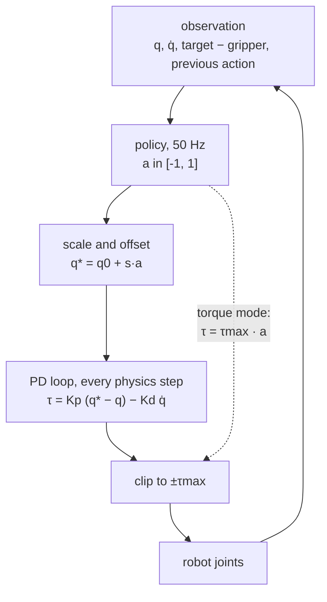

# 34 · Observation and action design

<!-- meta -->
| | |
|---|---|
| **Part** | [8 · Reinforcement learning for robots](README.md) |
| **Run type** | CPU · Mac or Colab CPU |
| **Prerequisites** | [33](33-ppo.md) |
| **Learn first** | [Proximal Policy Optimization (PPO)](https://aiengineeringfromscratch.com/lesson?path=phases/09-reinforcement-learning/08-ppo) |
| **Time** | ~60 min |
| **Code** | [`experiments/34-observation-action-design/experiment.py`](../experiments/34-observation-action-design/experiment.py) |
| **Status** | ✅ done |
<!-- /meta -->

> The policy does not move the robot. It talks to a controller, and what its numbers mean decides most of what it can learn.

## The problem

Unitree's Go2 policy does not output torques. Its 12 outputs are scaled by 0.25, added to a default joint angle, and tracked by a PD loop that runs four times per policy step ([`go2_config.py`](https://github.com/unitreerobotics/unitree_rl_gym/blob/main/legged_gym/envs/go2/go2_config.py), [`legged_robot.py` · `_compute_torques`](https://github.com/unitreerobotics/unitree_rl_gym/blob/main/legged_gym/envs/base/legged_robot.py)):

```python
torques = self.p_gains*(actions_scaled + self.default_dof_pos - self.dof_pos) - self.d_gains*self.dof_vel
```

with `stiffness = 20`, `damping = 0.5`, `action_scale = 0.25`, `decimation = 4` at `dt = 0.005` (50 Hz policy, 200 Hz PD). Why this and not torques, and why those numbers? With the PPO of lesson 33 held fixed, we change only the interface on the SO-101 reach and measure success, smoothness and energy.

## Core idea

### In plain words

The policy is a slow, high-level service that calls a fast, low-level one, in one of three ways. **Torque**: write the motor effort directly, like poking hardware registers; the policy must then hold the arm against gravity and damp its motion itself. **Absolute target**: send the joint angle it wants; a PD loop (a spring-and-damper controller, [lesson 12](../part-4-dynamics-and-control/12-joint-control.md)) chases that angle hundreds of times per second. **Delta target**: nudge the previous target by a small step.

With targets, the policy moves a setpoint 50 times per second and the stiff loop underneath does the rest. Three more choices sit around that call: the **action scale** (how far one unit of output reaches, and how large the exploration noise is in radians), the **policy rate** and the **observation** ("the target is a bit to the left of my gripper" is easier to act on than room coordinates).

### From policy to torque



### The three interfaces, as code

```python
def torque(a, q, qd, q_star_prev, mode, s):
    # a: policy output in [-1, 1]^4, q / qd: joint angles / velocities, s: action scale
    if mode == "torque":
        return TAU_MAX * a                          # policy is the controller; held for k physics steps
    if mode == "absolute":
        q_star = Q0 + s * a                         # setpoint around the default pose q0
    else:                                           # "delta"
        q_star = q_star_prev + s * a                # move the previous setpoint
    return clip(KP * (q_star - q) - KD * qd, -TAU_MAX, TAU_MAX)   # PD, every physics step

gamma = 1 - policy_dt / 0.4                         # keep a 0.4 s horizon when the rate changes
```

| Name | Policy output means | Torque at every physics step |
|---|---|---|
| torque | $\tau = \tau_{\max} a$ | held for $k$ steps |
| absolute target | $q^* = q_0 + s\,a$ | $\tau = K_p (q^* - q) - K_d \dot q$, clipped |
| delta target | $q^*_t = q^*_{t-1} + s\,a_t$ | same PD |

$a \in [-1,1]^n$ is the policy output, $q$ and $\dot q$ the joint angles and velocities, $q^*$ the joint target, $q_0$ the default pose, $s$ the action scale, $K_p$ and $K_d$ the PD gains, $\tau_{\max}$ the torque limit and $k$ the number of $h = 5$ ms physics steps per policy step.

<details>
<summary>Math details: what the servo, the scale, the rate and the observation do</summary>

**The SO-101 servo is already a PD loop.** Each STS3215 is a MuJoCo position actuator with `kp = 998.22`, `kv = 2.731`, `forcerange = ±2.94` N·m; MuJoCo evaluates it inside every physics step ([XML reference, actuators](https://mujoco.readthedocs.io/en/stable/XMLreference.html#actuator)). Our torque mode removes that loop and drives the actuators as motors ($\tau_{\max} = 2.94$ N·m). With targets, gravity and damping are handled at the physics rate; with torques the policy handles them at 50 Hz, with its noise in N·m.

**Action scale.** $s$ sets two things at once: the reachable range ($q_0 \pm s$) and the size of exploration noise in physical units (the initial policy std $e^{-1} \approx 0.37$ becomes $0.37\,s$ rad). The Go2 uses $s = 0.25$ rad; a gait stays near the default pose, an arm reaching across its workspace does not.

**Policy rate.** $\Delta t = k h$. A faster policy reacts sooner, but each decision matters less, and its discount must change to keep the same horizon in seconds (lesson 33): we set $\gamma = \lambda = 1 - \Delta t / 0.4\,\text{s}$.

**Observation.** The Go2 policy sees 48 numbers ([`legged_robot.py` · `compute_observations`](https://github.com/unitreerobotics/unitree_rl_gym/blob/main/legged_gym/envs/base/legged_robot.py)): base linear and angular velocity, projected gravity, the velocity command, joint positions relative to the default, joint velocities and the previous action, each with a fixed scale. Our reach observation has the same structure: $q - q_0$, $0.1\,\dot q$, $p_{\text{target}} - p_{\text{gripper}}$, previous action. We test two changes: dropping velocities, and giving the target as an absolute position instead of relative to the gripper.

Go deeper: [Proximal Policy Optimization (PPO)](https://aiengineeringfromscratch.com/lesson?path=phases/09-reinforcement-learning/08-ppo); [MuJoCo · actuators](https://mujoco.readthedocs.io/en/stable/XMLreference.html#actuator); [`legged_robot.py`](https://github.com/unitreerobotics/unitree_rl_gym/blob/main/legged_gym/envs/base/legged_robot.py).

</details>

## Build it

You will now write the interface between policy and robot: the action map, the servo's PD law, the decimation loop with its meters, and what changes with the control rate. Each step is checked against MuJoCo or the lesson's `ReachEnv`; nothing is trained, and the script runs in about 3 s.

The functions are in [`physai/rl.py`](../physai/rl.py); `uv run python experiments/34-observation-action-design/build.py` runs the five steps (output in [`build_output.txt`](../experiments/34-observation-action-design/build_output.txt)).

### Step 1 · From policy output to actuator command

```python
def action_to_ctrl(a, mode, q_home, scale, ctrl_prev, lo, hi, tau_max=2.94):
    """Map a policy output in [-1, 1] to the actuator command: absolute target, delta target or torque."""
    a = np.clip(a, -1.0, 1.0)
    if mode == "position":
        return np.clip(q_home + scale * a, lo, hi)
    if mode == "delta":
        return np.clip(ctrl_prev + scale * a, lo, hi)
    return tau_max * scale * a                                         # "torque": the policy is the controller
```

The check drives `ReachEnv` in each mode with random actions slightly outside $[-1, 1]$ and compares its command with yours:

```text
== Step 1. Policy output -> actuator command, 3 episodes of random actions per mode ==
position (scale 1.0): max |ours - ReachEnv's command| = 0.0e+00
   delta (scale 0.1): max |ours - ReachEnv's command| = 0.0e+00
  torque (scale 1.0): max |ours - ReachEnv's command| = 0.0e+00
```

### Step 2 · What the servo does with a target

```python
def pd_torque(q_star, q, qd, kp, kd, tau_max):
    """What a position servo does at every physics step: a PD law towards the target, clipped to its torque limit."""
    return np.clip(kp * (q_star - q) - kd * qd, -tau_max, tau_max)
```

Read the gains from the model, put the arm in 1000 random states with targets about 3 mrad away, and compare with the force MuJoCo computes:

```text
== Step 2. The servo's PD law vs MuJoCo, 1000 random states ==
STS3215 in the Menagerie model: kp = 998.22 N m/rad, kv = 2.731 N m s/rad, force range +-2.94 N m
max |ours - data.actuator_force| = 3.2e-13 N m; 1885 of 4000 torques at the limit
a position error of 2.95 mrad alone saturates the servo (2.94 / 998.22)
```

Your PD law is MuJoCo's position actuator (3.2e-13 N·m). With `kp = 998.22` a target 2.95 mrad away already demands the full 2.94 N·m, so 1885 of the 4000 torques sit at the limit: the stiffness the Experiment's torque-rate column measures.

### Step 3 · Decimation, and the two meters

The policy's command is held while the physics runs $k$ steps; the meters sample at the physics rate:

```python
def torque_rate_and_power(tau, qd, h):
    """Smoothness and energy of one episode at the physics rate.

    tau: (N + 1, n) actuator torques, starting with the one before the first step; qd: (N, n) joint velocities
    after each step; h: physics time step. Returns (RMS of ||d tau / dt|| [N m/s], mean sum |tau qdot| [W]).
    """
    rate = np.diff(tau, axis=0) / h
    return np.sqrt(np.mean(np.sum(rate ** 2, axis=1))), np.mean(np.sum(np.abs(tau[1:] * qd), axis=1))
```

```python
for _ in range(own.frame_skip):                             # the command is held for k physics steps
    mujoco.mj_step(own.model, own.data)
    taus.append(own.data.actuator_force[own.act].copy())
    qds.append(own.data.qvel[own.vadr].copy())
```

```text
== Step 3. Decimation and the physics-rate recorder: one episode per mode (position: scripted IK; torque: a = 0.1) ==
position: 320 physics steps; torque rate    345.9 N m/s (ReachEnv    345.9), power  1.713 W (ReachEnv  1.713)
  torque: 320 physics steps; torque rate      6.6 N m/s (ReachEnv      6.6), power  0.138 W (ReachEnv  0.138)
```

Your loop and meters reproduce `ReachEnv`'s recorder in both modes. One scripted-IK reach already shows Experiment A's gap: 345.9 N·m/s through the stiff servo, 6.6 N·m/s for a constant torque.

### Step 4 · The control rate changes the discount and the experience

```python
def discount_for_rate(dt, horizon_s=0.4):
    """The discount that keeps a fixed look-ahead in seconds when the policy period dt changes."""
    return 1.0 - dt / horizon_s
```

```text
== Step 4. Policy rate: gamma = 1 - dt / 0.4 s, and 300,000 policy steps in simulated time ==
frame_skip  rate Hz   gamma   simulated time
         1    200.0  0.9875       25 min
         2    100.0  0.9750       50 min
         4     50.0  0.9500      100 min
         8     25.0  0.9000      200 min
        16     12.5  0.8000      400 min
```

These are part B's $\gamma$ column; the last column is its confound: 300,000 policy steps are 25 min of simulated time at 200 Hz, 100 min at 50 Hz, 400 min at 12.5 Hz.

### Step 5 · The action scale decides what is reachable

Send the scripted IK controller through the same clipped interface at both scales, on the evaluation seeds:

```text
== Step 5. Action scale: scripted IK through the same clipped interface, 100 episodes (seeds 10000-10099) ==
scale 1.00 rad: reaches 100/100
scale 0.25 rad: reaches 27/100
joint vectors drawn by the target sampler that lie within q0 +- 0.25 rad on all 4 joints: 1.8 %
```

100/100 at 1.0 rad, 27/100 at 0.25 rad: Break it's reference numbers. Of the joint vectors the target sampler draws, only 1.8% lie inside $q_0 \pm 0.25$ rad on all four joints ($0.25 \cdot (0.25/0.6)^3$); the IK reaches more (27%) because other joint combinations reach some of the same points, but most targets are outside the action space whatever the policy learns.

### What you keep

`physai.rl` now also has `action_to_ctrl`, `pd_torque`, `torque_rate_and_power` and `discount_for_rate`. [Lesson 36](36-legged-locomotion.md) uses the same PD-target interface on the Go2, and [lesson 37](../part-9-sim-to-real/37-latency.md) adds a delay between command and actuator. [`tests/test_34_observation_action_design.py`](../tests/test_34_observation_action_design.py) checks the modes, the PD law against MuJoCo and the meters on a hand example; run `uv run pytest tests/test_34_observation_action_design.py`.

## Use it

In MuJoCo the interface is chosen in the model, not in Python: a `<position>` actuator with `kp` and `kv` is the PD servo of Step 2, a `<motor>` is a plain torque, and `forcerange` is the clip ([XML reference, actuators](https://mujoco.readthedocs.io/en/stable/XMLreference.html#actuator)). The lesson's torque mode rewrites the model's gain and bias parameters to turn the servos into motors (in `ReachEnv.__init__`). Unitree's training code instead computes the PD torque itself, inside the decimation loop, for all three modes ([`legged_robot.py` · `_compute_torques`](https://github.com/unitreerobotics/unitree_rl_gym/blob/main/legged_gym/envs/base/legged_robot.py)):

| Interface | This lesson | MuJoCo model | `legged_gym` `control_type` |
|---|---|---|---|
| absolute target | `"position"`, $q^* = q_0 + s a$ | `<position kp=... kv=...>` | `"P"`: $K_p(s a + q_{\text{default}} - q) - K_d \dot q$ |
| velocity target | not used | `<velocity kv=...>` | `"V"`: $K_p(s a - \dot q) - K_d \Delta\dot q / \Delta t$ |
| torque | `"torque"`, $\tau = 2.94\,a$ | `<motor>` | `"T"`: $\tau = s a$ |
| torque limit | `forcerange` = ±2.94 N·m | `forcerange` | `torch.clip(torques, -torque_limits, torque_limits)` |
| PD rate | every 5 ms physics step | every physics step | every step of `range(decimation)` |

Three traps:

- **The gains in the model are the gains you trained with.** A real servo's internal loop is not `kp = 998.22`; a policy that relied on the stiff simulated servo can behave differently on hardware (Part 9).
- **Scale is also noise.** The action scale multiplies the exploration noise (Math details); copying a robot's scale copies its exploration too.
- **Changing the rate changes $\gamma$'s meaning.** Keep the horizon in seconds with `discount_for_rate`, and decide whether your budget is in policy steps or in simulated time (Step 4).

## Experiment

[`experiment.py`](../experiments/34-observation-action-design/experiment.py) trains the lesson-33 PPO (same config, 300k policy steps) for every cell, 3 seeds × 100 evaluation episodes. During evaluation the env records, at the physics rate, how fast the torque changes (jerky commands) and how much mechanical power the joints use:

$$\text{torque rate} = \sqrt{\tfrac{1}{N}\textstyle\sum_t \lVert (\tau_t - \tau_{t-1})/h \rVert^2}\ \ [\text{N·m/s}], \qquad \text{power} = \tfrac{1}{N}\textstyle\sum_t \sum_i |\tau_{i,t}\,\dot q_{i,t}|\ \ [\text{W}]$$

The env records them as in Build it, Step 3; the action modes are Step 1's `action_to_ctrl`.

**Predict:** which of the three interfaces reaches the most targets in 300k steps, and which is smoothest?

MuJoCo 3.17.0, NumPy 2.5.4, PyTorch 2.14.1 (CPU), Apple Silicon Mac (Apple M5). Success counts are deterministic per seed; training times are wall-clock with six runs in parallel on a heavily loaded shared machine (the whole script, 30 runs, took 1190 s, about 20 minutes). `python experiment.py --only A:torque,D:0.25` trains just those cells for all three seeds; this rerun reproduced both lines exactly (except the timing column). `--quick` trains seed 0 only, which reproduces the first "success per seed" entry of every row but not the pooled columns.

**A. Action parameterization** (50 Hz, 3 seeds × 100 episodes):

| action | success per seed | pooled | Wilson 95% | final distance (mm) | torque rate (N·m/s) | power (W) |
|---|---|---|---|---|---|---|
| absolute target $q_0 + 1.0\,a$ (PD) | 100 / 98 / 100 | 298/300 | 97.6–99.8% | 7.5 | 1002 | 9.66 |
| delta target $+0.1\,a$ (PD) | 95 / 88 / 99 | 282/300 | 90.7–96.2% | 8.7 | 980 | 8.81 |
| torque $2.94\,a$ N·m | 83 / 93 / 96 | 272/300 | 86.8–93.5% | 7.6 | 70 | 1.87 |

(Final distance: mean over seeds of the median final distance.) Absolute targets learn best within the budget. Delta targets and torques come out lower, but their intervals overlap, so we do not rank those two; with three seeds per cell the intervals also understate seed-to-seed variation. The torque policy is an order of magnitude smoother (70 vs 1002 N·m/s) and uses far less mechanical power (1.87 vs 9.66 W). That points at the servo, not the policy: a position error of 2.95 mrad already saturates it (Build it, Step 2), so every new 50 Hz target produces a near bang-bang torque step. A PD interface is only as gentle as its gains; Unitree's training PD on the Go2 is soft by comparison ($K_p = 20$ N·m/rad).

**B. Policy rate** (absolute targets, $\gamma = \lambda = 1 - \Delta t/0.4$ s, same 300k policy steps):

| frame_skip | policy rate | $\gamma$ | success per seed | pooled | Wilson 95% | torque rate | power | train s |
|---|---|---|---|---|---|---|---|---|
| 1 | 200 Hz | 0.9875 | 37 / 33 / 26 | 96/300 | 27.0–37.5% | 1720 | 6.33 | 100 |
| 2 | 100 Hz | 0.9750 | 71 / 84 / 100 | 255/300 | 80.5–88.6% | 1305 | 7.79 | 134 |
| **4** | **50 Hz** | 0.9500 | 100 / 98 / 100 | 298/300 | 97.6–99.8% | 1002 | 9.66 | 125 |
| 8 | 25 Hz | 0.9000 | 87 / 72 / 76 | 235/300 | 73.3–82.6% | 751 | 13.54 | 245 |
| 16 | 12.5 Hz | 0.8000 | 33 / 35 / 13 | 81/300 | 22.3–32.3% | 567 | 19.54 | 359 |


There is a sweet spot, and it sits where the Go2 config also sits. Two effects meet. At a fixed number of policy steps, a 200 Hz policy sees only a quarter of the simulated time (and episodes) of a 50 Hz one, and its **credit assignment** (working out which earlier action caused a later reward) spans 4× more steps for the same horizon. At 12.5 Hz each decision holds for 80 ms, so the policy cannot correct within a motion, and power rises (19.54 W), consistent with the stiff servo chasing larger target jumps. A budget in simulated seconds would give the 200 Hz policy four times more experience (Build it, Step 4); we did not run that variant.

**C. Observation content** (absolute targets, 50 Hz):

| observation | success per seed | pooled | Wilson 95% | final distance (mm) |
|---|---|---|---|---|
| full: $q$, $\dot q$, target − gripper, previous action | 100 / 98 / 100 | 298/300 | 97.6–99.8% | 7.5 |
| without joint velocities | 77 / 68 / 80 | 225/300 | 69.8–79.6% | 14.4 |
| absolute target instead of target − gripper | 26 / 40 / 35 | 101/300 | 28.6–39.2% | 27.7 |

The relative goal is the single most important input: with the absolute target position the policy has to learn forward kinematics just to know which way to move, and success drops to a third. Dropping velocities costs a quarter of the successes: without $\dot q$ the policy can only infer motion indirectly (from its previous action), so it cannot reliably tell a joint that is arriving from one that is leaving. The Go2 observation likewise includes base and joint velocities.

## Break it

Copy the Go2's action scale, 0.25 rad, onto the arm:

| scale | success per seed | pooled | Wilson 95% | final distance (mm) |
|---|---|---|---|---|
| 1.0 rad | 100 / 98 / 100 | 298/300 | 97.6–99.8% | 7.5 |
| 0.25 rad | 9 / 8 / 4 | 21/300 | 4.6–10.5% | 62.6 |

The scripted IK controller, sent through the same clipped interface, reaches 100/100 targets at scale 1.0 and only **27/100** at 0.25. So the failure is not PPO's: targets are sampled up to 0.6–1.0 rad from $q_0$, and with $|a| \le 1$ the policy can command at most $q_0 \pm 0.25$ rad, so most targets are outside the action space. The scripted controller's 27/100 is a reference, not a strict ceiling (the IK is not optimal under clipping). The Go2's 0.25 works because a trot stays near the default pose; the scale must cover the motion the task needs, and no more, since it also multiplies the exploration noise.

## On the real robot

- The STS3215 on the SO-101 runs its own position loop, so on the real arm the "absolute target" interface is the native one: the policy writes goal positions over the servo bus. The model's own comment says its gains are not a one-to-one mapping of the servo gains used on the real arm ([`so101.xml`](https://github.com/google-deepmind/mujoco_menagerie/tree/f3b6013/robotstudio_so101)), so the simulated closed loop is an approximation. Torque mode would need current control, which this lesson did not test on hardware.
- For the Go2, the training PD (20 / 0.5) and Unitree's real-robot stand example (Kp 60, Kd 5, [`go2_stand_example.py`](https://github.com/unitreerobotics/unitree_sdk2_python/blob/master/example/go2/low_level/go2_stand_example.py)) differ; a policy trained with one set of gains is trained for that closed loop ([lesson 12](../part-4-dynamics-and-control/12-joint-control.md)).
- Smoothness numbers here are simulation results with an ideal actuator. The real arm's torque rate was not measured.

## Check yourself

1. **Easy.** In the Go2 config, what joint target does an action of $a = 1$ give for the front-left thigh (default 0.8 rad)? What torque does the PD produce if the joint is still at 0.8 rad and at rest?
2. **Medium.** Lower the SO-101 servo gain in the env (e.g. `kp = 100`, `kv` scaled to keep the damping ratio) and rerun section A for absolute targets. Predict the direction of torque rate and success before running.
3. **Hard.** Repeat section B with a budget in simulated seconds instead of policy steps (e.g. 1500 s of experience for every rate). Does the 200 Hz policy catch up? Report success with Wilson intervals over 3 seeds.

### Answers

1. $q^* = 0.25 \cdot 1 + 0.8 = 1.05$ rad; $\tau = 20 \cdot (1.05 - 0.8) - 0.5 \cdot 0 = 5.0$ N·m.
2. Open; we did not run it. Expect a lower torque rate (smaller torque per target step); whether success holds depends on whether the softer servo still overcomes gravity at the shoulder.
3. Open; we did not run it.

## Takeaways and sources

- Joint targets tracked by a PD loop learned best (298/300); raw torques learned less (272/300) but were an order of magnitude smoother, because the simulated servo is very stiff. Choose the interface and the gains together.
- The policy rate has an optimum (50 Hz here: 298/300 vs 96/300 at 200 Hz and 81/300 at 12.5 Hz, same step budget), and $\gamma$ must be retuned when the rate changes.
- Put what the task needs in the observation in the frame the policy acts in: target − gripper instead of the absolute target took success from 101/300 to 298/300. Size the action scale to the task: 0.25 rad capped the arm at 21/300.

Next: [lesson 35](35-reward-design.md), what the reward asks for and what the agent does with it.

**Sources**

- [`unitree_rl_gym` · `go2_config.py`](https://github.com/unitreerobotics/unitree_rl_gym/blob/main/legged_gym/envs/go2/go2_config.py), [`legged_robot.py`](https://github.com/unitreerobotics/unitree_rl_gym/blob/main/legged_gym/envs/base/legged_robot.py) (`_compute_torques`, `compute_observations`), [`legged_robot_config.py`](https://github.com/unitreerobotics/unitree_rl_gym/blob/main/legged_gym/envs/base/legged_robot_config.py) (BSD-3-Clause).
- [`unitree_sdk2_python` · `go2_stand_example.py`](https://github.com/unitreerobotics/unitree_sdk2_python/blob/master/example/go2/low_level/go2_stand_example.py).
- [MuJoCo · XML reference, actuators](https://mujoco.readthedocs.io/en/stable/XMLreference.html#actuator) (position actuator = PD inside the physics step).
- [MuJoCo Menagerie · `robotstudio_so101`](https://github.com/google-deepmind/mujoco_menagerie/tree/f3b6013/robotstudio_so101) (Apache-2.0).
- J. Schulman et al., "Proximal Policy Optimization Algorithms", 2017. [arXiv 1707.06347](https://arxiv.org/abs/1707.06347)
- Code: [`experiment.py`](../experiments/34-observation-action-design/experiment.py), [`output.txt`](../experiments/34-observation-action-design/output.txt); env and PPO from [lesson 32](../experiments/32-rl-environment/reach_env.py) and [lesson 33](../experiments/33-ppo/ppo.py); figure from [`plot.py`](../experiments/34-observation-action-design/plot.py).
