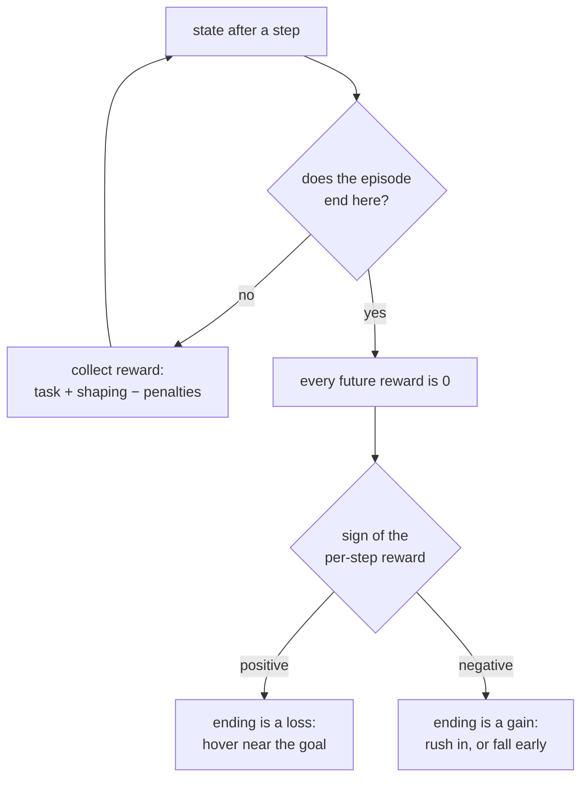

# 35 · Reward design and reward hacking

<!-- meta -->
| | |
|---|---|
| **Part** | [8 · Reinforcement learning for robots](README.md) |
| **Run type** | CPU · Mac or Colab CPU |
| **Prerequisites** | [33](33-ppo.md) |
| **Learn first** | [MDPs, States, Actions & Rewards](https://aiengineeringfromscratch.com/lesson?path=phases/09-reinforcement-learning/01-mdps-states-actions-rewards) |
| **Time** | ~60 min |
| **Code** | [`experiments/35-reward-design/experiment.py`](../experiments/35-reward-design/experiment.py) |
| **Status** | ✅ done |
<!-- /meta -->

> The agent optimizes the reward you wrote, not the task you meant. Every term, and every way an episode can end, is part of what you wrote.

## The problem

The Go2 training config sums ten reward terms with nonzero weights, from `tracking_lin_vel = 1.0` to `action_rate = -0.01` and `torques = -0.0002`, and it carries one line that exists only because of how an agent exploits rewards: `only_positive_rewards = True # if true negative total rewards are clipped at zero (avoids early termination problems)` ([`legged_robot_config.py`](https://github.com/unitreerobotics/unitree_rl_gym/blob/main/legged_gym/envs/base/legged_robot_config.py), [`go2_config.py`](https://github.com/unitreerobotics/unitree_rl_gym/blob/main/legged_gym/envs/go2/go2_config.py)). This lesson measures, on the SO-101 reach, what different reward shapes do with a fixed PPO and budget, produces a **reward hack** on purpose (a policy that scores well on the written reward without doing the task), and sweeps a smoothness penalty.

## Core idea

### In plain words

A reward is a metric, and RL is a team that optimizes the metric with no common sense at all. Pay programmers per line of code and you get long code, not good code. Pay an arm for being close to the target and end the game the moment it arrives, and it learns to hover just outside, because arriving stops the payments.

You have four kinds of building blocks. A **sparse** reward pays only on success: it says exactly what you want, but early on nobody ever succeeds, so it is silent, like a test suite with one end-to-end test that never passes yet. A **dense** reward pays a little every step for being closer: informative, but a proxy for the real goal. **Shaping** adds hints; the safe kind (potential-based) pays for progress and takes it back on retreat; over any loop the payments cancel, so it cannot be farmed by going back and forth. **Regularizers** are small penalties for jerky or expensive motion; they trade task success for smoothness.

Finally, how an episode ends is part of the reward. After the end every future reward is zero. If the per-step reward is positive, ending is a loss and the agent avoids it; if it is negative, ending is a gain and the agent seeks it.

### Where termination flips the incentive



### Shaping and termination, as code

```python
# Potential-based shaping: F = gamma * Phi(s') - Phi(s), with Phi = -20 * distance
def shaping(dist, dist_prev, gamma=0.95):
    return gamma * (-20 * dist) - (-20 * dist_prev)   # > 0 when closer; also 20*(1-gamma)*dist when standing still

# It cannot be farmed: summed along any trajectory it telescopes to the two endpoints,
#   sum_t gamma^t * F_t = gamma^T * Phi(s_T) - Phi(s_0)

# What ending the episode costs: the discounted value of staying forever
def value_of_staying(r_per_step, gamma=0.95):
    return r_per_step / (1 - gamma)   # ending forfeits this: a relief if r < 0, a loss if r > 0
```

| Term | Example (reach, distance $d$ in m) | Role |
|---|---|---|
| sparse task | $\mathbb 1[d < 0.02]$ | says exactly what success is; gives no gradient until success is found |
| dense task | $-d$ | points toward the goal at every step; defines "good" by a proxy |
| potential-based shaping | $F = \gamma\Phi(s') - \Phi(s)$ | adds guidance without changing the optimal policy |
| regularizers | $-w\lVert a_t - a_{t-1}\rVert^2$, $-w\lVert\tau\rVert^2$ | trade task performance for smoothness and energy |

$d$ is the gripper-to-target distance, $\mathbb 1[\cdot]$ is 1 when the condition holds and 0 otherwise, $\Phi$ is any function of the state (the potential), $s$ and $s'$ are the states before and after a step, $\gamma$ the discount, $w$ a penalty weight, $a_t$ the action and $\tau$ the joint torque.

<details>
<summary>Math details: why potential-based shaping is safe and why termination matters</summary>

**Potential-based shaping.** Ng, Harada and Russell showed that adding $F(s,s') = \gamma\Phi(s') - \Phi(s)$ for any potential $\Phi$ leaves the optimal policy unchanged, and that, without further knowledge of the MDP, this form is also necessary for that guarantee ([ICML 1999, pp. 278–287](https://mlanthology.org/icml/1999/ng1999icml-policy/)). Along a trajectory the shaping terms telescope, $\sum_t \gamma^t F_t = \gamma^T \Phi(s_T) - \Phi(s_0)$: every policy gets the same bonus up to terms that depend only on where it starts and ends, so shaping changes how fast you learn, not what is optimal. We use $\Phi = -20\,d$ with the PPO discount $\gamma = 0.95$.

**Termination.** A policy that could stay in a state forever while collecting $r$ per step would earn $\sum_{t\ge0}\gamma^t r = r/(1-\gamma)$. Entering a terminal state replaces that with 0. For $r > 0$ that is a loss the agent learns to avoid; for $r < 0$ it is a gain the agent learns to seek. In locomotion, falling terminates the episode, so a total made mostly of negative penalty terms makes an early fall attractive; the Go2 config clips the total at zero and names the reason "early termination problems". The reverse case is the hack we build below.

Go deeper: [MDPs, States, Actions & Rewards](https://aiengineeringfromscratch.com/lesson?path=phases/09-reinforcement-learning/01-mdps-states-actions-rewards); Ng, Harada, Russell, ICML 1999 (link above).

</details>

<!-- figure: 35-termination-hack -->

## Experiment

[`experiment.py`](../experiments/35-reward-design/experiment.py) keeps everything from lesson 33 fixed (absolute joint targets, 50 Hz, PPO reference config, 300k steps, 3 seeds × 100 evaluation episodes) and swaps the reward function passed to the env:

```python
def r_sparse(info):
    return float(info["dist"] < 0.02)

def r_pbrs(info):                       # sparse + gamma * Phi(s') - Phi(s), Phi = -20 d
    return r_sparse(info) + 0.95 * (-20 * info["dist"]) - (-20 * info["dist_prev"])

def r_closeness(info):                  # positive every step, 1 at the target
    return 1.0 - np.tanh(info["dist"] / 0.05)

def r_action_rate(w):
    return lambda info: -info["dist"] - w * np.sum((info["action"] - info["prev_action"]) ** 2)
```

**Predict:** with the closeness reward and an episode that ends the moment the gripper is within 2 cm, what will the trained arm do?

MuJoCo 3.17.0, NumPy 2.5.4, PyTorch 2.14.1 (CPU), Apple Silicon Mac (Apple M5). Deterministic per seed. The whole script (33 runs, six in parallel) took 1904 s wall-clock (about 32 minutes) on a heavily loaded machine. `python experiment.py --only close+end,pbrs` trains just those cells for all three seeds; this rerun reproduced their lines exactly. `--quick` trains seed 0 only, which reproduces the first "success per seed" entry of every row but not the pooled columns.

**A. Reward shape** (no termination; success = within 2 cm at the 1.6 s time limit):

| reward | success per seed | pooled | Wilson 95% | median final distance |
|---|---|---|---|---|
| dense $-d$ | 100 / 98 / 100 | 298/300 | 97.6–99.8% | 7.5 mm |
| sparse $\mathbb 1[d < 2\,\text{cm}]$ | 8 / 0 / 0 | 8/300 | 1.4–5.2% | 117.8 mm |
| sparse + $0.95\,\Phi(s') - \Phi(s)$, $\Phi = -20d$ | 99 / 97 / 99 | 295/300 | 96.2–99.3% | 7.8 mm |

(Median final distance: mean over the three seeds.) The sparse reward is the honest statement of the task and it fails: the initial policy rarely gets within 2 cm by chance (lesson 32: 1 of 200 random-action episodes ended there), so for most of training every reward is zero and the advantages carry no information. Adding a potential-based term restores learning to the level of the dense reward (the two intervals overlap) while, by Ng et al.'s theorem, not changing which policy is optimal for the sparse task.

**B. Reward hacking.** The episode now ends (`terminated`) the moment $d < 2$ cm, which looks like a natural way to define "reached". The reward is the positive closeness term $1 - \tanh(d / 5\,\text{cm})$:

| reward, termination | success per seed | pooled | Wilson 95% | written return | episode length | median final distance |
|---|---|---|---|---|---|---|
| closeness, ends on success | 23 / 43 / 29 | 95/300 | 26.7–37.1% | **22.67** | 62.3 steps | 28.8 mm |
| $-d$, ends on success | 99 / 100 / 98 | 297/300 | 97.1–99.7% | −0.72 | 9.2 steps | 14.7 mm |
| closeness, no termination | 98 / 100 / 100 | 298/300 | 97.6–99.8% | 64.00 | 80.0 steps | 5.1 mm |

Two control measurements make the hack explicit:

- The scripted IK controller, which reaches every target, scores a written return of only **2.28** under the closeness-plus-termination reward. The hacking policy scores 22.67: it beats the correct controller on the objective it was given by doing the task less.
- Run without termination, the same hacking policy ends at a median of **30.8 mm** from the target: it parks the gripper about 3 cm away, just outside the success ball, and collects roughly 0.45 per step for the rest of the episode.

The mechanism is the one in the diagram: entering the ball ends the episode and with it all future positive reward, so the agent learns to approach and stop short. The 95 successes are episodes in which it still ended up inside the ball. The same termination rule with a negative reward ($-d$) gives the opposite incentive: the agent hurries in (9.2 steps on average) because every step costs. Positive reward without termination also works (298/300). The hack lives in the combination, which is why it is easy to write by accident.

## Break it

Smoothness penalties are where the trade-off becomes a cliff. Sweep the weight $w$ of the action-rate term (the Go2 config uses the same term, `action_rate = -0.01`, computed as $\sum (a_{t-1} - a_t)^2$ in [`legged_robot.py`](https://github.com/unitreerobotics/unitree_rl_gym/blob/main/legged_gym/envs/base/legged_robot.py); `_prepare_reward_function` there multiplies every scale by the policy period, 0.02 s, so its per-step weight is $0.01 \times 0.02 = 0.0002$ against a velocity-tracking term of at most $1.0 \times 0.02$ per step):

| $w$ | success per seed | pooled | Wilson 95% | median final distance (mm) | torque rate (N·m/s) | power (W) |
|---|---|---|---|---|---|---|
| 0 | 100 / 98 / 100 | 298/300 | 97.6–99.8% | 7.5 | 1002 | 9.66 |
| 0.03 | 81 / 99 / 99 | 279/300 | 89.5–95.4% | 8.8 | 933 | 9.44 |
| 0.1 | 80 / 87 / 96 | 263/300 | 83.5–90.9% | 11.4 | 901 | 9.45 |
| 0.3 | 41 / 9 / 94 | 144/300 | 42.4–53.6% | 25.6 | 850 | 8.20 |
| 1.0 | 7 / 35 / 14 | 56/300 | 14.7–23.5% | 39.2 | 674 | 6.54 |
| 3.0 | 27 / 6 / 26 | 59/300 | 15.6–24.5% | 31.9 | 743 | 5.64 |


Up to $w = 0.1$ the policy loses 6 to 12 percentage points of success (279/300 and 263/300 against 298/300) and gains little smoothness (torque rate 1002 → 901 N·m/s). From $w = 0.3$ on, success collapses and the seeds disagree wildly (9 vs 94 out of 100): the penalty for moving the setpoint is now comparable to the distance reward, and the outcome depends on the seed. Power falls (9.66 → 5.64 W) largely because the arm moves less: the median final distance grows to 25.6–39.2 mm. Two lessons: a regularizer's weight must be set relative to the task term's scale (here $-d$ is a few centimetres per step), and with a stiff servo, smoothing the policy's targets barely smooths the torque. If smooth torque is the goal, change the interface or the gains (lesson 34) before raising $w$.

## On the real robot

- Penalty weights trade task success for gentler motion in simulation; whether the measured torque-rate reduction carries over depends on the real actuator. On the SO-101 it was not measured.
- A termination rule written for training is also a safety rule on hardware: on a real robot "episode ends" means a supervisor stops the motion ([lesson 15](../part-4-dynamics-and-control/15-safety.md)). The reward must not make that stop something the policy seeks or avoids for its own sake.
- The Go2 config's reward weights were tuned for its simulator and PD gains; changing either changes what those weights mean.

## Check yourself

1. **Easy.** For the closeness reward, what per-step reward does a gripper parked 3 cm from the target collect, and what does it collect after entering the success ball?
2. **Medium.** Fix the hack without removing the termination: add a terminal bonus $B$ when the episode ends by success. Estimate the $B$ that makes reaching at least as good as hovering for the remaining ~60 steps, then train three seeds and measure.
3. **Hard.** Replace the action-rate penalty by a torque-rate penalty computed inside the env at the physics rate, and repeat the sweep. Does it buy more smoothness per lost success than the action-rate term?

### Answers

1. $1 - \tanh(0.03/0.05) = 1 - \tanh(0.6) \approx 0.46$ per step; after success the episode is over, so every later reward is 0.
2. Hovering for $n$ more steps at ~0.46 per step is worth about $0.46 \sum_{t<n} 0.95^t$, which approaches $0.46/(1-0.95) \approx 9.2$ for long remainders; a bonus well above that removes the incentive. The training result is yours to measure; we did not run it.
3. Open; we did not run it.

## Takeaways and sources

- Sparse rewards state the task exactly but gave 8/300 within the budget; potential-based shaping recovered 295/300 without changing the optimal policy.
- Termination plus positive per-step reward is a measured reward hack: 95/300 success, the gripper parked ~3 cm away, and a written return (22.67) about ten times that of a controller that reaches every target (2.28). Check the sign of the reward wherever an episode can end.
- Regularizer weights fall off a cliff: action-rate weight 0.1 cost 12 percentage points (263/300), 0.3 halved success; set weights relative to the task term and measure the smoothness you actually get.

Next: [lesson 36](36-legged-locomotion.md), legged locomotion and massively parallel training.

**Sources**

- A. Y. Ng, D. Harada, S. Russell, "Policy Invariance Under Reward Transformations: Theory and Application to Reward Shaping", ICML 1999, pp. 278–287. [mlanthology](https://mlanthology.org/icml/1999/ng1999icml-policy/)
- [`unitree_rl_gym` · `legged_robot_config.py`](https://github.com/unitreerobotics/unitree_rl_gym/blob/main/legged_gym/envs/base/legged_robot_config.py), [`go2_config.py`](https://github.com/unitreerobotics/unitree_rl_gym/blob/main/legged_gym/envs/go2/go2_config.py), [`legged_robot.py`](https://github.com/unitreerobotics/unitree_rl_gym/blob/main/legged_gym/envs/base/legged_robot.py) (`_reward_action_rate`, `_reward_torques`) (BSD-3-Clause).
- J. Schulman et al., "Proximal Policy Optimization Algorithms", 2017. [arXiv 1707.06347](https://arxiv.org/abs/1707.06347)
- [Gymnasium · `Env` API](https://gymnasium.farama.org/api/env/) (terminated vs truncated).
- Code: [`experiment.py`](../experiments/35-reward-design/experiment.py), [`output.txt`](../experiments/35-reward-design/output.txt); env and PPO from [lesson 32](../experiments/32-rl-environment/reach_env.py) and [lesson 33](../experiments/33-ppo/ppo.py); figure from [`plot.py`](../experiments/35-reward-design/plot.py).
