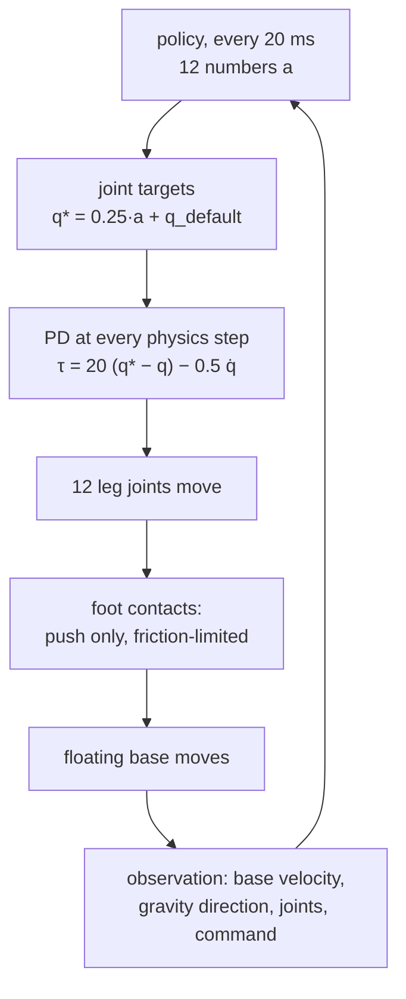

# 36 · Legged locomotion and massively parallel training

<!-- meta -->
| | |
|---|---|
| **Part** | [8 · Reinforcement learning for robots](README.md) |
| **Run type** | GPU · Colab GPU |
| **Prerequisites** | [34](34-observation-action-design.md), [35](35-reward-design.md) |
| **Learn first** | [Introduction to JAX](https://aiengineeringfromscratch.com/lesson?path=phases/03-deep-learning-core/12-intro-to-jax) · [Proximal Policy Optimization (PPO)](https://aiengineeringfromscratch.com/lesson?path=phases/09-reinforcement-learning/08-ppo) |
| **Time** | ~90 min |
| **Code** | [`experiments/36-legged-locomotion/experiment.py`](../experiments/36-legged-locomotion/experiment.py) |
| **Status** | ✅ done |
<!-- /meta -->

> A walking policy needs hundreds of millions of steps. The engineering question is where those steps come from.

## The problem

Lesson 33 trained an arm reach with 300,000 policy steps. Unitree's Go2 training configuration asks for a different order of magnitude: `num_envs = 4096` simulated robots, `num_steps_per_env = 24` per iteration and `max_iterations = 1500` ([`legged_robot_config.py`](https://github.com/unitreerobotics/unitree_rl_gym/blob/main/legged_gym/envs/base/legged_robot_config.py)), which is 147,456,000 policy steps, or 589,824,000 physics steps at `decimation = 4`. Rudin et al. showed that running thousands of robots in parallel on one workstation GPU trains a flat-terrain quadruped policy in under four minutes ([arXiv 2109.11978](https://arxiv.org/abs/2109.11978), CoRL 2021). This lesson explains what a legged robot adds to the RL problem, measures how far a CPU gets on the Go2 model, and shows how to run the GPU path with MuJoCo Playground.

## Core idea

### In plain words

An arm is bolted to the table; a dog-like robot is not. Its body (the **base**) floats: no motor holds it, and it moves only because the feet push on the floor. A foot can push but never pull, and it can push sideways only as hard as friction allows before it slips. Walking is a schedule of which feet are on the ground and which are swinging, called a **gait**. The policy never commands those foot forces. It sends joint targets, a PD loop turns them into torques, and the physics of the contacts turns the torques into forces on the body.

Learning that from trial and error takes on the order of a hundred million steps. PPO needs fresh attempts from the current policy for every update, and consecutive steps of one robot are nearly the same data. So the practical question becomes throughput, and the answer is to scale out like a stateless web service: run thousands of independent robot copies at once and step them all with one batched call.

### From policy to a moving body



### Massively parallel PPO, as code

```python
num_envs, steps_per_env = 4096, 24          # Go2 training config
obs = envs.reset()                          # shape (4096, obs_dim): one row per simulated robot
for t in range(steps_per_env):
    actions = policy(obs)                   # ONE batched network call for all robots
    obs, rewards, dones = envs.step(actions)   # ONE batched physics call (on a GPU with MJX)
samples = num_envs * steps_per_env          # 98,304 samples for this PPO update
seconds_per_robot = steps_per_env * 0.02    # while each robot advances only 0.48 s
```

| Quantity | Formula |
|---|---|
| a contact only pushes | $f_n \ge 0$ |
| friction limit | $\lVert f_t \rVert \le \mu f_n$ |
| standing still | $\sum f_n = m g$ |
| samples per update | $N_{\text{env}} \times T$ |

$f_n$ and $f_t$ are the normal and tangential (sideways) parts of a foot's contact force, $\mu$ the friction coefficient, $m$ the robot's mass, $g$ gravity, $N_{\text{env}}$ the number of parallel robots and $T$ the steps each one collects per iteration.

<details>
<summary>Math details: floating base, friction cones and why on-policy RL wants many copies</summary>

**Floating base.** The Go2 model has `nq = 19`, `nv = 18`, `nu = 12`: 12 actuated joints plus a 6-DoF base that no motor drives (`nq` is one larger than `nv` because the base orientation is stored as a 4-number quaternion). The base accelerates only through contact forces at the feet, which must lie inside the friction cone $\lVert f_t \rVert \le \mu f_n$ ([lesson 04](../part-1-simulation/04-friction.md)). In a trot, diagonal pairs of feet alternate between stance (contact) and swing.

**On-policy sampling.** PPO's update is only valid for samples from (nearly) the current policy, so old data cannot be reused across iterations. Samples from one robot are strongly correlated in time; 4096 robots give 4096 independent trajectories per update. The bottleneck becomes raw simulation throughput, which is why the physics, the policy and the PPO update all run batched on a GPU.

**MJX and MuJoCo Playground.** MJX runs MuJoCo in JAX (and a Warp version for NVIDIA GPUs); its documentation says it pays off when simulating thousands of scenes in parallel, while a single scene can be about 10× slower than CPU MuJoCo ([MJX docs](https://mujoco.readthedocs.io/en/stable/mjx.html)). MuJoCo Playground (Zakka et al., 2025, [arXiv 2502.08844](https://arxiv.org/abs/2502.08844), [playground.mujoco.org](https://playground.mujoco.org/)) builds environments and PPO training on MJX and reports training "in minutes on a single GPU". Its default locomotion PPO config uses `num_envs = 8192`; for `Go1JoystickFlatTerrain` it sets `num_timesteps = 200_000_000` ([`locomotion_params.py`](https://github.com/google-deepmind/mujoco_playground/blob/main/mujoco_playground/config/locomotion_params.py)). The Playground locomotion registry has Go1, Spot and Barkour quadrupeds, but no Go2 environment ([`locomotion/__init__.py`](https://github.com/google-deepmind/mujoco_playground/blob/main/mujoco_playground/_src/locomotion/__init__.py)).

Go deeper: [Introduction to JAX](https://aiengineeringfromscratch.com/lesson?path=phases/03-deep-learning-core/12-intro-to-jax), [Proximal Policy Optimization (PPO)](https://aiengineeringfromscratch.com/lesson?path=phases/09-reinforcement-learning/08-ppo); Rudin et al. ([arXiv 2109.11978](https://arxiv.org/abs/2109.11978)); Zakka et al. ([arXiv 2502.08844](https://arxiv.org/abs/2502.08844)).

</details>

### What the Go2 config rewards and randomizes

([`legged_robot_config.py`](https://github.com/unitreerobotics/unitree_rl_gym/blob/main/legged_gym/envs/base/legged_robot_config.py), [`go2_config.py`](https://github.com/unitreerobotics/unitree_rl_gym/blob/main/legged_gym/envs/go2/go2_config.py))

| Item | Value |
|---|---|
| velocity tracking | `tracking_lin_vel = 1.0`, `tracking_ang_vel = 0.5` |
| gait shaping | `feet_air_time = 1.0` (at touchdown, rewards swing time beyond 0.5 s, only when a velocity is commanded) |
| regularizers | `action_rate = -0.01`, `torques = -0.0002` (Go2), `dof_acc = -2.5e-7`, `collision = -1.` |
| sign handling | `only_positive_rewards = True` |
| friction randomization | `randomize_friction = True`, `friction_range = [0.5, 1.25]` |
| pushes | `push_robots = True`, every `push_interval_s = 15`, `max_push_vel_xy = 1.` |
| episode | `episode_length_s = 20`; ends early on base contact (`terminate_after_contacts_on = ["base"]`) or when roll exceeds 0.8 rad or pitch 1.0 rad (`check_termination` in [`legged_robot.py`](https://github.com/unitreerobotics/unitree_rl_gym/blob/main/legged_gym/envs/base/legged_robot.py)) |

Every row is a lesson-34 or lesson-35 decision. Randomizing friction over $[0.5, 1.25]$ means each of the 4096 robots learns on a slightly different floor (Part 9).

## Experiment

### CPU part (measured): how many Go2 steps per second?

[`experiment.py`](../experiments/36-legged-locomotion/experiment.py) loads the Menagerie Go2 (2 ms timestep, elliptic friction cones, `impratio = 100`), turns its 12 motors into PD servos with the training gains (Kp 20, Kd 0.5, torque capped at the motor limits) around the config's default joint angles, and lets it stand. Because the PD lives inside MuJoCo, a constant control vector is a valid closed-loop stance, so batches of robots can be stepped by `mujoco.rollout`, MuJoCo's C++ rollout module ([Python docs](https://mujoco.readthedocs.io/en/stable/python.html)): one `MjData` per thread, the GIL released, an internal thread pool.

```python
for i in range(m.nu):                     # motor -> PD servo, keep the torque limit
    m.actuator_gainprm[i, :3] = [KP, 0, 0]
    m.actuator_biasprm[i, :3] = [0, -KP, -KD]
    m.actuator_biastype[i] = mujoco.mjtBias.mjBIAS_AFFINE
    ...
datas = [mujoco.MjData(m) for _ in range(nthread)]
state, _ = rollout.rollout(m, datas, X0, U)   # X0: (nbatch, nstate), U: (nbatch, nstep, nu)
```

MuJoCo 3.17.0, NumPy 2.5.4, Apple Silicon Mac (Apple M5, 4 performance + 6 efficiency cores). Other jobs were running on the machine, so all rates are approximate and change noticeably from run to run; sections A and B are deterministic, and the load average (roughly, how many processes compete for the cores) is printed in the output. The script took 119 s wall-clock; `python experiment.py --quick` (one timing round, no 4096 batch) is a smoke test whose rates do not reproduce the tables.

**A. Contact basics.** After 2 s of standing: base height 26.2 cm, exactly four floor contacts (FL, FR, RL, RR), and the sum of contact normal forces is 149.2 N against $m g = 15.21\,\text{kg} \times 9.81 = 149.2$ N. The feet carry the whole weight; nothing else touches the floor.

**B. Same physics.** After 500 steps, `rollout.rollout` and a Python `mj_step` loop from the same state differ by exactly 0.0: batching changes the speed, not the result.

**C. Throughput** (Go2 standing from the settled stance, ~5·10⁴ steps per call, best of 5 round-robin rounds; load average 19 at the start, 24 at the end). Python loop over one `MjData`: 66,222 steps/s.

Wall-clock steps/s:

| nbatch | 1 thread | 2 threads | 4 threads | 8 threads |
|---|---|---|---|---|
| 1 | 53,682 | 57,408 | 54,815 | 52,672 |
| 8 | 64,102 | 151,081 | 275,833 | 488,908 |
| 64 | 73,356 | 154,889 | 240,953 | **490,195** |
| 512 | 49,779 | 100,212 | 242,904 | 428,027 |
| 4096 | 33,881 | 85,478 | 180,025 | 272,937 |

Steps per CPU-second (CPU time summed over all threads):

| nbatch | 1 thread | 2 threads | 4 threads | 8 threads |
|---|---|---|---|---|
| 1 | 80,578 | 81,863 | 78,990 | 78,729 |
| 8 | 82,577 | 84,988 | 78,202 | 70,084 |
| 64 | 88,725 | 86,335 | 73,876 | 69,250 |
| 512 | 72,782 | 71,480 | 69,633 | 62,351 |
| 4096 | 61,348 | 61,575 | 58,368 | 58,883 |


Read the two tables together:

- **The cost of one Go2 step is roughly fixed**: 58,368–88,725 steps per CPU-second in every cell, i.e. about 11–17 µs of CPU per step. Threads do not make a step cheaper (with 8 threads it gets slightly dearer: 62,351–78,729); they run more steps at once.
- **Threads need batch.** With one robot, extra threads give nothing (53,682 → 52,672). With 8 to 4096 robots, 8 threads give 6.7–8.6× the single-thread wall rate. Ratios at or above 8× most likely mean the single-thread cell got a smaller share of a machine with ~20 other runnable processes; treat the wall-clock table as approximate.
- **C++ alone is not the win.** One robot through `rollout` on one thread (53,682 steps/s) is no faster than the Python `mj_step` loop (66,222 steps/s): for a model this size the per-call Python overhead is small. The best cell (7.4× the Python loop) comes from spreading a batch over threads.
- **Very large batches cost more per step** (4096 robots: 58,368–61,575 steps per CPU-second); plausibly because `rollout` stores every state of every robot and the memory traffic grows with the batch; we did not profile it.
- **Arithmetic (section E):** the Go2 training config needs 589,824,000 physics steps. At the best rate here that is 0.3 h of physics alone on this CPU, before any policy inference or learning, with our 2 ms step instead of the config's 5 ms. And that best rate assumed 8 cores and robots that stand still.

### GPU part (procedure; we did not run it)

The official Playground locomotion notebook trains a Go1 joystick policy:

1. Open [`locomotion.ipynb` in Colab](https://colab.research.google.com/github/google-deepmind/mujoco_playground/blob/main/learning/notebooks/locomotion.ipynb).
2. *Runtime → Change runtime type → GPU*. The notebook states that a GPU runtime is required, and a check cell raises an error if `nvidia-smi` fails.
3. Run the install cells (`pip install mujoco`, `mujoco_mjx`, `brax`, `playground`, `mediapy`).
4. Run the *Quadrupedal → Joystick* section (load, config and training cells): `env_name = 'Go1JoystickFlatTerrain'`, `ppo_params = locomotion_params.brax_ppo_config(env_name)`.
5. Record, for your own report: GPU model (`nvidia-smi`), wall-clock time of the training cell, the final evaluation reward, and the rendered rollout. Then rerun with a different seed.

We report **no numbers** from this notebook: we did not run it, and the time depends on the GPU Colab assigns.

## Break it

Section C started every robot from a settled stance. Start the same 512-robot batch from the Menagerie keyframe pose with joints perturbed by ±0.1 rad, so every robot first settles onto its feet:

| start (512 robots × 25 steps, 8 threads) | steps/s | solver iterations / step | contacts |
|---|---|---|---|
| settled stance (+ small joint velocities) | 379,209 | 1.7 | 4.0 |
| released from keyframe pose, joints ±0.1 rad | 34,194 | 10.3 | 4.4 |

The same model, batch and threads run about eleven times slower. The number of contacts barely changes (4.0 vs 4.4), but the constraint solver (the part of MuJoCo that computes contact forces) needs 10.3 iterations per step instead of 1.7 while feet land and contact forces are redistributed. Per-step cost depends on what the robots are doing: impacts, slipping and falling robots, which is most of early locomotion training, cost far more than standing. A throughput benchmark run on calm robots overstates training speed, and a "speedup" measured on one scenario does not carry over to another. Benchmark with the states your training will actually visit.

## On the real robot

- The Go2 policies in `unitree_rl_gym` are trained in simulation with the gains above; Unitree's low-level example for the real Go2 stands the robot with Kp 60, Kd 5 instead ([`go2_stand_example.py`](https://github.com/unitreerobotics/unitree_sdk2_python/blob/master/example/go2/low_level/go2_stand_example.py), see [lesson 12](../part-4-dynamics-and-control/12-joint-control.md)). Training and deployment numbers are not interchangeable.
- What transfers is shaped by what was randomized: friction range, pushes, observation noise (`noise_scales` in the config). Part 9 covers latency, system identification and domain randomization.
- Nothing in this lesson was run on a real Go2. The standing test above is a simulation result; the real robot's contact forces were not measured.

## Check yourself

1. **Easy.** How many policy steps does one Go2 training iteration collect, and how many simulated seconds does each robot advance in it?
2. **Medium.** Using your own row of the table in section C, estimate how long the physics of the Go2 training config would take on your CPU. Which two factors does this estimate ignore that make the real cost higher?
3. **Hard.** Port the Go2: Menagerie ships `go2_mjx.xml` / `scene_mjx.xml`. Starting from Playground's `Go1JoystickFlatTerrain` environment, replace the model and the default pose with the Go2's (Unitree config: hip ±0.1, thigh 0.8 / 1.0, calf −1.5 rad), train on a Colab GPU, and report wall-clock and evaluation reward over 3 seeds.

### Answers

1. $4096 \times 24 = 98{,}304$ policy steps; each robot advances $24 \times 0.02$ s $= 0.48$ s.
2. On this Mac the best rate gives 0.3 h of physics alone (section E). Ignored: the policy forward pass and the PPO update, and the states visited: states with impacts, like the settling in section D, cost about eleven times more per step than standing. Also, 4096 robots per batch ran at a lower rate (272,937 steps/s) than the best cell.
3. Open; we did not run it.

## Takeaways and sources

- A legged robot is a floating base moved only by unilateral, friction-limited foot contacts; the policy commands joint targets and the gait emerges from contact physics and reward terms.
- Locomotion PPO consumes ~10⁸ policy steps (Go2 config: 147,456,000); throughput, not the algorithm, decides whether training takes minutes or days.
- On a CPU a Go2 step costs a roughly fixed 11–17 µs of CPU; threads help only when there is a batch to split, and impacts cost ~11× more per step. The next order of magnitude comes from thousands of environments on a GPU (MJX / Playground).

Next: [lesson 37](../part-9-sim-to-real/37-latency.md), the first sim-to-real gap: latency.

**Sources**

- N. Rudin, D. Hoeller, P. Reist, M. Hutter, "Learning to Walk in Minutes Using Massively Parallel Deep Reinforcement Learning", CoRL 2021. [arXiv 2109.11978](https://arxiv.org/abs/2109.11978)
- K. Zakka et al., "MuJoCo Playground", 2025. [arXiv 2502.08844](https://arxiv.org/abs/2502.08844), [playground.mujoco.org](https://playground.mujoco.org/), [code](https://github.com/google-deepmind/mujoco_playground)
- [MuJoCo · MJX documentation](https://mujoco.readthedocs.io/en/stable/mjx.html); [Python bindings · rollout](https://mujoco.readthedocs.io/en/stable/python.html).
- [`unitree_rl_gym` · `legged_robot_config.py`](https://github.com/unitreerobotics/unitree_rl_gym/blob/main/legged_gym/envs/base/legged_robot_config.py), [`go2_config.py`](https://github.com/unitreerobotics/unitree_rl_gym/blob/main/legged_gym/envs/go2/go2_config.py) (BSD-3-Clause).
- [MuJoCo Menagerie · `unitree_go2`](https://github.com/google-deepmind/mujoco_menagerie/tree/f3b6013/unitree_go2) (BSD-3-Clause).
- Code: [`experiment.py`](../experiments/36-legged-locomotion/experiment.py), [`output.txt`](../experiments/36-legged-locomotion/output.txt); figure from [`plot.py`](../experiments/36-legged-locomotion/plot.py).
