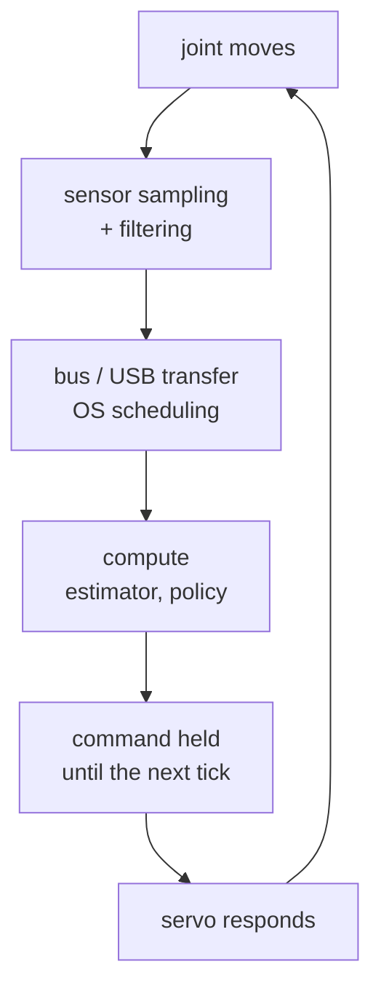

# 37 · Control rate and end-to-end latency

<!-- meta -->
| | |
|---|---|
| **Part** | [9 · Sim to real](README.md) |
| **Run type** | CPU · Mac or Colab CPU |
| **Prerequisites** | [12](../part-4-dynamics-and-control/12-joint-control.md), [17](../part-5-perception-and-estimation/17-sensors-noise-filtering.md) |
| **Learn first** | [Stochastic Processes](https://aiengineeringfromscratch.com/lesson?path=phases/01-math-foundations/22-stochastic-processes) |
| **Time** | ~45 min |
| **Code** | [`experiments/37-latency/experiment.py`](../experiments/37-latency/experiment.py) |
| **Status** | ✅ done |
<!-- /meta -->

> A feedback loop does not care where the delay comes from; it only sees the sum, and the sum has a hard limit set by the loop's own speed.

## The problem

A PD loop tuned in simulation ([lesson 12](../part-4-dynamics-and-control/12-joint-control.md)) assumes the controller sees the joint *now* and its torque acts *now*. On a real robot the reading is already old when it arrives, and the command is computed on a clock tick, sent over a bus and held until the next tick. LeRobot's recording examples run the robot loop at 30 frames per second ([LeRobot imitation-learning guide](https://huggingface.co/docs/lerobot/il_robots)), so a policy that outputs one action per frame works in 33 ms steps before any compute time is added. How much delay can a loop take, why does it go unstable instead of just "slower", and what can you do about it?

## Core idea

### In plain words

Imagine steering a car while watching the road on a screen that shows the video half a second late. On a straight road with gentle corrections you manage. Steer hard and you correct for where the car *was*: you overshoot, see it late, correct back too hard, and the weaving grows until you leave the road. The delay did not make you slower. It made your corrections arrive at the wrong moment.

A feedback controller does the same. It pushes the joint toward the target based on an old reading. A gentle loop barely notices. A stiff, fast loop has already pushed too far by the time it sees the effect, and beyond some delay every correction feeds the next swing instead of damping it.

Two facts follow. The loop only sees the *total* delay: sensor, filter, bus, compute and waiting for the next tick all add up. And the budget for that total is set by the loop itself: the faster the loop reacts, the less delay it can afford.

### The latency chain



End-to-end latency is the time once around this chain, from a physical event to the actuator's response to it:

| Stage | Source of delay |
|---|---|
| Sensing | exposure / encoder sampling, sensor-internal filtering |
| Filtering | moving average $\frac{N-1}{2}\Delta t$, low-pass $\approx\tau$ ([lesson 17](../part-5-perception-and-estimation/17-sensors-noise-filtering.md)) |
| Compute | state estimation, policy inference (a large model can take longer than one tick) |
| Communication | USB / serial bus round trips, OS scheduling |
| Sample and hold | a command computed at tick $k$ is held for a period $T$: on average $T/2$ old |
| Actuation | the servo's own response time, torque saturation |

### The delay budget, as code

Control engineers measure the budget with the *phase margin*. Every loop has a *crossover frequency* $\omega_c$: roughly how fast it corrects, the frequency at which a correction comes back exactly as large as it went out. The phase margin is the timing slack left at that frequency before corrections arrive exactly out of step and start to reinforce the error. A delay $d$ eats $\omega_c d$ of that slack. For a PD loop on one joint:

```python
from math import atan, sqrt

# Total delay the loop sees (s): just add the stages
d = t_sense + t_filter + t_bus + t_compute + T / 2   # T = 1 / control rate; add T if applied a tick late

# PD on one joint: torque = kp * (target - q) - kd * qdot
I, kp, zeta = 0.0901, 20.0, 0.7         # inertia (kg m^2), stiffness, damping ratio
kd = 2 * zeta * sqrt(kp * I)            # damping gain for that ratio

# Crossover: |kp + j*kd*w| / (I*w^2) == 1 is a quadratic in w^2
w_c = sqrt((kd**2 + sqrt(kd**4 + 4 * I**2 * kp**2)) / (2 * I**2))   # 22.99 rad/s
pm = atan(kd * w_c / kp)                # phase margin, rad (65.2 deg)
d_max = pm / w_c                        # largest total delay before it oscillates: 49.5 ms
```

| Quantity | Formula |
|---|---|
| Loop (PD on an inertia) | $L(s) = \dfrac{K_p + K_d s}{I s^2}$ |
| Crossover | $I^2\omega_c^4 = K_p^2 + K_d^2\omega_c^2$ |
| Phase margin | $\mathrm{PM} = \arctan(K_d\omega_c/K_p)$ |
| Delay margin | $d_{\max} = \mathrm{PM}/\omega_c$ |
| Delay added by a controller at rate $f$ | $T/2 = 1/(2f)$, plus $T$ per tick of compute |

$I$ is the joint inertia, $K_p$ and $K_d$ the PD gains, $s$ the Laplace variable (read it as "frequency"), $\omega_c$ the crossover frequency where the loop gain $|L|$ equals 1, PM the phase margin in radians, $d_{\max}$ the delay margin, $f$ the control rate and $T = 1/f$ its period.

Three consequences: a stiffer loop (higher $\omega_c$) tolerates *less* delay; at the limit the loop oscillates at $\omega_c$, with period $2\pi/\omega_c$; and control rate and latency are different knobs: a 1 kHz loop with 50 ms of camera delay is still a 50 ms loop.

<details>
<summary>Math details: why delay costs phase, and where T/2 comes from</summary>

**A delay is pure phase.** Delaying a signal by $d$ multiplies its Laplace transform by $e^{-sd}$. On the frequency axis $s = j\omega$, $|e^{-j\omega d}| = 1$ and its angle is $-\omega d$: the gain at every frequency is unchanged, the phase drops by $\omega d$, more at higher frequencies.

**Phase margin.** A loop with a single crossover is stable while its phase at $\omega_c$ stays above $-180°$; PM is the distance to $-180°$. The delay does not move $\omega_c$ (the gain is unchanged) but subtracts $\omega_c d$ there, so stability is lost when $\omega_c d = \mathrm{PM}$:

$$d_{\max} = \frac{\mathrm{PM}}{\omega_c}.$$

**PD on an inertia.** $|L(j\omega)| = \sqrt{K_p^2 + K_d^2\omega^2}/(I\omega^2) = 1$ is the quadratic in $\omega^2$ used in the code. The double integrator $1/(Is^2)$ contributes $-180°$ and the PD numerator gives back $\arctan(K_d\omega/K_p)$, which is PM at $\omega_c$. At constant ζ, $K_d \propto \sqrt{K_p}$ and $\omega_c \propto \sqrt{K_p}$, so PM stays the same while $d_{\max}$ shrinks as $1/\sqrt{K_p}$ (Break it: 98.9 ms at $K_p$ = 5, 49.5 ms at $K_p$ = 20).

**Sample and hold.** A zero-order hold has the transfer function $(1 - e^{-sT})/(sT)$, whose phase is exactly $-\omega T/2$: holding a command for one period acts like a delay of $T/2$. If the command computed from a reading is applied only at the next tick, add one full $T$: $3T/2$ in total.

**Assumptions.** Linear loop, one crossover, no actuator saturation. Part D shows how a saturating servo breaks the estimate.

Go deeper: [Stochastic Processes](https://aiengineeringfromscratch.com/lesson?path=phases/01-math-foundations/22-stochastic-processes) (AIEFS, signals over time); Lynch & Park, [*Modern Robotics*](https://hades.mech.northwestern.edu/index.php/Modern_Robotics), ch. 11; Tan et al., [arXiv 1804.10332](https://arxiv.org/abs/1804.10332) (latency in sim-to-real).

</details>

<!-- figure: 37-latency -->

### Three mitigations

1. **Lower the loop gain**: slower, but more margin.
2. **Predict**: integrate a model from the delayed state over the delay, using the commands already sent, and control the predicted present state (the Smith-predictor idea; exact only when the model is, part C).
3. **Plan ahead in open loop**: action chunking predicts a sequence of future actions per inference ([lesson 31](../part-7-learning-from-demonstration/31-act.md)). LeRobot's ACT defaults to `chunk_size = 100` and `n_action_steps = 100` ([`configuration_act.py`](https://github.com/huggingface/lerobot/blob/main/src/lerobot/policies/act/configuration_act.py)), and its rollout tool offers `--inference.type=rtc` "for smooth execution with slow VLA models" ([LeRobot guide](https://huggingface.co/docs/lerobot/il_robots)). Chunking trades reaction time for smoothness: while a chunk plays, the policy does not react to new observations.

## Experiment

Full script: [`experiments/37-latency/experiment.py`](../experiments/37-latency/experiment.py). MuJoCo 3.17.0, NumPy 2.5.4, Python 3.14, Apple Silicon Mac (Apple M5), deterministic, well under a minute of CPU.

**A. Delay sweep.** One joint as in lesson 12 ($I$ = 0.0901 kg·m², no gravity), $K_p$ = 20, $K_d$ = 1.879 (ζ = 0.7), physics and control at 1 kHz, step 0 → 0.5 rad. The controller reads the joint $d$ seconds late:

```python
j = max(k - nd, 0)
q_m, v_m = hist_q[j], hist_v[j]          # what the controller sees
u = kp * (TARGET - q_m) - kd * v_m
```

*Predict* with the formula: $\omega_c$ = 22.99 rad/s, PM = 65.2°, so $d_{\max}$ = 49.5 ms.

| delay [ms] | 0 | 5 | 10 | 20 | 30 | 40 | 50 | 60–100 |
|---|---|---|---|---|---|---|---|---|
| overshoot % | 4.45 | 4.47 | 4.51 | 5.02 | 11.51 | 31.23 | 215.84 | diverges |
| settle 2% [s] | 0.398 | 0.376 | 0.351 | 0.291 | 0.331 | 0.926 | never | never |


Bisection on whole milliseconds: stable at 48 ms, unstable at 49 ms. The oscillation at 49 ms has a period of 272 ms; $2\pi/\omega_c$ = 273 ms. Up to about 20 ms the delay costs almost nothing (it even shortens the settling time); the last 20 ms before the limit cost everything.

**B. Control rate.** Same joint, no added delay, controller at $f$ Hz with zero-order hold (physics stays at 1 kHz). Second variant: the command is ready one tick later. Last two columns: part A's overshoot at the equivalent delays $T/2$ and $3T/2$.

| rate [Hz] | T [ms] | overshoot % | + 1 tick compute | A at T/2 | A at 3T/2 |
|---|---|---|---|---|---|
| 1000 | 1.0 | 4.45 | 4.46 | 4.45 | 4.46 |
| 100 | 10.0 | 4.48 | 4.61 | 4.47 | 4.62 |
| 50 | 20.0 | 4.55 | 10.31 | 4.51 | 11.51 |
| 30 | 33.3 | 4.75 | 78.07 (unstable) | 4.72 | 215.84 |
| 20 | 50.0 | 5.34 | diverges | 6.66 | diverges |
| 10 | 100.0 | diverges | diverges | 215.84 | diverges |

The $T/2$ and $3T/2$ rules predict the trend: 30 Hz with immediate application behaves like 17 ms of delay (fine); the same 30 Hz with one tick of compute latency behaves like 50 ms and is past the limit.

**C. Prediction.** At $d$ = 40 ms, predict the present state by integrating $I\ddot q = \tau$ over the delay from the delayed reading, with the torques already sent:

| controller | overshoot % | settle 2% [s] |
|---|---|---|
| no delay (reference) | 4.45 | 0.398 |
| delay, no prediction | 31.23 | 0.926 |
| delay + prediction, exact model | 4.45 | 0.398 |
| inertia +50% in the model | 0.00 | 0.223 |
| inertia −30% in the model | 9.44 | 0.491 |
| assumed delay 20 ms (true 40) | 4.70 | 0.300 |

With an exact model and no disturbances, prediction removes the delay completely. With a wrong model it still helps here, but it changes the closed-loop response: knowing the delay and the dynamics (lesson 38) is what makes prediction safe.

**D. SO-101 at 30 Hz.** Menagerie SO-101, `shoulder_pan` servo (2 ms step). An outer "policy" loop at 30 Hz nudges the servo target from delayed readings: `target += K*T*(goal - q_delayed)`, $K$ = 10 s⁻¹. For an ideal servo, this integrator with delay is unstable when $K(d + T/2) > \pi/2$, i.e. above 140 ms (exact discrete-time analysis: from 5 ticks = 167 ms). The model servo is not ideal: alone, it reaches 50% of a 0.02 / 0.10 / 0.50 rad step after 18 / 44 / 110 ms. It *saturates* (hits its torque limit) on every one of these steps: with $k_p$ = 998 N·m/rad, only 2.94/998 ≈ 3 mrad of error already demands its full 2.94 N·m. The move is then acceleration-limited, and a larger step takes longer.

| delay [ms] | 0 | 33 | 50 | 67 | 100 | 117 | 133 |
|---|---|---|---|---|---|---|---|
| goal 0.1 rad: overshoot % | 0.0 | 0.1 | 12.3 | 30.8 | 70.9 | 80.8 | 94.7 |
| goal 0.1 rad: late \|e\|/goal | 0.000 | 0.000 | 0.000 | 0.000 | 0.001 | 0.004 | 0.267 |
| goal 0.5 rad: overshoot % | 36.3 | 69.1 | 146.9 | 290.3 | 290.0 | 289.7 | 289.9 |
| goal 0.5 rad: late \|e\|/goal | 0.000 | 0.000 | 1.744 | 2.903 | 3.391 | 3.493 | 2.899 |

For small corrections the loop keeps oscillating only at 133 ms, close to the ideal-servo estimate. For a 0.5 rad move it already fails at 50 ms: the saturated servo adds its own, amplitude-dependent delay.

## Break it

Fix the delay at 30 ms and make the PD loop stiffer at constant ζ = 0.7 (right panel of the figure above):

| $K_p$ | 5 | 10 | 20 | 40 | 80 | 160 |
|---|---|---|---|---|---|---|
| $\omega_c$ [rad/s] | 11.49 | 16.25 | 22.99 | 32.51 | 45.97 | 65.01 |
| $d_{\max}$ [ms] | 98.9 | 70.0 | 49.5 | 35.0 | 24.7 | 17.5 |
| overshoot % | 4.73 | 5.30 | 11.51 | 37.78 | diverges | diverges |

The damping ratio is the same in every row, yet the loop dies at $K_p$ = 80. Stiffness raises $\omega_c$, and the same 30 ms then costs $\omega_c \cdot d$ of phase. The formula predicts the failing rows exactly (24.7 and 17.5 ms are below 30 ms). Gains tuned in a zero-delay simulation are tuned for a loop that does not exist.

## On the real robot

- **Measure the latency, do not guess it.** LeRobot's SO-101 follower times each `Present_Position` bus read and each camera read in `get_observation` and logs them at debug level ([`so_follower.py`](https://github.com/huggingface/lerobot/blob/main/src/lerobot/robots/so_follower/so_follower.py)). With `max_relative_target` set, `send_action` adds another bus read, and a code comment warns of a slower loop. Procedure for the end-to-end number: command a step on one joint, log command time and `Present_Position` time stamps, and take the time until the reading starts to move. Not yet measured on the real arm.
- **The servo runs its own inner loop.** As in part D, the policy closes a slow outer loop around a fast position servo. Latency in that outer loop costs reaction time for absolute-position actions, and stability when the policy reacts to its own delayed observations (visual servoing, corrections).
- **Simulate the latency you will have.** Tan et al. simulate latency, together with system identification and an actuator model, to transfer quadruped gaits from simulation ([arXiv 1804.10332](https://arxiv.org/abs/1804.10332)). Put the measured delay into the training simulator (lesson 39) rather than tuning at zero delay.

## Check yourself

1. **Easy.** A camera pipeline adds 40 ms, the policy runs at 20 Hz and its output is applied one tick after the frame. Estimate the total delay with the $T/2$ rule.
2. **Medium.** Using $d_{\max} = \mathrm{PM}/\omega_c$, explain why part B's 30 Hz loop with one tick of compute fails while part A at 40 ms survives.
3. **Hard.** In part C, replace the exact predictor's model with one that ignores the motor command (pure extrapolation $q + \dot q\,d$). Predict, then run: overshoot at 40 ms?

### Answers

1. 40 ms + 50 ms (one tick of compute) + 25 ms (hold) = 115 ms.
2. One tick of compute plus hold at 30 Hz is about $3T/2$ = 50 ms, past the 49.5 ms margin; part A's 40 ms is inside it (31.23% overshoot, stable).
3. 15.15% overshoot, between the exact predictor (4.45%) and no prediction (31.23%), but settling takes 1.902 s, longer than with no prediction (0.926 s): extrapolating with the delayed velocity ignores the acceleration the controller itself commanded during the delay. Row "extrapolation" in part C of `output.txt`.

## Takeaways and sources

- Delay removes phase $\omega d$; the loop survives up to $d_{\max} = \mathrm{PM}/\omega_c$ (predicted 49.5 ms, measured 48–49 ms, oscillating at the predicted 273 ms period).
- Control rate adds about $T/2$ of delay, plus $T$ for each tick of compute latency: 30 Hz is fine with immediate application and unstable with one tick of compute in this loop.
- Prediction with a correct model removes the delay (31.23% → 4.45% overshoot); stiffer loops and saturating actuators tolerate less delay.

Next: [lesson 38 · System identification](38-system-identification.md).

Sources:
- [LeRobot · Imitation learning on real-world robots](https://huggingface.co/docs/lerobot/il_robots) (30 fps examples, `lerobot-rollout`, `--inference.type=rtc`; read 2026-10-27).
- LeRobot [`configuration_act.py`](https://github.com/huggingface/lerobot/blob/main/src/lerobot/policies/act/configuration_act.py), [`so_follower.py`](https://github.com/huggingface/lerobot/blob/main/src/lerobot/robots/so_follower/so_follower.py) (Apache-2.0).
- J. Tan et al., [Sim-to-Real: Learning Agile Locomotion For Quadruped Robots](https://arxiv.org/abs/1804.10332), 2018.
- T. Zhao et al., [Learning Fine-Grained Bimanual Manipulation with Low-Cost Hardware](https://arxiv.org/abs/2304.13705) (ACT), 2023.
- [MuJoCo Menagerie · robotstudio_so101](https://github.com/google-deepmind/mujoco_menagerie/tree/f3b6013/robotstudio_so101) (Apache-2.0).
- Lynch & Park, [*Modern Robotics*](https://hades.mech.northwestern.edu/index.php/Modern_Robotics), ch. 11.
- All measured numbers: [`experiments/37-latency/output.txt`](../experiments/37-latency/output.txt).
