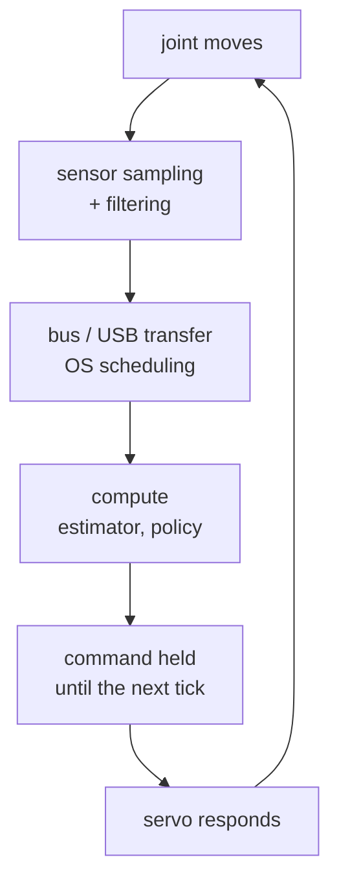
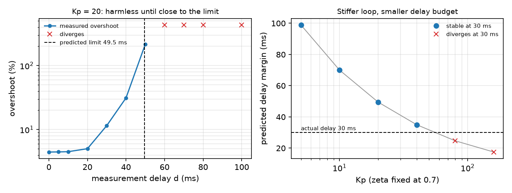

# 37 · Control rate and end-to-end latency

<!-- meta -->
| | |
|---|---|
| **Part** | [9 · Sim to real](README.md) |
| **Run type** | CPU · Mac or Colab CPU |
| **Prerequisites** | [12](../part-4-dynamics-and-control/12-joint-control.md), [17](../part-5-perception-and-estimation/17-sensors-noise-filtering.md) |
| **Learn first** | [Stochastic Processes](https://aiengineeringfromscratch.com/lesson?path=phases/01-math-foundations/22-stochastic-processes) |
| **Time** | ~45 min |
| **Code** | [`experiments/37-latency/experiment.py`](../experiments/37-latency/experiment.py) |
| **Status** | ✅ done |
<!-- /meta -->

> A feedback loop does not care where the delay comes from; it only sees the sum, and the sum has a hard limit set by the loop's own speed.

## The problem

A PD loop tuned in simulation ([lesson 12](../part-4-dynamics-and-control/12-joint-control.md)) assumes the controller sees the joint *now* and its torque acts *now*. On a real robot the reading is old when it arrives, and the command is computed on a clock tick, sent over a bus and held until the next tick. LeRobot's recording examples run the robot loop at 30 frames per second ([guide](https://huggingface.co/docs/lerobot/il_robots)): 33 ms steps before any compute time. How much delay can a loop take, why does it go unstable instead of "slower", and what helps?

## Core idea

### In plain words

Imagine steering a car by watching the road on a screen half a second late. With gentle corrections you manage. Steer hard and you correct for where the car *was*: you overshoot, see it late, correct back too hard, and the weaving grows until you leave the road. The delay did not make you slower; it made your corrections arrive at the wrong moment.

A feedback controller does the same: it pushes the joint based on an old reading. A gentle loop barely notices; a stiff, fast loop has already pushed too far when it sees the effect, and beyond some delay every correction feeds the next swing. The loop only sees the *total* delay (sensor, filter, bus, compute, waiting for the next tick), and the budget for that total is set by the loop itself: the faster it reacts, the less delay it can afford.

### The latency chain



End-to-end latency is the time once around this chain: sensing (exposure, encoder sampling), filtering (a moving average adds $\frac{N-1}{2}\Delta t$, [lesson 17](../part-5-perception-and-estimation/17-sensors-noise-filtering.md)), compute (a large model can take longer than a tick), bus round trips and OS scheduling, sample and hold (on average $T/2$), and the servo's own response.

### The delay budget, as code

Control engineers measure the budget with the *phase margin*. Every loop has a *crossover frequency* $\omega_c$: roughly how fast it corrects, the frequency at which a correction comes back exactly as large as it went out. The phase margin is the timing slack left there before corrections arrive exactly out of step and reinforce the error. A delay $d$ eats $\omega_c d$ of that slack. For a PD loop on one joint (Build it writes `pd_delay_margin`):

```python
d = t_sense + t_filter + t_bus + t_compute + T / 2   # total delay (s); T = 1 / rate, add T if applied a tick late
kd = 2 * zeta * sqrt(kp * I)                         # I = 0.0901 kg m^2, kp = 20, zeta = 0.7 -> kd = 1.879
w_c, pm, d_max = pd_delay_margin(I, kp, kd)          # 22.99 rad/s, 65.2 deg, 49.5 ms
```

| Quantity | Formula |
|---|---|
| Loop (PD on an inertia) | $L(s) = \dfrac{K_p + K_d s}{I s^2}$ |
| Crossover | $I^2\omega_c^4 = K_p^2 + K_d^2\omega_c^2$ |
| Phase margin | $\mathrm{PM} = \arctan(K_d\omega_c/K_p)$ |
| Delay margin | $d_{\max} = \mathrm{PM}/\omega_c$ |
| Delay added by a controller at rate $f$ | $T/2 = 1/(2f)$, plus $T$ per tick of compute |

$I$ is the joint inertia, $K_p$, $K_d$ the PD gains, $s$ the Laplace variable (read it as "frequency"), $\omega_c$ the frequency where $|L| = 1$, PM in radians, $f$ the control rate and $T = 1/f$.

Consequences: a stiffer loop (higher $\omega_c$) tolerates *less* delay; at the limit it oscillates with period $2\pi/\omega_c$; and a 1 kHz loop with 50 ms of camera delay is still a 50 ms loop.

<details>
<summary>Math details: why delay costs phase, and where T/2 comes from</summary>

**A delay is pure phase.** Delaying by $d$ multiplies the Laplace transform by $e^{-sd}$; at $s = j\omega$ its gain is 1 and its angle $-\omega d$.

**Phase margin.** A loop with one crossover is stable while its phase at $\omega_c$ stays above $-180°$; PM is the distance to $-180°$. The delay does not move $\omega_c$ but subtracts $\omega_c d$ there, so stability is lost when $\omega_c d = \mathrm{PM}$:

$$d_{\max} = \frac{\mathrm{PM}}{\omega_c}.$$

**PD on an inertia.** $|L(j\omega)| = 1$ is a quadratic in $\omega^2$. The double integrator contributes $-180°$, the PD numerator gives back $\arctan(K_d\omega/K_p)$: that is PM at $\omega_c$. At constant ζ, $K_d \propto \sqrt{K_p}$ and $\omega_c \propto \sqrt{K_p}$, so PM stays the same while $d_{\max}$ shrinks as $1/\sqrt{K_p}$ (Break it: 98.9 ms at $K_p$ = 5, 49.5 ms at $K_p$ = 20).

**Sample and hold.** A zero-order hold, $(1 - e^{-sT})/(sT)$, has phase exactly $-\omega T/2$: a delay of $T/2$. Applying the command only at the next tick adds one $T$: $3T/2$ in total.

**Assumptions.** Linear loop, one crossover, no saturation (part D breaks the last one).

Go deeper: [Stochastic Processes](https://aiengineeringfromscratch.com/lesson?path=phases/01-math-foundations/22-stochastic-processes) (AIEFS, signals over time); Lynch & Park, [*Modern Robotics*](https://hades.mech.northwestern.edu/index.php/Modern_Robotics), ch. 11; Tan et al., [arXiv 1804.10332](https://arxiv.org/abs/1804.10332) (latency in sim-to-real).

</details>

<!-- figure: 37-latency -->

### Three mitigations

1. **Lower the loop gain**: slower, but more margin.
2. **Predict**: integrate a model over the delay from the delayed state with the commands already sent, and control the predicted present (the Smith-predictor idea; exact only when the model is, part C).
3. **Plan ahead in open loop**: action chunking predicts several future actions per inference ([lesson 31](../part-7-learning-from-demonstration/31-act.md)); LeRobot's ACT defaults to `chunk_size = 100`, `n_action_steps = 100` ([`configuration_act.py`](https://github.com/huggingface/lerobot/blob/main/src/lerobot/policies/act/configuration_act.py)). While a chunk plays, the policy does not react to new observations.

## Build it

You will now write the delayed loop yourself. The joint is lesson 12's `simulate_joint` from [`physai/control.py`](../physai/control.py), so every trajectory can be compared with the Experiment's MuJoCo loop sample by sample. The finished code is in [`physai/sim2real.py`](../physai/sim2real.py); `uv run python experiments/37-latency/build.py` runs the five steps (output in [`build_output.txt`](../experiments/37-latency/build_output.txt)).

### Step 1 · A delay line

A delay is a queue: push the newest reading, read the oldest. Until it has filled, it returns the first value.

```python
class DelayLine:
    """Returns the value pushed n ticks ago (the first value until the line has filled)."""

    def __init__(self, n, x0):
        self.buf = deque([x0] * (n + 1), maxlen=n + 1)

    def __call__(self, x):
        self.buf.append(x)
        return self.buf[0]
```

```text
== Step 1. A delay line of 3 ticks ==
pushed  [1, 2, 3, 4, 5, 6, 7, 8]
read    [0, 0, 0, 1, 2, 3, 4, 5]
equals the history shifted by 3 (first value until filled): True
```

### Step 2 · The delay budget

```python
def pd_delay_margin(inertia, kp, kd):
    """Crossover w_c (rad/s), phase margin (rad) and delay margin PM / w_c (s) of PD on an inertia."""
    w_c = np.sqrt((kd**2 + np.sqrt(kd**4 + 4 * inertia**2 * kp**2)) / (2 * inertia**2))   # |L(j w_c)| = 1
    pm = np.arctan2(kd * w_c, kp)                  # the PD numerator's phase lead at w_c
    return w_c, pm, pm / w_c
```

```text
== Step 2. The delay budget of PD on an inertia ==
Kd = 1.879: w_c = 22.99 rad/s, PM = 65.2 deg, d_max = PM / w_c = 49.5 ms
|L(j w_c)| = 1.000000000000, phase of L = -114.8 deg = -180 + PM
np.roots of the crossover quartic: w = 22.9855 rad/s (ours 22.9855)
|characteristic equation| at s = j w_c, d = d_max: 7.3e-15 (a pole sits on the imaginary axis)
oscillation period at the boundary 2 pi / w_c = 273 ms
```

The check needs no simulation: at $d = d_{\max}$ the delayed characteristic equation $Is^2 + (K_p + K_d s)e^{-sd} = 0$ has a root at $s = j\omega_c$, a pole on the imaginary axis.

### Step 3 · PD that sees the past

The controller is a callable object, so `simulate_joint(torque_fn, …)` runs it unchanged. `see` returns what the controller sees; the clock is for Step 4.

```python
class DelayedPD:
    """PD on one joint that sees it nd ticks late, recomputes every `period` s (None: every tick) and holds
    the command in between; late=True applies each command one controller tick after computing it."""

    def __init__(self, kp, kd, target, dt, nd=0, period=None, late=False):
        self.kp, self.kd, self.target, self.dt, self.nd = kp, kd, target, dt, nd
        self.period, self.late = period, late
        self.k, self.next_tick, self.u, self.queued, self.line, self.sent = 0, 0.0, 0.0, 0.0, None, []

    def see(self, q, qd):
        """What the controller sees at this tick: the reading from nd ticks ago."""
        if self.line is None:
            self.line = DelayLine(self.nd, (q, qd))
        return self.line((q, qd))

    def __call__(self, q, qd):
        q_m, qd_m = self.see(q, qd)
        if self.period is None or self.k * self.dt >= self.next_tick - 1e-12:   # a controller tick
            self.next_tick += self.period or 0.0
            u = self.kp * (self.target - q_m) - self.kd * qd_m
            self.u, self.queued = (self.queued, u) if self.late else (u, u)
        self.k += 1
        self.sent.append(self.u)                   # torque applied during this tick
        return self.u
```

Overshoot and stability follow the Experiment's definitions:

```python
def overshoot(q, target):
    """Overshoot past a positive step target in percent; None if the run diverged (|q| > 50)."""
    if not np.all(np.abs(q) < 50):
        return None
    return max(0.0, (q.max() - target) / target * 100)
```

```python
def is_stable(q, target):
    """Stable if the run stayed bounded and the late error (last quarter) is below 90% of the error in the
    second quarter, or below 1 mrad: a decaying response, not a sustained or growing oscillation."""
    if overshoot(q, target) is None:
        return False
    e, n = np.abs(q - target), len(q)
    late, early = e[3 * n // 4:].max(), e[n // 4:n // 2].max()
    return late < 0.9 * early or late < 1e-3
```

```text
== Step 3. Delayed PD by hand vs the Experiment's MuJoCo loop ==
delay ms    ours %  stable  max |q_ours - q_mujoco|
       0      4.45     yes                  1.1e-16
      10      4.51     yes                  2.1e-17
      20      5.02     yes                  1.1e-16
      30     11.51     yes                  5.6e-17
      40     31.23     yes                  5.6e-17
      50    215.84      NO                  7.3e-15
      60  diverges      NO                  5.7e-14
stability boundary: stable at 48 ms, unstable at 49 ms (predicted d_max 49.5 ms)
```

Your loop and MuJoCo's agree to round-off at every delay, and the bisection lands where the Experiment's did.

### Step 4 · Control rate

With `period` set, the controller recomputes only on its ticks and holds the command; `late=True` applies each command one tick late. The last two columns are pure delays of $T/2$ and $3T/2$.

```text
== Step 4. Control rate: sample and hold, and one tick of compute ==
rate Hz   T ms    hold %  +1 tick %  delay T/2 %  delay 3T/2 %
   1000    1.0      4.45       4.46         4.45          4.46
    100   10.0      4.48       4.61         4.47          4.62
     50   20.0      4.55      10.31         4.51         11.51
     30   33.3      4.75      78.07         4.72        215.84
     20   50.0      5.34   diverges         6.66      diverges
     10  100.0  diverges   diverges       215.84      diverges
30 Hz hold, ours vs the Experiment's MuJoCo loop: max diff 1.1e-16 rad
```

### Step 5 · Predict over the delay

The predictor overrides `see`: from the delayed reading it integrates $I\ddot q = \tau$ with the torques already sent.

```python
class PredictivePD(DelayedPD):
    """DelayedPD that integrates the model I qdd = tau over the assumed delay (model_nd ticks) from the delayed
    reading, with the torques it already sent, and controls that predicted present state."""

    def __init__(self, kp, kd, target, dt, nd, model_inertia, model_nd):
        super().__init__(kp, kd, target, dt, nd)
        self.model_inertia, self.model_nd = model_inertia, model_nd

    def see(self, q, qd):
        q_m, qd_m = super().see(q, qd)
        j = max(self.k - self.nd, 0)               # tick of the reading
        for i in range(j, min(j + self.model_nd, self.k)):
            qd_m += self.sent[i] / self.model_inertia * self.dt   # same semi-implicit Euler as the plant
            q_m += qd_m * self.dt
        return q_m, qd_m
```

```text
== Step 5. Predict the present state over a 40 ms delay ==
controller                         overshoot %
no delay                                  4.45
delay, no prediction                     31.23
prediction, exact model                   4.45
prediction, inertia +50%                  0.00
prediction, inertia -30%                  9.44
prediction, assumed delay 20 ms           4.70
exact prediction vs no delay: max |q difference| = 0.0e+00 rad
inertia +50%, ours vs the Experiment's MuJoCo loop: max diff 5.6e-17 rad
```

With the exact model the prediction is the true present, so the loop retraces the delay-free one bit for bit; the wrong models reproduce part C.

### What you keep

`physai.sim2real` now has `DelayLine`, `pd_delay_margin`, `DelayedPD`, `PredictivePD`, `overshoot` and `is_stable`; lesson 38 identifies a delay, lesson 39 trains through one. [`tests/test_37_latency.py`](../tests/test_37_latency.py) pins them to MuJoCo and SciPy: `uv run pytest tests/test_37_latency.py`.

## Use it

MuJoCo 3.17 holds the delay inside the model: actuators and sensors accept `delay` with a history buffer of `nsample` samples (`interp`: zero-order hold, linear or cubic; [XML reference](https://mujoco.readthedocs.io/en/stable/XMLreference.html)). SciPy's frequency response gives the crossover numerically.

```xml
<actuator><motor joint="j" delay="0.039" nsample="39"/></actuator>
<sensor><jointpos joint="j" delay="0.039" nsample="39"/></sensor>   <!-- or delay the readings -->
```

```python
loop = signal.TransferFunction([kd, kp], [I, 0, 0])
w_c = optimize.brentq(lambda w: abs(signal.freqresp(loop, [w])[1][0]) - 1, 1.0, 1000.0)
```

```text
== Use it. MuJoCo's own delay buffer, SciPy's frequency response ==
MuJoCo model                                 overshoot %  ours, delay  ours %
no delay attribute                                  4.46         1 ms    4.46
sensors delay="0.039" nsample="39"                 31.23        40 ms   31.23
motor delay="0.039" nsample="39"                   31.23        40 ms   31.23
sensor delay 39 ms + reading sensordata after mj_step vs ours at 40 ms: max diff 5.6e-17 rad
SciPy freqresp + brentq: w_c = 22.9855 rad/s, PM = 65.16 deg, d_max = 49.47 ms (ours 22.9855, 65.16, 49.47)
```

Why 39 ms and not 40: `d.sensordata` read after `mj_step` is already one tick old (the "no delay attribute" row behaves like 1 ms). A delayed motor shifts the whole response; the overshoot is the same.

| Tool | Call | Returns |
|---|---|---|
| physai | `pd_delay_margin(I, kp, kd)` | $\omega_c$ (rad/s), PM (rad), $d_{\max}$ (s) |
| python-control | `margin(sys)` | gain margin, PM **in degrees**, phase-crossover, gain-crossover frequency ([docs](https://python-control.readthedocs.io/en/latest/generated/control.margin.html)) |
| MATLAB | `allmargin(sys)` | `PhaseMargin` (degrees), `PMFrequency`, `DelayMargin` (sample periods for discrete-time models) ([docs](https://www.mathworks.com/help/control/ref/dynamicsystem.allmargin.html)) |

Traps:

- **Stale sensors.** `sensordata` is computed before integration; read after `mj_step`, it is one step old, and that tick counts.
- **Degrees vs radians.** $d_{\max} = \mathrm{PM}/\omega_c$ needs PM in radians.
- **Which crossover.** The delay margin uses the *gain* crossover ($|L| = 1$); tools also return a phase crossover, often in the neighbouring slot.

## Experiment

Full script: [`experiments/37-latency/experiment.py`](../experiments/37-latency/experiment.py). MuJoCo 3.17.0, NumPy 2.5.4, Python 3.14, Apple Silicon Mac (Apple M5), deterministic, well under a minute of CPU.

**A. Delay sweep.** One joint as in lesson 12 ($I$ = 0.0901 kg·m², no gravity), $K_p$ = 20, $K_d$ = 1.879 (ζ = 0.7), physics and control at 1 kHz, step 0 → 0.5 rad. The controller reads the joint $d$ seconds late (the loop of Build it, Step 3). *Predict* with the formula: $\omega_c$ = 22.99 rad/s, PM = 65.2°, so $d_{\max}$ = 49.5 ms.

| delay [ms] | 0 | 5 | 10 | 20 | 30 | 40 | 50 | 60–100 |
|---|---|---|---|---|---|---|---|---|
| overshoot % | 4.45 | 4.47 | 4.51 | 5.02 | 11.51 | 31.23 | 215.84 | diverges |
| settle 2% [s] | 0.398 | 0.376 | 0.351 | 0.291 | 0.331 | 0.926 | never | never |



Bisection on whole milliseconds: stable at 48 ms, unstable at 49 ms, oscillating with a period of 272 ms ($2\pi/\omega_c$ = 273 ms). Up to about 20 ms the delay costs almost nothing; the last 20 ms before the limit cost everything.

**B. Control rate.** Same joint, no added delay, controller at $f$ Hz with zero-order hold (physics stays at 1 kHz). Second variant: the command is ready one tick later. Last two columns: part A at $T/2$ and $3T/2$.

| rate [Hz] | T [ms] | overshoot % | + 1 tick compute | A at T/2 | A at 3T/2 |
|---|---|---|---|---|---|
| 1000 | 1.0 | 4.45 | 4.46 | 4.45 | 4.46 |
| 100 | 10.0 | 4.48 | 4.61 | 4.47 | 4.62 |
| 50 | 20.0 | 4.55 | 10.31 | 4.51 | 11.51 |
| 30 | 33.3 | 4.75 | 78.07 (unstable) | 4.72 | 215.84 |
| 20 | 50.0 | 5.34 | diverges | 6.66 | diverges |
| 10 | 100.0 | diverges | diverges | 215.84 | diverges |

The rules predict the trend: 30 Hz applied at once behaves like 17 ms of delay (fine), with one tick of compute like 50 ms (past the limit).

**C. Prediction** at $d$ = 40 ms (the predictor of Build it, Step 5):

| controller | overshoot % | settle 2% [s] |
|---|---|---|
| no delay (reference) | 4.45 | 0.398 |
| delay, no prediction | 31.23 | 0.926 |
| delay + prediction, exact model | 4.45 | 0.398 |
| inertia +50% in the model | 0.00 | 0.223 |
| inertia −30% in the model | 9.44 | 0.491 |
| assumed delay 20 ms (true 40) | 4.70 | 0.300 |

With an exact model and no disturbances, prediction removes the delay completely; a wrong model still helps here but changes the response. Knowing the delay and the dynamics (lesson 38) is what makes prediction safe.

**D. SO-101 at 30 Hz.** Menagerie SO-101, `shoulder_pan` servo (2 ms step). An outer "policy" loop at 30 Hz nudges the servo target from delayed readings: `target += K*T*(goal - q_delayed)`, $K$ = 10 s⁻¹. For an ideal servo, this integrator with delay is unstable when $K(d + T/2) > \pi/2$, above 140 ms (discrete-time analysis: from 5 ticks = 167 ms). The model servo is not ideal: alone, it reaches 50% of a 0.02 / 0.10 / 0.50 rad step after 18 / 44 / 110 ms, because it *saturates* on every step: with $k_p$ = 998 N·m/rad, 2.94/998 ≈ 3 mrad of error already demands its full 2.94 N·m, so a larger step takes longer.

| delay [ms] | 0 | 33 | 50 | 67 | 100 | 117 | 133 |
|---|---|---|---|---|---|---|---|
| goal 0.1 rad: overshoot % | 0.0 | 0.1 | 12.3 | 30.8 | 70.9 | 80.8 | 94.7 |
| goal 0.1 rad: late \|e\|/goal | 0.000 | 0.000 | 0.000 | 0.000 | 0.001 | 0.004 | 0.267 |
| goal 0.5 rad: overshoot % | 36.3 | 69.1 | 146.9 | 290.3 | 290.0 | 289.7 | 289.9 |
| goal 0.5 rad: late \|e\|/goal | 0.000 | 0.000 | 1.744 | 2.903 | 3.391 | 3.493 | 2.899 |

Small corrections keep oscillating only at 133 ms, near the ideal-servo estimate; a 0.5 rad move fails at 50 ms: the saturated servo adds its own, amplitude-dependent delay.

## Break it

Fix the delay at 30 ms and make the PD loop stiffer at constant ζ = 0.7 (right panel of the figure above):

| $K_p$ | 5 | 10 | 20 | 40 | 80 | 160 |
|---|---|---|---|---|---|---|
| $\omega_c$ [rad/s] | 11.49 | 16.25 | 22.99 | 32.51 | 45.97 | 65.01 |
| $d_{\max}$ [ms] | 98.9 | 70.0 | 49.5 | 35.0 | 24.7 | 17.5 |
| overshoot % | 4.73 | 5.30 | 11.51 | 37.78 | diverges | diverges |

The damping ratio is the same in every row, yet the loop dies at $K_p$ = 80: stiffness raises $\omega_c$, and the same 30 ms costs $\omega_c d$ of phase. The formula predicts the failing rows exactly (24.7 and 17.5 ms are below 30 ms). Gains tuned in a zero-delay simulation are tuned for a loop that does not exist.

## On the real robot

- **Measure the latency, do not guess it.** LeRobot's SO-101 follower times each bus and camera read in `get_observation` and logs them at debug level ([`so_follower.py`](https://github.com/huggingface/lerobot/blob/main/src/lerobot/robots/so_follower/so_follower.py)). Procedure: command a step on one joint, log command and `Present_Position` time stamps, take the time until the reading moves. Not yet measured on the real arm.
- **The servo runs its own inner loop** (part D): outer-loop latency costs reaction time, and stability when the policy reacts to its own delayed observations.
- **Simulate the latency you will have** ([Tan et al.](https://arxiv.org/abs/1804.10332) did, with system identification and an actuator model): put the measured delay into the training simulator (lesson 39), for example with MuJoCo's `delay` attribute.

## Check yourself

1. **Easy.** A camera pipeline adds 40 ms, the policy runs at 20 Hz and its output is applied one tick after the frame. Estimate the total delay with the $T/2$ rule.
2. **Medium.** Using $d_{\max} = \mathrm{PM}/\omega_c$, explain why part B's 30 Hz loop with one tick of compute fails while part A at 40 ms survives.
3. **Hard.** In part C, replace the exact predictor's model with one that ignores the motor command (pure extrapolation $q + \dot q\,d$). Predict, then run: overshoot at 40 ms?

### Answers

1. 40 ms + 50 ms (one tick of compute) + 25 ms (hold) = 115 ms.
2. One tick of compute plus hold at 30 Hz is about $3T/2$ = 50 ms, past the 49.5 ms margin; part A's 40 ms is inside it (31.23% overshoot, stable).
3. 15.15% overshoot, between exact prediction (4.45%) and none (31.23%), but settling takes 1.902 s (no prediction: 0.926 s): extrapolation ignores the acceleration the controller commanded during the delay. Row "extrapolation" in part C of `output.txt`.

## Takeaways and sources

- Delay removes phase $\omega d$; the loop survives up to $d_{\max} = \mathrm{PM}/\omega_c$ (predicted 49.5 ms, measured 48–49 ms, oscillating at the predicted 273 ms period).
- Control rate adds about $T/2$, plus $T$ per tick of compute: here 30 Hz is fine applied at once, unstable with one tick of compute.
- Prediction with a correct model removes the delay (31.23% → 4.45%); stiffer loops and saturating actuators tolerate less.

Next: [lesson 38 · System identification](38-system-identification.md).

Sources:
- [LeRobot · Imitation learning on real-world robots](https://huggingface.co/docs/lerobot/il_robots) (30 fps examples, `lerobot-rollout`, `--inference.type=rtc`; read 2026-10-27).
- LeRobot [`configuration_act.py`](https://github.com/huggingface/lerobot/blob/main/src/lerobot/policies/act/configuration_act.py), [`so_follower.py`](https://github.com/huggingface/lerobot/blob/main/src/lerobot/robots/so_follower/so_follower.py) (Apache-2.0).
- J. Tan et al., [Sim-to-Real: Learning Agile Locomotion For Quadruped Robots](https://arxiv.org/abs/1804.10332), 2018.
- T. Zhao et al., [Learning Fine-Grained Bimanual Manipulation with Low-Cost Hardware](https://arxiv.org/abs/2304.13705) (ACT), 2023.
- [MuJoCo Menagerie · robotstudio_so101](https://github.com/google-deepmind/mujoco_menagerie/tree/f3b6013/robotstudio_so101) (Apache-2.0).
- Lynch & Park, [*Modern Robotics*](https://hades.mech.northwestern.edu/index.php/Modern_Robotics), ch. 11.
- All measured numbers: [`experiments/37-latency/output.txt`](../experiments/37-latency/output.txt).
