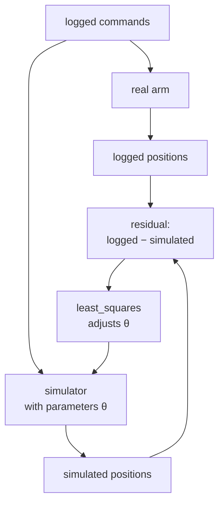

# 38 · System identification

<!-- meta -->
| | |
|---|---|
| **Part** | [9 · Sim to real](README.md) |
| **Run type** | CPU · Mac or Colab CPU |
| **Prerequisites** | [11](../part-4-dynamics-and-control/11-rigid-body-dynamics.md), [37](37-latency.md) |
| **Learn first** | [Optimization](https://aiengineeringfromscratch.com/lesson?path=phases/01-math-foundations/08-optimization) |
| **Time** | ~60 min |
| **Code** | [`experiments/38-system-identification/experiment.py`](../experiments/38-system-identification/experiment.py) |
| **Status** | ✅ done |
<!-- /meta -->

> A simulator is a hypothesis about the robot; system identification is how you test it with logged data and fix its numbers.

## The problem

The Menagerie SO-101 gives every STS3215 joint the same `damping="0.60" frictionloss="0.052" armature="0.028"` and a position actuator with `kp="998.22"`, and its own comment says these gains "are not a 1-to-1 mapping" of the servo gains LeRobot uses ([`so101.xml`](https://github.com/google-deepmind/mujoco_menagerie/blob/f3b6013/robotstudio_so101/so101.xml)). Your arm has its own print, payload, cable drag and bus delay, and lesson 37 showed that a missing 30 ms can ruin a loop. Which of the model's numbers are wrong for your arm, and can you fix them from logged trajectories alone?

## Core idea

### In plain words

System identification is a regression whose model is your simulator and whose weights are physical constants. Log what you commanded the real arm to do and what it did, replay the commands in the simulator, and turn its knobs (mass, friction, servo stiffness, delay) until the replay matches the log. Judge the result on data you did not fit.

Two things differ from ordinary regression. You choose the inputs: move the arm so that every knob leaves a fingerprint larger than the sensor noise (*excitation*). And if the model lacks a mechanism, the fit raises no error; it bends the other knobs to imitate the missing one, like omitted-variable bias.



### The fit, as code

```python
def residuals(theta):                                   # simulate: replay logged commands in MuJoCo
    return (simulate(theta, cmd_fit) - q_fit).ravel()   # one entry per joint per sample

theta_hat = levenberg_marquardt(residuals, theta_nominal, lb, ub)[0]   # Build it; or SciPy least_squares
val_rms = np.sqrt(np.mean((simulate(theta_hat, cmd_val) - q_val) ** 2))  # judge on a run the fit never saw
```

| What | Formula |
|---|---|
| Output-error fit | $\hat\theta = \arg\min_\theta \sum_k \big\| y_k - \hat y_k(\theta; u_{0:k}) \big\|^2$ |
| Validation error | RMS of $y_k - \hat y_k(\hat\theta; u_{0:k})$ on a held-out run |
| Linear in the parameters (arms with torque sensing) | $\tau = Y(q,\dot q,\ddot q)\,\pi$ |

$\theta$ is the parameter vector, $u_k$ the logged command and $y_k$ the logged joint positions at sample $k$, $\hat y_k(\theta; u_{0:k})$ the positions the simulator produces from the commands up to $k$, $\tau$ the joint torques, $Y$ a matrix computed from the measured motion ($q$, $\dot q$, $\ddot q$) and $\pi$ the inertial parameters.

Comparing whole simulated trajectories with the log is the *output-error* criterion; with a black-box model it is solved by nonlinear least squares with finite-difference Jacobians (AIEFS: [Optimization](https://aiengineeringfromscratch.com/lesson?path=phases/01-math-foundations/08-optimization)). Arms with torque sensing can use ordinary least squares on the regressor $\tau = Y\pi$ (Khalil & Dombre); a hobby servo reports no calibrated torque, so here the simulator is the model.

<details>
<summary>Math details: how the solver works, and why some parameters cannot be pinned</summary>

**Gauss–Newton in one line.** Linearize $r(\theta + \delta) \approx r(\theta) + J\delta$; minimizing $\|r + J\delta\|^2$ gives $\delta = -(J^\top J)^{-1} J^\top r$. Levenberg-Marquardt (Build it) and SciPy's trust-region `trf` are safeguarded versions of this step.

**Parameterization.** The experiment fits log-ratios to the nominal values: physical scales stay positive, and a given percentage change looks the same for every parameter.

**Identifiability.** A parameter is identifiable only if its column of $J$ is large compared with the noise and not nearly parallel to another column. If two parameter changes move the output in almost the same way, $J^\top J$ has a tiny eigenvalue along their combination: noise moves the estimate far along that *sloppy* direction while the predicted output barely changes. That is part B below.

**Excitation.** The input sets how large and how different the columns of $J$ are. Too large an input saturates the servo, whose torque then no longer depends on `kp` or damping (part A, 0.4 rad).

**Noise model.** Least squares is maximum likelihood for white Gaussian noise of equal size on every sample; quantized or biased encoders make it useful but not optimal.

**Missing mechanism.** If the true system has a term the model lacks, least squares projects its effect onto the parameters that exist. Every parameter can be biased at once (Break it).

Go deeper: [Optimization](https://aiengineeringfromscratch.com/lesson?path=phases/01-math-foundations/08-optimization) (AIEFS); L. Ljung, *System Identification: Theory for the User*; W. Khalil, E. Dombre, *Modeling, Identification and Control of Robots*; [SciPy `least_squares`](https://docs.scipy.org/doc/scipy/reference/generated/scipy.optimize.least_squares.html).

</details>

### What matters for an arm

MuJoCo names:

| Parameter | MuJoCo field | Shows up as |
|---|---|---|
| Link masses / inertias | `body_mass`, `body_inertia` | gravity sag, slower acceleration |
| Armature | `dof_armature` | extra inertia of the geared rotor |
| Viscous damping | `dof_damping` | speed-proportional drag |
| Friction loss | `dof_frictionloss` | dead band, stick-slip, offset at reversal |
| Actuator gain | `actuator_gainprm`, `actuator_biasprm` | stiffness of the servo |
| Torque limit | `actuator_forcerange` | maximum acceleration |
| Delay | (outside the model) | phase lag between command and motion |

**Excitation in practice.** The input must be *persistently exciting*: rich in frequency and large enough that every parameter changes the signal more than the noise does, yet inside the regime where the model holds and the robot is safe.

## Build it

You will now write the solver yourself: a finite-difference Jacobian of the residual and a Levenberg-Marquardt loop, about 40 lines of NumPy. The black box stays the Experiment's MuJoCo replay (`simulate`, `excitation`, the log-ratio parameters `to_theta`), so your fit can be compared with SciPy's on the same residual. The finished functions are in [`physai/sim2real.py`](../physai/sim2real.py); `uv run python experiments/38-system-identification/build.py` runs the steps (output in [`build_output.txt`](../experiments/38-system-identification/build_output.txt)).

### Step 1 · Fingerprints

Column $i$ of $J = \partial r/\partial x$ is how the logged trajectory moves when parameter $i$ moves. With a black box, each column is one extra simulation:

```python
def residual_jacobian(resid, x, r0=None, rel_step=1e-3):
    """Forward-difference Jacobian of a residual vector: one extra simulation per parameter."""
    r0 = resid(x) if r0 is None else r0
    J = np.empty((len(r0), len(x)))
    for i in range(len(x)):
        dx = np.zeros(len(x))
        dx[i] = rel_step * max(1.0, abs(x[i]))
        J[:, i] = (resid(x + dx) - r0) / dx[i]
    return J
```

```text
== Step 1. Fingerprints: |column| of the residual Jacobian at nominal (mrad per unit of x) ==
amplitude       mass  armature   damping  friction        kp     delay
0.02            11.6      32.0       6.3       2.5      26.9      48.1
0.10            37.3    1246.6     920.3      14.0     928.6     947.6
noise floor of the same log, 2 mrad x sqrt(2000 residuals) = 89.4 mrad
```

This is the excitation argument in numbers. A 10% change ($\Delta x = 0.1$) of damping moves the 0.02 rad log by 0.6 mrad in total, against a noise vector of 89.4 mrad: invisible. At 0.1 rad the same change moves it by 92 mrad. At 0.02 rad the delay column is the largest (a delay shifts every sample); the friction column is the smallest at both amplitudes.

### Step 2 · Levenberg-Marquardt

Gauss–Newton solves $(J^\top J)\,\delta = -J^\top r$. Far from the minimum that step can overshoot, so Levenberg-Marquardt adds $\lambda\,\mathrm{diag}(J^\top J)$: a large $\lambda$ turns the step into a short gradient step, a small one into Gauss–Newton. Raise $\lambda$ until the cost drops, lower it after a success, clip to the bounds:

```python
def levenberg_marquardt(resid, x0, lb, ub, iters=100, lam=1e-3, ftol=1e-10):
    """Minimize |resid(x)|^2 inside the box [lb, ub]: Gauss-Newton steps, damped by lam and clipped to the box.
    Returns the solution, its residual, the Jacobian at the last linearization and the number of evaluations."""
    x = np.clip(np.asarray(x0, float), lb, ub)
    r = resid(x)
    cost, nfev = r @ r, 1
    for _ in range(iters):
        J = residual_jacobian(resid, x, r)
        nfev += len(x)
        A, g = J.T @ J, J.T @ r
        while True:                                # raise the damping until the step lowers the cost
            x_new = np.clip(x + np.linalg.solve(A + lam * np.diag(np.diag(A)), -g), lb, ub)
            r_new = resid(x_new)
            nfev += 1
            if r_new @ r_new < cost or lam > 1e10:
                break
            lam *= 10
        if r_new @ r_new >= cost:                  # no step helps: we are at the minimum
            break
        done = cost - r_new @ r_new < ftol * cost
        x, r, cost, lam = x_new, r_new, r_new @ r_new, lam / 10
        if done:
            break
    return x, r, J, nfev
```

```text
== Step 2. Levenberg-Marquardt by hand, noise-free log at 0.1 rad ==
                          mass% armatur% damping% frictio%      kp%   dly ms  val mrad evals
ours                       -0.0     +0.0     -0.0     +0.0     -0.0     -0.0      0.00   108
final cost |r|^2 = 1.7e-16 mrad^2
```

Without noise the six hidden parameters come back exactly (the Experiment's part B, σ = 0 row). "evals" counts every simulation, the Jacobian columns included.

### Step 3 · With noise

```text
== Step 3. The same fit with 2 mrad of noise (the Experiment's part B draw) ==
                          mass% armatur% damping% frictio%      kp%   dly ms  val mrad evals
ours                       +8.5     -1.1     +0.9    -20.7     +3.3     +0.2      0.28    69
final cost |r|^2 = 7978.42 mrad^2 over 2000 residuals (2 mrad noise alone: 8000)
```

The final cost, 7978.42 mrad², is just below what the noise alone contributes ($2000 \times 2^2$ = 8000): the fit explains everything except the noise and overfits it slightly. SciPy, on the same residual (Use it), stops at +6.9% mass and −12.9% friction with a slightly higher cost (7982.43); the predictions on the validation run differ by 0.03 mrad.

### Step 4 · The sloppy direction

The singular values of $J$ say how well each direction in parameter space is pinned. With white noise of σ, the parameter covariance is $\sigma^2 (J^\top J)^{-1}$:

```python
U, s, Vt = np.linalg.svd(J, full_matrices=False)
sd = 2.0 * np.sqrt(np.diag(np.linalg.inv(J.T @ J)))   # 2 mrad noise -> 1-sigma spread of x
```

```text
== Step 4. The sloppy direction: singular values of J at the noisy solution ==
singular values: 685.6 277.3 79.2 62.4 29.0 3.9  (ratio 176)
weakest direction: mass -0.04 armature -0.00 damping -0.06 friction +1.00 kp -0.02 delay -0.02
predicted 1-sigma spread: mass 7.1% armature 0.4% damping 4.2% friction 51.2% kp 3.1% delay 0.20 ms
```

The weakest direction is almost pure friction: the data pin it 176 times worse than the best one, with a predicted 1σ spread of 51.2%. That is why friction wanders by −20.7% here, −12.9% for SciPy and up to +131.3% in the Experiment's part B, while armature (0.4%) and delay (0.20 ms) stay put.

### Step 5 · A missing mechanism

```text
== Step 5. A missing mechanism: no delay parameter, noise-free log ==
                          mass% armatur% damping% frictio%      kp%   dly ms  val mrad evals
ours, no delay            -45.0    +33.9    -28.7   +133.0    -68.1    -15.0      1.99   218
                       cost |r|^2 = 11230.1 mrad^2
fitted: mass 0.660, armature 0.054, damping 0.641, friction 0.233, kp 0.223
```

Your loop and SciPy (Use it) find two different wrong answers to the same wrong model: SciPy reaches the lower fit cost (8162.84 vs 11230.1 mrad²) but predicts the held-out run worse (6.23 vs 1.99 mrad). Both bias every parameter; both fake the 15 ms delay with a softer servo (kp 0.223 here, 0.226 in the Experiment). Without the right structure, the fit cost no longer ranks models by how well they predict.

### What you keep

`physai.sim2real` now has `residual_jacobian` and `levenberg_marquardt`. Lesson 39 randomizes around identified values; lesson 43 fits a dynamics model with the same least-squares idea. [`tests/test_38_system_identification.py`](../tests/test_38_system_identification.py) checks them against `np.linalg.lstsq` and SciPy: `uv run pytest tests/test_38_system_identification.py`.

## Use it

The library call is SciPy's [`least_squares`](https://docs.scipy.org/doc/scipy/reference/generated/scipy.optimize.least_squares.html); its default `trf` method handles bounds, `diff_step` sets the relative finite-difference step:

```python
s = least_squares(resid, x0, bounds=(lb, ub), diff_step=1e-3, xtol=1e-8, ftol=1e-10, gtol=1e-10)
theta_hat = to_theta(s.x)
```

```text
== Use it. scipy.optimize.least_squares on the same residuals ==
                          mass% armatur% damping% frictio%      kp%   dly ms  val mrad evals
SciPy, noise-free          -0.0     +0.0     -0.0     +0.0     -0.0     -0.0      0.00    77
                       cost |r|^2 = 0.00 mrad^2, nfev (without Jacobian calls) 11
SciPy, 2 mrad noise        +6.9     -1.3     +0.9    -12.9     +4.6     +0.2      0.25   125
                       cost |r|^2 = 7982.43 mrad^2, nfev (without Jacobian calls) 23
SciPy, no delay           -50.7    +35.4    +40.9    +46.0    -67.8    -15.0      6.23   104
                       cost |r|^2 = 8162.84 mrad^2, nfev (without Jacobian calls) 29
```

| Tool | Call | Watch out for |
|---|---|---|
| physai | `levenberg_marquardt(resid, x0, lb, ub)` | returns the cost as $\lvert r\rvert^2$ and counts every simulation |
| SciPy | `least_squares(fun, x0, bounds=...)` | `cost` is $\tfrac12\lvert r\rvert^2$; `nfev` excludes the finite-difference Jacobian calls (77 simulations above for `nfev` 11); `method='lm'` does not accept bounds |
| SciPy | `curve_fit(f, xdata, ydata, p0, bounds=...)` | defaults to `'lm'` without bounds, `'trf'` with them; `pcov` is rescaled by the residual variance unless `absolute_sigma=True` |

Traps:

- **Scale the parameters.** A 0.028 armature and a 15 ms delay differ by orders of magnitude; fit log-ratios and delay in 10 ms units (as here) or pass `x_scale`, or the finite-difference steps are meaningless for some columns.
- **Converged is not identified.** Both solvers stop happily on the flat friction direction; read the singular values before trusting a parameter.
- **Lower fit cost is not a better model** when a mechanism is missing (Step 5): rank fits on held-out data.

## Experiment

**Setup, sim-to-sim.** A "real" SO-101 is the Menagerie model with six hidden parameters changed (invented for this test). A nominal model fits them from logs.

| | mass scale | armature | damping | frictionloss | kp scale | delay |
|---|---|---|---|---|---|---|
| nominal | 1.000 | 0.028 | 0.600 | 0.052 | 1.000 | 0 ms |
| hidden "real" | 1.200 | 0.040 | 0.900 | 0.100 | 0.700 | 15 ms |

Five arm joints are driven by a multisine (a sum of sine waves, 0.5–3.5 Hz, different phases per joint) for 4 s around a mid pose; positions are logged at 100 Hz with white noise; physics 5 ms. SciPy's `least_squares` fits log-ratios to nominal (delay in 10 ms units) on the log; a held-out trajectory (smoothed random goals) checks the prediction. Before any fit, nominal vs real on it: 9.54 mrad RMS.

Full script: [`experiments/38-system-identification/experiment.py`](../experiments/38-system-identification/experiment.py). MuJoCo 3.17.0, NumPy 2.5.4, SciPy 1.18.1, Python 3.14, Apple Silicon Mac (Apple M5), deterministic, well under a minute of CPU.

**A. Sweep the excitation amplitude** (noise σ = 2 mrad). Entries: parameter error after the fit in percent of the real value (delay: error in ms); validation RMS in mrad; `sat` = share of steps with some servo at its 2.94 N·m limit. *Predict:* which amplitude identifies best?

| amplitude | mass | armature | damping | friction | kp | delay [ms] | val. after [mrad] | sat |
|---|---|---|---|---|---|---|---|---|
| 0.005 rad | −26.7% | +5.3% | −61.1% | +21.5% | −24.6% | −4.7 | 7.33 | 0.1% |
| 0.020 rad | +18.1% | −2.7% | −41.2% | +100.5% | +6.8% | −0.1 | 4.32 | 1.0% |
| 0.050 rad | −5.8% | +1.7% | −21.9% | −25.6% | −6.2% | −0.1 | 2.49 | 2.4% |
| **0.100 rad** | −4.1% | −0.5% | +0.1% | +16.5% | +1.4% | −0.0 | **0.09** | 4.6% |
| 0.200 rad | −0.2% | +1.5% | +2.1% | −48.2% | −8.1% | −0.5 | 0.13 | 41.0% |
| 0.400 rad | −6.9% | −23.4% | −35.4% | −68.3% | +13.3% | −3.7 | 6.67 | 100.0% |


Too small and the noise dominates: at 0.005 rad the 2 mrad noise is 40% of the amplitude (Build it, Step 1, measures the fingerprints). Too large and some servo is always at its torque limit, a torque source whose gain and damping barely matter: validation 6.67 mrad, almost nominal. In between (0.1–0.2 rad) the validation error drops from 9.54 to 0.09–0.13 mrad. From 0.02 to 0.2 rad the delay is found within 0.5 ms: it shifts every sample.

**B. Sweep the noise** at 0.1 rad:

| σ | mass | armature | damping | friction | kp | delay [ms] | val. after [mrad] |
|---|---|---|---|---|---|---|---|
| 0 | −0.0% | +0.0% | −0.0% | +0.0% | −0.0% | −0.0 | 0.00 |
| 2 mrad | +6.9% | −1.3% | +0.9% | −12.9% | +4.6% | +0.2 | 0.25 |
| 10 mrad | +27.8% | −4.3% | −0.5% | +120.4% | +19.3% | +0.8 | 0.76 |
| 30 mrad | −81.4% | −6.1% | −0.7% | +131.3% | −13.4% | +0.4 | 1.49 |

Without noise the fit recovers all six parameters exactly. With noise, armature, damping and delay stay within 6.1% / 1 ms, while mass and friction wander by up to −81.4% and +131.3%, yet validation stays at 1.49 mrad, six times better than nominal. Parameter error is not prediction error: a "sloppy" direction (Build it, Step 4: almost pure friction) barely changes the output, so the data cannot pin it and prediction hardly cares. The 2 mrad rows of A and B differ only in the noise draw (0.09 vs 0.25 mrad).

## Break it

Fit the 0.1 rad log with the wrong model structure: no delay parameter (delay fixed at 0), no noise.

| | mass | armature | damping | friction | kp | val. after [mrad] |
|---|---|---|---|---|---|---|
| no delay term | −50.7% | +35.4% | +40.9% | +46.0% | −67.8% | 6.23 |

Fitted: kp scale 0.226 (real 0.700), damping 1.268 (real 0.900), mass scale 0.591 (real 1.200). The optimizer cannot represent 15 ms of delay, so it fakes the lag with a soft, overdamped, light servo: 6.23 mrad on validation, worse than the delay model at 30 mrad of noise. A missing mechanism corrupts every parameter, not one (Build it, Step 5, finds a second, different wrong answer). Always include delay (lesson 37) and check on data you did not fit.

## On the real robot

Procedure for the real SO-101 (not yet measured on the real arm):

1. **Calibrate and connect** as in lesson 40. LeRobot reports degrees relative to the middle of the calibrated range by default (`use_degrees = True`; [`config_so_follower.py`](https://github.com/huggingface/lerobot/blob/main/src/lerobot/robots/so_follower/config_so_follower.py), [`motors_bus.py`](https://github.com/huggingface/lerobot/blob/main/src/lerobot/motors/motors_bus.py)); fit the offset and sign to the Menagerie angles from two known poses, or add them to $\theta$.
2. **Log a command stream** (`robot.send_action`, `robot.get_observation`, [LeRobot guide](https://huggingface.co/docs/lerobot/il_robots)) in a fixed-rate loop, with a time stamp for every command and reading.
3. **Excite one joint at a time**, then all: growing steps and a chirp (a sine sweeping up in frequency) or multisine, from a few degrees, inside the calibrated range, with lesson 15's safety layers on. Repeat each run to see the noise.
4. **Fit** the six parameters (plus offsets) by replaying the logged commands in MuJoCo with the logged time stamps. The Menagerie gains assume a servo P gain of 16 (comment in `so101.xml`), LeRobot's default `position_p_coefficient`.
5. **Validate** on a held-out run and a real task motion. If the fit only works on its own data, a mechanism is missing (backlash, which the Menagerie file defines but does not use; cable forces; temperature-dependent friction).

## Check yourself

1. **Easy.** Why is the delay identified well at 0.02 rad but damping is not?
2. **Medium.** In part B at σ = 30 mrad the mass scale is off by −81.4%, yet the validation error is only 1.49 mrad. Why does the mass matter so little for this arm's joint positions?
3. **Hard.** Add `forcerange` (the torque limit) as a seventh parameter and repeat part A. Predict whether the 0.4 rad row improves.

### Answers

1. A delay shifts the whole response, so every moving sample carries information about it; damping adds a force proportional to speed, which at small amplitude is below the noise (Build it, Step 1: 48.1 vs 6.3 mrad per unit at 0.02 rad).
2. The stiff servo holds the arm against gravity with a tiny sag (lesson 12: 0.033° at the shoulder for the bare arm), so mass acts only through inertia in fast moves, alongside the well-identified armature. Changing it changes the positions very little: the noise hides it, and the prediction barely depends on it.
3. The validation error improves from 6.67 to 0.82 mrad, but the parameters do not: the fitted torque-limit scale is 0.820 (real 1.000) and kp is off by −50.0%. Saturated data constrain the limit, not the servo gain, and the extra parameter absorbs the errors of the others. Same noise draw as part A; section "Exercise 3" of `output.txt`.

## Takeaways and sources

- Fit the simulator to logged commands and measurements (output error); with a good excitation, the validation error drops from 9.54 to 0.09 mrad.
- Excitation has a window: too small drowns in noise, too large saturates the actuator and hides the servo parameters.
- Parameter error is not prediction error, and a missing mechanism (delay) biases every other parameter: validate on held-out data.

Next: [lesson 39 · Domain randomization](39-domain-randomization.md).

Sources:
- L. Ljung, *System Identification: Theory for the User*, 2nd ed., Prentice Hall, 1999.
- W. Khalil, E. Dombre, *Modeling, Identification and Control of Robots*, Hermes Penton, 2002.
- [SciPy `least_squares`](https://docs.scipy.org/doc/scipy/reference/generated/scipy.optimize.least_squares.html); [MuJoCo XML reference · joint](https://mujoco.readthedocs.io/en/stable/XMLreference.html#body-joint) (armature, damping, frictionloss).
- [MuJoCo Menagerie · robotstudio_so101](https://github.com/google-deepmind/mujoco_menagerie/tree/f3b6013/robotstudio_so101) (Apache-2.0).
- LeRobot [`config_so_follower.py`](https://github.com/huggingface/lerobot/blob/main/src/lerobot/robots/so_follower/config_so_follower.py), [`motors_bus.py`](https://github.com/huggingface/lerobot/blob/main/src/lerobot/motors/motors_bus.py), [imitation-learning guide](https://huggingface.co/docs/lerobot/il_robots) (read 2026-10-27).
- J. Tan et al., [Sim-to-Real: Learning Agile Locomotion For Quadruped Robots](https://arxiv.org/abs/1804.10332), 2018 (system identification, actuator model and latency for transfer).
- All measured numbers: [`experiments/38-system-identification/output.txt`](../experiments/38-system-identification/output.txt).
