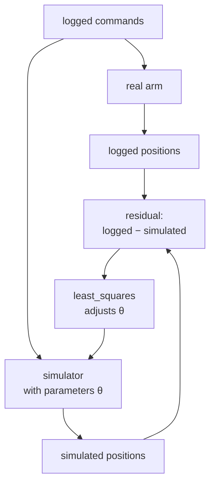

# 38 · System identification

<!-- meta -->
| | |
|---|---|
| **Part** | [9 · Sim to real](README.md) |
| **Run type** | CPU · Mac or Colab CPU |
| **Prerequisites** | [11](../part-4-dynamics-and-control/11-rigid-body-dynamics.md), [37](37-latency.md) |
| **Learn first** | [Optimization](https://aiengineeringfromscratch.com/lesson?path=phases/01-math-foundations/08-optimization) |
| **Time** | ~60 min |
| **Code** | [`experiments/38-system-identification/experiment.py`](../experiments/38-system-identification/experiment.py) |
| **Status** | ✅ done |
<!-- /meta -->

> A simulator is a hypothesis about the robot; system identification is how you test it with logged data and fix its numbers.

## The problem

The Menagerie SO-101 gives every STS3215 joint the same `damping="0.60" frictionloss="0.052" armature="0.028"` and a position actuator with `kp="998.22"`, and its own comment says these gains "are not a 1-to-1 mapping" of the servo gains LeRobot uses ([`so101.xml`](https://github.com/google-deepmind/mujoco_menagerie/blob/f3b6013/robotstudio_so101/so101.xml)). Your arm has its own print, its own payload, its own cable drag and its own bus delay. Lesson 37 showed that a missing 30 ms can turn a good loop into a bad one. Which of the model's numbers are wrong for your arm, and can you fix them from logged trajectories alone?

## Core idea

### In plain words

System identification is fitting a regression where the model is your simulator and the weights are physical constants. You log what you commanded the real arm to do and what it actually did. You replay the same commands in the simulator, compare the two trajectories, and turn the simulator's knobs (mass, friction, servo stiffness, delay) until the replay matches the log. As with any regression, you judge the result on data you did not fit.

Two things differ from ordinary regression. First, you generate the data yourself, so you choose the inputs: move the arm in ways that make every knob leave a fingerprint larger than the sensor noise. This is called *excitation*. Second, if the model lacks a mechanism, the fit does not raise an error; it bends all the other knobs to imitate the missing one, like omitted-variable bias in a regression.



### The fit, as code

```python
from scipy.optimize import least_squares

def simulate(theta, cmd):
    """Replay logged commands in MuJoCo with parameters theta; return joint positions."""
    ...   # theta: mass scale, armature, damping, frictionloss, kp scale, delay

def residuals(theta):
    return (simulate(theta, cmd_fit) - q_fit).ravel()    # one entry per joint per sample

theta_hat = least_squares(residuals, theta_nominal).x    # minimizes the sum of squared residuals

# Judge it on a run the fit never saw, like a test set
val_rms = np.sqrt(np.mean((simulate(theta_hat, cmd_val) - q_val) ** 2))
```

| What | Formula |
|---|---|
| Output-error fit | $\hat\theta = \arg\min_\theta \sum_k \big\| y_k - \hat y_k(\theta; u_{0:k}) \big\|^2$ |
| Validation error | RMS of $y_k - \hat y_k(\hat\theta; u_{0:k})$ on a held-out run |
| Linear in the parameters (arms with torque sensing) | $\tau = Y(q,\dot q,\ddot q)\,\pi$ |

$\theta$ is the parameter vector, $u_k$ the logged command and $y_k$ the logged joint positions at sample $k$, $\hat y_k(\theta; u_{0:k})$ the positions the simulator produces from the commands up to $k$, $\tau$ the joint torques, $Y$ a matrix computed from the measured motion ($q$, $\dot q$, $\ddot q$) and $\pi$ the inertial parameters.

Comparing whole simulated trajectories with the log is the *output-error* (or simulation-error) criterion. When the model is a black box (a MuJoCo rollout), solve it with a nonlinear least-squares method and finite-difference Jacobians (`scipy.optimize.least_squares`; see AIEFS: [Optimization](https://aiengineeringfromscratch.com/lesson?path=phases/01-math-foundations/08-optimization)). For torque-controlled arms with torque sensing, rigid-body dynamics is linear in the inertial parameters, so ordinary least squares on the regressor $\tau = Y\pi$ is the classic route (Khalil & Dombre). A hobby position servo reports no calibrated joint torque, so here the simulator is the model.

<details>
<summary>Math details: how the solver works, and why some parameters cannot be pinned</summary>

**Gauss–Newton in one line.** Stack all residuals into a vector $r(\theta)$ and linearize, $r(\theta + \delta) \approx r(\theta) + J\delta$ with $J = \partial r/\partial\theta$. Minimizing $\|r + J\delta\|^2$ gives the step $\delta = -(J^\top J)^{-1} J^\top r$. `least_squares` uses trust-region variants of this step (its default `trf` method handles bounds). With a black-box simulator every column of $J$ is a finite difference: one extra rollout per parameter per iteration.

**Parameterization.** The experiment fits log-ratios to the nominal values: physical scales stay positive, and a given percentage change looks the same for every parameter.

**Identifiability.** A parameter is identifiable only if its column of $J$ is large compared with the noise and not nearly parallel to another column. If two parameter changes move the output in almost the same way, $J^\top J$ has a tiny eigenvalue along their combination: noise moves the estimate far along that *sloppy* direction while the predicted output barely changes. That is part B below.

**Excitation.** The input decides how large and how different the columns of $J$ are. Too large an input leaves the regime the model describes well: once the servo is at its torque limit, its torque no longer depends on `kp` or damping, so their columns shrink (part A, 0.4 rad).

**Noise model.** Least squares is the maximum-likelihood estimate when the measurement noise is white, Gaussian and equally large on every sample. Real encoders are quantized and can be biased; then the estimate is still useful but no longer optimal.

**Missing mechanism.** If the true system has a term the model lacks, least squares projects its effect onto the parameters that exist. Every parameter can be biased at once (Break it).

Go deeper: [Optimization](https://aiengineeringfromscratch.com/lesson?path=phases/01-math-foundations/08-optimization) (AIEFS); L. Ljung, *System Identification: Theory for the User*; W. Khalil, E. Dombre, *Modeling, Identification and Control of Robots*; [SciPy `least_squares`](https://docs.scipy.org/doc/scipy/reference/generated/scipy.optimize.least_squares.html).

</details>

### What matters for an arm

MuJoCo names:

| Parameter | MuJoCo field | Shows up as |
|---|---|---|
| Link masses / inertias | `body_mass`, `body_inertia` | gravity sag, slower acceleration |
| Armature | `dof_armature` | extra inertia of the geared rotor |
| Viscous damping | `dof_damping` | speed-proportional drag |
| Friction loss | `dof_frictionloss` | dead band, stick-slip, offset at reversal |
| Actuator gain | `actuator_gainprm`, `actuator_biasprm` | stiffness of the servo |
| Torque limit | `actuator_forcerange` | maximum acceleration |
| Delay | (outside the model) | phase lag between command and motion |

**Excitation in practice.** A parameter can only be identified if it changes the measured signal more than the noise does. The input must be *persistently exciting*: rich in frequency and large enough in amplitude, yet inside the regime where the model holds and the robot is safe.

## Experiment

**Setup, sim-to-sim.** A "real" SO-101 is the Menagerie model with six hidden parameters changed (invented for this test). A nominal model fits them from logs.

| | mass scale | armature | damping | frictionloss | kp scale | delay |
|---|---|---|---|---|---|---|
| nominal | 1.000 | 0.028 | 0.600 | 0.052 | 1.000 | 0 ms |
| hidden "real" | 1.200 | 0.040 | 0.900 | 0.100 | 0.700 | 15 ms |

Five arm joints are driven by a multisine (a sum of sine waves, 0.5–3.5 Hz, different phases per joint) for 4 s around a mid pose; positions are logged at 100 Hz with white noise; physics 5 ms. The fit runs on the log; a different, held-out trajectory (smoothed random goals) checks the prediction. Before any fit, nominal vs real on the validation trajectory: 9.54 mrad RMS.

```python
def resid(x):                                    # x: log-ratios to nominal, delay in 10 ms units
    return 1e3 * (simulate(to_theta(x), cmd) - q_log).ravel()     # mrad
r = least_squares(resid, x0, bounds=(lb, ub), diff_step=1e-3)
```

Full script: [`experiments/38-system-identification/experiment.py`](../experiments/38-system-identification/experiment.py). MuJoCo 3.17.0, NumPy 2.5.4, SciPy 1.18.1, Python 3.14, Apple Silicon Mac (Apple M5), deterministic, well under a minute of CPU.

**A. Sweep the excitation amplitude** (noise σ = 2 mrad). Entries: parameter error after the fit in percent of the real value (delay: error in ms); validation RMS in mrad; `sat` = share of steps with some servo at its 2.94 N·m limit. *Predict:* which amplitude identifies best?

| amplitude | mass | armature | damping | friction | kp | delay [ms] | val. after [mrad] | sat |
|---|---|---|---|---|---|---|---|---|
| 0.005 rad | −26.7% | +5.3% | −61.1% | +21.5% | −24.6% | −4.7 | 7.33 | 0.1% |
| 0.020 rad | +18.1% | −2.7% | −41.2% | +100.5% | +6.8% | −0.1 | 4.32 | 1.0% |
| 0.050 rad | −5.8% | +1.7% | −21.9% | −25.6% | −6.2% | −0.1 | 2.49 | 2.4% |
| **0.100 rad** | −4.1% | −0.5% | +0.1% | +16.5% | +1.4% | −0.0 | **0.09** | 4.6% |
| 0.200 rad | −0.2% | +1.5% | +2.1% | −48.2% | −8.1% | −0.5 | 0.13 | 41.0% |
| 0.400 rad | −6.9% | −23.4% | −35.4% | −68.3% | +13.3% | −3.7 | 6.67 | 100.0% |


Too small and the noise dominates: at 0.005 rad the 2 mrad noise is 40% of the excitation amplitude, and the effects of damping, friction and mass are a small part of that small signal. Too large and some servo is always at its torque limit: the servo becomes a torque source whose gain and damping barely matter, and the fit fails on validation (6.67 mrad, almost as bad as nominal). In between (0.1–0.2 rad) the validation error drops from 9.54 to 0.09–0.13 mrad. From 0.02 to 0.2 rad the delay is found to within 0.5 ms; it is the easiest parameter, because it shifts every sample.

**B. Sweep the noise** at 0.1 rad:

| σ | mass | armature | damping | friction | kp | delay [ms] | val. after [mrad] |
|---|---|---|---|---|---|---|---|
| 0 | −0.0% | +0.0% | −0.0% | +0.0% | −0.0% | −0.0 | 0.00 |
| 2 mrad | +6.9% | −1.3% | +0.9% | −12.9% | +4.6% | +0.2 | 0.25 |
| 10 mrad | +27.8% | −4.3% | −0.5% | +120.4% | +19.3% | +0.8 | 0.76 |
| 30 mrad | −81.4% | −6.1% | −0.7% | +131.3% | −13.4% | +0.4 | 1.49 |

Without noise the fit recovers all six parameters exactly. With noise, armature, damping and delay stay within 6.1% / 1 ms, while mass and friction wander by up to −81.4% and +131.3%, yet the validation error stays at 1.49 mrad, six times better than nominal. Parameter error and prediction error are different things: some parameter combinations barely change the output (a "sloppy" direction), so the data cannot pin them, and for prediction it does not matter much. The 2 mrad rows of A and B are the same setting with different noise draws (0.09 vs 0.25 mrad): one noise realization is one sample.

## Break it

Fit the 0.1 rad log with the wrong model structure: no delay parameter (delay fixed at 0), no noise.

| | mass | armature | damping | friction | kp | val. after [mrad] |
|---|---|---|---|---|---|---|
| no delay term | −50.7% | +35.4% | +40.9% | +46.0% | −67.8% | 6.23 |

Fitted: kp scale 0.226 (real 0.700), damping 1.268 (real 0.900), mass scale 0.591 (real 1.200). The optimizer cannot represent 15 ms of delay, so it fakes the lag with a soft, overdamped, light servo. The fit is "good" on its own data and 6.23 mrad on validation, worse than with the delay term at 30 mrad of noise. A missing mechanism does not show up as one wrong parameter; it corrupts all of them. Always include delay (lesson 37) and check on data you did not fit.

## On the real robot

Procedure for the real SO-101 (not yet measured on the real arm):

1. **Calibrate and connect** as in lesson 40. LeRobot reports joint positions in degrees relative to the middle of the calibrated range by default (`use_degrees = True`; [`config_so_follower.py`](https://github.com/huggingface/lerobot/blob/main/src/lerobot/robots/so_follower/config_so_follower.py), [`motors_bus.py`](https://github.com/huggingface/lerobot/blob/main/src/lerobot/motors/motors_bus.py)). The offset and sign between those degrees and the Menagerie joint angles are unknown: put the arm in two known poses and fit them first, or add them to $\theta$.
2. **Log a command stream** with the Python API (`robot.send_action`, `robot.get_observation`, [LeRobot guide](https://huggingface.co/docs/lerobot/il_robots)) in a fixed-rate loop, saving the time stamp of every command and every reading. The loop rate the bus allows was not measured here.
3. **Excite one joint at a time first**, then all together: steps of increasing size and a chirp (a sine sweeping up in frequency) or multisine, starting at a few degrees, staying inside the calibrated range, away from the table, with the safety layers of lesson 15 on. Repeat each run to see the noise.
4. **Fit** the same six parameters (plus offsets) by replaying the logged commands in MuJoCo with the logged time stamps, as in `experiment.py`. The Menagerie gains were derived assuming a servo P gain of 16 (comment in `so101.xml`), which matches LeRobot's default `position_p_coefficient = 16`.
5. **Validate** on a held-out run and on a real task motion. If the fit only works on its own data, a mechanism is missing (backlash, which the Menagerie file defines but does not use; cable forces; temperature-dependent friction).

## Check yourself

1. **Easy.** Why is the delay identified well at 0.02 rad but damping is not?
2. **Medium.** In part B at σ = 30 mrad the mass scale is off by −81.4%, yet the validation error is only 1.49 mrad. Why does the mass matter so little for this arm's joint positions?
3. **Hard.** Add `forcerange` (the torque limit) as a seventh parameter and repeat part A. Predict whether the 0.4 rad row improves.

### Answers

1. A delay shifts the whole response in time, so every sample with nonzero velocity carries information about it; damping only changes the response by a force proportional to speed, which at small amplitude is smaller than the noise.
2. The stiff servo holds the arm against gravity with a tiny sag: lesson 12 measured a shoulder sag of 0.033° for the bare arm. Mass then acts only through inertia during fast moves, alongside the armature, which the fit identifies well. Changing the mass changes the positions very little, so the noise hides it; for the same reason it barely affects the prediction.
3. The validation error improves from 6.67 to 0.82 mrad, but the parameters do not: the fitted torque-limit scale is 0.820 (real 1.000) and kp is off by −50.0%. Saturated data constrain the limit, not the servo gain, and the extra parameter absorbs the errors of the others. Same noise draw as part A; section "Exercise 3" of `output.txt`.

## Takeaways and sources

- Fit the simulator to logged commands and measurements (output error); with a good excitation, the validation error drops from 9.54 to 0.09 mrad.
- Excitation has a window: too small drowns in noise, too large saturates the actuator and hides the servo parameters.
- Parameter error is not prediction error, and a missing mechanism (delay) biases every other parameter: validate on held-out data.

Next: [lesson 39 · Domain randomization](39-domain-randomization.md).

Sources:
- L. Ljung, *System Identification: Theory for the User*, 2nd ed., Prentice Hall, 1999.
- W. Khalil, E. Dombre, *Modeling, Identification and Control of Robots*, Hermes Penton, 2002.
- [SciPy `least_squares`](https://docs.scipy.org/doc/scipy/reference/generated/scipy.optimize.least_squares.html); [MuJoCo XML reference · joint](https://mujoco.readthedocs.io/en/stable/XMLreference.html#body-joint) (armature, damping, frictionloss).
- [MuJoCo Menagerie · robotstudio_so101](https://github.com/google-deepmind/mujoco_menagerie/tree/f3b6013/robotstudio_so101) (Apache-2.0).
- LeRobot [`config_so_follower.py`](https://github.com/huggingface/lerobot/blob/main/src/lerobot/robots/so_follower/config_so_follower.py), [`motors_bus.py`](https://github.com/huggingface/lerobot/blob/main/src/lerobot/motors/motors_bus.py), [imitation-learning guide](https://huggingface.co/docs/lerobot/il_robots) (read 2026-10-27).
- J. Tan et al., [Sim-to-Real: Learning Agile Locomotion For Quadruped Robots](https://arxiv.org/abs/1804.10332), 2018 (system identification, actuator model and latency for transfer).
- All measured numbers: [`experiments/38-system-identification/output.txt`](../experiments/38-system-identification/output.txt).
