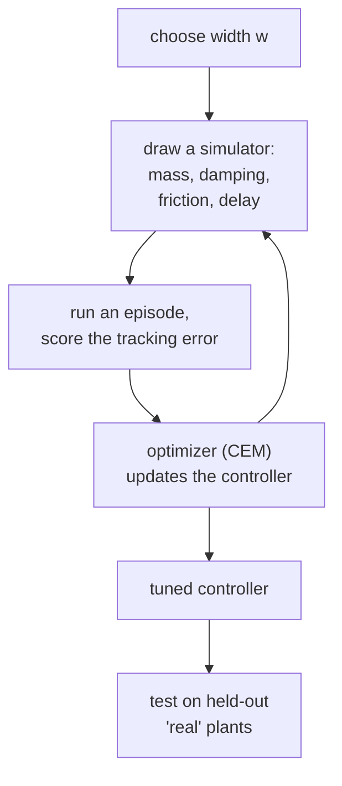

# 39 · Domain randomization

<!-- meta -->
| | |
|---|---|
| **Part** | [9 · Sim to real](README.md) |
| **Run type** | CPU · Mac or Colab CPU |
| **Prerequisites** | [33](../part-8-rl-for-robots/33-ppo.md), [38](38-system-identification.md) |
| **Learn first** | [Sim-to-Real Transfer](https://aiengineeringfromscratch.com/lesson?path=phases/09-reinforcement-learning/11-sim-to-real-transfer) · [Bias-Variance Tradeoff](https://aiengineeringfromscratch.com/lesson?path=phases/02-ml-fundamentals/10-bias-variance) |
| **Time** | ~60 min |
| **Code** | [`experiments/39-domain-randomization/experiment.py`](../experiments/39-domain-randomization/experiment.py) |
| **Status** | ✅ done |
<!-- /meta -->

> If you cannot know the real parameters exactly, train on a range that contains them; make the range too narrow and the policy is brittle, too wide and it is timid.

## The problem

System identification (lesson 38) narrows the gap between simulator and robot but never closes it: some parameters stay uncertain, and some change from day to day (payload, wear, temperature, a different floor). A controller or policy optimized on one nominal simulator exploits exactly the numbers it was given. Unitree's open training code for its legged robots therefore draws a new ground friction coefficient for every simulated robot, `randomize_friction = True`, `friction_range = [0.5, 1.25]`, and pushes the robots at random every 15 s ([`legged_robot_config.py`](https://github.com/unitreerobotics/unitree_rl_gym/blob/main/legged_gym/envs/base/legged_robot_config.py)); the Go2 configuration inherits these settings unchanged ([`go2_config.py`](https://github.com/unitreerobotics/unitree_rl_gym/blob/main/legged_gym/envs/go2/go2_config.py)). How wide should such a range be, and what does width cost?

## Core idea

### In plain words

Train a driver on one simulator only and they learn its exact quirks: where to brake, how much grip there is, how quickly the car reacts. Put them in a real car that differs a little and they misjudge every corner. Train them instead on many slightly different simulators, each with its own grip, weight and reaction delay, and they learn a driving style that works across the whole family. If the real car belongs to that family, it is, in Tobin et al.'s words, "just another variation". This is *domain randomization* (DR).

The price: a driver who must handle everything from ice to dry asphalt drives more cautiously than one who only knows dry asphalt. A range that is too narrow gives a brittle policy; one that is too wide gives a timid one. It is the same trade-off as regularization in machine learning: a little generalizes better, too much underfits.



### Domain randomization, as code

The only change from ordinary training is where the score comes from: an average over randomly drawn simulators instead of one fixed simulator. In this lesson the optimizer is the *cross-entropy method* (CEM), a simple derivative-free search: sample candidate controllers, keep the best ones, move the sampling distribution toward them, repeat.

```python
def expected_return(gains, w, n=10):
    plants = [sample_plant(w) for _ in range(n)]       # n random simulators of width w
    return mean(J(gains, p) for p in plants)           # J: return of one episode (here -RMS tracking error)

mu, sd = initial_mean, initial_spread                  # search distribution over (Kp, Kd, kg)
for it in range(12):                                   # CEM iterations
    cands = [normal(mu, sd) for _ in range(24)]        # candidate controllers
    elite = best(cands, key=lambda g: expected_return(g, w))
    mu, sd = mean(elite), std(elite)                   # move the search toward the best ones
```

| What | Formula |
|---|---|
| Nominal training | $\pi^*_0 = \arg\max_\pi\ J(\pi;\xi_0)$ |
| Domain randomization | $\pi^*_w = \arg\max_\pi\ \mathbb{E}_{\xi \sim p_w}\big[J(\pi;\xi)\big]$ |
| Width in this lesson | scales $\in [2^{-w}, 2^{w}]$ (log-uniform), delay $\in [5, 5+40w]$ ms |

$\pi$ is the policy (here the gains $K_p$, $K_d$, $k_g$), $\xi$ a vector of simulator parameters (mass, damping, friction, delay), $\xi_0$ its nominal value, $J(\pi;\xi)$ the return of the policy on the simulator with parameters $\xi$, and $p_w$ the distribution of simulators with width $w$.

<details>
<summary>Math details: why averaging over simulators helps, and when it cannot</summary>

**Coverage.** DR optimizes the average return over $p_w$. If the real robot's $\xi_{\text{real}}$ lies inside the support of $p_w$ (the set of simulators that can be drawn), the policy has been scored on simulators like it; if it lies outside, nothing in training checked that case.

**Average vs worst case.** As $w$ grows, the average is increasingly dominated by hard simulators (long delays, heavy links), so the optimum moves toward a cautious, worst-case controller. In the limit this approaches a minimax problem, $\max_\pi \min_\xi J(\pi;\xi)$, which gives up nominal performance for guarantees.

**The bias-variance analogy.** Training on one $\xi_0$ is like fitting one data set exactly: low error there, high error on new data. A wider $p_w$ acts like regularization: higher error on the known plant (bias), lower sensitivity to the unknown one (variance) (see AIEFS: [Bias-Variance Tradeoff](https://aiengineeringfromscratch.com/lesson?path=phases/02-ml-fundamentals/10-bias-variance)).

**Limits of a fixed controller.** A controller with fixed gains must find one compromise for every $\xi$. When the real variation is larger than what any single compromise can absorb, no width helps (Observe 4).

**Prior work.** Tobin et al. ([arXiv 1703.06907](https://arxiv.org/abs/1703.06907)) randomized rendering to train an object detector on simulated images only. Tan et al. ([arXiv 1804.10332](https://arxiv.org/abs/1804.10332)) randomized physical parameters, added perturbations and identified an actuator model and latency to move quadruped gaits from simulation to a real robot.

Go deeper: [Sim-to-Real Transfer](https://aiengineeringfromscratch.com/lesson?path=phases/09-reinforcement-learning/11-sim-to-real-transfer), [Bias-Variance Tradeoff](https://aiengineeringfromscratch.com/lesson?path=phases/02-ml-fundamentals/10-bias-variance) (AIEFS); de Boer et al., "A Tutorial on the Cross-Entropy Method" (2005).

</details>

### The trade-off, and what to randomize

| Width | Nominal sim | Real robot |
|---|---|---|
| 0 (nominal only) | best | fails when $\xi_{\text{real}} \ne \xi_0$ |
| just covers $\xi_{\text{real}}$ | slightly worse | works |
| far wider | worse | worse again: the policy is tuned for the worst case |

For an arm, randomize the parameters of lesson 38 (masses, damping, friction, armature, actuator gain) and the delay of lesson 37. Center the ranges on identified values and size them from the identification's uncertainty.

## Experiment

**Setup.** One arm joint with the STS3215 joint parameters of the Menagerie SO-101 (armature 0.028, damping 0.6, frictionloss 0.052, torque limit 2.94 N·m) carrying a 0.5 kg link with its center of mass at 15 cm (gravity torque up to 0.736 N·m). Torque control through a measurement delay. The "policy" is a three-parameter controller: PD tracking plus a gravity term $k_g\cos q_{\text{ref}}$,

$$\tau = \operatorname{clip}\big(K_p(q_{\text{ref}} - \tilde q) + K_d(\dot q_{\text{ref}} - \dot{\tilde q}) + k_g\cos q_{\text{ref}},\ \pm 2.94\big),$$

where $\tilde q$ is the delayed measurement. It is tuned with CEM (12 iterations × 24 candidates × 10 sampled plants each) to minimize RMS tracking error of a 3 s reference, $0.5\sin(2\pi\,0.4t) + 0.25\sin(2\pi\,1.1t+1)$ rad, at a 2 ms step. With width $w$, every training episode draws mass, damping and friction-loss scales log-uniformly in $[2^{-w}, 2^{w}]$ and the delay uniformly in $[5, 5+40w]$ ms (nominal: scales 1, delay 5 ms).

```python
def sample_plants(rng, n, w):
    s = lambda: 2.0 ** rng.uniform(-w, w, n)
    return dict(mass=s(), damping=s(), friction=s(), delay=rng.uniform(0.005, 0.005 + 0.040 * w, n))
```

**Test.** The nominal plant, and 32 held-out "real" plants never seen in training (invented for the test): mass ×1.10–1.39, damping ×0.80–1.56, friction ×1.02–2.48, delay 15.5–28.8 ms. Success: RMS error below 2°. Many copies of the joint live in one MuJoCo model so that one `mj_step` advances a whole batch.

Full script: [`experiments/39-domain-randomization/experiment.py`](../experiments/39-domain-randomization/experiment.py). MuJoCo 3.17.0, NumPy 2.5.4, Python 3.14, Apple Silicon Mac (Apple M5), deterministic (fixed seeds), well under a minute of CPU. *Predict:* which width is best on the real plants, and what happens to nominal error as $w$ grows?

| $w$ | delay range [ms] | scale range | $K_p$ | $K_d$ | $k_g$ | nominal RMS [°] | real mean [°] | real worst [°] | real success |
|---|---|---|---|---|---|---|---|---|---|
| 0 | 5 | 1.00 | 117.36 | 0.914 | 0.679 | **0.165** | 3.526 | 6.025 | 5/32 |
| 0.1 | 5–9 | 0.93–1.07 | 99.98 | 4.484 | 0.307 | 0.227 | 1.607 | 3.260 | 24/32 |
| 0.25 | 5–15 | 0.84–1.19 | 74.77 | 4.276 | 0.523 | 0.252 | 1.490 | 3.368 | 23/32 |
| 0.5 | 5–25 | 0.71–1.41 | 55.43 | 3.244 | 0.563 | 0.475 | 1.307 | 3.293 | **28/32** |
| 0.75 | 5–35 | 0.59–1.68 | 45.19 | 2.672 | 0.461 | 0.736 | **1.228** | 3.118 | 27/32 |
| 1.0 | 5–45 | 0.50–2.00 | 30.41 | 1.969 | 0.591 | 1.224 | 1.233 | 3.419 | 27/32 |


**Observe.**

1. Tuned on the nominal plant only, the controller is the best on that plant (0.165°) and the worst on the real ones (5/32). It chose $K_p$ = 117 with little damping, a loop that relies on knowing the delay is 5 ms; with 15.5–28.8 ms its error averages 3.526°.
2. Even a narrow range ($w$ = 0.1, delay up to 9 ms) lifts real success to 24/32: most of the gain comes from not trusting the exact delay. The best real results come from the ranges whose delay reaches into the real 15.5–28.8 ms ($w$ = 0.5 up to 25 ms; $w$ = 0.75 and 1 all of it): 27–28/32, mean 1.228–1.307°. Each row is a single CEM run with one seed, so treat differences of a few plants between rows as noise; we did not repeat with other seeds.
3. Nominal error grows steadily with width (0.165 → 1.224°) as $K_p$ falls (117 → 30): robustness is paid for in tracking on the plant you know.
4. No width solves all 32: the worst real plant stays above 3° in every row. Some real plants have friction ×2.48, outside even the $w$ = 1 range (up to ×2.00), and a fixed-gain controller has limits.

## Break it

Make the range much wider than the real variation:

| $w$ | delay range [ms] | scale range | $K_p$ | nominal RMS [°] | real mean [°] | real success |
|---|---|---|---|---|---|---|
| 1.5 | 5–65 | 0.35–2.83 | 38.01 | 1.190 | 1.788 | 23/32 |
| 2.0 | 5–85 | 0.25–4.00 | 19.59 | 2.201 | 2.345 | 13/32 |

At $w$ = 2 the training distribution includes 85 ms of delay and links four times lighter or heavier. The controller that survives all of that is soft ($K_p$ = 19.59): 2.201° on the nominal plant (13 times the nominal-only controller) and 13/32 on the real plants, worse than the narrowest range. The optimizer spends its effort on plants that do not exist. Width is a design parameter, set by identification (lesson 38) and measured latency (lesson 37), not "as wide as possible".

## On the real robot

- **Unitree's defaults** in `unitree_rl_gym`: ground friction per robot from `[0.5, 1.25]` (drawn once per environment from 64 buckets, [`legged_robot.py`](https://github.com/unitreerobotics/unitree_rl_gym/blob/main/legged_gym/envs/base/legged_robot.py)), `randomize_base_mass = False` with `added_mass_range = [-1., 1.]` available, `push_robots = True` every 15 s with `max_push_vel_xy = 1.` ([`legged_robot_config.py`](https://github.com/unitreerobotics/unitree_rl_gym/blob/main/legged_gym/envs/base/legged_robot_config.py)). Those are training-simulation settings; they say nothing about how well a given policy transfers, which we did not measure.
- **SO-101.** Policies trained by imitation on real demonstrations (Part 7, lesson 40) see real dynamics already; DR matters for policies trained in simulation (Part 8). For the arm, randomize around the parameters you identified, with ranges at least as wide as their spread across repeated identification runs, plus the latency you measured. Not yet measured on the real arm.
- **Check the range on hardware.** Run the trained policy on the robot and on held-out simulated plants; if the real result is worse than the worst simulated one, the real robot is outside your range or a mechanism is missing (lesson 38).

## Check yourself

1. **Easy.** With $w$ = 0.5, what are the delay range and the scale range? Do they contain all 32 real plants?
2. **Medium.** Why does the nominal-only controller choose low $K_d$ (0.914) while all randomized ones choose $K_d$ between 1.916 and 4.484? Use lesson 37.
3. **Hard.** Randomize only the delay (scales fixed at 1) with $w$ = 0.75, and compare real success with the full $w$ = 0.75 row. Predict first.

### Answers

1. Delay 5–25 ms, scales 0.71–1.41. No: real delays go up to 28.8 ms and friction up to ×2.48.
2. At 5 ms of delay the loop's phase margin is large, so the optimizer can trade damping for faster tracking. With uncertain, larger delays, $K_d$ restores phase margin at the crossover ($\mathrm{PM} = \arctan(K_d\omega_c/K_p)$), and the optimizer keeps it.
3. 27/32, the same as the full $w$ = 0.75 row, with a slightly lower mean error (1.174° vs 1.228°) and a higher nominal error (1.339° vs 0.736°, $K_p$ = 27.87). For these real plants the delay is the parameter that matters; the scale ranges add little. Last row of `output.txt`.

## Takeaways and sources

- Optimizing on the nominal simulator gives the best nominal result (0.165°) and the worst transfer (5/32).
- A range that covers most of the real variation transfers best (27–28/32); even a narrow one helps (24/32).
- Too wide costs both: nominal 2.201° and real 13/32 at $w$ = 2. Size the range from identification and measured latency.

Next: [lesson 40 · Deploying on the real SO-101](40-real-so101.md).

Sources:
- J. Tobin et al., [Domain Randomization for Transferring Deep Neural Networks from Simulation to the Real World](https://arxiv.org/abs/1703.06907), 2017.
- J. Tan et al., [Sim-to-Real: Learning Agile Locomotion For Quadruped Robots](https://arxiv.org/abs/1804.10332), 2018.
- [`unitree_rl_gym`](https://github.com/unitreerobotics/unitree_rl_gym): [`legged_robot_config.py`](https://github.com/unitreerobotics/unitree_rl_gym/blob/main/legged_gym/envs/base/legged_robot_config.py), [`legged_robot.py`](https://github.com/unitreerobotics/unitree_rl_gym/blob/main/legged_gym/envs/base/legged_robot.py), [`go2_config.py`](https://github.com/unitreerobotics/unitree_rl_gym/blob/main/legged_gym/envs/go2/go2_config.py) (BSD-3-Clause, read 2026-10-27).
- P.-T. de Boer, D. P. Kroese, S. Mannor, R. Y. Rubinstein, "A Tutorial on the Cross-Entropy Method", *Annals of Operations Research*, 2005.
- [MuJoCo Menagerie · robotstudio_so101](https://github.com/google-deepmind/mujoco_menagerie/tree/f3b6013/robotstudio_so101) (Apache-2.0): STS3215 joint parameters.
- All measured numbers: [`experiments/39-domain-randomization/output.txt`](../experiments/39-domain-randomization/output.txt).
