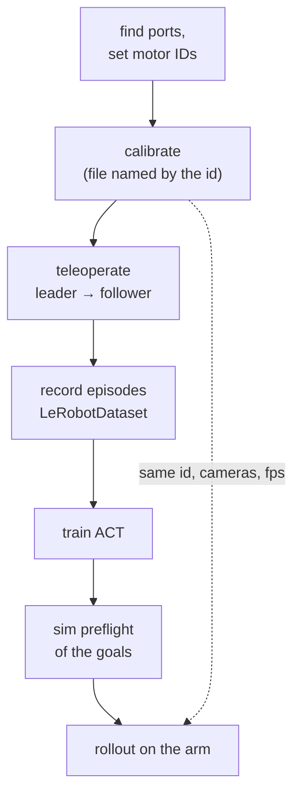

# 40 · Deploying on the real SO-101

<!-- meta -->
| | |
|---|---|
| **Part** | [9 · Sim to real](README.md) |
| **Run type** | HW · real SO-101 |
| **Prerequisites** | [15](../part-4-dynamics-and-control/15-safety.md), [28](../part-7-learning-from-demonstration/28-behavior-cloning.md), [38](38-system-identification.md) |
| **Learn first** | none |
| **Time** | ~120 min |
| **Code** | [`experiments/40-real-so101/experiment.py`](../experiments/40-real-so101/experiment.py) |
| **Status** | ✅ done |
<!-- /meta -->

> On hardware, most failures are bookkeeping: wrong port, wrong id, wrong calibration, wrong units. Check them in simulation and in writing before the arm moves.

## The problem

Everything so far ran in simulation. The real SO-101 workflow in LeRobot is short to type and easy to get subtly wrong: the calibration is stored under the robot's `id`, and LeRobot's guide warns that the same `id` must be used when teleoperating, recording and evaluating ([LeRobot imitation-learning guide](https://huggingface.co/docs/lerobot/il_robots)). A policy trained on data recorded with one calibration and run with another sends goals that are offset by the difference, and nothing in the software complains. This lesson writes the full deployment as a procedure and adds a simulation preflight that rejects a commanded trajectory before it reaches the motors.

## Core idea

### In plain words

Deploying a learned policy on the arm is a build pipeline: hardware setup, data, model, release. Each stage consumes configuration produced by an earlier one, above all the *calibration* file, which maps raw motor readings to the joint values the policy sees. Train with one calibration and run with another, and nothing crashes; every goal is silently shifted. It is the robot version of training a model with one feature normalization and serving it with another.

You record data by *teleoperation*: you move a hand-held *leader* arm and the motorized *follower* arm copies it. A policy is trained on those recordings, and a *rollout* runs it on the follower without you. So the work is mostly bookkeeping: keep port, id, calibration, cameras and frame rate the same from the first teleoperation to the last rollout, and check commands against a model before they reach the motors.



### The pipeline and its invariants

| Stage | Command | Produces | Invariant to keep |
|---|---|---|---|
| Ports | `lerobot-find-port` | one port per arm | the same USB device for the same arm |
| Motor setup | `lerobot-setup-motors` | IDs 1–6, common baudrate in EEPROM | done once per motor |
| Calibration | `lerobot-calibrate` | `<id>.json` under `HF_LEROBOT_CALIBRATION` | same `id` for every later command |
| Teleoperation | `lerobot-teleoperate` | leader → follower | follower behaves before recording |
| Recording | `lerobot-record` | `LeRobotDataset`, 30 fps | fixed cameras, consistent task |
| Training | `lerobot-train` | ACT checkpoint | trained on exactly that dataset |
| Rollout | `lerobot-rollout` | autonomous episodes | same cameras, fps, calibration as recording |

(The baudrate is the serial bus speed; EEPROM is the servo's own memory that survives power-off.)

**Units.** With the default `use_degrees = True`, LeRobot reports the five arm joints in degrees relative to the middle of the range recorded at calibration, and the gripper from 0 to 100 ([`config_so_follower.py`](https://github.com/huggingface/lerobot/blob/main/src/lerobot/robots/so_follower/config_so_follower.py), [`motors_bus.py`](https://github.com/huggingface/lerobot/blob/main/src/lerobot/motors/motors_bus.py)). The Menagerie model uses radians from its own zero. A sim check is only meaningful after you have measured the offset and sign between the two (lesson 38).

## Build it

Lesson 40's risks are bookkeeping, and bookkeeping has math you can check before the arm moves: how encoder ticks become the degrees a policy sees, how those degrees map to the model's radians, and how much torque gravity and a payload demand along a trajectory. The functions are in [`physai/sim2real.py`](../physai/sim2real.py); `uv run python experiments/40-real-so101/build.py` runs the steps (output in [`build_output.txt`](../experiments/40-real-so101/build_output.txt)). Every number below is from the Menagerie model or invented test values, not from a real arm.

### Step 1 · Ticks and degrees

LeRobot's degrees mode puts 0 at the middle of the calibrated range and spends 360° on `resolution - 1` ticks; going back it truncates with `int()` ([`motors_bus.py`](https://github.com/huggingface/lerobot/blob/main/src/lerobot/motors/motors_bus.py), `_normalize` / `_unnormalize`). Its docstring gives 4096 steps per turn for a 12-bit encoder, which is the default here.

```python
def ticks_to_deg(raw, range_min, range_max, resolution=4096):
    """LeRobot's degrees mode: 0 at the middle of the calibrated range, 360 deg per resolution - 1 ticks."""
    return (raw - (range_min + range_max) / 2) * 360 / (resolution - 1)
```

```python
def deg_to_ticks(deg, range_min, range_max, resolution=4096):
    """Back to an encoder position; int() truncates toward zero, as LeRobot's _unnormalize does."""
    return int(deg * (resolution - 1) / 360 + (range_min + range_max) / 2)
```

```text
== Step 1. Encoder ticks <-> degrees (12-bit encoder, calibrated range 1000-3000) ==
middle of the range 0.000 deg, ends -87.91 / 87.91 deg, one tick = 0.0879 deg
ticks -> deg -> ticks: 2001 of 2001 positions come back exactly
deg -> ticks -> deg for 16,001 goals: error from -0.0878 to 0.0000 deg (int() of a positive tick count rounds down: up to one tick, always low)
```

Readings survive the round trip exactly; commanded goals do not. Every goal is rounded *down* to a whole tick, by up to 0.088°: a systematic offset of half a tick on average, not a zero-mean noise.

### Step 2 · Degrees to model radians

The policy's degrees and the model's radians differ by a sign and an offset per joint (the Break it below shows what 10° of offset does). Two poses whose model angles you know fix both:

```python
def fit_calibration(deg, q_model):
    """Sign / scale and offset with q_model = a * radians(deg) + b, least squares over poses where both are known."""
    a, b = np.polyfit(np.radians(deg), q_model, 1)
    return a, b
```

```text
== Step 2. Degrees -> model radians: sign and offset from two known poses ==
readings [ 24.176 -44.571] deg -> fitted a = -1.0001 (true -1.0), b = 6.990 deg (true 7.000)
9 test poses: max error 0.067 deg (one tick is 0.088 deg)
```

With an invented mounting (reversed direction, 7° offset) and readings quantized to whole ticks, two poses recover the sign and the offset to 0.01°, and new poses map to within one tick.

### Step 3 · Gravity torque by hand

At rest, hinge $i$ carries $\tau_i = \sum_b (\hat a_i \times (c_b - o_i)) \cdot m_b g$ over the bodies beyond it, with body poses from lesson 07's `frame_tree`:

```python
def gravity_torques(m, qpos, frames, g=(0.0, 0.0, -9.81)):
    """Joint torques gravity puts on a hinge chain at rest: for hinge i, the sum over the bodies it carries of
    (a_i x (c_b - o_i)) . (m_b g). frames: world 4x4 pose of every body (lesson 07's frame_tree)."""
    tau = np.zeros(m.njnt)
    for j in range(m.njnt):
        if m.jnt_type[j] != 3:                     # hinges only
            continue
        T = frames[m.jnt_bodyid[j]]
        a, o = T[:3, :3] @ m.jnt_axis[j], T[:3, :3] @ m.jnt_pos[j] + T[:3, 3]   # axis and anchor in the world
        for b in range(1, m.nbody):
            p = b
            while p not in (0, m.jnt_bodyid[j]):   # is body b on the far side of joint j?
                p = m.body_parentid[p]
            if p == m.jnt_bodyid[j]:
                c = frames[b][:3, :3] @ m.body_ipos[b] + frames[b][:3, 3]          # centre of mass
                tau[j] += np.cross(a, c - o) @ (m.body_mass[b] * np.asarray(g))
    return tau
```

```text
== Step 3. Gravity torque by hand along the 303 goals vs qfrc_bias ==
goals 303, max |ours + qfrc_bias| = 6.7e-16 N m
largest static gravity torque 0.446 N m at elbow_flex (Experiment: 0.446 N m)
```

The 0.446 N·m of the Experiment's gravity column, from your own sum, equal to MuJoCo's `qfrc_bias` at rest to round-off.

### Step 4 · The payload budget

A point mass $p$ at the gripper frame adds $p\,J_p^\top g$ (lesson 09's Jacobian), linear in $p$; the largest safe payload is where the first joint, at the first pose, reaches the limit:

```python
def max_payload(tau0, per_kg, limit):
    """Smallest payload (kg) at which some |tau0 + p * per_kg| reaches `limit`; rows are poses, columns joints."""
    p = np.inf
    for t, k in zip(np.ravel(tau0), np.ravel(per_kg)):
        if k != 0:
            for target in (limit, -limit):
                root = (target - t) / k
                if root >= 0:
                    p = min(p, root)
    return p
```

```text
== Step 4. The payload budget at the gripper frame ==
payload kg  ours N m  MuJoCo model with payload N m
       0.2     0.945                          0.945
       0.4     1.445                          1.445
       0.6     1.944                          1.944
       0.8     2.443                          2.443
largest payload with static torque <= 80% of 2.94 N m: 0.764 kg
largest payload with static torque <= 100% of 2.94 N m: 0.999 kg
```

The Jacobian column and MuJoCo agree at every payload, and the budget is a number instead of a sweep: 0.764 kg under the 80% rule, 0.999 kg at the full 2.94 N·m. Writing this step found a bug in the first version of `experiment.py`: its payload body left the inertial position unset, so MuJoCo put the 0.2–0.8 kg mass 9.8 cm beyond the gripper frame, and table B overstated the torques (1.096 instead of 0.945 N·m at 0.2 kg). The script now sets `ipos`, and table B shows the corrected run.

### Step 5 · The static checks

```text
== Step 5. Static preflight: range margin and goal step per 30 fps tick ==
x0.5  goals 591, range margin 10.00 deg, largest step 0.026 rad/tick -> PASS
x1    goals 303, range margin 10.00 deg, largest step 0.052 rad/tick -> PASS
x2    goals 159, range margin 10.00 deg, largest step 0.103 rad/tick -> FAIL
x4    goals  87, range margin 10.00 deg, largest step 0.207 rad/tick -> FAIL
```

The same verdicts as the Experiment's part A, without simulating a single servo step: the step check is pure arithmetic on the goal list.

### What you keep

`physai.sim2real` now has `ticks_to_deg`, `deg_to_ticks`, `fit_calibration`, `gravity_torques` and `max_payload`. The capstone (lesson 44) needs the same degree-to-radian mapping for its procedure. [`tests/test_40_real_so101.py`](../tests/test_40_real_so101.py) checks them against MuJoCo: `uv run pytest tests/test_40_real_so101.py`.

## Use it

On the arm the conversion happens inside LeRobot: `robot.get_observation()` returns the normalized values and `robot.send_action()` takes them, in the mode the follower config chose. In MuJoCo, gravity torque at rest is `-qfrc_bias` after `mj_forward` with `qvel = 0`, as the Experiment uses it.

```python
d.qpos[:6], d.qvel[:] = goal, 0
mujoco.mj_forward(m, d)
tau_gravity = -d.qfrc_bias[:5]          # equals gravity_torques(m, d.qpos, frame_tree(m, d.qpos))[:5]
```

| LeRobot `MotorNormMode` | Value | From raw ticks ([`motors_bus.py`](https://github.com/huggingface/lerobot/blob/main/src/lerobot/motors/motors_bus.py)) |
|---|---|---|
| `DEGREES` (arm joints with `use_degrees = True`) | degrees from the middle of the calibrated range | `(val - mid) * 360 / max_res`, `max_res = resolution - 1` |
| `RANGE_M100_100` | −100 … 100 over the calibrated range | `(val - min) / (max - min) * 200 - 100`, negated if `drive_mode` |
| `RANGE_0_100` (gripper) | 0 … 100 | `(val - min) / (max - min) * 100`, or `100 - …` if `drive_mode` |

Traps:

- **Degrees scale with the encoder, ranges with the calibration.** A degree is the same angle on every arm; "50" in `RANGE_M100_100` depends on where you stopped moving the joint during calibration.
- **`drive_mode` flips the sign** in the range modes; the degrees formula above has no such term, so the model-side sign must come from the fit (Step 2).
- **Truncation is biased.** `int()` rounds every positive tick count down; keep it in mind when comparing commanded and measured angles at the 0.1° level.

## Experiment

### Part 1 · Hardware procedure (not yet measured on the real arm)

Commands and facts from the [SO-101 page](https://huggingface.co/docs/lerobot/so101), the [imitation-learning guide](https://huggingface.co/docs/lerobot/il_robots), the [ACT page](https://huggingface.co/docs/lerobot/act) and the [compute hardware guide](https://huggingface.co/docs/lerobot/hardware_guide), read 2026-10-27.

1. **Install** LeRobot (installation guide) plus the Feetech SDK: `pip install -e ".[feetech]"`.
2. **Assemble.** The follower uses six STS3215 servos with 1/345 gearing; the leader mixes 1/191 (pan, elbow), 1/345 (shoulder lift) and 1/147 (wrist flex, wrist roll, gripper) so it holds itself up but moves easily by hand.
3. **Find ports.** Run `lerobot-find-port` and unplug the arm when asked; on Linux grant access with `sudo chmod 666 /dev/ttyACM0`.
4. **Set motor IDs and baudrate**, one motor connected at a time, starting with the gripper (ID 6) and ending with shoulder pan (ID 1); with a Waveshare board, both jumpers on channel B:
   ```bash
   lerobot-setup-motors --robot.type=so101_follower --robot.port=/dev/ttyACM0
   lerobot-setup-motors --teleop.type=so101_leader --teleop.port=/dev/ttyACM1
   ```
5. **Calibrate** both arms: put every joint in the middle of its range, press Enter, then move each joint through its full range. `wrist_roll` is a full-turn motor and spans the whole encoder ([`so_follower.py`](https://github.com/huggingface/lerobot/blob/main/src/lerobot/robots/so_follower/so_follower.py)).
   ```bash
   lerobot-calibrate --robot.type=so101_follower --robot.port=/dev/ttyACM0 --robot.id=my_follower
   lerobot-calibrate --teleop.type=so101_leader --teleop.port=/dev/ttyACM1 --teleop.id=my_leader
   ```
6. **Teleoperate** until the follower tracks the leader everywhere you will work:
   ```bash
   lerobot-teleoperate --robot.type=so101_follower --robot.port=/dev/ttyACM0 --robot.id=my_follower \
     --teleop.type=so101_leader --teleop.port=/dev/ttyACM1 --teleop.id=my_leader
   ```
7. **Record** after `hf auth login`. Defaults: 60 s episodes, 60 s reset, 50 episodes (`--dataset.episode_time_s`, `--dataset.reset_time_s`, `--dataset.num_episodes`). Keys: → next, ← re-record, Esc stop. The guide suggests at least 50 episodes, 10 per object location, fixed cameras, and a task you could do yourself from the camera images alone.
   ```bash
   lerobot-record --robot.type=so101_follower --robot.port=/dev/ttyACM0 --robot.id=my_follower \
     --robot.cameras="{ front: {type: opencv, index_or_path: 0, width: 640, height: 480, fps: 30}}" \
     --teleop.type=so101_leader --teleop.port=/dev/ttyACM1 --teleop.id=my_leader \
     --display_data=true --dataset.repo_id=${HF_USER}/so101_pick --dataset.num_episodes=50 \
     --dataset.single_task="Pick the cube and place it in the bin"
   ```
   Check one episode with `lerobot-replay ... --dataset.episode=0` before training.
8. **Train ACT** ([lesson 31](../part-7-learning-from-demonstration/31-act.md)) on a GPU (`--policy.device=cuda`; `mps` on Apple silicon):
   ```bash
   lerobot-train --dataset.repo_id=${HF_USER}/so101_pick --policy.type=act \
     --output_dir=outputs/train/act_so101_pick --job_name=act_so101_pick \
     --policy.device=cuda --wandb.enable=true --policy.repo_id=${HF_USER}/act_so101_pick
   ```
   LeRobot's own figures (ACT page; hardware guide, which labels its numbers indicative): ACT has about 80M parameters and needs about 2–6 GB of VRAM at batch size 8; 5 epochs on a ~45k-frame dataset take about 30–60 min on an RTX 4090 / 3090 and about 6–14 h on an M1/M2/M3 Max with MPS (batch size 4); CPU-only training is not recommended.
9. **Roll out** with the same port, id and cameras:
   ```bash
   lerobot-rollout --strategy.type=base --policy.path=${HF_USER}/act_so101_pick \
     --robot.type=so101_follower --robot.port=/dev/ttyACM0 --robot.id=my_follower \
     --robot.cameras="{ front: {type: opencv, index_or_path: 0, width: 640, height: 480, fps: 30}}" \
     --task="Pick the cube and place it in the bin" --duration=60
   ```
   For recorded evaluation use `--strategy.type=sentry` or `episodic` with a `--dataset.repo_id` for the eval data. Report success as $k/n$ with a confidence interval ([lesson 25](../part-7-learning-from-demonstration/25-evaluating-policies.md)).

### Part 2 · Simulation preflight

A *preflight* is a check that runs before anything moves. Before step 9, and before replaying any recorded or generated trajectory, play it through the model. Here: a pick-and-place goal sequence (9 waypoints, min-jerk segments of 1.2 s, i.e. smooth start and stop; 303 goals at 30 fps, 10.1 s) through the Menagerie SO-101's servos. Six checks, our thresholds:

| check | rule |
|---|---|
| range | every goal ≥ 5° inside the model joint range |
| step | goal change ≤ 0.10 rad per 30 fps tick (cf. `max_relative_target`, lesson 15) |
| track | arm joints within 5° of their goal at the end of each tick |
| gravity | static gravity torque ≤ 80% of the 2.94 N·m servo limit |
| contact | no arm–floor or arm–arm contact during playback |
| sat (info) | share of steps with a servo at its torque limit |

```python
for g in goals:                       # static gravity torque at every goal
    d.qpos[:6] = g; d.qvel[:] = 0
    mujoco.mj_forward(m, d)
    grav = max(grav, np.abs(d.qfrc_bias[:5]).max())
```

Full script: [`experiments/40-real-so101/experiment.py`](../experiments/40-real-so101/experiment.py). MuJoCo 3.17.0, NumPy 2.5.4, Python 3.14, Apple Silicon Mac (Apple M5), deterministic, a few seconds of CPU. *Predict:* how fast can the trajectory be played, and what payload is too much?

**A. Playback speed** (no payload):

| speed | margin [°] | step [rad] | track [°] | sat % | gravity [N·m] | contacts | verdict |
|---|---|---|---|---|---|---|---|
| ×0.5 | 10.00 | 0.026 | 0.32 | 37.2 | 0.446 | 0 | PASS |
| ×1 | 10.00 | 0.052 | 0.62 | 52.9 | 0.446 | 0 | PASS |
| ×2 | 10.00 | 0.103 | 1.00 | 63.8 | 0.446 | 0 | FAIL: step |
| ×3 | 10.00 | 0.153 | 1.56 | 65.4 | 0.446 | 0 | FAIL: step |
| ×4 | 10.00 | 0.207 | 5.38 | 74.8 | 0.446 | 0 | FAIL: step, track |

**B. Payload** at the gripper frame (speed ×1):

| payload [kg] | 0.0 | 0.2 | 0.4 | 0.6 | 0.8 |
|---|---|---|---|---|---|
| gravity [N·m] | 0.446 | 0.945 | 1.445 | 1.944 | 2.443 |
| track [°] | 0.62 | 0.65 | 0.68 | 0.70 | 0.71 |
| verdict | PASS | PASS | PASS | PASS | FAIL: gravity |

**Observe.** The step check trips at ×2, long before tracking fails (×4): a cheap, conservative proxy you can also enforce on the robot. The model servo sits at its torque limit for 37.2–74.8% of the steps at every speed; with $k_p$ = 998 N·m/rad its linear band is only 2.94/998 ≈ 2.9 mrad, so saturation alone says little here. At 0.8 kg the static torque (2.443 N·m) passes 80% of the limit while the arm still tracks to 0.71°: the gravity check flags a missing margin before the arm has to prove it (Build it, Step 4, puts the 80% line at 0.764 kg).

## Break it

Shift every shoulder_lift goal by a calibration offset, as if the real arm's zero differed from the model's:

| offset [°] | 0 | 5 | 10 | 20 | 30 |
|---|---|---|---|---|---|
| range margin [°] | 10.00 | 10.00 | 10.00 | 10.00 | 10.00 |
| track [°] | 0.62 | 0.62 | 21.28 | 45.43 | 39.53 |
| steps with floor contact | 0 | 0 | 1521 | 4190 | 4927 |
| verdict | PASS | PASS | FAIL: track, contact | FAIL | FAIL |

The range check passes in every row (the 10.00° margin is the gripper's closed goal against its −10° limit); from a 10° offset on, the gripper drives into the floor at the "down" poses. Joint limits are not a model of the workspace. Preflight is only as good as the mapping between LeRobot's calibrated degrees and the model's angles: measure it.

## On the real robot

**Safety checklist** (lesson 15) before the first rollout:

- Power switch or plug within reach: an e-stop that does not depend on the software.
- `disable_torque_on_disconnect = True` by default: a crash or unplug drops the arm. Start over a soft surface, low.
- `max_relative_target` (default `None`) is a field of the follower config, in the same units as the goals (degrees by default). Set it for first rollouts; we did not test passing it on the command line.
- At connect LeRobot writes a 50% torque limit for the gripper only ([`so_follower.py`](https://github.com/huggingface/lerobot/blob/main/src/lerobot/robots/so_follower/so_follower.py)); it writes none for the five arm joints.
- Clear workspace, hands out, short `--duration` first, cameras exactly as during recording.

**What to log** for every session: LeRobot version, both calibration files (`<id>.json`), dataset repo id, episode count and fps, camera configuration, policy checkpoint (pushed checkpoints are tagged by step, e.g. `--policy.pretrained_revision=010000`), and per trial: outcome, failure mode, a video. Bus and camera read times appear in the debug log (lesson 37).

**Not yet measured on the real arm:** every number in this lesson's tables comes from the Menagerie model.

## Check yourself

1. **Easy.** Which command writes the calibration, and which argument decides where it is stored?
2. **Medium.** At ×2 the step check fails but tracking is 1.00°. Name two reasons to keep the stricter check anyway.
3. **Hard.** Extend `preflight()` with a minimum gripper-frame height above the floor. At what shoulder_lift offset does a 2 cm clearance first fail? Predict, then run.

### Answers

1. `lerobot-calibrate`; the `id` (`--robot.id` / `--teleop.id`) names the file `<id>.json`.
2. The model servo is not the real servo (its gains are not a 1-to-1 mapping, lesson 38), and a large goal jump means the arm moves at the servo's speed limit wherever a wrong goal points (lesson 15).
3. At 6°: the lowest gripper-frame height falls to 1.75 cm. A 5° offset, which the main preflight passes, still leaves only 2.05 cm (0°: 3.57 cm). Section "Exercise 3" of `output.txt`.

## Takeaways and sources

- The deployment is a pipeline with invariants: same port, `id`, calibration, cameras and fps from teleoperation to rollout.
- A cheap preflight catches unsafe commands: steps above 0.10 rad/tick from ×2, static torque past 80% of the limit from 0.8 kg (budget 0.764 kg).
- Joint-range checks do not catch a calibration offset; a 10° shoulder offset drives the gripper into the floor in simulation.

Next: [lesson 41 · Vision-language-action models](../part-10-foundation-models-and-agents/41-vla.md).

Sources:
- LeRobot docs, read 2026-10-27: [SO-101](https://huggingface.co/docs/lerobot/so101), [imitation learning on real robots](https://huggingface.co/docs/lerobot/il_robots), [ACT](https://huggingface.co/docs/lerobot/act), [compute hardware guide](https://huggingface.co/docs/lerobot/hardware_guide).
- LeRobot code (Apache-2.0): [`so_follower.py`](https://github.com/huggingface/lerobot/blob/main/src/lerobot/robots/so_follower/so_follower.py), [`config_so_follower.py`](https://github.com/huggingface/lerobot/blob/main/src/lerobot/robots/so_follower/config_so_follower.py), [`motors_bus.py`](https://github.com/huggingface/lerobot/blob/main/src/lerobot/motors/motors_bus.py).
- [SO-ARM100 repository](https://github.com/TheRobotStudio/SO-ARM100) (bill of materials, 3D-print files).
- [MuJoCo Menagerie · robotstudio_so101](https://github.com/google-deepmind/mujoco_menagerie/tree/f3b6013/robotstudio_so101) (Apache-2.0).
- All measured numbers: [`experiments/40-real-so101/output.txt`](../experiments/40-real-so101/output.txt).
