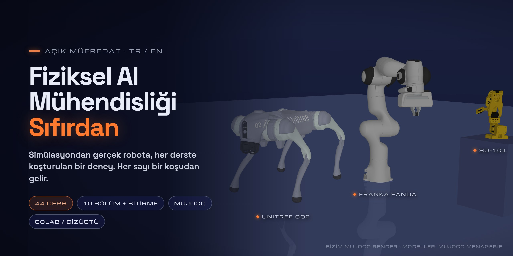

<!-- github-only: GitHub sayfası için hero ve rozetler; site/scripts/sync.mjs bu bloğu atlar -->
<p align="center">
  <a href="https://fport.github.io/physical-ai-from-scratch/tr/">
    
  </a>
</p>

<p align="center">
  <a href="#harita"></a>
  <a href="#harita"></a>
  <a href="../README.md"></a>
  <a href="https://fport.github.io/physical-ai-from-scratch/tr/"></a>
  <a href="https://github.com/fport/physical-ai-from-scratch/actions/workflows/pages.yml"></a>
  <a href="../notebooks/README.md"></a>
  <br>
  <a href="start-here/setup.md"></a>
  <a href="https://github.com/google-deepmind/mujoco"></a>
  <a href="https://github.com/google-deepmind/mujoco_menagerie"></a>
  <a href="../LICENSE"></a>
  <a href="../LICENSE-CONTENT"></a>
  <a href="https://github.com/fport/physical-ai-from-scratch/commits/main"></a>
</p>
<!-- /github-only -->

# Fiziksel AI Mühendisliği — Sıfırdan

Fiziksel dünyada iş yapan robotların arkasındaki mühendislik için eksiksiz, açık bir müfredat: simulation, spatial math, kinematics, dynamics ve control, perception, planning, imitation learning, reinforcement learning, sim-to-real ve robot foundation model'leri. Her dersin koşturulabilir bir deneyi var ve her sayı bir koşudan ya da bağlantısı verilen birincil bir kaynaktan geliyor.

**[Kurulum](start-here/setup.md)** · **[Önkoşullar](start-here/prerequisites.md)** · **[Bir ders nasıl okunur](start-here/how-to-read-a-lesson.md)** · **[İlk ders](part-1-simulation/01-world-as-text.md)** · **[English](../README.md)**

## Kimler için

Python yazabilen ve robot yazılımını uçtan uca kurmak isteyen mühendisler ve öğrenciler. Genel matematik, machine learning, deep learning ve reinforcement learning temelleri burada yeniden anlatılmaz: her ders **Önce öğren** satırında ücretsiz [AI Engineering from Scratch](https://aiengineeringfromscratch.com/index.html) kursunun ilgili dersine bağlanır; bu kitap onun üstüne robotiğe özgü kısmı öğretir.

## Nasıl kurulu

- **10 bölümde 44 ders ve bir bitirme projesi**, sıkı bir önkoşul sırasıyla. Her ders 30–90 dakika.
- **Tek şablon:** problem → ana fikir → deney → boz → gerçek robotta → kendini dene → akılda kalanlar ve kaynaklar.
- **Dizüstünde çalışır.** Deneylerin neredeyse hepsi MuJoCo ile Mac'te ya da Colab CPU'da koşar; GPU ya da gerçek kol isteyen birkaç ders bunu künyesinde söyler (çalışma türü CPU / GPU / ART / HW).
- **Tekrar eden robotlar:** SO-101 kolu, Franka Panda ve Unitree Go2; [MuJoCo Menagerie](https://github.com/google-deepmind/mujoco_menagerie) modelleriyle.

## Harita

| Bölüm | Konu | Dersler |
|---|---|---|
| 1 | [Simulation](part-1-simulation/README.md) | 01–05 |
| 2 | [Spatial math](part-2-spatial-math/README.md) | 06–07 |
| 3 | [Kinematics](part-3-kinematics/README.md) | 08–10 |
| 4 | [Dynamics ve control](part-4-dynamics-and-control/README.md) | 11–16 |
| 5 | [Perception ve estimation](part-5-perception-and-estimation/README.md) | 17–21 |
| 6 | [Planning ve optimal control](part-6-planning-and-optimal-control/README.md) | 22–24 |
| 7 | [Learning from demonstration](part-7-learning-from-demonstration/README.md) | 25–31 |
| 8 | [Robotlar için reinforcement learning](part-8-rl-for-robots/README.md) | 32–36 |
| 9 | [Sim-to-real](part-9-sim-to-real/README.md) | 37–40 |
| 10 | [Foundation model'ler ve agent'lar](part-10-foundation-models-and-agents/README.md) | 41–43 |
| — | [Bitirme projesi](capstone/README.md) | 44 |

## Deneyleri koştur

```bash
git clone https://github.com/fport/physical-ai-from-scratch.git
cd physical-ai-from-scratch
uv sync                                   # Python 3.14 + kilitli bağımlılıklar
uv run python experiments/02-timestep/experiment.py
```

Kitabı yerelde web sitesi olarak okumak için: `cd site && npm install && npm run dev` ([site/README.md](../site/README.md)).

## Dürüstlük

Kitaptaki her sayı ya `experiments/` altındaki bir deneyden (tam çıktısı yanında kayıtlı) ya da bağlantısı verilen birincil bir kaynaktan gelir. Koşturulmamış hiçbir şey sonuç gibi sunulmaz; gerçek kolda henüz koşturulmamış donanım adımları öyle etiketlenir. Kurallar: [Sayı ve kaynak kuralları](start-here/numbers-and-sources.md).

## Videolar

Türkçe kısa video serisi **Koddan Kasa** bu kitabın derslerini özetler; bkz. [Videolar ve dersler](start-here/video-map.md).

## Teşekkür

Ders formatı ve "framework'ten önce ham hâli" ilkesi, Rohit Ghumare ve katkıcılarının [AI Engineering from Scratch](https://github.com/rohitg00/ai-engineering-from-scratch) (MIT) müfredatından esinlendi; bu kitap onu önkoşul kursu olarak da kullanıyor. Metin ya da kod kopyalanmadı.

## Lisans

Kod (`experiments/`, `notebooks/`, `tools/`, `site/`) MIT ([LICENSE](../LICENSE)); ders metinleri CC BY 4.0 ([LICENSE-CONTENT](../LICENSE-CONTENT)). Robot modelleri kendi lisanslarıyla MuJoCo Menagerie'den indirilir.
