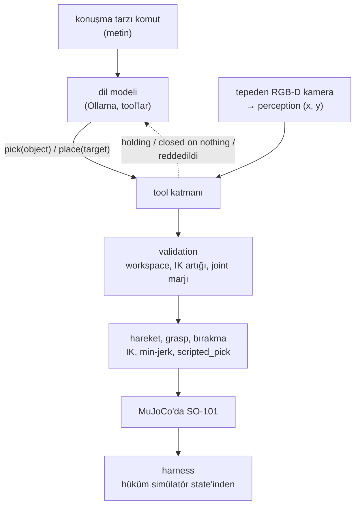

# 44 · Söyle, gör, planla, tut

<!-- meta -->
| | |
|---|---|
| **Bölüm** | [Bitirme projesi](README.md) |
| **Çalışma türü** | CPU · Mac ya da Colab CPU |
| **Önkoşul** | [21](../part-5-perception-and-estimation/21-object-perception.md), [24](../part-6-planning-and-optimal-control/24-lqr-and-mpc.md), [31](../part-7-learning-from-demonstration/31-act.md), [39](../part-9-sim-to-real/39-domain-randomization.md), [42](../part-10-foundation-models-and-agents/42-llm-agents.md) |
| **Önce öğren** | yok |
| **Süre** | ~180 dk |
| **Kod** | [`experiments/44-capstone/experiment.py`](../../experiments/44-capstone/experiment.py) |
| **Durum** | ✅ tam |
<!-- /meta -->

> Bir sistem, katmanlarının çarpımı kadar iyidir ve her katmanın ölçülebilen bir sözleşmesi olmalıdır.

## Problem

Önceki her ders tek bir katmanı, diğerlerini ideal kabul ederek test etti: [ders 16](../part-4-dynamics-and-control/16-grasping-and-pick-place.md)'nın grasp'i küpün gerçek konumunu biliyordu, [ders 21](../part-5-perception-and-estimation/21-object-perception.md)'in perception'ı tek bir kırmızı küp gördü, [ders 42](../part-10-foundation-models-and-agents/42-llm-agents.md)'nin agent'ına `find_object` ground truth veriyordu. Bir araya gelince katmanlar birbirini etkiler: bir IK reddi dil modeline metin olarak döner ve sonraki adımını değiştirir; küçük bir kamera hatası perception'a görünmez ve boş bir gripper olarak ortaya çıkar. Bu bitirme projesi bütün zinciri simüle SO-101 üzerinde kuruyor, uçtan uca ölçüyor ve her başarısızlığı bir katmana yazıyor.

## Ana fikir

### Sade anlatımla

Robotu bir microservice zinciri olarak düşün: bir cümleyi fonksiyon çağrısına çeviren bir dil modeli, küplerin nerede olduğunu söyleyen bir kamera servisi, bir doğrulayıcı, bir hareket planlayıcısı, bir gripper ve bir hakem. Her birinin bir API'si vardır ve her API, bir servisin cevap şemasını ve gecikmesini taahhüt etmesi gibi, kontrol edilebilen bir sözleşmeyle gelmelidir.

Zincirden iki şey çıkar. Birincisi, güvenilirlik çarpılır: her istek bütün servislerden geçmek zorundaysa uçtan uca başarı oranı servislerin başarı oranlarının çarpımıdır; beş çok iyi katman yine de vasat bir sistem yapabilir. İkincisi, bir istek başarısız olduğunda hatayı gösteren servis çoğu zaman hataya sebep olan servis değildir. Biraz kaymış bir kamera hiç hata üretmez; başarısızlık üç servis sonra, boşluğa kapanan bir gripper olarak ortaya çıkar. Distributed tracing benzeri bir şeye ihtiyacın var: yol boyunca her sözleşmeyi kontrol eden ve ilk bozulanı suçlayan bir harness.

Bu zinciri yönetilebilir tutan bir tasarım kuralı var: geometri dil modelinden hiç geçmez. Model bir tool adı ve bir nesne adı üretir, metrik hiçbir şey üretmez. Her koordinat kameradan, her eklem açısı inverse kinematics'ten gelir.

### Mimari



Yedi katman, her biri önceki bir derste kuruldu:

| katman | bu deneydeki bileşen | ders |
|---|---|---|
| dil | tool'lu Ollama `/api/chat`, temperature 0, seed 0 | [42](../part-10-foundation-models-and-agents/42-llm-agents.md) |
| perception | tepeden RGB-D kamera, HSV maskesi, depth back-projection | [19](../part-5-perception-and-estimation/19-camera-calibration.md), [20](../part-5-perception-and-estimation/20-pixels-to-table.md), [21](../part-5-perception-and-estimation/21-object-perception.md) |
| validation | workspace yarıçapı, IK artığı, joint marjı | [10](../part-3-kinematics/10-inverse-kinematics.md), [15](../part-4-dynamics-and-control/15-safety.md) |
| hareket | damped-least-squares IK, min-jerk joint trajectory'leri | [10](../part-3-kinematics/10-inverse-kinematics.md), [13](../part-4-dynamics-and-control/13-trajectory-generation.md) |
| grasp | `scripted_pick`: servo sıkması, weld yok | [16](../part-4-dynamics-and-control/16-grasping-and-pick-place.md) |
| bırakma | kutunun üstü için `ik_solve`, çeneyi aç | [10](../part-3-kinematics/10-inverse-kinematics.md) |
| harness | başarı simülatör state'inden, Wilson aralığı | [25](../part-7-learning-from-demonstration/25-evaluating-policies.md) |

(HSV maskesi: renk tonu, doygunluk ve parlaklığı küpün renk aralığına düşen pikselleri tut. Depth back-projection: bir pikseli derinliğiyle birlikte 3B bir noktaya çevir. IK artığı: en iyi eklem çözümünün gripper'ı hedeften ne kadar uzakta bıraktığı.)

### Hata bütçesi ve atama, kod olarak

Harness başarısız bir episode'u **pipeline sırasında sözleşmesini ilk bozan katmana** yazar: dil (istenen küpü hiç pick etmedi ya da hiç bırakmadı) → perception (görmedi ya da tahmin gerçek konumdan 8 mm'den fazla uzakta) → IK/limits (validation reddetti) → grasp (küp ≥ 4 cm kalkmadı) → bırakma (kutuda değil). Agent'ın `report_result`'u kaydedilir, hiçbir zaman hükme katılmaz.

```python
ORDER = ["language", "perception", "IK/limits", "grasp", "place"]

def attribute(ep):                       # only called for failed episodes
    for layer in ORDER:                  # pipeline order
        if not ep.contract_ok(layer):    # checked against simulator ground truth
            return layer                 # the first broken contract gets the blame

def end_to_end(p):                       # p[i]: pass rate of layer i among episodes that reach it
    return math.prod(p)                  # layers in series multiply

def even_split(P, L):                    # what each of L layers must reach for end-to-end P
    return P ** (1 / L)

def wilson(k, n, z=1.96):                # 95% interval for a success rate k/n (lesson 25)
    p = k / n
    centre = (p + z * z / (2 * n)) / (1 + z * z / n)
    half = z * math.sqrt(p * (1 - p) / n + z * z / (4 * n * n)) / (1 + z * z / n)
    return centre - half, centre + half
```

| Büyüklük | Formül |
|---|---|
| uçtan uca başarı | $P_{\text{uçtan uca}} = \prod_{i=1}^{L} p_i$ |
| eşit bütçe | $p_i = P^{1/L}$ |
| Wilson %95 aralığı | $\dfrac{\hat p + \frac{z^2}{2n} \pm z\sqrt{\frac{\hat p(1-\hat p)}{n} + \frac{z^2}{4n^2}}}{1 + \frac{z^2}{n}}$ |

$L$ seri katman sayısı, $p_i$ katman $i$'nin kendisine ulaşan bir episode'u geçme olasılığı, $P$ hedef uçtan uca oran, $\hat p = k/n$ $n$ episode üzerinden gözlenen başarı oranı ve $z$ güven düzeyinin normal quantile'ıdır (%95 için 1,96). 5 katmanda 0,90 için eşit bir paylaştırma her katmandan 0,979 ister (her paylaştırmada her $p_i \ge P$ olmalı).

<details>
<summary>Matematik ayrıntısı: çarpım burada neden tam, 30 episode neyi kanıtlayabilir</summary>

**Çarpım tanım gereği tamdır.** $p_i = \text{geçen}_i / \text{ulaşan}_i$'yi katman $i$'ye ulaşan episode'lar üzerinden tanımla. Katman $i+1$'e ulaşan episode'lar tam olarak katman $i$'yi geçenler olduğu için çarpım sadeleşir: $\prod_i p_i = \text{geçen}_L / \text{ulaşan}_1$, yani uçtan uca oran. Bu muhasebe için bağımsızlık varsayımı gerekmez; bağımsızlık yalnızca ayrı ayrı ölçülmüş geçme oranlarıyla yeni bir sistemi tahmin etmeye çalıştığında önemlidir.

**Her paylaştırmada her katman hedefin üstünde olmalı.** Her çarpan en fazla 1'dir; dolayısıyla her $j$ için $P = \prod p_i \le p_j$: hiçbir katman istediğin sistemden kötü olamaz.

**Temiz otuz episode bir kanıt değildir.** $k = n$ için Wilson alt sınırı $n / (n + z^2)$'ye indirgenir. $n = 30$ ile bu $30 / (30 + 1{,}96^2) \approx 0{,}886$'dır; eşit bir 5 katmanlı bütçenin istediği 0,979'un altında. Sınır bağımsız denemeler varsayar; bu deney deterministik bir modelle 6 sabit komutu 5 dizilimde tekrarlıyor, bu yüzden aralıkları olsa olsa fazla dardır.

**Kamera eğimi geometrisi.** Yüksekliği $h$ olan bir kameranın küçük bir $\alpha$ eğimi, bir ışının masaya değdiği noktayı yaklaşık $h\,\alpha$ kadar kaydırır (açı radyan cinsinden). $h = 0{,}6$ m'de bir derece $0{,}6 \times \pi/180$ m, yani yaklaşık 1 cm verir; bu, Boz tablosundaki medyan tahmin hatalarıyla örtüşüyor (1°'de 9,8 mm).

Daha derine: [ders 25](../part-7-learning-from-demonstration/25-evaluating-policies.md) (başarı oranları ve aralıklar), [ders 21](../part-5-perception-and-estimation/21-object-perception.md) (perception hatası), [ders 42](../part-10-foundation-models-and-agents/42-llm-agents.md) (validation ve yanlış iddialar); birincil kaynak: E. B. Wilson, ["Probable inference, the law of succession, and statistical inference"](https://doi.org/10.1080/01621459.1927.10502953) (1927).

</details>

### Arayüzler ve sözleşmeler

Bir arayüz bir tip artı bir sözleşmedir. Kontrol edemediğin bir sözleşme bir umuttur.

| arayüz | nereden → nereye | ne geçer | sözleşme |
|---|---|---|---|
| komut | kullanıcı → LLM | konuşma tanımadan gelen metin | yok |
| tool call | LLM → tool katmanı | `look()`, `pick(object)`, `place(target)`, `report_result(...)` | adlar `look()` ile eşleşmeli; yoksa hata mesajı |
| görüntü | kamera → perception | 640×480 RGB + depth, fovy 50°'den $K$, extrinsics $T_{wc}$ | $T_{wc}$ kalibre edildiği gibi |
| tahmin | perception → planner | base frame'de küp $(x, y)$, m | hata ≤ 8 mm (ders 21: 8 mm nişan hatası 30 pick'in 9'unu kaybettirdi) |
| plan | planner → validation | pre / down / lift pose'ları, artık | yarıçap 12–30 cm, artık ≤ 5 mm, down pose limitlerden ≥ 0,05 rad içeride |
| trajectory | hareket → servolar | her 2 ms'de bir pozisyon hedefi | `ctrlrange` içinde |
| sonkoşul | gripper → LLM | çene açısından "holding" / "closed on nothing" | ground truth yok |
| hüküm | simülatör → harness | küp pose'ları | istenen küp kutunun içinde, kutuda başka küp yok |

$K$ kameranın intrinsic matrisi (odak uzaklığı ve görüntü merkezi, burada 50°'lik dikey görüş açısından), $T_{wc}$ ise extrinsics'i, yani kameranın world frame'deki pose'udur ([ders 19](../part-5-perception-and-estimation/19-camera-calibration.md)); `ctrlrange` her MuJoCo actuator'ünün izin verilen komut aralığıdır.

## Deney

**Sahne.** Menagerie SO-101 (2 ms timestep) gri bir masada, üç adet 3 cm küp (kırmızı, yeşil, mavi, 30 g) x 16–25 cm, y −8–10 cm aralığına rastgele, birbirinden en az 7 cm uzağa bırakılıyor; açık mor bir kutu (içi 8 × 8 cm, 3 cm duvar) (12, −18) cm'de. Ders 21'in kamerası masanın 0,6 m üstünde; kol her görüntüden önce görüş alanının dışına katlanıyor.

**Pipeline.** `pick` algılar, doğrular, sonra ders 16'nın fiziksel pick'ini *algılanan* konuma nişanlayarak koşar; modele verdiği cevap simülatörden değil çene açısından gelir.

```python
def pick(self, object):
    self.perceive()                                     # arm parked, one RGB-D frame
    xy = self.scene.get(f"{color_of(object)} cube")     # perception estimate, never ground truth
    if xy is None:                     return error("not visible", self.visible())
    if not R_MIN <= dist(xy) <= R_MAX: return reject("outside the workspace")
    poses, err = g16.plan(m, home, I, [*xy, HALF])      # lesson 16 IK: pre / down / lift
    if err > 5e-3:                     return reject("not reachable (IK error above 5 mm)")
    if margin(poses["down"]) < 0.05:   return reject("too close to a joint limit")
    g16.scripted_pick(m, d, [*xy, HALF])                # physical grasp, no weld
    return "holding" if jaw_angle() > G_CLOSE + 0.15 else "closed on nothing"
```

Grasp'in içinde bir simülatör kısayolu kalıyor: `scripted_pick`, MuJoCo'nun contact listesinde iki çene de hedef küpe değdiğinde sıkmayı bitirir (bir jaw-stall sensörünün yerine; değmezse 4 s timeout'tan sonra yine kaldırır). Bu, kolun nereye gittiğini değil, kaldırmanın ne zaman başladığını belirler.

`place`, algılanan kutu merkezinin üstünde 7,5 cm yükseklikteki bir nokta için ders 10'un `ik_solve`'unu yumuşak bir "çene aşağı" terimiyle çözer (ağırlık 0,003: bırakılan bir küp tam bir orientation istemez, sert bir terim ise `wrist_flex`'i limitine kilitler), oraya min-jerk bir geçişle gider, çeneyi açar ve kolu park eder.

**Komutlar.** Altı konuşma tarzı komut, her biri aynı 5 dizilimde (seed 0), `qwen2.5:7b` ve `qwen3:1.7b` ile: 60 episode.

| id | komut | kastedilen |
|---|---|---|
| plain | put the red cube in the box | kırmızı |
| filler | um, could you grab the green block and drop it in the bin | yeşil |
| terse | blue one, box, please | mavi |
| asr | put the read cube in the box | kırmızı (tanıma hatası) |
| negation | the cube that is neither red nor green goes in the box | mavi |
| turkish | kırmızı küpü kutuya koy | kırmızı |

Tam script: [`experiments/44-capstone/experiment.py`](../../experiments/44-capstone/experiment.py). MuJoCo 3.17.0, NumPy 2.5.4, OpenCV 5.0.0, Python 3.14.7, Ollama 0.32.15, Apple Silicon Mac (Apple M5). Son koşu, çok yüklü bir makinede yaklaşık 5 dk sürdü; bu yaklaşık bir değer, benchmark değil.

*Tahmin et:* en sık hangi katman bozulur?

**Uçtan uca (kamera kalibre edildiği gibi):**

| model | başarı | Wilson %95 | dil | perception | IK/limits | grasp | bırakma | yanlış iddia |
|---|---|---|---|---|---|---|---|---|
| qwen2.5:7b | 26/30 (0,87) | [0,70, 0,95] | 0 | 0 | 4 | 0 | 0 | 4 |
| qwen3:1.7b | 21/30 (0,70) | [0,52, 0,83] | 5 | 0 | 4 | 0 | 0 | 4 |

**Hata bütçesi, `qwen2.5:7b`:** dil 30/30, perception 30/30, IK/limits 26/30 (0,867), grasp 26/26, bırakma 26/26; çarpım, 0,867, tanım gereği uçtan uca orana eşit. 30/30 geçen bir katmanın Wilson alt sınırı 0,886; eşit bütçenin 0,979'unun altında: 30 episode %90'lık bir sistemi kanıtlayamaz. Bu 30 episode, deterministik bir modelle 6 sabit komut × 5 dizilimdir, bağımsız örnekler değildir; bu yüzden aralıklar olsa olsa fazla dardır. İki modelin aralıkları örtüşüyor, yani bu koşu modelleri sıralamıyor.

**Gözlemler.**

- **Fiziksel katmanlar tuttu.** İstenen küpün perception hatası medyanı 0,35 mm, en büyüğü 0,63 mm (n = 60, her episode'da istenen küpün son pick'i); hiçbir başarısızlık grasp'e ya da bırakmaya yazılmadı.
- **8 IK/limits başarısızlığının hepsi tek bir sebep:** 1. ve 2. dizilimlerdeki mavi küp, (23,3, −8,0) ve (24,8, 4,3) cm'de; burada ders 16'nın üç grasp pose'u 5 mm içinde birlikte ulaşılabilir değil (`output.txt`'te `[REJ:IK]`). Validation reddetti, bu doğru; sonra **iki model de başka bir küp seçti** (yeşil ya da `terse`'te `qwen3:1.7b` için kırmızı), onu kutunun üstünde bıraktı ve başarı raporladı: 8 yanlış iddianın hepsi bu hedef değiştirme, yani ders 42'nin `find_object` ile bulduğu başarısızlık.
- **Validation joint aralığının kenarında çalışıyor.** Joint marjını validation'ın kontrol etmediği approach ve lift pose'ları bir joint limitine medyan 0,025 rad uzaktaydı (en az 0,000 rad: `wrist_flex` 1,658 rad'da). Her pose'a 0,05 rad marj koymak grasp'lerin en az yarısını reddederdi.
- **Tool katmanı net cevap verince dil hataları toparlandı.** `qwen3:1.7b` `pick(read cube)` ve `pick(kırmızı küp)` çağırdı, "no 'read cube' visible; visible objects: [...]" cevabını aldı, `look()` çağırdı ve ikisinde de 5/5 başardı. `filler`'da 5/5 başarısız oldu: `pick(green block)` ile yeşil küpü tuttu, hiç `look()` çağırmadı, `place(bin)` ve `pick(box)` çağırmaya devam etti ve 6 model turu bitti.
- **Agent ne zaman duracağını bilmiyor.** `plain`'de `qwen2.5:7b` kırmızı küpü bıraktı, sonra yine `place`, `look()` ve artık kutuda olan küp için `pick(red cube)` çağırdı; validation reddetti (IK) ve agent hiç `report_result` çağırmadı. Görev, yalnızca o pose ulaşılamaz olduğu için tamam kaldı.
- Diğer küpler 60 episode'un 8'inde 1 cm'den fazla itildi.

**Determinizm.** Temperature 0 ve seed 0; cevaplar bir koşu içinde tam request'e göre memoize ediliyor (önbelleğe alınıyor), bu yüzden 557 request için Ollama'ya 93 farklı çağrı gitti (modele koordinat gitmediği için konuşmalar dizilimler arasında tekrar ediyor). Yalnızca yazdırılan satırlarda farklı olan dört koşu aynı run signature'ı (`f942d461a345`) ve aynı tabloları verdi, bağımsız bir inceleme koşusu da bunları tekrarladı; yalnızca duvar saati satırları değişti. Determinizm, ders 42'deki gibi bu makinede bu ağırlıklarla Ollama 0.32.15'ten geliyor; başka bir sürüm ya da makine farklı cevaplar üretebilir.

## Boz

Kameranın extrinsics'i bir kez kalibre ediliyor; sonra gerçek kamera, perception kodunun bilmediği bir açıyla eğiliyor (yatay eksen $(1, 1, 0)/\sqrt 2$ etrafında rotation). 0,6 m'de her derece tahmini yaklaşık 1 cm kaydırıyor. `qwen2.5:7b`, `plain`, `filler`, `terse` komutları × 5 dizilim:


| eğim [°] | medyan tahmin hatası [mm] | başarı | Wilson %95 | perception | IK/limits | yanlış iddia |
|---|---|---|---|---|---|---|
| 0,0 | 0,4 | 13/15 | [0,62, 0,96] | 0 | 2 | 2 |
| 0,5 | 4,9 | 13/15 | [0,62, 0,96] | 0 | 2 | 2 |
| 1,0 | 9,8 | 12/15 | [0,55, 0,93] | 3 | 0 | 2 |
| 1,5 | 14,9 | 12/15 | [0,55, 0,93] | 3 | 0 | 2 |
| 2,0 | 19,8 | 3/15 | [0,07, 0,45] | 12 | 0 | 1 |

Grasp bu yönde yaklaşık 15 mm'ye kadar hatayı tolere etti (açık çene geniş), sonra 1,5° ile 2° arasında çöktü. 2°'de görünen belirti gripper'da: "closed on nothing". Agent yeniden denedi (episode başına en fazla üç pick), ama her deneme aynı sapmalı tahmine nişanlandı. Buradan iki ders çıkıyor. Birincisi, **bozulan ilk sözleşme, görülen ilk başarısızlığın yukarısındadır**: bu başarısızlıkları perception'a yalnızca tahmini simülatörün gerçeğiyle karşılaştıran harness yazabiliyor. İkincisi, **yeniden denemek rastgele hataları düzeltir, sistematik olanları değil**. Donanımda ground truth yok; çare her oturumdan önce bir calibration kontrolü, örneğin masada bilinen bir konumdaki bir fiducial'ın (kameranın hassas biçimde bulabildiği basılı bir işaret) tahmini 8 mm sözleşmesinin içine düşmeli (ders 19). Ayrıca 1,0° ve 1,5°'de 3 başarısızlığın ikisi 0°'deki aynı mavi küp retleri; perception'ın sözleşmesi önce bozulduğu için artık ona yazılıyorlar (üçüncüsü: kayan tahmin, 0. dizilimdeki yeşil küpü IK erişiminin dışına taşıdı). İlk-ihlal ataması bir kabuldür, nedensel bir kanıt değildir.

## Gerçek robotta

**Gerçek kolda henüz ölçülmedi.** Prosedür, [ders 40](../part-9-sim-to-real/40-real-so101.md)'ın donanım adımlarıyla:

1. Follower'ı kur ve kalibre et: `lerobot-setup-motors` ve `lerobot-calibrate --robot.type=so101_follower --robot.port=... --robot.id=...` ([LeRobot SO-101](https://huggingface.co/docs/lerobot/so101)). LeRobot'un kalibre derecesi ile modelin radyanı arasındaki ofseti ve işareti ölç (ders 40).
2. Masanın üstüne bir kamera sabitle. Intrinsics'i ve kameradan base'e transform'u kalibre et (ders 19). Her oturumdan önce masadaki bilinen noktalara bir fiducial koy ve tahmini 8 mm sözleşmesine karşı kontrol et; yukarıdaki sweep nedenini gösteriyor.
3. HSV eşiklerini odanın ışığında bir kez yeniden ayarla, sonra dondur (ders 21).
4. Tool katmanını değiştirme: IK ve validation Menagerie modeli üzerinde koşar; joint hedefleri kola `max_relative_target` ayarlı olarak gider (ders 15, 40). E-stop tool listesinin dışında kalır.
5. Hüküm bir sensör ister: istenen küpün kutu bölgesinin içinde olduğunu gösteren bir kamera kontrolü, bir insan etiketiyle doğrulanmış. Asla agent'ın raporu değil.
6. Aynı 6 komutu en az 5 dizilimde koş ve $k/n$'yi Wilson aralığı ve katman dağılımıyla, yukarıdaki simülasyon sayılarının yanında raporla.

## Kendini dene

1. **Kolay.** Katman geçme oranları 0,99, 0,95, 0,98, 0,97, 0,99 ise uçtan uca oran nedir ve önce hangi katmanı iyileştirirdin?
2. **Orta.** Hedef değiştirmeyi imkânsız yap: tool katmanı ilk `pick` çağrısındaki küpü hatırlasın ve aynı episode'da farklı bir küpün `pick`'ini reddetsin. Yanlış iddialara ve başarıya etkisini tahmin et, sonra koş.
3. **Zor.** `place`'ten sonra yeniden bakan ve kameranın kutu bölgesinde gördüğü küpleri döndüren bir `verify()` tool'u ekle. `qwen2.5:7b` onu çağırıyor mu ve başarıdan sonraki fazladan `pick`'i durduruyor mu? Koş ve sayıları raporla.

### Cevaplar

1. 0,99 × 0,95 × 0,98 × 0,97 × 0,99 ≈ 0,885; kaybın en büyük payını getirdiği için 0,95'lik katman.
2. Burada hesaplanmadı. Beklenen: yanlış iddialar düşer (8 hedef değiştirme redde dönüşür), başarı değişmez (istenen mavi küp yine erişim dışında).
3. Burada hesaplanmadı; koş.

## Akılda kalanlar ve kaynaklar

- Bu simülasyonda konuşma tarzı bir komuttan kutudaki küpe kadar bütün zincir `qwen2.5:7b` ile 26/30 başardı (Wilson [0,70, 0,95]); her başarısızlık tek bir erişim limitiydi ve agent her birini başka bir küp seçerek yanlış bir başarıya çevirdi.
- Başarısızlıkları harness'te ölçülen arayüz sözleşmelerine göre ata; başarısızlığın görünür olduğu katman (boş bir gripper) çoğu zaman bozulan katman değildir (kameranın extrinsics'i: 2° eğim başarıyı 13/15'ten 3/15'e düşürdü).
- Temiz 30 episode bir katmanı alttan ancak 0,886 ile sınırlar; 5 katmanda 0,90'a ulaşması gereken bir sistem eşit bütçede her katmandan 0,979 ister ve bunu göstermek 30'dan çok daha fazla deneme gerektirir.

Kaynaklar:
- Ollama [tool calling](https://docs.ollama.com/capabilities/tool-calling); model'ler `qwen2.5:7b`, `qwen3:1.7b`.
- LeRobot [SO-101 dokümantasyonu](https://huggingface.co/docs/lerobot/so101).
- [MuJoCo Menagerie · robotstudio_so101](https://github.com/google-deepmind/mujoco_menagerie/tree/main/robotstudio_so101) (Apache-2.0).
- E. B. Wilson, ["Probable inference, the law of succession, and statistical inference"](https://doi.org/10.1080/01621459.1927.10502953), *J. Amer. Statist. Assoc.* 22, 209–212, 1927.
- Ölçülen bütün sayılar: [`experiments/44-capstone/output.txt`](../../experiments/44-capstone/output.txt), grafik [`plot.py`](../../experiments/44-capstone/plot.py) ile.

### Buradan sonra

- Metnin önüne konuşma: Radford ve ark., [Robust Speech Recognition via Large-Scale Weak Supervision](https://arxiv.org/abs/2212.04356) (Whisper, 2022).
- Dil modelini robotun yapabildiklerine bağlamak: Ahn ve ark., [Do As I Can, Not As I Say](https://arxiv.org/abs/2204.01691) (SayCan, 2022); başarı kontrollerini plana geri beslemek: Huang ve ark., [Inner Monologue](https://arxiv.org/abs/2207.05608) (2022).
- Beceri kodunu modele yazdırmak: Liang ve ark., [Code as Policies](https://arxiv.org/abs/2209.07753) (2022); 3B value map'leri birleştirmek: Huang ve ark., [VoxPoser](https://arxiv.org/abs/2307.05973) (2023).
- Scripted grasp'in yerine öğrenilmiş bir policy: [ders 31](../part-7-learning-from-demonstration/31-act.md) (ACT) ve [ders 41](../part-10-foundation-models-and-agents/41-vla.md); Kim ve ark., [OpenVLA](https://arxiv.org/abs/2406.09246) (2024); Shukor ve ark., [SmolVLA](https://arxiv.org/abs/2506.01844) (2025).
