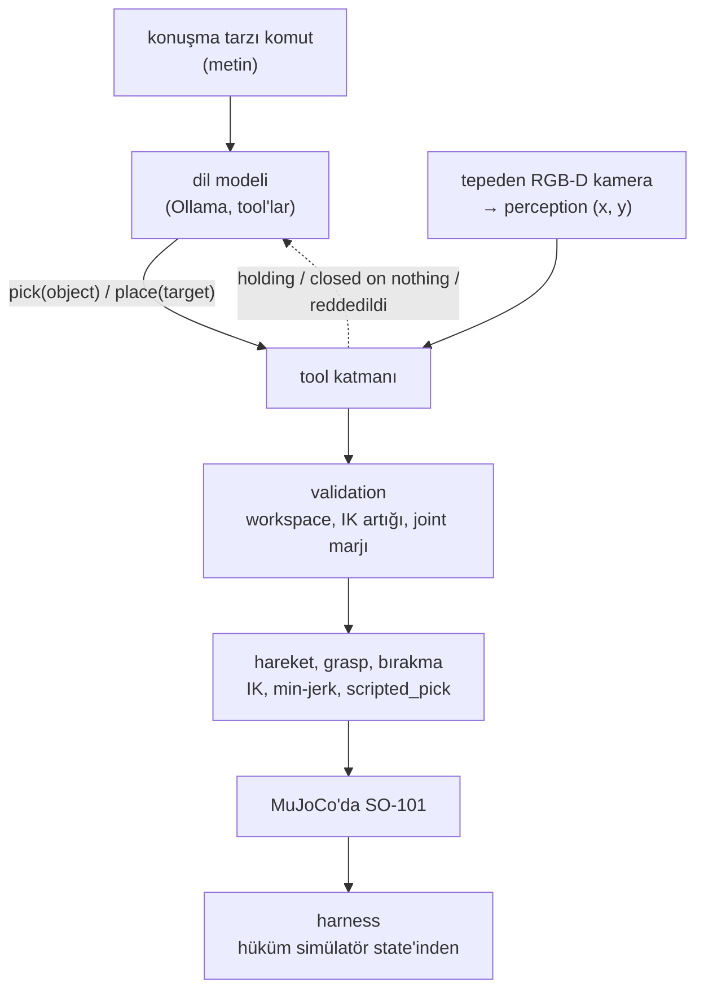

# 44 · Söyle, gör, planla, tut

<!-- meta -->
| | |
|---|---|
| **Bölüm** | [Bitirme projesi](README.md) |
| **Çalışma türü** | CPU · Mac ya da Colab CPU |
| **Önkoşul** | [21](../part-5-perception-and-estimation/21-object-perception.md), [24](../part-6-planning-and-optimal-control/24-lqr-and-mpc.md), [31](../part-7-learning-from-demonstration/31-act.md), [39](../part-9-sim-to-real/39-domain-randomization.md), [42](../part-10-foundation-models-and-agents/42-llm-agents.md) |
| **Önce öğren** | yok |
| **Süre** | ~180 dk |
| **Kod** | [`experiments/44-capstone/experiment.py`](../../experiments/44-capstone/experiment.py) |
| **Durum** | ✅ tam |
<!-- /meta -->

> Bir sistem, katmanlarının çarpımı kadar iyidir ve her katmanın ölçülebilen bir sözleşmesi olmalıdır.

## Problem

Önceki her ders tek bir katmanı, diğerlerini ideal kabul ederek test etti: [ders 16](../part-4-dynamics-and-control/16-grasping-and-pick-place.md)'nın grasp'i küpün gerçek konumunu biliyordu, [ders 21](../part-5-perception-and-estimation/21-object-perception.md)'in perception'ı tek bir kırmızı küp gördü, [ders 42](../part-10-foundation-models-and-agents/42-llm-agents.md)'nin agent'ı ground truth'u `find_object`'ten aldı. Bir araya gelince katmanlar birbirini etkiler: bir IK reddi modele metin olarak döner ve sonraki adımını değiştirir; küçük bir kamera hatası boş bir gripper olarak ortaya çıkar. Bu bitirme projesi bütün zinciri simüle SO-101 üzerinde kuruyor, uçtan uca ölçüyor ve her başarısızlığı bir katmana yazıyor.

## Ana fikir

### Sade anlatımla

Robotu bir microservice zinciri olarak düşün: bir cümleyi fonksiyon çağrısına çeviren bir dil modeli, küplerin nerede olduğunu söyleyen bir kamera servisi, bir doğrulayıcı, bir hareket planlayıcısı, bir gripper ve bir hakem; her birinin bir API'si ve kontrol edilebilen bir sözleşmesi var.

Buradan iki şey çıkar. Güvenilirlik çarpılır: uçtan uca başarı oranı servislerin oranlarının çarpımıdır, beş çok iyi katman yine de vasat bir sistem yapabilir. Ve hatayı gösteren servis çoğu zaman sebep olan değildir: biraz kaymış bir kamera hiç hata üretmez, başarısızlık üç servis sonra boşluğa kapanan bir gripper olarak ortaya çıkar. Distributed tracing benzeri bir şeye ihtiyacın var: her sözleşmeyi kontrol eden ve ilk bozulanı suçlayan bir harness.

Zinciri yönetilebilir tutan bir tasarım kuralı var: geometri dil modelinden hiç geçmez. Model bir tool adı ve bir nesne adı üretir; her koordinat kameradan, her eklem açısı inverse kinematics'ten gelir.

### Mimari



Her katman önceki bir dersten geliyor: dil [42](../part-10-foundation-models-and-agents/42-llm-agents.md)'den (Ollama tool'ları, temperature 0, seed 0), perception [19](../part-5-perception-and-estimation/19-camera-calibration.md)–[21](../part-5-perception-and-estimation/21-object-perception.md)'den (tepeden RGB-D kamera, HSV maskesi, depth back-projection), validation ve hareket [10](../part-3-kinematics/10-inverse-kinematics.md), [13](../part-4-dynamics-and-control/13-trajectory-generation.md) ve [15](../part-4-dynamics-and-control/15-safety.md)'ten, grasp [16](../part-4-dynamics-and-control/16-grasping-and-pick-place.md)'dan (servo sıkması, weld yok), harness [25](../part-7-learning-from-demonstration/25-evaluating-policies.md)'ten.

### Hata bütçesi ve atama, kod olarak

Harness başarısız bir episode'u **pipeline sırasında sözleşmesini ilk bozan katmana** yazar: dil (istenen küpü hiç pick etmedi ya da hiç bırakmadı) → perception (görmedi ya da tahmin gerçek konumdan 8 mm'den fazla uzakta) → IK/limits (validation reddetti) → grasp (küp ≥ 4 cm kalkmadı) → bırakma (kutuda değil). Agent'ın `report_result`'u kaydedilir, hiçbir zaman hükme katılmaz.

```python
layer = attribute(broken_contracts(episode))   # first broken contract, in pipeline order (Build it, Step 3)
p_end_to_end = math.prod(pass_rates)          # layers in series multiply
per_layer = 0.90 ** (1 / 5)                    # even split: 0.979 per layer for 0.90 end to end
lo, hi = wilson(26, 30)                        # lesson 25: [0.70, 0.95]
```

| Büyüklük | Formül |
|---|---|
| uçtan uca başarı | $P_{\text{uçtan uca}} = \prod_{i=1}^{L} p_i$ |
| eşit bütçe | $p_i = P^{1/L}$ |
| Wilson %95 aralığı, $n$'de $k$ | ders 25 |

$L$ seri katman sayısı, $p_i$ katman $i$'nin kendisine ulaşan episode'lar arasındaki geçme oranı, $P$ hedef uçtan uca oran.

<details>
<summary>Matematik ayrıntısı: çarpım burada neden tam, 30 episode neyi kanıtlayabilir</summary>

**Çarpım tanım gereği tamdır.** $p_i = \text{geçen}_i / \text{ulaşan}_i$ ile katman $i+1$'e ulaşan episode'lar katman $i$'yi geçenlerdir, yani $\prod_i p_i = \text{geçen}_L / \text{ulaşan}_1$. Bu muhasebe için bağımsızlık gerekmez; yalnızca ayrı ölçülmüş katmanlardan yeni bir sistemi tahmin etmek için gerekir.

**Her paylaştırmada her katman hedefin üstünde olmalı.** Her çarpan en fazla 1'dir; dolayısıyla her $j$ için $P = \prod p_i \le p_j$: hiçbir katman istediğin sistemden kötü olamaz.

**Temiz otuz episode bir kanıt değildir.** $k = n$ için Wilson alt sınırı $n / (n + z^2)$: $n = 30$'da 0,886, eşit bir 5 katmanlı bütçenin istediği 0,979'un altında.

**Kamera eğimi geometrisi.** Yüksekliği $h$ olan bir kameranın küçük bir $\alpha$ eğimi, bir ışının masaya değdiği noktayı yaklaşık $h\,\alpha$ kadar kaydırır: 0,6 m'de derece başına yaklaşık 1 cm (Sıfırdan yaz, Adım 1).

Daha derine: [ders 25](../part-7-learning-from-demonstration/25-evaluating-policies.md) (başarı oranları ve aralıklar), [ders 21](../part-5-perception-and-estimation/21-object-perception.md) (perception hatası), [ders 42](../part-10-foundation-models-and-agents/42-llm-agents.md) (validation ve yanlış iddialar); birincil kaynak: E. B. Wilson, ["Probable inference, the law of succession, and statistical inference"](https://doi.org/10.1080/01621459.1927.10502953) (1927).

</details>

### Arayüzler ve sözleşmeler

Bir arayüz bir tip artı bir sözleşmedir. Kontrol edemediğin bir sözleşme bir umuttur.

| arayüz | nereden → nereye | ne geçer | sözleşme |
|---|---|---|---|
| komut | kullanıcı → LLM | konuşma tanımadan gelen metin | yok |
| tool call | LLM → tool katmanı | `look()`, `pick(object)`, `place(target)`, `report_result(...)` | adlar `look()` ile eşleşmeli; yoksa hata mesajı |
| görüntü | kamera → perception | 640×480 RGB + depth, fovy 50°'den $K$, extrinsics $T_{wc}$ | $T_{wc}$ kalibre edildiği gibi |
| tahmin | perception → planner | base frame'de küp $(x, y)$, m | hata ≤ 8 mm (ders 21: 8 mm nişan hatası 30 pick'in 9'unu kaybettirdi) |
| plan | planner → validation | pre / down / lift pose'ları, artık | yarıçap 12–30 cm, artık ≤ 5 mm, down pose limitlerden ≥ 0,05 rad içeride |
| trajectory | hareket → servolar | her 2 ms'de bir pozisyon hedefi | `ctrlrange` içinde |
| sonkoşul | gripper → LLM | çene açısından "holding" / "closed on nothing" | ground truth yok |
| hüküm | simülatör → harness | küp pose'ları | istenen küp kutunun içinde, kutuda başka küp yok |

$K$ kameranın intrinsic matrisi, $T_{wc}$ world'deki pose'u ([ders 19](../part-5-perception-and-estimation/19-camera-calibration.md)); `ctrlrange` her actuator'ün izin verilen komut aralığı.

## Sıfırdan yaz

Şimdi pipeline'ın sözleşmelerini önceki derslerin modüllerinden yeniden kuracak ve her birini Deney'in koşusuyla karşılaştıracaksın: ders 19–21'in kamera modeli (`physai.vision`), ders 09'un zinciri üzerinde ders 42'nin erişim testi, ders 25'in Wilson aralığı (`physai.evaluation`). Yalnızca capstone'un eklediği şey yeni, [`physai/capstone.py`](../../physai/capstone.py) içinde. Veri Deney'in `output.txt`'i, bu yüzden dil modeline ya da renderer'a gerek yok; `uv run python experiments/44-capstone/build.py` adımları koşturur (çıktı [`build_output.txt`](../../experiments/44-capstone/build_output.txt) dosyasında).

### Adım 1 · Perception ve eğilmiş bir kamera

Gerçek kamera üst yüzün merkezini tam bir pikselde görür; perception o pikselin ışınını *kalibre edilmiş* kameradan küp üstlerinin düzlemine geri atar. Gerçek kamerayı eğ, ikisi ayrışır:

```python
def tilt(deg, axis=(1.0, 1.0, 0.0)):
    """World-frame rotation of a camera that has tilted by `deg` about a horizontal axis."""
    a = np.asarray(axis, float)
    return axis_angle_to_mat(a / np.linalg.norm(a), np.radians(deg))
```

```python
def estimate_xy(p_top, K, R_wc_true, R_wc_model, c, z_top):
    """Where perception puts a cube: the true camera images the top-face centre p_top at the nearest pixel, and
    the calibrated (model) camera casts that pixel's ray back onto the plane z = z_top."""
    uv = np.round(project_points(p_top[None], R_wc_true.T, -R_wc_true.T @ c, K))   # whole pixels
    return ray_plane(uv, K, R_wc_model, c, z_top)[0][0, :2]
```

```text
== Step 1. Perception: estimate of the requested cube (plain, filler, terse x 5 layouts) ==
K: f = 514.68 px, centre (319.5, 239.5); camera 0.6 m above the table, looking down
tilt deg  median err mm  max err mm  > 8 mm  Experiment median mm
     0.0            0.4         0.7    0/15                   0.4
     0.5            5.1         5.6    0/15                   4.9
     1.0           10.1        10.6   15/15                   9.8
     1.5           14.9        15.5   15/15                  14.9
     2.0           20.0        20.6   15/15                  19.8
small-angle estimate h * alpha at 1 deg: 9.9 mm
```

Yalnızca geometri, sıfır eğimdeki 0,4 mm piksel quantization'ı dahil, Deney'in medyanlarını 0,3 mm içinde üretiyor. 1°'den itibaren 15 tahminin hepsi 8 mm sözleşmesini bozuyor, yine de koşu 1° ve 1,5°'de 15'te 12 kez başarılı oldu: açık çene sözleşmenin istediğinden fazlasını tolere ediyor.

### Adım 2 · Erişim

Ders 16'nın üç grasp yüksekliğinde ders 42'nin `ik_position`'ı, artı 12–30 cm workspace yarıçapı:

```text
== Step 2. Reach: workspace radius and IK residual of the three grasp points ==
layout   cube  radius cm  reach miss mm    ours  Experiment
     0   blue       14.7           0.21  accept          ok
     0  green       21.2           0.13  accept          ok
     0    red       18.1           0.44  accept          ok
     1   blue       21.0           0.16  accept      REJ:IK
     1  green       19.2           0.31  accept          ok
     1    red       20.0           0.25  accept          ok
     2   blue       21.4           0.34  accept      REJ:IK
     2  green       17.6           0.27  accept          ok
     2    red       13.8           0.23  accept          ok
     3   blue       18.3           0.42  accept          ok
     3  green       15.9           0.19  accept          ok
     3    red       14.2           0.35  accept          ok
     4   blue       13.1           0.24  accept          ok
     4  green       19.8           0.26  accept          ok
     4    red       16.6           0.20  accept          ok
```

Yalnızca konuma bakan kontrol, Deney'in reddettiği iki mavi küp dahil 15 küpün hepsini kabul ediyor: ders 16'nın grasp'i ayrıca çenenin aşağı bakmasını ve iki yüze kapanmasını istiyor, pan ekseninden 21,0 ve 21,4 cm'de o yönelim erişim dışında, konum değil. Zayıf sözleşme kolu gripper'ın kullanamayacağı bir poza gönderirdi.

### Adım 3 · Log'dan sözleşmeler ve atama

```python
def attribute(broken, order=ORDER):
    """First layer, in pipeline order, whose contract broke; None if all held. broken: set of layer names."""
    return next((layer for layer in order if layer in broken), None)
```

Build script'i her episode'un tool çağrılarını ve perception hatasını `output.txt`'ten okuyor, bozulan sözleşmeleri işaretliyor (istenen küpün pick'i yok ya da tuttuktan sonra bırakma yok; 8 mm'nin ötesinde tahmin; istenen küpün reddedilen ya da boş pick'i; kutuda değil) ve ilkini suçluyor:

```text
== Step 3. The harness: contracts from each logged episode, first broken layer ==
failed episodes in output.txt: 33; our first broken layer = the Experiment's on 33/33
qwen2.5:7b: language 0, perception 0, IK/limits 4, grasp 0, place 0; success 26/30
qwen3:1.7b: language 5, perception 0, IK/limits 4, grasp 0, place 0; success 21/30
```

Kalibre ve eğik, 33 başarısız episode'un hepsi Deney'in katmanını alıyor: atama, log'lanmış sözleşmelerin saf bir fonksiyonu, hiçbir şey koşturmadan test edilebiliyor.

### Adım 4 · Bütçe

```python
def failure_budget(first_failures, n, order=ORDER):
    """Episodes that reach each layer and pass it, from the first broken layer of every failed episode.
    Returns [(layer, reached, passed)]; the product of passed / reached is the end-to-end rate."""
    rows, reached = [], n
    for layer in order:
        failed = sum(f == layer for f in first_failures)
        rows.append((layer, reached, reached - failed))
        reached -= failed
    return rows
```

```python
def even_split(P, L):
    """Pass rate every one of L layers in series needs for an end-to-end rate P."""
    return P ** (1 / L)
```

```text
== Step 4. Failure budget and what 30 episodes certify ==
language    reached 30 passed 30  p = 1.000
perception  reached 30 passed 30  p = 1.000
IK/limits   reached 30 passed 26  p = 0.867
grasp       reached 26 passed 26  p = 1.000
place       reached 26 passed 26  p = 1.000
product of layer pass rates 0.867 = end-to-end 26/30 = 0.867; Wilson 95% [0.70, 0.95]
even split of 0.90 over 5 layers: 0.979 per layer; a layer that passed 30/30 has Wilson lower bound 0.886
clean episodes needed before the lower bound reaches 0.979: 181
```

Çarpım 26/30'a sadeleşiyor, aralık ders 25'in `wilson`'ı ve bir katmanın alt sınırı, eşit 5 katmanlı paylaşımın 0,979'una ancak art arda 181 temiz episode'dan sonra ulaşıyor.

### Elinde kalan

`physai.capstone`, `vision`, `foundation`, `kinematics` ve `evaluation`'ın üstüne `tilt`, `estimate_xy`, `attribute`, `failure_budget` ve `even_split` ekliyor. [`tests/test_44_capstone.py`](../../tests/test_44_capstone.py) onları kontrol eder: `uv run pytest tests/test_44_capstone.py`; `uv run pytest` bütün kütüphanenin testlerini koşturur.

## Kütüphaneyle kullan

Kütüphane parçaları Deney'inkiler: OpenCV maskeleri (ders 21), RGB-D frame için MuJoCo'nun `Renderer`'ı, ders 16'nın `plan` ve `scripted_pick`'i, Ollama'nın `/api/chat`'i. Build, bunların etrafına harness disiplinini ekliyor:

```python
broken = broken_contracts(cmd, calls, perc_err, success)   # read from the log, never from the agent
layer = attribute(broken)                                   # first broken contract in pipeline order
lo, hi = wilson(k, n)                                       # lesson 25, physai.evaluation
```

Tuzaklar:

- **Atama bir kabuldür.** İlk-ihlal suçlaması eğik kameradaki mavi küp retlerini perception'a yazıyor; nedensel bir cevap karşı-olgusal koşu ister.
- **Bozulan sözleşme başarısızlık demek değildir.** 1°'de her tahmin 8 mm'den fazla şaştı ve 15 episode'un 12'si yine başarılı oldu.
- **Aynı kontrol, farklı sözleşme.** Konum erişimi ile grasp-pozu erişimi iki küpte ayrışıyor (Adım 2): validation'ın hangisini uyguladığını yaz.

## Deney

**Sahne.** Menagerie SO-101 (2 ms timestep), x 16–25 cm, y −8–10 cm aralığında rastgele, birbirinden en az 7 cm uzak üç adet 3 cm küp (kırmızı, yeşil, mavi, 30 g), (12, −18) cm'de açık bir kutu (içi 8 × 8 cm, 3 cm duvar), masanın 0,6 m üstünde ders 21'in kamerası. `pick` algılar, doğrular, sonra ders 16'nın fiziksel pick'ini *algılanan* konuma nişanlayarak koşar; modele cevabı çene açısından gelir.

```python
def pick(self, object):
    self.perceive()                                     # arm parked, one RGB-D frame
    xy = self.scene.get(f"{color_of(object)} cube")     # perception estimate, never ground truth
    if xy is None:                     return error("not visible", self.visible())
    if not R_MIN <= dist(xy) <= R_MAX: return reject("outside the workspace")
    poses, err = g16.plan(m, home, I, [*xy, HALF])      # lesson 16 IK: pre / down / lift
    if err > 5e-3:                     return reject("not reachable (IK error above 5 mm)")
    if margin(poses["down"]) < 0.05:   return reject("too close to a joint limit")
    g16.scripted_pick(m, d, [*xy, HALF])                # physical grasp, no weld
    return "holding" if jaw_angle() > G_CLOSE + 0.15 else "closed on nothing"
```

Bir simülatör kısayolu kalıyor: `scripted_pick`, MuJoCo'nun contact listesinde iki çene de küpe değdiğinde sıkmayı bitirir (bir jaw-stall sensörünün yerine; değmezse 4 s timeout). `place`, algılanan kutu merkezinin 7,5 cm üstü için ders 10'un `ik_solve`'unu yumuşak bir "çene aşağı" terimiyle (ağırlık 0,003) çözer, oraya min-jerk bir geçişle gider, çeneyi açar ve kolu park eder.

**Komutlar.** Altı konuşma tarzı komut, her biri aynı 5 dizilimde (seed 0), `qwen2.5:7b` ve `qwen3:1.7b` ile: 60 episode.

| id | komut | kastedilen |
|---|---|---|
| plain | put the red cube in the box | kırmızı |
| filler | um, could you grab the green block and drop it in the bin | yeşil |
| terse | blue one, box, please | mavi |
| asr | put the read cube in the box | kırmızı (tanıma hatası) |
| negation | the cube that is neither red nor green goes in the box | mavi |
| turkish | kırmızı küpü kutuya koy | kırmızı |

Tam script: [`experiments/44-capstone/experiment.py`](../../experiments/44-capstone/experiment.py). MuJoCo 3.17.0, NumPy 2.5.4, OpenCV 5.0.0, Python 3.14.7, Ollama 0.32.15, Apple M5; yüklü bir makinede yaklaşık 5 dk.

*Tahmin et:* en sık hangi katman bozulur?

**Uçtan uca (kamera kalibre edildiği gibi):**

| model | başarı | Wilson %95 | dil | perception | IK/limits | grasp | bırakma | yanlış iddia |
|---|---|---|---|---|---|---|---|---|
| qwen2.5:7b | 26/30 (0,87) | [0,70, 0,95] | 0 | 0 | 4 | 0 | 0 | 4 |
| qwen3:1.7b | 21/30 (0,70) | [0,52, 0,83] | 5 | 0 | 4 | 0 | 0 | 4 |

**Hata bütçesi, `qwen2.5:7b`:** dil 30/30, perception 30/30, IK/limits 26/30 (0,867), grasp 26/26, bırakma 26/26; çarpım, 0,867, uçtan uca orana eşit. 30/30 geçen bir katmanın Wilson alt sınırı 0,886, eşit bütçenin 0,979'unun altında: 30 episode %90'lık bir sistemi kanıtlayamaz (Sıfırdan yaz, Adım 4: 181 kanıtlardı). 30 episode deterministik bir modelle 6 sabit komut × 5 dizilim, yani aralıklar olsa olsa fazla dar; iki modelin aralıkları örtüşüyor.

**Gözlemler.**

- **Fiziksel katmanlar tuttu.** İstenen küpün perception hatası: medyan 0,35 mm, en büyük 0,63 mm (n = 60); hiçbir başarısızlık grasp'e ya da bırakmaya yazılmadı.
- **8 IK/limits başarısızlığının hepsi tek bir sebep:** 1. ve 2. dizilimlerdeki mavi küp, (23,3, −8,0) ve (24,8, 4,3) cm'de; burada ders 16'nın grasp pose'ları (çene aşağı) 5 mm içinde birlikte ulaşılabilir değil. Validation doğru olarak reddetti, sonra **iki model de başka bir küp seçti**, onu kutunun üstünde bıraktı ve başarı raporladı: 8 yanlış iddianın hepsi bu hedef değiştirme, ders 42'nin bulduğu başarısızlık.
- **Validation joint aralığının kenarında çalışıyor:** kontrol edilmeyen approach ve lift pose'ları bir joint limitine medyan 0,025 rad uzaktaydı (en az 0,000 rad).
- **Tool katmanı net cevap verince dil hataları toparlandı.** `qwen3:1.7b` `pick(read cube)` ve `pick(kırmızı küp)` çağırdı, "no 'read cube' visible; visible objects: [...]" cevabını aldı, `look()` çağırdı ve ikisinde de 5/5 başardı; `filler`'da 6 turu bitene kadar `place(bin)` çağırdı (0/5).
- **Agent ne zaman duracağını bilmiyor.** `plain`'de `qwen2.5:7b` kırmızı küpü bıraktı, sonra artık kutuda olan küp için `pick(red cube)` çağırdı; validation reddetti (IK) ve görev yalnızca o pose ulaşılamaz olduğu için tamam kaldı.
**Determinizm.** Temperature 0 ve seed 0; cevaplar bir koşu içinde tam request'e göre memoize ediliyor, bu yüzden 557 request için Ollama'ya 93 farklı çağrı gitti (modele koordinat gitmiyor). Dört koşu ve bağımsız bir inceleme koşusu aynı run signature'ı (`f942d461a345`) ve aynı tabloları verdi. Bu, ders 42'deki gibi bu makinede bu ağırlıklarla Ollama 0.32.15 için geçerli.

## Boz

Kameranın extrinsics'i bir kez kalibre ediliyor; sonra gerçek kamera perception'ın bilmediği bir açıyla eğiliyor (yatay eksen $(1, 1, 0)/\sqrt 2$ etrafında). `qwen2.5:7b`, `plain`, `filler`, `terse` komutları × 5 dizilim:


| eğim [°] | medyan tahmin hatası [mm] | başarı | Wilson %95 | perception | IK/limits | yanlış iddia |
|---|---|---|---|---|---|---|
| 0,0 | 0,4 | 13/15 | [0,62, 0,96] | 0 | 2 | 2 |
| 0,5 | 4,9 | 13/15 | [0,62, 0,96] | 0 | 2 | 2 |
| 1,0 | 9,8 | 12/15 | [0,55, 0,93] | 3 | 0 | 2 |
| 1,5 | 14,9 | 12/15 | [0,55, 0,93] | 3 | 0 | 2 |
| 2,0 | 19,8 | 3/15 | [0,07, 0,45] | 12 | 0 | 1 |

Grasp bu yönde yaklaşık 15 mm'ye kadar hatayı tolere etti (açık çene geniş), sonra 1,5° ile 2° arasında çöktü. 2°'de görünen belirti gripper'da, "closed on nothing", ve her yeniden deneme aynı sapmalı tahmine nişanlandı. **Bozulan ilk sözleşme, görülen ilk başarısızlığın yukarısındadır**: bu başarısızlıkları perception'a yalnızca tahmini gerçekle karşılaştıran harness yazabiliyor. Ve **yeniden denemek rastgele hataları düzeltir, sistematik olanları değil**; donanımda her oturumdan önce masada bilinen bir konumdaki bir fiducial'ı (basılı bir işaret) kontrol et (ders 19). 1,0° ve 1,5°'de 3 başarısızlığın ikisi 0°'deki mavi küp retleri; perception'ın sözleşmesi önce bozulduğu için artık ona yazılıyorlar: ilk-ihlal ataması bir kabuldür, nedensel bir kanıt değildir.

## Gerçek robotta

**Gerçek kolda henüz ölçülmedi.** Prosedür, [ders 40](../part-9-sim-to-real/40-real-so101.md)'ın donanım adımlarıyla:

1. Follower'ı kur ve kalibre et: `lerobot-setup-motors` ve `lerobot-calibrate --robot.type=so101_follower --robot.port=... --robot.id=...` ([LeRobot SO-101](https://huggingface.co/docs/lerobot/so101)); LeRobot'un dereceleri ile modelin radyanları arasındaki ofseti ve işareti fit et (ders 40, Sıfırdan yaz).
2. Masanın üstüne bir kamera sabitle, intrinsics'i ve kameradan base'e transform'u kalibre et (ders 19) ve her oturumdan önce bilinen masa noktalarındaki bir fiducial'ı 8 mm sözleşmesine karşı kontrol et.
3. HSV eşiklerini odanın ışığında bir kez yeniden ayarla, sonra dondur (ders 21).
4. Tool katmanını koru: IK ve validation Menagerie modelinde, joint hedefleri `max_relative_target` ayarlı gönderilir (ders 15, 40), e-stop tool listesinin dışında.
5. Hüküm bir sensör ister (kutu bölgesinin bir kamera kontrolü, bir insan etiketiyle doğrulanmış), asla agent'ın raporu değil.
6. 6 komutu en az 5 dizilimde koş; $k/n$'yi Wilson aralığı ve katman dağılımıyla simülasyon sayılarının yanında raporla.

## Kendini dene

1. **Kolay.** Katman geçme oranları 0,99, 0,95, 0,98, 0,97, 0,99 ise uçtan uca oran nedir ve önce hangi katmanı iyileştirirdin?
2. **Orta.** Hedef değiştirmeyi imkânsız yap: tool katmanı episode'da ilk adı geçenden farklı bir küpün `pick`'ini reddetsin. Yanlış iddialara ve başarıya etkisini tahmin et, sonra koş.
3. **Zor.** `place`'ten sonra yeniden bakan ve kutu bölgesinde görülen küpleri döndüren bir `verify()` tool'u ekle. `qwen2.5:7b` onu çağırıyor mu ve başarıdan sonraki fazladan `pick`'i durduruyor mu?

### Cevaplar

1. 0,99 × 0,95 × 0,98 × 0,97 × 0,99 ≈ 0,885; kaybın en büyük payını getirdiği için 0,95'lik katman.
2. Burada hesaplanmadı. Beklenen: yanlış iddialar düşer (8 hedef değiştirme redde dönüşür), başarı değişmez (istenen mavi küp yine erişim dışında).
3. Burada hesaplanmadı; koş.

## Akılda kalanlar ve kaynaklar

- Bu simülasyonda konuşma tarzı bir komuttan kutudaki küpe kadar bütün zincir `qwen2.5:7b` ile 26/30 başardı (Wilson [0,70, 0,95]); her başarısızlık tek bir erişim limitiydi ve agent her birini başka bir küp seçerek yanlış bir başarıya çevirdi.
- Başarısızlıkları harness'te ölçülen arayüz sözleşmelerine göre ata; başarısızlığın görünür olduğu katman (boş bir gripper) çoğu zaman bozulan katman değildir (kameranın extrinsics'i: 2° eğim başarıyı 13/15'ten 3/15'e düşürdü).
- Temiz 30 episode bir katmanı alttan ancak 0,886 ile sınırlar; 5 katmanlı 0,90'lık bir sistem her katmandan 0,979 ister, bunu göstermek 181 temiz episode ister.

Kaynaklar:
- Ollama [tool calling](https://docs.ollama.com/capabilities/tool-calling); model'ler `qwen2.5:7b`, `qwen3:1.7b`.
- LeRobot [SO-101 dokümantasyonu](https://huggingface.co/docs/lerobot/so101).
- [MuJoCo Menagerie · robotstudio_so101](https://github.com/google-deepmind/mujoco_menagerie/tree/main/robotstudio_so101) (Apache-2.0).
- E. B. Wilson, ["Probable inference, the law of succession, and statistical inference"](https://doi.org/10.1080/01621459.1927.10502953), *J. Amer. Statist. Assoc.* 22, 209–212, 1927.
- Ölçülen bütün sayılar: [`experiments/44-capstone/output.txt`](../../experiments/44-capstone/output.txt), grafik [`plot.py`](../../experiments/44-capstone/plot.py) ile.

### Buradan sonra

- Metnin önüne konuşma: [Whisper](https://arxiv.org/abs/2212.04356) (Radford ve ark., 2022).
- Modeli robotun yapabildiklerine bağlamak: [SayCan](https://arxiv.org/abs/2204.01691) (Ahn ve ark., 2022); başarı kontrollerini plana geri beslemek: [Inner Monologue](https://arxiv.org/abs/2207.05608) (Huang ve ark., 2022).
- Beceri kodunu model yazar: [Code as Policies](https://arxiv.org/abs/2209.07753) (Liang ve ark., 2022); 3B value map'ler: [VoxPoser](https://arxiv.org/abs/2307.05973) (Huang ve ark., 2023).
- Scripted grasp yerine öğrenilmiş bir policy: [ders 31](../part-7-learning-from-demonstration/31-act.md), [ders 41](../part-10-foundation-models-and-agents/41-vla.md); [OpenVLA](https://arxiv.org/abs/2406.09246), [SmolVLA](https://arxiv.org/abs/2506.01844).
