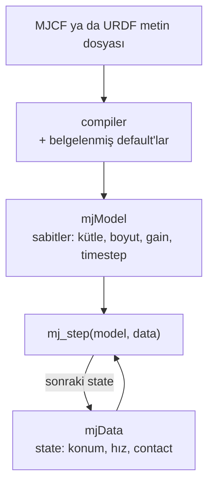

# 01 · Dünya bir metin dosyası: MJCF ve URDF

<!-- meta -->
| | |
|---|---|
| **Bölüm** | [1 · Simulation](README.md) |
| **Çalışma türü** | CPU · Mac ya da Colab CPU |
| **Önkoşul** | yok |
| **Önce öğren** | [Python for AI Engineering](https://aiengineeringfromscratch.com/lesson?path=phases/00-setup-and-tooling/13-python-for-ai-engineering) · [Python Environments](https://aiengineeringfromscratch.com/lesson?path=phases/00-setup-and-tooling/06-python-environments) |
| **Süre** | ~30 dk |
| **Kod** | [`experiments/01-world-as-text/experiment.py`](../../experiments/01-world-as-text/experiment.py) · [notebook](../../notebooks/01-world-as-text.ipynb) |
| **Durum** | ✅ tam |
<!-- /meta -->

> Bir robot modeli bir metin dosyasıdır: engine'in kullandığı her sayı ya dosyada yazılıdır ya da belgelenmiş bir default değerle doldurulur.

## Problem

Yüklenen bir dosya fiziksel olarak doğru olmak zorunda değildir. MuJoCo'nun kendi referansı, herkese açık bazı URDF modellerinde inertia değerlerinin keyfi göründüğünü ve fazla büyük olduğunu söyler ([XML reference · compiler/inertiafromgeom](https://mujoco.readthedocs.io/en/stable/XMLreference.html#compiler-inertiafromgeom)). Dosyayı okuyamazsan hangi kütleleri, inertia'ları, limit'leri ve gain'leri simüle ettiğini bilemezsin. Burada MJCF'i okuyacak, 15 satırlık bir dünya yazacak, default'ların ona ne yaptığını görecek ve gerçek SO-101 modelini açacaksın.

## Ana fikir

### Sade anlatımla

Bir model dosyası bir yemek tarifidir: malzemeler (rigid parçalar, şekiller, joint'ler, motorlar) ve miktarlar (boyutlar, kütleler, gain'ler). Söylemediği her şeyi engine belgelenmiş bir default listesinden doldurur; aşçının "oda sıcaklığı" varsayması gibi. Eksik bir sayı asla hata değildir; senin seçmediğin bir default'tur.

MuJoCo dosyayı bir kez iki nesneye *compile* eder: `mjModel` sabit kalanları (kütleler, boyutlar, gain'ler, timestep), `mjData` değişenleri (konumlar, hızlar, contact kuvvetleri) tutar. Simülasyon, `mjModel`'i kullanarak `mjData`'yı güncelleyen bir döngüdür.

En çok dikkat isteyen şey kütledir. Ya dosya onu her parça için yazar (`<inertial>`), ya da compiler onu şekillerden düzgün dolu cisimler olarak hesaplar; hangisi olacağına bir compiler ayarı karar verir. Yanlış kuralla ince bir dekoratif kabuk, sudan dolu bir blok gibi tartılır.



### Model yüklemek, kod olarak

```python
import mujoco

m = mujoco.MjModel.from_xml_string(xml)   # compile: text -> constants, gaps filled by defaults
d = mujoco.MjData(m)                      # state, initialised from the file
print(m.opt.timestep, sum(m.body_mass))   # always print what was filled in for you
for _ in range(1000):
    mujoco.mj_step(m, d)                  # advance the state by one timestep
# Build it, Step 1 writes what the compiler computes for a body without <inertial>
```

| Büyüklük | Formül |
|---|---|
| düzgün bir box'ın inertia'sı | $I_{xx} = \tfrac{m}{12}(b^2 + c^2)$, $I_{yy}, I_{zz}$ için döngüsel olarak |
| geom'dan çıkarılan kütle | $m = \rho V$ |
| orientation (quaternion) | $(\cos\frac{a}{2},\ \sin\frac{a}{2}\,(x, y, z))$, skaler önce |
| serbest düşme süresi | $T = \sqrt{2h/g}$ |
| hava drag'inin yavaşlatması | $k = \frac12 \rho_{\text{hava}} A$ olmak üzere $k v^2/m$ |

$m$ kütle; $a, b, c$ box'ın tam kenar uzunlukları; $I$ (inertia) bir cismin bir eksen etrafında döndürülmeye ne kadar direndiğini ölçer; $\rho$ yoğunluk, $V$ hacim; $(x, y, z)$ birim eksen, quaternion satırındaki $a$ açı; $h$ düşme yüksekliği, $g$ yerçekimi, $v$ hız, $A$ akışa bakan alan.

<details>
<summary>Matematik ayrıntısı: inertia çıkarımı, quaternion'lar ve drag tahmini</summary>

**Box inertia'sı.** Düzgün yoğunlukta $I_{zz} = \int (x^2 + y^2)\,dm$; $x^2$'yi $a$ kenarı boyunca integre etmek birim kütle başına $a^2/12$ verir, yani $I_{zz} = \frac{m}{12}(a^2 + b^2)$. Çıkarım her geom'u dolu sayar; içi boş bir kabuk ya da görsel mesh de dahil.

**Quaternion.** MuJoCo $(w, x, y, z) = (\cos\frac a2, \sin\frac a2\,\hat n)$ saklar, $w$ önce; `1 0 0 0` "rotation yok" demektir ([Modeling · Frame orientations](https://mujoco.readthedocs.io/en/stable/modeling.html#corientation)). Başka kütüphaneler $w$'yi sona koyar ([ders 06](../part-2-spatial-math/06-rotations.md)).

**Boşlukta kütle neden sadeleşir.** Yerçekimi kuvveti $mg$'dir; ivme $F/m = g$ kütleye bağlı değildir: her küp $T = \sqrt{2h/g}$ sürede düşer.

**Hava neden hafif küpleri geciktirir.** MuJoCo'nun drag modeli $k v^2/m$ kadar bir yavaşlama ekler ([Fluid forces](https://mujoco.readthedocs.io/en/stable/computation/fluid.html)). Drag'in küçük olduğunu, yani hızın hâlâ $v \approx g t$ olduğunu varsay. Yavaşlama o zaman $(k/m)\,g^2 t^2$ olur; bunu düşme süresi $T$ boyunca iki kez integre etmek kaybedilen mesafeyi verir:

$$\Delta z \approx \frac{k}{m}\,g^2 \int_0^T\!\!\int_0^{t} s^2\,ds\,dt = \frac{k}{m}\,\frac{g^2 T^4}{12}$$

Bu $1/m$ ile orantılıdır.

Daha derine: [Python for AI Engineering](https://aiengineeringfromscratch.com/lesson?path=phases/00-setup-and-tooling/13-python-for-ai-engineering), [Python Environments](https://aiengineeringfromscratch.com/lesson?path=phases/00-setup-and-tooling/06-python-environments) (AIEFS); [MuJoCo XML reference](https://mujoco.readthedocs.io/en/stable/XMLreference.html), [MuJoCo Modeling](https://mujoco.readthedocs.io/en/stable/modeling.html).

</details>

### Tek tabloda MJCF

MJCF, MuJoCo'nun XML formatıdır. *Body*, kendi frame'i olan rigid bir parçadır; iç içe body'ler *kinematic tree*'yi oluşturur. *Geom*, bir body'ye bağlı bir şekildir. *Joint*, bir body'ye bir *serbestlik derecesi* (dof), yani bağımsız bir hareket yolu verir.

| Eleman | Ne olduğu | Dokunacağın attribute'lar |
|---|---|---|
| `option` | global fizik ayarları | `timestep` (default 0,002 s), `integrator` (default `Euler`), `gravity`, `density`/`viscosity` (default 0: hava yok), `cone` |
| `worldbody` | ağacın sabit kökü | statik geom'lar (zemin, masa) |
| `body` | kinematic tree'de rigid bir frame | parent'a göre `pos`, `quat` |
| `geom` | collision için ve default olarak kütle için bir şekil | `type`, `size` (box için yarı uzunluklar), `mass` ya da `density` (default 1000 kg/m³), `friction`, `solref`/`solimp` |
| `joint` | bir body ile parent'ı arasındaki serbestlik derecesi | `type` (`hinge`, `slide`, `ball`, `free`), `axis`, `range`, `damping`, `armature` |
| `inertial` | bir body'nin açık yazılmış kütle özellikleri | `mass`, `pos` (kütle merkezi), `diaginertia` ya da `fullinertia` |
| `default` / `class` / `childclass` | attribute değerlerinin isimli şablonları | ör. her servo joint'i aynı `damping` ve `armature`'ı alır |
| `actuator` | kuvvet üreten şey | `motor`, `position`, `velocity`, `general`; `joint`, `gear`, `ctrlrange`, `forcerange` |
| `sensor` | `mjData.sensordata`'ya yazılan büyüklükler | `jointpos`, `framequat`, `touch`, … |

### Kütle ve inertia: yazılmış ya da çıkarılmış

Çalışma anında yalnızca *body* kütle özellikleri vardır; geom kütleleri sadece compile sırasında kullanılır ([geom/mass](https://mujoco.readthedocs.io/en/stable/XMLreference.html#body-geom-mass)). Kuralı `compiler/inertiafromgeom` seçer:

| Değer | Davranış |
|---|---|
| `auto` (default) | body'nin `<inertial>`'ı yoksa geom'larından çıkar |
| `true` | `<inertial>`'ı ezerek her zaman geom'lardan çıkar |
| `false` | her body'de `<inertial>` olmak zorunda |

### URDF ve MJCF

URDF, ROS ekosisteminin robot formatıdır.

| | URDF | MJCF |
|---|---|---|
| Ağaç | `link` + `joint` | iç içe `body` + `joint` |
| Kütle | her link'te `inertial` | `inertial` ya da geom'lardan çıkarım |
| Actuator, sensor, solver, contact parametreleri | formatın parçası değil | birinci sınıf elemanlar |
| Şablonlar | yok | `default` class'ları |

MuJoCo URDF'in bir alt kümesini doğrudan yükler, compiler seçenekleri için de özel bir `<mujoco>` bloğu kabul eder ([Modeling · URDF extensions](https://mujoco.readthedocs.io/en/stable/modeling.html#curdf)). Menagerie her dönüşümü modelin README'sinde belgeler: Go2 URDF → MJCF dönüştürüldü, sonra `freejoint`, `<default>` class'ları ve ayarlı ayak contact'ları aldı ([Menagerie · unitree_go2](https://github.com/google-deepmind/mujoco_menagerie/tree/f3b6013/unitree_go2)); SO-101 üreticinin MJCF'inden başlar, `implicitfast`'e geçer ve collision primitive'leri ekler ([Menagerie · robotstudio_so101](https://github.com/google-deepmind/mujoco_menagerie/tree/f3b6013/robotstudio_so101)).

## Sıfırdan yaz

Şimdi compiler'ın doldurduğunu (şekillerden kütle ve inertia) ve `mj_step`'in düşen bir küpe yaptığını yaklaşık 60 satır NumPy ile elle hesaplayacak, her adımı MuJoCo ile karşılaştıracaksın. Adımları kendi dosyana yaz ve her adımdan sonra çalıştır. Bitmiş fonksiyonlar [`physai/sim.py`](../../physai/sim.py) içinde; `uv run python experiments/01-world-as-text/build.py` beş adımı kontrolleriyle birlikte koşturur (çıktı [`build_output.txt`](../../experiments/01-world-as-text/build_output.txt) dosyasında).

### Adım 1 · Dolu bir şeklin kütlesi ve inertia'sı

`<inertial>`'ı olmayan bir body, geom'larının düzgün dolu cisim olarak kütlesini $\rho V$ ve inertia'sını alır. MJCF boyutları yarı uzunluktur (`size=".1 .1 .1"` 20 cm'lik bir box); cylinder ve capsule yarıçapı ve $z$ boyunca yarı uzunluğu verir.

```python
def solid_inertia(kind, size, density):
    """Mass and principal inertia of a uniform solid, with MuJoCo's `size` convention (half-lengths)."""
    if kind == "box":                                  # size = half-sides (x, y, z)
        a, b, c = 2 * np.asarray(size, float)
        mass = density * a * b * c
        return mass, mass / 12 * np.array([b * b + c * c, a * a + c * c, a * a + b * b])
    if kind == "sphere":                               # size = (radius,)
        r = size[0]
        mass = density * 4 / 3 * np.pi * r**3
        return mass, np.full(3, 2 / 5 * mass * r * r)
    r, h = size[0], 2 * size[1]                        # cylinder/capsule: radius, half-length along z
    m_cyl = density * np.pi * r * r * h
    i_xx, i_zz = m_cyl * (3 * r * r + h * h) / 12, m_cyl * r * r / 2
    if kind == "cylinder":
        return m_cyl, np.array([i_xx, i_xx, i_zz])
    m_sph = density * 4 / 3 * np.pi * r**3             # capsule: cylinder plus two hemispherical caps
    i_xx += m_sph * (2 * r * r / 5 + h * h / 4 + 3 * h * r / 8)
    i_zz += m_sph * 2 * r * r / 5
    return m_cyl + m_sph, np.array([i_xx, i_xx, i_zz])
```

```python
rho = mass / solid_inertia(kind, size, 1.0)[0]     # a geom with mass="..." fixes the density
m_ours, i_ours = solid_inertia(kind, size, rho)     # compare with m.body_mass[1], m.body_inertia[1]
```

```text
== Step 1. Solid shapes: our mass and inertia vs MuJoCo's compiler ==
geom                size (m)  mass (kg)        I_xx        I_yy        I_zz  max rel. err
box          [0.1, 0.1, 0.1]     0.1000  6.6667e-04  6.6667e-04  6.6667e-04       1.1e-16
box        [0.1, 0.05, 0.02]     0.5600  5.4133e-04  1.9413e-03  2.3333e-03       0.0e+00
sphere                [0.04]     0.2681  1.7157e-04  1.7157e-04  1.7157e-04       0.0e+00
cylinder         [0.03, 0.1]     1.5268  5.4329e-03  5.4329e-03  6.8707e-04       2.2e-16
capsule          [0.03, 0.1]     0.6786  3.4383e-03  3.4383e-03  2.9518e-04       2.2e-16
```

İlk satır Deney'in 100 g'lık küpü: orada yazdığı gibi 6,6667·10⁻⁴ kg·m².

### Adım 2 · Birkaç geom, tek body

Birkaç geom varsa compiler kütleleri toplar, kütle merkezini (COM) ağırlıklı ortalamaya koyar ve her geom'un inertia'sını parallel-axis teoremiyle oraya taşır: COM'dan $r$ uzaklıktaki bir parça $m(\lVert r\rVert^2 I - r r^\top)$ ekler.

```python
def combine_parts(masses, positions, inertias):
    """One rigid body from parts (axis-aligned principal inertias at given positions): mass, COM, 3x3 inertia."""
    masses, positions = np.asarray(masses, float), np.asarray(positions, float)
    mass = masses.sum()
    com = masses @ positions / mass
    inertia = np.zeros((3, 3))
    for m_i, p, i_diag in zip(masses, positions, inertias):
        r = p - com                                    # parallel-axis theorem: shift each part to the COM
        inertia += np.diag(i_diag) + m_i * (r @ r * np.eye(3) - np.outer(r, r))
    return mass, com, inertia
```

```text
== Step 2. One body from two parts: a 1 kg box above a 0.5 kg sphere ==
mass 1.5000 kg (body_mass 1.5000) · COM z 0.03333 m (body_ipos z 0.03333)
inertia about the COM, diagonal: [0.0155   0.0155   0.002167] kg m^2
body_inertia:                    [0.0155   0.0155   0.002167] kg m^2
max rel. error 2.2e-16; each part alone about the COM would give I_xx 0.002167 (no parallel-axis term)
```

Parallel-axis terimi olmasa body yedi kat daha kolay devriliyor gibi görünürdü. MuJoCo sonucu principal eksenlerde saklar (`body_inertia` artı rotation `body_iquat`); burada parçalar $z$ ekseni üzerinde, matris zaten diagonal.

### Adım 3 · Adım adım bir düşüş

MuJoCo'nun default `Euler`'i önce hızı günceller, sonra yeni hızla ilerler (sıranın neden önemli olduğunu ders 02 anlatıyor):

```python
def semi_implicit_euler(x, v, accel, h, c_implicit=0.0):
    """Update the velocity first, then move with the new one (MuJoCo's Euler).

    c_implicit: damping per unit inertia treated implicitly, v' = v + h a / (1 + h c), as MuJoCo's
    Euler does for joint damping and implicitfast for every velocity-dependent force (lesson 05).
    """
    v_new = v + h * accel(x, v) / (1 + h * c_implicit)
    return x + h * v_new, v_new
```

Düşüşün kendisi, alt yüz masa yüzeyini geçene kadar süren bir döngü:

```python
zs, z, v = [0.9], 0.9, 0.0
while z - 0.10 > 0.40:                               # bottom face still above the tabletop
    z, v = semi_implicit_euler(z, v, lambda z, v: -9.81, 0.002)
    zs.append(z)
```

```text
== Step 3. Free fall by hand (velocity first, then position) vs mj_step, vacuum ==
light: lands at step 143 · max |z_ours - z_mujoco| over the fall 1.1e-16 m
heavy: lands at step 143 · max |z_ours - z_mujoco| over the fall 1.1e-16 m
analytic sqrt(2 * 0.40 / 9.81) = 0.2856 s = step 142.8
```

Deney'in iniş adımı, 143, ve yükseklikleri tek bir yuvarlama farkıyla. Kütle döngüye hiç girmiyor.

### Adım 4 · Hava drag'i

`density` > 0 olduğunda MuJoCo her body'yi aynı kütle ve inertia'ya sahip düzgün box ile değiştirir ve her yüze quadratic drag uygular, $F = -\tfrac12 \rho_{\text{hava}} A\,|v|\,v$ ([Fluid forces](https://mujoco.readthedocs.io/en/stable/computation/fluid.html)). Box, Adım 1'deki box formülünü tersine çevirerek bulunur:

```python
def inertia_box(mass, inertia):
    """Full side lengths of the uniform box with this mass and principal inertia (MuJoCo's drag shape)."""
    i_x, i_y, i_z = inertia
    return np.sqrt(6 / mass * np.array([i_y + i_z - i_x, i_x + i_z - i_y, i_x + i_y - i_z]))
```

```python
def quadratic_drag(v, box, rho):
    """Drag force on a box moving at v (box axes): -1/2 rho * (area facing each axis) * |v| v."""
    area = np.array([box[1] * box[2], box[0] * box[2], box[0] * box[1]])
    return -0.5 * rho * area * np.abs(v) * v
```

Drag'i ivmeye ekle, `-9.81 + quadratic_drag(v, box, 1.2)[2] / mass`, ve iki küpü yeniden bırak:

```text
== Step 4. Drag from the equivalent inertia box vs MuJoCo's qfrc_fluid ==
inertia box of the 100 g cube: [0.2 0.2 0.2] m (the geom is 0.2 m)
v_z = -1.0 m/s · our drag 0.024000 N · qfrc_fluid 0.024000 N
v_z = -2.8 m/s · our drag 0.188160 N · qfrc_fluid 0.188160 N
air drop by hand: light lands at step 145, heavy at step 143 · light is 1.10 cm higher when heavy lands · delay 4.08 ms
max |z_ours - z_mujoco| for the light cube over its fall: 0.0e+00 m
```

Tam olarak Deney'in sayıları: 145 ve 143. adımlar, 1,10 cm, 4,08 ms. Matematik ayrıntısı'ndaki tahmin (1,15 cm) bir yaklaşım; bu döngü ise simülasyonun kendisi.

### Adım 5 · Bütün sweep

```text
== Step 5. The mass sweep with air, from our own integrator (heavy = 1 kg) ==
light     5 g · delay  93.44 ms
light    10 g · delay  46.25 ms
light    20 g · delay  22.59 ms
light    50 g · delay   8.65 ms
light   100 g · delay   4.08 ms
light   200 g · delay   1.81 ms
light   500 g · delay   0.45 ms
light  1000 g · delay   0.00 ms
```

Gözlemle'deki tablo, satır satır, kendi kodundan.

### Elinde kalan

`physai.sim` artık `solid_inertia`, `combine_parts`, `inertia_box`, `quadratic_drag` ve `semi_implicit_euler` içeriyor; ders 02 sonuncusunun yanına explicit Euler ve RK4 ekliyor, ders 05 implicit damping seçeneğini kullanıyor. [`tests/test_01_world_as_text.py`](../../tests/test_01_world_as_text.py) bunları MuJoCo'ya sabitliyor; bir şey değiştirdikten sonra `uv run pytest tests/test_01_world_as_text.py` çalıştır.

## Kütüphaneyle kullan

Pratikte Adım 1–2'yi compiler yapar; sonucu geri oku:

```python
m = mujoco.MjModel.from_xml_path(path("robotstudio_so101", "so101.xml"))
b = m.body("upper_arm").id
m.body_mass[b], m.body_ipos[b]          # mass, COM in the body frame
m.body_inertia[b], m.body_iquat[b]      # principal inertia and the rotation to its axes
sum(m.body_mass)                        # 0.6454 kg: print it after every load
mujoco.mj_setTotalmass(m, 0.70)         # rescales every body's mass AND inertia
```

Her format bunlara farklı ad verir:

| Format | Kütle | Kütle merkezi | Inertia |
|---|---|---|---|
| MJCF `<inertial>` | `mass` | `pos` | `diaginertia` (`quat` ile) ya da `fullinertia` (6 sayı) |
| URDF `<inertial>` | `<mass value>` | `<origin xyz rpy>` | `<inertia ixx ixy ixz iyy iyz izz>` |
| compile edilmiş `mjModel` | `body_mass` | `body_ipos` | `body_inertia` (principal) + `body_iquat` |

Tuzaklar:

- **Yarı uzunluklar.** MJCF box `size`'ı kenarın yarısı, URDF `<box size>` kenarın tamamı: kopyalanan bir sayı hacimde 8 kat şaşar.
- **Principal eksenler.** `body_inertia`, body frame'inde değil `body_iquat` frame'inde diagonal; SO-101'in `upper_arm`'ında ikisi farklı.
- **Dizileri düzenlemek.** `m.body_mass[b] = ...` `body_inertia`'yı (ve onunla Adım 4'ün drag box'ını) değiştirmez; `mj_setTotalmass` ikisini de ölçekler.

## Deney

### A · 15 satır, iki küp

```xml
<mujoco>
 <option gravity="0 0 -9.81"/>
 <worldbody>
  <geom type="plane" size="2 2 .1"/>
  <geom name="table" type="box" size=".35 .25 .4"/>
  <body name="light" pos="-.13 0 .9">
   <freejoint/>
   <geom type="box" size=".1 .1 .1" mass=".1"/>
  </body>
  <body name="heavy" pos=".13 0 .9">
   <freejoint/>
   <geom type="box" size=".1 .1 .1" mass=".1"/>
  </body>
 </worldbody>
</mujoco>
```

İki adet 20 cm'lik küp; alt yüzleri masa yüzeyinin 40 cm üstünde. `<freejoint/>` bir body'ye altı hareket yönünün hepsini verir. `inertial` yok, yani kütle özellikleri geom'lardan geliyor. Script 8. ve 12. satırları (kütleler), hava için de 2. satırı değiştiriyor:

```python
def make_xml(light_kg=0.1, heavy_kg=1.0, air=False):
    lines = list(LINES)
    lines[7] = lines[7].replace('mass=".1"', f'mass="{light_kg:g}"')
    lines[11] = lines[11].replace('mass=".1"', f'mass="{heavy_kg:g}"')
    if air:
        lines[1] = ' <option gravity="0 0 -9.81" density="1.2"/>'   # air density, kg/m³
    return "\n".join(lines)
```

**Tahmin et.** Boşlukta 1 kg'lık küp 100 g'lık küpten önce mi iner? `density="1.2"` ile hangisi gecikir ve gecikme kütleyle nasıl ölçeklenir?

**Çalıştır.** [`experiment.py`](../../experiments/01-world-as-text/experiment.py), MuJoCo 3.17.0, NumPy 2.5.4, Apple M5, deterministic (iki çalıştırma aynı çıktıyı veriyor, [`output.txt`](../../experiments/01-world-as-text/output.txt)'de kayıtlı).

**Gözlemle.** Compile edilmiş default'lar: timestep 0,002 s, density 0, viscosity 0, integrator Euler. 100 g'lık küpün çıkarılan inertia'sı eksen başına 6,6667·10⁻⁴ kg·m², body quaternion'ı `[1 0 0 0]`.

Boşlukta iki küp de masaya **143. adımda** ulaşıyor (analitik $\sqrt{2 \cdot 0{,}40 / 9{,}81}$ = 0,2856 s). Havayla ağır küp 143. adımda, hafif olan 145. adımda iniyor; ağır olan indiğinde hafif olan **1,10 cm** yukarıda, interpolasyonla gecikme **4,08 ms**.

| hafif küp (ağır = 1 kg) | boşlukta gecikme | `density="1.2"` ile gecikme |
|---|---|---|
| 5 g | 0,00 ms | 93,44 ms |
| 10 g | 0,00 ms | 46,25 ms |
| 20 g | 0,00 ms | 22,59 ms |
| 50 g | 0,00 ms | 8,65 ms |
| 100 g | 0,00 ms | 4,08 ms |
| 200 g | 0,00 ms | 1,81 ms |
| 500 g | 0,00 ms | 0,45 ms |
| 1 kg | 0,00 ms | 0,00 ms |


Boşlukta kütle sadeleşiyor ($a = F/m = g$). Havada gecikme kabaca $1/m$ ile ölçekleniyor, çünkü drag yavaşlaması $k v^2 / m$ kütleye bölünüyor; eğri 1 kg'a yaklaşırken kılavuzun altına iniyor, çünkü ağır küp de biraz yavaşlıyor. Matematik ayrıntısı'ndaki elle tahmin $(k/m)\, g^2 T^4/12$, 1,28 cm − 0,13 cm = **1,15 cm** veriyor; simülasyonda 1,10 cm. Bu MuJoCo'nun drag modeli, gerçek bir küpün ölçümü değil.

### B · Gerçek SO-101 dosyası

```python
m = mujoco.MjModel.from_xml_path(path("robotstudio_so101", "so101.xml"))
print(m.nbody, m.njnt, m.nu, sum(m.body_mass))
```

| Büyüklük (compile edilmiş model) | Değer |
|---|---|
| body'ler (world dahil) | 9 |
| joint'ler | 6, hepsi hinge (6 dof) |
| actuator'ler | 6; gain `fixed` + bias `affine` = `<position>` servo, kp 998,22, kv 2,731 |
| geom / sensor | 50 / 0 |
| açık `<inertial>`'ı olan body'ler | 8'de 7; `camera_mount` geom'larından çıkarılıyor |
| toplam kütle | **0,6454 kg** |
| `option` | timestep 0,005 s, `implicitfast`, `elliptic` cone |

Gain `fixed` artı bias `affine`, MuJoCo'nun bir position servo'yu saklama biçimidir ([ders 05](05-joints-and-actuators.md)). Dosya ayrıca `iterations`, `ls_iterations` ve `impratio`'yu ayarlıyor.

## Boz

Aynı SO-101 dosyasını `inertiafromgeom="true"` ile compile et: her body'nin `<inertial>`'ı, 1000 kg/m³ (default, su) yoğunlukta geom çıkarımıyla değiştirilir:

| | dosyadaki hâli | `inertiafromgeom="true"` |
|---|---|---|
| toplam kütle | 0,6454 kg | **2,3565 kg** (×3,65) |
| shoulder kütlesi | 0,1000 kg | 0,4018 kg |
| upper_arm kütlesi | 0,1030 kg | 0,4551 kg |
| upper_arm en büyük asal inertia (döndürülmesi en zor eksen etrafındaki inertia) | 1,509·10⁻⁴ kg·m² | 9,178·10⁻⁴ kg·m² |

Hiçbir hata çıkmıyor ve model simüle olmaya devam ediyor. Çıkarım, default `inertiagrouprange` (0–5) içindeki her geom'u, görsel mesh'ler dahil, 1000 kg/m³'te dolu bir cisim sayıyor ([compiler/inertiagrouprange](https://mujoco.readthedocs.io/en/stable/XMLreference.html#compiler-inertiagrouprange), [geom/density](https://mujoco.readthedocs.io/en/stable/XMLreference.html#body-geom-density)). Böyle bir modelde bir gravity compensation torque'u ya da bir system identification sonucu (loglanmış hareketten fiziksel parametre tahmini) aynı oranda yanlış çıkar. Yükledikten sonra her zaman `sum(m.body_mass)`'i yazdır.

## Gerçek robotta

- Menagerie SO-101 kütleleri üreticinin MJCF'inden geliyor ve burada bir teraziyle karşılaştırılmadı. **Gerçek kolda henüz ölçülmedi.**
- Prosedür: monte edilmiş follower kolu sabitleme kıskacı ve kablolar olmadan tart, 0,6454 kg ile karşılaştır ve simüle edilen torklara güvenmeden önce her farkı (vidalar, kablolar, baskı dolgusu) açıkla.
- Gerçek kolun motorları [LeRobot SO-101 rehberinde](https://huggingface.co/docs/lerobot/so101) listeleniyor: follower'da 1/345 dişli oranlı altı STS3215 servo.

## Kendini dene

1. **Kolay.** `gravity="0 0 -1.62"` yap. Boşlukta iki küp hâlâ aynı adımda mı iniyor? Önce analitik süreyi tahmin et.
2. **Orta.** Üçüncü bir küp ekle: 100 g ama 10 cm. Havada, 20 cm'lik 100 g'lık küpten hızlı mı yavaş mı? $k/m = \frac12 \rho A / m$'den akıl yürüt, sonra çalıştır.
3. **Zor.** 30 cm'lik bir capsule geom (`mass="0.2"`) ve capsule'ün inertia'sının on katı olan açık bir `<inertial>` içeren bir MJCF body yaz. `auto`, `true` ve `false` ile compile edip her biri için `body_mass` ve `body_inertia`'yı yazdır. Hangi ayar compile olmaz ve neden?

### Cevaplar

1. Evet: boşlukta kütle hiç devreye girmiyor. Adım sayısını $\sqrt{2 \cdot 0{,}40 / 1{,}62}$ ile kontrol et.
2. Daha hızlı: aynı kütlede ön yüz alanı dörtte bir, dolayısıyla $k/m$ dört kat küçük.
3. `auto` `<inertial>`'ını korur, `true` onu capsule'den çıkarılan inertia ile değiştirir (Sıfırdan yaz'daki `solid_inertia("capsule", ...)` bunu önceden söyler), `false` compile olur çünkü body'de `<inertial>` var; yalnızca `<inertial>`'ı olmayan body'ler için hata verir.

## Akılda kalanlar ve kaynaklar

- MJCF = `option` + `body` / `joint` / `geom` ağacı + `actuator` / `sensor`; yazılmayan her şey belgelenmiş bir default alır.
- Kütle özellikleri ya açık yazılır (`<inertial>`) ya da geom'lardan düzgün yoğunlukla çıkarılır; kararı `inertiafromgeom` verir ve yanlış seçim SO-101 kütlesini hiçbir hata vermeden 3,65 kat değiştirdi.
- MuJoCo quaternion'ları skaler-önce: `1 0 0 0` = birim.

Sonraki: [ders 02 · Time integration ve timestep](02-timestep.md).

**Kaynaklar**
- [MuJoCo XML reference](https://mujoco.readthedocs.io/en/stable/XMLreference.html): `option`, `geom`, `joint`, `inertial`, `compiler/inertiafromgeom`, `inertiagrouprange`.
- [MuJoCo Modeling](https://mujoco.readthedocs.io/en/stable/modeling.html): default class'ları, frame orientation'ları, URDF extensions.
- [MuJoCo Fluid forces](https://mujoco.readthedocs.io/en/stable/computation/fluid.html).
- [MuJoCo Menagerie](https://github.com/google-deepmind/mujoco_menagerie): `robotstudio_so101` (Apache-2.0) ve `unitree_go2` README'leri (sabitlenmiş commit `experiments/common/menagerie.py` içinde).
- [LeRobot SO-101 rehberi](https://huggingface.co/docs/lerobot/so101).
- Sayılarımız: [`experiments/01-world-as-text/output.txt`](../../experiments/01-world-as-text/output.txt).
