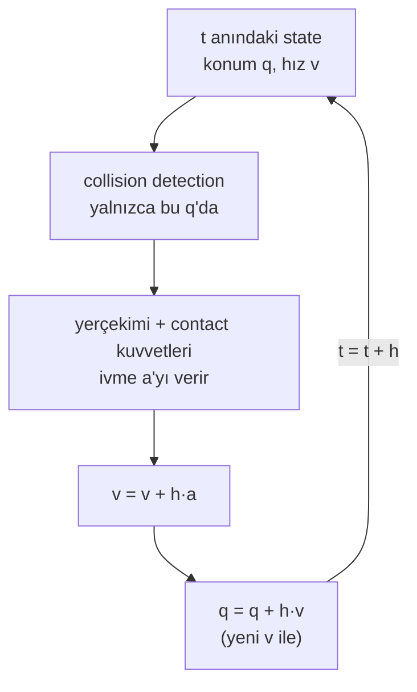

# 02 · Time integration ve timestep

<!-- meta -->
| | |
|---|---|
| **Bölüm** | [1 · Simulation](README.md) |
| **Çalışma türü** | CPU · Mac ya da Colab CPU |
| **Önkoşul** | [01](01-world-as-text.md) |
| **Önce öğren** | [Calculus for Machine Learning](https://aiengineeringfromscratch.com/lesson?path=phases/01-math-foundations/04-calculus-for-ml) · [Numerical Stability](https://aiengineeringfromscratch.com/lesson?path=phases/01-math-foundations/13-numerical-stability) |
| **Süre** | ~30 dk |
| **Kod** | [`experiments/02-timestep/experiment.py`](../../experiments/02-timestep/experiment.py) · [notebook](../../notebooks/02-timestep.ipynb) |
| **Durum** | ✅ tam |
<!-- /meta -->

> Simülatör zamanı akıtmaz; `dt` kadar sıçrar ve contact'ı yalnızca düştüğü yerde arar.

## Problem

Unitree'nin bacaklı robotları için açık eğitim kodu (Isaac Gym) fiziği `sim.dt = 0.005` s ile adımlıyor ve policy'nin her `decimation = 4` adımda bir karar vermesine izin veriyor, yani saniyede 50 karar ([`legged_robot_config.py`](https://github.com/unitreerobotics/unitree_rl_gym/blob/main/legged_gym/envs/base/legged_robot_config.py)). Neden 5 ms de 20 değil? MuJoCo timestep'i hız–doğruluk dengesini etkileyen "en önemli tek parametre" olarak tanımlıyor ([XML reference · option/timestep](https://mujoco.readthedocs.io/en/stable/XMLreference.html#option)). Somut bir hata: 1 m yükseklikten 1 cm'lik bir tablaya bırakılan 5 cm'lik bir küp yerde bitiyor. Hangi `dt` değerleri buna yol açıyor ve "küçük her zaman güvenlidir" doğru mu?

## Ana fikir

### Sade anlatımla

Simülatör karanlık bir odadaki çakar ışık gibi çalışır: her timestep'te bir kez çakar, o anda her şeyin nerede olduğunu hesaplar ve bir sonraki çakışa atlar. İki çakış arasında hiçbir şey hesaplanmaz.

Çarpışmalar yalnızca çakışlarda bulunur. Bir çakışta ince bir tablanın üstünde, sonrakinde altında olan hızlı bir küp masaya hiç değmez. Küpü tablanın *içinde* yakalayan bir çakış onu yakın yüzden dışarı iter; küpün merkezi ortayı geçmişse bu alt yüzdür. Yumuşak bir contact da doğru tarafta yakalanmış bir küpün ortayı geçecek kadar batmasına izin verebilir.

Yani timestep yalnızca bir doğruluk ayarı değildir: cismin hızı ve engelin kalınlığıyla birlikte bir contact'ın oluşup oluşmayacağına karar verir.



### Tek timestep, kod olarak

```python
h = 0.002                          # timestep in seconds (MuJoCo's default)
while t < t_end:
    contacts = detect(q)           # overlaps at THIS position only, never along the path
    a = acceleration(q, v, contacts)   # gravity plus contact forces, divided by mass
    v = v + h * a                  # update the velocity first ...
    q = q + h * v                  # ... then move with the NEW velocity: a jump of v*h
    t = t + h
```

| Büyüklük | Formül |
|---|---|
| semi-implicit Euler adımı | $v_{t+h} = v_t + h\,a_t, \qquad q_{t+h} = q_t + h\,v_{t+h}$ |
| bir adımda sıçranan mesafe | $\Delta q = v\,h$ |
| $H$ yüksekliğinden serbest düşüş sonrası hız | $v = \sqrt{2 g H}$ |

$q$ konum, $v$ hız, $a$ ivme, $h$ timestep (`dt`), $t$ zaman, $g$ yerçekimi, $H$ bırakma yüksekliğidir.

<details>
<summary>Matematik ayrıntısı: neden "semi-implicit" ve bir integrator neyi düzeltir, neyi düzeltemez</summary>

**Ayrıklaştırma.** Fizik bir diferansiyel denklemdir: $\dot q = v$, $\dot v = a(q, v)$. Bir integrator onu $t$'den $t + h$'ye sıçrayan bir kuralla değiştirir. MuJoCo ivmeleri sürekli zamanda hesaplar, sonra integre eder ([Computation · Numerical integration](https://mujoco.readthedocs.io/en/stable/computation/index.html#geintegration)).

**Explicit ve semi-implicit Euler.** Explicit Euler *eski* hızla ilerler, $q_{t+h} = q_t + h v_t$; MuJoCo'nun `Euler`'i olan semi-implicit Euler *yeni* hızla. Bir yayda, $a = -\omega^2 q$, explicit Euler genliği her adımda $\sqrt{1 + h^2\omega^2} > 1$ ile çarpar ve her $h$'de enerji kazanır. Semi-implicit Euler'in adım matrisinin determinantı 1'dir ve $h\omega < 2$ olduğu sürece özdeğerleri birim çember üzerindedir; ötesinde patlar (Sıfırdan yaz, Adım 3; yine [ders 03](03-contact.md) ve [ders 05](05-joints-and-actuators.md)'te).

**Integrator'lar neyi değiştirir.** Diğerleri daha fazla kuvvet terimini implicit çözer (yeni state'te) ya da adım başına birkaç kez kuvvet hesaplar (RK4). Bu sert damping'e ve düzgün harekete yardım eder; hiçbiri continuous collision detection eklemez.

**Orta düzlem neden önemli.** İnce bir tabla için, küpün merkezi tablanın orta düzlemini geçtiği anda çakışmadan en kısa çıkış yolu aşağıya doğrudur; ölçülen contact normal'i de tam orada ters döner (aşağıda Gözlemle'nin 2. ve 3. maddeleri).

Daha derine: [Calculus for Machine Learning](https://aiengineeringfromscratch.com/lesson?path=phases/01-math-foundations/04-calculus-for-ml), [Numerical Stability](https://aiengineeringfromscratch.com/lesson?path=phases/01-math-foundations/13-numerical-stability) (AIEFS); [MuJoCo Computation · Integrators](https://mujoco.readthedocs.io/en/stable/computation/index.html#geintegrators).

</details>

### Contact yalnızca adımlarda kontrol edilir

Hızlı bir cisim ve ince bir engel için üç şey ters gidebilir:

| Hata | Koşul | Sonuç |
|---|---|---|
| kaçırılan contact | hiçbir adım çakışmaya denk gelmez | engine masayı hiç görmez |
| yanlış taraftan çakışma | ilk çakışma zaten tablanın orta düzleminin ötesinde | box–box contact normal'i *aşağı* bakar; solver küpü içinden iter |
| fazla yumuşak contact | contact doğru tarafta görülür ama soft constraint küpün orta düzlemin ötesine batmasına izin verir | normal çarpma sırasında ters döner |

*Contact normal'i*, contact'ın ittiği yöndür. Üçüncüsünü timestep değil, contact'ın yumuşaklığı olan `solref` belirler ([ders 03](03-contact.md)).

### Integrator'lar

*Integrator*, ivmeleri bir sonraki hıza ve konuma çevirir. "Implicit" bir kuvvet terimini yeni, henüz bilinmeyen state'te hesaplar (bir lineer çözüm, ama sert kuvvetlere dayanır); "explicit" mevcut state'te.

| `integrator` | Neyi implicit çözer | Neyi iyileştirir |
|---|---|---|
| `Euler` (default) | yalnızca joint damping | en ucuzu; doküman onu uyumluluk için tutuyor ve `implicitfast` öneriyor |
| `implicitfast` | Coriolis/merkezkaç dışındaki bütün hıza bağlı kuvvetler | sert damping, actuator `kv`, drag |
| `implicit` | aynısı artı Coriolis/merkezkaç (LU çözümü) | birbirine bağlı dönen zincirler (çok uzuvlu sarkaçlar) |
| `RK4` | hiçbiri; 4. mertebe, çok aşamalı | düzgün hareketin doğruluğu, adım başına 4 kuvvet hesabı |
| `discrete` | hız *ve* konum stiffness'ı, constraint'lerle birlikte | explicit limitin çok ötesinde sert yaylar ve position servo'lar |

Kaynak: [Computation · Integrators](https://mujoco.readthedocs.io/en/stable/computation/index.html#geintegrators), [option/integrator](https://mujoco.readthedocs.io/en/stable/XMLreference.html#option-integrator). Düşen küp için önemli olup olmadığı aşağıda ölçülüyor.

<!-- figure: 02-timestep-tunnel -->

## Sıfırdan yaz

Şimdi üç integrator yazacak, her birinin nerede kararsızlaştığını ölçecek ve Deney'deki "ilk çakışmada merkez" sütununu fizik engine'i olmadan, yaklaşık 50 satır NumPy ile yeniden üreteceksin. Adımları kendi dosyana yaz ve her adımdan sonra çalıştır. Bitmiş fonksiyonlar [`physai/sim.py`](../../physai/sim.py) içinde; `uv run python experiments/02-timestep/build.py` dört adımı kontrolleriyle birlikte koşturur (çıktı [`build_output.txt`](../../experiments/02-timestep/build_output.txt) dosyasında).

### Adım 1 · Adım atmanın üç yolu

Her stepper state'i $(x, v)$, bir `accel(x, v)` fonksiyonunu ve adımı $h$ alır, sonraki state'i döndürür. Explicit Euler eski hızla ilerler, semi-implicit Euler (MuJoCo'nun `Euler`'i, ders 01'de yazdın) yenisiyle, RK4 ise dört eğimin ortalamasını alır:

```python
def explicit_euler(x, v, accel, h):
    """Move with the old velocity, then update it."""
    return x + h * v, v + h * accel(x, v)
```

```python
def semi_implicit_euler(x, v, accel, h, c_implicit=0.0):
    """Update the velocity first, then move with the new one (MuJoCo's Euler).

    c_implicit: damping per unit inertia treated implicitly, v' = v + h a / (1 + h c), as MuJoCo's
    Euler does for joint damping and implicitfast for every velocity-dependent force (lesson 05).
    """
    v_new = v + h * accel(x, v) / (1 + h * c_implicit)
    return x + h * v_new, v_new
```

```python
def rk4(x, v, accel, h):
    """Classic fourth-order Runge-Kutta on (x, v): four force evaluations per step."""
    k1x, k1v = v, accel(x, v)
    k2x, k2v = v + h / 2 * k1v, accel(x + h / 2 * k1x, v + h / 2 * k1v)
    k3x, k3v = v + h / 2 * k2v, accel(x + h / 2 * k2x, v + h / 2 * k2v)
    k4x, k4v = v + h * k3v, accel(x + h * k3x, v + h * k3v)
    return (x + h / 6 * (k1x + 2 * k2x + 2 * k3x + k4x),
            v + h / 6 * (k1v + 2 * k2v + 2 * k3v + k4v))
```

Deney düzeneği 1 Hz'lik bir yaydaki 1 kg'lık kütle, $\omega = 2\pi$ rad/s ile $a = -\omega^2 x$; MuJoCo'da `stiffness` = $\omega^2$ olan bir slide joint:

```text
== Step 1. Our steppers vs mj_step on a 1 Hz spring (h = 10 ms, 500 steps) ==
semi_implicit_euler  vs integrator=Euler: max |x_ours - qpos| = 5.6e-17 m
rk4                  vs integrator=RK4  : max |x_ours - qpos| = 4.8e-16 m
explicit_euler: no MuJoCo integrator moves with the old velocity; checked against its formula in Step 2
```

### Adım 2 · Enerji

Bir yay enerjisini, $\tfrac12 v^2 + \tfrac12\omega^2 x^2$, sonsuza dek korumalı. Rahat bir $h\omega$ = 0,063'te 1000 adımdan sonra:

```text
== Step 2. Energy after 1000 steps, relative to the start (h = 10 ms, h*w = 0.063) ==
explicit_euler       E/E0 = 51.422174
semi_implicit_euler  E/E0 = 0.999350
rk4                  E/E0 = 0.999999
formula for explicit Euler (1 + h^2 w^2)^n = 51.422174
```

Explicit Euler enerjiyi her adımda tam olarak $1 + h^2\omega^2$ ile çarpar (Matematik ayrıntısı): on saniyede 51 kat. Semi-implicit Euler doğru değerin etrafında kaymadan salınır; RK4 biraz kaybeder.

### Adım 3 · Kararlılık sınırı

Lineer bir kuvvet üzerinde her stepper, $(x, v)$'ye etki eden 2 × 2'lik bir matristir. Sütunlarını bulmak için bir adımı $(1, 0)$ ve $(0, 1)$'e uygula; en büyük |özdeğeri| adım başına büyümedir:

```python
def step_growth(step, h, k, c=0.0, **kw):
    """Largest |eigenvalue| of one step on a = -k x - c v: above 1, every step amplifies the motion."""
    accel = lambda x, v: -k * x - c * v                # noqa: E731
    cols = [step(x, v, accel, h, **kw) for x, v in ((1.0, 0.0), (0.0, 1.0))]
    return np.abs(np.linalg.eigvals(np.array(cols).T)).max()
```

```text
== Step 3. Growth per step on the undamped spring vs h*w ==
  h*w  explicit_euler  semi_implicit        rk4   max |x| over 10 steps: ours (semi-implicit) / MuJoCo Euler
  0.5        1.118034       1.000000   0.999895   0.1022 m / 0.1022 m (started at 0.1)
  1.0        1.414214       1.000000   0.993905   0.1 m / 0.1 m (started at 0.1)
  1.9        2.147091       1.000000   0.800899   0.3202 m / 0.3202 m (started at 0.1)
  2.1        2.325941       1.877328   0.682240   116.4 m / 116.4 m (started at 0.1)
  2.8        2.973214       5.663429   0.930667   4.123e+06 m / 4.123e+06 m (started at 0.1)
  2.9        3.067572       6.250000   1.193063   1.083e+07 m / 1.083e+07 m (started at 0.1)
```

Semi-implicit Euler $h\omega = 2$'ye kadar tam nötr (1,000000), ötesinde patlıyor; senin kodunda da MuJoCo'da da, adım adım aynı. Sınırın altında yörünge sınırlı ama bozuk: $h\omega$ = 1,9'da 0,1 m'den başlayan kütle 0,32 m'ye savruluyor. Explicit Euler her $h$'de büyüyor. RK4 hafifçe sönümlüyor, $h\omega$ = 2,8'de dayanıyor, 2,9'da çöküyor. Ders 03 ve 05'in contact sertliği ve servo gain'i olarak karşılaştığı $h\omega < 2$ bu.

### Adım 4 · İlk çakışan adım

İlk çakışmadan önce contact yok; dolayısıyla kendi stepper'ınla serbest düşüş, küpün tablaya göre nereye düştüğünü söyler:

```python
def first_overlap(z0, h, top, bottom, half, g=9.81):
    """Free fall with MuJoCo's Euler from rest at z0: centre height at the first step a cube of half-size
    `half` overlaps a slab between `bottom` and `top`, or None if a step jumps over the slab."""
    z, v = z0, 0.0
    while z + half > bottom:
        z, v = semi_implicit_euler(z, v, lambda x, u: -g, h)
        if z - half < top and z + half > bottom:
            return z
    return None
```

```text
== Step 4. Drop onto the 1 cm tabletop: centre at the first overlapping step (cm) ==
dt (ms)     ours   MuJoCo  side of the mid-plane (29.5 cm)
    0.5    32.32    32.32  above
      1    32.21    32.21  above
      2    31.99    31.99  above
      3    31.34    31.34  above
      4    32.43    32.43  above
      6    32.00    32.00  above
      8    29.80    29.80  above
     10    28.47    28.47  below: pushed out downward
     12    30.69    30.69  above
     15    27.36    27.36  below: pushed out downward
     20    30.72    30.72  above
     25        -        -  no step overlaps: missed contact
     30        -        -  no step overlaps: missed contact
     40        -        -  no step overlaps: missed contact
     50        -        -  no step overlaps: missed contact
```

Deney'in sütunu, her satırıyla: yanlış taraftan çakışmalar (10, 15 ms) ve tablanın üstünden atlayan dört timestep dahil. İlk çakışmadan *sonra* olanlar için ders 03'ün contact modeli gerekiyor.

### Elinde kalan

`physai.sim` artık `explicit_euler`, `semi_implicit_euler`, `rk4`, `step_growth` ve `first_overlap` içeriyor. Ders 03 `step_growth`'u contact yayında, ders 05 bir position servo'da çalıştırıyor. [`tests/test_02_timestep.py`](../../tests/test_02_timestep.py) bunları MuJoCo'ya sabitliyor; bir şey değiştirdikten sonra `uv run pytest tests/test_02_timestep.py` çalıştır.

## Kütüphaneyle kullan

MuJoCo'da timestep ve integrator `m.opt`'un iki alanıdır ve `mj_step` onları uygular:

```python
m.opt.timestep = 0.005
m.opt.integrator = mujoco.mjtIntegrator.mjINT_IMPLICITFAST   # or mjINT_EULER, mjINT_RK4, ...
for _ in range(n_substeps):          # physics steps per control decision
    mujoco.mj_step(m, d)
```

Araçlar "fizik adımı" ile "kontrol adımı"nı farklı adlarla ayırır:

| Araç | Fizik adımı | Kontrol adımı |
|---|---|---|
| MuJoCo | `m.opt.timestep` | senin döngün: action başına kaç `mj_step` çağrısı |
| Gymnasium MuJoCo env'leri | `model.opt.timestep` | `env.step()` başına `frame_skip` adım; `env.dt = timestep * frame_skip` |
| `legged_gym` (Problem) | `sim.dt` = 0,005 s | action başına `decimation` = 4 fizik adımı |
| SciPy `solve_ivp` | adaptif, default `method="RK45"` | – (kontrol döngüsü değil) |

Tuzaklar:

- **"Euler" semi-implicit'tir.** MuJoCo'nun `Euler`'i ders kitabındaki yöntemle değil `semi_implicit_euler` ile örtüşür (Adım 1).
- **Bölünmüş adım RK4'ü yok sayar.** `integrator="RK4"` iken `mj_step1` ardından `mj_step2` (control'ü adımın ortasında ayarlamak için kullanılan bölünmüş adım) `rk4`'ü değil `semi_implicit_euler`'i yeniden üretir: Adım 1'in yayında kontrol ettik.
- **`env.dt` timestep değildir.** Gymnasium'da policy her `frame_skip` fizik adımında bir karar verir; yalnızca `model.opt.timestep`'ten hesaplanan bir frekans bu çarpan kadar yanlıştır.

## Deney

Sahne: zemin, üst yüzü 30 cm'de olan 24 × 24 × 1 cm'lik bir tabla (orta düzlem 29,5 cm) ve tablanın 97,5 cm üstünden başlayan 5 cm, 100 g'lık bir küp.

```python
XML = """
<mujoco>
  <worldbody>
    <geom name="floor" type="plane" size="2 2 0.1"/>
    <geom name="table" type="box" size="0.12 0.12 0.005" pos="0 0 0.295"/>
    <body name="cube" pos="0 0 1.30">
      <freejoint/>
      <geom type="box" size="0.025 0.025 0.025" mass="0.1"/>
    </body>
  </worldbody>
</mujoco>"""

m = mujoco.MjModel.from_xml_string(XML)
m.opt.timestep = dt_ms / 1000          # <- the swept number
```

Script her `dt` için şunları kaydediyor: tablayla ilk çakışan adımda (contact'ın ilk kez oluşabileceği yer) küp merkezinin yüksekliği, masa contact'ı bulunup bulunmadığı, çarpma sırasındaki en alçak merkez ve sonuç. Sweep'i daha sert bir contact'la, iki geom'a da `solref="0.005 1"` vererek tekrarlıyor (contact iki geom'un değerlerinin ortalamasını kullanır; `dt` 2,5 ms'nin üstündeyken solver 0,005'i 2·`dt`'ye yükseltir, bkz. [ders 03](03-contact.md)).

**Tahmin et.** Çarpma hızı $\sqrt{2 \cdot 9{,}81 \cdot 0{,}975}$ = 4,37 m/s, yani bir adım 2 ms'de 0,87 cm, 10 ms'de 4,37 cm. Küp nerede içinden geçer?

**Çalıştır.** [`experiment.py`](../../experiments/02-timestep/experiment.py), MuJoCo 3.17.0, NumPy 2.5.4, Apple M5, deterministic; çıktı [`output.txt`](../../experiments/02-timestep/output.txt)'de.

| dt (ms) | adım (cm) | ilk çakışmada merkez (cm) | contact görüldü | en alçak merkez (cm) | default `solref` | `solref 0.005 1` |
|---|---|---|---|---|---|---|
| 0,5 | 0,22 | 32,32 | evet | — | **geçti** | kaldı |
| 1 | 0,44 | 32,21 | evet | — | **geçti** | kaldı |
| 2 | 0,87 | 31,99 | evet | 29,60 | kaldı | kaldı |
| 3 | 1,31 | 31,34 | evet | — | **geçti** | kaldı |
| 4 | 1,75 | 32,43 | evet | 30,54 | kaldı | kaldı |
| 6 | 2,62 | 32,00 | evet | 30,84 | kaldı | kaldı |
| 8 | 3,50 | 29,80 | evet | 29,65 | kaldı | kaldı |
| 10 | 4,37 | **28,47** | evet | — | **geçti** | **geçti** |
| 12 | 5,25 | 30,69 | evet | 30,69 | kaldı | kaldı |
| 15 | 6,56 | **27,36** | evet | — | **geçti** | **geçti** |
| 20 | 8,75 | 30,72 | evet | 30,72 | kaldı | kaldı |
| 25, 30, 40, 50 | 10,93–21,87 | — | **hayır** | — | **geçti** | **geçti** |


**Gözlemle.** Üç hata türünün üçü de görünüyor:

1. **Kaçırılan contact, ≥ 25 ms.** Hiçbir adım çakışmaya denk gelmiyor; hiç contact üretilmiyor.
2. **Yanlış taraftan çakışma, 10 ve 15 ms.** İlk çakışan adımda merkez zaten 29,5 cm'nin altında. 10 ms'de ilk masa contact'ı (t = 0,460 s) 1,97 cm derinde ve küpe etki eden normal'in z bileşeni −1,00: kuvvetin büyüklüğü doğru, yönü yanlış. Daha sert bir contact burada işe yaramaz.
3. **Fazla yumuşak contact, 0,5, 1 ve 3 ms.** İlk çakışma doğru tarafta; 1 ms'de ilk contact (t = 0,447 s) 0,29 cm derinde ve normal z = +1,00. Soft contact yine de 4,37 m/s'lik küpün batmasına izin veriyor: t = 0,463 s'de merkez 29,49 cm'ye, orta düzlemin hemen altına iniyor (1 cm'lik tablaya yaklaşık 3 cm), normal dönüyor ve küp düşüyor. Ayakta kalan 2 ms koşusu 29,60 cm'ye, dönmeye 0,1 cm kala iniyor. `solref="0.005 1"` ile hepsi kalıyor.

Sonuç `dt`'ye göre monoton değil: "küçük daha güvenli" 0,5 ve 1 ms'de, "tabladan ince adım güvenli" 3 ms'de çöküyor; 12 ve 20 ms ise son contact'sız adımın nereye düştüğü şansıyla ayakta kalıyor (Sıfırdan yaz, Adım 4 bu düşme noktalarını önceden söylüyor).

## Boz

`dt`'yi sabit tut, yalnızca integrator'ı değiştir (default contact):

| dt | Euler | implicitfast | RK4 | discrete |
|---|---|---|---|---|
| 1 ms | geçti | geçti | geçti | geçti |
| 2 ms | kaldı (29,60) | kaldı (29,60) | **geçti** | **geçti** |
| 8 ms | kaldı (29,65) | kaldı (29,65) | **geçti** | **geçti** |
| 10 ms | geçti | geçti | geçti | geçti |
| 25 ms | geçti | geçti | geçti | geçti |

Hiçbir integrator başarısız bir durumu kurtarmıyor; RK4 ve `discrete`, Euler'in atlattığı iki durumda başarısız oluyor: her biri çarpmayı farklı çözüyor ve Euler koşusu dönmeye yalnızca 0,1 cm uzakken bu fark belirleyici. Integrator kuvvetleri detection'lar arasında harekete çevirir; örneklenen state'ler arasındaki yolu taramaz, yumuşak bir contact'ı da sertleştirmez. Aday çözümler daha kalın collision geom'ları ya da daha sert bir `solref`'tir; her biri bunun gibi bir sweep'le kontrol edilir. Integrator'ların *gerçekten* düzelttiği şeyler (sert damping, sert servo'lar) [ders 05](05-joints-and-actuators.md)'te ölçülüyor.

## Gerçek robotta

- Menagerie SO-101 `timestep="0.005"` ve `integrator="implicitfast"` ayarlıyor ([so101.xml](https://github.com/google-deepmind/mujoco_menagerie/blob/f3b6013/robotstudio_so101/so101.xml)). İnce bir nesneye (bir kart, bir kablo) kapanan bir gripper parmağı bu küp ve tablayla aynı geometridir.
- Prosedür: simülasyondaki bir grasp'e güvenmeden önce grasp'i 5, 2 ve 1 ms'de çalıştır ve nesnenin son pose'unu karşılaştır. `dt` ile değişen bir sonuç grasp'in özelliği değil, simülasyon artefaktıdır. **Gerçek kolda henüz ölçülmedi**; gerçek dünyadaki karşılığıyla karşılaştırılmadı.
- RL'de (reinforcement learning) `decimation`, control hızını fizik hızından ayırır: policy 50 Hz'de çalışırken fizik 200 Hz'de çalışabilir.

## Kendini dene

1. **Kolay.** Tablayı 4 cm kalın yap (`size="0.12 0.12 0.02"`, üst yüz 30 cm'de kalsın). Hangi hata türü önce kaybolmalı, neden?
2. **Orta.** Küpü 3 m'den bırak. Çarpma hızını hesapla, sonra sweep'i yeniden çalıştır. Başarısız `dt` kümesi büyüyor mu küçülüyor mu?
3. **Zor.** 0,5–20 ms aralığındaki her `dt` için küpün kaldığı en büyük `solref` timeconst'u (dampratio 1'de) bul. Çiz. Bunun neden 10 ve 15 ms'yi düzeltemeyeceğini açıkla.

### Cevaplar

1. Fazla yumuşak contact türü: normal'in dönebilmesi için merkezin artık üst yüzün 0,5 cm değil 2 cm altına inmesi gerekir. Geri kalanını ölç.
2. Çarpma hızı yeni yükseklikle $\sqrt{2 g h}$; daha hızlı çarpmalar daha derin batar ve daha uzun adım atar. Sıfırdan yaz'daki `first_overlap` yeni ilk-çakışma sütununu hiçbir şey çalıştırmadan önce söyler.
3. 10 ve 15 ms'de ilk çakışan adım zaten orta düzlemin altında, yani stiffness ne olursa olsun ilk contact aşağı bakar.

## Akılda kalanlar ve kaynaklar

- Semi-implicit Euler $v\,h$ kadar sıçrar; contact yalnızca adım anlarında tespit edilir.
- Bu sahnede üç hata türü bir arada: kaçırılan contact (büyük `dt`), yanlış taraftan çakışma (orta `dt`), fazla yumuşak contact (her `dt`, `solref` ile düzelir). Sonuç `dt`'ye göre monoton değil.
- Integrator değiştirmek hiçbirini düzeltmedi; contact'a kritik davranışı `dt` sweep'iyle doğrula.

Sonraki: [ders 03 · Contact: soft constraint, solref ve solimp](03-contact.md).

**Kaynaklar**
- [MuJoCo XML reference · option](https://mujoco.readthedocs.io/en/stable/XMLreference.html#option): `timestep` (default 0,002), `integrator`.
- [MuJoCo Computation · Numerical integration ve Integrators](https://mujoco.readthedocs.io/en/stable/computation/index.html#geintegration).
- [`unitree_rl_gym` · `legged_robot_config.py`](https://github.com/unitreerobotics/unitree_rl_gym/blob/main/legged_gym/envs/base/legged_robot_config.py): `dt = 0.005`, `decimation = 4` (2026-10-27'de okundu).
- [Menagerie · robotstudio_so101](https://github.com/google-deepmind/mujoco_menagerie/tree/f3b6013/robotstudio_so101).
- Gymnasium `MujocoEnv` kaynak kodu (`dt = model.opt.timestep * frame_skip`), sürüm 1.4.0.
- Sayılarımız: [`experiments/02-timestep/output.txt`](../../experiments/02-timestep/output.txt), [`build_output.txt`](../../experiments/02-timestep/build_output.txt).
