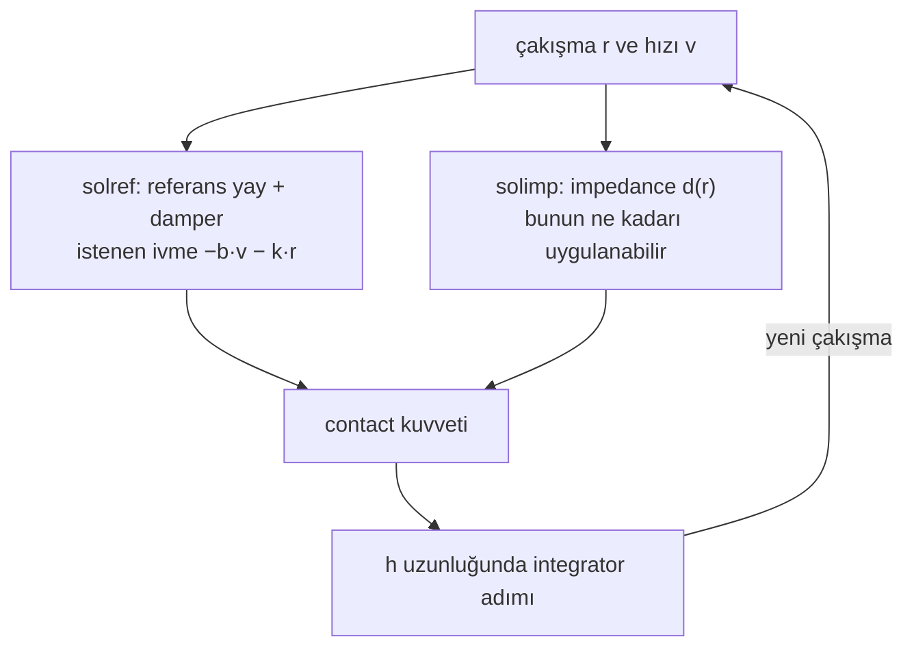

# 03 · Contact: soft constraint, solref ve solimp

<!-- meta -->
| | |
|---|---|
| **Bölüm** | [1 · Simulation](README.md) |
| **Çalışma türü** | CPU · Mac ya da Colab CPU |
| **Önkoşul** | [02](02-timestep.md) |
| **Önce öğren** | [Numerical Stability](https://aiengineeringfromscratch.com/lesson?path=phases/01-math-foundations/13-numerical-stability) |
| **Süre** | ~40 dk |
| **Kod** | [`experiments/03-contact/experiment.py`](../../experiments/03-contact/experiment.py) |
| **Durum** | ✅ tam |
<!-- /meta -->

> MuJoCo contact'ı sert, sönümlü sanal bir yaydır: ne kadar yumuşak olacağını sen seçersin, stabil kalıp kalmayacağına timestep karar verir.

## Problem

[Ders 02](02-timestep.md)'de bir küp `dt` = 1 ms'de bile 1 cm'lik tabladan geçti: contact doğru tarafta tespit edildi ama küpün yaklaşık 3 cm batmasına izin verdi. Her MuJoCo contact'ı biraz iç içe geçer. Menagerie SO-101 kendi gripper contact parametrelerini ayarlıyor (`solref="0.01 1"`, `condim="6"`), README'sinin manipulation için iyi çalıştığını söylediği değerlerle ([so101.xml](https://github.com/google-deepmind/mujoco_menagerie/blob/f3b6013/robotstudio_so101/so101.xml), [README](https://github.com/google-deepmind/mujoco_menagerie/tree/f3b6013/robotstudio_so101)). Bu ders o iki sayının ne yaptığını ölçüyor: duran bir küp ne kadar batıyor, bırakılan bir küp ne kadar sekiyor ve contact timestep'in integre edebileceğinden sert olunca ne oluyor.

## Ana fikir

### Sade anlatımla

Gerçek cisimler iç içe geçemez. Her çakışmayı tam olarak yasaklamak her adımda zor ve sıçramalı bir problem demek; MuJoCo daha yumuşak bir şey yapar: iki şekil çakıştığında aralarına görünmez bir yay ve bir amortisör koyar. Çakışma ne kadar derinse o kadar sert geri iter. Cisimler her zaman biraz batar; ne kadar batacağını sen seçersin.

Bu yayı iki ayar tanımlar. `solref`, çakışmayı ne kadar hızlı geri aldığını (*time constant*: küçük = sert) ve ne kadar sönümlendiğini (*damping ratio*: 1'in altında zıplar) söyler. `solimp`, solver'ın yayın itişinin ne kadarını uygulayabileceğini söyler (*impedance*: 0 ile 1 arasında, derinlikle artar).

Püf noktası zamandır. Bir çakışmayı yaklaşık iki timestep'ten kısa sürede geri almaya çalışan bir yay her adımda hedefi aşar ve enerji kazanır. MuJoCo bu yüzden iki timestep'ten kısa time constant'ları sessizce reddeder.



### Contact yayı, kod olarak

```python
def solref_to_spring(timeconst, dampratio, d, d_w):
    b = 2 / (d_w * timeconst)                         # damping of the reference spring (1/s)
    k = d / (d_w**2 * timeconst**2 * dampratio**2)    # stiffness of the reference spring (1/s²)
    return b, k

# What the solver aims for on one contact:  a1 + d * (b * v + k * r) == (1 - d) * a_u
# At rest a1 = v = 0: the resting penetration (Build it, Step 3 solves it exactly)
timeconst_used = max(timeconst, 2 * h)     # the refsafe guard (h = timestep)
```

| Büyüklük | Formül |
|---|---|
| soft constraint (tek contact) | $a_1 + d\,(b\,v + k\,r) = (1 - d)\,a_u$ |
| `solref`'ten referans yay | $b = \dfrac{2}{d_w\,\text{timeconst}}, \quad k = \dfrac{d(r)}{d_w^2\,\text{timeconst}^2\,\text{dampratio}^2}$ |
| durağan penetration | $r = (1-d)\,a_u\,\Big(\dfrac{d_w}{d}\Big)^2\,\text{timeconst}^2\,\text{dampratio}^2$ |
| yay frekansı | $\omega = 1/(\text{timeconst}\cdot\text{dampratio})$ |
| stabilite koruması (`refsafe`) | kullanılan timeconst $= \max(\text{timeconst}, 2h)$ |

$r$ penetration'dır (şekillerin ne kadar çakıştığı), $v$ onun değişim hızı, $a_u$ cismin contact olmasaydı sahip olacağı ivme (yerçekimi, burada $g$), $a_1$ ise solver'ın contact normal'i boyunca ürettiği ivme. $d \in (0,1)$, `solimp`'ten gelen impedance'tır: $r = 0$'da $d_0$'dan $r$ = width'te $d_w$'ye yumuşak bir S eğrisiyle çıkar. timeconst ve dampratio iki `solref` sayısıdır; $k$ ve $b$ onların ima ettiği stiffness ve damping, $\omega$ yayın doğal frekansı, $h$ timestep'tir.

<details>
<summary>Matematik ayrıntısı: durağan penetration, refsafe koruması ve açığı</summary>

**Durağan penetration.** Durgun hâlde $a_1 = v = 0$, yani $d\,k\,r = (1-d)\,a_u$; $k$'yi yerine koymak tablodaki formülü verir ([Modeling · Solver parameters](https://mujoco.readthedocs.io/en/stable/modeling.html#csolver)). Sabit impedance'ta ($d = d_w$) bu, dokümandaki $r = a_u (1-d)\,\text{timeconst}^2\,\text{dampratio}^2$ olur. Penetration timeconst² ile büyür: iki kat yumuşak, dört kat derin batar. $d$, $r$'ye bağlı olduğu için tam değer iki ilişkinin uyuştuğu yerdedir (Sıfırdan yaz, Adım 3).

**`refsafe` neden var.** Doküman, timeconst'un timestep'in en az iki katı olması gerektiğini, aksi hâlde sistemin integrator için fazla sert olup unstable olabileceğini söylüyor; MuJoCo bunu `refsafe` flag'i kapatılmadıkça zorlar ([Reference](https://mujoco.readthedocs.io/en/stable/modeling.html#csolverreference), [option/flag/refsafe](https://mujoco.readthedocs.io/en/stable/XMLreference.html#option-flag-refsafe)). Bu, [ders 02](02-timestep.md)'nin adım boyu limitinin contact yayına uygulanmış hâli; nerede durduğunu Sıfırdan yaz, Adım 4 hesaplıyor.

**Korumadaki açık.** Buradaki "time constant", doğal frekans ile damping oranının çarpımının tersidir; yani $\omega = 1/(\text{timeconst}\cdot\text{dampratio})$. `refsafe` çarpımı değil, timeconst'u kırpar. Küçük bir dampratio bu yüzden koruma açıkken bile $\omega$'yı limitin ötesine taşır. (Bu `Euler`, `implicitfast`, `implicit` ve `RK4` için geçerli; `discrete` altında `refsafe` bunun yerine timeconst·dampratio < $h$ olan satırları değiştirir, bkz. [option/flag/refsafe](https://mujoco.readthedocs.io/en/stable/XMLreference.html#option-flag-refsafe).)

**İki geom, tek contact.** İki geom temas ettiğinde, birinin `priority`'si yüksek değilse `solref`/`solimp` değerlerinin ortalaması alınır (ağırlıklar `solmix`); margin ve gap toplanır ([Contact parameters](https://mujoco.readthedocs.io/en/stable/modeling.html#ccontact)).

Daha derine: [Numerical Stability](https://aiengineeringfromscratch.com/lesson?path=phases/01-math-foundations/13-numerical-stability) (AIEFS: sert bir yayın explicit integration'ı neden patlar); [MuJoCo Modeling · Solver parameters](https://mujoco.readthedocs.io/en/stable/modeling.html#csolver).

</details>

### Contact attribute'ları

| Attribute | Sayılar (default) | Anlamı |
|---|---|---|
| `solref` | `timeconst dampratio` (`0.02 1`) | yukarıdaki referans yay. Büyük timeconst = daha yumuşak. Negatif değerler = doğrudan `-stiffness -damping` |
| `solimp` | `d0 dw width midpoint power` (`0.9 0.95 0.001 0.5 2`) | $d(r)$, $r = 0$'da $d_0$'dan $r$ = width'te (1 mm) $d_w$'ye sigmoid boyunca çıkar |
| `margin` | 0 | mesafe < margin olunca contact aktif olur (kuvvet üretir) |
| `gap` | 0 | margin ile margin + gap arasındaki contact'lar raporlanır ama kuvvet üretmez |
| `condim` | 3 | 1 sürtünmesiz · 3 kayma sürtünmesi · 4 + burulma · 6 + yuvarlanma |

Kaynaklar: [Reference (solref)](https://mujoco.readthedocs.io/en/stable/modeling.html#csolverreference), [Impedance (solimp)](https://mujoco.readthedocs.io/en/stable/modeling.html#csolverimpedance), [geom/condim](https://mujoco.readthedocs.io/en/stable/XMLreference.html#body-geom-condim), [margin and gap](https://mujoco.readthedocs.io/en/stable/computation/index.html#comargingap). `condim`, bir contact'ın kullanabileceği kuvvet yönlerinin sayısıdır: 1 normal boyunca saf itme, 3 iki yönde kayma sürtünmesi ekler, 4 ve 6 burulma ve yuvarlanma direncini ekler.

<!-- figure: 03-contact-spring -->

## Sıfırdan yaz

Şimdi MuJoCo'nun tek bir contact için contact yasasını yaklaşık 50 satır NumPy ile yazacak, onunla bir küre bırakacak ve her adımı MuJoCo'nun constraint verisiyle karşılaştıracaksın. Cisim Deney'in tek contact'lı küresi (5 cm yarıçap, 1 kg, `dt` = 2 ms), `condim="1"` ile: bir contact tam olarak bir constraint satırı. Adımları kendi dosyana yaz ve her adımdan sonra çalıştır. Bitmiş fonksiyonlar [`physai/sim.py`](../../physai/sim.py) içinde; `uv run python experiments/03-contact/build.py` dört adımı kontrolleriyle birlikte koşturur (çıktı [`build_output.txt`](../../experiments/03-contact/build_output.txt) dosyasında).

### Adım 1 · İki ayar sayıya dönüşüyor

`solimp`, impedance $d(r)$ olur: `midpoint`'te birleşen ve `width` boyunca $d_0$'dan $d_w$'ye tırmanan iki üs eğrisi. `solref`, referans yayın stiffness'ı $K$ ve damping'i $B$ olur; `refsafe` koruması da içinde:

```python
def impedance(r, solimp):
    """MuJoCo's impedance d(r) for penetration r >= 0: d0 at r = 0 rising to dwidth at r = width."""
    d0, dw, width, mid, power = solimp
    x = min(r / width, 1.0)
    if x >= 1.0:
        return dw
    if x <= mid:                                       # two power curves joined at the midpoint
        y = x**power / mid ** (power - 1)
    else:
        y = 1 - (1 - x) ** power / (1 - mid) ** (power - 1)
    return d0 + y * (dw - d0)
```

```python
def solref_kb(solref, dmax, h, refsafe=True):
    """Stiffness K and damping B of the reference spring, as MuJoCo stores them (efc_KBIP[:, :2])."""
    timeconst, dampratio = solref
    if refsafe:
        timeconst = max(timeconst, 2 * h)              # the guard: never stiffer than two timesteps
    return 1 / (dmax**2 * timeconst**2 * dampratio**2), 2 / (dmax * timeconst)
```

MuJoCo her aktif constraint satırının $K$, $B$ ve $d$'sini `mj_forward`'dan sonra `d.efc_KBIP` içinde saklar:

```text
== Step 1. Impedance and reference spring vs efc_KBIP (sphere placed at penetration r) ==
timeconst  r (mm)   d ours  d MuJoCo     K ours   K MuJoCo   B ours  B MuJoCo
    0.001     0.5   0.9250    0.9250    69252.1    69252.1   526.32    526.32
    0.004     0.5   0.9250    0.9250    69252.1    69252.1   526.32    526.32
    0.020     0.2   0.9040    0.9040     2770.1     2770.1   105.26    105.26
    0.020     0.5   0.9250    0.9250     2770.1     2770.1   105.26    105.26
    0.020     2.0   0.9500    0.9500     2770.1     2770.1   105.26    105.26
    0.100     0.5   0.9250    0.9250      110.8      110.8    21.05     21.05
```

$K$, tablodaki $k$'nin $d(r)$ çarpanı olmadan hâli; MuJoCo $d$'yi referans ivmeyi kurarken uygular. 1. ve 2. satırlar aynı: 0,001 s'lik timeconst $2h$ = 0,004 s'ye yükseltildi.

### Adım 2 · Tek contact, tek düşüş

Referans ivme $a_\text{ref} = -B v - K d\,(\text{dist})$; penetration sırasında dist < 0. Solver bunu impedance üzerinden serbest ivme $a_0$ ile harmanlar ve contact'ın asla çekmesine izin vermez:

```python
def contact_accel(dist, vel, a0, solref, solimp, h, refsafe=True):
    """Normal acceleration of one frictionless contact (dist < 0 = penetrating, a0 = acceleration without it)."""
    if dist >= 0:
        return a0
    d = impedance(-dist, solimp)
    k, b = solref_kb(solref, solimp[1], h, refsafe)
    a_ref = -b * vel - k * d * dist                    # what the reference spring-damper asks for
    return max(a0, (1 - d) * a0 + d * a_ref)           # a contact can push, never pull
```

Bunu ders 02'nin `semi_implicit_euler`'ine `accel` olarak ver ve küreyi 10 cm'den bırak:

```text
== Step 2. One contact by hand vs MuJoCo ==
at r = 0.5 mm, v = -0.3 m/s: a_ref ours 32.860111 m/s^2 · efc_aref 32.860111 m/s^2
10 cm drop, 2 s:   peak penetration (mm)   rebound (mm)   max |z_ours - z_mujoco| (m)
dampratio 1.0:           8.726           0.000            2.4e-13
dampratio 0.3:           4.859          14.519            1.4e-13
dampratio 0.1:           2.282          57.912            8.7e-12
```

Senin 1 boyutlu küren MuJoCo'nunkini 1e-11 m ya da daha iyi izliyor: sürtünmesiz tek bir contact için constraint solver bu satırlara indirgeniyor. Deney'deki küp daha az batıyor (dampratio 1'de 8,283 mm): ağırlığını dört köşe contact'ı paylaşıyor.

### Adım 3 · Durağan penetration

Durgun hâlde $a_1 = v = 0$, yani constraint $d\,k\,r = (1-d)\,a_u$ olur; $d$, $r$'ye bağlı olduğu için bisection ile çöz:

```python
def resting_penetration(a_u, solref, solimp, h):
    """Penetration where the contact holds a body still: d k r = (1 - d) a_u, solved for r by bisection."""
    def excess(r):                                     # > 0 once the spring pushes more than needed
        d = impedance(r, solimp)
        k, _ = solref_kb(solref, solimp[1], h)
        return d * d * k * r - (1 - d) * a_u
    lo, hi = 0.0, 1.0
    for _ in range(200):
        mid = (lo + hi) / 2
        lo, hi = (lo, mid) if excess(mid) > 0 else (mid, hi)
    return (lo + hi) / 2
```

```text
== Step 3. Resting penetration: bisection on d k r = (1 - d) a_u vs the resting sphere (mm) ==
timeconst     ours  MuJoCo, 2 s at rest
    0.001   0.0175               0.0175
    0.002   0.0175               0.0175
    0.004   0.0175               0.0175
    0.005   0.0273               0.0273
    0.010   0.1078               0.1078
    0.020   0.3672               0.3672
    0.050   1.2263               1.2262
    0.100   4.9050               4.9050
```

Deney'in küre sütunu, her satırıyla. 0,05 s'de bisection 1,2263 mm, 2 s sonraki küre 1,2262 mm veriyor: o yumuşak contact mikrometrenin onda biri kadar hâlâ oturuyor.

### Adım 4 · Sert contact'lar neden patlar

Durgunluğa yakın, Adım 2'nin yasası lineer bir yay-damper: $a \approx -d B v - d^2 K r$. Ders 02'nin `step_growth`'u adım başına büyümesini ölçer, 1 boyutlu düşüşün de kürenin ne yaptığını gösterir:

```text
== Step 4. Growth per step of the linearized contact spring (d = 0.95) vs the 10 cm drop ==
timeconst dampratio refsafe   h*w  growth   highest bottom (m, from 0.100): ours / MuJoCo
   0.0005      1.00     off  4.00  22.314   6.687 / 6.687
   0.0010      1.00     off  2.00   6.464   13.753 / 13.753
   0.0020      1.00     off  1.00   1.618   1.786 / 1.786
   0.0030      1.00     off  0.67   0.699   0.100 / 0.100
   0.0010      1.00      on  0.50   0.750   0.100 / 0.100
   0.0200      0.10      on  1.00   0.894   0.100 / 0.100
   0.0200      0.07      on  1.43   0.894   0.100 / 0.100
   0.0200      0.05      on  2.00   1.740   0.345 / 0.345
```

1'in üstündeki büyüme her adımın hareketi büyüttüğü demek: tam da küreyi fırlatan satırlar, senin kodunda da MuJoCo'da da. Limit ders 02'nin $h\omega < 2$'sinden düşük: contact'ın damping'i explicit integre ediliyor ve bu sınırı $h^2\omega^2 < 4 - 2hc$'ye çekiyor ([ders 05](05-joints-and-actuators.md) türetiyor), dampratio 1'de yaklaşık $h\omega < 0{,}83$. 0,002 s'nin ($h\omega$ = 1,00) patlamasının, 0,003 s'nin ayakta kalmasının ve `refsafe`'in $2h$'sinin ($h\omega$ = 0,50) güvenli olmasının sebebi bu. dampratio'yu düşürmek $\omega$'yı yükseltir ama damping'i değil: 0,05'te büyüme `refsafe` açıkken 1,740. Deney'deki küp 0,07'de bırakıldığı yükseklikten biraz yukarı da sekiyor (0,106 m); tek contact'lı bu küre sekmiyor.

### Elinde kalan

`physai.sim` artık `impedance`, `solref_kb`, `contact_accel` ve `resting_penetration` içeriyor; `semi_implicit_euler` ve `step_growth`'u yeniden kullandın. Ders 04 aynı contact'a sürtünme ekliyor. [`tests/test_03_contact.py`](../../tests/test_03_contact.py) bunları MuJoCo'ya sabitliyor; bir şey değiştirdikten sonra `uv run pytest tests/test_03_contact.py` çalıştır.

## Kütüphaneyle kullan

MuJoCo'da iki ayarı geom başına (ya da default class ya da `<pair>` başına) verirsin ve oluşan constraint'i geri okursun:

```python
<geom ... solref="0.01 1" solimp="0.9 0.95 0.001 0.5 2" condim="3" priority="1"/>

mujoco.mj_forward(m, d)
d.efc_pos[:d.nefc]        # signed distance per row (negative = penetrating)
d.efc_KBIP[:d.nefc]       # K, B, impedance d and its slope per row (Step 1)
d.efc_aref[:d.nefc]       # reference acceleration (Step 2)
f = np.zeros(6)
mujoco.mj_contactForce(m, d, 0, f)   # contact 0's force in its contact frame: normal first
```

Tuzaklar:

- **Satırlar contact değildir.** `condim="3"` ve default pyramidal cone ile bir contact'ın dört satırı vardır (ders 04) ve $d$, $K$, $B$ satır başınadır. `efc_*`'ye `d.contact[i].efc_address` üzerinden eriş.
- **İki geom, tek değer.** Farklı `solref`/`solimp` değerleri, bir geom'un `priority`'si yüksek değilse `solmix` ile ortalanır; SO-101 gripper'ı bunu yapıyor (Matematik ayrıntısı).
- **Negatif `solref`** doğrudan stiffness ve damping'e geçer, `solref="-stiffness -damping"`; dokümanın system identification için önerdiği form bu.

## Deney

Bir düzlem üstünde 10 cm, 1 kg'lık bir küp (ve tek contact'lı kontrol olarak 5 cm yarıçaplı, 1 kg'lık bir küre), `dt` = 2 ms, iki geom'da da aynı `solref`:

```python
<geom type="plane" size="1 1 .1" solref="{tc} {dr}"/>
<body pos="0 0 {z0}">
  <freejoint/>
  <geom type="box" size=".05 .05 .05" mass="1" solref="{tc} {dr}"/>
</body>
```

`rest()` cismi düzleme değecek şekilde yerleştirip 2 s sonra contact mesafesini okur. `drop()` onu düzlemin 10 cm üstünden bırakıp en derin penetration'ı ve sekme yüksekliğini kaydeder.

**Tahmin et.** timeconst iki katına çıkarsa küp ne kadar daha derine batar?

**Çalıştır.** [`experiment.py`](../../experiments/03-contact/experiment.py), MuJoCo 3.17.0, NumPy 2.5.4, Apple M5, deterministic; çıktı [`output.txt`](../../experiments/03-contact/output.txt)'de.

**Sweep 1 · timeconst → durağan penetration** (dampratio 1):

| timeconst (s) | küp (mm) | küre (mm) | $d$ | yukarıdaki denklem (mm) |
|---|---|---|---|---|
| 0,001 | 0,0044 | 0,0175 | 0,9000 | 0,0175 |
| 0,002 | 0,0044 | 0,0175 | 0,9000 | 0,0175 |
| 0,004 | 0,0044 | 0,0175 | 0,9000 | 0,0175 |
| 0,005 | 0,0068 | 0,0273 | 0,9001 | 0,0273 |
| 0,01 | 0,0273 | 0,1078 | 0,9012 | 0,1078 |
| 0,02 (default) | 0,1078 | 0,3672 | 0,9135 | 0,3672 |
| 0,05 | 0,4914 | 1,2262 | 0,9500 | 1,2263 |
| 0,1 | 1,2263 | 4,9050 | 0,9500 | 4,9050 |

- Küre (tek contact) her satırda durağan hâl denklemiyle dört haneye kadar örtüşüyor; sabit-$d$ formu yalnızca $r$ 1 mm'lik width'i aştığında (0,05 ve 0,1 s) tutuyor, orada $d = d_w$ = 0,95.
- Küpün dört köşe contact'ı var, her biri ağırlığın dörtte birini taşıyor. İkisinin aynı $d$'de olduğu satırlarda (0,001–0,01 s ve 0,1 s) küp kürenin dörtte biri kadar batıyor; 0,02 ve 0,05 s'de daha sığ penetration'ı `solimp` sigmoid'inde daha aşağıda (daha küçük $d$) kalıyor, bu yüzden oransal olarak daha çok batıyor.
- 0,001, 0,002 ve 0,004 s aynı sonucu veriyor: $2h$ = 0,004 s'nin altında `refsafe` değeri değiştiriyor.

**Sweep 2 · impedance** (`solimp="d d 0.001"`, timeconst 0,02): $d$ = 0,5 / 0,9 / 0,95 / 0,99 için penetration 0,4905 / 0,0981 / 0,0490 / 0,0098 mm, yani $1-d$ ile orantılı.

**Sweep 3 · dampratio → 10 cm'den düşüş** (timeconst 0,02):

| dampratio | en derin penetration (mm) | sekme (mm) |
|---|---|---|
| 0,1 | 2,220 | 56,504 |
| 0,2 | 3,503 | 24,202 |
| 0,3 | 4,629 | 13,766 |
| 0,5 | 6,236 | 3,339 |
| 0,7 | 7,288 | 0,055 |
| 1,0 | 8,283 | 0,000 |
| 2,0 | 9,723 | 0,000 |


dampratio MuJoCo'nun restitution düğmesidir (bir çarpmanın ne kadar sektirdiği): 1'in altında küp sekiyor, 1'den itibaren sekmiyor. dampratio 1'de daha yumuşak bir timeconst çarpmada daha derine batıyor: 0,004, 0,01, 0,02, 0,05, 0,1 s için 0,297, 3,295, 8,283, 23,248, 48,314 mm. Default contact'a 10 cm'den bırakılan 1 kg'lık küp en derin noktasında zeminin 8,283 mm "içinde"; durgun hâlde 0,1078 mm.

## Boz

**1 · timeconst 2·dt'nin altında, `refsafe` kapalı** (dampratio 1, 10 cm'den düşüş, `dt` = 2 ms):

| timeconst | refsafe | en derin pen. (mm) | ulaşılan en yüksek nokta | son 0,5 s titreşim (mm) |
|---|---|---|---|---|
| 0,0005–0,004 | açık | 0,297 | 0,100 m (başlangıç) | 0,000 |
| 0,0005 | kapalı | 0,297 | **7,834 m** | 497,278 |
| 0,001 | kapalı | 2,327 | **13,809 m** | 2084,273 |
| 0,002 | kapalı | 6,308 | 0,894 m | 267,969 |
| 0,003 | kapalı | 0,578 | 0,100 m (sekme 2,581 mm) | 0,000 |
| 0,004 | kapalı | 0,297 | 0,100 m | 0,000 |

Titreşim sütunu, küpün hareketsiz yatması gereken son 0,5 s'deki yüksekliğinin standart sapmasıdır. Koruma açıkken 0,004 s'nin altındaki her timeconst sessizce 0,004 s oluyor. Kapalıyken contact enerji pompalıyor: 10 cm'den bırakılan 1 kg'lık küp 13,809 m'ye fırlatılıyor. 0,003 s'de (1,5·dt) ayakta kalıyor ama hiç sekmemesi gereken dampratio 1'de 2,581 mm sekiyor.

**2 · korumadaki boşluk**: `refsafe` açık, timeconst 0,02, küçük dampratio. $\omega = 1/(\text{timeconst}\cdot\text{dampratio})$ ile:

| dampratio | $h\omega$ | sekme (mm) | en yüksek nokta |
|---|---|---|---|
| 0,10 | 1,00 | 56,504 | 0,100 m |
| 0,07 | 1,43 | 105,891 | 0,106 m |
| 0,05 | 2,00 | 3146,979 | 3,147 m |

0,07'de küp bırakıldığı yükseklikten daha yükseğe sekiyor; 0,05'te ($h\omega$ = 2) 3,147 m'ye fırlatılıyor. `discrete` dışında `refsafe` yalnızca timeconst'a bakıyor, yani sekmeli bir contact koruma açıkken de patlayabilir. $\text{timeconst}\cdot\text{dampratio}$ çarpımını `dt`'nin rahatça üstünde tut.

## Gerçek robotta

- Menagerie SO-101: kolun collision geom'ları `condim="3"` ve default `solref` kullanıyor; gripper collision geom'ları (`collision_gripper` class'ı) `condim="6"`, `friction="1 5e-3 5e-4"`, `solref="0.01 1"` ve `priority="1"` kullanıyor, yani onların parametreleri nesneninkileri eziyor ([so101.xml](https://github.com/google-deepmind/mujoco_menagerie/blob/f3b6013/robotstudio_so101/so101.xml)). Modelin `timestep="0.005"` değerinde 0,01 s tam olarak $2h$, yani `refsafe`'in izin verdiği en sert değer.
- Gerçek gripper pad'leri 3D baskı plastik; burada kullanılan kaynaklarda onlar için yayımlanmış bir esneklik ya da restitution değeri yok. **Gerçek kolda henüz ölçülmedi.** Prosedür: bilinen bir nesneyi sabit yüksekliklerden pad'e bırak, sekmeyi filme al, dampratio'yu fit et; bilinen bir kuvvetle bastır, çökmeyi ölç, timeconst'u fit et (ya da doğrudan `-stiffness -damping` formu, bkz. Kütüphaneyle kullan).

## Kendini dene

1. **Kolay.** Default `solimp` ile duran 1 kg'lık bir küreyi 1 mm penetration'a hangi timeconst getirir? Denklemi kullan, sonra script'te kontrol et.
2. **Orta.** Düzleme `margin="0.001"` ver. Küp düzlem yüzeyine göre nerede durur, neden?
3. **Zor.** `dt` = 5 ms'de (SO-101 timestep'i) Boz 1 ve 2'yi tekrarla. Hangi timeconst ve dampratio değerleri güvensiz hâle gelir?

### Cevaplar

1. 1 mm'nin üstünde $d = d_w$ = 0,95, yani $9{,}81 \cdot 0{,}05 \cdot \text{timeconst}^2 = 0{,}001$'i çöz; tablo bunu 0,02 ile 0,05 s arasına sıkıştırıyor.
2. Impedance ve referans artık mesafe − margin üzerinde çalışır; küp eski durgun penetration kadar, düzleme değmeden 1 mm'nin biraz altında havada durur. Ölç.
3. `refsafe` 0,01 s'nin altındaki her timeconst'u yükseltir. Geri kalanı için simüle etmeden önce her ayarda Sıfırdan yaz'ın `step_growth`'unu $h$ = 0,005 ile çalıştır: 1'in üstündeki büyüme güvensizdir.

## Akılda kalanlar ve kaynaklar

- Contact bir soft constraint'tir; durağan penetration $(1-d)\,a_u\,(d_w/d)^2\,\text{timeconst}^2\,\text{dampratio}^2$, tek contact için dört haneye kadar doğrulandı.
- dampratio sekmeyi, timeconst yumuşaklığı belirler. Default contact'a 10 cm'den düşüş en derin noktada 8,283 mm penetration yapıyor.
- timeconst ≥ 2·dt tut (refsafe zorlar) ve timeconst·dampratio'yu dt'nin rahatça üstünde tut (bunu yalnızca `discrete` integrator'ının `refsafe`'i zorlar).

Sonraki: [ders 04 · Friction ve friction cone](04-friction.md).

**Kaynaklar**
- [MuJoCo Modeling · Solver parameters, Contact parameters](https://mujoco.readthedocs.io/en/stable/modeling.html#csolver).
- [MuJoCo XML reference · geom (solref, solimp, margin, gap, condim), option/flag/refsafe](https://mujoco.readthedocs.io/en/stable/XMLreference.html).
- [MuJoCo Computation · Contact, margin and gap](https://mujoco.readthedocs.io/en/stable/computation/index.html#cocontact).
- [Menagerie · robotstudio_so101](https://github.com/google-deepmind/mujoco_menagerie/tree/f3b6013/robotstudio_so101).
- Sayılarımız: [`experiments/03-contact/output.txt`](../../experiments/03-contact/output.txt).
