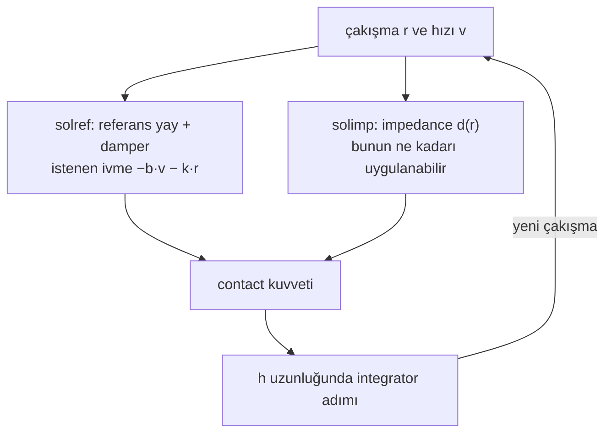

# 03 · Contact: soft constraint, solref ve solimp

<!-- meta -->
| | |
|---|---|
| **Bölüm** | [1 · Simulation](README.md) |
| **Çalışma türü** | CPU · Mac ya da Colab CPU |
| **Önkoşul** | [02](02-timestep.md) |
| **Önce öğren** | [Numerical Stability](https://aiengineeringfromscratch.com/lesson?path=phases/01-math-foundations/13-numerical-stability) |
| **Süre** | ~40 dk |
| **Kod** | [`experiments/03-contact/experiment.py`](../../experiments/03-contact/experiment.py) |
| **Durum** | ✅ tam |
<!-- /meta -->

> MuJoCo contact'ı sert, sönümlü sanal bir yaydır: ne kadar yumuşak olacağını sen seçersin, stabil kalıp kalmayacağına timestep karar verir.

## Problem

[Ders 02](02-timestep.md)'de bir küp `dt` = 1 ms'de bile 1 cm'lik tabladan geçti: contact doğru tarafta tespit edildi ama küpün yaklaşık 3 cm batmasına izin verdi. Gerçek nesneler birbirinin içine girmez, oysa her MuJoCo contact'ı biraz girer. Menagerie SO-101, gripper için kendi contact parametrelerini ayarlıyor (`solref="0.01 1"`, `condim="6"`), README'sinin manipulation için iyi çalıştığını söylediği değerlerle ([so101.xml](https://github.com/google-deepmind/mujoco_menagerie/blob/f3b6013/robotstudio_so101/so101.xml), [README](https://github.com/google-deepmind/mujoco_menagerie/tree/f3b6013/robotstudio_so101)). Bu ders o iki sayının ne yaptığını ölçüyor: duran bir küp ne kadar batıyor, bırakılan bir küp ne kadar sekiyor ve contact timestep'in integre edebileceğinden daha sert yapılınca ne oluyor.

## Ana fikir

### Sade anlatımla

Gerçek cisimler iç içe geçemez. Her çakışmayı tam olarak yasaklayan bir simülatör her adımda zor ve sıçramalı bir problem çözmek zorunda kalırdı. MuJoCo daha yumuşak bir şey yapar: iki şekil çakıştığında aralarına görünmez bir yay ve bir amortisör koyar. Çakışma ne kadar derinse yay o kadar sert geri iter. Bu yüzden cisimler her zaman biraz batar; ne kadar batacağını sen seçersin.

Bu yayı iki ayar tanımlar. `solref`, yayın bir çakışmayı ne kadar hızlı geri almaya çalıştığını (*time constant*: küçük = sert) ve ne kadar sönümlendiğini (*damping ratio*: 1'in altında zıplar, 1 ve üstünde zıplamaz) söyler. `solimp`, solver'ın yayın itişinin ne kadarını uygulayabileceğini söyler (*impedance*: 0 ile 1 arasında, derinlikle artan bir sayı).

Püf noktası zamandır. Bir çakışmayı yaklaşık iki timestep'ten kısa sürede geri almaya çalışan bir yay her adımda hedefi aşar ve simülasyon enerji kaybedeceğine enerji kazanır. MuJoCo bu yüzden iki timestep'ten kısa time constant'ları sessizce reddeder.



### Contact yayı, kod olarak

```python
def solref_to_spring(timeconst, dampratio, d, d_w):
    b = 2 / (d_w * timeconst)                         # damping of the reference spring (1/s)
    k = d / (d_w**2 * timeconst**2 * dampratio**2)    # stiffness of the reference spring (1/s²)
    return b, k

# What the solver aims for on one contact (approximately):
#     a1 + d * (b * v + k * r) == (1 - d) * a_u
# At rest a1 = v = 0, which gives the resting penetration:
def resting_penetration(a_u, timeconst, dampratio, d, d_w):
    return (1 - d) * a_u * (d_w / d)**2 * timeconst**2 * dampratio**2

timeconst_used = max(timeconst, 2 * h)     # the refsafe guard (h = timestep)
```

| Büyüklük | Formül |
|---|---|
| soft constraint (tek contact) | $a_1 + d\,(b\,v + k\,r) = (1 - d)\,a_u$ |
| `solref`'ten referans yay | $b = \dfrac{2}{d_w\,\text{timeconst}}, \quad k = \dfrac{d(r)}{d_w^2\,\text{timeconst}^2\,\text{dampratio}^2}$ |
| durağan penetration | $r = (1-d)\,a_u\,\Big(\dfrac{d_w}{d}\Big)^2\,\text{timeconst}^2\,\text{dampratio}^2$ |
| yay frekansı | $\omega = 1/(\text{timeconst}\cdot\text{dampratio})$ |
| stabilite koruması (`refsafe`) | kullanılan timeconst $= \max(\text{timeconst}, 2h)$ |

$r$ penetration'dır (şekillerin ne kadar çakıştığı), $v$ onun değişim hızı, $a_u$ cismin contact olmasaydı sahip olacağı ivme (yerçekimi, burada $g$), $a_1$ ise solver'ın contact normal'i boyunca ürettiği ivme. $d \in (0,1)$, `solimp`'ten gelen impedance'tır: $r = 0$'da $d_0$'dan $r$ = width'te $d_w$'ye yumuşak bir S eğrisiyle çıkar. timeconst ve dampratio iki `solref` sayısıdır; $k$ ve $b$ onların ima ettiği stiffness ve damping, $\omega$ yayın doğal frekansı, $h$ timestep'tir.

<details>
<summary>Matematik ayrıntısı: durağan penetration, refsafe koruması ve açığı</summary>

**Durağan penetration.** Durgun hâlde cisim normal boyunca ne ivmelenir ne hareket eder; $a_1 = v = 0$ ve constraint $d\,k\,r = (1-d)\,a_u$ olur. $k$'yi yerine koymak tablodaki formülü verir ([Modeling · Solver parameters](https://mujoco.readthedocs.io/en/stable/modeling.html#csolver)). Sabit impedance'ta ($d = d_w$) bu, dokümandaki $r = a_u (1-d)\,\text{timeconst}^2\,\text{dampratio}^2$ formülüne dönüşür. Penetration timeconst² ile büyür: iki kat yumuşak, dört kat derin batar. $d$, `solimp` eğrisi üzerinden $r$'ye bağlı olduğu için tam değer iki ilişkinin uyuştuğu yerdedir; deney iki biçimi de karşılaştırıyor.

**`refsafe` neden var.** Doküman, timeconst'un timestep'in en az iki katı olması gerektiğini, aksi hâlde sistemin integrator için fazla sert olup unstable olabileceğini söylüyor; MuJoCo bunu `refsafe` flag'i kapatılmadıkça zorlar ([Reference](https://mujoco.readthedocs.io/en/stable/modeling.html#csolverreference), [option/flag/refsafe](https://mujoco.readthedocs.io/en/stable/XMLreference.html#option-flag-refsafe)). Fikir [ders 02](02-timestep.md)'deki adım boyu stabilite limiti $h\omega < 2$ ile aynı: contact yayı adıma göre fazla sert olmamalı. dampratio = 1 iken timeconst $\ge 2h$, $h\omega \le 0.5$ demektir; bu limitin epey içinde kalan bir güvenlik payı.

**Korumadaki açık.** Buradaki "time constant", doğal frekans ile damping oranının çarpımının tersidir; yani $\omega = 1/(\text{timeconst}\cdot\text{dampratio})$. `refsafe` çarpımı değil, timeconst'u kırpar. Küçük bir dampratio bu yüzden koruma açıkken bile $\omega$'yı limitin ötesine taşır. (Bu `Euler`, `implicitfast`, `implicit` ve `RK4` için geçerli; `discrete` altında `refsafe` bunun yerine timeconst·dampratio < $h$ olan satırları değiştirir, bkz. [option/flag/refsafe](https://mujoco.readthedocs.io/en/stable/XMLreference.html#option-flag-refsafe).)

**İki geom, tek contact.** İki geom temas ettiğinde, birinin `priority`'si yüksek değilse `solref`/`solimp` değerlerinin ortalaması alınır (ağırlıklar `solmix`); margin ve gap toplanır ([Contact parameters](https://mujoco.readthedocs.io/en/stable/modeling.html#ccontact)).

Daha derine: [Numerical Stability](https://aiengineeringfromscratch.com/lesson?path=phases/01-math-foundations/13-numerical-stability) (AIEFS: sert bir yayın explicit integration'ı neden patlar); [MuJoCo Modeling · Solver parameters](https://mujoco.readthedocs.io/en/stable/modeling.html#csolver).

</details>

### Contact attribute'ları

| Attribute | Sayılar (default) | Anlamı |
|---|---|---|
| `solref` | `timeconst dampratio` (`0.02 1`) | yukarıdaki referans yay. Büyük timeconst = daha yumuşak. Negatif değerler = doğrudan `-stiffness -damping` |
| `solimp` | `d0 dw width midpoint power` (`0.9 0.95 0.001 0.5 2`) | $d(r)$, $r = 0$'da $d_0$'dan $r$ = width'te (1 mm) $d_w$'ye sigmoid boyunca çıkar |
| `margin` | 0 | mesafe < margin olunca contact aktif olur (kuvvet üretir) |
| `gap` | 0 | margin ile margin + gap arasındaki contact'lar raporlanır ama kuvvet üretmez |
| `condim` | 3 | 1 sürtünmesiz · 3 kayma sürtünmesi · 4 + burulma · 6 + yuvarlanma |

Kaynaklar: [Reference (solref)](https://mujoco.readthedocs.io/en/stable/modeling.html#csolverreference), [Impedance (solimp)](https://mujoco.readthedocs.io/en/stable/modeling.html#csolverimpedance), [geom/condim](https://mujoco.readthedocs.io/en/stable/XMLreference.html#body-geom-condim), [margin and gap](https://mujoco.readthedocs.io/en/stable/computation/index.html#comargingap). `condim`, bir contact'ın kullanabileceği kuvvet yönlerinin sayısıdır: 1 normal boyunca saf itme, 3 iki yönde kayma sürtünmesi ekler, 4 ve 6 burulma ve yuvarlanma direncini ekler.

<!-- figure: 03-contact-spring -->

## Deney

Bir düzlem üstünde 10 cm, 1 kg'lık bir küp (ve tek contact'lı kontrol olarak 5 cm yarıçaplı, 1 kg'lık bir küre), `dt` = 2 ms, iki geom'da da aynı `solref`:

```python
<geom type="plane" size="1 1 .1" solref="{tc} {dr}"/>
<body pos="0 0 {z0}">
  <freejoint/>
  <geom type="box" size=".05 .05 .05" mass="1" solref="{tc} {dr}"/>
</body>
```

`rest()` cismi düzleme değecek şekilde yerleştirip 2 s sonra contact mesafesini okur. `drop()` onu düzlemin 10 cm üstünden bırakıp en derin penetration'ı ve sekme yüksekliğini kaydeder.

**Tahmin et.** timeconst iki katına çıkarsa küp ne kadar daha derine batar?

**Çalıştır.** [`experiment.py`](../../experiments/03-contact/experiment.py), MuJoCo 3.17.0, NumPy 2.5.4, Apple M5, deterministic; çıktı [`output.txt`](../../experiments/03-contact/output.txt)'de.

**Sweep 1 · timeconst → durağan penetration** (dampratio 1):

| timeconst (s) | küp (mm) | küre (mm) | $d$ | yukarıdaki denklem (mm) |
|---|---|---|---|---|
| 0,001 | 0,0044 | 0,0175 | 0,9000 | 0,0175 |
| 0,002 | 0,0044 | 0,0175 | 0,9000 | 0,0175 |
| 0,004 | 0,0044 | 0,0175 | 0,9000 | 0,0175 |
| 0,005 | 0,0068 | 0,0273 | 0,9001 | 0,0273 |
| 0,01 | 0,0273 | 0,1078 | 0,9012 | 0,1078 |
| 0,02 (default) | 0,1078 | 0,3672 | 0,9135 | 0,3672 |
| 0,05 | 0,4914 | 1,2262 | 0,9500 | 1,2263 |
| 0,1 | 1,2263 | 4,9050 | 0,9500 | 4,9050 |

- Küre (tek contact) her satırda durağan hâl denklemiyle dört haneye kadar örtüşüyor. Dokümandaki sabit-$d$ formu yalnızca $r$ 1 mm'lik width'i aştığında (0,05 ve 0,1 s) tutuyor; orada $d = d_w$ = 0,95.
- Küpün dört köşe contact'ı var, her biri ağırlığın dörtte birini taşıyor. İkisinin aynı $d$'de olduğu satırlarda (0,001–0,01 s ve 0,1 s) küp kürenin dörtte biri kadar batıyor; 0,02 ve 0,05 s'de küpün daha sığ penetration'ı `solimp` sigmoid'inde daha aşağıda (daha küçük $d$) kalıyor, bu yüzden oransal olarak daha çok batıyor.
- 0,001, 0,002 ve 0,004 s aynı sonucu veriyor: $2h$ = 0,004 s'nin altında `refsafe` değeri değiştiriyor.

**Sweep 2 · impedance** (`solimp="d d 0.001"`, timeconst 0,02): $d$ = 0,5 / 0,9 / 0,95 / 0,99 için penetration 0,4905 / 0,0981 / 0,0490 / 0,0098 mm, yani $1-d$ ile orantılı.

**Sweep 3 · dampratio → 10 cm'den düşüş** (timeconst 0,02):

| dampratio | en derin penetration (mm) | sekme (mm) |
|---|---|---|
| 0,1 | 2,220 | 56,504 |
| 0,2 | 3,503 | 24,202 |
| 0,3 | 4,629 | 13,766 |
| 0,5 | 6,236 | 3,339 |
| 0,7 | 7,288 | 0,055 |
| 1,0 | 8,283 | 0,000 |
| 2,0 | 9,723 | 0,000 |


dampratio MuJoCo'nun restitution düğmesidir (restitution = bir çarpmanın ne kadar sektirdiği): 1'in altında küp sekiyor, 1 ve üstünde sekmiyor. dampratio 1'de daha yumuşak bir timeconst çarpmada daha derine batıyor: 0,004, 0,01, 0,02, 0,05, 0,1 s için 0,297, 3,295, 8,283, 23,248, 48,314 mm. Default contact'a 10 cm'den bırakılan 1 kg'lık küp en derin noktasında zeminin 8,283 mm "içine" giriyor; durgun penetration'ı ise 0,1078 mm.

## Boz

**1 · timeconst 2·dt'nin altında, `refsafe` kapalı** (dampratio 1, 10 cm'den düşüş, `dt` = 2 ms):

| timeconst | refsafe | en derin pen. (mm) | ulaşılan en yüksek nokta | son 0,5 s titreşim (mm) |
|---|---|---|---|---|
| 0,0005–0,004 | açık | 0,297 | 0,100 m (başlangıç) | 0,000 |
| 0,0005 | kapalı | 0,297 | **7,834 m** | 497,278 |
| 0,001 | kapalı | 2,327 | **13,809 m** | 2084,273 |
| 0,002 | kapalı | 6,308 | 0,894 m | 267,969 |
| 0,003 | kapalı | 0,578 | 0,100 m (sekme 2,581 mm) | 0,000 |
| 0,004 | kapalı | 0,297 | 0,100 m | 0,000 |

Titreşim sütunu, küpün hareketsiz yatması gereken son 0,5 s'deki yüksekliğinin standart sapmasıdır. Koruma açıkken 0,004 s'nin altındaki her timeconst sessizce 0,004 s oluyor. Kapalıyken yay bu adımda explicit integration için fazla sert ve contact enerji pompalıyor: 10 cm'den bırakılan 1 kg'lık küp 13,809 m'ye fırlatılıyor. 0,003 s'de (1,5·dt) ayakta kalıyor ama hiç sekmemesi gereken dampratio 1'de bile 2,581 mm sekiyor.

**2 · korumadaki boşluk**: `refsafe` açık, timeconst 0,02, küçük dampratio. $\omega = 1/(\text{timeconst}\cdot\text{dampratio})$ ile:

| dampratio | $h\omega$ | sekme (mm) | en yüksek nokta |
|---|---|---|---|
| 0,10 | 1,00 | 56,504 | 0,100 m |
| 0,07 | 1,43 | 105,891 | 0,106 m |
| 0,05 | 2,00 | 3146,979 | 3,147 m |

0,07'de küp bırakıldığı yükseklikten daha yükseğe sekiyor (enerji kazancı); 0,05'te ($h\omega$ = 2) 3,147 m'ye fırlatılıyor. `discrete` dışında `refsafe` yalnızca timeconst'a bakıyor, yani sekmeli bir contact koruma açıkken bile patlayabilir. $\text{timeconst}\cdot\text{dampratio}$ çarpımını `dt`'nin rahatça üstünde tut.

## Gerçek robotta

- Menagerie SO-101: kolun collision geom'ları `condim="3"` ve default `solref` kullanıyor; gripper collision geom'ları (`collision_gripper` class'ı) `condim="6"`, `friction="1 5e-3 5e-4"`, `solref="0.01 1"` ve `priority="1"` kullanıyor, yani onların parametreleri nesneninkileri eziyor ([so101.xml](https://github.com/google-deepmind/mujoco_menagerie/blob/f3b6013/robotstudio_so101/so101.xml)). Modelin `timestep="0.005"` değerinde 0,01 s tam olarak $2h$, yani `refsafe`'in izin verdiği en sert değer.
- Gerçek gripper pad'leri 3D baskı plastik; burada kullanılan kaynaklarda onlar için yayımlanmış bir esneklik ya da restitution değeri yok. **Gerçek kolda henüz ölçülmedi.** Prosedür: bilinen bir nesneyi sabit yüksekliklerden pad'e bırak, sekmeyi filme al, dampratio'yu fit et; bilinen bir kuvvetle bastır, çökmeyi ölç, timeconst'u fit et (ya da dokümanın system identification, yani model parametrelerini ölçülen harekete oturtmak için önerdiği doğrudan `-stiffness -damping` formatını kullan).

## Kendini dene

1. **Kolay.** Default `solimp` ile duran 1 kg'lık bir küreyi 1 mm penetration'a hangi timeconst getirir? Denklemi kullan, sonra script'te kontrol et.
2. **Orta.** Düzleme `margin="0.001"` ver. Küp düzlem yüzeyine göre nerede durur, neden?
3. **Zor.** `dt` = 5 ms'de (SO-101 timestep'i) Boz 1 ve 2'yi tekrarla. Hangi timeconst ve dampratio değerleri güvensiz hâle gelir?

### Cevaplar

1. 1 mm'nin üstünde $d = d_w$ = 0,95, yani $9{,}81 \cdot 0{,}05 \cdot \text{timeconst}^2 = 0{,}001$'i çöz; tablo bunu 0,02 ile 0,05 s arasına sıkıştırıyor.
2. Impedance ve referans artık mesafe − margin üzerinde çalışır; durgun hâlde bu büyüklük eski durgun penetration'a eşit olur: küp düzleme değmeden, 1 mm'nin biraz altında bir yükseklikte havada durur. Ölç.
3. `refsafe` 0,01 s'nin altındaki her timeconst'u yükseltir; kapalıyken 0,01 s'nin altında sorun bekle. dampratio için $0{,}005/(\text{timeconst}\cdot\text{dampratio})$ 2'ye yaklaşınca bekle. Çalıştırarak doğrula.

## Akılda kalanlar ve kaynaklar

- Contact bir soft constraint'tir; durağan penetration $(1-d)\,a_u\,(d_w/d)^2\,\text{timeconst}^2\,\text{dampratio}^2$, tek contact için dört haneye kadar doğrulandı.
- dampratio sekmeyi, timeconst yumuşaklığı belirler. Default contact'a 10 cm'den düşüş en derin noktada 8,283 mm penetration yapıyor.
- timeconst ≥ 2·dt tut (refsafe zorlar) ve timeconst·dampratio'yu dt'nin rahatça üstünde tut (bunu yalnızca `discrete` integrator'ının `refsafe`'i zorlar).

Sonraki: [ders 04 · Friction ve friction cone](04-friction.md).

**Kaynaklar**
- [MuJoCo Modeling · Solver parameters, Contact parameters](https://mujoco.readthedocs.io/en/stable/modeling.html#csolver).
- [MuJoCo XML reference · geom (solref, solimp, margin, gap, condim), option/flag/refsafe](https://mujoco.readthedocs.io/en/stable/XMLreference.html).
- [MuJoCo Computation · Contact, margin and gap](https://mujoco.readthedocs.io/en/stable/computation/index.html#cocontact).
- [Menagerie · robotstudio_so101](https://github.com/google-deepmind/mujoco_menagerie/tree/f3b6013/robotstudio_so101).
- Sayılarımız: [`experiments/03-contact/output.txt`](../../experiments/03-contact/output.txt).
