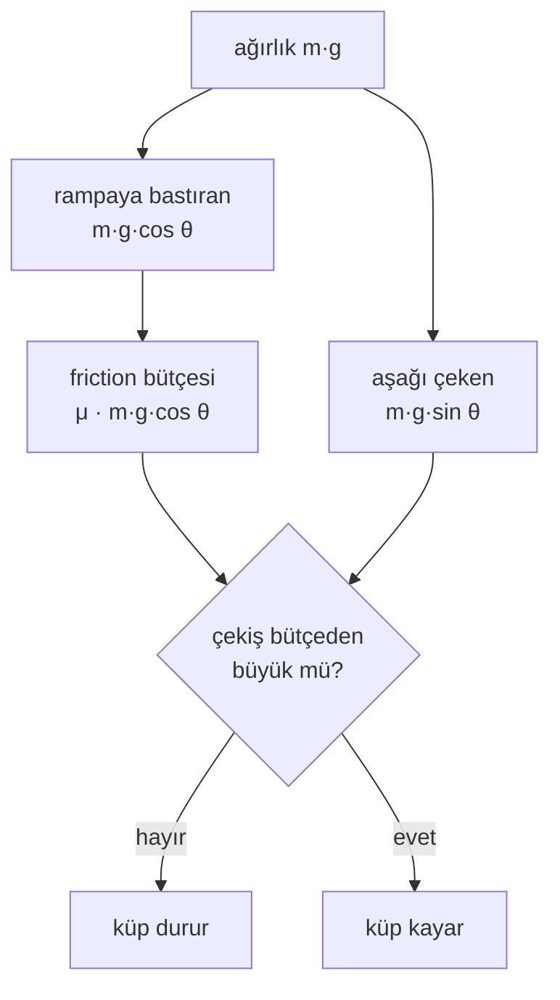

# 04 · Friction ve friction cone

<!-- meta -->
| | |
|---|---|
| **Bölüm** | [1 · Simulation](README.md) |
| **Çalışma türü** | CPU · Mac ya da Colab CPU |
| **Önkoşul** | [03](03-contact.md) |
| **Önce öğren** | [Vectors, Matrices & Operations](https://aiengineeringfromscratch.com/lesson?path=phases/01-math-foundations/02-vectors-matrices-operations) |
| **Süre** | ~40 dk |
| **Kod** | [`experiments/04-friction/experiment.py`](../../experiments/04-friction/experiment.py) · [notebook](../../notebooks/04-friction.ipynb) |
| **Durum** | ✅ tam |
<!-- /meta -->

> Kaymaya ağırlık değil bir oran karar verir: tan θ = μ, simülasyondaki cone da buna yaklaşmak zorunda.

## Problem

Unitree'nin açık temel eğitim config'i (Go2 config'inin miras aldığı) zemin friction'ını rastgeleleştirir ama kütleyi değil: `num_envs = 4096` paralel kopyanın her biri friction'ını `friction_range = [0.5, 1.25]` aralığından çekiyor, `randomize_base_mass = False` ([`legged_robot_config.py`](https://github.com/unitreerobotics/unitree_rl_gym/blob/main/legged_gym/envs/base/legged_robot_config.py)). Kayma için doğru düğme friction'dır: bir ayağın ya da tutulan bir nesnenin kayıp kaymayacağı, nesnenin ne kadar ağır olduğuna değil, friction katsayısına ve contact kuvvetinin yönüne bağlı. Bu ders MuJoCo'da bir rampa üstündeki küpün kayma açısını ölçüyor, Coulomb yasasıyla karşılaştırıyor ve simülasyonun ondan saptığı iki yeri buluyor: eşiğin altında creep ve yöne bağlı pyramidal friction cone.

## Ana fikir

### Sade anlatımla

Friction bir bütçedir. Bir yüzey bir cismi yana doğru itebilir, ama yalnızca bir sınıra kadar; bu sınır da cismin yüzeye ne kadar bastırdığıyla orantılıdır. Orantı katsayısı friction katsayısı μ'dür.

Bir kitabın üstüne telefon koy ve kitabı yavaşça eğ. Eğmek aynı anda iki şey yapar: telefonun ağırlığının daha azı kitaba bastırır (bütçe küçülür), daha fazlası telefonu aşağı çeker (talep büyür). Bir açıda talep bütçeyi aşar ve telefon kayar. Ağır bir telefon daha sert bastırır, ama tam aynı oranda daha sert de çekilir; ağırlık sadeleşir: kayma açısı yalnızca μ'ye bağlıdır.

Bir simülatör bu bütçeyi temsil etmek zorundadır. Tam kural, yan kuvvetin aynı sınıra kadar her yöne bakabileceğini söyler; yani izin verilen kuvvetler yuvarlak bir koni oluşturur. MuJoCo'nun default'u bu yuvarlak koniyi bir piramitle yaklaşıklar; piramidin düz yüzleri sınırı yöne bağımlı yapar. Ayrıca MuJoCo'nun contact'ı yumuşak olduğu için ([ders 03](03-contact.md)) friction da yumuşaktır: sınırın altında bile bir cisim yavaşça creep yapabilir.



### Kayma testi, kod olarak

```python
from math import sin, cos, atan, degrees

def coulomb_slips(theta, mu, m, g):      # theta in radians, g = gravity (m/s²)
    pull = m * g * sin(theta)              # gravity component along the ramp (N)
    budget = mu * m * g * cos(theta)       # largest friction force the surface can supply (N)
    return pull > budget                   # m and g cancel: same as tan(theta) > mu

slip_angle = degrees(atan(mu))             # e.g. mu = 0.5 -> 26.57°
accel = g * (sin(theta) - mu * cos(theta)) # downhill acceleration once it slides

def in_elliptic_cone(f_n, f_t1, f_t2, mu):  # MuJoCo's round cone, condim 3
    return f_n >= 0 and f_t1**2 + f_t2**2 <= (mu * f_n)**2
```

| Büyüklük | Formül |
|---|---|
| küpü aşağı çeken kuvvet | $m g \sin\theta$ |
| friction limiti | $\mu\, m g \cos\theta$ |
| kayma koşulu | $\tan\theta > \mu$ |
| kayarken ivme | $a = g(\sin\theta - \mu\cos\theta)$ |
| elliptic cone | $f_1 \ge 0,\ f_1^2 \ge \sum_i f_i^2/\mu_{i-1}^2$ |

$m$ küpün kütlesi, $g$ yerçekimi, $\theta$ rampa açısı, $\mu$ kayma friction katsayısıdır; $f_1$ yüzey normal'i boyunca contact kuvveti, $f_2, f_3$ (daha yüksek `condim` ile daha fazlası) ise her biri kendi katsayısı $\mu_{i-1}$ ile sınırlanan teğetsel bileşenlerdir.

<details>
<summary>Matematik ayrıntısı: rampada Coulomb yasası ve simüle edilen cone neden sapar</summary>

**Kayma koşulu.** Statik friction en fazla $\mu N$ sağlayabilir; rampada normal kuvvet $N = m g\cos\theta$'dır. Küp $m g\sin\theta \le \mu\, m g\cos\theta$ olduğu sürece durur. $m g\cos\theta$'ya bölmek $\tan\theta \le \mu$ verir: kütle ve yerçekimi sadeleşir ([OpenStax University Physics 1, §6.2](https://openstax.org/books/university-physics-volume-1/pages/6-2-friction)). Eşiğin üstünde net aşağı yönlü kuvvet $m g(\sin\theta - \mu\cos\theta)$'dır; tablodaki ivme buradan gelir.

**Cone'lar.** Bir contact kuvveti $f$ friction cone'un içindeyse kabul edilebilirdir ([Computation · Contact](https://mujoco.readthedocs.io/en/stable/computation/index.html#cocontact)). Elliptic cone tablodaki eşitsizliktir. Pyramidal cone, $n$ = `condim` olmak üzere $2(n-1)$ negatif olmayan kenar kuvvetinden kurulur; `condim=3` için 4 kenar. Piramidin yüzleri düzdür; kesiti çember değil çokgendir ve izin verdiği friction limiti, kaymanın contact frame'ine göre yönüne bağlıdır. Doküman elliptic cone'u fiziksel gerçekliğin daha iyi modeli olarak tanımlıyor; pyramidal cone ise bazen daha hızlı ve sağlam ([option/cone](https://mujoco.readthedocs.io/en/stable/XMLreference.html#option)).

**Creep.** Friction constraint'i de normal constraint gibi yumuşak çözülür; bu yüzden eşiğin altında küçük, sabit bir kayma hızına izin verilir. Doküman buna slow slippage diyor ve iki önlem sayıyor: `impratio` > 1 ile elliptic cone'lar ya da `noslip` solver'ı ([Modeling · Slow slippage](https://mujoco.readthedocs.io/en/stable/modeling.html#cslowslippage)).

**Tek μ.** `geom/friction` üç sayı tutar (kayma, burulma, yuvarlanma; default `1 0.005 0.0001`). Tek bir kayma katsayısı var, yani ayrı statik ve kinetik friction yok. Bir contact çiftinde, bir geom'un `priority`'si yüksek değilse eleman bazında maksimum kullanılır ([geom/friction](https://mujoco.readthedocs.io/en/stable/XMLreference.html#body-geom-friction), [Contact parameters](https://mujoco.readthedocs.io/en/stable/modeling.html#ccontact)).

Daha derine: [Vectors, Matrices & Operations](https://aiengineeringfromscratch.com/lesson?path=phases/01-math-foundations/02-vectors-matrices-operations) (AIEFS: bir kuvveti bileşenlerine ayırmak); [OpenStax University Physics 1, §6.2](https://openstax.org/books/university-physics-volume-1/pages/6-2-friction); [MuJoCo Computation · Contact](https://mujoco.readthedocs.io/en/stable/computation/index.html#cocontact).

</details>

### MuJoCo'da friction cone'lar

| `option/cone` | Tanım | `condim=3` contact başına satır |
|---|---|---|
| `pyramidal` (default) | bir piramidin $2(n-1)$ negatif olmayan kenar kuvveti | 4 |
| `elliptic` | $f_1 \ge 0,\ f_1^2 \ge \sum f_i^2/\mu_{i-1}^2$ | 3 |

*Satır*, constraint solver'ın o contact için bulması gereken tek bir skaler bilinmeyendir.

## Deney

80 × 30 × 2 cm'lik bir rampaya hizalı ve durgun yerleştirilmiş 8 cm'lik bir küp; iki geom da aynı μ'yü alıyor.

```python
def xml(theta_deg, mu, mass, cone="pyramidal"):
    return f"""
<mujoco>
  <option cone="{cone}"/>
  <worldbody>
    <body name="ramp" euler="0 {-theta_deg} 0">
      <geom type="box" size=".40 .15 .01" friction="{mu} 0.005 0.0001"/>
    </body>
    <body name="cube">
      <freejoint/>
      <geom type="box" size=".04 .04 .04" mass="{mass}" friction="{mu} 0.005 0.0001"/>
    </body>
  </worldbody>
</mujoco>"""
```

2 s simüle ediliyor; $v_1$ ve $v_2$, 0,5–1,0 s ve 1,5–2,0 s aralıklarındaki ortalama aşağı yönlü hızlar. Creep (eşiğin altında yavaş kayma, bkz. Matematik ayrıntısı) yüzünden "kayma" iki koşul istiyor:

```python
def slips(v1, v2):
    return v2 > 2.0 and (v2 - v1) > 0.5      # cm/s: fast AND accelerating
```

Kayma açısı, kendisinden büyük her açıda da kaymanın olduğu en küçük açı; grid 0,05°, $\arctan\mu$'nün 3° altından 1° üstüne kadar.

**Tahmin et.** 10 kg'lık bir küp 0,1 kg'lıktan daha büyük bir açıda mı kayar?

**Çalıştır.** [`experiment.py`](../../experiments/04-friction/experiment.py), MuJoCo 3.17.0, Apple M5, `dt` = 2 ms, deterministic; çıktı [`output.txt`](../../experiments/04-friction/output.txt)'de.

| μ | $\arctan\mu$ | 0,1 kg | 1 kg | 10 kg |
|---|---|---|---|---|
| 0,3 | 16,70° | 16,75° | 16,75° | 16,75° |
| 0,5 | 26,57° | 26,60° | 26,60° | 26,60° |
| 0,8 | 38,66° | 38,70° | 38,70° | 38,70° |

**Gözlemle.**
- Kütlenin etkisi yok: bütün sweep boyunca 0,1 kg ve 10 kg'lık küplerin hız dizileri en fazla 2,1·10⁻¹² cm/s farklı (yuvarlama).
- Ölçülen açı teoriden en fazla bir grid adımı uzakta (en büyük sapma +0,05°). μ = 1 için script 45,00°'ye karşı 44,90° veriyor.
- **Creep.** Eşiğin en az 1° altında küp hâlâ sabit hızla hareket ediyor: μ = 0,3, 0,5, 0,8 için 0,30, 0,60 ve 1,42 cm/s'ye kadar; $v_2 - v_1$ ise 0,05 cm/s'nin altında kalıyor. Yalnızca hıza bakan bir kriterle ($v_2$ > 2 cm/s) "kayma açısı" μ = 0,3 ve 0,5 için 16,35°'ye (−0,35°) ve 26,25°'ye (−0,32°) düşüyor. O kriterin yakaladığı şey ivmelenme değil, creep.
- Elliptic cone hizalı küp için aynı açıları veriyor (16,75°, 26,60°, 38,70°).

## Boz

Küpü rampa normali etrafında 45° döndür. Coulomb friction izotroptur, hiçbir şey değişmemeli:

| μ | cone | kayma açısı | teoriye göre | eşiğin ≥ 0,5° altında en yüksek sabit hız |
|---|---|---|---|---|
| 0,5 | pyramidal | 26,30° | −0,27° | 7,40 cm/s |
| 0,5 | elliptic | 26,60° | +0,03° | 0,18 cm/s |
| 0,8 | pyramidal | 37,70° | −0,96° | 27,24 cm/s |
| 0,8 | elliptic | 38,60° | −0,06° | 0,34 cm/s |

Default pyramidal cone'da döndürülmüş küp μ = 0,8'de neredeyse 1° erken kayıyor ve durması gereken yerde 27,24 cm/s'ye kadar kayıyor. Elliptic cone bir iki grid adımı içinde kalıyor. Makul bir mekanizma, piramidin kenarlarının contact frame'ine bağlı olması ve böylece izin verilen teğetsel kuvvetin yöne bağlı hâle gelmesi; ama bu burada ayrıştırılmadı (box–box contact noktalarının yerleşimi de rotation'la değişiyor). Bunu ölçülmüş bir uyarı olarak al: **friction limitleri önemliyse (grasping, ayak kayması) `cone="elliptic"` kullan ya da bir sweep'le doğrula.**

Bu sayıların arkasındaki hız eğrileri, μ = 0,8 için, iki sapmayı birlikte gösteriyor ([`plot.py`](../../experiments/04-friction/plot.py) aynı `sweep()`'i yeniden çalıştırıyor; açı başına hızlar `output.txt`'de yok):


## Gerçek robotta

- Menagerie SO-101 zaten `cone="elliptic"` ve `impratio="10"` kullanıyor, yani yukarıdaki slow slippage önlemini. Gripper collision geom'ları `friction="1 5e-3 5e-4"`, `condim="6"` ve `priority="1"` kullanıyor, yani onların μ = 1 değeri nesneninkini eziyor ([so101.xml](https://github.com/google-deepmind/mujoco_menagerie/blob/f3b6013/robotstudio_so101/so101.xml)). μ = 1'in baskı pad'lerle belirli bir nesne arasında tutup tutmadığı **gerçek kolda henüz ölçülmedi**.
- Prosedür (bu deneyle aynı): nesneyi pad malzemesinden bir rampaya koy, yavaşça eğ, kayma açısını 5 kez kaydet, μ = tan θ. Gerçek yüzeylerde statik katsayı kinetikten büyüktür; MuJoCo'nun tek μ'sü bu farkı temsil edemez.

## Kendini dene

1. **Kolay.** `mass`'ı 1000 kg yap. μ = 0,5'teki kayma açısını tahmin et, sonra düzenleyip `--quick` ile çalıştır.
2. **Orta.** Rampaya μ = 0,3, küpe μ = 0,8 ver. Hangi açıda kayar? Sonra rampa geom'una `priority="1"` ekle.
3. **Zor.** μ ∈ [0,5, 1,25] ile eğitilmiş policy için rampadaki kayma açısı aralığını hesapla. Sonra döndürülmüş küp ve iki cone ile pyramidal sonucun μ = 1,25'te ne kadar sapabileceğini ölç. [Ders 39 · Domain randomization](../part-9-sim-to-real/39-domain-randomization.md) için not al.

### Cevaplar

1. Değişmez, bu düzenekte 26,60°: kütle sadeleşir.
2. Priority olmadan MuJoCo büyük μ'yü, 0,8'i kullanır, yani yaklaşık 38,7° bekle; rampada priority varken μ = 0,3, yaklaşık 16,75°. Doğrulamak için çalıştır.
3. Teoride $\arctan 0{,}5$'ten (26,57°, script yazdırıyor) $\arctan 1{,}25$'e; döndürülmüş küpün μ = 1,25'teki sapması tahminle değil ölçümle bulunmalı.

## Akılda kalanlar ve kaynaklar

- tan θ = μ, kütleden bağımsız; kayma kriteri ivmelenme istediğinde MuJoCo bunu μ = 0,3–0,8 için 0,05° içinde üretiyor (μ = 1'de 45,00°'ye karşı 44,90°).
- Soft contact eşiğin altında creep yapıyor (burada 1,42 cm/s'ye kadar); yalnızca hıza bakan kriter creep'i kayma sanıyor.
- Default pyramidal cone bu testte yöne bağlı (45°'de −0,96°); elliptic değil.

Sonraki: [ders 05 · Joint'ler ve actuator'ler](05-joints-and-actuators.md).

**Kaynaklar**
- [OpenStax, University Physics Vol. 1, §6.2 Friction](https://openstax.org/books/university-physics-volume-1/pages/6-2-friction).
- [MuJoCo XML reference · option/cone, geom/friction](https://mujoco.readthedocs.io/en/stable/XMLreference.html); [Computation · Contact](https://mujoco.readthedocs.io/en/stable/computation/index.html#cocontact); [Modeling · Contact parameters](https://mujoco.readthedocs.io/en/stable/modeling.html#ccontact).
- [`unitree_rl_gym` · `legged_robot_config.py`](https://github.com/unitreerobotics/unitree_rl_gym/blob/main/legged_gym/envs/base/legged_robot_config.py): `num_envs = 4096`, `randomize_friction = True`, `friction_range = [0.5, 1.25]` (2026-10-27'de okundu).
- [Menagerie · robotstudio_so101](https://github.com/google-deepmind/mujoco_menagerie/tree/f3b6013/robotstudio_so101).
- Sayılarımız: [`experiments/04-friction/output.txt`](../../experiments/04-friction/output.txt).
