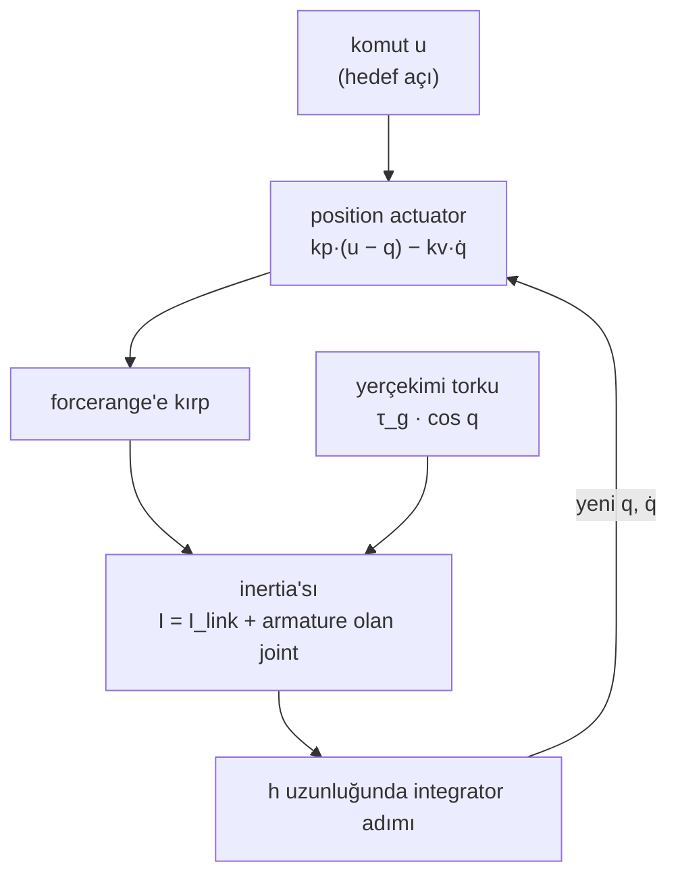
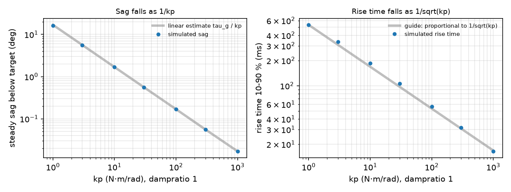

# 05 · Joint'ler ve actuator'ler

<!-- meta -->
| | |
|---|---|
| **Bölüm** | [1 · Simulation](README.md) |
| **Çalışma türü** | CPU · Mac ya da Colab CPU |
| **Önkoşul** | [01](01-world-as-text.md), [02](02-timestep.md) |
| **Önce öğren** | [Calculus for Machine Learning](https://aiengineeringfromscratch.com/lesson?path=phases/01-math-foundations/04-calculus-for-ml) |
| **Süre** | ~45 dk |
| **Kod** | [`experiments/05-joints-and-actuators/experiment.py`](../../experiments/05-joints-and-actuators/experiment.py) |
| **Durum** | ✅ tam |
<!-- /meta -->

> `<position>` actuator, physics adımının içinde yaşayan bir PD controller'dır: gain'i sarkmayı belirler, armature ise adımın onu integre edip edemeyeceğine karar verir.

## Problem

Menagerie SO-101 her joint'e aynı servo'yu veriyor: `armature="0.028"` olan bir joint üstünde `<position kp="998.22" kv="2.731" forcerange="-2.94 2.94"/>`; bir yorum da bu gain'lerin gerçek servo'nunkilerin birebir kopyası olmadığını söylüyor ([so101.xml](https://github.com/google-deepmind/mujoco_menagerie/blob/f3b6013/robotstudio_so101/so101.xml)). kp neden neredeyse 1000, bir hobi servo'sunda armature ne işe yarıyor ve gain'leri kopyalayıp armature'ı atarsan ne olur? Bu ders yerçekimi yüklü tek bir link kuruyor, kp'nin sarkmayı ve yükselme süresini nasıl belirlediğini ölçüyor ve aynı gain'lerin simülasyonu nerede ıraksattığını buluyor.

## Ana fikir

### Sade anlatımla

Bir `<position>` actuator'ü, joint'i komut verilen açıya çeken bir yay artı bir amortisör gibi davranır. Yayın sertliği `kp`'dir: hedeften ne kadar uzaksa o kadar sert çeker. Amortisörün gücü `kv`'dir: joint ne kadar hızlıysa o kadar frenler. Mühendisler buna PD controller der (hataya Orantılı bir terim artı hıza bağlı bir Türev terimi; İngilizcesi Proportional-Derivative).

Yaya asılan bir ağırlık yüksüz duruşunun altında dengelenir: yay ancak gerildiğinde iter. Yerçekimi altındaki bir position servo da aynısını yapar: kabaca yerçekimi torku bölü `kp` kadar *sarkar*. Daha sert bir yay daha az sarkar ve daha çabuk varır.

Sertliğin simülasyonda bir bedeli var. Hafif bir joint'teki sert bir yay hızlı salınır; bir timestep bu salınıma göre uzunsa her adım hedefi aşar ve simülasyon patlar. *Armature*, joint'e eklenen ek inertia'dır: gerçek bir servoda motorun dönen rotoru; dişli kutusu onu joint'te çok daha ağır hissettirir. Salınımı timestep'in takip edebileceği kadar yavaşlatır.



### Servo, kod olarak

```python
force = clip(kp * (u - q) - kv * qdot, *forcerange)   # spring toward u, damper on speed (PD), clamped

# Steady sag e under a gravity torque tau_g: solve kp * e == tau_g * cos(e)
sag_estimate = tau_g / kp                        # good when the sag is small

# How fast the joint oscillates, and whether the timestep h can follow it
omega = sqrt(kp / (I_link + armature))           # natural frequency (rad/s)
h_omega = h * omega                              # explicit integration needs about h_omega < 2
kv = 2 * zeta * sqrt(kp * m)                     # what dampratio=zeta sets; m = reflected inertia
```

| Büyüklük | Formül |
|---|---|
| actuator kuvveti | $k_p(u - q) - k_v\,\dot q$, `forcerange`'e kırpılır |
| durağan sarkma | $k_p\,e_{\text{ss}} = \tau_g \cos e_{\text{ss}}\ \ (\approx \tau_g/k_p)$ |
| doğal frekans | $I = I_{\text{link}} + \text{armature}$ olmak üzere $\omega = \sqrt{k_p / I}$ |
| explicit stabilite limiti (sönümsüz) | $h\omega \lesssim 2$ |
| damping'li `implicitfast` limiti | $c = (k_v + \text{damping})/I$ olmak üzere $h^2\omega^2 < 4 + 2hc$ |
| `dampratio`'dan `kv` | $k_v = 2\zeta\sqrt{k_p\,m}$ |

$u$ komut edilen açı, $q$ joint açısı, $\dot q$ hızı; $k_p$, $k_v$ actuator gain'leri; $\tau_g$ link yatayken yerçekimi torku; $e_{\text{ss}}$ durağan durum hatası (sarkma); $I$ efektif inertia, $I_{\text{link}}$ linkin payı; $h$ timestep; $c$ birim inertia başına damping; $\zeta$ damping oranı, $m$ `qpos0`'daki yansıyan inertia.

<details>
<summary>Matematik ayrıntısı: sarkma, yükselme süresi ve iki stabilite sınırı</summary>

**Sarkma.** Durgun hâlde $\dot q = 0$ ve $q = -e_{\text{ss}}$'de $k_p(0 - q) = \tau_g\cos q$; küçük $e_{\text{ss}}$ için $e_{\text{ss}} \approx \tau_g/k_p$. Integral terimi (hata sürdükçe büyüyen bir terim) olmadan hata asla sıfıra inmez.

**Yükselme süresi.** Hedef etrafında lineerleştirilince joint, zaman ölçeği $1/\omega = \sqrt{I/k_p}$ olan yaya bağlı bir kütledir; sabit damping oranında her süre onunla ölçeklenir, dolayısıyla $\propto 1/\sqrt{k_p}$.

**Explicit limit.** `Euler`, `implicit` ve `implicitfast` konum terimini explicit integre eder; doküman limiti $h \lesssim 2/\omega_{\max}$ olarak veriyor ve yalnızca `discrete`'in konumda implicit olduğunu belirtiyor ([Computation · Integrators](https://mujoco.readthedocs.io/en/stable/computation/index.html#geintegrators)); [ders 02](02-timestep.md) ve [03](03-contact.md)'ün $h\omega < 2$'si.

**Implicit damping ile.** `implicitfast` damping'i yeni hızda hesaplar: $v' = v + h(-\omega^2 q - c\,v')$, $q' = q + h v'$. Adım matrisinin determinantı $1/(1 + hc)$, izi $(2 + hc - h^2\omega^2)/(1 + hc)$; 2×2 lineer bir dönüşüm $|\text{iz}| < 1 + \det$ olduğunda stabildir, yani $h^2\omega^2 < 4 + 2hc$. Explicit integre edilen damping (Euler'in `kv`'ye yaptığı) $h^2\omega^2 < 4 - 2hc$ verir: limiti *düşürür*. Sıfırdan yaz, Adım 4 ikisini de sayısal olarak hesaplıyor.

**Armature.** Armature, kütle matrisi $M$'nin joint'e ait köşegenine eklenir; dişli bir motor için yansıyan rotor inertia'sıdır: rotor inertia'sı × dişli oranı² ([XML reference · joint](https://mujoco.readthedocs.io/en/stable/XMLreference.html#body-joint-armature)). Büyük $I$, $\omega$'yı düşürür.

Daha derine: [Calculus for Machine Learning](https://aiengineeringfromscratch.com/lesson?path=phases/01-math-foundations/04-calculus-for-ml) (AIEFS: setpoint etrafında lineerleştirme); [MuJoCo Modeling · Actuators](https://mujoco.readthedocs.io/en/stable/modeling.html#cactuators).

</details>

### Joint'ler

| `joint type` | dof | Tipik kullanım |
|---|---|---|
| `hinge` | `axis` etrafında 1 rotation | SO-101'in bütün joint'leri |
| `slide` | `axis` boyunca 1 öteleme | lineer tablalar, prizmatik gripper'lar |
| `ball` | 3 rotation | kollarda nadiren |
| `free` | 6 | serbest cisimler, robot gövdeleri |

| Joint attribute'u | Etkisi | Kaynak notu |
|---|---|---|
| `range` | konum limiti (contact gibi yumuşak bir constraint) | `limited` ya da `autolimits` ile açılır |
| `damping` | $\tau = -\text{damping}\cdot\dot q$ | `Euler` bunu implicit çözer |
| `armature` | $M$'nin joint köşegenine eklenen ek inertia | rotor inertia'sı × dişli oranı² |
| `frictionloss` | normal kuvvetle ölçeklenmeyen kuru sürtünme | kuvvet yasası değil, bir constraint |

Kaynaklar: [XML reference · joint](https://mujoco.readthedocs.io/en/stable/XMLreference.html#body-joint-armature), [Computation · Friction loss](https://mujoco.readthedocs.io/en/stable/computation/index.html#cofriction).

### Actuator'ler

Her actuator aslında `general`'dır: kuvvet $= \text{gain}\cdot\text{ctrl} + \text{bias}$, `forcerange`'e kırpılır, `gear` üzerinden joint'e aktarılır (Sıfırdan yaz, Adım 1). Kısayollar gain ve bias'ı ayarlar ([XML reference · actuator](https://mujoco.readthedocs.io/en/stable/XMLreference.html#actuator-position), [Modeling · Actuators](https://mujoco.readthedocs.io/en/stable/modeling.html#cactuators)):

| Kısayol | Kuvvet | Notlar |
|---|---|---|
| `motor` | $u$ | tork komutu; controller policy'nin kendisi |
| `position` | $k_p(u - q) - k_v\,\dot q$ | yerleşik PD; `kp` default 1, `kv` default 0, ya da `dampratio` |
| `velocity` | $k_v(u - \dot q)$ | doküman bununla `implicitfast`/`implicit` öneriyor |

## Sıfırdan yaz

Şimdi MuJoCo'nun actuator kuvvet yasasını ve Deney'in servo ile sürülen linkini yaklaşık 40 satır NumPy ile yazacak, kp sweep'ini yeniden üretecek ve Boz'un her hücresini 2 × 2'lik bir matristen tahmin edeceksin. Adımları kendi dosyana yaz ve her adımdan sonra çalıştır. Bitmiş fonksiyonlar [`physai/sim.py`](../../physai/sim.py) içinde; `uv run python experiments/05-joints-and-actuators/build.py` dört adımı kontrolleriyle birlikte koşturur (çıktı [`build_output.txt`](../../experiments/05-joints-and-actuators/build_output.txt) dosyasında).

### Adım 1 · Her actuator için tek kuvvet yasası

Her actuator affine'dir: kuvvet = `gainprm[0]` · ctrl + `biasprm[0]` + `biasprm[1]` · uzunluk + `biasprm[2]` · hız, sonra kırpılır. Kısayollar yalnızca bu sayıları doldurur: `position` gain'i $k_p$, bias'ı $(0, -k_p, -k_v)$ yapar; `velocity` gain'i $k_v$, bias'ı $(0, 0, -k_v)$; `motor` gain'i 1.

```python
def actuator_force(ctrl, length, velocity, gainprm, biasprm, forcerange=None):
    """MuJoCo's affine actuator: gain * ctrl + bias(length, velocity), then clamped to forcerange."""
    force = gainprm[0] * ctrl + biasprm[0] + biasprm[1] * length + biasprm[2] * velocity
    return force if forcerange is None else np.clip(force, *forcerange)
```

Bir joint actuator'ünde uzunluk joint açısıdır, tork da `gear` × kuvvet. Her birinde bir actuator olan üç hinge:

```text
== Step 1. Actuator force laws vs MuJoCo (100 random states and controls) ==
motor, gear 3                        gainprm[0]   1.0 · biasprm[:3] [0. 0. 0.] · max error 0.0e+00 N m
position kp 40 kv 2, forcerange ±5   gainprm[0]  40.0 · biasprm[:3] [  0. -40.  -2.] · max error 3.6e-15 N m
velocity kv 0.7                      gainprm[0]   0.7 · biasprm[:3] [ 0.   0.  -0.7] · max error 0.0e+00 N m
```

### Adım 2 · Deney'in linki

Servo'nun davranışını üç sayı belirler, her biri elle hesaplanabilir: hinge etrafındaki inertia (ders 01'in capsule `solid_inertia`'sı artı parallel-axis terimi $m (L/2)^2$), yerçekimi $-\tau_g\cos q$ ve inertia (link artı armature) üzerinden `dampratio`'dan gelen $k_v$:

```python
def kv_from_dampratio(kp, dampratio, inertia):
    """Damping gain that gives a position servo this damping ratio on this inertia: 2 zeta sqrt(kp I)."""
    return 2 * dampratio * np.sqrt(kp * inertia)
```

```text
== Step 2. The Experiment's link: inertia, gravity torque, kv from dampratio ==
link inertia about the hinge 0.00414684 kg m^2 · M_00 - armature 0.00414684
gravity torque at q = 0.3: -tau_g cos q = -0.281156 N m · -qfrc_bias -0.281156 N m
   kp  kv ours  kv MuJoCo
    1    0.359      0.359
   10    1.134      1.134
  100    3.586      3.586
 1000   11.340     11.340
```

Deney'in tabloları ince çubuk değeri $mL^2/3$ = 0,0040 kg·m²'yi kullanıyor; capsule'ün yuvarlak uçları 0,00015 ekliyor, bu yüzden Adım 4'ün $h\omega$'sı Boz A'dan ikinci ondalıkta ayrılıyor.

### Adım 3 · Servo döngüsü

`implicitfast` hıza bağlı her kuvveti, burada actuator'ün $k_v$'sini, implicit çözer; yani adım, `c_implicit` = $k_v / I$ ile ders 01'in `semi_implicit_euler`'i:

```python
accel = lambda q, v: (actuator_force(0.0, q, v, [kp], [0, -kp, -kv]) - tau_g * np.cos(q)) / I
q, v = semi_implicit_euler(q, v, accel, h, c_implicit=kv / I)     # one implicitfast step
```

Sarkma $k_p e = \tau_g\cos e$'nin çözümü (Newton yöntemi):

```python
def servo_sag(kp, tau_g):
    """Steady error e of a PD servo holding a link against gravity: kp e = tau_g cos e (Newton's method)."""
    e = tau_g / kp
    for _ in range(50):
        e -= (kp * e - tau_g * np.cos(e)) / (kp + tau_g * np.sin(e))
    return e
```

```text
== Step 3. Our servo loop vs mj_step (implicitfast), step -0.5 rad -> 0, 3 s ==
   kp  max |q_ours - qpos|  sag (deg)  servo_sag (deg)  rise 10-90 % (ms)
    1              5.6e-17     16.193           16.193              533.0
    3              1.4e-17      5.594            5.594              335.6
   10              2.8e-17      1.685            1.685              185.6
   30              2.8e-17      0.562            0.562              106.1
  100              1.4e-17      0.169            0.169               56.7
  300              5.6e-17      0.056            0.056               31.6
 1000              2.8e-17      0.017            0.017               16.5
```

Deney'in sweep'i, satır satır, ve `mj_step`'ten 6e-17 rad içinde bir yörünge.

### Adım 4 · Boz'u tahmin et

`step_growth` anahtar kelime argümanlarını adıma iletir; böylece lineerleştirilmiş servo $a = -(k_p/I)\,q - ((k_v + \text{damping})/I)\,v$ üzerinde iki integrator'ı karşılaştırır. `Euler` yalnızca joint damping'i implicit çözer, `implicitfast` $k_v$'yi de:

```python
g_euler = step_growth(semi_implicit_euler, h, kp / I, (kv + damping) / I, c_implicit=damping / I)
g_fast = step_growth(semi_implicit_euler, h, kp / I, (kv + damping) / I, c_implicit=(kv + damping) / I)
```

```text
== Step 4. Growth per step: kv explicit (Euler) or implicit (implicitfast) vs MuJoCo ==
      kp armature   h*w  Euler growth  MuJoCo Euler  implicitfast growth  MuJoCo implicitfast
     998    0.028  0.88         0.725        stable                0.812               stable
     998    0.010  1.33         0.343        stable                0.678               stable
     998    0.005  1.65         1.650      diverged                0.595               stable
     998    0.002  2.01         2.838      diverged                0.519               stable
     998    0.000  2.45         4.143      diverged                0.446               stable
    3000    0.028  1.53         0.725        stable                0.812               stable
   10000    0.028  2.79         5.491      diverged                3.262             diverged
   30000    0.028  4.83        19.786      diverged               13.661             diverged
```

1'in üstündeki büyüme, iki integrator'da da tam olarak MuJoCo'nun ıraksadığı hücreleri işaretliyor; lineer test frictionloss'u dışarıda bıraksa bile. Bu, Matematik ayrıntısı'ndaki sınırın hesaplanmış hâli: explicit damping limiti düşürür (`Euler` $h\omega$ = 1,65'te çöküyor), implicit damping yükseltir (`implicitfast` armature'sız 2,45'te dayanıyor, ama $hc$'nin küçük olduğu kp 10000'de, $h\omega$ = 2,79, dayanmıyor).

### Elinde kalan

`physai.sim` artık `actuator_force`, `kv_from_dampratio` ve `servo_sag` içeriyor; `c_implicit`'li `semi_implicit_euler` de bir `implicitfast` adımı. Ders 12 tam joint controller'ını (PID, gravity feedforward) bunun yanına yazıyor. [`tests/test_05_joints_and_actuators.py`](../../tests/test_05_joints_and_actuators.py) bunları MuJoCo'ya sabitliyor; bir şey değiştirdikten sonra `uv run pytest tests/test_05_joints_and_actuators.py` çalıştır.

## Kütüphaneyle kullan

Actuator'ü tanımla, `mj_step` uygulasın, compile edilmiş sayıları geri oku:

```python
<position joint="j" kp="998.22" kv="2.731" forcerange="-2.94 2.94"/>   # or dampratio="1" instead of kv

d.ctrl[a] = target                                  # in ctrlrange; for <position>, an angle
mujoco.mj_step(m, d)
d.actuator_force[a]                                 # force after the clamp (Step 1)
d.qfrc_actuator                                     # joint torques: gear x force
m.actuator_gainprm[a, 0], m.actuator_biasprm[a, :3] # kp and (0, -kp, -kv)
```

Tuzaklar:

- **`<general>` `biasprm`'ı yok sayar**, `biastype="affine"` de vermezsen (default'u none); `<position>` bunu senin yerine ayarlar.
- **İki kırpma.** `ctrlrange` komutu (`<position>` için bir açı), `forcerange` kuvveti sınırlar.
- **`dampratio` compile sırasında çözülür**, `qpos0`'daki inertia'dan (Adım 2); çalışma anında armature'ı ya da bir kütleyi değiştirirsen $k_v$ eski değerinde kalır.

## Deney

Bir hinge üstünde 20 cm, 0,3 kg'lık bir capsule, $q = 0$'da yatay: $\tau_g$ = 0,2943 N·m, $I_{\text{link}}$ = 0,0040 kg·m² (ince çubuk), `dt` = 5 ms (SO-101'in timestep'i), `implicitfast`.

```python
<option timestep="0.005" integrator="implicitfast"/>
<body name="link">
  <joint name="j" type="hinge" axis="0 -1 0" armature="0.028"/>
  <geom type="capsule" fromto="0 0 0 0.2 0 0" size="0.01" mass="0.3"/>
</body>
<actuator><position joint="j" kp="{kp}" dampratio="1"/></actuator>
```

$q = -0{,}5$ rad'dan başla, $u = 0$ komutu ver, 3 s çalıştır. Sarkma = son 0,5 s'deki ortalama hata; yükselme = yolun %10'undan %90'ına varma süresi.

**Tahmin et.** kp × 10: sarkmaya ve yükselme süresine ne olur?

**Çalıştır.** [`experiment.py`](../../experiments/05-joints-and-actuators/experiment.py), MuJoCo 3.17.0, NumPy 2.5.4, Apple M5, deterministic; çıktı [`output.txt`](../../experiments/05-joints-and-actuators/output.txt)'de.

| kp (N·m/rad) | dampratio 1'den kv | sarkma (°) | $\tau_g/k_p$ (°) | tam çözüm (°) | yükselme %10–90 (ms) |
|---|---|---|---|---|---|
| 1 | 0,359 | 16,193 | 16,862 | 16,193 | 533,0 |
| 3 | 0,621 | 5,594 | 5,621 | 5,594 | 335,6 |
| 10 | 1,134 | 1,685 | 1,686 | 1,685 | 185,6 |
| 30 | 1,964 | 0,562 | 0,562 | 0,562 | 106,1 |
| 100 | 3,586 | 0,169 | 0,169 | 0,169 | 56,7 |
| 300 | 6,211 | 0,056 | 0,056 | 0,056 | 31,6 |
| 1000 | 11,340 | 0,017 | 0,017 | 0,017 | 16,5 |



**Gözlemle.** Sarkma her satırda statik denge $k_p e = \tau_g\cos e$ ile üç ondalığa kadar eşit; lineer $\tau_g/k_p$ yalnızca sarkma büyükken (kp = 1) sapıyor. İntegral terimi olmayan bir position servo yerçekimi altında her zaman sarkar: kp 1000'de 0,017°, kp 1'de 16,193°. Yükselme süresi $1/\sqrt{k_p}$ ile düşüyor (kp 10 → 100: 185,6 → 56,7 ms). Sarkmayı dev gain'ler olmadan kaldırmak [ders 12](../part-4-dynamics-and-control/12-joint-control.md)'deki gravity feedforward'ın işi.

## Boz

**A · SO-101 servo'sunu koru, armature'ı at.** kp 998,22, kv 2,731, joint damping 0,6, frictionloss 0,052, `dt` = 5 ms; armature sweep'i:

| armature | $I$ (kg·m²) | $h\omega$ | Euler | implicitfast | discrete |
|---|---|---|---|---|---|
| 0,028 | 0,0320 | 0,88 | stabil | stabil | stabil |
| 0,010 | 0,0140 | 1,34 | stabil | stabil | stabil |
| 0,005 | 0,0090 | 1,67 | **ıraksadı** | stabil | stabil |
| 0,002 | 0,0060 | 2,04 | **ıraksadı** | stabil | stabil |
| 0,001 | 0,0050 | 2,23 | **ıraksadı** | stabil | stabil |
| 0 | 0,0040 | 2,50 | **ıraksadı** | stabil | stabil |

Euler ilk çöken, daha $h\omega$ = 1,67'de: joint damping'i implicit, actuator'ün `kv`'sini explicit çözüyor; doküman da bu yüzden `kv` kullanıldığında `implicitfast` ya da `implicit` öneriyor ([actuator/position/kv](https://mujoco.readthedocs.io/en/stable/XMLreference.html#actuator-position)). Menagerie'nin ±2,94 N·m `forcerange`'i eklenince Euler artık patlamıyor, titriyor (hedef etrafında hızlı, küçük bir ileri geri): armature 0,001'de tepeden tepeye 0,629°, 0'da 0,798°; sayısal bir problemden çok servo gürültüsüne benzeyen bir hata.

**B · kp'yi yükselt** (implicitfast, armature 0,028): kp 3000'de stabil ($h\omega$ = 1,53), kp 10000'de ($h\omega$ = 2,80) ve 30000'de ($h\omega$ = 4,84) **ıraksadı**; `discrete` dördünde de stabil kaldı. `implicitfast` damping'i implicit, `kp`'yi explicit integre eder; bu, $c = (k_v + \text{damping})/I$ ile $h^2\omega^2 < 4 + 2hc$ sınırını verir (Matematik ayrıntısı); dokümandaki $h\omega \lesssim 2$ damping'siz durum. Armature 0,028'de $hc$ küçük ve sınır 2'nin hemen üstünde. A'da armature'ı atmak $I$'yı çok küçültüp $hc$'yi büyüttü; bu yüzden `implicitfast` $h\omega$ = 2,50'de ayakta kaldı, `kv`'yi explicit çözen Euler 1,67'de çöktü. Sıfırdan yaz, Adım 4 A ve B'nin her hücresini bu yolla tahmin ediyor.

## Gerçek robotta

Script compile edilmiş SO-101 modelini okuyor ([Menagerie · robotstudio_so101](https://github.com/google-deepmind/mujoco_menagerie/tree/f3b6013/robotstudio_so101)), ev pozu `qpos0`, `dt` = 5 ms:

| joint | kp | kv | forcerange (N·m) | armature | $M_{ii}$ (kg·m²) | link payı | $h\omega$ | armature'sız $h\omega$ |
|---|---|---|---|---|---|---|---|---|
| shoulder_pan | 998,22 | 2,731 | ±2,94 | 0,028 | 0,04446 | 0,01646 | 0,75 | 1,23 |
| shoulder_lift | 998,22 | 2,731 | ±2,94 | 0,028 | 0,04542 | 0,01742 | 0,74 | 1,20 |
| elbow_flex | 998,22 | 2,731 | ±2,94 | 0,028 | 0,03734 | 0,00934 | 0,82 | 1,63 |
| wrist_flex | 998,22 | 2,731 | ±2,94 | 0,028 | 0,02913 | 0,00113 | 0,93 | 4,71 |
| wrist_roll | 998,22 | 2,731 | ±2,94 | 0,028 | 0,02808 | 0,00008 | 0,94 | 17,62 |
| gripper | 998,22 | 2,731 | ±2,94 | 0,028 | 0,02802 | 0,00002 | 0,94 | 39,33 |

Bilek ve gripper için armature efektif inertia'nın neredeyse tamamı; o olmadan bu joint'ler $h\omega \approx 2$'nin çok ötesinde olurdu. kp ve kv'yi armature'sız bir `Euler` modeline kopyalamak Boz A'yı tekrar üretir. SO-101'in kendi `implicitfast`'i altında armature'sız ayakta kalıp kalmadığı test edilmedi; büyük implicit `kv`'si sınırı yükseltir, o yüzden hiçbir şey varsayma.

Gerçek donanım bilgileri, [LeRobot SO-101 rehberinden](https://huggingface.co/docs/lerobot/so101): follower 1/345 dişli oranlı altı STS3215 servo kullanıyor; leader, elle hareket ettirilebilsin diye 1/191, 1/345 ve 1/147'yi karıştırıyor. Servo'lar tek bir bus'ı paylaşıyor; her birinin EEPROM'unda (kalıcı belleğinde) saklanan benzersiz bir ID'si var (shoulder pan 1 … gripper 6). Menagerie yorumu, kp, kv ve forcerange'in servo proportional gain'i 16 varsayımıyla türetildiğini ve LeRobot'un gain'lerinin birebir karşılığı olmadığını söylüyor.

Prosedür: gerçek elbow'a 0,5 rad'lık bir adım komutu ver, joint konumunu LeRobot üzerinden kaydet, yükselme süresini ve sarkmayı aynı yük altındaki simüle edilmiş joint'le karşılaştır. **Gerçek kolda henüz ölçülmedi.**

## Kendini dene

1. **Kolay.** `<position>`'ı `<motor>` ile değiştir ve `ctrl = 0` gönder. Link ne yapar? Hangi `ctrl` onu yatay tutar?
2. **Orta.** Position actuator'e `gear="2"` ekle, kp = 100 kalsın. Sarkma değişir mi? Gear'ın uzunluk ve kuvvet üzerindeki etkisiyle açıkla.
3. **Zor.** Boz A için kv = 0 iken (joint damping 0,6 kalsın) Euler'in ıraksadığı en büyük armature'ı bul. $h\omega$ = 2 tahminiyle karşılaştır.

### Cevaplar

1. Yerçekimiyle düşer (sıfır tork). Tutmak için $q = 0$'da $u = \tau_g$ = 0,2943 N·m gerekir.
2. `gear` hem actuator uzunluğunu hem kuvvet aktarımını ölçekler, dolayısıyla joint stiffness'ı gear² × kp olur: sarkmanın yaklaşık dörtte birini bekle. Ölç.
3. Damping'siz: $h\omega = 2$, yani $I = k_p (h/2)^2$. Implicit joint damping sınırı $h^2\omega^2 < 4 + 2hc$'ye genişletir, yani ıraksama daha küçük bir armature'da başlar; Sıfırdan yaz'ın `step_growth`'u kv = 0 ile onu sweep'i çalıştırmadan bulur.

## Akılda kalanlar ve kaynaklar

- `<position>` = kp, kv gain'li PD; yerçekimi altında sarkma $\tau_g\cos e/k_p$ (kp 1'de 16,193°, kp 1000'de 0,017°), yükselme süresi ∝ $1/\sqrt{k_p}$.
- Armature $\omega = \sqrt{k_p/I}$'yı düşürür. SO-101'in 0,028'i bilek ve gripper inertia'sının çoğunu oluşturuyor ve 5 ms'de $h\omega$'yı 1'in altında tutuyor.
- `Euler` önce çöküyor (explicit `kv`), `implicitfast` $h^2\omega^2 > 4 + 2hc$ olunca (damping küçükse ≈ 2), `discrete` denenen her durumda dayandı; `step_growth` her hücreyi önceden söylüyor.

Sonraki: [ders 06 · Rotation](../part-2-spatial-math/06-rotations.md). Bu actuator'lerin üstündeki control: [ders 12](../part-4-dynamics-and-control/12-joint-control.md).

**Kaynaklar**
- [MuJoCo XML reference · joint, actuator (motor, position, velocity, general)](https://mujoco.readthedocs.io/en/stable/XMLreference.html#actuator-position).
- [MuJoCo Modeling · Actuators](https://mujoco.readthedocs.io/en/stable/modeling.html#cactuators); [Computation · Integrators](https://mujoco.readthedocs.io/en/stable/computation/index.html#geintegrators).
- [Menagerie · robotstudio_so101/so101.xml](https://github.com/google-deepmind/mujoco_menagerie/blob/f3b6013/robotstudio_so101/so101.xml) (`sts3215` class'ı).
- [LeRobot SO-101 rehberi](https://huggingface.co/docs/lerobot/so101).
- Sayılarımız: [`output.txt`](../../experiments/05-joints-and-actuators/output.txt), [`build_output.txt`](../../experiments/05-joints-and-actuators/build_output.txt).
