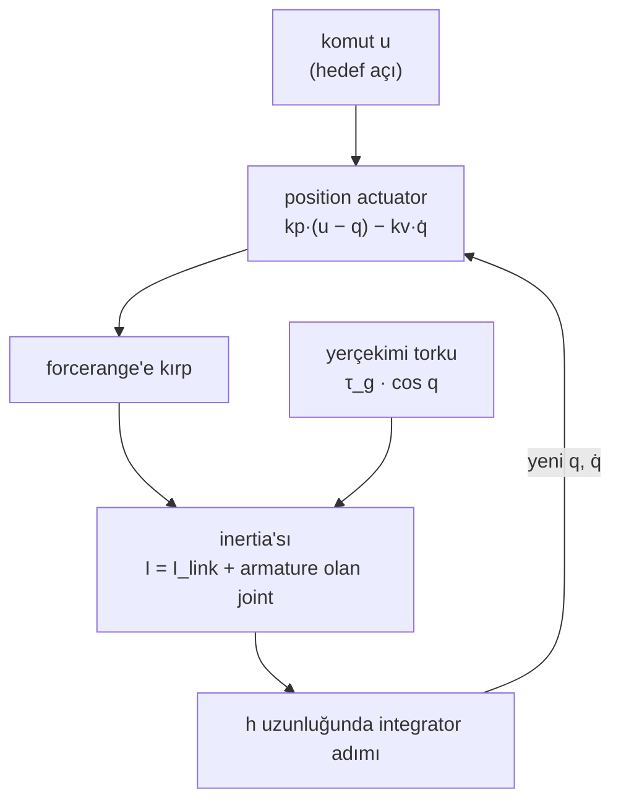

# 05 · Joint'ler ve actuator'ler

<!-- meta -->
| | |
|---|---|
| **Bölüm** | [1 · Simulation](README.md) |
| **Çalışma türü** | CPU · Mac ya da Colab CPU |
| **Önkoşul** | [01](01-world-as-text.md), [02](02-timestep.md) |
| **Önce öğren** | [Calculus for Machine Learning](https://aiengineeringfromscratch.com/lesson?path=phases/01-math-foundations/04-calculus-for-ml) |
| **Süre** | ~45 dk |
| **Kod** | [`experiments/05-joints-and-actuators/experiment.py`](../../experiments/05-joints-and-actuators/experiment.py) |
| **Durum** | ✅ tam |
<!-- /meta -->

> `<position>` actuator, physics adımının içinde yaşayan bir PD controller'dır: gain'i sarkmayı belirler, armature ise adımın onu integre edip edemeyeceğine karar verir.

## Problem

Menagerie SO-101 her joint'e aynı servo'yu veriyor: `armature="0.028"` olan bir joint üstünde `<position kp="998.22" kv="2.731" forcerange="-2.94 2.94"/>`; bir yorum da bu gain'lerin gerçek servo gain'lerinin birebir kopyası olmadığını söylüyor ([so101.xml](https://github.com/google-deepmind/mujoco_menagerie/blob/f3b6013/robotstudio_so101/so101.xml)). kp neden neredeyse 1000, bir hobi servo'sunda armature ne işe yarıyor ve gain'leri kendi modeline kopyalayıp armature'ı atarsan ne olur? Bu ders yerçekimi yüklü tek bir link kuruyor, kp'nin durağan hâl sarkmasını ve yükselme süresini nasıl belirlediğini ölçüyor, sonra aynı gain'lerin simülasyonu ıraksattığı noktayı buluyor.

## Ana fikir

### Sade anlatımla

Bir `<position>` actuator'ü, joint'i komut verdiğin açıya doğru çeken bir yay artı bir amortisör gibi davranır. Yayın sertliği `kp`'dir: joint hedeften ne kadar uzaksa o kadar sert çeker. Amortisörün gücü `kv`'dir: joint ne kadar hızlı hareket ederse o kadar frenler. Kontrol mühendisleri buna PD controller der (hataya Orantılı bir terim artı onun Türevine, yani hıza bağlı bir terim; İngilizcesi Proportional-Derivative).

Bir yaya ağırlık asarsan, ağırlıksız duracağı yerin biraz altında dengelenir, çünkü yay ancak gerildiğinde iter. Yerçekimi altındaki bir position servo da aynısını yapar: kabaca yerçekimi torku bölü `kp` kadar *sarkar*. Daha sert bir yay daha az sarkar ve hedefe daha çabuk varır.

Sertliğin simülasyonda bir bedeli var. Hafif bir joint'teki sert bir yay hızlı salınır. Bir timestep bu salınıma göre fazla uzunsa her adım bir öncekini aşar ve simülasyon patlar. *Armature*, joint'e eklenen ek inertia'dır: gerçek bir servoda motorun dönen rotorunu temsil eder; dişli kutusu onu joint'te çok daha ağır hissettirir. Salınımı timestep'in takip edebileceği kadar yavaşlatır.



### Servo, kod olarak

```python
def position_actuator(u, q, qdot, kp, kv, forcerange):
    force = kp * (u - q) - kv * qdot             # spring toward u, damper on speed (PD)
    return clip(force, *forcerange)              # then clamped; N·m for a hinge

# Steady sag e under a gravity torque tau_g: solve kp * e == tau_g * cos(e)
sag_estimate = tau_g / kp                        # good when the sag is small

# How fast the joint oscillates, and whether the timestep h can follow it
omega = sqrt(kp / (I_link + armature))           # natural frequency (rad/s)
h_omega = h * omega                              # explicit integration needs about h_omega < 2
kv_from_dampratio = 2 * zeta * sqrt(kp * m)      # what dampratio=zeta sets; m = reflected inertia
```

| Büyüklük | Formül |
|---|---|
| actuator kuvveti | $k_p(u - q) - k_v\,\dot q$, `forcerange`'e kırpılır |
| durağan sarkma | $k_p\,e_{\text{ss}} = \tau_g \cos e_{\text{ss}}\ \ (\approx \tau_g/k_p)$ |
| doğal frekans | $I = I_{\text{link}} + \text{armature}$ olmak üzere $\omega = \sqrt{k_p / I}$ |
| explicit stabilite limiti (sönümsüz) | $h\omega \lesssim 2$ |
| damping'li `implicitfast` limiti | $c = (k_v + \text{damping})/I$ olmak üzere $h^2\omega^2 < 4 + 2hc$ |
| `dampratio`'dan `kv` | $k_v = 2\zeta\sqrt{k_p\,m}$ |

$u$ komut edilen açı, $q$ joint açısı, $\dot q$ onun hızıdır; $k_p$ ve $k_v$ actuator gain'leri; $\tau_g$ link yatayken üzerindeki yerçekimi torku; $e_{\text{ss}}$ durağan durum hatası (sarkma); $I$ joint'in hissettiği efektif inertia, $I_{\text{link}}$ linkin kendi payı; $h$ timestep; $c$ birim inertia başına toplam damping; $\zeta$ damping oranı, $m$ ise `qpos0`'daki yansıyan inertia'dır.

<details>
<summary>Matematik ayrıntısı: sarkma, yükselme süresi ve iki stabilite sınırı</summary>

**Sarkma.** Durgun hâlde $\dot q = 0$'dır ve actuator torku yerçekimini dengeler: $q = -e_{\text{ss}}$'de $k_p(0 - q) = \tau_g\cos q$. Küçük $e_{\text{ss}}$ için $\cos e_{\text{ss}} \approx 1$ ve $e_{\text{ss}} \approx \tau_g/k_p$. Integral terimi (hata sürdükçe büyüyen bir terim) olmadan hata asla sıfıra inmez.

**Yükselme süresi.** Hedef etrafında lineerleştirilince joint, zaman ölçeği $1/\omega = \sqrt{I/k_p}$ olan yaya bağlı bir kütledir; sabit damping oranında %10–90 yükselme süresi dahil her süre onunla ölçeklenir, dolayısıyla $\propto 1/\sqrt{k_p}$.

**Explicit limit.** Konum terimi `Euler`, `implicit` ve `implicitfast` tarafından explicit integre edilir; doküman explicit stabilite limitini $h \lesssim 2/\omega_{\max}$ olarak veriyor ve yalnızca `discrete`'in konumda implicit olduğunu belirtiyor ([Computation · Integrators](https://mujoco.readthedocs.io/en/stable/computation/index.html#geintegrators)). Bu, [ders 03](03-contact.md)'teki contact yayıyla aynı $h\omega < 2$'dir.

**Implicit damping ile.** `implicitfast` damping'i yeni hızda hesaplar: $v' = v + h(-\omega^2 q - c\,v')$, sonra $q' = q + h v'$. Adım matrisinin determinantı $1/(1 + hc)$, izi $(2 + hc - h^2\omega^2)/(1 + hc)$'dir; 2×2 lineer bir dönüşüm $|\text{iz}| < 1 + \det$ olduğunda stabildir, bu da $h^2\omega^2 < 4 + 2hc$ verir. Damping bunun yerine explicit integre edilirse (Euler'in actuator `kv`'sine yaptığı gibi) aynı cebir $h^2\omega^2 < 4 - 2hc$ verir: damping o zaman limiti *düşürür*.

**Armature.** Armature, kütle matrisi $M$'nin joint'e ait köşegenine eklenir; dişli bir motor için yansıyan rotor inertia'sıdır: rotor inertia'sı × dişli oranı² ([XML reference · joint](https://mujoco.readthedocs.io/en/stable/XMLreference.html#body-joint-armature)). Büyük $I$, $\omega$'yı düşürür; sayısal rolü budur.

Daha derine: [Calculus for Machine Learning](https://aiengineeringfromscratch.com/lesson?path=phases/01-math-foundations/04-calculus-for-ml) (AIEFS: setpoint etrafında lineerleştirme); [MuJoCo Modeling · Actuators](https://mujoco.readthedocs.io/en/stable/modeling.html#cactuators).

</details>

### Joint'ler

| `joint type` | dof | Tipik kullanım |
|---|---|---|
| `hinge` | `axis` etrafında 1 rotation | SO-101'in bütün joint'leri |
| `slide` | `axis` boyunca 1 öteleme | lineer tablalar, prizmatik gripper'lar |
| `ball` | 3 rotation | kollarda nadiren |
| `free` | 6 | serbest cisimler, robot gövdeleri |

| Joint attribute'u | Etkisi | Kaynak notu |
|---|---|---|
| `range` | konum limiti (contact gibi yumuşak bir constraint) | `limited` ya da `autolimits` ile açılır |
| `damping` | $\tau = -\text{damping}\cdot\dot q$ | Euler integrator'ı bunu implicit çözer |
| `armature` | $M$'nin joint'e ait köşegenine eklenen ek inertia | yansıyan rotor inertia'sı: rotor inertia'sı × dişli oranı² |
| `frictionloss` | yükten bağımsız kuru sürtünme (Coulomb'dan farklı olarak normal kuvvetle ölçeklenmez) | bir kuvvet yasası değil, bir constraint türü olarak çözülür |

Kaynaklar: [XML reference · joint](https://mujoco.readthedocs.io/en/stable/XMLreference.html#body-joint-armature), [Computation · Friction loss](https://mujoco.readthedocs.io/en/stable/computation/index.html#cofriction).

### Actuator'ler

Her actuator aslında `general`'dır: kuvvet $= \text{gain}\cdot\text{ctrl} + \text{bias}$, sonra `forcerange`'e kırpılır, sonra `gear` üzerinden joint'e aktarılır (joint torku = gear × kuvvet). Kısayollar gain ve bias'ı ayarlar ([XML reference · actuator](https://mujoco.readthedocs.io/en/stable/XMLreference.html#actuator-position), [Modeling · Actuators](https://mujoco.readthedocs.io/en/stable/modeling.html#cactuators)):

| Kısayol | Kuvvet | Notlar |
|---|---|---|
| `motor` | $u$ | tork komutu; controller policy'nin kendisi |
| `position` | $k_p(u - q) - k_v\,\dot q$ | yerleşik PD; `kp` default 1, `kv` default 0, ya da `dampratio` |
| `velocity` | $k_v(u - \dot q)$ | doküman bununla `implicitfast`/`implicit` öneriyor |

`ctrlrange` $u$'yu, `forcerange` kuvveti kırpar.

## Deney

Bir hinge üstünde 20 cm, 0,3 kg'lık bir capsule, $q = 0$'da yatay. $\tau_g$ = 0,2943 N·m, $I_{\text{link}}$ = 0,0040 kg·m², `dt` = 5 ms (SO-101 modelinin timestep'i), `implicitfast`.

```python
<option timestep="0.005" integrator="implicitfast"/>
<body name="link">
  <joint name="j" type="hinge" axis="0 -1 0" armature="0.028"/>
  <geom type="capsule" fromto="0 0 0 0.2 0 0" size="0.01" mass="0.3"/>
</body>
<actuator><position joint="j" kp="{kp}" dampratio="1"/></actuator>
```

$q = -0{,}5$ rad'dan başla, $u = 0$ komutu ver, 3 s çalıştır. Sarkma = son 0,5 s'deki ortalama hata; yükselme = hedefe giden yolun %10'undan %90'ına varma süresi.

**Tahmin et.** kp × 10: sarkmaya ve yükselme süresine ne olur?

**Çalıştır.** [`experiment.py`](../../experiments/05-joints-and-actuators/experiment.py), MuJoCo 3.17.0, NumPy 2.5.4, Apple M5, deterministic; çıktı [`output.txt`](../../experiments/05-joints-and-actuators/output.txt)'de.

| kp (N·m/rad) | dampratio 1'den kv | sarkma (°) | $\tau_g/k_p$ (°) | tam çözüm (°) | yükselme %10–90 (ms) |
|---|---|---|---|---|---|
| 1 | 0,359 | 16,193 | 16,862 | 16,193 | 533,0 |
| 3 | 0,621 | 5,594 | 5,621 | 5,594 | 335,6 |
| 10 | 1,134 | 1,685 | 1,686 | 1,685 | 185,6 |
| 30 | 1,964 | 0,562 | 0,562 | 0,562 | 106,1 |
| 100 | 3,586 | 0,169 | 0,169 | 0,169 | 56,7 |
| 300 | 6,211 | 0,056 | 0,056 | 0,056 | 31,6 |
| 1000 | 11,340 | 0,017 | 0,017 | 0,017 | 16,5 |


**Gözlemle.** Sarkma her satırda statik denge $k_p e = \tau_g\cos e$ ile üç ondalığa kadar eşit; lineer $\tau_g/k_p$ yalnızca sarkma büyükken (kp = 1) sapıyor. İntegral terimi olmayan bir position servo yerçekimi altında her zaman sarkar: burada kp 1000'de 0,017°, kp 1'de 16,193°. Yükselme süresi $1/\sqrt{k_p}$ ile düşüyor (kp 10'dan 100'e × 10: 185,6 → 56,7 ms). O sarkmayı dev gain'ler olmadan kaldırmak, [ders 12](../part-4-dynamics-and-control/12-joint-control.md)'deki gravity feedforward'ın (bilinen yerçekimi torkunu komuta eklemek) işi.

## Boz

**A · SO-101 servo'sunu koru, armature'ı at.** kp 998,22, kv 2,731, joint damping 0,6, frictionloss 0,052, `dt` = 5 ms; armature sweep'i:

| armature | $I$ (kg·m²) | $h\omega$ | Euler | implicitfast | discrete |
|---|---|---|---|---|---|
| 0,028 | 0,0320 | 0,88 | stabil | stabil | stabil |
| 0,010 | 0,0140 | 1,34 | stabil | stabil | stabil |
| 0,005 | 0,0090 | 1,67 | **ıraksadı** | stabil | stabil |
| 0,002 | 0,0060 | 2,04 | **ıraksadı** | stabil | stabil |
| 0,001 | 0,0050 | 2,23 | **ıraksadı** | stabil | stabil |
| 0 | 0,0040 | 2,50 | **ıraksadı** | stabil | stabil |

Euler ilk çöken, daha $h\omega$ = 1,67'de: joint damping'i implicit çözüyor ama actuator'ün `kv` terimini explicit integre ediyor; doküman da bu yüzden `kv` kullanıldığında `implicitfast` ya da `implicit` öneriyor ([actuator/position/kv](https://mujoco.readthedocs.io/en/stable/XMLreference.html#actuator-position)). Menagerie'nin ±2,94 N·m `forcerange`'i eklenince Euler artık patlamıyor, onun yerine titriyor (hedef etrafında hızlı, küçük bir ileri geri): armature 0,001'de tepeden tepeye 0,629°, 0'da 0,798°. Bu, sayısal bir problemden çok servo gürültüsüne benzeyen bir hata.

**B · kp'yi yükselt** (implicitfast, armature 0,028): kp 3000'de stabil ($h\omega$ = 1,53), kp 10000'de ($h\omega$ = 2,80) ve 30000'de ($h\omega$ = 4,84) **ıraksadı**. `discrete` dördünde de stabil kaldı. `implicitfast` damping'i implicit, `kp`'yi explicit integre eder. Bu güncellemenin lineer analizi $c = (k_v + \text{damping})/I$ olmak üzere $h^2\omega^2 < 4 + 2hc$ sınırını verir; explicit integre edilen damping (Euler'in `kv`'si) aynı terime eksi işaretle girer, dokümandaki $h\omega \lesssim 2$ ise damping'siz durumdur. Armature 0,028'de $hc$ küçük ve sınır 2'nin hemen üstünde: 1,53'te stabil, 2,80'de ıraksadı. A'da armature'ı atmak $I$'yı çok küçültüp $hc$'yi büyüttü; bu yüzden `implicitfast` $h\omega$ = 2,50'de ayakta kaldı, `kv`'yi explicit integre eden Euler ise 1,67'de çöktü. Sınır A ve B'deki her hücreyi doğru tahmin ediyor.

## Gerçek robotta

Script compile edilmiş SO-101 modelini okuyor ([Menagerie · robotstudio_so101](https://github.com/google-deepmind/mujoco_menagerie/tree/f3b6013/robotstudio_so101)), ev pozu `qpos0`, `dt` = 5 ms:

| joint | kp | kv | forcerange (N·m) | armature | $M_{ii}$ (kg·m²) | link payı | $h\omega$ | armature'sız $h\omega$ |
|---|---|---|---|---|---|---|---|---|
| shoulder_pan | 998,22 | 2,731 | ±2,94 | 0,028 | 0,04446 | 0,01646 | 0,75 | 1,23 |
| shoulder_lift | 998,22 | 2,731 | ±2,94 | 0,028 | 0,04542 | 0,01742 | 0,74 | 1,20 |
| elbow_flex | 998,22 | 2,731 | ±2,94 | 0,028 | 0,03734 | 0,00934 | 0,82 | 1,63 |
| wrist_flex | 998,22 | 2,731 | ±2,94 | 0,028 | 0,02913 | 0,00113 | 0,93 | 4,71 |
| wrist_roll | 998,22 | 2,731 | ±2,94 | 0,028 | 0,02808 | 0,00008 | 0,94 | 17,62 |
| gripper | 998,22 | 2,731 | ±2,94 | 0,028 | 0,02802 | 0,00002 | 0,94 | 39,33 |

Bilek ve gripper için armature efektif inertia'nın neredeyse tamamı; o olmadan bu joint'ler $h\omega \approx 2$'nin çok ötesinde olurdu. Bu modelden kp ve kv'yi armature'ı olmadan bir `Euler` modeline kopyalamak Boz A'yı tekrar üretir. SO-101'in kendisinin, kendi `implicitfast`'i altında armature'sız stabil kalıp kalmadığı burada test edilmedi: büyük implicit `kv` terimi sınırı yükseltir (Boz B), o yüzden ikisini de varsayma.

Gerçek donanım bilgileri, [LeRobot SO-101 rehberinden](https://huggingface.co/docs/lerobot/so101): follower kol 1/345 dişli oranlı altı STS3215 servo kullanıyor; leader, elle hareket ettirilebilsin diye 1/191, 1/345 ve 1/147 oranlarını karıştırıyor. Servo'lar tek bir bus'ı paylaşıyor; her birinin servo'nun EEPROM'unda (küçük, kalıcı belleğinde) saklanan benzersiz bir ID'si var (shoulder pan 1 … gripper 6). Menagerie yorumu, kp, kv ve forcerange değerlerinin servo proportional gain'inin 16 olduğu varsayımıyla türetildiğini ve LeRobot'un kullandığı gain'lerin birebir karşılığı olmadığını söylüyor.

Karşılaştırma prosedürü: gerçek elbow'a 0,5 rad'lık bir adım komutu ver, joint konumunu LeRobot üzerinden kaydet, yükselme süresini ve durağan sarkmayı aynı yük altındaki simüle edilmiş joint'le karşılaştır. **Gerçek kolda henüz ölçülmedi.**

## Kendini dene

1. **Kolay.** `<position>`'ı `<motor>` ile değiştir ve `ctrl = 0` gönder. Link ne yapar? Hangi `ctrl` onu yatay tutar?
2. **Orta.** Position actuator'e `gear="2"` ekle, kp = 100 kalsın. Sarkma değişir mi? Gear'ın uzunluk ve kuvvet üzerindeki etkisiyle açıkla.
3. **Zor.** Boz A için kv = 0 iken (joint damping 0,6 kalsın) Euler'in ıraksadığı en büyük armature'ı bul. $h\omega$ = 2 tahminiyle karşılaştır.

### Cevaplar

1. Yerçekimiyle düşer (sıfır tork). Tutmak için $q = 0$'da $u = \tau_g$ = 0,2943 N·m gerekir.
2. `gear` actuator uzunluğunu ve kuvvet aktarımını ölçekler, dolayısıyla efektif joint stiffness'ı gear² × kp olur: sarkmanın yaklaşık dört kat azalmasını bekle. Ölç.
3. Damping'siz tahmin: $I = k_p (h/2)^2$, yani $h\omega = 2$. Implicit joint damping sınırı $c$ = damping/$I$ olmak üzere $h^2\omega^2 < 4 + 2hc$'ye genişletir, yani ıraksamanın biraz daha küçük bir armature'da başlamasını bekle. Bulmak için sweep'i çalıştır.

## Akılda kalanlar ve kaynaklar

- `<position>` = kp, kv gain'li PD; yerçekimi altındaki durağan sarkma $\tau_g\cos e/k_p$ (burada kp 1'de 16,193°, kp 1000'de 0,017°), yükselme süresi ∝ $1/\sqrt{k_p}$.
- Armature $\omega = \sqrt{k_p/I}$'yı düşürür. SO-101'in 0,028'i bilek ve gripper inertia'sının çoğunu oluşturuyor ve 5 ms'de $h\omega$'yı 1'in altında tutuyor.
- `Euler` önce çöküyor (explicit `kv`), `implicitfast` $h^2\omega^2 > 4 + 2hc$ olunca çöküyor (explicit `kp`, implicit damping; damping küçükse ≈ 2), `discrete` denenen bütün durumlarda dayandı.

Sonraki: [ders 06 · Rotation](../part-2-spatial-math/06-rotations.md). Bu actuator'lerin üstündeki control: [ders 12](../part-4-dynamics-and-control/12-joint-control.md).

**Kaynaklar**
- [MuJoCo XML reference · joint, actuator (motor, position, velocity, general)](https://mujoco.readthedocs.io/en/stable/XMLreference.html#actuator-position).
- [MuJoCo Modeling · Actuators](https://mujoco.readthedocs.io/en/stable/modeling.html#cactuators); [Computation · Integrators](https://mujoco.readthedocs.io/en/stable/computation/index.html#geintegrators).
- [Menagerie · robotstudio_so101/so101.xml](https://github.com/google-deepmind/mujoco_menagerie/blob/f3b6013/robotstudio_so101/so101.xml) (`sts3215` class'ı).
- [LeRobot SO-101 rehberi](https://huggingface.co/docs/lerobot/so101).
- Sayılarımız: [`experiments/05-joints-and-actuators/output.txt`](../../experiments/05-joints-and-actuators/output.txt).
