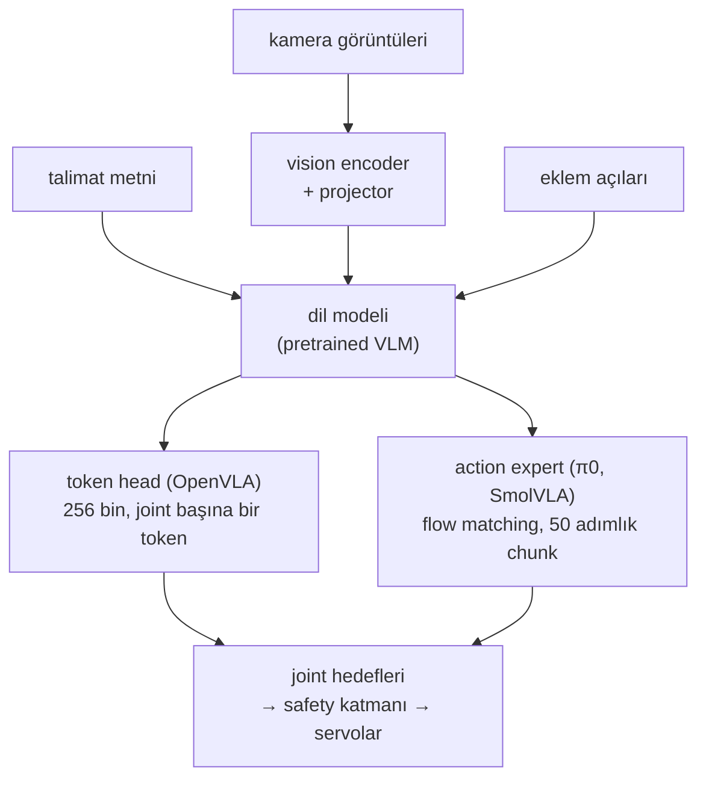

# 41 · Vision-language-action model'leri

<!-- meta -->
| | |
|---|---|
| **Bölüm** | [10 · Foundation model'ler ve agent'lar](README.md) |
| **Çalışma türü** | ART · hazır sonuçlar, CPU'da çalışır |
| **Önkoşul** | [31](../part-7-learning-from-demonstration/31-act.md) |
| **Önce öğren** | [Embodied VLAs: RT-2, OpenVLA, π0, GR00T](https://aiengineeringfromscratch.com/lesson?path=phases/12-multimodal-ai/21-embodied-vlas-openvla-pi0-groot) · [The Full Transformer — Encoder + Decoder](https://aiengineeringfromscratch.com/lesson?path=phases/07-transformers-deep-dive/05-full-transformer) |
| **Süre** | ~60 dk |
| **Kod** | [`experiments/41-vla/experiment.py`](../../experiments/41-vla/experiment.py) |
| **Durum** | ✅ tam |
<!-- /meta -->

> VLA, observation'ı bir cümle de içeren bir policy'dir. Robot için belirleyici tasarım kararı çıkış tarafındadır: joint başına bir token mı, yoksa sürekli action'lardan bir chunk mı?

## Problem

LeRobot'un SmolVLA kılavuzu bir SO-101 sahibine yaklaşık 50 episode kaydetmesini, `lerobot/smolvla_base`'i fine-tune etmesini ve `--task="Grasp a lego block and put it in the bin."` ile çalıştırmasını söylüyor ([docs](https://huggingface.co/docs/lerobot/smolvla)). Buna GPU saati harcamadan önce bir mühendisin bilmesi gerekenler: ağ tam olarak neyi okuyor (hangi kameralar, hangi state, ne kadar metin), ne yazıyor (bir action mı elli mi, token mı gerçek sayı mı) ve parametreleri nerede duruyor. Bu cevaplar, weight'leri indirmeden incelenebilen açık dosyalarda. Bu ders onları SmolVLA, π0 ve OpenVLA için okuyor, sonra token tabanlı çıkışın [ders 16](../part-4-dynamics-and-control/16-grasping-and-pick-place.md)'nın scripted SO-101 pick'i üzerinde neye mal olduğunu ölçüyor.

## Ana fikir

### Sade anlatımla

Resimlere bakabilen bir sohbet modeli düşün. Ona üç kamera karesini, robotun o anki eklem açılarını ve "lego'yu kutuya koy" cümlesini göster; cevabı kelimelerle değil motor komutlarıyla versin. Vision-language-action model'i (VLA) budur: çıkış token'ları joint hedefleri olan bir LLM. Ağın çoğu pretrained görüntü-metin modelidir; robota özgü kısım sondaki küçük bir parçadır, yani modelin iç feature'larını bir servonun izleyebileceği sayılara çeviren **action head**.

Bu head'i kurmanın iki yolu var. Birincisi action'a metin gibi davranır: her joint hedefini 256 seviyeden birine yuvarlar ve her seviyeyi bir kelime olarak yazar; kelime başına bir decoder geçişi. İkincisi küçük ek bir ağa gerçek sayılardan oluşan bütün bir **chunk**'ı, örneğin sonraki 50 adımı, tek seferde yazdırır: rastgele gürültüden başlar ve onu 10 küçük adımda temizler, görüntü diffusion modellerinin resim yapması gibi. Yuvarlamak çözünürlüğe, joint başına bir kelime ise joint başına milyarlarca parametrelik bir modelin bir geçişine mal olur; chunk 50 action için tek çağrıdır, bu da yavaş bir modelin hızlı bir servo döngüsünü sürmesini sağlar.

### Veri akışı



### İki action head, kod olarak

Token head'i bir quantizer'dır; flow head'i ise hızını bir ağdan alan küçük bir ODE çözücüsü (ikisini de Sıfırdan yaz'da yazıyorsun).

```python
k = tokenize(a, lo, hi, 256)                  # lo, hi: 1st and 99th percentile of the training actions
a_hat = detokenize(k, lo, hi, 256)            # the bin centre: |a - a_hat| <= Delta / 2
A = sample_chunk(lambda x, tau: v_theta(x, tau, obs), np.random.randn(50 * 32), 10)   # noise -> 50 x 32 chunk
```

| Head | Çıkış | Hata | Kontrol adımı başına maliyet |
|---|---|---|---|
| token | $k = \big\lfloor B\,\frac{a - a_{lo}}{a_{hi} - a_{lo}} \big\rfloor$, $\hat a = a_{lo} + (k + \tfrac12)\Delta$ | $\lvert a - \hat a\rvert \le \Delta/2$, $\Delta = \frac{a_{hi} - a_{lo}}{B}$ | $D$ decoder geçişi |
| flow matching | $A^{\tau+\delta} = A^\tau + \delta\, v_\theta(A^\tau, o)$, $A^0 \sim \mathcal N(0, I)$ | öğrenilmiş, sabit bir sınırı yok | $H$ action'lık chunk başına $1/\delta$ expert geçişi |

$a$ bir action boyutu (bir joint hedefi), $B$ bin sayısı, $[a_{lo}, a_{hi}]$ clipping aralığı, $\Delta$ bin genişliği, $D$ action boyutu, $A$ $H$ action'lık bir chunk, $\tau \in [0, 1]$ flow zamanı, $\delta$ adım boyu ve $v_\theta$ observation $o$'yu gören öğrenilmiş hız ağıdır.

<details>
<summary>Matematik ayrıntısı: observation, flow-matching loss'u ve quantization hatası</summary>

**Observation ve çıkış.** Bir VLA'nın observation'ı

$$o_t = [I_t^1,\dots,I_t^n,\ \ell_t,\ q_t]$$

kamera görüntüleri, dil talimatının token'ları ve proprioceptive state'tir (robotun kendi eklem açıları). Çıkışı bir action chunk'ıdır: $A_t = [a_t, \dots, a_{t+H-1}]$ (π0 makalesi, [arXiv 2410.24164](https://arxiv.org/abs/2410.24164)). Gövde pretrained bir vision-language model'idir (VLM): bir vision encoder, dil modelinin embedding uzayına (kelimeler için kullandığı vektörlere) bir projector ve bir transformer dil modeli (bkz. AIEFS: [Embodied VLAs](https://aiengineeringfromscratch.com/lesson?path=phases/12-multimodal-ai/21-embodied-vlas-openvla-pi0-groot)).

**Ayrık action token'ları (OpenVLA).** Her action boyutu ayrı ayrı 256 bin'den birine ayrıklaştırılıyor; bin genişliği, training action'larının 1. ve 99. quantile'ı arasındaki aralığı eşit bölüyor. Llama tokenizer'ının en az kullanılan 256 token'ı bu bin'lerle değiştiriliyor ve model olağan next-token loss'uyla eğitiliyor ([arXiv 2406.09246](https://arxiv.org/abs/2406.09246), §3.2). 7 boyutlu bir action 7 token'dır ve token'lar autoregressive, yani art arda, her biri öncekilere bakarak decode edilir.

**Quantization hatası.** Bin merkezine decode etmek en fazla $\Delta/2$ hata bırakır; gerçek değer bin içinde eşit dağılmışsa RMS hata $\Delta/\sqrt{12}$'dir. İkisi de $1/B$ ile ölçeklenir; dolayısıyla çıkarılan her bit ($B \to B/2$) hatayı ikiye katlar. $[a_{lo}, a_{hi}]$ dışındaki değerler clip'lenir: aralık training verisinden dondurulmuştur.

**Flow matching (π0, SmolVLA).** Ayrı bir "action expert" transformer'ı VLM'in feature'larına attention yapar ve Gauss gürültüsünü action chunk'ına taşıyan bir hız alanı öğrenir. $A^\tau = \tau A + (1-\tau)\epsilon$, $\epsilon \sim \mathcal N(0, I)$ ile gürültüden veriye giden düz yolun hızı sabittir, $\frac{d}{d\tau}A^\tau = A - \epsilon$; ağ bunu tahmin etmek üzere eğitilir:

$$\mathcal L(\theta) = \mathbb E\,\big\|v_\theta(A^\tau, o) - (A - \epsilon)\big\|^2, \qquad A^{\tau+\delta} = A^\tau + \delta\, v_\theta(A^\tau, o),\ \ A^0 \sim \mathcal N(0, I)$$

Inference'ta ODE, $\tau = 0$'dan $1$'e $\delta$ boyutlu Euler adımlarıyla integre edilir; $\delta = 0{,}1$ 10 adım verir.

Daha derine: [Embodied VLAs: RT-2, OpenVLA, π0, GR00T](https://aiengineeringfromscratch.com/lesson?path=phases/12-multimodal-ai/21-embodied-vlas-openvla-pi0-groot), [The Full Transformer](https://aiengineeringfromscratch.com/lesson?path=phases/07-transformers-deep-dive/05-full-transformer); birincil kaynaklar: [OpenVLA](https://arxiv.org/abs/2406.09246), [π0](https://arxiv.org/abs/2410.24164), [SmolVLA](https://arxiv.org/abs/2506.01844).

</details>

<!-- figure: 41-action-tokenization -->

### Üç model yan yana

π0 10 Euler adımı (δ = 0,1) ve H = 50 kullanıyor; 3B'lik bir PaliGemma VLM'i artı 300M'lik bir action expert, toplam 3,3B ([arXiv 2410.24164](https://arxiv.org/abs/2410.24164)). SmolVLA aynı fikri 450M parametrede tutuyor (expert'te yaklaşık 100M), SmolVLM-2'nin yalnızca ilk 16 katmanını, frame başına 64 visual token'ı ve n = 50'lik chunk'ları kullanıyor, expert'te cross- ve self-attention'ı dönüşümlü diziyor ([arXiv 2506.01844](https://arxiv.org/abs/2506.01844)).

| | OpenVLA | π0 | SmolVLA |
|---|---|---|---|
| action head | 256-bin token, autoregressive | flow-matching expert | flow-matching expert |
| çağrı başına çıkış | 1 action | chunk, H = 50 | chunk, n = 50 |
| pretraining verisi | 970k episode, Open X-Embodiment | 7 robot konfigürasyonu ve 68 görevden 10.000 saat, artı OXE, DROID, Bridge | 481 community dataset'i, 22,9k episode, 10,6M frame |

**Cross-embodiment**, gövdeleri farklı robotlar için tek bir ağ demek. Robotların action boyutu farklıdır; bu yüzden aşağıdaki config'ler state ve action'ı sabit bir `max_action_dim` = 32'ye pad'liyor (küçük bir robot fazla slot'ları padding olarak bırakır): 6 boyutlu bir SO-101 ile daha yüksek boyutlu iki kollu bir sistem tek bir ağı paylaşıyor. **Fine-tuning** ardından pretrained model'i tek bir robota ve göreve uyarlıyor: SmolVLA'nın config'i vision encoder'ı donduruyor ve yalnızca expert'i eğitiyor; OpenVLA'nın LoRA'sı (dondurulmuş weight'lere eklenen küçük low-rank matrisler) model parametrelerinin yalnızca %1,4'ünü eğiterek full fine-tuning'e denk geliyor ([arXiv 2406.09246](https://arxiv.org/abs/2406.09246), §5.3).

## Sıfırdan yaz

Şimdi iki action head'i de ağsız yazacaksın: Deney'in kullandığı haliyle token quantizer'ı ve kusursuz eğitilmiş bir ağın vereceği velocity ile çalışan bir flow-matching sampler. Veri, ders 16'nın scripted pick'inin 229 action'ı (Deney'in `demo()`'su kaydediyor). Fonksiyonlar [`physai/foundation.py`](../../physai/foundation.py) içinde; `uv run python experiments/41-vla/build.py` adımları koşturur (çıktı [`build_output.txt`](../../experiments/41-vla/build_output.txt) dosyasında).

### Adım 1 · Token'lar

```python
def tokenize(a, lo, hi, n_bins=256):
    """OpenVLA-style action tokens: clip each dimension to [lo, hi], cut it into n_bins equal bins, return the index."""
    x = (np.clip(a, lo, hi) - lo) / (hi - lo)               # 0..1
    return np.minimum((x * n_bins).astype(int), n_bins - 1)
```

```python
def detokenize(k, lo, hi, n_bins=256):
    """Back to an action: the centre of bin k."""
    return lo + (k + 0.5) / n_bins * (hi - lo)
```

```text
== Step 1. Tokens per dimension, bins between the 1st and 99th percentile ==
demonstration: 229 actions x 6 dims; arm-joint ranges (deg): 3.7 69.4 26.1 31.2 0.4
 bins  same tokens as experiment.py  re-tokenized = same  max |err| / (Delta/2)
    4                          True                 True                  1.000
    8                          True                 True                  1.000
   16                          True                 True                  1.000
   64                          True                 True                  1.000
  256                          True                 True                  1.000
 1024                          True                 True                  1.000
```

Token'ların her bin sayısında Deney'inkilerle aynı, de-tokenize edip yeniden tokenize etmek aynı token'ı veriyor ve en büyük hata tam olarak yarım bin. Tam olarak, yalnızca altında değil: bu demonstration uç pozlarını tutuyor, 1. ve 99. percentile'ları minimum ve maksimumu ve bu değerler en dıştaki bin kenarlarında duruyor.

### Adım 2 · Yarım bin ve $\Delta/\sqrt{12}$

```text
== Step 2. RMS error of the arm joints vs Delta / sqrt(12) ==
 bins  RMS err deg  Delta/sqrt(12) deg  max err deg  Delta/2 (widest) deg
    4        3.161               2.598        8.672                 8.672
    8        1.566               1.299        4.336                 4.336
   16        0.745               0.650        2.168                 2.168
   64        0.209               0.162        0.542                 0.542
  256        0.048               0.041        0.136                 0.136
 1024        0.012               0.010        0.034                 0.034
```

RMS hata her bit'te yarıya iniyor, $\Delta/\sqrt{12}$'nin öngördüğü gibi, ama onun %17–29 üstünde kalıyor (256 bin'de 0,048°'ye karşı 0,041°): formül değerlerin bin içinde eşit yayıldığını varsayıyor, tutulan uç pozlar ise hep en kötü yerde, bir merkezden yarım bin uzakta. Sayılar Deney'in tablosuyla uyuşuyor.

### Adım 3 · Gripper'da

Joint hataları forward kinematics ile tip hatasına dönüşüyor; [`physai/kinematics.py`](../../physai/kinematics.py)'deki `fk` (ders 09) gripper-frame konumunu döndürür.

```text
== Step 3. At the gripper: forward kinematics of the de-tokenized actions ==
 bins  mean tip err mm  max tip err mm
    4            15.69           40.36
    8             8.83           19.75
   16             3.51            9.54
   64             1.24            2.00
  256             0.26            0.60
 1024             0.07            0.17
```

Deney'in tablosuyla aynı tip hataları: 256 bin'de ortalama 0,26 mm, 4 bin'de en kötü 40,36 mm, 30 mm'lik küpten fazla.

### Adım 4 · Head'in maliyeti

```text
== Step 4. Network passes per second at a 30 Hz control loop ==
tokens, one action per call, 6 dims: 30 x 6 = 180 decoder passes/s
tokens for the 7-D OpenVLA action: 30 x 7 = 210 decoder passes/s
chunk of 50, execute 50 before re-planning, 10 flow steps: 0.6 VLM passes/s, 6 expert passes/s, 1667 ms without reacting to new images
chunk of 50, execute 10 before re-planning, 10 flow steps: 3.0 VLM passes/s, 30 expert passes/s, 333 ms without reacting to new images
```

Token'lar her adımda boyut başına bütün dil modelinin bir geçişine mal oluyor; bir chunk 50 action için bir VLM geçişine ve 10 küçük expert geçişine. Bedel son sütunda: 50'lik bir chunk 30 Hz'de oynarken policy 1,67 s boyunca yeni görüntülere bakmıyor; chunk başına 10 action yürütmek tepki süresini beş kat hesapla satın alıyor.

### Adım 5 · Flow head

Bir velocity ağını eğitmek GPU kısmı (Ek B), ama hedefinin sonlu bir training chunk listesi için kapalı bir formu var: gürültülü noktadan onu üretmiş olabilecek chunk'lara ortalama yön. Ağ yerine bu tam velocity'yi kullan:

```python
def flow_velocity(x, tau, data):
    """The flow-matching velocity a perfectly trained network would output when the training set is `data` (n, d):
    for x_tau = tau a + (1 - tau) eps, E[a - eps | x_tau = x] = (weighted mean of the data - x) / (1 - tau)."""
    logw = -((x[None] - tau * data) ** 2).sum(axis=1) / (2 * (1 - tau) ** 2)   # posterior over training chunks
    w = np.exp(logw - logw.max())
    return (w @ data / w.sum() - x) / (1 - tau)
```

```python
def sample_chunk(velocity, x0, n_steps):
    """Flow-matching inference: integrate dx/dtau = v(x, tau) from noise (tau = 0) to an action chunk (tau = 1)."""
    x = x0.copy()
    for i in range(n_steps):
        x = x + velocity(x, i / n_steps) / n_steps        # Euler step of size 1 / n_steps
    return x
```

```text
== Step 5. Flow head: Euler steps through the exact velocity of the demonstration's chunks ==
training set: 180 chunks of 50 x 6 = 300 numbers; 20 samples from noise
flow steps  RMS to nearest chunk rad  within 0.01 rad  RMS to the mean chunk rad
         1                    0.2576             0/20                     0.0000
         2                    0.0473             0/20                     0.2466
         5                    0.0045            18/20                     0.2890
        10                    0.0032            20/20                     0.2912
        20                    0.0006            20/20                     0.2921
```

Tek Euler adımı tam olarak *ortalama* chunk'a iniyor (ona 0,0000 rad), 180 farklı hareketin ortalaması, hiçbir gerçeğine 0,2576 rad'dan yakın değil: ortalamaya tek bir regression'ın ürettiği bulanıklık (ders 30). Adım arttıkça örnek tek bir demonstration'a bağlanıyor: 5 adımdan sonra 20 örneğin 18'i bir training chunk'ının 0,01 rad yakınında, 10 adımdan sonra 20'si de; π0'ın ve SmolVLA'nın adım sayısı.

### Elinde kalan

`physai.foundation` artık `tokenize`, `detokenize`, `flow_velocity` ve `sample_chunk` içeriyor. Ders 42 bu tür çıktılarla robot arasına bir validation katmanı koyuyor. [`tests/test_41_vla.py`](../../tests/test_41_vla.py) quantization sınırlarını ve sampler'ı kontrol eder: `uv run pytest tests/test_41_vla.py`.

## Kütüphaneyle kullan

LeRobot'ta head policy'nin içinde. `select_action` her çağrıda `n_action_steps` action'lık bir kuyruktan bir action döndürür ve modeli yalnızca kuyruk boşalınca çalıştırır ([`modeling_smolvla.py`](https://github.com/huggingface/lerobot/blob/main/src/lerobot/policies/smolvla/modeling_smolvla.py)); burada çalıştırılmadı:

```python
policy = SmolVLAPolicy.from_pretrained("lerobot/smolvla_base")
action = policy.select_action(batch)      # images, state, task text -> one action; a new chunk every n_action_steps calls
```

| Araç | Action çıktısı | Kontrol edilecek gelenek |
|---|---|---|
| physai | `tokenize(a, lo, hi, 256)`, `sample_chunk(v, noise, 10)` | gürültü $\tau = 0$'da, temiz action'lar $\tau = 1$'de |
| OpenVLA | boyut başına 1. ile 99. quantile arasında 256 bin ([arXiv 2406.09246](https://arxiv.org/abs/2406.09246), §3.2) | bin token'ları Llama'nın en az kullanılan 256 token'ının üzerine yazılır |
| LeRobot SmolVLA | `chunk_size` 50'lik chunk, `n_action_steps` kadarı yürütülür, `num_steps` 10 flow adımı (Deney, A bölümü) | training kodu geleneğine [`FlowConvention.NOISE_AT_ONE`](https://github.com/huggingface/lerobot/blob/main/src/lerobot/policies/common/flow_matching.py) diyor (gürültü t = 1'de, 1 → 0 integre edilir): zaman ters yönde akıyor |

Tuzaklar:

- **Aralık dondurulmuştur.** Bin'ler training verisinin 1.–99. percentile'ını kaplar; daha geniş hareketli yeni bir görev sessizce kırpılır.
- **Flow zamanının yönü.** Bazı kodlar gürültüyü $\tau = 0$'a, bazıları $t = 1$'e koyar; ikisini karıştırmak ters yönde integre eder.
- **Padding.** Config'ler action'ları `max_action_dim` 32'ye pad'ler; SO-101'i yalnızca ilk 6 sayı sürer.

## Deney

**A. Artifact'leri oku.** Bir `.safetensors` weight dosyası 8 baytlık bir uzunlukla ve ardından tensor adları ile şekillerinden oluşan bir JSON tablosuyla başlar. Her model için `config.json`'u ve yalnızca bu header'ı çekiyoruz (HTTP Range isteğiyle; bu istek sunucudan dosyanın tamamı yerine bir bayt aralığı ister), sonra parametreleri bileşen başına topluyoruz.

```python
n = struct.unpack("<Q", fetch(repo, fn, (0, 7)))[0]      # header length
header = json.loads(fetch(repo, fn, (8, 7 + n)))           # {tensor: {dtype, shape, offsets}}
counts[group_of(name)] += prod(shape)
```

*Tahmin et:* SmolVLA'nın 450M parametresinin çoğu nerede: vision'da mı, dilde mi, action'da mı?

Config'lerden okunan: `smolvla_base` 6 boyutlu bir state ve üç adet 3 × 256 × 256 kamera bekliyor, en fazla 48 dil token'ı alıyor, 32'ye pad'lenmiş 6 boyutlu bir action veriyor, `chunk_size` 50, `n_action_steps` 50, 10 flow adımı. `pi0_base`: üç adet 224 × 224 kamera, 32 boyutlu state ve action, chunk 50, 10 inference adımı, `gemma_2b` + `gemma_300m`. `openvla-7b`: 224 × 224 görüntü, `n_action_bins` 256, 7 boyutlu action'lar, 25 dataset için normalizasyon istatistikleri.

| parametre (tensor şekillerinden) | smolvla_base | pi0_base | openvla-7b |
|---|---|---|---|
| dil modeli | 204,6M | 1981,9M | 6607,6M |
| vision encoder | 86,4M | 412,4M | 730,9M |
| action expert | 98,2M | 311,5M | – |
| LM çıkış head'(ler)i | 47,3M | 790,0M | 131,3M |
| vision-language connector | 11,8M | 2,4M | 71,4M |
| action / state / time projeksiyonları | 1,6M | 3,2M | – |
| **toplam** | **450,0M** | **3501,4M** | **7541,2M** |
| çekilen header baytı | 73.056 | 129.872 | 126.432 |

Toplamlar makalelerdeki 450M ve 7B ile uyuşuyor. Saklanan π0 checkpoint'i makaledeki 3,3B'ye karşı 3501,4M tutuyor; farkın çoğu, π0'ın kullanmadığı action expert'in 263,3M'lik vocabulary head'i (vocabulary'deki her kelimeye puan veren katman); action'lar küçük `action_out_proj` üzerinden çıkıyor: 3501,4M − 263,3M = 3238,1M. PaliGemma'nın 526,6M'lik head'i ise gerekli: header'da ayrı bir token embedding tensor'ü yok, yani bu head tied input embedding olarak da kullanılıyor. Üç header toplam 329.360 bayt; hiç weight indirilmedi. SmolVLA'nın bütçesinin nereye gittiğine dikkat: 204,6M dil modeli, 98,2M action expert. Çağrı başına SmolVLA ve π0, 10 flow adımından sonra 50 × 32 sürekli değer döndürüyor; OpenVLA 7 token döndürüyor, yani kontrol adımı başına 7 decoder geçişi.

**B. Bin sayısını sweep et.** Ders 16'nın scripted pick'ini al (MuJoCo, 50 Hz'de 6 joint hedefinden oluşan 229 action), her boyutu OpenVLA tarzında token'laştır, bin merkezlerine geri çevir ve sonucu aynı sahnede fiziksel başarı testiyle (küpün altı ≥ 4 cm, iki çene de contact'ta) açık döngü replay et (kayıtlı action'lar sahneye bakılmadan oynatılır). Tip hatası, forward kinematics'ten ([ders 8](../part-3-kinematics/08-forward-kinematics.md)) gelen gripper frame konumu. Script'in tamamı: [`experiments/41-vla/experiment.py`](../../experiments/41-vla/experiment.py). MuJoCo 3.17.0, NumPy 2.5.4, Python 3.14, Apple M5, deterministik.

*Tahmin et:* kol joint'leri kabaca bir radyan aralığa yayılıyor; 256 bin derecenin küçük bir kesri kadar hata vermeli.


| bin | bit/boyut | RMS kol joint hatası | maks kol joint hatası | ort. tip hatası | maks tip hatası | replay | küpün altı |
|---|---|---|---|---|---|---|---|
| 1024 | 10 | 0,012° | 0,034° | 0,07 mm | 0,17 mm | kalktı | 7,24 cm |
| 256 | 8 | 0,048 | 0,136 | 0,26 | 0,60 | kalktı | 7,21 |
| 64 | 6 | 0,209 | 0,542 | 1,24 | 2,00 | kalktı | 6,96 |
| 16 | 4 | 0,745 | 2,168 | 3,51 | 9,54 | kalktı | 6,68 |
| 8 | 3 | 1,566 | 4,336 | 8,83 | 19,75 | kalktı | 5,19 |
| 4 | 2 | 3,161 | 8,672 | 15,69 | 40,36 | **kalkmadı** | 0,00 |

Orijinal demonstration küpü 7,37 cm'ye kaldırdı; token'laştırılmamış 50 Hz replay'i 7,25 cm'ye. 256 bin'de hata gripper'da 0,26 mm, döngüdeki her şeyin altında: token'ın bedeli çözünürlük değil, boyut başına bir decoder geçişi ve training verisinden dondurulmuş bir clipping aralığı (burada değerlerin %0,00'ı dışarıda kaldı: 1. ve 99. percentile'lar minimum ve maksimuma eşit). Grafik `output.txt`'teki 32 ve 128 bin satırlarını da gösteriyor.

## Boz

Bin sayısını düşür. Çıkarılan her bit hatayı kabaca ikiye katlıyor (kol joint'i RMS 0,745° → 1,566° → 3,161°, 16 → 8 → 4 bin). Grasp 8 bin'e kadar 19,75 mm'lik en kötü tip hatasıyla dayanıyor, küp daha alçakta kalıyor (5,19 cm). 4 bin'de en kötü durum, 40,36 mm, 30 mm'lik küpü aşıyor ve replay küpü kaldırmıyor. Bin sayısını vocabulary boyutundan değil, görevin toleransından seç (çenede birkaç milimetre).

## Gerçek robotta

- **SmolVLA ile SO-101.** LeRobot'un prosedürü: ~50 episode kaydet (referans dataset'lerinde 5 küp pozisyonunun her biri için "10 episodes"; 25 episode "was not enough"), `lerobot-train --policy.path=lerobot/smolvla_base` ile fine-tune et (20k adım "~4 hrs on a single A100"), `lerobot-rollout --robot.type=so101_follower` ile çalıştır ([docs](https://huggingface.co/docs/lerobot/smolvla)). GPU kısmı [Ek B](../appendix/b-smolvla-finetuning.md)'de. **Bizim kolumuzda henüz ölçülmedi.**
- **Latency bir bütçedir.** π0 üç kamerayla RTX 4090'da chunk başına 73 ms raporluyor ([arXiv 2410.24164](https://arxiv.org/abs/2410.24164), Tablo I); OpenVLA bir RTX 4090'da "approximately 6Hz" ([arXiv 2406.09246](https://arxiv.org/abs/2406.09246)). Yavaş bir modelin 30–50 Hz'lik bir servo döngüsünü sürmesini sağlayan chunking'dir; SmolVLA buna asenkron inference ekliyor, böylece sıradaki chunk mevcut olan yürütülürken hesaplanıyor ([arXiv 2506.01844](https://arxiv.org/abs/2506.01844)). Mac sayıları: [Ek C](../appendix/c-inference-speed-on-mac.md).
- **π0 için donanım.** openpi, inference için > 8 GB, LoRA fine-tuning için > 22,5 GB GPU belleği listeliyor ve yalnızca Ubuntu 22.04'te test edildiğini belirtiyor ([openpi](https://github.com/Physical-Intelligence/openpi)). Bu çıkışların herhangi biriyle servo'lar arasında [ders 15](../part-4-dynamics-and-control/15-safety.md)'in safety katmanı durur.

## Kendini dene

1. **Kolay.** OpenVLA tarzı token'larla 6 boyutlu bir SO-101 action'ı kontrol adımı başına kaç token ister ve 30 Hz'de saniyede kaç decoder geçişi eder?
2. **Orta.** 256 bin satırında en büyük joint hatası 0,136°. Bu, aralığı en geniş joint'in yarım bin'iyse, o aralık kabaca ne kadar geniş?
3. **Zor.** Uniform bin'leri quantile bin'leriyle (bin başına eşit sayıda training değeri) değiştir ve B bölümünü yeniden koştur. Koşturmadan önce tahmin et: en çok hangi satırlar değişir ve neden?

### Cevaplar

1. Adım başına 6 token; saniyede 6 × 30 = 180 decoder geçişi (chunking olmadan).
2. Bir bin ≈ 2 × 0,136° = 0,272°, dolayısıyla aralık ≈ 0,272° × 256 ≈ 70°.
3. Burada hesaplanmadı; koştur.

## Akılda kalanlar ve kaynaklar

- VLA (görüntüler, talimat, eklem state'i) → action eşlemesi yapar; π0 ve SmolVLA bir flow-matching expert'ten 50 adımlık sürekli chunk'lar verir, OpenVLA ise her seferinde bir boyut olmak üzere 256-bin token'lar.
- Açık config'ler ve safetensors header'ları (üç model için 329.360 bayt header) girişleri, chunk uzunluğunu ve parametre bütçesini verir: SmolVLA 450,0M, bunun 98,2M'si action expert'te.
- SO-101 pick'inde 256 bin 0,26 mm tip hatasına mal oluyor; 4 bin (en kötü durumda 40,36 mm) grasp'i başarısız kılıyor.

Sıradaki: [ders 42 · Robot tool'ları olan LLM agent'ları](42-llm-agents.md).

Kaynaklar:
- Kim et al., [OpenVLA](https://arxiv.org/abs/2406.09246) (arXiv 2406.09246); config [`openvla/openvla-7b`](https://huggingface.co/openvla/openvla-7b).
- Black et al., [π0: A Vision-Language-Action Flow Model](https://arxiv.org/abs/2410.24164) (arXiv 2410.24164); config [`lerobot/pi0_base`](https://huggingface.co/lerobot/pi0_base); [openpi](https://github.com/Physical-Intelligence/openpi).
- Shukor et al., [SmolVLA](https://arxiv.org/abs/2506.01844) (arXiv 2506.01844); [LeRobot SmolVLA docs](https://huggingface.co/docs/lerobot/smolvla); config [`lerobot/smolvla_base`](https://huggingface.co/lerobot/smolvla_base) (Apache-2.0).
- Ölçülen tüm sayılar: [`experiments/41-vla/output.txt`](../../experiments/41-vla/output.txt), grafik [`plot.py`](../../experiments/41-vla/plot.py) ile.
