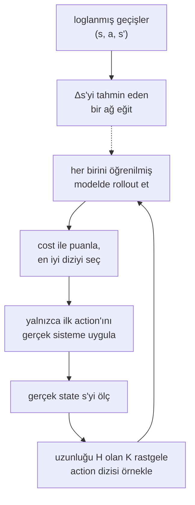

# 43 · World model'ler: öğrenilmiş dynamics

<!-- meta -->
| | |
|---|---|
| **Bölüm** | [10 · Foundation model'ler ve agent'lar](README.md) |
| **Çalışma türü** | CPU · Mac ya da Colab CPU |
| **Önkoşul** | [28](../part-7-learning-from-demonstration/28-behavior-cloning.md) |
| **Önce öğren** | [World Models & Video Diffusion](https://aiengineeringfromscratch.com/lesson?path=phases/04-computer-vision/28-world-models-video-diffusion) · [Multi-Layer Networks and Forward Pass](https://aiengineeringfromscratch.com/lesson?path=phases/03-deep-learning-core/02-multi-layer-networks) |
| **Süre** | ~60 dk |
| **Kod** | [`experiments/43-world-models/experiment.py`](../../experiments/43-world-models/experiment.py) |
| **Durum** | ✅ tam |
<!-- /meta -->

> Öğrenilmiş bir $s' = f(s, a)$ modeli, dünyayı sürekli yeniden ölçen bir planner onu kullanabiliyorsa yeterince iyidir; tek adımlık doğruluk yanlış ölçüttür.

## Problem

Model tabanlı kontrol ([ders 24](../part-6-planning-and-optimal-control/24-lqr-and-mpc.md)) dynamics'in elinde olduğunu varsayar. Yük taşıyan, kablo sürtünmesi ya da aşınmış dişlileri olan gerçek bir kolda çoğu zaman elinde değildir, ama $(s_t, a_t, s_{t+1})$ geçişlerini loglayabilirsin: state, uyguladığın action ve ardından gelen state. Nagabandi et al. rastgele action'lardan gelen böyle bir veriyle bir sinir ağı eğitti ve simüle robotları onun içinde MPC ile kontrol etti ([arXiv 1708.02596](https://arxiv.org/abs/1708.02596)); world-model agent'ları fikri görüntülere ve latent state'lere taşıyor (Ha & Schmidhuber, [arXiv 1803.10122](https://arxiv.org/abs/1803.10122); Dreamer, [arXiv 1912.01603](https://arxiv.org/abs/1912.01603)). Senin sisteminde işe yarayıp yaramayacağına iki soru karar verir: model kendi çıktılarıyla rollout edildiğinde tahmin hatası ne hızla büyüyor, ve öğrenilmiş modelde planlamak gerçek modelde planlamakla aynı sonuca ulaşıyor mu?

## Ana fikir

### Sade anlatımla

World model, öğrenilmiş bir fizik simülatörüdür. Kütleleri ve eklemleri tek tek yazmak yerine sistemin ne yaptığını kaydedersin ve bir ağı tek bir soruya cevap verecek şekilde eğitirsin: "bu state'te bu action'ı uygularsam sıradaki state ne olur?" Tekrar kayıtlarından bir oyun motoru kurmaya benzer.

Tek bir adım sorulduğunda böyle bir model çok doğru olabilir. Sorun, daha ileriyi görmek için onu kendi çıktılarıyla çalıştırdığında başlar; planner'ın ihtiyacı da tam olarak budur. Her tahminin küçük bir hatası vardır, sıradaki tahmin bu biraz yanlış state'ten başlar ve hatalar üst üste biner. GPS düzeltmesi olmadan parakete hesabı (dead reckoning) yapmak gibi: öğrenilmiş simülasyon ne kadar uzun koşarsa gerçeklikten o kadar uzaklaşır.

Çare de parakete hesabındakiyle aynı: sık sık yeni bir konum al. Model predictive control (MPC) öğrenilmiş simülatörün içinde çok sayıda aday action dizisi dener, en iyisini seçer, yalnızca onun ilk action'ını gerçek sisteme uygular, gerçek yeni state'i ölçer ve yeniden planlar. Her yeniden ölçüm kaymayı sıfırlar; bu yüzden bir planner, uzun açık döngü tahminler için işe yaramaz olacak bir modelden bile iyi sonuç alabilir.

### Öğrenilmiş bir modelin içinde planlama



### World model ve planner, kod olarak

```python
# Learned dynamics: predict the change of state and add it
def predict(s, a):                       # s = (theta, theta_dot), a = motor torque
    return s + f_theta(features(s, a))   # f_theta: a small MLP trained on logged transitions

# Open-loop rollout: the model is fed its own predictions
def rollout(s0, actions):
    s, states = s0, []
    for a in actions:
        s = predict(s, a)                # any error in s is carried into the next step
        states.append(s)
    return states

# Random-shooting MPC: one control step
def mpc_step(s, K, H):
    U = random_sequences(K, H)           # K candidate action sequences, each H steps long
    costs = [cost(rollout(s, u), u) for u in U]
    return U[argmin(costs)][0]           # apply only the first action, then measure and repeat
```

| Parça | Formül |
|---|---|
| öğrenilmiş dynamics | $\hat s_{t+1} = s_t + \hat f_\theta(s_t, a_t)$ |
| training | $\min_\theta \sum_{\mathcal D} \big\| (s_{t+1} - s_t) - \hat f_\theta(s_t, a_t) \big\|^2$ |
| $H$ adımlık rollout | $\hat s_{t+h} = \hat s_{t+h-1} + \hat f_\theta(\hat s_{t+h-1}, a_{t+h-1})$ |
| MPC | $a_t = u^{\star}_0$, $\ u^\star = \arg\min_{u^1..u^K} \sum_{h} c(\hat s_{t+h}, u_h)$ |

$s_t$ adım $t$'deki state, $a_t$ (ya da $u_h$) action, $\hat f_\theta$ weight'leri $\theta$ olan ağ, $\mathcal D$ loglanmış geçişlerin dataset'i, $\hat s$ tahmin edilen bir state, $H$ planlama ufku, $K$ aday dizi sayısı ve $c$ tahmin edilen tek bir adımın cost'udur.

<details>
<summary>Matematik ayrıntısı: neden değişimi tahmin ediyoruz, hatalar neden birikiyor, feedback ne kazandırıyor</summary>

**Değişimi tahmin etmek.** Değişimi tahmin etmek, state'i tahmin etmekten kolaydır (Nagabandi et al., §IV-A): bir kontrol adımında state az hareket eder, dolayısıyla $s_{t+1} - s_t$ küçük ve iyi ölçeklenmiş bir hedeftir; $s_{t+1}$'in kendisi ise büyük ölçüde girişin bir kopyasıdır. Girişler ve hedefler training'den önce sıfır ortalama ve birim varyansa normalize edilir (bkz. AIEFS: [Multi-Layer Networks](https://aiengineeringfromscratch.com/lesson?path=phases/03-deep-learning-core/02-multi-layer-networks)).

**Biriken hata.** Training tek adımlık hatayı minimize eder. Planlama ise $H$ adımlık açık döngü tahminler kullanır; bunlar modele kendi hatalarını besler. Aynı makale modelleri bu yüzden bu $H$ adımlık hatayla doğruluyor. $e_h = \hat s_{t+h} - s_{t+h}$ ve tek adımlık model hatası için $\epsilon_h$ yaz. Gerçek dynamics'i $s_{h+1} = s_h + f(s_h, a_h)$ gerçek trajectory etrafında doğrusallaştırmak şunu verir:

$$e_{h+1} \approx \big(I + \tfrac{\partial f}{\partial s}\big)\, e_h + \epsilon_h .$$

Dynamics'in kararlı olduğu yerde (aşağı sarkık sarkaç) parantez $e_h$'yi küçültür ya da korur ve hatalar kabaca toplanır; hata $h$ ile yaklaşık doğrusal büyür. Kararsız olduğu yerde (yakın state'lerin ayrıştığı dik konum civarı) parantezin mutlak değeri 1'den büyük bir özdeğeri vardır ve hata geometrik büyür. İki tür trajectory'yi karıştıran bir test setinde ortalama hata, birkaç kararsız trajectory tarafından domine edilir; A bölümünün gösterdiği de budur.

**Random-shooting MPC.** Uzunluğu $H$ olan $K$ action dizisi örnekle, her birini modelle tahmin et, bir cost ile puanla, en iyisinin yalnızca ilk action'ını uygula, yeni state'i ölç, tekrarla (Nagabandi et al., §IV-C). Plan her adımda ölçülen state'ten yeniden başladığı için her planın yalnızca ilk action'ı yürütülür; uzun ufuklu tahmin hatası action seçimini etkiler, sıradaki planın başladığı state'i değil. PETS, model belirsizliğini hesaba katmak için tek ağın yerine olasılıksal bir ensemble koyuyor ([arXiv 1805.12114](https://arxiv.org/abs/1805.12114)); Dreamer davranışı hayali latent trajectory'ler üzerinden backpropagation ile öğreniyor ([arXiv 1912.01603](https://arxiv.org/abs/1912.01603)).

Daha derine: [World Models & Video Diffusion](https://aiengineeringfromscratch.com/lesson?path=phases/04-computer-vision/28-world-models-video-diffusion), [Multi-Layer Networks and Forward Pass](https://aiengineeringfromscratch.com/lesson?path=phases/03-deep-learning-core/02-multi-layer-networks); birincil kaynaklar: [Nagabandi et al.](https://arxiv.org/abs/1708.02596), [PETS](https://arxiv.org/abs/1805.12114), [Dreamer](https://arxiv.org/abs/1912.01603), [World Models](https://arxiv.org/abs/1803.10122).

</details>

<!-- figure: 43-rollout-error -->

### Bu dersin sistemi

| terim | burada |
|---|---|
| state $s$ | $(\theta, \dot\theta)$, $\theta = 0$ aşağı sarkık |
| action $a$ | motor torku $u$, $\lvert u\rvert \le 2$ N·m |
| model girişi | $(\cos\theta, \sin\theta, \dot\theta, u)$ (θ'da periyodik) |
| cost | $\sum_h \mathrm{wrap}(\theta_h - \pi)^2 + 0{,}1\,\dot\theta_h^2 + 0{,}001\,u_h^2$ |

Model $\theta$ yerine $\cos\theta$ ve $\sin\theta$ görür; böylece $\theta$ ile $\theta + 2\pi$ aynı görünür. $\mathrm{wrap}$ bir açı farkını $[-\pi, \pi)$ aralığına taşır; dolayısıyla cost dik konumda ($\theta = \pi$) en düşüktür.

## Sıfırdan yaz

Şimdi bütün zinciri NumPy ile kuracaksın: gerçek dinamik, bir veri seti, bir world model, open-loop rollout'lar ve bir MPC planner. Deney'den tek fark: Adam ile eğitilen bir MLP yerine $\hat f_\theta$, $(\cos\theta, \sin\theta, \dot\theta, u)$'nun polinom feature'larında doğrusal ve tek bir least-squares çözümüyle fit ediliyor. Böylece modelin kapasitesi tek bir düğme (derece) oluyor ve build birkaç saniyede deterministik koşuyor. Fonksiyonlar [`physai/foundation.py`](../../physai/foundation.py) içinde; `uv run python experiments/43-world-models/build.py` adımları koşturur (çıktı [`build_output.txt`](../../experiments/43-world-models/build_output.txt) dosyasında).

### Adım 1 · Gerçek dinamik

Beş alt adımlık semi-implicit Euler. MuJoCo'nun Euler integrator'ü joint damping'i implicit uygular: paydadaki $I + h b$ bu.

```python
def pendulum_step(s, u, p=PEND):
    """One 0.05 s control step of the torque-limited pendulum, s = (theta, theta_dot), theta = 0 hanging.
    Semi-implicit Euler with implicit joint damping, as MuJoCo's Euler integrator; works on batches."""
    th, w = s[..., 0], s[..., 1]
    u = np.clip(u, -p["u_max"], p["u_max"])
    for _ in range(p["substeps"]):
        tau = u - p["mgl"] * np.sin(th) - p["damping"] * w
        w = w + p["h"] * tau / (p["inertia"] + p["h"] * p["damping"])   # damping taken at the new speed
        th = th + p["h"] * w
    return np.stack([th, w], axis=-1)
```

```text
== Step 1. The pendulum step by hand vs MuJoCo (5 x mj_step of 10 ms) ==
inertia from MuJoCo's mass matrix: 0.25036 kg m^2 (0.25 + 2/5 m r^2 = 0.25036)
max |ours - MuJoCo| over 200 random states and torques: 1.8e-15
```

### Adım 2 · Veri

Deney'in tarifi: bütün çember üzerinde rastgele başlangıçlar, iki kontrol adımı boyunca tutulan rastgele torklar, 50 adımlık 400 trajectory. Her trajectory tek bir batch'in bir satırı; yani 20.000 transition toplamak `pendulum_step`'e 50 çağrı demek.

```text
== Step 2. Data: 400 random-action trajectories x 50 steps ==
training transitions 20000, held-out transitions 5000
|delta theta| up to 0.589 rad per step, |delta theta_dot| up to 1.433 rad/s per step
```

### Adım 3 · State değişimini fit et

```python
def poly_features(s, u, degree):
    """All monomials up to `degree` of (cos theta, sin theta, theta_dot / 8, u / 2), constant included."""
    base = np.stack([np.cos(s[..., 0]), np.sin(s[..., 0]), s[..., 1] / 8, u / 2], axis=-1)
    cols = [np.ones(base.shape[:-1])]
    for d in range(1, degree + 1):
        for idx in itertools.combinations_with_replacement(range(4), d):
            cols.append(np.prod(base[..., list(idx)], axis=-1))
    return np.stack(cols, axis=-1)
```

```python
def fit_world_model(S, A, S_next, degree):
    """Least-squares fit of the change of state: S_next - S ~ poly_features(S, A) @ W. Returns W."""
    return np.linalg.lstsq(poly_features(S, A, degree), S_next - S, rcond=None)[0]
```

```python
def predict(W, s, u, degree):
    """Learned dynamics: the next state is the current one plus the predicted change."""
    return s + poly_features(s, u, degree) @ W
```

```text
== Step 3. Fit the change of state, feature degree 1-4 ==
degree features  one-step |angle err| rad  one-step |vel err| rad/s
     1        5                   7.9e-04                   3.9e-02
     2       15                   5.6e-05                   3.3e-03
     3       35                   1.9e-06                   1.3e-04
     4       70                   1.1e-07                   8.4e-06
```

Her ek derece tek adım doğruluğunda bir büyüklük mertebesinden fazlasını kazandırıyor. Derece 2 (15 feature) ayrılmış veride tek adımı 5,6e-05 rad ile tahmin ediyor, Deney'in 17.410 parametreli MLP'sinden (0,0004 rad) bile iyi: bu sistem bu feature'larda pürüzsüz, least squares ise Adam'ın 1200 adımda durduğu yerde tam minimumu buluyor.

### Adım 4 · Rollout et

```python
def rollout_errors(step_true, step_model, s0, U, horizons):
    """Feed the same actions U (n, T) to the true system and to the model from the same states s0 (n, 2);
    return {H: (mean, median) |angle error|} after H steps of open-loop prediction."""
    s_true, s_model, out = s0.copy(), s0.copy(), {}
    for k in range(U.shape[1]):
        s_true, s_model = step_true(s_true, U[:, k]), step_model(s_model, U[:, k])
        if k + 1 in horizons:
            e = np.abs(wrap(s_model[:, 0] - s_true[:, 0]))
            out[k + 1] = (e.mean(), np.median(e))
    return out
```

```text
== Step 4. Open-loop rollouts: 200 held-out starts, the same random torques to model and truth ==
degree       H=1       H=5      H=10      H=20      H=40      H=60     H=100  H100/H1   (mean |angle err| rad; med 2: median, degree 2)
     1   1.1e-03   2.8e-02   8.6e-02   2.2e-01   4.2e-01   5.9e-01   7.8e-01      735
     2   5.6e-05   1.8e-03   5.0e-03   9.1e-03   2.3e-02   4.4e-02   8.6e-02     1528
     3   2.4e-06   8.7e-05   2.5e-04   7.8e-04   2.7e-03   5.0e-03   1.3e-02     5355
     4   1.1e-07   4.2e-06   1.1e-05   3.2e-05   8.6e-05   1.3e-04   3.2e-04     2959
 med 2   4.7e-05   1.4e-03   4.1e-03   7.2e-03   1.4e-02   2.1e-02   2.6e-02
```

100 adımdaki büyüme derece 1 için 735×, daha iyi modeller için 1528× ile 5355× arası: daha doğru bir model daha yavaş birikmiyor. Deney'in MLP'sine en yakın satır derece 2 (100 adım ortalaması 8,6e-02'ye karşı 0,0966 rad) ve ortalaması yine medyanından kopuyor (H = 100'de 8,6e-02'ye karşı 2,6e-02): birkaç ıraksayan trajectory'nin imzası.

### Adım 5 · İçinde planla

```python
def wrap(a):
    """Angle difference mapped into [-pi, pi)."""
    return (a + np.pi) % (2 * np.pi) - np.pi
```

```python
def swing_up_cost(s, u):
    """Per-step cost: angle from upright, speed, torque."""
    return wrap(s[..., 0] - np.pi) ** 2 + 0.1 * s[..., 1] ** 2 + 0.001 * u ** 2
```

```python
def shooting_mpc(step_plan, step_true, s0, H, K, rng, steps=100, hold=5, u_max=2.0):
    """Random-shooting MPC: K piecewise-constant torque sequences of length H, rolled out with step_plan;
    the first action of the cheapest one goes to step_true, then replan from the measured state.
    Returns success (within 0.2 rad of upright for the last 20 steps), mean tail error, first upright step."""
    s, angles = s0.copy(), []
    for _ in range(steps):
        U = np.repeat(rng.uniform(-u_max, u_max, (K, -(-H // hold))), hold, axis=1)[:, :H]
        x, cost = np.repeat(s[None], K, axis=0), np.zeros(K)
        for t in range(H):
            x = step_plan(x, U[:, t])
            cost += swing_up_cost(x, U[:, t])
        s = step_true(s, U[np.argmin(cost), 0])
        angles.append(abs(wrap(s[0] - np.pi)))
    a = np.array(angles)
    first = int(np.argmax(a < 0.2)) if np.any(a < 0.2) else -1
    return bool(np.all(a[-20:] < 0.2)), float(np.mean(a[-20:])), first
```

```text
== Step 5. Random-shooting MPC swing-up, K = 100, 3 starts, 5 s ==
planner            H  success  mean tail err rad  first upright step
true dynamics     10      0/3              0.831                   -
true dynamics     30      3/3              0.023                  66
degree-2 model    10      0/3              0.831                   -
degree-2 model    30      3/3              0.028                  67
```

Planner'ın modeli gerçek dinamik olunca MPC'n Deney'in "true" satırlarını birebir üretiyor (H = 10'da 0/3; H = 30'da 3/3, 0,023 rad, ilk dik konum 66. adımda): aynı seed'ler, aynı adaylar, MuJoCo'nunkine 1,8e-15 kadar eşit bir adım. 15 feature'lık modelin içinde de H = 30'da 3/3 kaldırıyor, bir adım sonra dik.

### Elinde kalan

`physai.foundation` artık `pendulum_step`, `poly_features`, `fit_world_model`, `predict`, `wrap`, `rollout_errors`, `swing_up_cost` ve `shooting_mpc` içeriyor. Capstone (ders 44) aynı ölçümden-yeniden-planla döngüsünü görev seviyesinde kullanıyor. [`tests/test_43_world_models.py`](../../tests/test_43_world_models.py) pendulum'u MuJoCo'ya sabitler: `uv run pytest tests/test_43_world_models.py`.

## Kütüphaneyle kullan

Kütüphane yolu Deney'inki: normalize edilmiş state değişimini tahmin eden, Adam ile eğitilen bir PyTorch MLP ve gerçek planner'ın K adayının hepsini C'de değerlendiren `mujoco.rollout`.

```python
def forward(self, s, u):                                   # predict the change, not the state
    x = (features(s, u) - self.x_mu) / self.x_sd
    return s + self.net(x) * self.d_sd + self.d_mu

st, _ = rollout.rollout(M, D_ROLL, x0[None], ctrl)          # ctrl: (K, H * 5, 1), all candidates at once
```

| $s_{t+1}$ modeli | Nerede | Fit | Tek adım hatası |
|---|---|---|---|
| polinom, derece 2 | `physai.foundation` | tek `lstsq`, çıktı başına 15 ağırlık | 5,6e-05 rad (Sıfırdan yaz) |
| MLP 4-128-128-2 | Deney, PyTorch | 1200 Adam adımı, 17.410 parametre | 0,0004 rad (A bölümü) |
| simülatörün kendisi | `mujoco.rollout` | yok | 0 |

Tuzaklar:

- **Açılar sarılır.** $\theta$ yerine $\cos\theta, \sin\theta$ ver ve açıları `wrap` ile karşılaştır; yoksa $\pi$ ile $-\pi$ 6,28 rad uzak görünür.
- **Değişimi tahmin et.** $s_{t+1}$ çoğunlukla $s_t$'nin kopyasıdır; onunla eğitilen model kapasitesini kopyalamaya harcar.
- **Tek adım hatası yanlış ölçüt.** Ayrılmış veride H adımlık tabloyu raporla; derece 4 tek adımda derece 2'den 500 kat iyi ama 2959× birikiyor.

## Deney

**Sistem.** Bir MuJoCo sarkacı: 0,5 m'de 1 kg'lık noktasal kütle, hinge damping 0,05 N·m·s/rad, tork limiti 2 N·m; bu, yataydaki 4,91 N·m'lik yerçekimi torkundan küçük, dolayısıyla swing-up (sarkacı aşağıdan dik konuma getirmek) pompalama gerektiriyor: enerji biriktirmek için ileri geri sallamak. Kontrol adımı 0,05 s (5 × 10 ms, semi-implicit Euler). **Veri:** rastgele başlangıçlardan ve rastgele torklardan 400 trajectory × 50 adım = 20.000 geçiş. **Model:** MLP 4-128-128-2 (17.410 parametre), batch 512 ile 1200 Adam adımı, train MSE (training verisindeki ortalama karesel hata) 2,47e-06.

Script'in tamamı: [`experiments/43-world-models/experiment.py`](../../experiments/43-world-models/experiment.py). MuJoCo 3.17.0, NumPy 2.5.4, PyTorch 2.14.1 (CPU, 1 thread), Python 3.14, Apple M5. Deterministik: yeniden koşu her hata ve başarı sayısını aynen üretiyor; yalnızca süreler değişiyor. Ağır yüklü bir makinede toplam ~2 dk (yaklaşık).

**A. Rollout ufku → tahmin hatası.** 200 ayrılmış trajectory (training'de kullanılmamış); model ve simülatöre aynı rastgele torklar veriliyor. *Tahmin et:* tek adımlık hata 0,0004 rad ise, 100 adım sonra ne olur?


| H adım | H [s] | ort. \|açı hatası\| [rad] | medyan [rad] | ort. \|hız hatası\| [rad/s] |
|---|---|---|---|---|
| 1 | 0,05 | 0,0004 | 0,0004 | 0,0019 |
| 5 | 0,25 | 0,0018 | 0,0012 | 0,0059 |
| 10 | 0,50 | 0,0030 | 0,0023 | 0,0074 |
| 20 | 1,00 | 0,0068 | 0,0031 | 0,0222 |
| 40 | 2,00 | 0,0222 | 0,0042 | 0,0585 |
| 60 | 3,00 | 0,0547 | 0,0047 | 0,1310 |
| 100 | 5,00 | 0,0966 | 0,0072 | 0,2400 |

Ortalama 100 adımda yaklaşık 240× büyüyor, 1 s'den sonra doğrusaldan hızlı; medyan yalnızca 18×. Aradaki fark, hatanın birkaç trajectory'de toplandığını söylüyor. Makul bir mekanizma (burada ölçülmedi): dik konuma yakın geçen trajectory'ler; orada yakın state'ler ayrışır ve küçük bir model hatası sarkacın hangi yöne düşeceğine karar verir.

**B. Planlama ufku, öğrenilmiş ve gerçek model.** Aşağı sarkık konumdan swing-up (3 başlangıç, K = 100 dizi, her 5 adımda yeni bir rastgele tork), 5 s'lik episode'lar; başarı = son saniyenin tamamında dik konuma 0,2 rad içinde olmak, kuyruk hatası ise o son saniyede dik konuma olan ortalama uzaklık. Gerçek planner adayları MuJoCo'da (`mujoco.rollout`), öğrenilmiş olan MLP'de rollout ediyor; iki durumda da seçilen action gerçek simülatöre uygulanıyor.

| H | planner | başarı | ort. kuyruk hatası [rad] | ilk dik adım | plan süresi [s] |
|---|---|---|---|---|---|
| 10 | gerçek | 0/3 | 0,831 | – | 5,7 |
| 10 | öğrenilmiş | 0/3 | 0,853 | – | 1,2 |
| 20 | gerçek | 2/3 | 0,046 | 76 | 10,9 |
| 20 | öğrenilmiş | 2/3 | 0,059 | 77 | 2,6 |
| 30 | gerçek | 3/3 | 0,023 | 66 | 18,2 |
| 30 | öğrenilmiş | 3/3 | 0,021 | 67 | 4,0 |

Başarıya model değil planlama ufku karar veriyor: 0,5 s, pompalamanın karşılığını görmek için kısa; 1,5 s ikisi için de yetiyor. Öğrenilmiş model, dik konuma ulaşma zamanında gerçek modelle bir adım içinde eşleşiyor ve bu koşuda 4–5× daha hızlı planladı, çünkü 100 aday tek bir batch'li tensor işlemiyle değerlendiriliyor (plan süreleri ağır yüklü bir makinedeki duvar saati ve koşudan koşuya değişiyor; başarı ve hata sütunları değişmiyor).

## Boz

**Modeli aç bırak.** Yalnızca düşük enerjili veriyle eğitilmiş bir model (görülen |θ| ≤ 0,42 rad, torklar ≤ 0,5 N·m) tam aralıklı test setinde 0,0371 rad tek adım hatasına sahip, yaklaşık 90× kötü; 10 adım sonra 0,1160 rad. Onunla MPC yine de 3 başlangıcın 2'sinde swing-up yaptı (H = 20). Tam aralıklı dataset'i 2 trajectory'ye (100 geçiş) küçültmek 20 adımlık hatayı 0,0307 rad'a çıkardı ve H = 30 ile MPC yine 3/3 başardı. Feedback model hatasını gizliyor: planner her 0,05 s'de ölçülen state'ten yeniden başlıyor.

**Feedback'i kaldır.** Her planın ilk k action'ını yeniden planlamadan önce açık döngü yürüt (H = 30); yukarıdaki grafiğin sağ paneli bu tabloyu çiziyor:

| k | yeniden planlama aralığı | gerçek model | kuyruk hatası [rad] | öğrenilmiş model | kuyruk hatası [rad] |
|---|---|---|---|---|---|
| 1 | 0,05 s | 3/3 | 0,023 | 3/3 | 0,021 |
| 5 | 0,25 s | 3/3 | 0,074 | 2/3 | 0,126 |
| 10 | 0,50 s | 1/3 | 0,173 | 1/3 | 0,173 |
| 20 | 1,00 s | 0/3 | 0,665 | 0/3 | 0,620 |
| 30 | 1,50 s | 0/3 | 1,216 | 0/3 | 1,216 |

k = 5'te öğrenilmiş model, gerçek modelin tuttuğu bir başlangıcı kaybediyor: açık döngü hatası artık önemli. k = 10'un ötesinde mükemmel model bile başarısız, çünkü 100 rastgele dizinin en iyisi kararsız bir dengeyi açık döngüde tutamıyor. Yeniden planlama sıklığı, kusurlu bir modeli (ve kusurlu bir optimizer'ı) kullanılabilir kılan düğmedir.

## Gerçek robotta

- **Gerçek kolda henüz ölçülmedi.** SO-101 için prosedür: rastgele ama limitlere uyan hareketler sırasında ([ders 15](../part-4-dynamics-and-control/15-safety.md)'in validation'ı) eklem konumlarını ve komutlanan hedefleri kontrol frekansında logla, $\hat f_\theta$'yı $(q, \dot q, q^{\text{goal}}) \to \Delta(q, \dot q)$ üzerinde eğit, herhangi bir kapalı döngü kullanımından önce ayrılmış loglarda H adımlık hata tablosunu raporla.
- Gerçek veri, bu sarkaçta olmayan sensör gürültüsü, latency ve backlash (dişlilerdeki boşluk) içerir; model bunları yalnızca veride varsa öğrenir. Sarkaçta rastgele torklar ucuzdur; bir kolda konum, hız ve torkta sınırlandırılmalıdır.
- Yeniden planlama sıklığını yüksek, ufku bir kontrol periyodunda hesaplanabilecek kadar kısa tut; donanımda B tablosundaki planlama süresi latency bütçesinin parçasıdır.

## Kendini dene

1. **Kolay.** A tablosuna göre ortalama açı hatası 1 s'den 5 s'lik açık döngü tahmine kaç kat büyüyor?
2. **Orta.** Ortalama H adımlık hata neden medyandan çok daha hızlı büyüyebilir? H = 100 satırını kullan.
3. **Zor.** Tek MLP'yi 5'li bir ensemble ile değiştir (farklı seed'ler) ve PETS'teki gibi ensemble dağılımını ek bir cost terimi olarak kullan. Düşük enerji durumunu yeniden koştur. Koşturmadan önce tahmin et: başarı 2/3'ün üstüne çıkar mı?

### Cevaplar

1. 0,0966 / 0,0068 ≈ 14.
2. H = 100'de ortalama 0,0966 rad, medyan 0,0072 rad: trajectory'lerin çoğu doğru kalıyor, birkaçı büyük açılarla ayrışıp ortalamayı domine ediyor (muhtemelen kararsız dik state'e yakın geçenler; burada ölçülmedi).
3. Burada hesaplanmadı; koştur.

## Akılda kalanlar ve kaynaklar

- 20.000 rastgele geçişle eğitilen 17.410 parametrelik bir MLP tek adımı 0,0004 rad hatayla tahmin ediyor; 100 adım rollout edildiğinde ortalama hata 240× büyüyor.
- Öğrenilmiş modelin içinde random-shooting MPC, sarkacı MuJoCo içindeki MPC kadar güvenilir biçimde kaldırdı (H = 30'da 3/3), bu makinede planlama süresinin bir kesriyle.
- Ölçülen state'lerden sık yeniden planlama büyük model hatalarını emiyor; 5 adımlık açık döngü yürütme onları şimdiden açığa çıkarıyor.

Sıradaki: Bitirme projesi · [ders 44 · Söyle, gör, planla, tut](../capstone/44-capstone.md).

Kaynaklar:
- Nagabandi, Kahn, Fearing, Levine, [Neural Network Dynamics for Model-Based Deep RL with Model-Free Fine-Tuning](https://arxiv.org/abs/1708.02596) (arXiv 1708.02596).
- Ha & Schmidhuber, [World Models](https://arxiv.org/abs/1803.10122) (arXiv 1803.10122); Hafner et al., [Dream to Control](https://arxiv.org/abs/1912.01603) (arXiv 1912.01603); Chua et al., [PETS](https://arxiv.org/abs/1805.12114) (arXiv 1805.12114).
- MuJoCo [Python bindings, `rollout` modülü](https://mujoco.readthedocs.io/en/stable/python.html).
- Ölçülen tüm sayılar: [`experiments/43-world-models/output.txt`](../../experiments/43-world-models/output.txt), grafik [`plot.py`](../../experiments/43-world-models/plot.py) ile.
