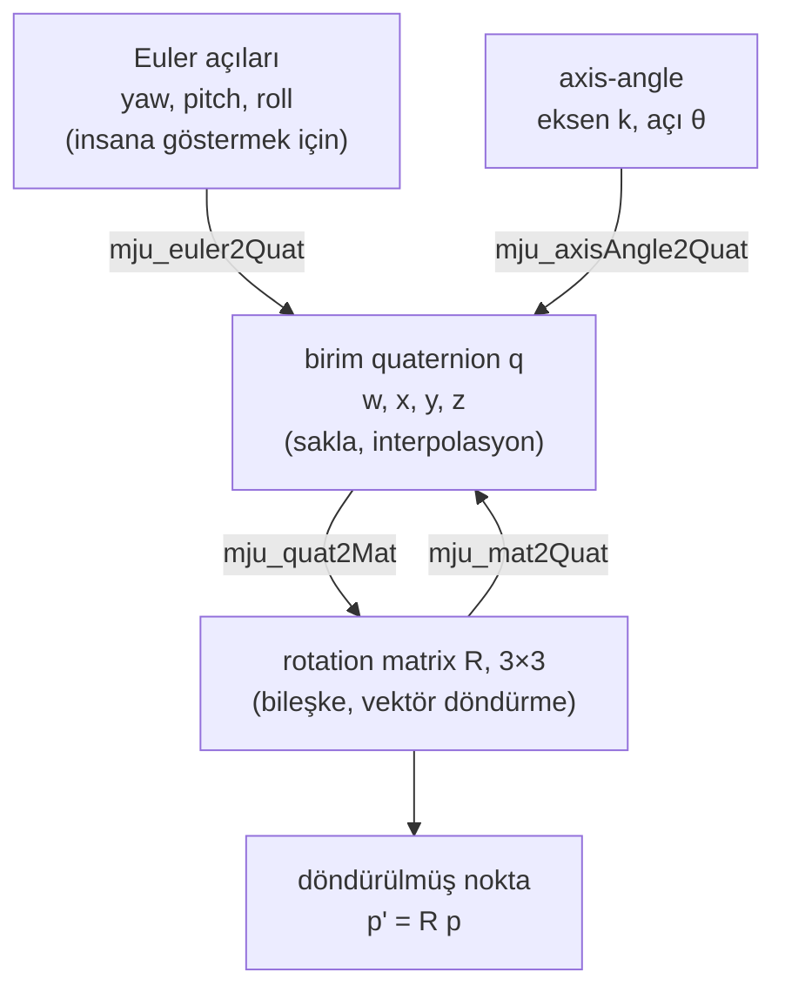

# 06 · Rotation: matrix, Euler açıları, axis-angle, quaternion

<!-- meta -->
| | |
|---|---|
| **Bölüm** | [2 · Spatial math](README.md) |
| **Çalışma türü** | CPU · Mac ya da Colab CPU |
| **Önkoşul** | [01](../part-1-simulation/01-world-as-text.md) |
| **Önce öğren** | [Linear Algebra Intuition](https://aiengineeringfromscratch.com/lesson?path=phases/01-math-foundations/01-linear-algebra-intuition) · [Matrix Transformations](https://aiengineeringfromscratch.com/lesson?path=phases/01-math-foundations/03-matrix-transformations) |
| **Süre** | ~60 dk |
| **Kod** | [`experiments/06-rotations/experiment.py`](../../experiments/06-rotations/experiment.py) |
| **Durum** | ✅ tam |
<!-- /meta -->

> Orientation'ı rotation matrix ya da birim quaternion olarak sakla; Euler açılarını yalnızca göstermek için kullan.

## Problem

Serbest hareket eden bir cisim içeren herhangi bir MuJoCo modelini açıp state vektörüne bakın. Tek bir serbest cismin `nq = 7` konum sayısı (3'ü konum, 4'ü quaternion) ama yalnızca `nv = 6` hız sayısı (3 doğrusal, 3 açısal) vardır; bizim çalıştırmamız tam olarak bunu ve varsayılan quaternion'ı `[1, 0, 0, 0]` yazdırıyor. Bir simülatör üç boyutlu bir büyüklük için neden dört sayı saklar, konum ile hız neden farklı boyuttadır?

Çünkü orientation'ın üç sayılık her tarifi bir yerde bozulur. Euler açılarında 90° pitch'e gelmiş bir gripper bir dönme yönünü kaybeder: hiçbir sonlu Euler açısı hızı o yönü üretemez. Bu ders bunun nerede olduğunu ve neye mal olduğunu ölçüyor, bozulmayan gösterimleri de gösteriyor.

## Ana fikir

### Sade anlatımla

Orientation "bu şey hangi yöne bakıyor?" sorusunun cevabıdır. Üç düğmeli bir tripod kafasına takılı bir kamera düşün: pan (sağa/sola çevir), tilt (yukarı/aşağı bak) ve roll (görüntüyü döndür). Üç düğmenin okuması **Euler açıları**dır. İnsanlar kolay okur; her arayüzün bunları göstermesinin sebebi bu.

Şimdi kamerayı tam yukarı çevir. Pan ve roll artık kamerayı aynı dikey çizgi etrafında döndürür ve bu pozdan kamerayı yana çeviren bir düğme kalmaz. Bir yön kayboldu: buna **gimbal lock** denir. Kamera elbette her yöne bakabilir; bozulan, üç düğmeli *tarif*tir, ve yalnızca o pozda değil, onun bütün bir komşuluğunda sorun çıkarır.

Çözüm, orientation'ı bir dönüş dizisi olmadan tarif etmektir. **Rotation matrix**, cismin üç ekseninin nereyi gösterdiğini, üst frame'in koordinatlarında üç ok olarak yazar. **Birim quaternion** ise "bu eksen etrafında bu açı kadar dön" bilgisini dört sayıya sığdırır. İkisinin de kötü bir pozu yoktur. Quaternion'ın tek bir tuhaflığı var: $q$ ile $-q$ aynı orientation'dır; quaternion karşılaştıran ya da karıştıran kod işareti kontrol etmelidir.



### Rotation'lar kod olarak

```python
import numpy as np

def Rz(a):                         # z ekseni etrafında a açısı (rad) kadar rotation
    c, s = np.cos(a), np.sin(a)
    return np.array([[c, -s, 0], [s, c, 0], [0, 0, 1]])
# Ry(a) ve Rx(a), y ve x etrafında aynı şekilde kurulur

p = np.array([1.0, 0, 0])
Rz(np.pi / 2) @ p                  # active: vektörü döndür               -> [0, 1, 0]
Rz(np.pi / 2).T @ p                # passive: aynı vektör, +90° dönmüş frame'deki koordinatları -> [0, -1, 0]

R = Rz(yaw) @ Ry(pitch) @ Rx(roll) # Euler z-y'-x'': bileşke = çarpım, sıra önemli

def quat(axis, angle):             # axis: birim 3-vektör, angle: rad
    return np.r_[np.cos(angle / 2), np.sin(angle / 2) * axis]   # MuJoCo'daki gibi skaler önde

def slerp(q0, q1, t):              # iki orientation'ı karıştır, t 0'dan 1'e
    if q0 @ q1 < 0:                # q1 ile -q1 aynı rotation: kısa yolu seç
        q1 = -q1
    om = np.arccos(np.clip(q0 @ q1, -1, 1))   # quaternion'lar arasındaki açı
    return (np.sin((1 - t) * om) * q0 + np.sin(t * om) * q1) / np.sin(om)
```

İki `Rz` satırı aynı matrisin iki okunuşudur ve çalıştırma tam bu vektörleri yazdırıyor:

| Okunuş | Formül | Anlamı |
|---|---|---|
| Active | $p' = R\,p$ | $p$ vektörünü döndür |
| Passive | $p_B = R_{AB}^\top\, p_A$ | aynı nokta, $R_{AB}$ kadar dönmüş bir $B$ frame'indeki koordinatları |

| Gösterim | Formül | Kötü pozlar |
|---|---|---|
| Rotation matrix | $R^\top R = I,\ \det R = +1$ | yok |
| Euler açıları z-y'-x'' | $R = R_z(\psi)R_y(\theta)R_x(\phi)$ | pitch $\theta = \pm 90°$ (gimbal lock) |
| Axis-angle (Rodrigues) | $R = I + \sin\theta\,K + (1-\cos\theta)\,K^2$ | – |
| Birim quaternion | $q = (\cos\tfrac{\theta}{2},\ \sin\tfrac{\theta}{2}\,\hat k)$ | yok, ama $q$ ile $-q$ aynı rotation'dır |

$R$, sütunları dönmüş frame'in eksenlerinin üst frame'deki ifadesi olan 3×3'lük matristir; $\psi, \theta, \phi$ yaw, pitch ve roll'dur; axis-angle satırlarında $\hat k$ birim dönme ekseni, $\theta$ açıdır; $K = [\hat k]_\times$ çapraz çarpımı hesaplayan matristir, $Kv = \hat k \times v$; $q$ skaler önde yazılır.

Bileşke, matris çarpımıdır ve sıra **değiştirilemez**: $R_z(90°)R_x(90°)$ ile $R_x(90°)R_z(90°)$ arasında 120°'lik bir rotation fark vardır (aşağıda ölçüldü). $R_{AC} = R_{AB} R_{BC}$: soldan sağa okununca her yeni rotation, yeni ulaşılan frame'in eksenleri etrafındadır (intrinsic). İki orientation'ı karıştırmak için Euler açılarında düz bir çizgi değil, en kısa yayı izleyen **slerp** (spherical linear interpolation) kullan.

Euler açılarının neden bozulduğu tek satırda: Euler açısı hızlarını cismin açısal hızına çeviren $E$ matrisinin $\det E = \cos\theta$'dır ve pitch ±90°'de sıfırdır.

<details>
<summary>Matematik ayrıntısı: Euler hız haritası, Rodrigues ve slerp</summary>

**Euler hız haritası.** Intrinsic z-y'-x'' için (yaw $\psi$, pitch $\theta$, roll $\phi$) gövde açısal hızı, açı hızlarına doğrusal bağlıdır:

$$\omega_b = E(\theta,\phi)\begin{bmatrix}\dot\phi\\ \dot\theta\\ \dot\psi\end{bmatrix},\qquad E=\begin{bmatrix}1&0&-\sin\theta\\0&\cos\phi&\sin\phi\cos\theta\\0&-\sin\phi&\cos\phi\cos\theta\end{bmatrix},\qquad \det E=\cos\theta .$$

$\theta = \pm 90°$ olduğunda birinci ve üçüncü sütun paralel olur: roll ve yaw cismi aynı eksen etrafında döndürür. Bu gimbal lock'tur; fiziksel rotation'ın değil, parametrelemenin singularity'sidir. Yakınında $E$ hâlâ tersinirdir ama neredeyse singular'dır; sıradan bir açısal hız üretmek için çok büyük açı hızları gerekir (Boz).

**Rodrigues formülü.** Her rotation, birim bir $\hat k$ ekseni etrafında bir $\theta$ açısıdır. $K = [\hat k]_\times$ (çapraz çarpım matrisi, skew-symmetric) ile $R = I + \sin\theta\,K + (1-\cos\theta)\,K^2$.

**Birim quaternion.** $q = (\cos\tfrac{\theta}{2},\ \sin\tfrac{\theta}{2}\,\hat k)$. Yarım açı yüzünden $\theta + 2\pi$ kadar dönmek aynı fiziksel rotation için $-q$ verir: **double cover**, $q$ ile $-q$ tek bir rotation'dır.

**Slerp** en kısa büyük çember yayı boyunca interpolasyon yapar: $\mathrm{slerp}(q_0,q_1,t) = \frac{\sin((1-t)\Omega)}{\sin\Omega}q_0 + \frac{\sin(t\Omega)}{\sin\Omega}q_1$, $\cos\Omega = q_0\cdot q_1$; $q_0\cdot q_1 < 0$ ise önce $q_1 \to -q_1$. Bu çevirme olmadan yay uzun yoldan dolaşabilir.

Daha derine: AIEFS [Linear Algebra Intuition](https://aiengineeringfromscratch.com/lesson?path=phases/01-math-foundations/01-linear-algebra-intuition), [Matrix Transformations](https://aiengineeringfromscratch.com/lesson?path=phases/01-math-foundations/03-matrix-transformations); $SO(3)$ (bütün rotation matrix'lerin grubu) ve exponential coordinate'ların titiz anlatımı Lynch & Park, *Modern Robotics*, Böl. 3'te.

</details>

### MuJoCo'da

MuJoCo quaternion'ı skaler önde yazar: modelleme rehberi axis-angle rotation'ının quaternion'ını kosinüs terimi önde yazar ve sıfır rotation `1 0 0 0`'dır ([MuJoCo modeling: frame orientations](https://mujoco.readthedocs.io/en/stable/modeling.html)). Gösterimler arasında `mju_euler2Quat` (dizi string'i; küçük harf = intrinsic, büyük harf = extrinsic), `mju_axisAngle2Quat`, `mju_quat2Mat`, `mju_mat2Quat`, `mju_mulQuat`, `mju_subQuat` ile dönüşüm yapar ([API reference](https://mujoco.readthedocs.io/en/stable/APIreference/APIfunctions.html)). Baştaki bilmecenin cevabı da bu: orientation 4 quaternion sayısı olarak saklanır, ama açısal hız sıradan bir 3-vektördür; bu yüzden `nq` ile `nv` farklıdır.

## Deney

Script: [`experiments/06-rotations/experiment.py`](../../experiments/06-rotations/experiment.py). MuJoCo 3.17.0, NumPy 2.5.4, Apple Silicon Mac (Apple M5), sabit seed'ler, 10 s'nin altında.

**Önce tahmin et.** Euler hız haritası hangi pitch'te sorun olur: 45°, 80°, yoksa yalnızca tam 90°'de mi? Saf Euler açısı interpolasyonu gerçek en kısa rotation'dan ne kadar sapabilir?

**Adım 1 · dönüşümler tutarlı.** 1000 rastgele rotation; elle yazılmış matrisler ile MuJoCo fonksiyonları.

```python
q = np.zeros(4)
mujoco.mju_euler2Quat(q, [yaw, pitch, roll], "zyx")   # intrinsic z-y'-x''
R = np.zeros(9); mujoco.mju_quat2Mat(R, q)
```

| Kontrol (1000 rastgele rotation) | en büyük mutlak hata |
|---|---|
| `mju_euler2Quat("zyx")` ile $R_zR_yR_x$ | 5,6e-16 |
| `mju_axisAngle2Quat` ile Rodrigues | 6,7e-16 |
| `mju_mat2Quat` → `mju_quat2Mat` gidiş-dönüş | 4,2e-16 |
| $q$ ile $-q$ matrisi | 0,0e+00 |
| 1000 bileşke sonrası $\lvert R^\top R - I\rvert$ | 1,4e-14 |

**Adım 2 · pitch sweep'i → $E$'nin koşullanması.** **Condition number** cond(E), $E$'yi ters çevirdiğinde göreli hataları ne kadar büyütebileceğini söyler: 1 mükemmeldir, sonsuz bir yönün kaybolduğu anlamına gelir. σ_min, yani en küçük singular value, $E$'nin en zayıf yönü ne kadar küçülttüğüdür. Analitik $E$, $R$'nin merkezi farklarıyla kontrol edildi (her satırda uyum ≤ 9,6e-11). Roll 30°'de sabit.

| pitch | det E | σ_min | cond(E) |
|---|---|---|---|
| 0° | 1,00 | 1,00 | 1,000 |
| 60° | 0,500 | 0,366 | 3,732 |
| 80° | 0,174 | 0,123 | 11,43 |
| 89° | 0,0175 | 0,0123 | 114,6 |
| 89,9° | 0,00175 | 0,00123 | 1146 |
| 89,99° | 0,000175 | 0,000123 | 11460 |
| 90° | 6,12e-17 | 3,40e-17 | sonsuz |

Condition number $1/\cos\theta$ gibi büyüyor: 80°'de bile 11,43. Sorun tek bir nokta değil, bir komşuluk.

**Adım 3 · başlangıç pitch'i sweep'i → interpolasyon hatası.** Her satırda 300 çift; hedef, başlangıcın rastgele bir eksen etrafında 60° döndürülmüş hâli. Saf interpolasyon (yaw, pitch, roll) üzerinde doğrusal; yaw ve roll kısa yoldan sarılıyor; referans slerp. "sapma" iki yol arasındaki en büyük açı, "yol/60" Euler yolunun gerçekte ne kadar rotation katettiği.

| başlangıç pitch | medyan sapma | p95 sapma | en büyük sapma | medyan yol/60° | sapması > 90° olan çift |
|---|---|---|---|---|---|
| 0° | 3,71° | 6,30° | 6,95° | 1,010 | 0 |
| 30° | 4,44° | 14,88° | 20,62° | 1,014 | 0 |
| 60° | 7,83° | 23,91° | 179,74° | 1,042 | 7 |
| 85° | 14,96° | 178,59° | 179,83° | 1,149 | 22 |
| 89° | 16,99° | 178,73° | 179,99° | 1,190 | 23 |


Pitch 0'da bile Euler yolu en kısa yol değil (medyan 3,71° sapma). 90° yakınında hedefin pitch'i ±90° sınırını geçebiliyor; çıkarılan yaw ve roll yaklaşık 180° sıçrıyor ve interpolasyonla bulunan orientation uzun yoldan dolaşıyor: katetmesi gereken 60°'nin 5,595 katına kadar.

## Boz

**Euler hızları patlar.** $E$'nin 90°'de kaybettiği yön etrafında (roll 30° için $\omega_b \propto (0, \sin\phi, \cos\phi)$) 1 rad/s'lik gövde rotation'ı iste ve $E\,\dot{\boldsymbol\alpha} = \omega_b$'yi çöz:

| pitch | 0° | 60° | 85° | 89° | 89,9° | 89,99° |
|---|---|---|---|---|---|---|
| gereken ‖Euler hızı‖ (rad/s) | 1,0 | 2,6 | 16,2 | 81,0 | 810,3 | 8102,8 |

Euler açısı hızı komut eden bir controller, tamamen sıradan bir hareketi üretmek için actuator'larını doyuma sokar (hız ya da tork sınırına dayandırır). Bu, [ders 10](../part-3-kinematics/10-inverse-kinematics.md)'da kinematik singularity olarak tekrar göreceğin mekanizmanın aynısı: hızları hızlara eşleyen bir matris rank kaybediyor.

**İşaret kontrolü olmadan slerp.** Aynı şekilde 60° aralıklı 300 çift, ama $q_1$ rastgele olarak $-q_1$ ile değiştiriliyor (aynı rotation). 300 çiftin 156'sında $q_0\cdot q_1 < 0$ çıktı. Kontrolle her yol 60,0° katediyor; kontrolsüz en kötü yol 300,0° katediyor: uzun yoldan, çünkü quaternion yayı $360° - 60°$'lik rotation'ı kapsıyor.

## Gerçek robotta

- SO-101'in joint'leri hinge'dir (her biri sabit tek bir eksen etrafında döner); joint açıları hiçbir zaman gimbal lock yaşamaz. Sorun bir üst seviyede çıkar: gripper orientation hedefini roll-pitch-yaw olarak yazdığın her yerde (teleoperation arayüzleri, dataset etiketleri, policy action'ları). Quaternion sakla ve quaternion ile interpolasyon yap; Euler açısına yalnızca bir insana göstermek için çevir.
- Araçlar arasında konvansiyonlar farklıdır. MuJoCo skaleri öne koyar; `eulerseq` compiler varsayılanı `"xyz"`'dir ve dokümantasyon URDF'nin "rpy"sinin MJCF'te `"XYZ"`'ye (extrinsic) karşılık geldiğini söyler ([XML reference: compiler/eulerseq](https://mujoco.readthedocs.io/en/stable/XMLreference.html#compiler-eulerseq)). Birçok başka kütüphane skaleri sona koyar. Kaydedilmiş bir orientation'a güvenmeden önce bilinen bir rotation'ı çevirip kontrol et.
- IMU'lar ve kamera tracker'ları gürültülü orientation tahmini verir. Bu dersteki hiçbir şey donanımda ölçülmedi; yukarıdaki sayılar double precision'da saf matematiktir.

## Kendini dene

1. **Kolay.** $R_x(90°)^\top$, x etrafında −90°'lik active rotation mı, yoksa +90° dönmüş bir frame'e passive koordinat değişimi mi? (İkisini de cevapla.)
2. **Orta.** Adım 2'yi extrinsic `"XYZ"` dizisi (her dönüş sabit üst eksenler etrafında) için tekrarla. Hız haritası hangi pitch'te singular olur?
3. **Zor.** `interp_stats`'ı, saf interpolasyon hedefin Euler üçlüsünü önce başlangıca en yakın dala açacak şekilde değiştir ($(\psi,\theta,\phi)$ ve $(\psi\pm\pi, \pi-\theta, \phi\pm\pi)$ ikisini de dene). Başlangıç pitch'i 85°'de en büyük sapma 90°'nin altına iner mi? Medyan iner mi?

### Cevaplar

1. İkisi de: active rotation olarak $R_x(90°)^\top = R_x(-90°)$'dir; aynı zamanda üst frame'deki koordinatları x etrafında +90° dönmüş bir frame'e taşır.
2. Sabit eksenler etrafında önce X, sonra Y, sonra Z, $R = R_z(c)R_y(b)R_x(a)$ verir: intrinsic z-y'-x'' ile aynı matris. Bu yüzden aynı yerde, ortadaki açı ±90° iken singular olur. Extrinsic diziyi `mju_euler2Quat`'a verip matrisleri karşılaştırarak kontrol et.
3. Bu dersin script'inde hesaplanmadı. Çalıştır ve Adım 3 tablosuyla karşılaştır; ne bulursan bul, pitch 0'daki medyan sapma sıfıra inemez, çünkü Euler açılarında düz bir çizgi $SO(3)$'te geodesic (en kısa yol) değildir.

## Akılda kalanlar ve kaynaklar

- Rotation matrix ve birim quaternion singularity içermez; Euler açılarının hız haritasında $\det E = \cos\theta$, 80° pitch'te cond zaten 11,43.
- Euler açıları arasında asla interpolasyon yapma; $q_0\cdot q_1<0$ çevirmesiyle slerp gerçek 60,0°'yi katediyor, saf Euler yolları bunun 5,595 katına kadar katetti.
- Konvansiyonunu bil: skaler önde ya da sonda, intrinsic (küçük harf) ya da extrinsic (büyük harf), active ya da passive.

Sonraki: [ders 07 · Rigid transform'lar ve frame tree'leri](07-rigid-transforms.md).

**Kaynaklar**

- K. M. Lynch, F. C. Park, *Modern Robotics: Mechanics, Planning, and Control*, Cambridge Univ. Press, 2017, Böl. 3 "Rigid-Body Motions". [Kitap sayfası ve ücretsiz preprint](https://hades.mech.northwestern.edu/index.php/Modern_Robotics).
- MuJoCo dokümantasyonu: [Modeling · frame orientations](https://mujoco.readthedocs.io/en/stable/modeling.html), [XML reference · compiler/eulerseq](https://mujoco.readthedocs.io/en/stable/XMLreference.html#compiler-eulerseq), [API functions (`mju_*` matematik)](https://mujoco.readthedocs.io/en/stable/APIreference/APIfunctions.html).
