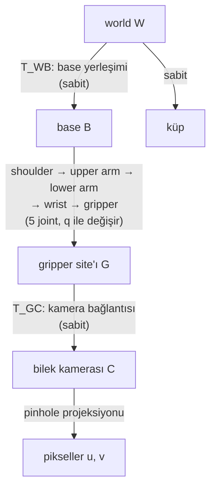

# 07 · Rigid transform'lar ve frame tree'leri

<!-- meta -->
| | |
|---|---|
| **Bölüm** | [2 · Spatial math](README.md) |
| **Çalışma türü** | CPU · Mac ya da Colab CPU |
| **Önkoşul** | [06](06-rotations.md) |
| **Önce öğren** | [Vectors, Matrices & Operations](https://aiengineeringfromscratch.com/lesson?path=phases/01-math-foundations/02-vectors-matrices-operations) · [Matrix Transformations](https://aiengineeringfromscratch.com/lesson?path=phases/01-math-foundations/03-matrix-transformations) |
| **Süre** | ~45 dk |
| **Kod** | [`experiments/07-rigid-transforms/experiment.py`](../../experiments/07-rigid-transforms/experiment.py) |
| **Durum** | ✅ tam |
<!-- /meta -->

> Bir nokta, ancak frame'inin adıyla birlikte bir sayı üçlüsüdür; transform o adı değiştirme yoludur.

## Problem

Menagerie SO-101 modelinde bir bilek kamerası var (`wrist_cam`, dikey görüş açısı 61°, [`so101.xml`](https://github.com/google-deepmind/mujoco_menagerie/blob/f3b6013/robotstudio_so101/so101.xml) içinde gripper'a tanımlı). Bir detector bu görüntüde bir küp buluyor. Küpü kavramak için kolun küpü **base** frame'inde bilmesi gerekir; çeneleri kapatmak için **gripper** frame'inde; başka robotlarla birlikte kaydetmek için **world** frame'inde. Bunların her biri aynı fiziksel nokta için farklı bir sayı üçlüsüdür ve her joint hareketinde değişir.

Bunları karıştırmak hiçbir şeyi çökertmez. Gripper'ı sessizce küpten 10 ila 42 cm uzağa gönderir (aşağıda ölçüldü). Bu ders dört transform'u elle kuruyor ve MuJoCo'ya karşı kontrol ediyor.

## Ana fikir

### Sade anlatımla

"Küp 15 cm önümde" demek, ancak "ben"in nerede olduğunu ve hangi yöne baktığımı biliyorsan işe yarar. Bunu herkes için aynı anlama gelen bir GPS koordinatıyla karşılaştır. **Frame** böyle bir referanstır: bir orijin ve üç eksen yönü. World frame sahnenin GPS'idir; base, gripper ve kamera frame'leri ise robotun her parçası için "önümde"dir. Aynı küpün her birinde farklı bir sayı üçlüsü vardır.

**Rigid transform** iki frame arasında çeviri tarifidir: döndür (ders 06), sonra kaydır. Gripper'ın base frame'inde nerede olduğunu ve kameranın gripper frame'inde nerede olduğunu biliyorsan, iki tarifi zincirleyip kamerayı base frame'inde bulursun. Kodda bu düz function composition'dır: `world_from_base(base_from_gripper(gripper_from_camera(p)))`. Transform'ları "A from B" diye adlandırmak zinciri dürüst tutar: komşu harfler birimler gibi eşleşmelidir.

Bir robot böyle frame'lerden oluşan bir ağaçtır, **frame tree**. Bazı kenarlar sabittir (base'in cıvatalandığı yer, kameranın gripper'a vidalandığı yer); diğerleri bir joint döndükçe değişir.



### Transform'lar kod olarak

```python
import numpy as np

def T(R, t):                     # R (3x3) rotation ve t (3,) translation'dan 4x4 transform
    M = np.eye(4)
    M[:3, :3], M[:3, 3] = R, t
    return M

def T_inv(M):                    # kapalı form ters, np.linalg.inv gerekmez
    R, t = M[:3, :3], M[:3, 3]
    return T(R.T, -R.T @ t)

# Adlandırma: T_AB, B frame'indeki koordinatları A frame'ine taşır ("A from B").
p_B = np.array([x, y, z, 1.0])   # homogeneous nokta: 1 ekle ki kaydırma da çarpımın parçası olsun
p_A = T_AB @ p_B                 # B -> A
T_AC = T_AB @ T_BC               # zincir = bileşke; içteki harfler sadeleşir
p_B = T_inv(T_AB) @ p_A          # A -> B
```

$B$ frame'inin $A$ frame'indeki pose'u, bir $R_{AB}$ rotation'ı ve $B$'nin orijininin $A$'daki konumu $t_{AB}$'dir; ikisi 4×4'lük bir **homogeneous transform**'da toplanır:

$$T_{AB} = \begin{bmatrix} R_{AB} & t_{AB} \\ 0 & 1\end{bmatrix},\qquad p_A = T_{AB}\,p_B\ \ (p = [x\ y\ z\ 1]^\top \text{ ile}).$$

| İşlem | Formül | Pratik kural |
|---|---|---|
| Bileşke | $T_{AC} = T_{AB}\,T_{BC}$ | içteki alt indisler sadeleşir |
| Ters | $T_{AB}^{-1} = T_{BA} = \begin{bmatrix} R^\top & -R^\top t \\ 0 & 1\end{bmatrix}$ | genel matris tersi çağırma |
| Noktanın frame'ini değiştir | $p_B = T_{AB}^{-1}\,p_A$ | istediğin alt indis sağa gelir |

$T_{AB}$, $B$'deki koordinatları $A$'daki koordinatlara taşıyan transform'dur; $R_{AB}$ onun 3×3'lük rotation'ı, $t_{AB}$ metre cinsinden translation'ıdır; $p_A$ ile $p_B$ aynı fiziksel noktanın, sonuna 1 eklenmiş olarak $A$ ve $B$ frame'lerindeki yazılışıdır.

<details>
<summary>Matematik ayrıntısı: ters neden ucuz, mesafeler neden korunur</summary>

**Homogeneous koordinatlar.** Bir noktaya 1 eklemek, "döndür, sonra $t$ ekle" işlemini tek bir matris çarpımına çevirir: $T p = [Rp + t;\ 1]$. Transform zincirlerini bir çarpım zinciri yapan budur.

**Kapalı form ters.** $p_A = R p_B + t$ denklemini $p_B$ için çöz: $p_B = R^{-1}(p_A - t) = R^\top p_A - R^\top t$, çünkü rotation matrix $R^\top R = I$'yı sağlar. Bu kesindir ve genel tersten ucuzdur; deney bunu `np.linalg.inv` ile karşılaştırıyor.

**Mesafeler korunur.** İki nokta için $\lVert T p - T p'\rVert = \lVert R(p - p')\rVert = \lVert p - p'\rVert$. Yani iki frame birbirine rigid olarak bağlıysa (aralarındaki transform sabitse), herhangi bir nokta ikisinde de aynı mesafe kadar oynar: Sonuç 3 bunu gripper ve kamera için gösteriyor.

**Bir joint hareket edince hangi koordinatlar değişir.** $p_F = T_{WF}^{-1}\,p_W$. Bir joint $T_{WF}$'yi ancak ağaçta world'den $F$'ye giden yol üzerindeyse değiştirir; $F$'den sonra gelen bir joint $F$ koordinatlarını değiştiremez.

Daha derine: AIEFS [Vectors, Matrices & Operations](https://aiengineeringfromscratch.com/lesson?path=phases/01-math-foundations/02-vectors-matrices-operations), [Matrix Transformations](https://aiengineeringfromscratch.com/lesson?path=phases/01-math-foundations/03-matrix-transformations); Lynch & Park, *Modern Robotics*, Böl. 3.

</details>

### MuJoCo'da frame tree'ler

MuJoCo her düğümün world pose'unu hesaplayıp `mjData`'da saklar ([API reference](https://mujoco.readthedocs.io/en/stable/APIreference/APIfunctions.html)):

| Nesne | Konum | Orientation | Dolduran |
|---|---|---|---|
| body (normal frame) | `xpos` | `xmat`, `xquat` | `mj_kinematics` |
| body inertial frame'i | `xipos` | `ximat` | `mj_kinematics` |
| site | `site_xpos` | `site_xmat` | `mj_kinematics` |
| kamera | `cam_xpos` | `cam_xmat` | `mj_camlight` (`mj_forward`'un parçası) |

**Site**, bir body'ye bağlı, adı olan ve kütlesi olmayan bir frame'dir; gripper ucu gibi noktaları işaretlemek için kullanılır. Ezberlenecek iki konvansiyon. MuJoCo kamerası kendi frame'inin **−z** ekseni boyunca bakar; görüntüde +x sağ, +y yukarıdır ([XML reference: camera](https://mujoco.readthedocs.io/en/stable/XMLreference.html#body-camera)). Bir `framepos` sensor'ünde `objtype/reftype="body"` body'nin **inertial** frame'i (orijini kütle merkezinde), `"xbody"` ise normal frame'idir ([XML reference: framepos](https://mujoco.readthedocs.io/en/stable/XMLreference.html#sensor-framepos)).

## Deney

Script: [`experiments/07-rigid-transforms/experiment.py`](../../experiments/07-rigid-transforms/experiment.py). MuJoCo 3.17.0, NumPy 2.5.4, Apple Silicon Mac (Apple M5), deterministik, yaklaşık 2 s.

**Kurulum.** SO-101 base'i, MuJoCo'nun modeli kodla düzenleme API'si `MjSpec` ile (0,10, −0,05, 0) m'ye taşındı ve 30° yaw verildi; yani world ≠ base. 3 cm'lik bir küp masada, world'de (0,2905, 0,0600, 0,015) m'de duruyor. Kol, bilek kamerasının küpü gördüğü bir pozda. Dört `framepos` sensor'ü küpü base (`xbody`), base (`body`), gripper site'ı ve kamera frame'inde raporluyor.

**Önce tahmin et.** `shoulder_pan`'i döndürünce (hareketsiz) küpün dört koordinat üçlüsünden hangileri değişir?

```python
def T_inv(M):
    R, t = M[:3, :3], M[:3, 3]
    return T(R.T, -R.T @ t)

F = {"B": T(d.xmat[base], d.xpos[base]),
     "G": T(d.site_xmat[site], d.site_xpos[site]),
     "C": T(d.cam_xmat[cam], d.cam_xpos[cam])}
cube_in = {k: (T_inv(Tw) @ np.append(p_world, 1))[:3] for k, Tw in F.items()}
```

**Sonuç 1 · elle transform ile MuJoCo.**

| Frame | elle küp (m) | sensor'e göre en büyük mutlak fark |
|---|---|---|
| world W | (0,2905, 0,0600, 0,0150) | – |
| base B | (0,2200, 0,0000, 0,0150) | 2,8e-17 |
| gripper G (site `gripperframe`) | (0,0806, −0,0290, −0,0205) | 1,4e-17 |
| kamera C (`wrist_cam`) | (−0,0064, −0,0011, −0,1508) | 4,1e-17 |

Kapalı formdaki ters, `np.linalg.inv` ile 1,1e-15'e kadar tutuyor; $T_{WB}T_{BG}$ de $T_{WG}$'yi 5,6e-17'ye kadar veriyor. Kamera üçlüsünde $z = -0{,}1508$ m: küp lensin 15 cm önünde, neredeyse optik eksen (lensten dümdüz çıkan çizgi) üzerinde.

**Sonuç 2 · kamera frame'inden piksele.** Bir pinhole kamera derinliğe böler: iki kat uzaktaki bir nokta, görüntü merkezine iki kat yakın düşer. 640×480'de odak uzaklığı $f = (H/2)/\tan(\text{fovy}/2) = 407{,}4$ px ile küp merkezi $u = 302{,}7$, $v = 242{,}8$ px'e düşüyor ($u = W/2 + f x/(-z)$, $v = H/2 - f y/(-z)$). Küpün 8 köşesini projekte edip convex hull'larını doldurmak, MuJoCo'nun render ettiği segmentation maskesine karşı IoU'su (kesişim alanı bölü birleşim alanı) 0,979 olan bir siluet veriyor (9643'e karşı 9454 px), centroid farkı 0,74 px. Doğru kontrol centroid değil siluettir (Gerçek robotta bölümüne bak).

**Sonuç 3 · `shoulder_pan` sweep'i.** Diğer joint'ler sabit; koordinatlar cm.

| pan | küp B'de | küp G'de | küp C'de | gripper site'ı W'de |
|---|---|---|---|---|
| −40° | 22,00, 0,00, 1,50 | 5,30, 2,62, 11,15 | 12,62, 2,90, −9,83 | 18,88, 9,21, 8,26 |
| 0° | 22,00, 0,00, 1,50 | 8,16, −1,46, −0,19 | 1,23, 1,14, −14,39 | 25,47, 2,79, 8,26 |
| 40° | 22,00, 0,00, 1,50 | 5,30, −10,68, −7,96 | −6,62, −8,08, −17,01 | 26,40, −6,36, 8,26 |

Sonra her kol joint'i pozun etrafında ±30° sweep ediliyor (yalnızca kinematik, limitler uygulanmıyor):

| Sweep edilen joint | W'de en büyük değişim | B'de | G'de | C'de | $T_{GC}$ kayması |
|---|---|---|---|---|---|
| shoulder_pan | 0,00 mm | 0,00 mm | 93,77 mm | 93,77 mm | 7,8e-16 |
| shoulder_lift | 0,00 | 0,00 | 93,44 | 93,44 | 7,8e-16 |
| elbow_flex | 0,00 | 0,00 | 150,07 | 150,07 | 7,8e-16 |
| wrist_flex | 0,00 | 0,00 | 124,53 | 124,53 | 5,6e-16 |
| wrist_roll | 0,00 | 0,00 | 15,74 | 15,74 | 5,6e-16 |

Bir frame'deki koordinatlar, yalnızca ağaçta o frame ile world **arasında** bir joint varsa değişir. Base koordinatları hiç değişmiyor; gripper ve kamera koordinatları tam olarak aynı mesafe kadar değişiyor, çünkü $T_{GC}$ sabit (kayma ≤ 7,8e-16) ve rigid transform mesafeleri korur. `wrist_roll` gripper frame koordinatlarını en az değiştiriyor (15,74 mm): roll ekseni etrafında 30°'ye kadar dönmek onları $2r\sin 15°$ kadar oynatır; $r$ küpün o eksene uzaklığıdır, yani küp eksenden yalnızca yaklaşık 30 mm uzakta.

## Boz

Küpü gripper frame'inde hesaplamanın beş yolu, sensor'e karşı puanlanmış:

| Hesap | hata |
|---|---|
| $T_{WG}^{-1}\,p$ (doğru) | 0,0 mm |
| $R\,(p - t)$: Rᵀ yerine R (active/passive karışıklığı) | 101,0 mm |
| $(T_{BG}\,T_{WB})^{-1}\,p$: yanlış bileşke sırası | 103,2 mm |
| $R^\top p$: translation unutulmuş | 274,3 mm |
| $T_{WG}\,p$: tersi yerine transform'un kendisi | 424,4 mm |

Bir de sinsi olanı: `reftype="body"` olan bir `framepos` sensor'ü (−0,0044, 0,0397, 0,2032) m okuyor; gerçek base frame değerinden 295,5 mm uzakta. Çünkü base'in inertial frame'ini kullanıyor: orijini kütle merkezinde, eksenleri asal atalet eksenleri. Bu hataların hiçbiri exception fırlatmaz.

## Gerçek robotta

- Donanımda `framepos` sensor'ü yoktur; $T_{WB}$ (base'in nereye cıvatalandığı) ve $T_{GC}$ (kameranın gripper üzerinde nerede durduğu) kalibrasyonla **ölçülmelidir** ([ders 19](../part-5-perception-and-estimation/19-camera-calibration.md)'a bak). Modeldeki $T_{GC}$ bir CAD değeridir. Gerçek kolda henüz ölçülmedi.
- OpenCV'nin pinhole modeli $u = f_x X_c/Z_c + c_x$, $v = f_y Y_c/Z_c + c_y$ projeksiyonunu, piksel satırları aşağı doğru artacak şekilde yapar; yani +z ileri, +y aşağı ([calib3d.hpp](https://github.com/opencv/opencv/blob/4.x/modules/calib3d/include/opencv2/calib3d.hpp)). MuJoCo kamera frame'indeki bir nokta, x etrafında 180°'lik bir rotation ile OpenCV noktasına dönüşür: $(x, y, z) \to (x, -y, -z)$. Bunu yanlış yapmak görüntüyü ters çevirir.
- Blob centroid'ini projekte edilmiş merkez sanma. Sonuç 2'de render edilen maskenin centroid'i $u = 299{,}3$, $v = 240{,}3$ px, merkez ise $u = 302{,}7$, $v = 242{,}8$ px'e düşüyor: perspektifte bir katı cismin görüntüsünün centroid'i, merkezinin görüntüsü değildir. Kalibrasyon için köşe ya da keypoint kullan.

## Kendini dene

1. **Kolay.** Sonuç 3'te gripper site'ının world z'si neden her pan açısında sabit (8,26 cm)?
2. **Orta.** $T_{BC}$'yi `T_inv` ve `F` sözlüğü cinsinden yaz. Hangi joint'lere bağlıdır?
3. **Zor.** Küp için `reftype="camera"` olan bir `framequat` sensor'ü ekle ve $R_{CW}R_{W,\text{küp}}$'ü elle doğrula. En büyük hata nedir?

### Cevaplar

1. Pan ekseni düşey (base'e yalnızca yaw verildi); bu eksen etrafında dönmek her noktayı kendi yüksekliğinde tutar.
2. $T_{BC}$ = `T_inv(F["B"]) @ F["C"]`. Beş kol joint'inin hepsine bağlıdır, base yerleşimine hiç bağlı değildir.
3. Bu dersin script'inde hesaplanmadı; hatanı Sonuç 1'deki konum hatalarıyla karşılaştır.

## Akılda kalanlar ve kaynaklar

- Kapalı form tersle $p_B = T_{AB}^{-1}p_A$; bu kurulumda elle transform'lar MuJoCo ile ≤ 4,1e-17 m tuttu.
- Bir joint, koordinatları yalnızca ağaçta kendisinden sonra gelen frame'lerde değiştirir; küpün base koordinatları 0,00 mm değişirken gripper/kamera koordinatları 150,07 mm'ye kadar oynadı.
- Frame konvansiyonlarını bil: kamera −z ileri (MuJoCo), `body` = inertial frame, `xbody` = normal frame (295,5 mm'lik tuzak).

Sonraki: [ders 08 · Forward kinematics, degrees of freedom ve workspace](../part-3-kinematics/08-forward-kinematics.md).

**Kaynaklar**

- K. M. Lynch, F. C. Park, *Modern Robotics*, Böl. 3 "Rigid-Body Motions" (homogeneous transform'lar). [Kitap sayfası](https://hades.mech.northwestern.edu/index.php/Modern_Robotics).
- MuJoCo: [XML reference · camera](https://mujoco.readthedocs.io/en/stable/XMLreference.html#body-camera), [XML reference · framepos](https://mujoco.readthedocs.io/en/stable/XMLreference.html#sensor-framepos), [API functions](https://mujoco.readthedocs.io/en/stable/APIreference/APIfunctions.html).
- SO-101 modeli: [MuJoCo Menagerie `robotstudio_so101`](https://github.com/google-deepmind/mujoco_menagerie/blob/f3b6013/robotstudio_so101/so101.xml) (Apache-2.0).
