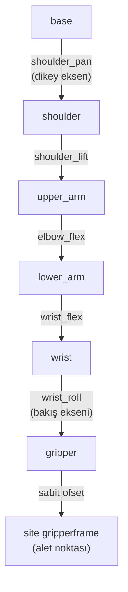

# 08 · Forward kinematics, degrees of freedom ve workspace

<!-- meta -->
| | |
|---|---|
| **Bölüm** | [3 · Kinematics](README.md) |
| **Çalışma türü** | CPU · Mac ya da Colab CPU |
| **Önkoşul** | [07](../part-2-spatial-math/07-rigid-transforms.md) |
| **Önce öğren** | [Matrix Transformations](https://aiengineeringfromscratch.com/lesson?path=phases/01-math-foundations/03-matrix-transformations) |
| **Süre** | ~45 dk |
| **Kod** | [`experiments/08-forward-kinematics/experiment.py`](../../experiments/08-forward-kinematics/experiment.py) |
| **Durum** | ✅ tam |
<!-- /meta -->

> Forward kinematics, ağaç boyunca bir transform çarpımıdır; o çarpımdaki joint sayısı hangi pose'ların var olduğuna karar verir.

## Problem

SO-101 follower kolu altı STS3215 servo kullanır ([LeRobot SO-101 rehberi](https://huggingface.co/docs/lerobot/so101)). Bunlardan biri yalnızca çeneyi açıp kapatır. Geriye, pose'u **altı** sayıdan (3 konum, 3 orientation) oluşan bir gripper'ı yerleştirecek **beş** joint kalır. Bir policy ya da teleoperatör, hiçbir joint ayarının üretemediği bir gripper pose'u isteyebilir ve koldaki hiçbir şey bunu söylemez.

Bir hedef için joint açılarını hesaplamadan önce (ders 10) ileri haritaya ihtiyaç var: joint açıları → gripper pose'u. Bu ders onu MJCF dosyasından elle kuruyor, MuJoCo'ya karşı kontrol ediyor, kolun workspace'ini ölçüyor ve beş joint'in hangi orientation'ları veremediğini tam olarak gösteriyor.

## Ana fikir

### Sade anlatımla

Menteşeli bir masa lambası düşün. Her menteşenin açısını biliyorsan ampulün tam olarak nerede olduğunu söyleyebilirsin: ayaktan başla, ilk kolu izle, ilk menteşe açısı kadar dön, sonraki kolu izle, böyle devam et. Bu **forward kinematics (FK)**'tir: joint açıları girer, aletin pose'u çıkar. Tek cevabı olan saf bir fonksiyondur, hesaplaması ucuzdur ve ders 07'deki frame tree'nin base'den alete kadar çarpılmasından ibarettir.

Ters soru ("ampulü buraya hangi açılar koyar?") daha zordur ve bazen hiç cevabı yoktur. Sebebi saymaktır. Bir gripper pose'u altı sayı ister: üçü nerede olduğu, üçü hangi yöne baktığı için. Her joint bir düğmedir. SO-101'in gripper'ı hareket ettiren beş düğmesi var; altı sayıyı bağımsız olarak ayarlayamaz. Joint'lerinden üçünün (shoulder lift, elbow, wrist flex) eksenleri paraleldir; birlikte gripper'ı yalnızca tek bir dikey düzlem içinde hareket ettirirler. Pan joint'i bu düzlemi döndürür, wrist roll ise gripper'ı kendi bakış ekseni etrafında çevirir. Verilen bir noktada gripper yalnızca o düzlem içinde bir yöne bakabilir.

**Workspace**, aletin ulaşabildiği bütün noktalardır. Gerçek bir kol için formülü yoktur; çok sayıda rastgele joint ayarı deneyip aletin nereye düştüğünü kaydederek tahmin edilir.



Lift, elbow ve wrist flex üç paralel "pitch" eksenidir. Altıncı motor `gripper`, `gripper` body'sine bağlıdır ve yalnızca çeneyi oynatır; bu yüzden bu zincirde yoktur.

### Forward kinematics kod olarak

```python
import numpy as np

def fk(q):                                  # q: 5 kol joint açısı (rad)
    M = np.eye(4)                           # base frame'inden başla
    for T_static, axis, qi in zip(STATIC, AXES, q):
        M = M @ T_static                    # üst body -> alt body sabit ofseti (MJCF pos/quat)
        M = M @ T(axis_rot(axis, qi), np.zeros(3))  # joint ekseni etrafında qi kadar dön
    return M @ T_SITE                       # alet noktasına sabit ofset (site pos/quat)

# Örneklemeyle workspace: limitler içinde düzgün rastgele joint'ler, aletin düştüğü yeri sakla
pts = np.array([fk(np.random.uniform(lo, hi))[:3, 3] for _ in range(N)])
```

| Büyüklük | Formül |
|---|---|
| Forward kinematics | $T_{W,\text{site}}(q) = \prod_{i=1}^{n}\Big(T^{\text{static}}_{i}\ \mathrm{Rot}(\hat a_i, q_i)\Big)\ T_{\text{site}}$ |
| 1-DoF joint'lerden açık zincirin mobility'si | joint sayısı $n$ |
| Workspace | $\{\,p(q) : q_{\min} \le q \le q_{\max}\,\}$ |

$q_i$, $i$. joint'in açısıdır; $T^{\text{static}}_i$ üst body'den $i$. body'ye sabit transform'dur (`body_pos`/`body_quat`'tan); $\hat a_i$ o body'nin frame'inde joint eksenidir (`jnt_axis`; joint body orijinindedir, bu modelde `jnt_pos = 0`); $\mathrm{Rot}(\hat a, q)$, $\hat a$ etrafında $q$ kadar rotation'dır; $T_{\text{site}}$ alet site'ının sabit ofsetidir; $p(q)$ aletin konumu, $q_{\min}, q_{\max}$ joint limitleridir.

| Kol | Aleti oynatan joint'ler | Görev boyutu | Sonuç |
|---|---|---|---|
| SO-101 | 5 (pan, lift, elbow, wrist flex, wrist roll) | 6 | verilen bir noktada yalnızca 2 boyutlu bir orientation ailesi var |
| Franka Panda | 7 | 6 | bir fazla (redundant) DoF: genelde çok sayıda çözüm |

**Degree of freedom (DoF)**, değiştirebildiğin bağımsız bir sayıdır; "redundant", görevin gerektirdiğinden fazla joint olması demektir.

<details>
<summary>Matematik ayrıntısı: product of exponentials, DoF sayımı ve kol düzlemi</summary>

**Aynı harita, başka gösterim.** Lynch & Park FK'yi matris üstellerinin çarpımı olarak yazar: $T(q) = e^{[\mathcal S_1]q_1}\cdots e^{[\mathcal S_n]q_n}M$; burada $M$ aletin $q = 0$'daki pose'u, $\mathcal S_i$ ise $i$. joint'in base frame'indeki screw axis'idir (*Modern Robotics*, Böl. 4). Çarpanlar yukarıdaki MJCF tarzı çarpımdan farklıdır, sonuç farklı değildir.

**Sayım.** Bir pose'un 3 konum ve 3 orientation sayısı vardır. Alet konumunu sabitlemek SO-101'in 5 joint DoF'unun 3'ünü kullanır; orientation için $5 - 3 = 2$ kalır: bütün orientation'ların 3 boyutlu kümesi içinde 2 boyutlu bir aile.

**Kol düzlemi.** Lift, elbow ve wrist flex normali $n$ olan paralel eksenler etrafında döner; aleti ve yaklaşma eksenini yalnızca $n$'ye dik düzlem içinde oynatırlar. Pan bu düzlemi dikey eksen etrafında döndürür. Wrist roll aleti yaklaşma ekseni etrafında çevirir; bu, yaklaşma yönünü değiştirmez. Yani sabit bir noktada yaklaşma ekseni kol düzleminde olmak zorundadır. Site'ın roll ekseninden 12 mm'lik ofseti (Adım 1) bu kuralı biraz esnetir.

**Örnekleme neden eşitsiz.** Joint uzayında düzgün örnekleme uzayda düzgün değildir: küçük joint değişimlerinin aleti çok oynattığı bölgeler seyrek ziyaret edilir; nadir köşelerin görünmesi için çok örnek gerekir.

Daha derine: AIEFS [Matrix Transformations](https://aiengineeringfromscratch.com/lesson?path=phases/01-math-foundations/03-matrix-transformations); Lynch & Park, *Modern Robotics*, Böl. 2 "Configuration Space" ve Böl. 4 "Forward Kinematics".

</details>

<!-- figure: 08-arm-plane-workspace -->

## Deney

Script: [`experiments/08-forward-kinematics/experiment.py`](../../experiments/08-forward-kinematics/experiment.py). MuJoCo 3.17.0, NumPy 2.5.4, SciPy, Apple Silicon Mac (Apple M5), sabit seed'ler, yaklaşık 80 s CPU süresi.

**Önce tahmin et.** SO-101'in erişilebilir uzayı kaç tane 1 cm'lik voxel kaplar ve 10 000 rastgele joint örneği bunların çoğunu bulur mu?

**Adım 1 · elle FK.** Zincir derlenmiş modelden okunuyor: base → shoulder → upper_arm → lower_arm → wrist → gripper → site `gripperframe`.

```python
def fk_hand(q):
    M = np.eye(4)
    for Ts, jt in zip(STATIC, JOINT):          # T_static from body_pos / body_quat
        M = M @ Ts
        if jt is not None:
            j, ax = jt
            M = M @ T(axis_rot(ax, q[j]), np.zeros(3))
    return M @ T_SITE                          # site_pos / site_quat
```

Limitler içindeki 1000 rastgele joint vektöründe elle FK ile `mj_kinematics` konumda **3,3e-16 m**, rotation matrix elemanı başına **1,2e-15** içinde tutuyor. Alet site'ı wrist roll ekseninden 12,0 mm uzakta; bu yüzden roll 0 → 180° iken site 24,0 mm yer değiştiriyor: IK'da sonra önemli olacak bir ayrıntı.

**Adım 2 · DoF.** Modelde `nq = 6`, `nv = 6`, 6 actuator var:

| Joint | Aralık (derece) |
|---|---|
| shoulder_pan | −110,0 .. 110,0 |
| shoulder_lift | −100,0 .. 100,0 |
| elbow_flex | −96,8 .. 96,8 |
| wrist_flex | −95,0 .. 95,0 |
| wrist_roll | −157,2 .. 162,8 |
| gripper | −10,0 .. 100,0 |

Beşi `gripperframe`'i hareket ettiriyor; altıncısı yalnızca çeneyi.

**Adım 3 · örnek sayısı sweep'i → workspace tahmini.** Joint vektörleri limitler içinde düzgün dağılımlı, çarpışma filtresi yok. Hacim, dolu **voxel**'lerin (1 cm ya da 2 cm'lik küp hücreler) sayısıyla ölçülür; **convex hull** bütün noktaları saran en küçük dışbükey şekildir.

| Örnek | hacim, 1 cm voxel | hacim, 2 cm voxel | convex hull | en büyük erişim | z = 0'ın altında site |
|---|---|---|---|---|---|
| 1 000 | 1,0 L | 7,6 L | 234,5 L | 0,471 m | %25,4 |
| 10 000 | 9,5 L | 60,9 L | 269,7 L | 0,473 m | %25,2 |
| 100 000 | 71,8 L | 222,2 L | 283,6 L | 0,473 m | %24,9 |
| 1 000 000 | 230,4 L | 282,9 L | 289,6 L | 0,473 m | %25,1 |

En büyük erişim (pan ekseni üzerinde omuz yüksekliğindeki noktadan ölçülen) 10 000 örnekten sonra yakınsıyor, hacim yakınsamıyor: 1 cm voxel ile bir milyon örnekte hâlâ büyüyor, çünkü düzgün joint örneklemesi workspace'i çok eşitsiz geziyor. Convex hull en hızlı yakınsıyor ama fazla tahmin ediyor, çünkü her içbükey bölgeyi dolduruyor. Joint vektörlerinin dörtte biri aleti base'in durduğu masa düzleminin altına koyuyor.


## Boz

**Kol düzleminin dışında istenen orientation.** Hedef noktayı (0,22, 0, 0,08) m'de sabitle. Kol düzlemini bul (normal $n$ = shoulder lift ekseni; üç pitch ekseni 4,6e-16'ya kadar paralel). $a = \cos\beta\,a_0 + \sin\beta\,n$ yaklaşma yönünü iste; $a_0$ düzlemde, yatayın 45° altında. 12 seed'den (rastgele başlangıç joint vektörleri) sınırlı bir least-squares çözücüyle çöz (ders 10 bu tür çözücüleri kuruyor):

| β (düzlem dışı) | 0° | 5° | 10° | 20° | 30° | 45° | 60° | 90° |
|---|---|---|---|---|---|---|---|---|
| en iyi yaklaşma hatası | 0,098° | 3,086° | 8,083° | 18,077° | 28,070° | 43,058° | 58,036° | 87,682° |
| konum hatası | 0,000 mm | 0,000 | 0,000 | 0,000 | 0,000 | 0,000 | 0,000 | 0,000 |

Konuma her seferinde ulaşılıyor; orientation hatası β ile bire bir büyüyor, ondan biraz aşağıda kalarak (5°'de 3,086°, 90°'de 87,682°). Bu küçük kazanç 12 mm'lik site ofsetinden geliyor: bileği roll ettirmek site'ı düzlemin dışına taşıyor, bu da pan'ın biraz dönmesine izin veriyor. β = 0'da çözücü wrist_roll'u joint limitinde bitiriyor, geriye 0,098° kalıyor.

**Rastgele orientation'lar.** Aynı noktada 200 düzgün dağılımlı rastgele tam orientation (6 boyutlu görev):

| Kol | medyan hata | 1° içinde | 5° içinde | 10° içinde | 30° içinde |
|---|---|---|---|---|---|
| SO-101 (5 joint), nokta (0,22, 0, 0,08) m | 72,0° | 2 / 200 | 5 / 200 | 8 / 200 | 33 / 200 |
| Franka Panda (7 joint), nokta (0,5, 0, 0,4) m | 0,00° | 181 / 200 | 187 / 200 | 189 / 200 | 199 / 200 |

SO-101 için keyfi bir gripper orientation'ı kural değil istisnadır. Panda da bazı hedefleri kaçırıyor (en büyük hata 33,6°); joint limitleri aktifken ve yalnızca 6 seed ile bu çalıştırma joint limitlerini yerel minimumlardan ayırmıyor.

## Gerçek robotta

- LeRobot rehberi altı motoru shoulder pan, shoulder lift, elbow flex, wrist flex, wrist roll ve gripper olarak adlandırıyor ([LeRobot SO-101](https://huggingface.co/docs/lerobot/so101)); Menagerie modelindeki altı joint'in aynısı.
- Gerçek FK, link uzunlukları ve joint sıfır ofsetleri kadar iyidir. LeRobot kalibrasyonu her joint'i aralığının ortasına koyup sonra her birini tam aralığı boyunca hareket ettiriyor; Menagerie modeli yorumlarında elbow aralığına uygulanmış 5 derecelik bir kalibrasyon ofsetini not ediyor ([so101.xml](https://github.com/google-deepmind/mujoco_menagerie/blob/f3b6013/robotstudio_so101/so101.xml)). Gerçek gripper'ın modelin FK'sından ne kadar uzağa düştüğü gerçek kolda henüz ölçülmedi. Prosedür: 20 poz komut et, gripper ucunu cetvelle ya da kamera işaretiyle ölç, `mj_kinematics` ile karşılaştır.
- 5 DoF'lu bir kol için gripper pose'larını 6 boyutlu action olarak saklayan dataset'ler, robotun tam olarak ulaşamayacağı hedefler içerir. Joint konumlarını sakla ya da eğitimden önce erişilebilirliği kontrol et.

## Kendini dene

1. **Kolay.** `gripper` joint'i neden `gripperframe`'e giden FK zincirinin parçası değil?
2. **Orta.** `fk_hand` ile, bir milyon örneklik çalıştırmada en büyük erişimi veren joint vektörünü bul. Kol düz mü?
3. **Zor.** Hangi tek ek hinge, nereye konursa, SO-101'in test noktasında her orientation'a ulaşmasını sağlar? Düzlem resmiyle savun, sonra joint'i `MjSpec` ile ekleyip test et.

### Cevaplar

1. `gripperframe` site'ı `gripper` body'sine bağlı; `gripper` joint'i ise site'ın atası olmayan `moving_jaw_so101_v1` alt body'sini hareket ettiriyor.
2. Bu dersin script'inde hesaplanmadı. Bulduğunu ders 10'daki gergin pozla karşılaştır.
3. Ekseni pitch eksenlerine paralel olmayan ve yaklaşma ekseni boyunca da olmayan bir hinge, örneğin wrist flex ile wrist roll arasına bir bilek yaw'ı. Yaklaşma ekseninin düzlemden çıkmasına izin verir. Burada hesaplanmadı.

## Akılda kalanlar ve kaynaklar

- FK = MJCF'ten okunan sabit ofsetler ile joint rotation'larının çarpımı; elle sürüm `mj_kinematics` ile 3,3e-16 m'ye kadar tuttu.
- Örneklenmiş workspace hacmi örnek sayısına ve voxel boyuna bağlıdır (bir milyon örnekte 230,4 L'ye karşı 282,9 L); ikisini birlikte ver.
- 5 joint 6 boyutlu bir pose'u gerçekleştiremez: düzlem dışı orientation hatası β ile büyüyor (90°'de 87,682°), 200 rastgele orientation'dan yalnızca 2'si 1° içinde erişilebilir çıktı; 7 joint'li Panda'da 200'de 181.

Sonraki: [ders 09 · Jacobian ve differential kinematics](09-jacobians.md).

**Kaynaklar**

- K. M. Lynch, F. C. Park, *Modern Robotics*, Böl. 2 "Configuration Space" ve Böl. 4 "Forward Kinematics". [Kitap sayfası](https://hades.mech.northwestern.edu/index.php/Modern_Robotics).
- LeRobot, [SO-101 montaj ve kurulum rehberi](https://huggingface.co/docs/lerobot/so101).
- MuJoCo Menagerie: [`robotstudio_so101`](https://github.com/google-deepmind/mujoco_menagerie/blob/f3b6013/robotstudio_so101/so101.xml) (Apache-2.0), [`franka_emika_panda`](https://github.com/google-deepmind/mujoco_menagerie/tree/f3b6013/franka_emika_panda).
- MuJoCo [API functions](https://mujoco.readthedocs.io/en/stable/APIreference/APIfunctions.html) (`mj_kinematics`).
