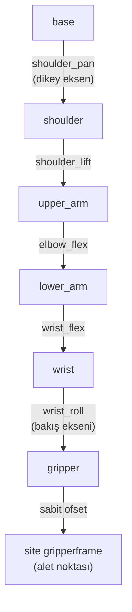

# 08 · Forward kinematics, degrees of freedom ve workspace

<!-- meta -->
| | |
|---|---|
| **Bölüm** | [3 · Kinematics](README.md) |
| **Çalışma türü** | CPU · Mac ya da Colab CPU |
| **Önkoşul** | [07](../part-2-spatial-math/07-rigid-transforms.md) |
| **Önce öğren** | [Matrix Transformations](https://aiengineeringfromscratch.com/lesson?path=phases/01-math-foundations/03-matrix-transformations) |
| **Süre** | ~45 dk |
| **Kod** | [`experiments/08-forward-kinematics/experiment.py`](../../experiments/08-forward-kinematics/experiment.py) |
| **Durum** | ✅ tam |
<!-- /meta -->


> Forward kinematics, ağaç boyunca bir transform çarpımıdır; o çarpımdaki joint sayısı hangi pose'ların var olduğuna karar verir.

## Problem

SO-101 follower kolu altı STS3215 servo kullanır ([LeRobot SO-101 rehberi](https://huggingface.co/docs/lerobot/so101)). Bunlardan biri yalnızca çeneyi açıp kapatır. Geriye, pose'u **altı** sayıdan (3 konum, 3 orientation) oluşan bir gripper'ı yerleştirecek **beş** joint kalır. Bir policy ya da teleoperatör, hiçbir joint ayarının üretemediği bir gripper pose'u isteyebilir ve koldaki hiçbir şey bunu söylemez.

Bir hedef için joint açılarını hesaplamadan önce (ders 10) ileri haritaya ihtiyaç var: joint açıları → gripper pose'u. Bu ders onu MJCF dosyasından elle kuruyor, MuJoCo'ya karşı kontrol ediyor, kolun workspace'ini ölçüyor ve beş joint'in hangi orientation'ları veremediğini tam olarak gösteriyor.

## Ana fikir

### Sade anlatımla

Menteşeli bir masa lambası düşün. Her menteşenin açısını biliyorsan ampulün tam olarak nerede olduğunu söyleyebilirsin: ayaktan başla, ilk kolu izle, ilk menteşe açısı kadar dön, sonraki kolu izle, böyle devam et. Bu **forward kinematics (FK)**'tir: joint açıları girer, aletin pose'u çıkar. Tek cevabı olan saf bir fonksiyondur, hesaplaması ucuzdur ve ders 07'deki frame tree'nin base'den alete kadar çarpılmasından ibarettir.

Ters soru ("ampulü buraya hangi açılar koyar?") daha zordur ve bazen hiç cevabı yoktur. Sebebi saymaktır. Bir gripper pose'u altı sayı ister: üçü nerede olduğu, üçü hangi yöne baktığı için. Her joint bir düğmedir. SO-101'in gripper'ı hareket ettiren beş düğmesi var; altı sayıyı bağımsız olarak ayarlayamaz. Joint'lerinden üçünün (shoulder lift, elbow, wrist flex) eksenleri paraleldir; birlikte gripper'ı yalnızca tek bir dikey düzlem içinde hareket ettirirler. Pan joint'i bu düzlemi döndürür, wrist roll ise gripper'ı kendi bakış ekseni etrafında çevirir.

**Workspace**, aletin ulaşabildiği bütün noktalardır. Gerçek bir kol için formülü yoktur; çok sayıda rastgele joint ayarı deneyip aletin nereye düştüğünü kaydederek tahmin edilir.



Lift, elbow ve wrist flex üç paralel "pitch" eksenidir. Altıncı motor `gripper`, `gripper` body'sine bağlıdır ve yalnızca çeneyi oynatır; bu yüzden bu zincirde yoktur.

### Forward kinematics kod olarak

```python
M = np.eye(4)                                     # start at the base frame
for T_static, axis, qi in zip(STATIC, AXES, q):   # one entry per body, base to tip
    M = M @ T_static @ T(axis_rot(axis, qi), np.zeros(3))   # fixed offset, then the joint turn
tool = M @ T_SITE                                 # fixed offset to the tool point
```

| Büyüklük | Formül |
|---|---|
| Forward kinematics | $T_{W,\text{site}}(q) = \prod_{i=1}^{n}\Big(T^{\text{static}}_{i}\ \mathrm{Rot}(\hat a_i, q_i)\Big)\ T_{\text{site}}$ |
| 1-DoF joint'lerden açık zincirin mobility'si | joint sayısı $n$ |
| Workspace | $\{\,p(q) : q_{\min} \le q \le q_{\max}\,\}$ |

$q_i$, $i$. joint'in açısıdır; $T^{\text{static}}_i$ üst body'den $i$. body'ye sabit transform'dur (`body_pos`/`body_quat`'tan); $\hat a_i$ o body'nin frame'inde joint eksenidir (`jnt_axis`); $\mathrm{Rot}(\hat a, q)$, $\hat a$ etrafında $q$ kadar rotation'dır; $T_{\text{site}}$ alet site'ının sabit ofsetidir; $p(q)$ aletin konumu, $q_{\min}, q_{\max}$ joint limitleridir.

| Kol | Aleti oynatan joint'ler | Görev boyutu | Sonuç |
|---|---|---|---|
| SO-101 | 5 (pan, lift, elbow, wrist flex, wrist roll) | 6 | verilen bir noktada yalnızca 2 boyutlu bir orientation ailesi var |
| Franka Panda | 7 | 6 | bir fazla (redundant) DoF: genelde çok sayıda çözüm |

**Degree of freedom (DoF)**, değiştirebildiğin bağımsız bir sayıdır; "redundant", görevin gerektirdiğinden fazla joint olması demektir.

<details>
<summary>Matematik ayrıntısı: product of exponentials, DoF sayımı ve kol düzlemi</summary>

**Aynı harita, başka gösterim.** Lynch & Park FK'yi matris üstellerinin çarpımı olarak yazar: $T(q) = e^{[\mathcal S_1]q_1}\cdots e^{[\mathcal S_n]q_n}M$; burada $M$ aletin $q = 0$'daki pose'u, $\mathcal S_i$ ise $i$. joint'in base frame'indeki screw axis'idir (*Modern Robotics*, Böl. 4). Çarpanlar yukarıdaki MJCF tarzı çarpımdan farklıdır, sonuç farklı değildir.

**Sayım.** Bir pose'un 3 konum ve 3 orientation sayısı vardır. Alet konumunu sabitlemek SO-101'in 5 joint DoF'unun 3'ünü kullanır; orientation için $5 - 3 = 2$ kalır: bütün orientation'ların 3 boyutlu kümesi içinde 2 boyutlu bir aile.

**Kol düzlemi.** Lift, elbow ve wrist flex normali $n$ olan paralel eksenler etrafında döner; aleti ve yaklaşma eksenini yalnızca $n$'ye dik düzlem içinde oynatırlar. Pan bu düzlemi dikey eksen etrafında döndürür. Wrist roll aleti yaklaşma ekseni etrafında çevirir; bu, yaklaşma yönünü değiştirmez. Yani sabit bir noktada yaklaşma ekseni kol düzleminde olmak zorundadır. Site'ın roll ekseninden 12 mm'lik ofseti (Sıfırdan yaz, Adım 3) bu kuralı biraz esnetir.

**Örnekleme neden eşitsiz.** Joint uzayında düzgün örnekleme uzayda düzgün değildir: küçük joint değişimlerinin aleti çok oynattığı bölgeler seyrek ziyaret edilir; nadir köşelerin görünmesi için çok örnek gerekir.

Daha derine: AIEFS [Matrix Transformations](https://aiengineeringfromscratch.com/lesson?path=phases/01-math-foundations/03-matrix-transformations); Lynch & Park, *Modern Robotics*, Böl. 2 "Configuration Space" ve Böl. 4 "Forward Kinematics".

</details>

<!-- figure: 08-arm-plane-workspace -->

## Sıfırdan yaz

Şimdi SO-101'in forward kinematics'ini yaklaşık 50 satır NumPy ile kendin yazacaksın ve her adımı MuJoCo ile karşılaştıracaksın. Kodun MuJoCo'dan yalnızca modelin sabit sayılarını alıyor: her gövdenin bir öncekine göre nerede durduğu, her hinge'in hangi yöne baktığı, alet noktasının nerede olduğu. Poza bağlı her şey senin.

Adımları kendi dosyana yaz (örneğin `scratch/my_fk.py`) ve her adımdan sonra çalıştır. Bitmiş fonksiyonlar [`physai/kinematics.py`](../../physai/kinematics.py) içinde; `uv run python experiments/08-forward-kinematics/build.py` dört adımı kontrolleriyle birlikte koşturur (çıktı [`build_output.txt`](../../experiments/08-forward-kinematics/build_output.txt) dosyasında).

### Adım 1 · Zinciri tarif et

Seri bir kol, tabandan uca bir link listesidir. Her link katı bir gövdedir: $q = 0$'da bir önceki gövdeye göre orijini ve yönelimi, bir de etrafında döndüğü hinge. Bunları iki küçük dataclass tutar:

```python
@dataclass
class Link:
    pos: np.ndarray    # body origin in the parent body's frame (m)
    rot: np.ndarray    # body orientation in the parent frame, 3x3, at q = 0
    axis: np.ndarray   # hinge axis in this body's frame (unit)
    anchor: np.ndarray  # a point on the hinge axis, in this body's frame (m)
```

```python
@dataclass
class Chain:
    links: list        # base to tip, one hinge each
    tool_pos: np.ndarray  # tool point in the last body's frame (m)
```

Okuyucu alet site'ından dünya gövdesine kadar yukarı yürür, sonra listeyi tabandan uca gidecek şekilde çevirir. Hinge'i olmayan gövdeler (SO-101'in tabanı) sabit ofset olur.

```python
def chain_from_mujoco(m, site_name):
    """Read the hinge chain from the world down to a site (static model data only)."""
    site = m.site(site_name)
    bodies, b = [], int(site.bodyid[0])
    while b != 0:                                  # walk up to the world body
        bodies.append(b)
        b = int(m.body_parentid[b])
    links = []
    for b in reversed(bodies):
        hinges = [j for j in range(m.njnt) if m.jnt_bodyid[j] == b and m.jnt_type[j] == 3]
        j = hinges[0] if hinges else None          # bodies without a hinge are fixed offsets
        links.append(Link(m.body_pos[b].copy(), quat_to_mat(m.body_quat[b]),
                          m.jnt_axis[j].copy() if j is not None else None,
                          m.jnt_pos[j].copy() if j is not None else None))
    return Chain(links, site.pos.copy())
```

```text
== Step 1. The chain: world -> gripperframe ==
link       offset in parent (m)  hinge axis (body frame)
   0                 [0. 0. 0.]                    fixed
   1     [0.0388 0.     0.0624]               [0. 0. 1.]
   2  [-0.0304 -0.0183 -0.0542]               [0. 0. 1.]
   3  [-0.1126 -0.028   0.    ]               [0. 0. 1.]
   4  [-0.1349  0.0052  0.    ]               [0. 0. 1.]
   5  [ 0.     -0.0611  0.0181]               [0. 0. 1.]
tool point in the last body: [ 0.012  -0.0002 -0.0981] m
```

Bu kolun her hinge'i kendi gövdesinin $z$ ekseni etrafında döner; kolun biçimi ofsetlerde ve gövde yönelimlerinde saklı (`body_quat`, [`physai/spatial.py`](../../physai/spatial.py) içindeki `quat_to_mat` ile matrise çevriliyor; formül [ders 06](../part-2-spatial-math/06-rotations.md)'dan).

### Adım 2 · Elle forward kinematics

Tabandan uca yürü ve o anki gövdenin dünyadaki pozunu tut: bir rotation $R$ ve bir konum $p$. Her link'te gövdenin orijinine adım at ($p \leftarrow p + R\,\text{pos}$) ve yönelimini al ($R \leftarrow R\,\text{rot}$). Bir hinge'e gelince eksenini ve üzerindeki bir noktayı dünya koordinatlarında not et, sonra ötesindeki her şeyi o doğru etrafında $q_i$ kadar döndür. Dönüşü Rodrigues formülü kurar:

```python
def axis_angle_to_mat(axis, angle):
    """Rotation by `angle` (rad) about the unit vector `axis` (Rodrigues' formula)."""
    k = np.array([[0, -axis[2], axis[1]], [axis[2], 0, -axis[0]], [-axis[1], axis[0], 0]])
    return np.eye(3) + np.sin(angle) * k + (1 - np.cos(angle)) * (k @ k)
```

```python
def fk(chain, q):
    """Joint axes and anchor points in the world, and the tool position, at joint angles q."""
    R, p = np.eye(3), np.zeros(3)                  # pose of the current body in the world
    axes, anchors, i = [], [], 0
    for link in chain.links:
        p = p + R @ link.pos                       # step to this body's origin...
        R = R @ link.rot                           # ...and its orientation at q = 0
        if link.axis is not None:
            a, o = R @ link.axis, p + R @ link.anchor
            axes.append(a)
            anchors.append(o)
            turn = axis_angle_to_mat(a, q[i])      # turn everything beyond about the hinge line
            R, p = turn @ R, o + turn @ (p - o)
            i += 1
    return np.array(axes), np.array(anchors), p + R @ chain.tool_pos
```

Dönüş dünya orijini etrafında değil bir doğru etrafında; konum güncellemesinin $o + T(p - o)$ olmasının sebebi bu: doğru orijinden geçsin diye kaydır, döndür, geri kaydır. `fk` ayrıca her hinge'in dünyadaki eksenini ve anchor noktasını döndürür; ders 09 Jacobian'ı bunlardan kuruyor.

```text
== Step 2. Forward kinematics by hand vs mj_kinematics (1000 random poses) ==
max |p_ours - site_xpos| = 2.8e-16 m
```

Deney'in 1000 pozunda senin FK'n ile MuJoCo yuvarlama hatası kadar örtüşüyor. Deney'in 4×4 çarpımı aynı pozlarda 3,3e-16 m buluyor: aynı floating-point işlemlerinin başka bir sırası, başka bir cevap değil.

### Adım 3 · Joint'leri say, düzlemi bul

Ana fikir'deki DoF argümanı artık kendi çıktında kontrol edebileceğin bir şey: hinge'leri say, üç pitch ekseninin her pozda paralel kaldığını test et ve alet noktasının wrist roll ekseninden ne kadar uzakta durduğunu ölç ($\hat a \times (p - o)$'nun uzunluğu; ders 09'un Jacobian sütununa çevirdiği kaldıraç kolu).

```python
axes, anchors, p0 = fk(chain, np.zeros(5))
par = max(np.linalg.norm(np.cross(axes[1], axes[k])) for k in (2, 3))   # lift vs elbow, wrist flex
lever = np.linalg.norm(np.cross(axes[4], p0 - anchors[4]))               # tool point to the roll axis
```

```text
== Step 3. Degrees of freedom and the arm plane, from your FK ==
hinges in the chain: 5; model: nq = 6, nv = 6 (the 6th joint moves only the jaw)
lift, elbow, wrist flex axes parallel: max |a_lift x a_k| over 50 poses = 1.2e-16
tool point off the wrist_roll axis: 12.0 mm; roll 0 -> 180 deg moves it 24.0 mm
```

Altı sayılık bir pose için beş hinge, üçü her pozda paralel: Ana fikir'deki düzlem. 12,0 mm ve 24,0 mm, Deney'in Adım 1 sayıları.

### Adım 4 · Workspace'i örnekle

Joint vektörlerini limitler içinde düzgün dağılımla çek, her birinde kendi FK'nı çalıştır ve dolu küpleri say:

```python
def sample_workspace(chain, lo, hi, n, seed=1):
    """Tool positions for n joint vectors drawn uniformly within the joint limits [lo, hi]."""
    qs = np.random.default_rng(seed).uniform(lo, hi, size=(n, len(lo)))
    return np.array([fk(chain, q)[2] for q in qs])
```

```python
def voxel_volume(points, size):
    """Volume (m^3) of the cubic cells of edge `size` (m) that contain at least one point."""
    cells = np.unique(np.floor(points / size).astype(int), axis=0)
    return len(cells) * size ** 3
```

```text
== Step 4. Workspace by sampling (seed 1, the Experiment's first samples) ==
 samples  1 cm voxels (L)  2 cm voxels (L)  max reach (m)  below z = 0
    1000              1.0              7.6          0.471        25.4%
   10000              9.5             60.9          0.473        25.2%
```

Deney'in seed'iyle bunlar onun ilk 1 000 ve 10 000 örneği; bu yüzden satırlar tablosuyla tam aynı (1,0 / 7,6 L, sonra 9,5 / 60,9 L, 0,473 m). Bir milyonluk satır saf Python FK ile bir dakikadan uzun sürüyor; Deney bunun yerine `mj_kinematics` çağırıyor.

### Elinde kalan

`physai.kinematics` artık `Link`, `Chain`, `chain_from_mujoco`, `fk`, `sample_workspace` ve `voxel_volume` içeriyor. Ders 09 Jacobian'ı `fk` üzerine, ders 10 inverse kinematics'i onun üzerine kuruyor. [`tests/test_08_forward_kinematics.py`](../../tests/test_08_forward_kinematics.py) bunları MuJoCo'ya sabitliyor; bir şey değiştirdikten sonra `uv run pytest tests/test_08_forward_kinematics.py` çalıştır.

## Kütüphaneyle kullan

MuJoCo'da forward kinematics tek çağrıdır ve her body'nin, joint'in ve site'ın pozunu birden doldurur:

```python
d.qpos[:5] = q
mujoco.mj_kinematics(m, d)                  # or mj_forward, which also runs everything after it
p = d.site_xpos[site_id]                    # equals fk(chain, q)[2] to round-off (Step 2)
R = d.site_xmat[site_id].reshape(3, 3)      # 9 numbers, row-major
axes, anchors = d.xaxis[:5], d.xanchor[:5]  # equal fk(chain, q)[0] and [1]
```

| Araç | Çağrı | Ne alırsın |
|---|---|---|
| physai | `fk(chain, q)` | hinge eksenleri, anchor'lar ve alet konumu, dünya frame'inde |
| MuJoCo | `mj_kinematics(m, d)` | body'lerin `xpos`/`xquat`/`xmat`'i, `site_xpos`/`site_xmat`, joint'lerin `xaxis`/`xanchor`'u |
| *Modern Robotics* kodu | `FKinSpace(M, Slist, thetalist)` | home pozu $M$ ve space screw axis'lerinden 4×4 alet pozu ([`core.py`](https://github.com/NxRLab/ModernRobotics/blob/master/packages/Python/modern_robotics/core.py)) |

Üç tuzak:

- **Satır mı sütun mu.** `site_xmat` satır öncelikli düzleştirilmiştir; `reshape(3, 3)` rotation'ı, `reshape(3, 3).T` tersini verir. Transpose edilmiş bir rotation da geçerli bir rotation gibi görünür.
- **Bayat pozlar.** `qpos`'a yazmak, `mj_kinematics` ya da `mj_forward` çalışana kadar hiçbir şeyi değiştirmez; ondan önce `site_xpos`'u okursan hiçbir uyarı almadan bir önceki pozu alırsın.
- **`qpos` joint başına bir sayı değildir.** Burada `nq = nv`, ama free ya da ball joint bir quaternion saklar (ders 36): joint'lere listedeki sırayla değil `m.jnt_qposadr` üzerinden eriş.

## Deney

Script: [`experiments/08-forward-kinematics/experiment.py`](../../experiments/08-forward-kinematics/experiment.py). MuJoCo 3.17.0, NumPy 2.5.4, SciPy, Apple Silicon Mac (Apple M5), sabit seed'ler, yaklaşık 80 s CPU süresi.

**Önce tahmin et.** SO-101'in erişilebilir uzayı kaç tane 1 cm'lik voxel kaplar ve 10 000 rastgele joint örneği bunların çoğunu bulur mu?

**Adım 1 · elle FK.** Zincir derlenmiş modelden okunuyor: base → shoulder → upper_arm → lower_arm → wrist → gripper → site `gripperframe`. Script, Sıfırdan yaz'daki gibi anchor doğruları etrafında döndürmek yerine 4×4 transform'ları çarpıyor (`body_pos`/`body_quat`'tan `T_static`, sonra joint rotation'ı). Limitler içindeki 1000 rastgele joint vektöründe elle FK ile `mj_kinematics` konumda **3,3e-16 m**, rotation matrix elemanı başına **1,2e-15** içinde tutuyor. Alet site'ı wrist roll ekseninden 12,0 mm uzakta; bu yüzden roll 0 → 180° iken site 24,0 mm yer değiştiriyor: IK'da sonra önemli olacak bir ayrıntı.

**Adım 2 · DoF.** Modelde `nq = 6`, `nv = 6`, 6 actuator var:

| Joint | Aralık (derece) |
|---|---|
| shoulder_pan | −110,0 .. 110,0 |
| shoulder_lift | −100,0 .. 100,0 |
| elbow_flex | −96,8 .. 96,8 |
| wrist_flex | −95,0 .. 95,0 |
| wrist_roll | −157,2 .. 162,8 |
| gripper | −10,0 .. 100,0 |

Beşi `gripperframe`'i hareket ettiriyor; altıncısı yalnızca çeneyi.

**Adım 3 · örnek sayısı sweep'i → workspace tahmini.** Joint vektörleri limitler içinde düzgün dağılımlı, çarpışma filtresi yok. Hacim, dolu **voxel**'lerin (1 cm ya da 2 cm'lik küp hücreler) sayısıyla ölçülür; **convex hull** bütün noktaları saran en küçük dışbükey şekildir.

| Örnek | hacim, 1 cm voxel | hacim, 2 cm voxel | convex hull | en büyük erişim | z = 0'ın altında site |
|---|---|---|---|---|---|
| 1 000 | 1,0 L | 7,6 L | 234,5 L | 0,471 m | %25,4 |
| 10 000 | 9,5 L | 60,9 L | 269,7 L | 0,473 m | %25,2 |
| 100 000 | 71,8 L | 222,2 L | 283,6 L | 0,473 m | %24,9 |
| 1 000 000 | 230,4 L | 282,9 L | 289,6 L | 0,473 m | %25,1 |

En büyük erişim (pan ekseni üzerinde omuz yüksekliğindeki noktadan) 10 000 örnekten sonra yakınsıyor, hacim yakınsamıyor: 1 cm voxel ile bir milyon örnekte hâlâ büyüyor, çünkü düzgün joint örneklemesi workspace'i çok eşitsiz geziyor. Convex hull en hızlı yakınsıyor ama fazla tahmin ediyor, çünkü her içbükey bölgeyi dolduruyor. Joint vektörlerinin dörtte biri aleti base'in durduğu masa düzleminin altına koyuyor.


## Boz

**Kol düzleminin dışında istenen orientation.** Hedef noktayı (0,22, 0, 0,08) m'de sabitle. Kol düzlemini bul (normal $n$ = shoulder lift ekseni; üç pitch ekseni 4,6e-16'ya kadar paralel). $a = \cos\beta\,a_0 + \sin\beta\,n$ yaklaşma yönünü iste; $a_0$ düzlemde, yatayın 45° altında. 12 seed'den (rastgele başlangıç joint vektörleri) sınırlı bir least-squares çözücüyle çöz (ders 10 bu tür çözücüleri kuruyor):

| β (düzlem dışı) | 0° | 5° | 10° | 20° | 30° | 45° | 60° | 90° |
|---|---|---|---|---|---|---|---|---|
| en iyi yaklaşma hatası | 0,098° | 3,086° | 8,083° | 18,077° | 28,070° | 43,058° | 58,036° | 87,682° |
| konum hatası | 0,000 mm | 0,000 | 0,000 | 0,000 | 0,000 | 0,000 | 0,000 | 0,000 |

Konuma her seferinde ulaşılıyor; orientation hatası β ile bire bir büyüyor, ondan biraz aşağıda kalarak. Bu küçük kazanç 12 mm'lik site ofsetinden geliyor: bileği roll ettirmek site'ı düzlemin dışına taşıyor, bu da pan'ın biraz dönmesine izin veriyor. β = 0'da çözücü wrist_roll'u joint limitinde bitiriyor, geriye 0,098° kalıyor.

**Rastgele orientation'lar.** Aynı noktada 200 düzgün dağılımlı rastgele tam orientation (6 boyutlu görev):

| Kol | medyan hata | 1° içinde | 5° içinde | 10° içinde | 30° içinde |
|---|---|---|---|---|---|
| SO-101 (5 joint), nokta (0,22, 0, 0,08) m | 72,0° | 2 / 200 | 5 / 200 | 8 / 200 | 33 / 200 |
| Franka Panda (7 joint), nokta (0,5, 0, 0,4) m | 0,00° | 181 / 200 | 187 / 200 | 189 / 200 | 199 / 200 |

SO-101 için keyfi bir gripper orientation'ı kural değil istisnadır. Panda da bazı hedefleri kaçırıyor (en büyük hata 33,6°); joint limitleri aktifken ve yalnızca 6 seed ile bu çalıştırma joint limitlerini yerel minimumlardan ayırmıyor.

## Gerçek robotta

- LeRobot rehberi altı motoru shoulder pan, shoulder lift, elbow flex, wrist flex, wrist roll ve gripper olarak adlandırıyor ([LeRobot SO-101](https://huggingface.co/docs/lerobot/so101)); Menagerie modelindeki altı joint'in aynısı.
- Gerçek FK, link uzunlukları ve joint sıfır ofsetleri kadar iyidir. LeRobot kalibrasyonu her joint'i aralığının ortasına koyup sonra her birini tam aralığı boyunca hareket ettiriyor; Menagerie modeli yorumlarında elbow aralığına uygulanmış 5 derecelik bir kalibrasyon ofsetini not ediyor ([so101.xml](https://github.com/google-deepmind/mujoco_menagerie/blob/f3b6013/robotstudio_so101/so101.xml)). Gerçek gripper'ın modelin FK'sından ne kadar uzağa düştüğü gerçek kolda henüz ölçülmedi. Prosedür: 20 poz komut et, gripper ucunu cetvelle ya da kamera işaretiyle ölç, `mj_kinematics` ile karşılaştır.
- 5 DoF'lu bir kol için gripper pose'larını 6 boyutlu action olarak saklayan dataset'ler, robotun tam olarak ulaşamayacağı hedefler içerir. Joint konumlarını sakla ya da eğitimden önce erişilebilirliği kontrol et.

## Kendini dene

1. **Kolay.** `gripper` joint'i neden `gripperframe`'e giden FK zincirinin parçası değil?
2. **Orta.** Kendi `fk`'nla, bir milyon örneklik çalıştırmada en büyük erişimi veren joint vektörünü bul. Kol düz mü?
3. **Zor.** Hangi tek ek hinge, nereye konursa, SO-101'in test noktasında her orientation'a ulaşmasını sağlar? Düzlem resmiyle savun, sonra joint'i `MjSpec` ile ekleyip test et.

### Cevaplar

1. `gripperframe` site'ı `gripper` body'sine bağlı; `gripper` joint'i ise site'ın atası olmayan `moving_jaw_so101_v1` alt body'sini hareket ettiriyor.
2. Bu dersin script'inde hesaplanmadı. Bulduğunu ders 10'daki gergin pozla karşılaştır.
3. Ekseni pitch eksenlerine paralel olmayan ve yaklaşma ekseni boyunca da olmayan bir hinge, örneğin wrist flex ile wrist roll arasına bir bilek yaw'ı. Yaklaşma ekseninin düzlemden çıkmasına izin verir. Burada hesaplanmadı.

## Akılda kalanlar ve kaynaklar

- FK = MJCF'ten okunan sabit ofsetler ile joint rotation'larının çarpımı; senin elle yazdığın sürüm `mj_kinematics` ile 2,8e-16 m'ye, Deney'inki 3,3e-16 m'ye kadar tuttu.
- Örneklenmiş workspace hacmi örnek sayısına ve voxel boyuna bağlıdır (bir milyon örnekte 230,4 L'ye karşı 282,9 L); ikisini birlikte ver.
- 5 joint 6 boyutlu bir pose'u gerçekleştiremez: düzlem dışı orientation hatası β ile büyüyor (90°'de 87,682°), 200 rastgele orientation'dan yalnızca 2'si 1° içinde erişilebilir çıktı; 7 joint'li Panda'da 200'de 181.

Sonraki: [ders 09 · Jacobian ve differential kinematics](09-jacobians.md).

**Kaynaklar**

- K. M. Lynch, F. C. Park, *Modern Robotics*, Böl. 2 "Configuration Space" ve Böl. 4 "Forward Kinematics". [Kitap sayfası](https://hades.mech.northwestern.edu/index.php/Modern_Robotics); [Python kütüphanesi `core.py`](https://github.com/NxRLab/ModernRobotics/blob/master/packages/Python/modern_robotics/core.py).
- LeRobot, [SO-101 montaj ve kurulum rehberi](https://huggingface.co/docs/lerobot/so101).
- MuJoCo Menagerie: [`robotstudio_so101`](https://github.com/google-deepmind/mujoco_menagerie/blob/f3b6013/robotstudio_so101/so101.xml) (Apache-2.0), [`franka_emika_panda`](https://github.com/google-deepmind/mujoco_menagerie/tree/f3b6013/franka_emika_panda).
- MuJoCo [API functions](https://mujoco.readthedocs.io/en/stable/APIreference/APIfunctions.html) (`mj_kinematics`).
