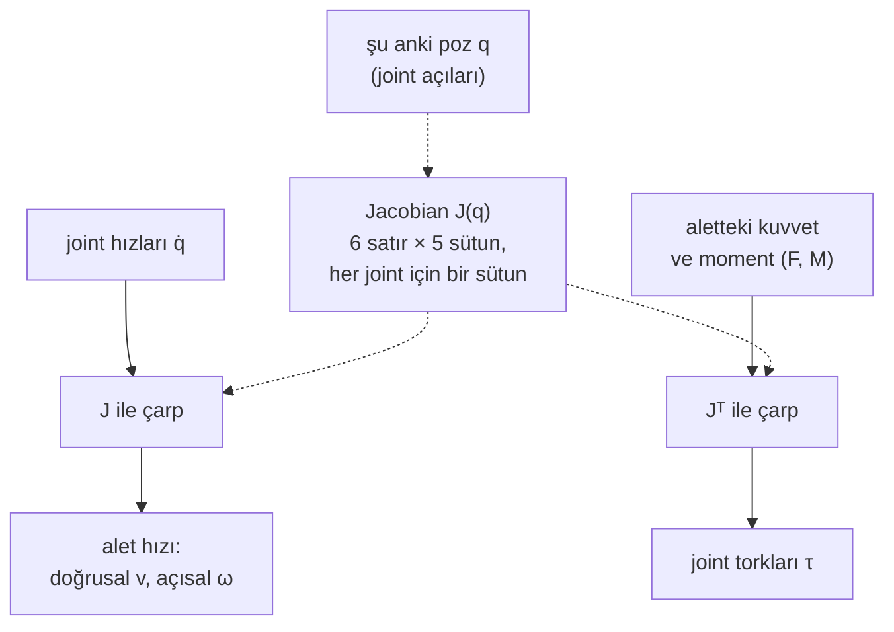

# 09 · Jacobian ve differential kinematics

<!-- meta -->
| | |
|---|---|
| **Bölüm** | [3 · Kinematics](README.md) |
| **Çalışma türü** | CPU · Mac ya da Colab CPU |
| **Önkoşul** | [08](08-forward-kinematics.md) |
| **Önce öğren** | [Calculus for Machine Learning](https://aiengineeringfromscratch.com/lesson?path=phases/01-math-foundations/04-calculus-for-ml) · [Linear Systems](https://aiengineeringfromscratch.com/lesson?path=phases/01-math-foundations/17-linear-systems) |
| **Süre** | ~45 dk |
| **Kod** | [`experiments/09-jacobians/experiment.py`](../../experiments/09-jacobians/experiment.py) |
| **Durum** | ✅ tam |
<!-- /meta -->

> Tek bir matris joint hızlarını alet hızına çevirir; transpozu da alet kuvvetlerini joint torklarına geri çevirir.

## Problem

SO-101'in omuz servosu gripper'daki 2 N'luk bir itmeyi tutmak için ne kadar tork ister? Joint'ler toplamda 1 rad/s ile dönerken gripper ne kadar hızlı hareket eder? İki sorunun cevabı aynı: her pozda değişen 6×5'lik bir matris. Menagerie modeli her servoyu 2,94 N m ile sınırlıyor ([`so101.xml`](https://github.com/google-deepmind/mujoco_menagerie/blob/f3b6013/robotstudio_so101/so101.xml) içinde `forcerange="-2.94 2.94"`); bir yükün güvenli olup olmadığı yalnızca yüke değil, o matrise bağlı.

Bu matrisin tam doğru olması da gerekiyor: ders 10 onunla yüzlerce kez iterasyon yapıyor. Yaygın bir kısayol onu finite difference ile hesaplamaktır. Bu ders o kısayolun ne zaman doğru, ne zaman yanlış olduğunu ölçüyor.

## Ana fikir

### Sade anlatımla

Bir motoru biraz döndür ve gripper'ı izle: belli bir yöne, belli bir hızla biraz hareket eder. Bunu her motor için yap ve cevapları her motor için bir sütun olacak şekilde yaz. Bu tablo **Jacobian**'dır: "her motor biraz dönünce el hangi yöne ve ne hızla gider". Birkaç motoru aynı anda döndürürsen elin hızı, her biri kendi motorunun hızıyla ölçeklenmiş bu sütunların toplamıdır. Tablo poza göre değişir, çünkü kaldıraç kolları değişir: kol gergin uzanmışken omuz eli, kol katlıyken olduğundan çok daha hızlı hareket ettirir.

Aynı tablo tersten okununca (**transpose**'u) kuvvet sorusunu cevaplar. Gripper'a bastır: her motor, baskı çarpı kendi kaldıraç kolu kadar bir tork hisseder; sütunu tam olarak bunu kodlar. Uzun bir kaldıraç torku büyütür, uzun bir anahtar gibi.

Tabloyu analitik olarak yazamıyorsan ölçebilirsin: bir joint'i küçük bir adım kadar oynat, aletin ne kadar gittiğine bak, böl. Bu bir **finite difference**'tır; ML'deki sayısal gradient kontrolüyle aynı numara. Adım çok büyükse hareketin eğriliği tahmini bozar; çok küçükse floating-point yuvarlaması bozar.



### Jacobian kod olarak

```python
import numpy as np

def hinge_column(axis, o, p):    # axis: joint axis (unit, world), o: point on the axis, p: tool point
    jp = np.cross(axis, p - o)   # tool linear velocity per 1 rad/s of this joint (m/s)
    jr = axis                    # tool angular velocity per 1 rad/s of this joint (rad/s)
    return np.r_[jp, jr]

J = np.column_stack([hinge_column(a, o, p) for a, o in zip(axes, origins)])   # 6 x n
twist = J @ qdot                 # [v; w]: tool velocity for joint speeds qdot
tau = J.T @ np.r_[F, M]          # joint torques for the tool to push with force F and moment M

def fd_column(tool_pos, q, i, eps=1e-5):   # central difference for column i (position rows)
    dq = np.zeros_like(q)
    dq[i] = eps
    return (tool_pos(q + dq) - tool_pos(q - dq)) / (2 * eps)
```

| Büyüklük | Formül |
|---|---|
| Hız haritası | $\begin{bmatrix} v \\ \omega \end{bmatrix} = J(q)\,\dot q = \begin{bmatrix} J_p(q) \\ J_r(q) \end{bmatrix}\dot q ,\qquad J \in \mathbb R^{6\times n}$ |
| Bir hinge'in $i$. sütunu | $J_{p,i} = \hat a_i \times (p - o_i)$, $\ J_{r,i} = \hat a_i$ |
| Statik kuvvet haritası | $\tau = J^\top \begin{bmatrix} F \\ M \end{bmatrix}$ |
| İleri fark | $\frac{x(q + \varepsilon e_i) - x(q)}{\varepsilon}$, hata $O(\varepsilon)$ |
| Merkezi fark | $\frac{x(q+\varepsilon e_i) - x(q-\varepsilon e_i)}{2\varepsilon}$, hata $O(\varepsilon^2)$ |

$q$ ve $\dot q$ joint açıları ve hızlarıdır; $v$ ve $\omega$ aletin world koordinatlarındaki doğrusal ve açısal hızıdır; $J_p$ ve $J_r$, $J$'nin üç konum ve üç rotation satırıdır; $\hat a_i$, $i$. hinge'in world koordinatlarındaki birim ekseni, $o_i$ bu eksen üzerindeki herhangi bir noktadır; $p$ alet noktasıdır; $F$ ve $M$ aletin çevreye uyguladığı kuvvet ve momenttir; $\tau$ joint torklarının vektörüdür; $x(q)$ alet konumu, $e_i$ $i$. joint'in birim vektörü, $\varepsilon$ adımdır.

Bu **geometric Jacobian**'dır (Lynch & Park, *Modern Robotics*, Böl. 5). MuJoCo onu `mj_jac` (bir body'ye bağlı herhangi bir world noktası), `mj_jacBody` ve `mj_jacSite` ile döndürür ([API reference](https://mujoco.readthedocs.io/en/stable/APIreference/APIfunctions.html)). Alete bastıran bir dış wrench (kuvvet artı moment) $(F, M)$, $-J^\top[F;M]$ ile tutulur.

<details>
<summary>Matematik ayrıntısı: sütun formülü, virtual work ve en iyi finite difference adımı</summary>

**Bir hinge'in sütunu.** $i$. hinge'i 1 rad/s ile döndürmek, ondan sonraki her şeyi $o_i$'den geçen $\hat a_i$ ekseni etrafında döndürür. $o$'dan geçen bir doğru etrafında $\omega$ açısal hızıyla dönen rigid bir cisim üzerindeki $p$ noktası $\omega \times (p - o)$ hızıyla hareket eder; bu da $J_{p,i} = \hat a_i \times (p - o_i)$ ve $J_{r,i} = \hat a_i$ verir.

**Virtual work ile statik kuvvet haritası.** Dengede joint'lerin verdiği güç aletin aktardığı güce eşittir: her $\dot q$ için $\tau^\top \dot q = [F; M]^\top [v; \omega] = [F; M]^\top J\dot q$, dolayısıyla $\tau = J^\top [F; M]$. Sürtünme, boşluk ve yerçekimi ek terimlerdir (yerçekimi Boz bölümünde giriyor).

**Finite difference hatası.** Taylor açılımı ileri fark için $\varepsilon$ mertebesinde, merkezi fark için $\varepsilon^2$ mertebesinde bir truncation hatası verir. Floating-point yuvarlaması yaklaşık $\epsilon_{\text{mach}}\lvert x\rvert/\varepsilon$ kadar hata ekler; $\epsilon_{\text{mach}}$ machine epsilon'dur (bir double'ın göreli hassasiyeti). Toplamı en küçük yapmak, ileri fark için kabaca $\sqrt{\epsilon_{\text{mach}}}$, merkezi fark için $\sqrt[3]{\epsilon_{\text{mach}}}$ civarında bir en iyi adım verir.

**Rotation sütunları özeldir.** Bir hinge'i $\varepsilon$ kadar oynatmak aleti tam olarak o hinge'in ekseni etrafında $\varepsilon$ kadar döndürür; orientation fark oranında truncation hatası yoktur, yalnızca yuvarlama vardır (Deney, Adım 2).

Daha derine: AIEFS [Calculus for Machine Learning](https://aiengineeringfromscratch.com/lesson?path=phases/01-math-foundations/04-calculus-for-ml), [Linear Systems](https://aiengineeringfromscratch.com/lesson?path=phases/01-math-foundations/17-linear-systems); Lynch & Park, *Modern Robotics*, Böl. 5 "Velocity Kinematics and Statics".

</details>

<!-- figure: 09-velocity-ellipse -->

## Sıfırdan yaz

Şimdi SO-101'in Jacobian'ını ders 08'in üzerine yaklaşık 30 satır NumPy ile kendin yazacaksın ve her adımı MuJoCo ile karşılaştıracaksın. [Ders 08](08-forward-kinematics.md)'den elinde `chain_from_mujoco` ve `fk` var; `fk` her hinge'in dünyadaki eksenini $\hat a_i$, üzerindeki bir noktayı $o_i$ ve alet noktasını $p$ döndürüyor: sütun formülünün ihtiyaç duyduğu üç şey tam olarak bunlar. MuJoCo'dan yeni hiçbir şey gelmiyor.

Adımları kendi dosyana yaz (örneğin `scratch/my_jacobian.py`) ve her adımdan sonra çalıştır. Bitmiş fonksiyonlar [`physai/kinematics.py`](../../physai/kinematics.py) içinde; `uv run python experiments/09-jacobians/build.py` dört adımı kontrolleriyle birlikte koşturur (çıktı [`build_output.txt`](../../experiments/09-jacobians/build_output.txt) dosyasında).

### Adım 1 · Tek bir hinge sütunu

Ana fikir'deki formül, tek bir hinge için: doğrusal kısım eksen ile eksenden alete uzanan kaldıracın çapraz çarpımı, açısal kısım eksenin kendisi.

```python
def hinge_column(axis, o, p):
    """Tool twist per 1 rad/s of one hinge: linear part a x (p - o), angular part a."""
    return np.r_[np.cross(axis, p - o), axis]
```

```python
chain = chain_from_mujoco(m, "gripperframe")              # lesson 08
axes, anchors, p = fk(chain, Q0)
col = hinge_column(axes[1], anchors[1], p)                # shoulder_lift
```

```text
== Step 1. One hinge column at q = (0, -0.6, 0.9, 0.4, 0.3) ==
shoulder_lift column, ours:    -0.0198   0.0000  -0.2193   0.0000   1.0000   0.0000
shoulder_lift column, MuJoCo:  -0.0198   0.0000  -0.2193   0.0000   1.0000   0.0000
lever |a x (p - o)| = 0.2202 m, max difference 8.3e-17
```

Lift sütunu rad/s başına $(-0{,}0198, 0, -0{,}2193)$ m/s: lift'i döndürmek aleti çoğunlukla dümdüz aşağı, 0,2202 m'lik bir kaldıracın hızıyla hareket ettirir.

### Adım 2 · Sütunlardan Jacobian

Her hinge için bir sütun, yan yana; `fk`'nın zaten döndürdüğü eksen ve noktalarla:

```python
def jacobian(chain, q):
    """Geometric Jacobian (6 x n) of the tool point: rows 0-2 linear, rows 3-5 angular, world frame."""
    axes, anchors, p = fk(chain, q)
    return np.column_stack([hinge_column(a, o, p) for a, o in zip(axes, anchors)])
```

```text
== Step 2. Jacobian from hinge columns vs mj_jacSite (50 poses) ==
max entry error: linear rows 3.9e-16, angular rows 1.0e-15
```

### Adım 3 · Matrisi kullan

$J$ elindeyken Problem bölümündeki iki soru birer satır:

```python
J = jacobian(chain, Q0)
speed = np.linalg.norm(J[:3] @ (np.ones(5) / np.sqrt(5)))   # tool speed, every joint at 1/sqrt(5) rad/s
tau = J[:3].T @ np.array([0, 0, -2.0])                       # torques for a 2 N push down
```

```text
== Step 3. Use it at q = (0, -0.6, 0.9, 0.4, 0.3) ==
tool speed for every joint at 1/sqrt(5) rad/s: 0.312 m/s
F =     [0, 0, -2.0] N  ->  J^T F =  0.0000  0.4385  0.5194  0.2586  0.0042 N m
F =      [2.0, 0, 0] N  ->  J^T F =  0.0052 -0.0397 -0.2571 -0.1873 -0.0036 N m
F =      [0, 1.5, 0] N  ->  J^T F = -0.3745  0.0000  0.0000  0.0000  0.0175 N m
```

Aşağı baskı için lift torku, 2 N çarpı Adım 1'deki lift sütununun dikey girdisi. Deney'in Adım 3 tablosuyla karşılaştır: servo lift'te 0,4383 N m tuttu, burada 0,4385 N m çıkıyor. Aradaki 0,0002 bir hata değil. Servo'lar yük altında biraz esner, kol biraz farklı bir pozda oturur ve $J$ poza bağlıdır; oturmuş pozda ikisi 4,2e-14 farkla aynı. Pan girdisinin sıfır olmasının sebebini ilk alıştırma soruyor.

### Adım 4 · Finite difference ile kendini kontrol et

Öğrenilmiş bir modelinki dahil her Jacobian'a uygulayabileceğin test: her joint'i biraz oynat ve kendi forward kinematics'inin farkını al.

```python
def fd_jacobian(tool_pos, q, eps=1e-5):
    """Position rows of the Jacobian by central differences of any function q -> tool position."""
    cols = []
    for i in range(len(q)):
        dq = np.zeros(len(q))
        dq[i] = eps
        cols.append((tool_pos(q + dq) - tool_pos(q - dq)) / (2 * eps))
    return np.column_stack(cols)
```

```text
== Step 4. Central differences of our FK vs our analytic Jacobian (eps = 1e-5) ==
median max entry error: 4.7e-12
```

Deney'deki ε sweep'inin `mj_jacSite`'a karşı ε = 1e-5'te merkezi farklar için bulduğu hata bu (5,6e-12); bu kez kendi matrisine karşı.

### Elinde kalan

`physai.kinematics` artık `hinge_column`, `jacobian` ve `fd_jacobian` de içeriyor. Ders 10 inverse kinematics'i, ders 14 bir task-space controller'ı bunların üzerine kuruyor. [`tests/test_09_jacobians.py`](../../tests/test_09_jacobians.py) bunları MuJoCo'ya sabitliyor; bir şey değiştirdikten sonra `uv run pytest tests/test_09_jacobians.py` çalıştır.

## Kütüphaneyle kullan

Pratikte aynı matrisi kütüphaneden istersin. MuJoCo'da bu üç çağrı, ve ikincisi kolayca unutulur:

```python
mujoco.mj_kinematics(m, d)
mujoco.mj_comPos(m, d)                     # mj_jac* reads data that only mj_comPos fills
jacp, jacr = np.zeros((3, m.nv)), np.zeros((3, m.nv))
mujoco.mj_jacSite(m, d, jacp, jacr, site_id)
J = np.r_[jacp, jacr]                      # equals jacobian(chain, q) to 1e-15 (Build it, Step 2)
```

Başka araçlar aynı bilgiyi farklı konvansiyonlarla döndürür. Sayıları karıştırmadan önce hangisinin elinde olduğuna bak:

| Araç | Çağrı | Satır sırası | Hangi noktanın hızı, hangi eksenlerde |
|---|---|---|---|
| physai | `jacobian(chain, q)` | önce doğrusal, sonra açısal | alet noktası, dünya eksenleri |
| MuJoCo | `mj_jacSite(m, d, jacp, jacr, site)` | iki ayrı 3 × nv dizi | site, dünya eksenleri |
| Pinocchio | `computeFrameJacobian(model, data, q, frame_id, LOCAL_WORLD_ALIGNED)` | önce doğrusal, sonra açısal | frame orijini, dünya eksenleri (yukarıdakiyle aynı); `LOCAL` frame'in kendi eksenlerini kullanır |
| *Modern Robotics* | space Jacobian $J_s$, body Jacobian $J_b$ | önce açısal, sonra doğrusal | $J_s$: gövdenin space-frame orijinindeki noktası; $J_b$: body frame orijini, gövde eksenleri |

Saatlere mal olan üç tuzak:

- **Sütunlar serbestlik dereceleridir.** MuJoCo Jacobian'larının `m.nq` (konum) değil `m.nv` (hız) kadar sütunu vardır. Modelde free ya da ball joint olduğu anda ikisi ayrılır (quaternion'ın 4 sayısı ama 3 dönme hızı vardır); bkz. ders 36.
- **Quaternion sırası.** MuJoCo $(w, x, y, z)$ saklar; SciPy'ın `Rotation.from_quat`'ı `scalar_first=True` vermezsen $(x, y, z, w)$ bekler.
- **Bayat veri.** `mj_jacSite` son `mj_kinematics`/`mj_forward`'ın hesapladığı konumları okur; `qpos`'u değiştirip yeniden hesaplamayı unutursan hiçbir hata almadan bir önceki pozun Jacobian'ını alırsın.

## Deney

Script: [`experiments/09-jacobians/experiment.py`](../../experiments/09-jacobians/experiment.py). MuJoCo 3.17.0, NumPy 2.5.4, Apple Silicon Mac (Apple M5), deterministik, birkaç saniye.

```python
mujoco.mj_kinematics(m, d)
mujoco.mj_comPos(m, d)                     # fills the data mj_jac* reads
jp, jr = np.zeros((3, m.nv)), np.zeros((3, m.nv))
mujoco.mj_jacSite(m, d, jp, jr, site_id)   # 3 x nv each, world frame
```

**Önce tahmin et.** Daha küçük bir finite difference adımı her zaman daha mı iyi? Hangi adımı seçerdin?

**Adım 1 · hız haritası.** 50 rastgele poz, rastgele birim joint hızları. Tahmin edilen $J\dot q$ ile site'ın $10^{-6}$ s'deki gerçek hareketi: en büyük bağıl hata 7,9e-07 (doğrusal) ve 3,8e-07 (açısal). Her joint $1/\sqrt5$ rad/s'de ($\lvert\dot q\rvert = 1$) iken medyan site hızı 0,306 m/s.

**Adım 2 · ε adımı sweep'i.** 50 pozun medyanı; `mj_jacSite`'a göre en büyük eleman hatası. Orientation farkları `mju_subQuat` ile alınıp world frame'ine döndürülüyor.

| ε (rad) | ileri $J_p$ | ileri $J_r$ | merkezi $J_p$ | merkezi $J_r$ |
|---|---|---|---|---|
| 1e-1 | 1,2e-02 | 4,8e-15 | 4,2e-04 | 2,6e-15 |
| 1e-3 | 1,2e-04 | 4,5e-13 | 4,2e-08 | 2,5e-13 |
| 1e-5 | 1,2e-06 | 4,7e-11 | **5,6e-12** | 2,3e-11 |
| 1e-7 | 1,2e-08 | 4,5e-09 | 4,7e-10 | 2,3e-09 |
| 1e-8 | **9,8e-09** | 4,4e-08 | 4,9e-09 | 2,3e-08 |
| 1e-10 | 9,5e-07 | 4,4e-06 | 4,3e-07 | 2,2e-06 |
| 1e-12 | 8,9e-05 | 4,6e-04 | 4,7e-05 | 2,4e-04 |
| 1e-14 | 8,3e-03 | 4,5e-02 | 4,5e-03 | 2,6e-02 |

Öteleme hatası V biçiminde. Minimumun sağında truncation (ε'un her on kat büyümesinde hata ileri farkta 10 kat, merkezi farkta 100 kat artıyor); solunda yuvarlama (ε'un her on kat küçülmesinde hata 10 kat artıyor). En iyi ileri adım 1e-8 (hata 9,8e-09), en iyi merkezi adım 1e-5 (hata 5,6e-12). Karşılaştırma için $\sqrt{\epsilon_{\text{mach}}} = $ 1,5e-08 ve $\sqrt[3]{\epsilon_{\text{mach}}} = $ 6,1e-06.


Rotation sütunlarında **hiç truncation hatası yok**: bir hinge'i ε kadar oynatmak site'ı tam olarak o hinge'in ekseni etrafında ε kadar döndürür; fark oranı kesindir, geriye yalnızca yuvarlama kalır (ε = 0,1'de 4,8e-15, ε küçüldükçe büyüyor).

**Adım 3 · simülasyonda τ = Jᵀ F doğrulaması.** Yalnızca dış kuvvet etki etsin diye yerçekimi ve joint friction loss kapatıldı. Kol position servo'larıyla (komut edilen açıya doğru geri iten motorlar) bir pozu tutuyor; gripper site'ına `xfrc_applied` ile sabit bir kuvvet uygulanıyor (kuvvet artı $r\times F$ momenti, çünkü `xfrc_applied` body'nin kütle merkezinde etki eder). 20 s'lik simülasyondan sonra joint'ler duruyor (en büyük |q̇| = 8,5e-15 rad/s) ve servo torkları $J^\top F$ ile karşılaştırılıyor:

| site'taki F (N) | $J^\top F$ (N m), joint 1–5 | servo torku (N m), işaret çevrilmiş | en büyük fark |
|---|---|---|---|
| (0, 0, −2) | 0,0000, 0,4383, 0,5191, 0,2584, 0,0042 | 0,0000, 0,4383, 0,5191, 0,2584, 0,0042 | 4,2e-14 |
| (2, 0, 0) | 0,0052, −0,0395, −0,2569, −0,1872, −0,0036 | aynı | 7,1e-14 |
| (0, 1,5, 0) | −0,3745, −0,0000, −0,0001, −0,0001, 0,0175 | aynı | 7,2e-14 |
| (1, −1, 1) | 0,2523, −0,2390, −0,3882, −0,2229, −0,0156 | aynı | 1,6e-13 |

Servo'lar tam olarak $-J^\top F$'ye oturuyor. Yana doğru bir itme (0, 1,5, 0) N neredeyse yalnızca pan joint'ini yüklüyor; aşağı doğru itme üç pitch joint'ini yüklüyor.

## Boz

**Uç yükünü bir servo doyana kadar artır.** Yerçekimi açıkken servo'lar, aşağı doğru bir $f$ uç kuvveti için $\tau = g(q) - f\,J_p^\top(-\hat z)$ sağlamak zorunda. Her joint için modelin 2,94 N m limitini alarak:

| Poz (rad) | lift ekseni → uç (m) | yerçekimi torku, lift / elbow (N m) | en büyük ek uç yükü | sınırlayan joint |
|---|---|---|---|---|
| yakın (0, −1,5, 1,5, 0,5, 0) | 0,172 | −0,059 / −0,469 | 8,81 N | elbow_flex |
| orta (0, −0,6, 0,9, 0,4, 0) | 0,220 | −0,281 / −0,443 | 9,61 N | elbow_flex |
| gergin (0, 1,3, −1,3, 0, 0) | 0,411 | −0,909 / −0,483 | 4,95 N | shoulder_lift |

Sonra gergin durum, kuvvet bu limitin bir kesrine ayarlanarak 5 s simüle ediliyor:

| uç kuvveti (N) | × limit | 5 s sonra uç düşüşü | lift servo torku |
|---|---|---|---|
| 0,00 | 0,0 | 0,5 mm | −0,909 N m |
| 2,48 | 0,5 | 1,2 mm | −1,925 N m |
| 4,46 | 0,9 | 1,8 mm | −2,737 N m |
| 5,45 | 1,1 | 147,4 mm | −2,940 N m |
| 7,43 | 1,5 | 179,7 mm | −2,940 N m |

Limitin altında kol yaklaşık bir milimetre sarkıyor (sonlu servo stiffness'ı). Limitin yüzde on üstünde lift servo'su −2,940 N m'de kırpılıyor ve kol 147,4 mm düşüyor. Kolu 0,220 m'den 0,411 m'ye uzatmak güvenli yükü kabaca yarıya indirdi: limiti yük değil, Jacobian belirliyor.

## Gerçek robotta

- 2,94 N m'lik `forcerange` bir model parametresidir. MJCF yorumu, position gain'lerinin ve kuvvetlerin servo proportional gain'i 16 varsayılarak hesaplandığını ve bunların LeRobot'taki servo gain'lerinin "not a 1-to-1 mapping" olduğunu söylüyor ([so101.xml](https://github.com/google-deepmind/mujoco_menagerie/blob/f3b6013/robotstudio_so101/so101.xml)). Yük tablosunu bir donanım değeri gibi okuma. Gerçek kolda henüz ölçülmedi. Prosedür: gergin pozda gripper'a bilinen ağırlıklar as, joint torkunu kaydet (örneğin sürücün sunuyorsa servo'nun akım okumasından) ve $J^\top F$'ye fit et.
- Donanımda statik harita ayrıca joint sürtünmesini (modelin `frictionloss`'u, Deney'in Adım 3'ünde kapatıldı), dişli boşluğunu ve kablo kuvvetlerini taşır; $\tau = J^\top F$'nin ancak bunlar kadar tutmasını bekle.
- Jacobian'ı yine de finite difference ile hesaplıyorsan (örneğin öğrenilmiş bir modelin etrafında), 1e-8 değil, 1e-5 rad civarında ε ile merkezi fark kullan.

## Kendini dene

1. **Kolay.** $F = (0, 0, -2)$ N için $J^\top F$'nin ilk elemanı neden tam 0,0000?
2. **Orta.** Hangi poz, aşağı doğru uç kuvvetinin newton'u başına shoulder lift torkunu en büyük yapar? "Lift ekseni → uç" sütunuyla savun, sonra `mj_jacSite` ile kontrol et.
3. **Zor.** ε sweep'ini float32'de tekrarla (farkı almadan önce konumları `np.float32`'ye çevir). En iyi adımlar nereye kayar, neden?

### Cevaplar

1. Joint 1'in (pan) ekseni düşey; düşey bir kuvvetin düşey bir eksen etrafında momenti yoktur, yani $\hat a_1 \cdot (r \times F) = 0$.
2. Tamamen gergin yatay poz: newton başına lift torku, lift ekseninden uca yatay mesafeye eşittir; script çıktısında gergin pozda 0,410 N m/N. Diğer pozları script ile kontrol et.
3. Burada hesaplanmadı. Minimumların daha büyük ε'a, $\epsilon_{32} \approx 1{,}2\times10^{-7}$ (float32 machine epsilon) ile $\sqrt{\epsilon_{32}}$ ve $\sqrt[3]{\epsilon_{32}}$ civarına kaymasını bekle.

## Akılda kalanlar ve kaynaklar

- `mj_jacSite` geometric Jacobian'ı verir; $J\dot q$ gerçek site hızıyla 7,9e-07 bağıl hatayla tuttu.
- Finite difference'ın en iyi bir adımı vardır: bu sweep'te 1e-8 (ileri, 9,8e-09) ve 1e-5 (merkezi, 5,6e-12); daha küçüğü daha kötü.
- $\tau = J^\top F$ simülasyonda 1,6e-13 N m'ye kadar tuttu; 0,411 m'lik kolda modelin servo'ları yalnızca 4,95 N uç yükü taşıyor.

Sonraki: [ders 10 · Inverse kinematics ve singularity](10-inverse-kinematics.md).

**Kaynaklar**

- K. M. Lynch, F. C. Park, *Modern Robotics*, Böl. 5 "Velocity Kinematics and Statics". [Kitap sayfası](https://hades.mech.northwestern.edu/index.php/Modern_Robotics).
- MuJoCo [API functions](https://mujoco.readthedocs.io/en/stable/APIreference/APIfunctions.html) (`mj_jac`, `mj_jacSite`, `mju_subQuat`).
- SO-101 modeli ve servo parametreleri: [MuJoCo Menagerie `robotstudio_so101`](https://github.com/google-deepmind/mujoco_menagerie/blob/f3b6013/robotstudio_so101/so101.xml).
