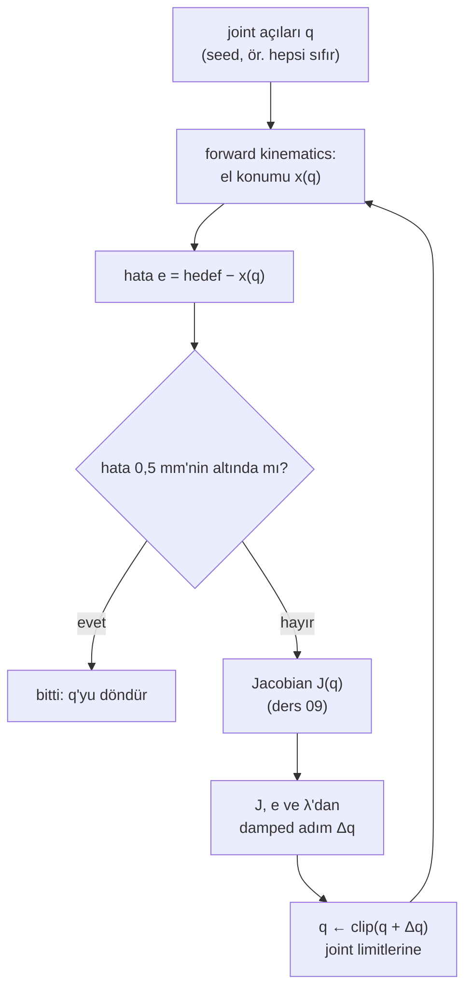

# 10 · Inverse kinematics ve singularity

<!-- meta -->
| | |
|---|---|
| **Bölüm** | [3 · Kinematics](README.md) |
| **Çalışma türü** | CPU · Mac ya da Colab CPU |
| **Önkoşul** | [09](09-jacobians.md) |
| **Önce öğren** | [Singular Value Decomposition](https://aiengineeringfromscratch.com/lesson?path=phases/01-math-foundations/11-singular-value-decomposition) · [Optimization](https://aiengineeringfromscratch.com/lesson?path=phases/01-math-foundations/08-optimization) · [Linear Systems](https://aiengineeringfromscratch.com/lesson?path=phases/01-math-foundations/17-linear-systems) |
| **Süre** | ~60 dk |
| **Kod** | [`experiments/10-inverse-kinematics/experiment.py`](../../experiments/10-inverse-kinematics/experiment.py) |
| **Durum** | ✅ tam |
<!-- /meta -->

> Inverse kinematics, forward kinematics üzerinde Newton yöntemidir; Jacobian'ın rank kaybettiği yerde onu patlamaktan koruyan şey damping'dir.

## Problem

Bir kavrama planlayıcısı diyor ki: SO-101'in gripper'ını (0,20, 0,05, 0,05) m'ye koy, parmaklar aşağı baksın. Servo'ların beş joint açısına ihtiyacı var. Forward kinematics (ders 08) ters yönde çalışır. Bu geometri için kapalı form tersler yalnızca özel durumlarda vardır ve joint limitlerini hesaba katmaz; bu yüzden problemi genelde ders 09'daki Jacobian ile sayısal olarak çözersin ve üç şey ters gidebilir: iterasyon ıraksar, joint limitlerinin dışında bir çözüme yakınsar ya da gergin bir kolun yakınında saçma joint hızları ister.

Bu ders küçük, yeniden kullanılabilir bir `ik_solve` yazıyor ve her başarısızlığı ölçüyor.

## Ana fikir

### Sade anlatımla

Inverse kinematics (IK), ders 08'in tersini sorar: "eli *oraya* hangi joint açıları koyar?". Genel bir formülü yoktur; herhangi bir kara kutuyu ayarlar gibi çözersin: elin hedeften ne kadar uzak olduğunu ölç, Jacobian'a (ders 09) hangi küçük joint değişiminin eli hedefe doğru götüreceğini sor, o adımı at ve tekrarla. Bu, forward kinematics'e uygulanmış Newton yöntemidir ve iyi bir başlangıçtan birkaç adımda yakınsar.

Üç şekilde ters gider. Birincisi, kol neredeyse düzken eli daha dışarı götüremez; yine de bunu istemek çözücüyü neredeyse sıfır bir sayıya böldürür ve devasa joint hareketleri komut ettirir. Böyle bir poz bir **singularity**'dir: Jacobian bir yön kaybetmiştir. İkincisi, çözücü bir joint limitine dayanıp orada takılabilir. Üçüncüsü, birden fazla cevap olabilir (elbow up ya da elbow down) ve bazıları joint limitlerinin dışında kalır.

Birinci soruna standart çözüm **damping**'dir: dev adımları reddet. Damped least squares eli gidebildiği yere götürür, kolun hizmet edemediği yönden ise patlamak yerine basitçe vazgeçer.



### IK kod olarak

```python
for it in range(max_iter):
    e = target - fk_pos(q)                         # task error (m)
    if np.linalg.norm(e) < tol:                    # 0.5 mm: success
        break
    J = jac_pos(q)                                 # 3 x n position Jacobian (lesson 09)
    q = np.clip(q + J.T @ np.linalg.solve(J @ J.T + lam**2 * np.eye(3), e), lo, hi)   # damped step, limits
```

| Yöntem | Adım $\Delta q$ | Kaynak |
|---|---|---|
| Newton-Raphson (pseudo-inverse) | $J^{+}e$ | *Modern Robotics*, Böl. 6 |
| Jacobian transpose | $\alpha J^\top e$, $\ \alpha = \dfrac{\langle e, JJ^\top e\rangle}{\lVert JJ^\top e\rVert^2}$ | Buss 2009, §3 |
| Damped least squares (DLS) | $J^\top (JJ^\top + \lambda^2 I)^{-1} e$ | Buss 2009, §5 |
| Manipulability | $w = \sqrt{\det(JJ^\top)} = \prod_i \sigma_i$ | Yoshikawa 1985 |

$e = x^\* - x(q)$, hedef $x^\*$ ile aletin şu anki konumu $x(q)$ arasındaki görev hatasıdır; $J$, $q$'daki Jacobian, $J^{+}$ onun pseudo-inverse'üdür (kare olmayan bir matrisin least-squares tersi); $\alpha$ bir adım uzunluğudur; $\lambda$ damping'dir, burada metre cinsindendir çünkü $J_p$ m/rad cinsindendir; $\sigma_i$, $J$'nin singular value'larıdır (her asal yönünü ne kadar gerdiği); $w$ manipulability'dir ve singularity'de sıfıra düşer.

Pseudo-inverse hızlıdır ama singularity yakınında dev adımlar atar; transpose yöntemi hep güvenli ama yavaş adımlar atar; DLS ikisinin arasındadır ve λ ile ayarlanır. **Joint limitleri** burada her adımdan sonra kırpılarak uygulanıyor. Görevin denklem sayısı kolun joint sayısından az olduğunda ya da geometri katlandığında (elbow up / elbow down) **birden fazla çözüm** vardır.

<details>
<summary>Matematik ayrıntısı: SVD üzerinden DLS, singularity ve manipulability</summary>

**FK üzerinde Newton.** $x(q + \Delta q) \approx x(q) + J\Delta q$ olarak doğrusallaştır, $J\Delta q = e$'yi $\Delta q$ için çöz ve tekrarla. $J$ kare ya da tersinir değilse least-squares çözümü $J^{+}e$'dir.

**DLS**, $\lVert J\Delta q - e\rVert^2 + \lambda^2\lVert\Delta q\rVert^2$'yi minimize eder: hatayı karşıla, ama büyük adımların bedelini öde. Singular value decomposition $J = \sum_i \sigma_i u_i v_i^\top$ ile Newton'dan farkı her yön için tek bir çarpandır:

$$J^{+}e = \sum_i \frac{1}{\sigma_i}\,v_i u_i^\top e, \qquad \Delta q_{\text{DLS}} = \sum_i \frac{\sigma_i}{\sigma_i^2+\lambda^2}\,v_i u_i^\top e .$$

$\sigma_i \to 0$ iken pseudo-inverse kazancı $1/\sigma_i$ patlar; DLS kazancı sıfıra gider. $\sigma_i \gg \lambda$ iken ikisi neredeyse eşittir. Buss, λ'nın singularity'ler yakınında kararlılık için yeterince büyük olması gerektiğini, ama fazla büyük bir değerin yakınsamayı yavaşlattığını not eder ([Buss 2009](https://mathweb.ucsd.edu/~sbuss/ResearchWeb/ikmethods/iksurvey.pdf)).

**Singularity ve manipulability.** $J$ rank kaybettiğinde poz singular'dır. Yoshikawa'nın manipulability ölçüsü $w = \sqrt{\det(JJ^\top)} = \prod_i \sigma_i$, birim joint hızlarının ürettiği hız elipsoidinin hacmiyle orantılıdır ve singularity'de sıfıra düşer ([Yoshikawa 1985](https://doi.org/10.1177/027836498500400201)). En küçük $\sigma_i$'nin $u_i$ yönü, aletin zar zor hareket edebildiği yöndür.

**Limitler ve dallar.** Her adımdan sonra kırpmak joint limitlerine uymanın en basit yoludur; iterasyonu bir limite dayalı hâlde takılı bırakabilir, Deney'in Adım 1'i bunu ölçüyor. Farklı seed'ler çözüm kümesinin farklı dallarına yakınsayabilir (Deney'in Adım 2'si).

Daha derine: AIEFS [Singular Value Decomposition](https://aiengineeringfromscratch.com/lesson?path=phases/01-math-foundations/11-singular-value-decomposition), [Optimization](https://aiengineeringfromscratch.com/lesson?path=phases/01-math-foundations/08-optimization), [Linear Systems](https://aiengineeringfromscratch.com/lesson?path=phases/01-math-foundations/17-linear-systems); Lynch & Park, *Modern Robotics*, Böl. 5–6; Buss 2009; Yoshikawa 1985.

</details>

<!-- figure: 10-ik-dls -->

## Sıfırdan yaz

Şimdi damped least-squares çözücüyü ders 09'un `fk` ve `hinge_column` fonksiyonlarının üzerine yaklaşık 25 satır NumPy ile kendin yazacaksın ve MuJoCo'ya, NumPy'ın pseudo-inverse'üne ve Deney'e karşı kontrol edeceksin. Joint limitleri dışında MuJoCo'dan yeni hiçbir şey gelmiyor.

Adımları kendi dosyana yaz (örneğin `scratch/my_ik.py`) ve her adımdan sonra çalıştır. Bitmiş fonksiyonlar [`physai/kinematics.py`](../../physai/kinematics.py) içinde; `uv run python experiments/10-inverse-kinematics/build.py` dört adımı kontrolleriyle birlikte koşturur (çıktı [`build_output.txt`](../../experiments/10-inverse-kinematics/build_output.txt) dosyasında).

### Adım 1 · Tek bir damped adım

DLS adımı $J$'yi tersine çevirmek yerine 3 × 3'lük bir sistem çözer; $\lambda = 0$ iken pseudo-inverse adımıdır.

```python
def dls_step(J, e, lam):
    """Damped least-squares step J^T (J J^T + lam^2 I)^-1 e; lam = 0 gives the pseudo-inverse step."""
    return J.T @ np.linalg.solve(J @ J.T + lam ** 2 * np.eye(len(e)), e)
```

Onu matematik ayrıntısındaki SVD biçimine, $\sum_i \sigma_i/(\sigma_i^2+\lambda^2)\,v_i u_i^\top e$, karşı $q = 0$'da 1 cm'lik bir hata için kontrol et:

```python
J = jacobian(chain, np.zeros(5))[:3]                 # position rows, lesson 09
U, sig, Vt = np.linalg.svd(J, full_matrices=False)
svd = Vt.T @ (sig / (sig ** 2 + lam ** 2) * (U.T @ e))
```

```text
== Step 1. One DLS step vs the SVD formula (q = 0, a 1 cm error) ==
singular values of J_p at q = 0: 0.4764 0.3527 0.0771 m/rad
lam = 0     |dq| = 0.1008 rad, max diff to sum sigma/(sigma^2+lam^2) v u^T e: 4.2e-17
lam = 0.01  |dq| = 0.0992 rad, max diff to sum sigma/(sigma^2+lam^2) v u^T e: 2.8e-17
lam = 0.1   |dq| = 0.0394 rad, max diff to sum sigma/(sigma^2+lam^2) v u^T e: 2.1e-17
lam = 0 vs np.linalg.pinv(J) @ e: max diff 4.2e-17
```

En küçük singular value 0,0771 m/rad; bu yüzden λ = 0,01 adımı neredeyse değiştirmiyor (0,1008 → 0,0992 rad), λ = 0,1 ise 0,0394 rad'a kısaltıyor: damping yalnızca $\sigma_i$'nin λ'dan çok büyük olmadığı yönlerde ısırır.

### Adım 2 · Döngü, joint limitleriyle

Hata 0,5 mm'nin altına inene kadar adımı tekrarla ve her adımdan sonra joint limitlerine kırp. İterasyon başına tek bir `fk` çağrısı hem hatayı hem sütunları verir:

```python
def ik_solve(chain, target, q0, lo, hi, lam=0.1, tol=5e-4, max_iter=200):
    """Position IK by damped least squares, clipped to the joint limits after every step.

    Returns (q, success, iterations); success means |target - tool position| < tol (m).
    """
    q = np.array(q0, dtype=float)
    for it in range(max_iter + 1):
        axes, anchors, p = fk(chain, q)
        e = target - p                             # task error (m)
        if np.linalg.norm(e) < tol:
            return q, True, it
        if it == max_iter:
            break
        J = np.column_stack([hinge_column(a, o, p)[:3] for a, o in zip(axes, anchors)])  # position rows
        q = np.clip(q + dls_step(J, e, lam), lo, hi)
    return q, False, max_iter
```

```text
== Step 2. Solve for (0.20, 0.05, 0.05) m from q = 0, check with mj_kinematics ==
lam = 0    success True,   5 iterations, q = [-0.306 -1.745  1.573  0.949  0.012] rad, MuJoCo tool error 0.189 mm
lam = 0.1  success True,  13 iterations, q = [-0.306 -0.922  1.091  0.969  0.009] rad, MuJoCo tool error 0.392 mm
```

MuJoCo'nun kendi forward kinematics'i iki cevabı da doğruluyor. İkisi farklı cevaplar: üç konum sayısı için beş joint iki boyutlu bir çözüm ailesi bırakır ve damping'siz çözücü lift −100° limitinde (−1,745 rad) kırpılmış hâlde bitirip yine de yakınsadı.

### Adım 3 · Deney'in sweep'i

Çözücünü Deney'in 500 hedefinde (aynı rastgele joint vektörlerinin FK'sı) onun en iyi damping'inde koştur:

```python
targets = np.array([fk(chain, q)[2] for q in np.random.default_rng(0).uniform(LO, HI, size=(500, 5))])
res = [ik_solve(chain, t, np.zeros(5), LO, HI, lam=0.1) for t in targets]
```

```text
== Step 3. The Experiment's sweep: 500 reachable targets, q0 = 0, tol 0.5 mm, 200 iterations ==
lam = 0.1: success 88.6%, median 15 iterations, p95 92; 56 of 57 failures end at a joint limit
```

Her sayı Deney'in λ = 0,1 satırıyla aynı (%88,6, medyan 15, p95 92, 57'de 56), çünkü FK'n ve Jacobian'ın MuJoCo'nunkilerle yuvarlama hatası kadar aynı ve döngü de aynı.

### Adım 4 · Singularity'yi izle

Kolu bükük pozdan Deney'in düz pozuna doğru ger ve en zayıf yön $u_3$ boyunca 5 cm/s iste. Manipulability singular value'ların çarpımıdır:

```python
Jp = jacobian(chain, q_bent + s * (q_straight - q_bent))[:3]
U, sig, Vt = np.linalg.svd(Jp)
w = np.prod(sig)                                      # = sqrt(det(J J^T))
v = 0.05 * U[:, 2]                                    # 5 cm/s along the weakest direction
qdot_pinv, qdot_dls = dls_step(Jp, v, 0.0), dls_step(Jp, v, 0.1)
```

```text
== Step 4. Stretching the arm: singular values, manipulability, joint speed for 5 cm/s ==
    s  sigma1  sigma2    sigma3          w  |qdot| pinv  |qdot| DLS 0.1
 0.00  0.4764  0.2419  7.71e-02  8.879e-03         0.65           0.242
 0.50  0.5155  0.3885  4.42e-02  8.857e-03         1.13           0.185
 0.90  0.5295  0.4397  9.20e-03  2.143e-03         5.43           0.046
 0.99  0.5301  0.4412  9.35e-04  2.187e-04        53.47           0.005
 1.00  0.5301  0.4411  1.05e-04  2.444e-05       478.33           0.001
```

Bunlar Deney'in Adım 3 ve Boz sayıları: σ₃ 1,05e-04'e düşüyor, pseudo-inverse 478,33 rad/s istiyor, DLS 0,001 rad/s civarında kalıyor.

### Elinde kalan

`physai.kinematics` artık `dls_step` ve `ik_solve` içeriyor. Sonraki bir ders bir el konumu için joint hedeflerine ihtiyaç duyduğunda (ders 13'ün Kartezyen düz çizgisi her ara noktada IK çözüyor), döngü bu. [`tests/test_10_inverse_kinematics.py`](../../tests/test_10_inverse_kinematics.py) onu MuJoCo'nun FK'sına ve SVD formülüne karşı kontrol ediyor; bir şey değiştirdikten sonra `uv run pytest tests/test_10_inverse_kinematics.py` çalıştır.

## Kütüphaneyle kullan

MuJoCo forward kinematics ve Jacobian hesaplar ama IK çözücüsü yoktur: kütüphane yolu `mj_jacSite` ile aynı döngüdür (Deney'in `ik_solve`'u bunu yapar) ya da genel, sınırlı bir least-squares çözücü:

```python
from scipy.optimize import least_squares

def residual(q):
    d.qpos[:5] = q
    mujoco.mj_kinematics(m, d)
    return d.site_xpos[site_id] - target              # metres

sol = least_squares(residual, q0, bounds=(lo, hi))     # joint limits as bounds, sol.x = joint angles
```

Ders 08'in Boz bölümü bunu 12 seed ile kullandı. Limitlere düzgünce uyar (kırpma yok), bedeli çözüm başına daha fazla FK çağrısıdır.

| Araç | Çağrı | Yöntem, limitler |
|---|---|---|
| physai | `ik_solve(chain, target, q0, lo, hi, lam=0.1)` | DLS, her adımdan sonra limitlere kırpılır |
| Deney | `ik_solve(model, data, target, method="dls", damping=0.1)` | `mj_jacSite` üzerinde aynı döngü; ayrıca `"pinv"`, `"transpose"`, isteğe bağlı bir hedef eksen |
| SciPy | `least_squares(residual, q0, bounds=(lo, hi))` | trust-region least squares, sınırları çözücü uygular |
| *Modern Robotics* kodu | `IKinSpace(Slist, M, T, thetalist0, eomg, ev)` | `pinv` ile Newton-Raphson, tam 6 boyutlu pose, joint limiti yok, en fazla 20 iterasyon ([`core.py`](https://github.com/NxRLab/ModernRobotics/blob/master/packages/Python/modern_robotics/core.py)) |

Üç tuzak:

- **λ'nın birimi var.** Konum satırları m/rad iken λ metre cinsindendir. Orientation satırlarını (rad/rad) ve konum satırlarını tek bir $J$'de üst üste koyarsan tek bir λ bir metreye bir radyan gibi davranır; Deney'in `axis_weight`'i gibi önce satırları ağırlıklandır.
- **Kırpma başarısızlığı gizler.** Kırpan bir çözücü her seferinde bir joint vektörü döndürür. Döndürülen `q`'ya değil, başarı bayrağına (ya da son hataya) bak.
- **Seed dalı seçer.** Farklı başlangıç joint vektörleri farklı çözümlere yakınsar (Sıfırdan yaz, Adım 2 ve Deney'in Adım 2'si). Takip ederken seed'i robotun o anki pozundan al ki ardışık çözümler tek bir dalda kalsın.

## Deney

Script: [`experiments/10-inverse-kinematics/experiment.py`](../../experiments/10-inverse-kinematics/experiment.py). MuJoCo 3.17.0, NumPy 2.5.4, Apple Silicon Mac (Apple M5), deterministik, yaklaşık 6 s CPU süresi.

Script'in çözücüsü MuJoCo'nun Jacobian'ı üzerinde çalışır ve import edilebilir (deney kodu `if __name__ == "__main__":` altında):

```python
sys.path.insert(0, "experiments/10-inverse-kinematics")
from experiment import ik_solve
res = ik_solve(model, data, target_pos, method="dls", damping=0.1)   # res.q, res.success, res.iters
```

**Önce tahmin et.** En yüksek başarı oranını hangi λ verir: 0 (saf Newton), 0,01, 0,1 ya da 0,3 (birim metre, çünkü $J_p$ m/rad cinsinden)?

**Adım 1 · λ sweep'i.** 500 rastgele **erişilebilir** konum hedefi (limitler içindeki rastgele joint vektörlerinin FK'sı), seed (başlangıç joint vektörü) $q_0 = 0$, başarı = 200 iterasyon içinde 0,5 mm'nin altında hata.

| Yöntem | başarı | medyan iterasyon | p95 iterasyon | medyan en büyük ‖Δq‖ (rad) | joint limitinde biten başarısızlık |
|---|---|---|---|---|---|
| Jacobian transpose | %85,6 | 35 | 151 | 0,699 | 72'de 24 |
| pseudo-inverse (λ = 0) | %73,2 | 6 | 34 | 4,901 | 134'te 132 |
| DLS λ = 0,001 | %73,2 | 6 | 34 | 4,900 | 134'te 130 |
| DLS λ = 0,01 | %76,0 | 6 | 34 | 4,737 | 120'de 120 |
| DLS λ = 0,03 | %84,6 | 7 | 30 | 3,920 | 77'de 77 |
| **DLS λ = 0,1** | **%88,6** | 15 | 92 | 1,598 | 57'de 56 |
| DLS λ = 0,3 | %74,6 | 64 | 167 | 0,485 | 127'de 50 |
| DLS λ = 0,1 + 4 rastgele yeniden başlatma | %96,8 | 17 (toplam) | – | – | – |

Az damping ile Newton birkaç radyanlık adımlar atıyor, kırpma bir joint'i limitine çiviliyor ve iterasyon orada takılıyor: neredeyse her başarısızlık bir limitte bitiyor. λ = 0,3 ile adımlar kısa; başarısızlıkların çoğu basitçe iterasyon bütçesini bitiriyor (127'nin 77'si limitte bitmiyor). Burada en iyi nokta λ = 0,1; başarısız çözümleri rastgele seed'lerden yeniden başlatmak başarıyı %96,8'e çıkarıyor.


**Adım 2 · birden fazla çözüm.** Hedef (0,20, 0,05, 0,05) m, parmaklar (site x ekseni) aşağı bakıyor, wrist_roll 0'da sabit; yani dört joint dört bağımsız kısıtla karşı karşıya. 100 rastgele seed, DLS λ = 0,01:

| Joint limitleri | yakınsayan | farklı çözüm | gerçek limitlerin içinde |
|---|---|---|---|
| yok sayıldı | 96 / 100 | 4 | 1 |
| uygulandı | 92 / 100 | 1 | 1 |

Limitler olmadan çözücü ders kitabındaki dört dalı buluyor: ön/arka (pan −17,6° ya da 163,1°) × elbow up/down. Yalnızca biri, (−17,6°, −17,2°, 29,3°, 77,9°), SO-101'in aralıkları içinde. Limitleri yok sayan bir çözücü, yakınsayan 96 seed'inin 37 + 20 + 13'ünde erişilemez bir dala düşüyor.

**Adım 3 · gerilirken manipulability.** Bükülü bir pozdan (lift 1,3 rad, elbow 0), $\sigma_3$'ü minimize ederek bulunan düz poza (elbow −73,74°, wrist 2,01°); $s$ aradeğerliyor. Konum Jacobian'ı, 3×5; cond = σ₁/σ₃:

| s | σ₁ | σ₂ | σ₃ | w | cond | erişim (m) |
|---|---|---|---|---|---|---|
| 0,00 | 0,4764 | 0,2419 | 7,71e-02 | 8,879e-03 | 6,2 | 0,3477 |
| 0,50 | 0,5155 | 0,3885 | 4,42e-02 | 8,857e-03 | 12 | 0,3945 |
| 0,90 | 0,5295 | 0,4397 | 9,20e-03 | 2,143e-03 | 58 | 0,4104 |
| 0,99 | 0,5301 | 0,4412 | 9,35e-04 | 2,187e-04 | 570 | 0,4110 |
| 1,00 | 0,5301 | 0,4411 | 1,05e-04 | 2,444e-05 | 5100 | 0,4110 |

İki singular value yerinde duruyor; üçüncüsü, radyal yön, çöküyor. s = 0,90 ile 1,00 arasında erişim bir milimetreden az değişirken $w$ 2,143e-03'ten 2,444e-05'e düşüyor: workspace sınırına yakın kol dışarı doğru neredeyse hiç hareket edemiyor.

## Boz

Her pozda zayıf yön $u_3$ boyunca 5 cm/s'lik bir alet hızı iste ve joint hızını hesapla:

| s | ‖q̇‖ pinv (rad/s) | ‖q̇‖ DLS λ=0,03 | DLS gerçekleşen / istenen | ‖q̇‖ DLS λ=0,1 | DLS gerçekleşen / istenen |
|---|---|---|---|---|---|
| 0,500 | 1,13 | 0,774 | 0,685 | 0,185 | 0,164 |
| 0,900 | 5,43 | 0,467 | 0,086 | 0,046 | 0,008 |
| 0,990 | 53,47 | 0,052 | 0,001 | 0,005 | 0,000 |
| 0,999 | 345,39 | 0,008 | 0,000 | 0,001 | 0,000 |
| 1,000 | 478,33 | 0,006 | 0,000 | 0,001 | 0,000 |

Pseudo-inverse, gergin pozda 5 cm/s'lik bir istek için 478,33 rad/s istiyor. DLS joint hızlarını sınırlı tutuyor ve bedelini takiple ödüyor: kolun hizmet edemediği yönde basitçe hareket etmiyor. λ ile ayarladığın denge budur: singularity'lerden uzakta doğruluk, yakınlarında sınırlı komutlar.

## Gerçek robotta

- Ham pseudo-inverse hızlarını asla servo'lara gönderme. DLS kullan (ya da $\Delta q$'yu kırp) ve joint limitlerini yalnızca firmware'de değil çözücüde de uygula: firmware limiti joint'i durdurur ama çözücü joint'in hareket ettiğine inanmaya devam eder.
- Modelin joint aralıkları Menagerie dosyasından gelir (yorumuna göre elbow aralığı 5 derecelik bir kalibrasyon ofseti taşıyor, [so101.xml](https://github.com/google-deepmind/mujoco_menagerie/blob/f3b6013/robotstudio_so101/so101.xml)). Fiziksel kolunun kullanılabilir aralıkları LeRobot kalibrasyonuna bağlıdır ([LeRobot SO-101](https://huggingface.co/docs/lerobot/so101)); IK'ya güvenmeden önce onları geri oku.
- Yalnızca simülasyon sonuçları. Gerçek SO-101'de IK doğruluğu (komut edilen bir IK çözümünde ucun gerçekte nereye düştüğü) gerçek kolda henüz ölçülmedi. Prosedür: bir ızgara üzerinde 20 hedef için IK çöz, joint'leri komut et, ucu ölç, hata dağılımını raporla.

## Kendini dene

1. **Kolay.** Deney'in Adım 1'inde λ = 0,001 olan DLS neden neredeyse tam olarak pseudo-inverse gibi davranıyor?
2. **Orta.** `ik_solve`'u `target_axis` ve `joints=ARM[:4]` ile (Adım 2'deki gibi wrist_roll sabit) kullanarak (0,20, 0,0, 0,15) m'de "parmaklar yatay, +x yönünde" iste. 1e-5'e yakınsar mı? Ders 08'deki kol düzlemiyle açıkla.
3. **Zor.** $w < w_0$ için $\lambda(w) = \lambda_0 (1 - w/w_0)^2$, değilse 0 olan uyarlamalı bir damping uygula (Buss, λ'yı konfigürasyondan seçen birkaç yayımlanmış yöntem listeliyor) ve Deney'in Adım 1 sweep'ini (ya da Sıfırdan yaz, Adım 3'ü) yeniden koş. Başarıda ve iterasyonda sabit λ = 0,1'i geçer mi?

### Cevaplar

1. λ² = 1e-6 m², singularity'ye çok yakın olmadıkça $\sigma_i^2$ yanında ihmal edilebilir; dolayısıyla $\sigma_i/(\sigma_i^2+\lambda^2) \approx 1/\sigma_i$.
2. Yakınsamasını bekleme. Pitch joint'leri parmakları, yönünü yalnızca pan'ın değiştirebildiği tek bir düşey düzleme paralel tutar; parmakların +x boyunca olması pan'ı sabitler ve wrist_roll 0'da tutulunca site y = 0'ın biraz dışında kalır, dolayısıyla konum ve eksen aynı anda tam sağlanamaz. SO-101'in aralıkları içinde ıskalama çok daha büyüktür, çünkü shoulder_lift ve wrist_flex limitlerinde biter. Çalıştır ve kalan hatayı oku (bu dersin script'inde hesaplanmadı).
3. Burada hesaplanmadı.

## Akılda kalanlar ve kaynaklar

- Newton adımı $J^{+}e$ hızlı yakınsıyor (medyan 6 iterasyon) ama $q_0=0$'dan hedeflerin yalnızca %73,2'sinde başarılı oldu; DLS λ = 0,1 %88,6'da, yeniden başlatmalarla %96,8'de başarılı oldu.
- Joint limitlerini uygulamak cevabı 4 çözümden SO-101'in gerçekten ulaşabildiği 1 çözüme indirdi.
- Kol düzleşirken manipulability $w$ 8,879e-03'ten 2,444e-05'e düştü; pseudo-inverse o noktada 5 cm/s için 478,33 rad/s istedi, DLS sınırlı kaldı.

Sonraki: [ders 11 · Rigid-body dynamics](../part-4-dynamics-and-control/11-rigid-body-dynamics.md).

**Kaynaklar**

- K. M. Lynch, F. C. Park, *Modern Robotics*, Böl. 5 "Velocity Kinematics and Statics" (manipulability) ve Böl. 6 "Inverse Kinematics". [Kitap sayfası](https://hades.mech.northwestern.edu/index.php/Modern_Robotics).
- S. R. Buss, "Introduction to Inverse Kinematics with Jacobian Transpose, Pseudoinverse and Damped Least Squares methods", yayımlanmamış rapor, UC San Diego, 2009. [PDF](https://mathweb.ucsd.edu/~sbuss/ResearchWeb/ikmethods/iksurvey.pdf).
- T. Yoshikawa, "Manipulability of Robotic Mechanisms", *The International Journal of Robotics Research* 4(2):3–9, 1985. [doi:10.1177/027836498500400201](https://doi.org/10.1177/027836498500400201).
- MuJoCo [API functions](https://mujoco.readthedocs.io/en/stable/APIreference/APIfunctions.html) (`mj_jacSite`).
