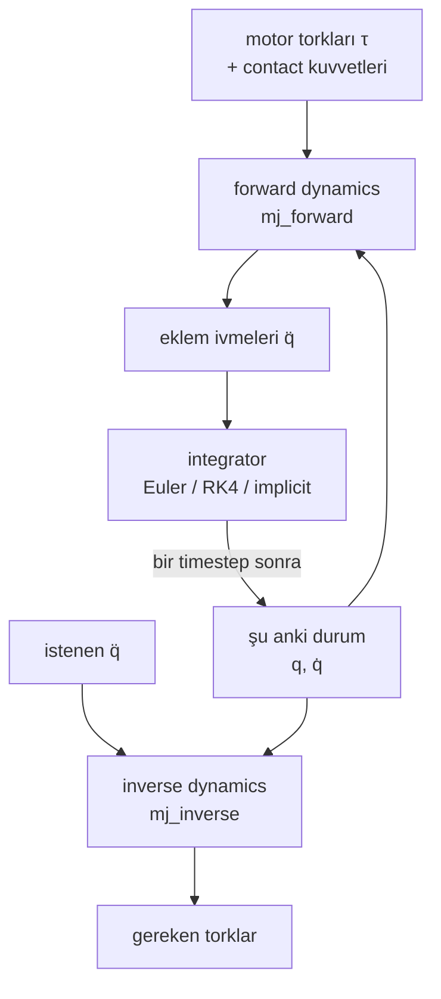
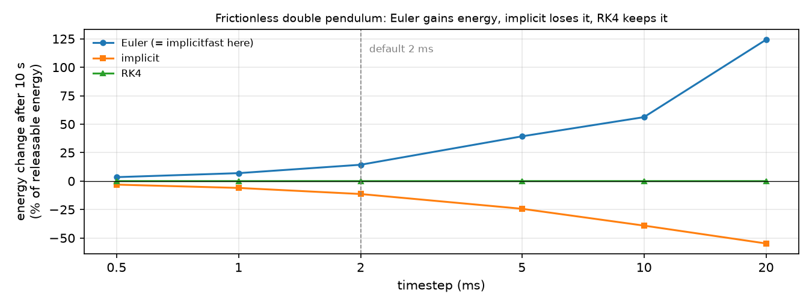

# 11 · Rigid-body dynamics

<!-- meta -->
| | |
|---|---|
| **Bölüm** | [4 · Dynamics ve control](README.md) |
| **Çalışma türü** | CPU · Mac ya da Colab CPU |
| **Önkoşul** | [09](../part-3-kinematics/09-jacobians.md) |
| **Önce öğren** | [Calculus for Machine Learning](https://aiengineeringfromscratch.com/lesson?path=phases/01-math-foundations/04-calculus-for-ml) · [Linear Systems](https://aiengineeringfromscratch.com/lesson?path=phases/01-math-foundations/17-linear-systems) |
| **Süre** | ~60 dk |
| **Kod** | [`experiments/11-rigid-body-dynamics/experiment.py`](../../experiments/11-rigid-body-dynamics/experiment.py) |
| **Durum** | ✅ tam |
<!-- /meta -->

> Bu bölümdeki her controller üç terimden kurulur: bir inertia matrisi, bir bias kuvveti ve gönderdiğin tork. MuJoCo üçünü de senin için hesaplar; bu ders onları doğru hesapladığını kontrol ediyor.

## Problem

Bir Franka Panda'yı `home` pozunda sabit tutmak için, yalnızca yerçekimine karşı koymak adına joint 2 yaklaşık 29 N·m, joint 4 yaklaşık 22 N·m ister (aşağıda Menagerie modeli üzerinde ölçüldü). Kolu bir yol boyunca hareket ettirmek için ayrıca link'leri hızlandıran torka da ihtiyacın var ve bu tork diğer link'lerin nerede olduğuna bağlı. Bir controller bunlardan herhangi birini yok sayarsa kol sarkar, geride kalır ya da overshoot yapar; bir pozda sorunu çözen gain'ler başka bir pozda bozar. 12–16. derslerin hepsi aynı hareket denkleminden başlıyor. Onu kullanmadan önce MuJoCo'nun versiyonunu elle türetilebilecek kadar küçük bir sisteme karşı doğruluyoruz ve integrator seçiminin ürettiği fiziği nasıl değiştirdiğini ölçüyoruz.

## Ana fikir

### Sade anlatımla

Bir robot kolunu hareket ettirmek, Newton'un "kuvvet = kütle × ivme" yasasının bütün link zinciri için bir kez yazılmış hâlidir. Bir eklemin nasıl ivmeleneceğine üç şey karar verir:

- **Kolun şu an ne kadar ağır hissettirdiği.** Buz patencisi kollarını içeri çekince daha hızlı döner: kütle eksenden uzaktayken aynı beden daha zor döner. Bir robot omzu da uzanmış kolu katlanmış koldan çok daha ağır hisseder; bir eklemi oynatmak diğerlerini de çeker.
- **Sen hiçbir şey göndermesen de etki eden kuvvetler.** Yerçekimi her link'i aşağı çeker. Eklemler zaten hareket ediyorsa link'ler birbirini yana da iter (lunaparkta dönen platformda hissettiğin Coriolis ve merkezkaç etkileri). Bunların toplamına **bias kuvveti** denir: her şeyi olduğu gibi tutmak için bile sıfırlaman gereken kısım.
- **Neyle ittiğin ve neyin geri ittiği.** Motor torkları ve masadan ya da bir nesneden gelen contact kuvvetleri.

Denkleme iki soru sorabilirsin. **Forward dynamics**: "Bu torkları uyguluyorum; kol nasıl ivmelenir?" Simülatörün her adımda yaptığı budur. **Inverse dynamics**: "Bu ivmeyi istiyorum; hangi torklar gerekir?" Controller'ın ihtiyacı budur. Dersin ikinci yarısı zamanla ilgili: simülatör kolu bir oyun döngüsü gibi küçük adımlarla ilerletir ve her adımı atma biçimi (**integrator**) sessizce enerji ekleyip çıkarabilir.



### Hareket denklemi kod olarak

```python
# n joints. Every array is recomputed by MuJoCo for the current pose and speed.
M = mass_matrix(q)         # (n, n) how heavy each joint feels in this pose      -> mj_fullM
c = bias_force(q, qd)      # (n,)   gravity + Coriolis/centrifugal               -> qfrc_bias
tau_c = J_c.T @ f_contact  # (n,)   contact forces mapped onto the joints        -> qfrc_constraint

# Forward dynamics (simulator): torques in, accelerations out
qdd = np.linalg.solve(M, tau + tau_c - c)

# Inverse dynamics (controller): accelerations in, torques out
tau_needed = M @ qdd_desired + c - tau_c

# One step of semi-implicit Euler, MuJoCo's default integrator
qd = qd + dt * qdd         # new velocity first ...
q = q + dt * qd            # ... then position, using the new velocity
```

| Formül | Ne olduğu |
|---|---|
| $M(q)\,\ddot q + C(q,\dot q)\,\dot q + g(q) = \tau + J^\top(q)\, f$ | rijit açık zincirin hareket denklemi (Lynch & Park, *Modern Robotics*, böl. 8) |
| $\ddot q = M^{-1}\big(\tau + J^\top f - c\big)$, $\;c = C\dot q + g$ | forward dynamics |
| $\tau = M\ddot q_d + c - J^\top f$ | inverse dynamics |
| $\dot q = 0$ iken $c = g(q)$ | kolu sabit tutan tork (gravity compensation) |

Burada $q \in \mathbb{R}^n$ eklem açıları, $\dot q$ ve $\ddot q$ hızları ve ivmeleri, $M(q)$ joint-space inertia matrisi, $C(q,\dot q)\dot q$ Coriolis/merkezkaç kuvvetleri, $g(q)$ yerçekimi torkları, $c$ bunların toplamı (bias kuvveti), $\tau$ uyguladığın torklar, $f$ contact kuvvetleri ve $J$ onları eklemlere aktaran Jacobian'dır (ders 09).

| Terim | Anlamı | MuJoCo'da nerede |
|---|---|---|
| $M(q)$ | joint-space inertia matrisi; simetrik, pozitif tanımlı, poza bağlı | `mjData.M` (sparse; eski sürümlerde `qM`), yoğun kopyası `mj_fullM` ile |
| $C(q,\dot q)\dot q + g(q)$ | Coriolis/merkezkaç ve yerçekimi kuvvetleri: **bias** kuvveti $c$ | `mjData.qfrc_bias` |
| $\tau$ | uyguladığın kuvvetler: actuator'lar ve kullanıcı kuvvetleri | `qfrc_actuator`, `qfrc_applied` |
| $J^\top f$ | joint'lere aktarılmış contact ve diğer constraint kuvvetleri | `qfrc_constraint` |

MuJoCo aynı denklemi $M\dot v + c = \tau + J^\top f$ olarak yazar. `mj_forward`, $q, \dot q, \tau$'dan `qacc`'yi hesaplar; `mj_step`'in integrate etmeden önce yaptığı budur. `mj_inverse`, $q, \dot q, \ddot q$'dan `qfrc_inverse`'ü hesaplar ("qacc must be set before calling") ([API reference](https://mujoco.readthedocs.io/en/stable/APIreference/APIfunctions.html)). $\dot q = 0$ iken bias saf yerçekimidir; yani durağan haldeki `qfrc_bias`, 12. derste feedforward olarak vereceğin yerçekimi kompanzasyon torkudur. $M$ matrisi ise 13. ve 14. derslerde istenen ivmeyi torka çeviren şeydir.

**Integrator'lar.** MuJoCo şunları sunar: `Euler` (semi-implicit: yukarıdaki kodda olduğu gibi önce yeni hız, sonra yeni hızla konum), `RK4` (adım başına dört kuvvet hesabı, ortalaması alınır), `implicit` (hıza bağlı kuvvetlerin türevlerini de kullanır) ve `implicitfast` (aynısı ama Coriolis/merkezcil türevler olmadan; dokümanlar çoğu model için bunu öneriyor, ama varsayılan hâlâ `Euler`) ([Computation · Numerical integration](https://mujoco.readthedocs.io/en/stable/computation/index.html)). Sürtünmesiz bir sarkaç enerjisini sabit tutmak zorundadır; bu yüzden enerji kayması integration hatasının temiz bir ölçüsüdür.

<details>
<summary>Matematik ayrıntısı: denklem nereden geliyor, integrator'lar neden kayıyor</summary>

**Kökeni.** Kinetik enerji $T = \tfrac12 \dot q^\top M(q)\dot q$ ve potansiyel enerji $U(q)$ ile Euler–Lagrange denklemleri $\frac{d}{dt}\frac{\partial T}{\partial \dot q} - \frac{\partial T}{\partial q} + \frac{\partial U}{\partial q} = \tau$ tam olarak $M\ddot q + C\dot q + g = \tau$ verir. $C\dot q$ terimi, $M$'nin $q$ ile değişmesinden gelen her şeyi toplar; hızlarda ikinci derecedendir, bu yüzden durağan halde kaybolur. $g = \partial U/\partial q$. Contact kuvvetleri virtual work yoluyla $J^\top f$ olarak girer.

**$M$ neden simetrik pozitif tanımlı.** Fiziksel bir kolun sıfır olmayan her hızı için $T = \tfrac12 \dot q^\top M \dot q$ pozitiftir; yani $M \succ 0$ ve forward dynamics çözümünün her zaman tek bir cevabı vardır. Condition number'ı (en büyük özdeğerin en küçüğe oranı) "en ağır" ve "en hafif" yönlerin ne kadar eşitsiz olduğunu söyler.

**MuJoCo $c$'yi nasıl hesaplar.** İvmeyi sıfıra koyup recursive Newton–Euler algoritmasını koşar: o anki $q, \dot q$'da sıfır ivme için gereken torklar tam olarak $C\dot q + g$'dir ([Computation](https://mujoco.readthedocs.io/en/stable/computation/index.html)).

**Enerji kayması.** Sürtünme ve actuator yokken $E = T + U$ sabittir. Birinci mertebe bir integrator, simüle edilen birim zaman başına $\Delta t$ ile orantılı hata yapar; deneyde adım yarıya inince hatanın yarıya inmesinin sebebi bu. Semi-implicit Euler yalnızca $M$ sabitken ve hiçbir kuvvet hıza bağlı değilken symplectic'tir (enerji hatasını biriktirmek yerine sınırlı tutar); çift sarkaç iki koşulu da bozar ("Boz" bölümüne bak). Implicit şemalar hıza bağlı kuvvetleri doğrusallaştırır; bu da sayısal damping ekler.

Daha derine: [Calculus for Machine Learning](https://aiengineeringfromscratch.com/lesson?path=phases/01-math-foundations/04-calculus-for-ml) (türev, zincir kuralı), [Linear Systems](https://aiengineeringfromscratch.com/lesson?path=phases/01-math-foundations/17-linear-systems) ($M\ddot q = b$'yi çözmek); Lynch & Park, [*Modern Robotics*](https://hades.mech.northwestern.edu/index.php/Modern_Robotics), böl. 8; MuJoCo [Computation](https://mujoco.readthedocs.io/en/stable/computation/index.html).

</details>

## Deney

**Önce tahmin et.** Elle türetilmiş iki link'li bir sarkaç için MuJoCo'nun `M`, `qfrc_bias` ve `mj_inverse` değerleri formüllere ne kadar yakın olur: 1e-3, 1e-8 mi, yoksa makine hassasiyeti mi? Ve varsayılan 2 ms adımda hangi integrator salınan bir çift sarkacın enerjisini sabit tutar?

**Kurulum.** İki link, $y$ ekseni etrafındaki menteşelerle x–z düzleminde salınıyor. Link 1: 1 kg, 40 cm, kütle merkezi 20 cm'de, inertia 0,02 kg·m². Link 2: 0,5 kg, 30 cm, kütle merkezi 15 cm'de, inertia 0,005 kg·m². Joint damping yok, sürtünme yok, contact yok. $a = m_2 l_1 c_2$ ile:

$$M = \begin{bmatrix} m_1c_1^2 + I_1 + m_2(l_1^2 + c_2^2 + 2 l_1 c_2\cos q_2) + I_2 & m_2(c_2^2 + l_1 c_2 \cos q_2) + I_2 \\ \cdot & m_2 c_2^2 + I_2 \end{bmatrix},\quad C\dot q = a \sin q_2 \begin{bmatrix} -(2\dot q_1 \dot q_2 + \dot q_2^2) \\ \dot q_1^2 \end{bmatrix}$$

```python
d.qpos[:], d.qvel[:], d.qacc[:] = q, qd, qdd
mujoco.mj_inverse(m, d)              # -> d.qfrc_inverse, also fills d.M and d.qfrc_bias
mujoco.mj_fullM(m, d, Mf)            # dense M (MuJoCo 3.17 signature: model, data, dst)
tau = Ma @ qdd + Ca + ga             # the hand-derived torque
d.qfrc_applied[:] = tau
mujoco.mj_forward(m, d)              # must give back qdd
```

1000 rastgele durum (seed 0, $q \in [-\pi, \pi]$, $\dot q \in [-5, 5]$ rad/s, $\ddot q \in [-20, 20]$ rad/s²). Sonra sarkaç yataydan bırakılıyor ve 4 integrator × 6 timestep için 10 s pasif olarak salınıyor. Tam script: [`experiments/11-rigid-body-dynamics/experiment.py`](../../experiments/11-rigid-body-dynamics/experiment.py). MuJoCo 3.17.0, NumPy 2.5.4, Python 3.14, Apple M5, deterministik, ~3 s.

**Sonuç 1: MuJoCo formüllerle makine hassasiyetinde örtüşüyor.**

| Kontrol (1000 durum üzerinde en büyük) | en büyük mutlak fark |
|---|---|
| `mj_fullM` ve $M(q)$ | 1,39e-16 kg·m² |
| `qfrc_bias` ve $C\dot q + g$ | 1,78e-15 N·m |
| `mj_inverse` ve $\tau$ (en büyük $|\tau|$ = 9,0 N·m) | 3,55e-15 N·m |
| `mj_forward` ivmesi ve $\ddot q$ | 1,88e-13 rad/s² |

**Sonuç 2: integrator fiziği değiştiriyor.** 10 s boyunca enerji hatası, sarkacın bırakabileceği 4,660 J'ün yüzdesi olarak; her hücre max |E(t) − E₀| / son E − E₀.

| integrator | 0,5 ms | 1 ms | 2 ms | 5 ms | 10 ms | 20 ms |
|---|---|---|---|---|---|---|
| `Euler` | 3,467 / +3,467 | 6,984 / +6,984 | 14,357 / +14,355 | 41,123 / +39,316 | 89,992 / +56,191 | 140,049 / +124,182 |
| `RK4` | 0,000 / −0,000 | 0,000 / −0,000 | 0,000 / −0,000 | 0,000 / −0,000 | 0,003 / −0,001 | 0,037 / −0,014 |
| `implicit` | 3,093 / −3,093 | 6,007 / −6,007 | 11,352 / −11,352 | 24,317 / −24,317 | 39,105 / −39,105 | 55,292 / −54,794 |
| `implicitfast` | her hücrede `Euler` ile aynı | | | | | |



Tablonun söyledikleri:

- **Euler enerji kazanıyor, implicit kaybediyor**; ikisi de kabaca timestep ile orantılı (dt yarıya inince hata da yarıya iniyor: 6,984 → 3,467). Varsayılan 2 ms'de sürtünmesiz çift sarkaç 10 s'de %14,357 enerji kazanıyor.
- **Burada `implicitfast` = `Euler`.** Bu modelde joint damping yok; hıza bağlı tek kuvvet Coriolis/merkezcil kuvvet ve `implicitfast` onu düşürüyor, `Euler`'de zaten hiç yoktu. İki güncelleme aynı hale geliyor.
- **`implicit` enerji söndürüyor.** Coriolis kuvvetlerini doğrusallaştırmak sayısal damping ekliyor. Contact'lı bir robotta bu çoğu zaman işe yarar; enerji inceliyorsan yanlıştır.
- **RK4 başka bir sınıfta**: 5 ms'ye kadar %0,000 (üç ondalığa kadar), adım başına dört kuvvet hesabı karşılığında.

**Sonuç 3: robotlarda aynı büyüklükler.** $\dot q = 0$ ile (keyframe, model dosyasında saklanan isimli bir pozdur):

| Model, poz | `qfrc_bias`'tan $g(q)$ [N·m] |
|---|---|
| Panda `home`, joint 1–7 | 0,00, −29,36, 0,00, 22,05, 0,67, 2,31, −0,00 |
| SO-101 öne uzanmış (hepsi 0), joint 1–5 | 0,000, −0,573, −0,483, −0,130, −0,007 |
| SO-101 katlı (lift −1,57, elbow 1,57) | 0,000, −0,066, −0,483, −0,130, −0,007 |

Panda'nın `home`'daki $M$ köşegeni 1,509, 2,795, 1,471, 1,058, 0,144, 0,154, 0,107 kg·m²; bunun her joint'te 0,100'ü modelin `armature` değeri (köşegene eklenen yansıyan rotor inertia'sı). $M$'nin condition number'ı (en ağır yönünün en hafif yönüne oranı): 32,6. 2,795 kg·m² hisseden bir omuz ile 0,107 kg·m² hisseden bir bilek aynı gain'ler altında aynı davranmaz; 12. ve 14. derslerin konusu bu.

## Boz

Semi-implicit Euler koşusunun timestep'ini büyüt: 20 ms'de pasif sarkaç 10 s'yi bırakılabilir enerjisinin **+%124,182**'siyle bitiriyor ve +%140,049'a kadar çıkıyor. Bırakıldığından daha yükseğe salınan sürtünmesiz bir sarkaç fizik değil; integration hatası. Simülasyonda seni hiçbir şey uyarmıyor: NaN yok, contact yok, exception yok. Tek savunma bunun gibi bir kontrol: enerji (`<flag energy="enable"/>` ile aç, `d.energy`'yi oku) ya da daha küçük bir adımla karşılaştırma.

Mekanizma: semi-implicit Euler, her adımın başındaki inertia'yı ve Coriolis kuvvetini kullanan birinci mertebe bir yöntemdir. Inertia'sı sabit ve hıza bağlı kuvveti olmayan bir sistemde symplectic'tir: enerji hatası salınır ama sınırlı kalır; burada $M$, $q_2$'ye bağlı ve Coriolis kuvveti explicit hesaplanıyor, bu yüzden o yapı kayboluyor ve adım başına hata salınmak yerine birikiyor. Büyüklüğü, ilk satırın gösterdiği gibi dt ile ölçekleniyor.

## Gerçek robotta

- **SO-101.** LeRobot STS3215 servo'larını position modunda sürüyor ([`so_follower.py`](https://github.com/huggingface/lerobot/blob/main/src/lerobot/robots/so_follower/so_follower.py), `set_operating_mode("position", motor)`); tork girişi yok, yani $M$ ve $g$ yalnızca servo'nun kendi döngüsü üzerinden devreye giriyor. Yukarıdaki $g(q)$ sayıları Menagerie modelinin kütle ve inertia'larını kullanıyor; bunlar model çıktısı, gerçek kolda ölçülmedi.
- **Panda.** libfranka dinamik modeli kullanıcı koduna açıyor; Cartesian impedance örneği her döngüde `model.coriolis(robot_state)`'i ve Jacobian'ı okuyor ve Coriolis torkunu komutuna ekliyor ([`cartesian_impedance_control.cpp`](https://github.com/frankarobotics/libfranka/blob/main/examples/cartesian_impedance_control.cpp)). Aynı yapı 14. derste karşına çıkacak.
- **Model hatası.** Gerçek kollar URDF/MJCF'de olmayan kablolar, dişli kutusu sürtünmesi ve yükler taşır. Bir inverse dynamics terimi, arkasındaki inertia parametreleri kadar iyidir; onları belirlemek [ders 38 · System identification](../part-9-sim-to-real/38-system-identification.md)'ın konusu.

## Kendini dene

1. **Kolay.** Yukarıdaki çift sarkaçta $M_{11}$, $q_2 = 0$ (kol düz) ile $q_2 = \pi$ (geriye katlanmış) arasında ne kadar değişir?
2. **Orta.** Panda'da `home`'da `qvel = 0` ve `qacc = 0` ile `mj_inverse` çağır. `qfrc_inverse` neye eşit olmalı ve neden?
3. **Zor.** İki sarkaç joint'ine de `damping="0.05"` ekle ve B bölümünü yeniden koş. Koşmadan önce tahmin et: `implicitfast` hâlâ `Euler`'e eşit mi? Enerji artık her integrator için azalıyor mu?

### Cevaplar

1. $\Delta M_{11} = 4 m_2 l_1 c_2 = 4 \cdot 0{,}5 \cdot 0{,}4 \cdot 0{,}15 = 0{,}12$ kg·m² (kol düzken daha büyük).
2. Yerçekimi torkuna, yani Sonuç 3'teki `qfrc_bias`'a (joint 2'de −29,36 N·m, joint 4'te 22,05 N·m): ivme sıfır, hız sıfır ve contact yokken gereken tek kuvvet yerçekimini sıfırlayan kuvvettir; pasif damping sıfır hızda sıfırdır.
3. Kaydedilen koşunun parçası değil; koş. Dokümanlardan ipucu: `Euler` joint damping'i implicit olarak ele alır, `implicitfast` ise Coriolis/merkezcil dışındaki bütün hıza bağlı kuvvetlerin türevlerini ekler. Hıza bağlı tek kuvvet joint damping olunca ikisi aynı implicit güncellemeyi kurar; aynı kalmalarını bekle. Damping artık enerji eksiltiyor; Euler'in sayısal kazancının bunun üstünde hâlâ görünüp görünmediğine bak.

## Akılda kalanlar ve kaynaklar

- $M(q)\ddot q + c(q,\dot q) = \tau + J^\top f$; MuJoCo'da `mj_fullM` $M$'yi, `qfrc_bias` $c$'yi (durağan halde saf yerçekimi), `mj_inverse` istenen ivme için torku verir. Elle türetilmiş bir çift sarkaçta ~1e-15'e kadar örtüşüyorlar.
- Integrator fiziğin parçası: 2 ms'de semi-implicit Euler sürtünmesiz çift sarkaca 10 s'de %14,357 enerji ekliyor, `implicit` %11,352 eksiltiyor, RK4 %0,000'da kalıyor (üç ondalık).
- Robot inertia'sı poza bağlı ve joint'ler arasında çok dengesiz (Panda köşegeni 2,795'e karşı 0,107 kg·m²); tek bir gain setinin bütün joint'lere nadiren uymasının sebebi bu.

Sonraki: [ders 12 · Joint control: PD, PID, gravity feedforward ve position servo](12-joint-control.md).

Kaynaklar:
- Lynch, K. M., Park, F. C. [*Modern Robotics*](https://hades.mech.northwestern.edu/index.php/Modern_Robotics), Cambridge University Press, 2017, böl. 8 (Dynamics of Open Chains).
- MuJoCo dokümantasyonu: [Computation](https://mujoco.readthedocs.io/en/stable/computation/index.html) (hareket denklemleri, integrator'lar), [API functions](https://mujoco.readthedocs.io/en/stable/APIreference/APIfunctions.html) (`mj_inverse`, `mj_forward`, `mj_fullM`), [`mjdata.h`](https://github.com/google-deepmind/mujoco/blob/main/include/mujoco/mjdata.h) (`M`, `qfrc_bias`, `qfrc_inverse`).
- [MuJoCo Menagerie](https://github.com/google-deepmind/mujoco_menagerie): `franka_emika_panda`, `robotstudio_so101`.
- LeRobot [`so_follower.py`](https://github.com/huggingface/lerobot/blob/main/src/lerobot/robots/so_follower/so_follower.py); libfranka [`cartesian_impedance_control.cpp`](https://github.com/frankarobotics/libfranka/blob/main/examples/cartesian_impedance_control.cpp) (ikisi de 27.10.2026'da okundu).
- Ölçülen bütün sayılar: [`experiments/11-rigid-body-dynamics/output.txt`](../../experiments/11-rigid-body-dynamics/output.txt).
