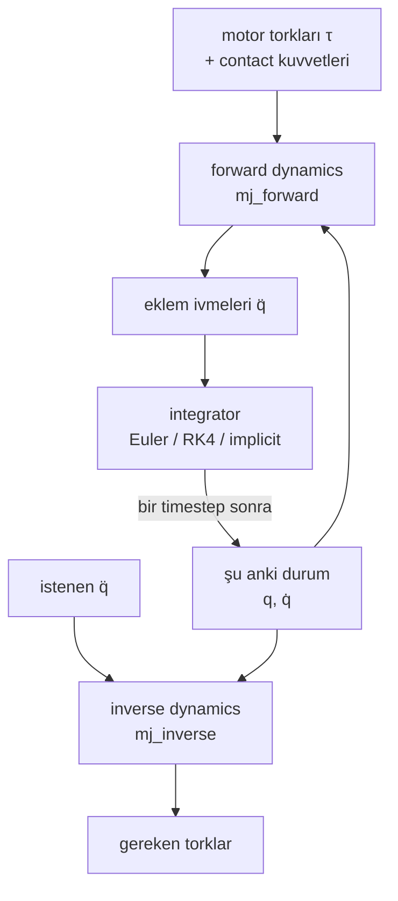

# 11 · Rigid-body dynamics

<!-- meta -->
| | |
|---|---|
| **Bölüm** | [4 · Dynamics ve control](README.md) |
| **Çalışma türü** | CPU · Mac ya da Colab CPU |
| **Önkoşul** | [09](../part-3-kinematics/09-jacobians.md) |
| **Önce öğren** | [Calculus for Machine Learning](https://aiengineeringfromscratch.com/lesson?path=phases/01-math-foundations/04-calculus-for-ml) · [Linear Systems](https://aiengineeringfromscratch.com/lesson?path=phases/01-math-foundations/17-linear-systems) |
| **Süre** | ~60 dk |
| **Kod** | [`experiments/11-rigid-body-dynamics/experiment.py`](../../experiments/11-rigid-body-dynamics/experiment.py) |
| **Durum** | ✅ tam |
<!-- /meta -->

> Bu bölümdeki her controller üç terimden kurulur: bir inertia matrisi, bir bias kuvveti ve gönderdiğin tork. Bu ders üçünü de elle hesaplıyor ve MuJoCo'nunkileri kontrol ediyor.

## Problem

Bir Franka Panda'yı `home` pozunda sabit tutmak için, yalnızca yerçekimine karşı koymak adına joint 2 yaklaşık 29 N·m, joint 4 yaklaşık 22 N·m ister (aşağıda Menagerie modeli üzerinde ölçüldü). Kolu hareket ettirmek için ayrıca link'leri hızlandıran torka da ihtiyacın var ve bu, diğer link'lerin nerede olduğuna bağlı. Bunu yok sayarsan kol sarkar, geride kalır ya da overshoot yapar. 12–16. derslerin hepsi aynı hareket denkleminden başlıyor; burada onu kuruyor, MuJoCo'nun versiyonunu elle türetilebilecek kadar küçük bir sisteme karşı doğruluyor ve integrator'ın fiziği nasıl değiştirdiğini ölçüyorsun.

## Ana fikir

### Sade anlatımla

Bir robot kolunu hareket ettirmek, Newton'un "kuvvet = kütle × ivme" yasasının bütün link zinciri için bir kez yazılmış hâlidir. Bir eklemin nasıl ivmeleneceğine üç şey karar verir:

- **Kolun şu an ne kadar ağır hissettirdiği.** Buz patencisi kollarını içeri çekince daha hızlı döner. Bir robot omzu da uzanmış kolu katlanmış koldan çok daha ağır hisseder; bir eklemi oynatmak diğerlerini de çeker.
- **Sen hiçbir şey göndermesen de etki eden kuvvetler.** Yerçekimi ve eklemler hareket edince link'lerin birbirini yana itmesi (lunaparktaki dönen platformda olduğu gibi Coriolis ve merkezkaç). Toplamları: **bias kuvveti**, her şeyi olduğu gibi tutmak için sıfırlaman gereken kısım.
- **Neyle ittiğin ve neyin geri ittiği.** Motor torkları ve masadan ya da bir nesneden gelen contact kuvvetleri.

Denkleme iki soru sorabilirsin. **Forward dynamics**: "bu torklar; hangi ivme?", simülatörün her adımda yaptığı. **Inverse dynamics**: "bu ivme; hangi torklar?", controller'ın ihtiyacı. Simülatör sonra küçük adımlarla ilerler ve her adımı atma biçimi (**integrator**) sessizce enerji ekleyip çıkarabilir.



### Hareket denklemi kod olarak

```python
M = mass_matrix(q)                   # (n, n) how heavy each joint feels in this pose      -> mj_fullM
c = bias(q, qd)                      # (n,)   gravity + Coriolis/centrifugal               -> qfrc_bias
qdd = np.linalg.solve(M, tau + J_c.T @ f_contact - c)     # forward dynamics (simulator)
tau_needed = M @ qdd_desired + c - J_c.T @ f_contact      # inverse dynamics (controller)
qd = qd + dt * qdd; q = q + dt * qd  # semi-implicit Euler: new velocity first, then position
```

| Formül | Ne olduğu |
|---|---|
| $M(q)\,\ddot q + C(q,\dot q)\,\dot q + g(q) = \tau + J^\top(q)\, f$ | rijit açık zincirin hareket denklemi (Lynch & Park, *Modern Robotics*, böl. 8) |
| $\ddot q = M^{-1}\big(\tau + J^\top f - c\big)$, $\;c = C\dot q + g$ | forward dynamics |
| $\tau = M\ddot q_d + c - J^\top f$ | inverse dynamics |
| $\dot q = 0$ iken $c = g(q)$ | kolu sabit tutan tork (gravity compensation) |

$q \in \mathbb{R}^n$: eklem açıları; $M(q)$: joint-space inertia; $C\dot q$: Coriolis/merkezkaç kuvvetleri; $g(q)$: yerçekimi torkları; $c$: toplamları (bias kuvveti); $\tau$: uygulanan torklar; $f$: Jacobian $J$ ile eklemlere aktarılan contact kuvvetleri (ders 09).

| Terim | Anlamı | MuJoCo'da nerede |
|---|---|---|
| $M(q)$ | joint-space inertia; simetrik, pozitif tanımlı, poza bağlı | `mjData.M` (sparse; eski sürümlerde `qM`), yoğun kopyası `mj_fullM` ile |
| $C(q,\dot q)\dot q + g(q)$ | **bias** kuvveti $c$ | `mjData.qfrc_bias` |
| $\tau$ | actuator ve kullanıcı kuvvetleri | `qfrc_actuator`, `qfrc_applied` |
| $J^\top f$ | joint'lere aktarılan contact ve constraint kuvvetleri | `qfrc_constraint` |

MuJoCo aynı denklemi $M\dot v + c = \tau + J^\top f$ olarak yazar. `mj_forward`, $q, \dot q, \tau$'dan `qacc`'yi hesaplar (`mj_step`'in integrate etmeden önce yaptığı); `mj_inverse`, $q, \dot q, \ddot q$'dan `qfrc_inverse`'ü hesaplar ([API reference](https://mujoco.readthedocs.io/en/stable/APIreference/APIfunctions.html)). Durağan halde bias saf yerçekimidir: 12. dersin feedforward'u.

**Integrator'lar.** MuJoCo şunları sunar: `Euler` (yukarıdaki gibi semi-implicit), `RK4` (adım başına dört kuvvet hesabı), `implicit` (hıza bağlı kuvvetlerin türevlerini de kullanır) ve `implicitfast` (aynısı ama Coriolis/merkezcil türevler olmadan; dokümanlar çoğu model için bunu öneriyor, ama varsayılan hâlâ `Euler`) ([Computation · Numerical integration](https://mujoco.readthedocs.io/en/stable/computation/index.html)). Sürtünmesiz bir sarkaç enerjisini korumak zorundadır; enerji kayması integration hatasını ölçer.

<details>
<summary>Matematik ayrıntısı: denklem nereden geliyor, integrator'lar neden kayıyor</summary>

**Kökeni.** Kinetik enerji $T = \tfrac12 \dot q^\top M(q)\dot q$ ve potansiyel enerji $U(q)$ ile Euler–Lagrange denklemleri $\frac{d}{dt}\frac{\partial T}{\partial \dot q} - \frac{\partial T}{\partial q} + \frac{\partial U}{\partial q} = \tau$ tam olarak $M\ddot q + C\dot q + g = \tau$ verir. $C\dot q$ terimi, $M$'nin $q$ ile değişmesinden gelen her şeyi toplar; hızlarda ikinci derecedendir, bu yüzden durağan halde kaybolur. $g = \partial U/\partial q$. Contact kuvvetleri virtual work yoluyla $J^\top f$ olarak girer.

**$M$ neden simetrik pozitif tanımlı.** Sıfır olmayan her hız için $T = \tfrac12 \dot q^\top M \dot q > 0$; yani forward dynamics çözümünün her zaman tek bir cevabı vardır. Condition number'ı en ağır ve en hafif yönlerin ne kadar eşitsiz olduğunu söyler.

**MuJoCo $c$'yi ve $M$'yi nasıl hesaplar.** $c$'yi sıfır ivmeyle recursive Newton–Euler algoritmasıyla, $M$'yi composite rigid body algoritmasıyla ([Computation](https://mujoco.readthedocs.io/en/stable/computation/index.html)): Sıfırdan yaz'daki iki algoritma.

**Enerji kayması.** Sürtünme ve actuator yokken $E = T + U$ sabittir. Birinci mertebe bir integrator, simüle edilen birim zaman başına $\Delta t$ ile orantılı hata yapar, yani adım yarıya inince hata da yarıya iner; semi-implicit Euler'in her zamanki sınırlı hatasını burada neden kaybettiği Boz bölümünde.

Daha derine: [Calculus for Machine Learning](https://aiengineeringfromscratch.com/lesson?path=phases/01-math-foundations/04-calculus-for-ml) (türev, zincir kuralı), [Linear Systems](https://aiengineeringfromscratch.com/lesson?path=phases/01-math-foundations/17-linear-systems) ($M\ddot q = b$'yi çözmek); Lynch & Park, [*Modern Robotics*](https://hades.mech.northwestern.edu/index.php/Modern_Robotics), böl. 8; MuJoCo [Computation](https://mujoco.readthedocs.io/en/stable/computation/index.html).

</details>

## Sıfırdan yaz

Şimdi inverse dynamics'i, mass matrix'i ve bir simülatör adımını yaklaşık 120 satır NumPy ile yazacaksın; her biri Deney'in çift sarkacında, SO-101'de ve Panda'da MuJoCo ile karşılaştırılıyor. MuJoCo'dan yalnızca sabit sayıları alıyorsun: ofsetler, eksenler, kütleler, kütle merkezleri, inertia'lar, armature, yerçekimi.

Adımları kendi dosyana yaz (örneğin `scratch/my_dynamics.py`) ve her adımdan sonra çalıştır. Bitmiş fonksiyonlar [`physai/dynamics.py`](../../physai/dynamics.py) içinde; `uv run python experiments/11-rigid-body-dynamics/build.py` beş adımı kontrolleriyle birlikte koşturur (çıktı [`build_output.txt`](../../experiments/11-rigid-body-dynamics/build_output.txt) dosyasında).

### Adım 1 · Dünya koordinatlarında bir gövde ağacı

Ders 08 tek bir zinciri tek bir alet noktasına kadar yürüdü. Dynamics her gövdeye ihtiyaç duyar (SO-101'in hareketli çenesinin de bir ağırlığı var), bu yüzden okuyucu bütün ağacı, her gövdenin kütle özellikleriyle birlikte tutar:

```python
@dataclass
class Body:
    parent: int          # index of the parent body in the tree, -1 for the world
    pos: np.ndarray      # origin in the parent's frame (m)
    rot: np.ndarray      # orientation in the parent's frame at q = 0, 3x3
    joint: str           # "hinge", "slide" or "" (welded to its parent)
    axis: np.ndarray     # joint axis in this body's frame (unit)
    anchor: np.ndarray   # a point on the joint axis, in this body's frame (m)
    mass: float          # kg
    com: np.ndarray      # centre of mass in this body's frame (m)
    inertia: np.ndarray  # 3x3 rotational inertia about the centre of mass, body frame (kg m^2)
```

```python
@dataclass
class Tree:
    bodies: list         # base to tips: a parent always comes before its children
    armature: np.ndarray  # rotor inertia added to each joint, one per degree of freedom (kg m^2)
    gravity: np.ndarray  # m/s^2, world frame
```

```python
def tree_from_mujoco(m):
    """Every body of a model whose joints are single hinges or slides (static model data only)."""
    bodies = []
    for b in range(1, m.nbody):
        kind, axis, anchor = "", None, None
        if m.body_jntnum[b] > 1:
            raise ValueError("one joint per body only")
        if m.body_jntnum[b]:
            j = m.body_jntadr[b]
            kind = {3: "hinge", 2: "slide"}[int(m.jnt_type[j])]
            axis, anchor = m.jnt_axis[j].copy(), m.jnt_pos[j].copy()
        R = quat_to_mat(m.body_iquat[b])           # principal axes of inertia in the body frame
        bodies.append(Body(int(m.body_parentid[b]) - 1, m.body_pos[b].copy(), quat_to_mat(m.body_quat[b]),
                           kind, axis, anchor, float(m.body_mass[b]), m.body_ipos[b].copy(),
                           R @ np.diag(m.body_inertia[b]) @ R.T))
    return Tree(bodies, m.dof_armature.copy(), m.opt.gravity.copy())
```

Gerisini kısa tutan hile: her hızı tek bir 6-vektör $(\omega, v_0)$ olarak yaz, yani açısal hız ve gövdenin dünya orijininde duran noktasının hızı; her inertia'yı da dünya orijini etrafında 6 × 6 bir matris olarak. O zaman $o$'dan geçen $\hat a$ eksenli bir hinge, gövdesini rad/s başına $S = (\hat a,\ o \times \hat a)$ ile hareket ettirir ve birkaç gövdenin inertia'sı basitçe toplamlarıdır.

```python
def skew(v):
    """Matrix of the cross product: skew(a) @ b = a x b."""
    return np.array([[0, -v[2], v[1]], [v[2], 0, -v[0]], [-v[1], v[0], 0]])
```

```python
def spatial_inertia(mass, c, Ic):
    """6x6 inertia about the world origin of a body with centre of mass c and inertia Ic about c (world)."""
    C = skew(c)
    return np.block([[Ic + mass * C @ C.T, mass * C], [mass * C.T, mass * np.eye(3)]])
```

```python
def spatial_tree(tree, q):
    """At joint positions q: each body's centre of mass, 6x6 inertia and joint motion vector, all in the world.

    A joint's motion vector S is the body's spatial velocity per unit joint speed: (a, o x a) for a hinge
    with axis a through o, (0, a) for a slide; None for a welded body.
    """
    R, p, coms, inertias, S, k = [], [], [], [], [], 0
    for b in tree.bodies:
        Rp, pp = (R[b.parent], p[b.parent]) if b.parent >= 0 else (np.eye(3), np.zeros(3))
        Rb, pb, s = Rp @ b.rot, pp + Rp @ b.pos, None
        if b.joint:
            a, o = Rb @ b.axis, pb + Rb @ b.anchor
            if b.joint == "hinge":
                turn = axis_angle_to_mat(a, q[k])
                Rb, pb, s = turn @ Rb, o + turn @ (pb - o), np.r_[a, np.cross(o, a)]
            else:
                pb, s = pb + a * q[k], np.r_[np.zeros(3), a]
            k += 1
        R.append(Rb)
        p.append(pb)
        coms.append(pb + Rb @ b.com)
        inertias.append(spatial_inertia(b.mass, coms[-1], Rb @ b.inertia @ Rb.T))
        S.append(s)
    return coms, inertias, S
```

```text
== Step 1. The body tree of the double pendulum ==
body parent  joint mass (kg)    com in body (m)  inertia diag (kg m^2)
   0     -1  hinge     1.000      [0.2 0.  0. ]       [0.02 0.02 0.02]
   1      0  hinge     0.500   [0.15 0.   0.  ]    [0.005 0.005 0.005]
centres of mass vs MuJoCo's xipos, 1000 random poses: max diff 2.2e-16 m
```

### Adım 2 · Inverse dynamics: recursive Newton–Euler

Tabandan dışarı doğru her gövdenin hızı ebeveyninkine $S\dot q_i$ eklenmiş hâli, ivmesi ebeveyninkine $S\ddot q_i$ ve $S$'nin kendisi hareket ettiği için gelen bir terim eklenmiş hâlidir; her gövde $I a + v \times^* I v$ net kuvvetine ihtiyaç duyar. Uçlardan içeri doğru her joint bütün alt ağacını taşır ve torku, kuvvetin kendi $S$'si boyunca kalan kısmıdır. Yerçekimi bedava: tabanı 9,81 m/s² ile yukarı ivmelendir.

```python
def cross_motion(v):
    """6x6 matrix of v x (.) for motion vectors (velocities, accelerations)."""
    w, u = skew(v[:3]), skew(v[3:])
    return np.block([[w, np.zeros((3, 3))], [u, w]])
```

```python
def rnea(tree, q, qd, qdd):
    """Inverse dynamics by recursive Newton-Euler: the joint forces that give accelerations qdd at (q, qd)."""
    _, inertias, S = spatial_tree(tree, q)
    V, A, f, dof, k = [], [], [], [], 0
    for i, b in enumerate(tree.bodies):            # outward: velocities and accelerations
        if b.parent >= 0:
            v, a = V[b.parent], A[b.parent]
        else:                                      # gravity enters as an upward acceleration of the base
            v, a = np.zeros(6), np.r_[np.zeros(3), -tree.gravity]
        dof.append(k if S[i] is not None else None)
        if S[i] is not None:
            v = v + S[i] * qd[k]
            a = a + S[i] * qdd[k] + cross_motion(v) @ S[i] * qd[k]
            k += 1
        V.append(v)
        A.append(a)
        f.append(inertias[i] @ a - cross_motion(v).T @ inertias[i] @ v)   # net force on the body
    tau = tree.armature * np.asarray(qdd, dtype=float)
    for i in reversed(range(len(tree.bodies))):    # inward: each joint carries its whole subtree
        if dof[i] is not None:
            tau[dof[i]] += S[i] @ f[i]
        if tree.bodies[i].parent >= 0:
            f[tree.bodies[i].parent] = f[tree.bodies[i].parent] + f[i]
    return tau
```

```text
== Step 2. Inverse dynamics (RNEA) vs mj_inverse and the hand formula, 1000 random states ==
max |tau_ours - qfrc_inverse| = 3.6e-15 N m, max |tau_ours - (M qdd + C qd + g)| = 3.6e-15 N m
```

### Adım 3 · Bias ve yerçekimi

Sıfır ivme iste, RNEA bias'ı $c = C\dot q + g$ döndürür; durağan halde bu yerçekimi torkudur. MuJoCo da `qfrc_bias`'ı böyle hesaplar:

```python
c = rnea(tree, q, qd, np.zeros(n))          # = qfrc_bias
g = rnea(tree, q, np.zeros(n), np.zeros(n)) # = qfrc_bias at rest: gravity compensation
```

```text
== Step 3. Bias c = rnea(q, qd, 0) vs qfrc_bias; at rest it is gravity ==
double pendulum, 1000 states: max |c_ours - qfrc_bias| = 2.7e-15 N m
SO-101 stretched (all 0)                g(q) =  0.000 -0.573 -0.483 -0.130 -0.007 N m, max diff to qfrc_bias 1.1e-16
SO-101 folded (lift -1.57, elbow 1.57)  g(q) =  0.000 -0.066 -0.483 -0.130 -0.007 N m, max diff to qfrc_bias 1.8e-16
```

SO-101 satırları Deney'in Sonuç 3'ü.

### Adım 4 · Mass matrix: composite rigid bodies

$M$'nin $j$. sütunu, yalnızca joint $j$'yi durağan halden 1 rad/s² ile ivmelendiren joint kuvvetidir. Onun ötesindeki her şey tek bir rijit blok, **composite** gövde olarak hareket eder; dünya inertia'sı düz bir toplamdır. Ona etkiyen kuvvet $I^c_j S_j$'dir ve $j$ ile taban arasındaki her joint bunun kendi ekseni boyunca kalan kısmını hisseder:

```python
def mass_matrix(tree, q):
    """Joint-space inertia M(q) by composite rigid bodies: M_ij = S_i . (Ic_j S_j) for i an ancestor of j."""
    _, inertias, S = spatial_tree(tree, q)
    comp = [I.copy() for I in inertias]
    for i in reversed(range(len(tree.bodies))):    # composite inertia: a body plus everything beyond it
        if tree.bodies[i].parent >= 0:
            comp[tree.bodies[i].parent] += comp[i]
    dof = np.cumsum([s is not None for s in S]) - 1
    M = np.zeros((len(tree.armature), len(tree.armature)))
    for j in range(len(tree.bodies)):
        if S[j] is None:
            continue
        F, i = comp[j] @ S[j], j                   # force to accelerate body j's subtree at joint j's unit rate
        while i >= 0:                              # ...as felt by every joint between j and the base
            if S[i] is not None:
                M[dof[i], dof[j]] = M[dof[j], dof[i]] = S[i] @ F
            i = tree.bodies[i].parent
    return M + np.diag(tree.armature)
```

```text
== Step 4. Mass matrix by composite rigid bodies vs mj_fullM ==
double pendulum, 1000 poses: max diff 1.4e-16 kg m^2 to mj_fullM, 1.1e-16 to the formula
SO-101: 6 joints, 20 random poses, max diff 1.9e-17 kg m^2
Panda: 9 joints, 20 random poses, max diff 2.1e-14 kg m^2
Panda 'home': diag M = 1.509 2.795 1.471 1.058 0.144 0.154 0.107 kg m^2, cond(M[:7, :7]) = 32.6
```

Panda'nın 9 joint'i iki parmak slide'ını da içeriyor; köşegen (joint başına 0,100 kg·m² `armature` ile) ve 32,6 condition number Deney'inkiler.

### Adım 5 · Bir simülatör: forward dynamics artı semi-implicit Euler

Forward dynamics, elindeki iki parçayla tek bir doğrusal çözümdür; MuJoCo'nun sırasıyla bir Euler adımı ve enerji simülatörü tamamlar:

```python
def forward_dynamics(tree, q, qd, tau):
    """Joint accelerations for applied joint forces tau: M(q) qdd = tau - c(q, qd)."""
    bias = rnea(tree, q, qd, np.zeros(len(q)))     # c = C(q, qd) qd + g(q): forces for zero acceleration
    return np.linalg.solve(mass_matrix(tree, q), tau - bias)
```

```python
def energy(tree, q, qd):
    """Kinetic plus potential energy (J), potential measured from the world origin."""
    coms, _, _ = spatial_tree(tree, q)
    potential = -sum(b.mass * tree.gravity @ c for b, c in zip(tree.bodies, coms))
    return 0.5 * qd @ mass_matrix(tree, q) @ qd + potential
```

```python
qd = qd + dt * forward_dynamics(tree, q, qd, np.zeros(2))   # new speed first...
q = q + dt * qd                                             # ...then the angle from the new speed
```

```text
== Step 5. Forward dynamics + semi-implicit Euler, 10 s at dt = 2 ms (the Experiment's Euler row) ==
after 10 s: max |q_ours - q_mj_step| = 1.3e-13 rad
energy error: max 14.357%, final +14.353% (one step earlier +14.355%) of 4.660 J
```

5000 adımdan sonra senin sarkacın `mj_step`'inkinden 1,3e-13 rad uzakta ve enerji Deney'deki %14,357'de tepe yapıyor. Son değer üçüncü ondalıkta ayrılıyor (+%14,353'e karşı +%14,355), çünkü `mj_step`'ten sonraki `d.energy` o adımın başındaki duruma ait; senin bir adım önceki enerjin +%14,355.

### Elinde kalan

`physai.dynamics` artık `tree_from_mujoco`, `spatial_tree`, `rnea`, `mass_matrix`, `forward_dynamics` ve `energy` içeriyor. Ders 13 `mass_matrix` ile $M(q)\ddot q_r$ feedforward'u ekliyor; ders 14 elin inertia'sını ondan kuruyor. [`tests/test_11_rigid_body_dynamics.py`](../../tests/test_11_rigid_body_dynamics.py) bunları hinge–slide test modelinde, SO-101'de ve Panda'da MuJoCo'ya sabitliyor; bir şey değiştirdikten sonra `uv run pytest tests/test_11_rigid_body_dynamics.py` çalıştır.

## Kütüphaneyle kullan

MuJoCo bunların hepsini `mj_forward` sırasında doldurur; ihtiyacın olanı doğru çağrıdan sonra iste:

```python
mujoco.mj_forward(m, d)                    # fills d.M (sparse), d.qfrc_bias, d.qacc
M = np.zeros((m.nv, m.nv))
mujoco.mj_fullM(m, d, M)                   # dense M, = mass_matrix(tree, q)
c = d.qfrc_bias                            # = rnea(tree, q, qd, 0)
d.qacc[:] = qdd_desired
mujoco.mj_inverse(m, d)                    # d.qfrc_inverse = rnea(tree, q, qd, qdd)
```

| Araç | Inverse dynamics | Mass matrix | Yalnız yerçekimi |
|---|---|---|---|
| physai | `rnea(tree, q, qd, qdd)` | `mass_matrix(tree, q)` | `rnea(tree, q, 0, 0)` |
| MuJoCo | `mj_inverse` → `qfrc_inverse` | `mj_forward`'dan sonra `mj_fullM` | `qvel = 0` iken `qfrc_bias` |
| Pinocchio | `rnea(model, data, q, v, a)` → `data.tau` | `crba(model, data, q)` → `data.M`, yalnız üst üçgen | `computeGeneralizedGravity(model, data, q)` → `data.g` |
| *Modern Robotics* kodu | `InverseDynamics(thetalist, dthetalist, ddthetalist, g, Ftip, Mlist, Glist, Slist)` | `MassMatrix(thetalist, Mlist, Glist, Slist)` | `GravityForces(thetalist, g, Mlist, Glist, Slist)` |

Kaynaklar: Pinocchio [`rnea.hpp`](https://github.com/stack-of-tasks/pinocchio/blob/master/include/pinocchio/algorithm/rnea.hpp), [`crba.hpp`](https://github.com/stack-of-tasks/pinocchio/blob/master/include/pinocchio/algorithm/crba.hpp); *Modern Robotics* [`core.py`](https://github.com/NxRLab/ModernRobotics/blob/master/packages/Python/modern_robotics/core.py).

Dört tuzak:

- **Yarım matris.** Pinocchio'nun `crba`'sı `data.M`'nin yalnız üst üçgenini doldurur; MuJoCo'nun `d.M`'si sparse'tır. `M @ x`'ten önce `mj_fullM` kullan (ya da simetrikleştir).
- **`mj_inverse` `qacc` ister.** `d.qacc`'yi istenen ivme olarak okur; son adımdan kalan değeri orada bırakırsan o ivmenin torkunu alırsın.
- **`qfrc_inverse`'ün içinde ne var.** Actuator'ların eklemesi gereken kısım: pasif kuvvetler (joint damping, yaylar) ve constraint kuvvetleri çıkarılmıştır, `qfrc_inverse = rnea − qfrc_passive − qfrc_constraint`. SO-101'de (joint damping 0,6) bir joint hareket ettiği anda senin `rnea`'ndan ayrılır.
- **Armature.** Menagerie modelleri köşegene rotor inertia'sı ekler (SO-101'de 0,028, Panda'da 0,100). Bunu dışarıda bırakırsan $M$'n tam o kadar yanlış olur.

## Deney

**Önce tahmin et.** Elle türetilmiş iki link'li bir sarkaç için MuJoCo'nun `M`, `qfrc_bias` ve `mj_inverse` değerleri formüllere ne kadar yakın olur: 1e-3, 1e-8 mi, yoksa makine hassasiyeti mi? Ve varsayılan 2 ms adımda hangi integrator salınan bir çift sarkacın enerjisini sabit tutar?

**Kurulum.** İki link, $y$ ekseni etrafındaki menteşelerle x–z düzleminde salınıyor. Link 1: 1 kg, 40 cm, kütle merkezi 20 cm'de, inertia 0,02 kg·m². Link 2: 0,5 kg, 30 cm, kütle merkezi 15 cm'de, inertia 0,005 kg·m². Joint damping yok, sürtünme yok, contact yok. $a = m_2 l_1 c_2$ ile:

$$M = \begin{bmatrix} m_1c_1^2 + I_1 + m_2(l_1^2 + c_2^2 + 2 l_1 c_2\cos q_2) + I_2 & m_2(c_2^2 + l_1 c_2 \cos q_2) + I_2 \\ \cdot & m_2 c_2^2 + I_2 \end{bmatrix},\quad C\dot q = a \sin q_2 \begin{bmatrix} -(2\dot q_1 \dot q_2 + \dot q_2^2) \\ \dot q_1^2 \end{bmatrix}$$

Script `mj_fullM`, `qfrc_bias`, `mj_inverse` ve `mj_forward`'ı bu formüllerle 1000 rastgele durumda karşılaştırıyor (seed 0, $q \in [-\pi, \pi]$, $\dot q \in [-5, 5]$ rad/s, $\ddot q \in [-20, 20]$ rad/s²). Sonra sarkaç yataydan bırakılıyor ve 4 integrator × 6 timestep için 10 s pasif olarak salınıyor. Tam script: [`experiments/11-rigid-body-dynamics/experiment.py`](../../experiments/11-rigid-body-dynamics/experiment.py). MuJoCo 3.17.0, NumPy 2.5.4, Python 3.14, Apple M5, deterministik, ~3 s.

**Sonuç 1: MuJoCo formüllerle makine hassasiyetinde örtüşüyor.**

| Kontrol (1000 durum üzerinde en büyük) | en büyük mutlak fark |
|---|---|
| `mj_fullM` ve $M(q)$ | 1,39e-16 kg·m² |
| `qfrc_bias` ve $C\dot q + g$ | 1,78e-15 N·m |
| `mj_inverse` ve $\tau$ (en büyük $|\tau|$ = 9,0 N·m) | 3,55e-15 N·m |
| `mj_forward` ivmesi ve $\ddot q$ | 1,88e-13 rad/s² |

**Sonuç 2: integrator fiziği değiştiriyor.** 10 s boyunca enerji hatası, sarkacın bırakabileceği 4,660 J'ün yüzdesi olarak; her hücre max |E(t) − E₀| / son E − E₀.

| integrator | 0,5 ms | 1 ms | 2 ms | 5 ms | 10 ms | 20 ms |
|---|---|---|---|---|---|---|
| `Euler` | 3,467 / +3,467 | 6,984 / +6,984 | 14,357 / +14,355 | 41,123 / +39,316 | 89,992 / +56,191 | 140,049 / +124,182 |
| `RK4` | 0,000 / −0,000 | 0,000 / −0,000 | 0,000 / −0,000 | 0,000 / −0,000 | 0,003 / −0,001 | 0,037 / −0,014 |
| `implicit` | 3,093 / −3,093 | 6,007 / −6,007 | 11,352 / −11,352 | 24,317 / −24,317 | 39,105 / −39,105 | 55,292 / −54,794 |
| `implicitfast` | her hücrede `Euler` ile aynı | | | | | |


- **Euler enerji kazanıyor, implicit kaybediyor**; ikisi de kabaca timestep ile orantılı (dt yarıya inince 6,984 → 3,467). Varsayılan 2 ms'de sürtünmesiz çift sarkaç 10 s'de %14,357 kazanıyor.
- **Burada `implicitfast` = `Euler`.** Joint damping yokken hıza bağlı tek kuvvet Coriolis/merkezcil kuvvet; `implicitfast` onu düşürüyor, `Euler`'de zaten hiç yoktu.
- **`implicit` enerji söndürüyor**: Coriolis kuvvetlerini doğrusallaştırmak sayısal damping ekliyor; contact'larla çoğu zaman işe yarar, enerji incelerken yanlıştır.
- **RK4** 5 ms'ye kadar %0,000'da kalıyor, adım başına dört kuvvet hesabı karşılığında.

**Sonuç 3: robotlarda aynı büyüklükler.** $\dot q = 0$ ile (keyframe, model dosyasında saklanan isimli bir pozdur):

| Model, poz | `qfrc_bias`'tan $g(q)$ [N·m] |
|---|---|
| Panda `home`, joint 1–7 | 0,00, −29,36, 0,00, 22,05, 0,67, 2,31, −0,00 |
| SO-101 öne uzanmış (hepsi 0), joint 1–5 | 0,000, −0,573, −0,483, −0,130, −0,007 |
| SO-101 katlı (lift −1,57, elbow 1,57) | 0,000, −0,066, −0,483, −0,130, −0,007 |

Panda'nın `home`'daki $M$ köşegeni 1,509, 2,795, 1,471, 1,058, 0,144, 0,154, 0,107 kg·m²; bunun her joint'te 0,100'ü modelin `armature` değeri (yansıyan rotor inertia'sı); condition number 32,6. 2,795 kg·m² hisseden bir omuz ile 0,107 kg·m² hisseden bir bilek aynı gain'ler altında aynı davranmaz (ders 12 ve 14).

## Boz

Semi-implicit Euler koşusunun timestep'ini büyüt: 20 ms'de pasif sarkaç 10 s'yi bırakılabilir enerjisinin **+%124,182**'siyle bitiriyor ve +%140,049'a kadar çıkıyor. Bırakıldığından daha yükseğe salınan sürtünmesiz bir sarkaç integration hatasıdır ve seni hiçbir şey uyarmaz: NaN yok, exception yok. Tek savunma bunun gibi bir kontrol: enerji (`<flag energy="enable"/>` ile aç, `d.energy`'yi oku) ya da daha küçük bir adımla karşılaştırma.

Mekanizma: semi-implicit Euler her adımın başındaki inertia'yı ve Coriolis kuvvetini kullanır. Inertia sabit ve hıza bağlı kuvvet yokken symplectic olurdu (sınırlı, salınan enerji hatası); burada $M$, $q_2$'ye bağlı ve Coriolis kuvveti explicit, bu yüzden adım başına hata dt ile orantılı olarak birikiyor. Sıfırdan yaz'daki simülatörün de 2 ms'de aynı %14,357'yi gösteriyor.

## Gerçek robotta

- **SO-101.** LeRobot STS3215 servo'larını position modunda sürüyor ([`so_follower.py`](https://github.com/huggingface/lerobot/blob/main/src/lerobot/robots/so_follower/so_follower.py), `set_operating_mode("position", motor)`); tork girişi yok, yani $M$ ve $g$ yalnızca servo'nun kendi döngüsü üzerinden devreye giriyor. Yukarıdaki $g(q)$ sayıları Menagerie modelinin kütle ve inertia'larını kullanıyor; bunlar model çıktısı, gerçek kolda ölçülmedi.
- **Panda.** libfranka dinamik modeli açıyor; Cartesian impedance örneği her döngüde `model.coriolis(robot_state)`'i okuyup komutuna ekliyor ([`cartesian_impedance_control.cpp`](https://github.com/frankarobotics/libfranka/blob/main/examples/cartesian_impedance_control.cpp)), 14. dersin yapısı.
- **Model hatası.** Gerçek kollar URDF/MJCF'de olmayan kablolar, dişli kutusu sürtünmesi ve yükler taşır. Bir inverse dynamics terimi, arkasındaki inertia parametreleri kadar iyidir; onları belirlemek [ders 38 · System identification](../part-9-sim-to-real/38-system-identification.md)'ın konusu.

## Kendini dene

1. **Kolay.** Yukarıdaki çift sarkaçta $M_{11}$, $q_2 = 0$ (kol düz) ile $q_2 = \pi$ (geriye katlanmış) arasında ne kadar değişir?
2. **Orta.** Panda'da `home`'da `qvel = 0` ve `qacc = 0` ile `mj_inverse` çağır. `qfrc_inverse` neye eşit olmalı ve neden?
3. **Zor.** İki sarkaç joint'ine de `damping="0.05"` ekle ve B bölümünü yeniden koş. Koşmadan önce tahmin et: `implicitfast` hâlâ `Euler`'e eşit mi? Enerji artık her integrator için azalıyor mu?

### Cevaplar

1. $\Delta M_{11} = 4 m_2 l_1 c_2 = 4 \cdot 0{,}5 \cdot 0{,}4 \cdot 0{,}15 = 0{,}12$ kg·m² (kol düzken daha büyük).
2. Yerçekimi torkuna, yani Sonuç 3'teki `qfrc_bias`'a (joint 2'de −29,36 N·m, joint 4'te 22,05 N·m): ivme sıfır, hız sıfır ve contact yokken gereken tek kuvvet yerçekimini sıfırlayan kuvvettir; pasif damping sıfır hızda sıfırdır.
3. Kaydedilen koşunun parçası değil; koş. Dokümanlardan ipucu: `Euler` joint damping'i implicit olarak ele alır, `implicitfast` ise Coriolis/merkezcil dışındaki bütün hıza bağlı kuvvetlerin türevlerini ekler; aynı kalmalarını bekle. Euler'in sayısal kazancının damping'in üstünde hâlâ görünüp görünmediğine bak.

## Akılda kalanlar ve kaynaklar

- $M(q)\ddot q + c(q,\dot q) = \tau + J^\top f$; `mj_fullM` $M$'yi, `qfrc_bias` $c$'yi (durağan halde saf yerçekimi), `mj_inverse` istenen ivme için torku verir. Senin RNEA ve composite-body kodun onlarla ~1e-15'e kadar örtüşüyor, elle türetilmiş formüller de.
- Integrator fiziğin parçası: 2 ms'de semi-implicit Euler sürtünmesiz çift sarkaca 10 s'de %14,357 enerji ekliyor, `implicit` %11,352 eksiltiyor, RK4 %0,000'da kalıyor (üç ondalık).
- Robot inertia'sı poza bağlı ve joint'ler arasında çok dengesiz (Panda köşegeni 2,795'e karşı 0,107 kg·m²); tek bir gain setinin bütün joint'lere nadiren uymasının sebebi bu.

Sonraki: [ders 12 · Joint control: PD, PID, gravity feedforward ve position servo](12-joint-control.md).

Kaynaklar:
- Lynch, K. M., Park, F. C. [*Modern Robotics*](https://hades.mech.northwestern.edu/index.php/Modern_Robotics), Cambridge University Press, 2017, böl. 8 (Dynamics of Open Chains).
- MuJoCo dokümantasyonu: [Computation](https://mujoco.readthedocs.io/en/stable/computation/index.html) (hareket denklemleri, integrator'lar), [API functions](https://mujoco.readthedocs.io/en/stable/APIreference/APIfunctions.html) (`mj_inverse`, `mj_forward`, `mj_fullM`), [`mjdata.h`](https://github.com/google-deepmind/mujoco/blob/main/include/mujoco/mjdata.h) (`M`, `qfrc_bias`, `qfrc_inverse`).
- [MuJoCo Menagerie](https://github.com/google-deepmind/mujoco_menagerie): `franka_emika_panda`, `robotstudio_so101`.
- LeRobot [`so_follower.py`](https://github.com/huggingface/lerobot/blob/main/src/lerobot/robots/so_follower/so_follower.py); libfranka [`cartesian_impedance_control.cpp`](https://github.com/frankarobotics/libfranka/blob/main/examples/cartesian_impedance_control.cpp) (ikisi de 27.10.2026'da okundu).
- Ölçülen bütün sayılar: [`experiments/11-rigid-body-dynamics/output.txt`](../../experiments/11-rigid-body-dynamics/output.txt).
