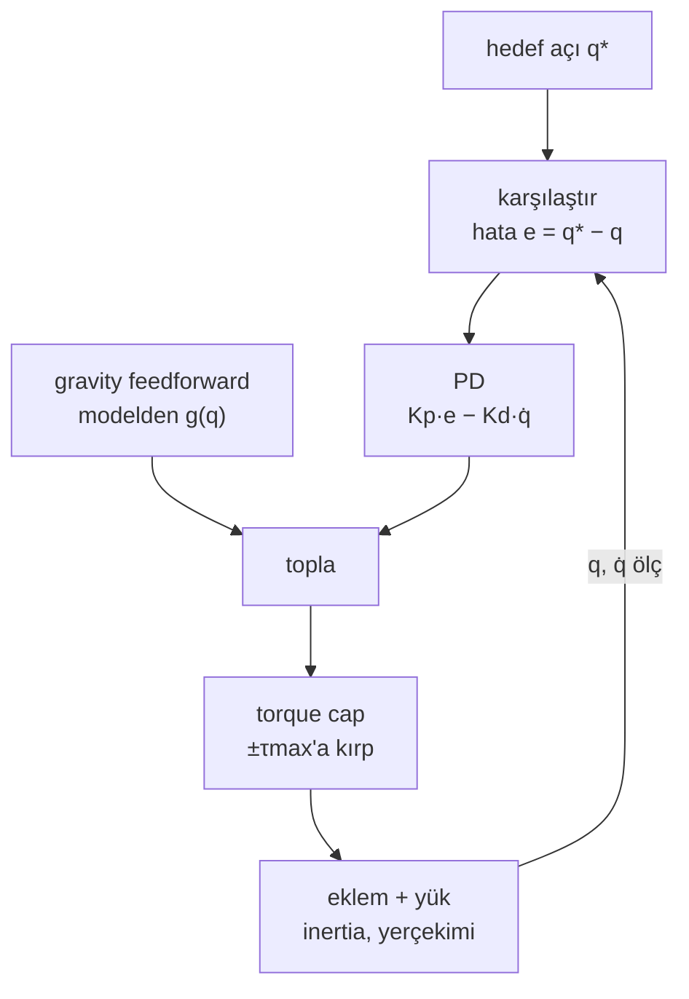

# 12 · Joint control: PD, PID, gravity feedforward ve position servo

<!-- meta -->
| | |
|---|---|
| **Bölüm** | [4 · Dynamics ve control](README.md) |
| **Çalışma türü** | CPU · Mac ya da Colab CPU |
| **Önkoşul** | [05](../part-1-simulation/05-joints-and-actuators.md), [11](11-rigid-body-dynamics.md) |
| **Önce öğren** | [Calculus for Machine Learning](https://aiengineeringfromscratch.com/lesson?path=phases/01-math-foundations/04-calculus-for-ml) |
| **Süre** | ~60 dk |
| **Kod** | [`experiments/12-joint-control/experiment.py`](../../experiments/12-joint-control/experiment.py) · [notebook](../../notebooks/12-joint-control.ipynb) |
| **Durum** | ✅ tam |
<!-- /meta -->

> Policy "joint bu açıya" der. Joint'in oraya nasıl gideceğine iki sayı, Kp ve Kd karar verir; yerçekimini tek başlarına düzeltemezler.

## Problem

Unitree Go2'nun 12 bacak joint'i var. Unitree'nin açık eğitim kodunda bunların her biri aynı PD kuralıyla (proportional–derivative: bir yay artı bir sönümleyici, aşağıda açıklanıyor) sürülüyor: `stiffness = 20` (Kp, N·m/rad), `damping = 0.5` (Kd, N·m·s/rad), `control_type = 'P'` ([`go2_config.py`](https://github.com/unitreerobotics/unitree_rl_gym/blob/main/legged_gym/envs/go2/go2_config.py)):

```python
# legged_robot.py · _compute_torques
torques = self.p_gains*(actions_scaled + self.default_dof_pos - self.dof_pos) - self.d_gains*self.dof_vel
return torch.clip(torques, -self.torque_limits, self.torque_limits)
```

([`legged_robot.py`](https://github.com/unitreerobotics/unitree_rl_gym/blob/main/legged_gym/envs/base/legged_robot.py)). Policy hedefi her 20 ms'de bir güncelliyor (`sim.dt = 0.005`, `decimation = 4`, [`legged_robot_config.py`](https://github.com/unitreerobotics/unitree_rl_gym/blob/main/legged_gym/envs/base/legged_robot_config.py)); PD kuralı onu her 5 ms'de torka çeviriyor. Unitree'nin gerçek Go2 için düşük seviyeli kalkma örneği farklı sayılar kullanıyor: Kp = 60 ve Kd = 5 ([`go2_stand_example.cpp`](https://github.com/unitreerobotics/unitree_sdk2/blob/main/example/go2/go2_stand_example.cpp)). Bu sayılar neden çalışıyor, neyi yanlış yapıyor ve bir SO-101 servo'su bunun yerine ne yapıyor?

## Ana fikir

### Sade anlatımla

Eklemi hedef açısına bir **yay ve bir amortisörle** bağlanmış gibi düşün; arabanın tekerleğinin gövdeye bağlanışı gibi. Yay, eklem hedeften ne kadar uzaksa o kadar sert çeker; sertliği **Kp**'dir. Amortisör, yönü ne olursa olsun hıza direnir; gücü **Kd**'dir. Sert yay ile zayıf amortisör hedefe hızlı varır, sonra zıplar (**overshoot**). Güçlü amortisör zıplamayı keser ama hareketi ağırlaştırır. Arada tatlı bir nokta vardır ve eklemin ne kadar ağır olduğuna bağlıdır: hafif bir bileği sakinleştiren amortisör ağır bir omuz için zayıf kalır.

Controller hiç durmayan bir döngüdür: açıyı ölç, hedefle karşılaştır, bir torkla düzelt, her milisaniyede tekrarla. Yerçekimi yay benzetmesini bir noktada bozar: yay yalnızca gerildiğinde iter, yani bir ağırlığı tutmak için gergin kalmak zorundadır ve eklem hedefinin biraz **altında** durur (**sarkma**). Üç çıkış yolu var: daha sert bir yay (sarkma azalır, sıfıra inmez), ne kadar süredir yanıldığının hesabını tutup daha sert iten bir **integral** terimi (sarkmayı yavaşça giderir, overshoot yapabilir) ya da **feedforward**: ağırlığı modelden hesapla ve daha hiç hata oluşmadan tam o torku ekle.

SO-101'deki gibi bir hobi servo'su aynı döngüyü motorun içinde koşar. Ona tork değil hedef açı gönderirsin; o da en fazla **torque cap**'i kadar karşı koyar.



### Kontrol döngüsü kod olarak

```python
integ = 0.0
while True:                               # every dt (1 ms here; inside the servo on a real arm)
    q, qd = read_joint()                  # measure: angle [rad], velocity [rad/s]
    e = q_target - q                      # compare: distance to the target [rad]
    tau = kp * e - kd * qd                # correct: spring toward target, damper against speed
    integ += e * dt                       # PID only: running sum of past error [rad*s]
    tau += ki * integ                     # PID only: push harder the longer the error lasts
    tau += gravity_torque(q)              # feedforward only: cancel the known load (qfrc_bias)
    tau = np.clip(tau, -tau_max, tau_max) # the motor cannot give more than its cap
    apply_torque(tau)
```

| Formül | Ne söylüyor |
|---|---|
| $\tau = K_p (q^* - q) - K_d \dot q$ | PD kuralı (yay + sönümleyici) |
| $I\ddot q + K_d \dot q + K_p q = K_p q^*$ | kapalı döngü bir kütle–yay–sönümleyicidir |
| $\omega_n = \sqrt{K_p / I}$ | ne kadar hızlı tepki verdiği; settling süresi $1/\omega_n$ ile ölçeklenir |
| $\zeta = \dfrac{K_d}{2\sqrt{K_p I}}$ | şekil: 1'in altında overshoot yapar, 1 kritik damping'dir, 1'in üstünde sürünür |
| $\zeta<1$ için $\text{overshoot} = e^{-\pi\zeta/\sqrt{1-\zeta^2}}$ | hedefin ötesine salındığı adım oranı |
| $K_p\, e = g(q^* - e)$ | yayın yerçekimi torkunu dengelediği sarkma $e$ |

Burada $q$ eklem açısı, $q^*$ hedef, $\dot q$ eklem hızı, $\tau$ motor torku, $I$ eklemin inertia'sı (11. dersten, $M$'nin köşegeni), $K_p$ N·m/rad cinsinden stiffness, $K_d$ N·m·s/rad cinsinden damping, $\omega_n$ rad/s cinsinden doğal frekans, $\zeta$ birimsiz damping oranı, $e = q^* - q$ hata ve $g(\cdot)$ verilen açıdaki yerçekimi torkudur. Kp hızı, Kd şekli belirler.

| Sarkmaya çözüm | Kural | Bedeli |
|---|---|---|
| Kp'yi artır | aynı | daha sert, daha çok saturation (tork sınırına dayanır), contact'a karşı daha az dayanıklı |
| PID | $+\,K_i \int e\,dt$ | yavaş ve büyük hareketlerde integral şişer (windup: büyümeye devam eder) |
| Gravity feedforward | modelden $+\,g(q)$ (durağan haldeki `qfrc_bias`) | doğru bir model gerekir (ders 11) |

**Servo.** MuJoCo Menagerie modelinde her STS3215 bir `position` actuator'ü: kuvvet $= k_p(\text{ctrl} - q) - k_v\dot q$, $k_p = 998{,}22$, $k_v = 2{,}731$, ±2,94 N·m'de kırpılıyor (`so101.xml`; dosya bu gain'lerin LeRobot'un kullandığı servo gain'lerine birebir karşılık gelmediğini not ediyor). Motorun içinde çalışan, torque cap'li bir PD döngüsü.

<details>
<summary>Matematik ayrıntısı: ikinci derece sistem, overshoot ve yerçekiminin neden PD'den fazlasını istediği</summary>

**Kapalı döngü.** $\tau = K_p(q^* - q) - K_d\dot q$'yu tek bir eklemin hareket denklemine $I\ddot q = \tau$ (yerçekimsiz) koy: $I\ddot q + K_d\dot q + K_p q = K_p q^*$. $I$'ya böl: $\ddot q + 2\zeta\omega_n\dot q + \omega_n^2 q = \omega_n^2 q^*$; $\omega_n$ ve $\zeta$ tablodaki gibi. Karakteristik kökler $-\zeta\omega_n \pm \omega_n\sqrt{\zeta^2 - 1}$'dir: $\zeta < 1$ için karmaşık (salınımlı), $\zeta = 1$'de çift reel kök, $\zeta > 1$ için biri yavaş iki reel kök; overdamping'in yeniden yavaş oturmasının sebebi bu.

**Overshoot.** $\zeta<1$ için step yanıtı $q(t) = q^*\big(1 - e^{-\zeta\omega_n t}(\cos\omega_d t + \tfrac{\zeta}{\sqrt{1-\zeta^2}}\sin\omega_d t)\big)$, $\omega_d = \omega_n\sqrt{1-\zeta^2}$. İlk tepe $t = \pi/\omega_d$'dedir; overshoot formülü buradan çıkar. Sabit $\zeta$'da yanıttaki her zaman sabiti $1/\omega_n$'in katıdır; bu yüzden Kp dört katına çıkınca settling süresi yarıya iner.

**Yerçekimi sarkması.** Bir yük torku varken denge ($\dot q = \ddot q = 0$) $K_p e = g(q^* - e)$ ister: sonlu her $K_p$ için sıfır olmayan bir $e$. B bölümündeki link için $g = mgl\cos(\cdot)$ ve sabit nokta sayısal olarak çözülüyor.

**Integral etkisi.** $+K_i\int e\,dt$ ile denge $\frac{d}{dt}\int e\,dt = e = 0$ ister; kalıcı hata kaybolur. Bedeli: döngü üçüncü dereceye çıkar ve büyük bir hareket sırasında integral, hedefin ötesinde "geri sarılması" gereken hata biriktirir (windup). Feedforward ise $g(q)$'yu ekler; model doğru olduğu sürece geriye yukarıdaki yerçekimsiz hata dinamiği kalır.

Daha derine: [Linear Systems](https://aiengineeringfromscratch.com/lesson?path=phases/01-math-foundations/17-linear-systems); Lynch & Park, [*Modern Robotics*](https://hades.mech.northwestern.edu/index.php/Modern_Robotics), böl. 11 (Robot Control).

</details>

## Deney

Tam script: [`experiments/12-joint-control/experiment.py`](../../experiments/12-joint-control/experiment.py). MuJoCo 3.17.0, NumPy 2.5.4, Python 3.14, Apple M5, deterministik, ~2 s. Dört bölüm, her biri bir sweep.

**A. Damping oranı.** Tek joint, $I$ = 0,0901 kg·m² (30 cm'de 1 kg), yerçekimi yok, Kp = 20, 0 → 0,5 rad basamak, tork her 1 ms'de uygulanıyor. *Tahmin et:* overshoot hangi ζ'da kaybolur ve hangi ζ en hızlı oturur?

| ζ | Kd | overshoot % (sim) | formül % | oturma %2 [sn] |
|---|---|---|---|---|
| 0,1 | 0,268 | 72,91 | 72,92 | 2,573 |
| 0,3 | 0,805 | 37,14 | 37,23 | 0,751 |
| 0,5 | 1,342 | 16,16 | 16,30 | 0,538 |
| 0,7 | 1,879 | 4,45 | 4,60 | 0,398 |
| 1,0 | 2,685 | 0,00 | 0,00 | 0,393 |
| 1,5 | 4,027 | 0,00 | 0,00 | 0,716 |

Formül yüzdenin bir kesrine kadar tutuyor. ζ ≈ 0,7–1 en hızlı oturuyor; aşırı sönüm (1,5) yine yavaşlıyor. Sabit ζ = 0,7'de Kp dört katına çıkınca oturma süresi yarıya iniyor: Kp 5 / 20 / 80 → ωn 7,45 / 14,90 / 29,80 rad/s → 0,799 / 0,398 / 0,197 s.

**B. Yerçekimi.** Aynı joint yerçekimiyle ($mgl$ = 2,943 N·m), sarkık durumdan (90°) yataya (0°) basamak, ζ = 0,7.

| Kp | sarkma (sim) | $K_p e = mgl\cos e$'den sarkma |
|---|---|---|
| 5 | 29,385° | 29,385° |
| 10 | 16,193° | 16,193° |
| 20 | 8,342° | 8,342° |
| 40 | 4,204° | 4,204° |
| 80 | 2,106° | 2,106° |

Sonra Kp = 20, Kd = 1,879 ile 8,342°'lik sarkmayı gidermenin üç yolu (4 s simülasyon):

```python
tau = kp * e - kd * qd + ki * integ        # PID
tau += d.qfrc_bias[0]                       # or: gravity feedforward from the model
```

| controller | son hata | overshoot | ±0,5° içine girme süresi |
|---|---|---|---|
| PD | 8,342° | 0,000° | hiç |
| PID, Ki = 10 | 0,603° | 0,365° | 4 s içinde değil |
| PID, Ki = 40 | −0,001° | 12,359° | 1,310 s |
| PID, Ki = 160 | 0,000° | 46,016° | 1,520 s |
| PD + `qfrc_bias` | −0,000° | 3,994° | 0,463 s |

Integral terimi hatayı gideriyor ama karşılığında zaman ya da overshoot alıyor. Feedforward hatayı hemen gideriyor; kalan overshoot ζ = 0,7 döngüsünün kendisine ait (11. dersin $g(q)$'su işini yapıyor).


**C. SO-101 servo'su.** Kol öne uzanmış (bütün joint'ler 0, gripper yaklaşık 39 cm ileride), yük gripper frame'inde, bütün servo'lara 0'ı tutmaları söyleniyor, 3 s.

| yük | yerçekimi torku, omuz | omuz sarkması | servo torku | gripper düşüşü |
|---|---|---|---|---|
| 0,00 kg | −0,573 N·m | 0,033° | −0,573 N·m | 0,03 cm |
| 0,25 kg | −1,363 | 0,078° | −1,364 | 0,09 |
| 0,50 kg | −2,153 | 0,124° | −2,156 | 0,14 |
| 0,70 kg | −2,785 | 0,160° | −2,789 | 0,18 |
| 0,80 kg | −3,101 | 37,403° | −2,940 (cap) | 22,30 |
| 1,00 kg | −3,733 | 37,403° | −2,940 (cap) | 22,30 |

$k_p$ 1000 N·m/rad civarındayken sarkma bir derecenin kesri kadar; ta ki yerçekimi torku 2,94 N·m'lik cap'i geçene kadar. O noktada position döngüsünün elinde bir şey kalmıyor ve kol, gripper yere dayanana kadar düşüyor. Sert bir servo yerçekimini gizler; tork limiti gizlemez.

**D. Go2 vaka çalışması.** Menagerie Go2 bacakları katlı yatıyor (gövde 10 cm'de); 3 s boyunca 12 joint'in hepsine $\tau = K_p(q^* - q) - K_d\dot q$ veriliyor, motor limitlerinde kırpılıyor; $q^*$ = `go2_config.py`'deki `default_joint_angles`. Son = 2,5–3 s arası ortalama gövde yüksekliği; overshoot = (tepe − son)/(son − başlangıç); "saturation'daki adımlar" = herhangi bir joint'in tork limitine dayandığı kontrol adımlarının payı.

| Kp / Kd | tepe | tepe zamanı | tepede yerdeki ayak | son | overshoot | saturation'daki adımlar |
|---|---|---|---|---|---|---|
| **20 / 0,5** (eğitim) | 25,6 cm | 0,45 s | 4 | **25,2 cm** | %3,0 | %0,0 |
| 5 / 0,5 | 11,1 | 2,92 | 4 | 11,1 | %0,8 | %0,0 |
| 10 / 0,5 | 19,7 | 2,75 | 4 | 19,6 | %0,1 | %0,0 |
| 40 / 0,5 | 36,0 | 0,28 | 2 | 29,1 | %36,4 | %0,5 |
| 80 / 0,5 | **50,8** | 0,33 | **0** | 29,9 | %104,5 | %2,9 |
| 20 / 0 | 26,3 | 0,31 | 4 | 24,7 | **%11,0** | %0,0 |
| 20 / 2 | 25,3 | 1,04 | 4 | 25,2 | %1,2 | %0,0 |
| 60 / 5 (gerçek robot örneğinin gain'leri) | 29,9 | 1,11 | 4 | 29,8 | %0,2 | %0,9 |
| 20 / 0,5 + gövdede 5 kg | 22,7 | 0,38 | 4 | 21,8 | %7,4 | %0,0 |

Hedef açılar tam tutulsaydı gövde 32,35 cm'de dururdu (ön bacaklar; arka 31,39 cm; yalnızca geometri). 20 / 0,5 ile 25,2 cm'de duruyor, yaklaşık 7 cm aşağıda: bu, B bölümündeki yerçekimi sarkmasının aynı anda on iki joint'teki hali. PD tek başına bu açığı kapatmıyor; eğitimde policy hedefi kaydırarak kapatıyor (`go2_config.py`'de `action_scale = 0.25`).

## Boz

**Kp yukarı, Kd sabit.** 80 / 0,5'te gövde t = 0,33 s'de 50,8 cm'ye kadar overshoot yapıyor, **dört ayağın dördü de yerden kesik**, ve adımların %2,9'unda bir joint tork limitinde. ζ diliyle: Kd yerinde kalırken Kp dört katına çıktı, yani ζ yarıya indi; joint'ler hedefin çok ötesine savruluyor ve biriken enerji robotu fırlatıyor. Kd'yi Kp ile birlikte artırmak (60 / 5) %0,2 overshoot ve 29,8 cm'lik bir duruş veriyor.

**Ki yukarı.** B bölümünde Ki = 160 kalıcı (uzun vadede kalan) hatayı gideriyor ama 46,016° overshoot yapıyor: 90°'lik hareket sırasında integral büyük bir hata biriktiriyor ve bu hata hedefin ötesine geçerek "boşaltılmak" zorunda. Gerçek controller'lar saturation ve büyük hatalar sırasında integrator'ı kırpar ya da dondurur (anti-windup), ya da feedforward kullanıp Ki'yi küçük tutar.

## Gerçek robotta

- **Go2.** 20 / 0,5, hedefi her 20 ms'de kaydıran bir policy altındaki eğitim simülasyonu gain'leri. Unitree'nin `unitree_rl_gym/deploy` klasöründe yalnızca G1, H1 ve H1_2 için gerçek robot config'i var, Go2 için yok ([`deploy_real/configs`](https://github.com/unitreerobotics/unitree_rl_gym/tree/main/deploy/deploy_real/configs)). SDK kalkma örneği Kp 60, Kd 5 kullanıyor ve hedefi basamakla vermiyor: başlangıç pozundan ara noktalar üzerinden doğrusal interpolasyon yapıyor, her faz 2 ms'lik 500 ya da daha fazla tick sürüyor ([`go2_stand_example.cpp`](https://github.com/unitreerobotics/unitree_sdk2/blob/main/example/go2/go2_stand_example.cpp), [Python sürümü](https://github.com/unitreerobotics/unitree_sdk2_python/blob/master/example/go2/low_level/go2_stand_example.py)). Rampalı hedef, 13. dersin trajectory fikri. Bu dersteki Go2 sayılarının hiçbiri donanımda ölçülmedi.
- **Model farkları.** Menagerie Go2, joint'lere 2 N·m·s/rad pasif damping ve 0,2 N·m friction loss ekliyor; eğitimdeki [`go2.urdf`](https://github.com/unitreerobotics/unitree_rl_gym/blob/main/resources/robots/go2/urdf/go2.urdf)'de joint damping kaydı yok ve diz effort limiti 35,55 N·m (Menagerie: 45,43 N·m). Bizim adımımız 2 ms (eğitim: 5 ms). Bu yüzden "Kd = 0" bile damping içeriyor ve buradaki her salınım eğitimdekinden yumuşak. Nitel sonuçlara güven (Kp 5 kalkamıyor, Kp 80 yerden kesiliyor, 20 / 0,5 yaklaşık 7 cm aşağıda duruyor); tam overshoot yüzdelerini bu modele özgü say.
- **SO-101.** Follower kol 1/345 dişli oranlı altı STS3215 servo kullanıyor; leader kol hem kendini taşıyabilsin hem elle hareket ettirilebilsin diye 1/191, 1/345 ve 1/147'yi karıştırıyor ([LeRobot SO-101 dokümanı](https://huggingface.co/docs/lerobot/so101)). Sen hedef konum gönderiyorsun; konum hatasını motor akımına çeviren döngü servo'nun içinde çalışıyor. C bölümündeki sarkma ve düşüş sayıları Menagerie modelinden geliyor ve gerçek kolda henüz ölçülmedi. Ölçüm prosedürü: kolu öne uzat, gripper'a bilinen kütleler as, shoulder_lift'in `Present_Position` değerini oku ve servo ısınmadan dur.

## Kendini dene

1. **Kolay.** Bir bilek joint'inin $I$ = 0,01 kg·m² ve Kp = 20 N·m/rad. Hangi Kd ζ = 0,7 verir?
2. **Orta.** B bölümünde hangi Kp, 1 kg'lık, 30 cm'lik link'in PD sarkmasını 1°'nin altına indirir? $K_p e \approx mgl$ kullan.
3. **Zor.** `experiment.py`'de Go2 kuralına bir I terimi ekle (`Ki * integral(q* - q)`). ~7 cm'lik açık 3 s içinde kapanıyor mu? Overshoot'a ve tepede yerdeki ayak sayısına ne oluyor?

### Cevaplar

1. $K_d = 2\zeta\sqrt{K_p I} = 2 \cdot 0{,}7 \cdot \sqrt{0{,}2} \approx 0{,}63$ N·m·s/rad.
2. $e < 1° = 0{,}01745$ rad için $K_p > 2{,}943 / 0{,}01745 \approx 169$ N·m/rad gerekir (tablonun eğilimi: Kp 80 → 2,106°).
3. Burada hesaplanmadı; koş.

## Akılda kalanlar ve kaynaklar

- PD bir yay–sönümleyicidir: $\zeta = K_d / (2\sqrt{K_p I})$ overshoot'u yüzdenin bir kesrine kadar öngörür (ζ = 0,1'de %72,91'e karşı %72,92); ζ ≈ 0,7–1 en hızlı oturur.
- Yerçekimi altında PD $g/K_p$ kadar sarkar (Kp 20'de 8,342°); PID bunu yavaşça giderir ve windup yapar (Ki 160'ta 46,016° overshoot); `qfrc_bias`'tan gravity feedforward bir anda giderir.
- Bir position servo, torque cap'li sert bir PD'dir; Go2'nun 20 / 0,5'i policy olmadan 7 cm aşağıda durur, 80 / 0,5 onu yerden fırlatır.

Sonraki: [ders 13 · Trajectory generation](13-trajectory-generation.md).

Kaynaklar:
- [`unitree_rl_gym`](https://github.com/unitreerobotics/unitree_rl_gym): [`go2_config.py`](https://github.com/unitreerobotics/unitree_rl_gym/blob/main/legged_gym/envs/go2/go2_config.py), [`legged_robot.py`](https://github.com/unitreerobotics/unitree_rl_gym/blob/main/legged_gym/envs/base/legged_robot.py), [`legged_robot_config.py`](https://github.com/unitreerobotics/unitree_rl_gym/blob/main/legged_gym/envs/base/legged_robot_config.py) (BSD-3-Clause, © Unitree Robotics).
- [`unitree_sdk2` · `go2_stand_example.cpp`](https://github.com/unitreerobotics/unitree_sdk2/blob/main/example/go2/go2_stand_example.cpp), [`unitree_sdk2_python` · `go2_stand_example.py`](https://github.com/unitreerobotics/unitree_sdk2_python/blob/master/example/go2/low_level/go2_stand_example.py): Kp 60, Kd 5, interpolasyonlu hedefler.
- [LeRobot SO-101 dokümantasyonu](https://huggingface.co/docs/lerobot/so101) (27.10.2026'da okundu).
- [MuJoCo Menagerie](https://github.com/google-deepmind/mujoco_menagerie): `unitree_go2` (BSD-3-Clause, © Unitree Robotics), `robotstudio_so101` (Apache-2.0); [MuJoCo Modeling · actuators](https://mujoco.readthedocs.io/en/stable/modeling.html).
- Lynch & Park, [*Modern Robotics*](https://hades.mech.northwestern.edu/index.php/Modern_Robotics), böl. 11 (Robot Control).
- Ölçülen bütün sayılar: [`experiments/12-joint-control/output.txt`](../../experiments/12-joint-control/output.txt).

> Go2 modeli: MuJoCo Menagerie (Google DeepMind), Unitree Robotics URDF'sinden, BSD-3-Clause. Unitree ve Go2 adları olgusal olarak kullanılıyor; Unitree bu çalışmayı desteklemiyor ya da onaylamıyor.
