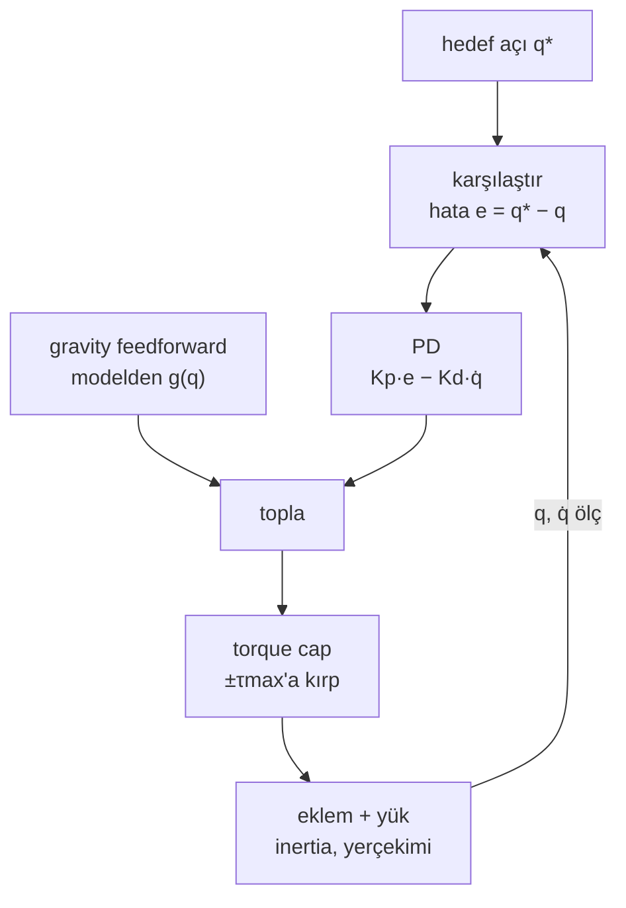
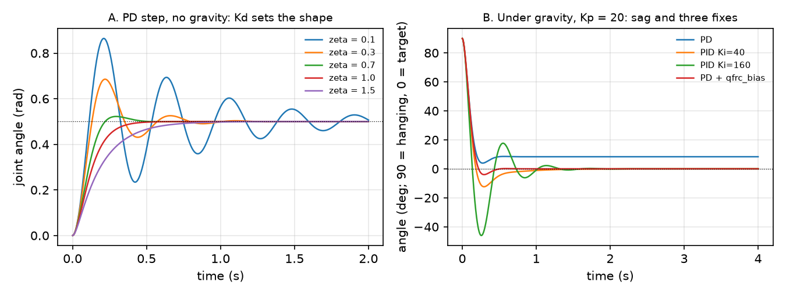

# 12 · Joint control: PD, PID, gravity feedforward ve position servo

<!-- meta -->
| | |
|---|---|
| **Bölüm** | [4 · Dynamics ve control](README.md) |
| **Çalışma türü** | CPU · Mac ya da Colab CPU |
| **Önkoşul** | [05](../part-1-simulation/05-joints-and-actuators.md), [11](11-rigid-body-dynamics.md) |
| **Önce öğren** | [Calculus for Machine Learning](https://aiengineeringfromscratch.com/lesson?path=phases/01-math-foundations/04-calculus-for-ml) |
| **Süre** | ~60 dk |
| **Kod** | [`experiments/12-joint-control/experiment.py`](../../experiments/12-joint-control/experiment.py) · [notebook](../../notebooks/12-joint-control.ipynb) |
| **Durum** | ✅ tam |
<!-- /meta -->

> Policy "joint bu açıya" der. Joint'in oraya nasıl gideceğine iki sayı, Kp ve Kd karar verir; yerçekimini tek başlarına düzeltemezler.

## Problem

Unitree Go2'nun 12 bacak joint'i var. Unitree'nin açık eğitim kodunda her biri aynı PD kuralıyla (proportional–derivative: bir yay artı bir sönümleyici) sürülüyor: `stiffness = 20` (Kp, N·m/rad), `damping = 0.5` (Kd, N·m·s/rad), `control_type = 'P'` ([`go2_config.py`](https://github.com/unitreerobotics/unitree_rl_gym/blob/main/legged_gym/envs/go2/go2_config.py)):

```python
# legged_robot.py · _compute_torques
torques = self.p_gains*(actions_scaled + self.default_dof_pos - self.dof_pos) - self.d_gains*self.dof_vel
return torch.clip(torques, -self.torque_limits, self.torque_limits)
```

([`legged_robot.py`](https://github.com/unitreerobotics/unitree_rl_gym/blob/main/legged_gym/envs/base/legged_robot.py)). Policy hedefi her 20 ms'de bir güncelliyor (`sim.dt = 0.005`, `decimation = 4`, [`legged_robot_config.py`](https://github.com/unitreerobotics/unitree_rl_gym/blob/main/legged_gym/envs/base/legged_robot_config.py)); Unitree'nin gerçek Go2 için kalkma örneği Kp = 60, Kd = 5 kullanıyor ([`go2_stand_example.cpp`](https://github.com/unitreerobotics/unitree_sdk2/blob/main/example/go2/go2_stand_example.cpp)). Bu sayılar neden çalışıyor, neyi yanlış yapıyor ve bir SO-101 servo'su bunun yerine ne yapıyor?

## Ana fikir

### Sade anlatımla

Eklemi hedefine bir **yayla** (sertliği **Kp**, uzaklaştıkça daha sert çeker) ve bir **amortisörle** (gücü **Kd**, hıza direnir) bağlanmış gibi düşün. Sert yay, zayıf amortisör: hızlı varır, sonra zıplar (**overshoot**); güçlü amortisör: zıplama yok, hareket ağır. Tatlı nokta eklemin ne kadar ağır olduğuna bağlıdır.

Controller her milisaniye tekrarlar: ölç, karşılaştır, düzelt. Yay yalnızca gerildiğinde iter; bu yüzden bir ağırlığı tutarken eklem hedefinin biraz **altında** durur (**sarkma**). Üç çıkış yolu var: daha sert bir yay (sarkma azalır, sıfıra inmez), hata sürdükçe daha sert iten bir **integral** terimi (yavaş, overshoot yapabilir) ya da **feedforward**: ağırlığın torkunu modelden hesaplayıp daha hiç hata oluşmadan ekle.

SO-101'deki gibi bir hobi servo'su bu döngüyü motorun içinde koşar: hedef açı gönderirsin, en fazla **torque cap**'i kadar karşı koyar.



### Kontrol döngüsü kod olarak

```python
integ = 0.0
while True:                               # every dt (1 ms here; inside the servo on a real arm)
    q, qd = read_joint()                  # measure: angle [rad], velocity [rad/s]
    e = q_target - q                      # compare: distance to the target [rad]
    tau = kp * e - kd * qd                # correct: spring toward target, damper against speed
    integ += e * dt                       # PID only: running sum of past error [rad*s]
    tau += ki * integ                     # PID only: push harder the longer the error lasts
    tau += gravity_torque(q)              # feedforward only: cancel the known load (qfrc_bias)
    tau = np.clip(tau, -tau_max, tau_max) # the motor cannot give more than its cap
    apply_torque(tau)
```

| Formül | Ne söylüyor |
|---|---|
| $\tau = K_p (q^* - q) - K_d \dot q$ | PD kuralı (yay + sönümleyici) |
| $I\ddot q + K_d \dot q + K_p q = K_p q^*$ | kapalı döngü bir kütle–yay–sönümleyicidir |
| $\omega_n = \sqrt{K_p / I}$ | hız; settling süresi $1/\omega_n$ ile ölçeklenir |
| $\zeta = \dfrac{K_d}{2\sqrt{K_p I}}$ | şekil: 1'in altında overshoot, 1 kritik, 1'in üstünde sürünme |
| $\zeta<1$ için $\text{overshoot} = e^{-\pi\zeta/\sqrt{1-\zeta^2}}$ | hedefin ötesine salınan adım oranı |
| $K_p\, e = g(q^* - e)$ | sarkma $e$: yay yerçekimini dengeler |

$q$, $q^*$, $\dot q$: açı, hedef, hız; $\tau$: motor torku; $I$: eklemin inertia'sı (ders 11, $M$'nin köşegeni); $K_p$ N·m/rad, $K_d$ N·m·s/rad; $\omega_n$: doğal frekans; $\zeta$: damping oranı; $e = q^* - q$; $g(\cdot)$: yerçekimi torku. Kp hızı, Kd şekli belirler.

**Servo.** Menagerie modelinde her STS3215 bir `position` actuator'ü: kuvvet $= k_p(\text{ctrl} - q) - k_v\dot q$, $k_p = 998{,}22$, $k_v = 2{,}731$, ±2,94 N·m'de kırpılıyor (`so101.xml`): torque cap'li bir PD döngüsü.

<details>
<summary>Matematik ayrıntısı: ikinci derece sistem, overshoot ve yerçekiminin neden PD'den fazlasını istediği</summary>

**Kapalı döngü.** PD kuralını $I\ddot q = \tau$'ya koyup $I$'ya böl: $\ddot q + 2\zeta\omega_n\dot q + \omega_n^2 q = \omega_n^2 q^*$. Kökler $-\zeta\omega_n \pm \omega_n\sqrt{\zeta^2 - 1}$ $\zeta < 1$ için salınır, $\zeta > 1$ için yavaş bir reel kök içerir; bu yüzden overdamping yine yavaş oturur.

**Overshoot.** $\zeta<1$ için step yanıtı $\omega_d = \omega_n\sqrt{1-\zeta^2}$ ile salınır ve ilk tepesi $t = \pi/\omega_d$'dedir; overshoot formülü buradan çıkar. Sabit $\zeta$'da her zaman sabiti $1/\omega_n$'in katıdır; bu yüzden Kp dört katına çıkınca settling süresi yarıya iner.

**Yerçekimi sarkması.** Dururken $K_p e = g(q^* - e)$: sonlu her $K_p$ için sıfır olmayan bir $e$ (Sıfırdan yaz, Adım 4 çözüyor).

**Integral etkisi.** $+K_i\int e\,dt$ ile denge $e = 0$ ister; bedeli üçüncü dereceden bir döngü ve windup. Feedforward ise, model doğruysa, yerçekimsiz hata dinamiğini bırakır.

Daha derine: [Linear Systems](https://aiengineeringfromscratch.com/lesson?path=phases/01-math-foundations/17-linear-systems); Lynch & Park, [*Modern Robotics*](https://hades.mech.northwestern.edu/index.php/Modern_Robotics), böl. 11 (Robot Control).

</details>

<!-- figure: 12-pd-step -->

## Sıfırdan yaz

Şimdi joint controller'ı yaklaşık 50 satır NumPy ile yazacaksın; her adım Deney'in eklemini koşturan MuJoCo ile karşılaştırılıyor: bir hinge'den 30 cm uzakta 1 kg, 1 ms'lik adımlar. MuJoCo'dan yalnızca sabit sayıları alıyorsun.

Adımları kendi dosyana yaz (örneğin `scratch/my_joint.py`) ve her adımdan sonra çalıştır. Bitmiş fonksiyonlar [`physai/control.py`](../../physai/control.py) içinde; `uv run python experiments/12-joint-control/build.py` altı adımı kontrolleriyle birlikte koşturur (çıktı [`build_output.txt`](../../experiments/12-joint-control/build_output.txt) dosyasında).

### Adım 1 · Yük: tek bir link'te yerçekimi

$q = 0$ yatay ve $q > 0$ aşağıyken kütle $-l\sin q$ yüksekliğindedir; yerçekimi eklemi $mgl\cos q$ ile döndürür. Inertia $ml^2$ artı kütlenin kendi $10^{-4}$ kg·m²'si.

```python
def gravity_torque(q, m, l, g=9.81):
    """Torque gravity puts on a hinge with a point mass m at distance l (q = 0 horizontal, q > 0 down)."""
    return m * g * l * np.cos(q)
```

MuJoCo'nun `qfrc_bias`'ı ters işaretlidir: eklemin yerinde kalmak için *sağlaması* gereken kuvvet.

```text
== Step 1. Gravity torque m g l cos(q) by hand vs MuJoCo ==
inertia: m l^2 + 1e-4 = 0.0901 kg m^2, MuJoCo mass matrix = 0.0901 kg m^2
 q (deg)  ours (N m)  -qfrc_bias (N m)
       0      2.9430            2.9430
      30      2.5487            2.5487
      60      1.4715            1.4715
      90      0.0000            0.0000
     -45      2.0810            2.0810
max difference: 4.7e-16 N m
```

### Adım 2 · Simülatör: tek bir semi-implicit Euler adımı

Bir hinge için Newton $I\ddot q = \tau + \tau_{\text{yük}}$ der. MuJoCo'nun varsayılan `Euler`'inin sırasıyla integre et: önce yeni hız, sonra **yeni** hızdan yeni açı (semi-implicit Euler, ders 11).

```python
def step_joint(q, qd, tau, inertia, dt, load=0.0):
    """One semi-implicit Euler step: new speed from the torques, then new angle from the new speed."""
    qdd = (tau + load) / inertia                   # motor torque plus load torque (e.g. gravity)
    qd = qd + dt * qdd
    q = q + dt * qd                                # uses the updated speed: this is the "semi"
    return q, qd
```

```python
def simulate_joint(torque_fn, q0, inertia, dt, steps, load_fn=None):
    """Run a torque controller on one joint from rest at q0; returns the angle after every step."""
    q, qd, qs = q0, 0.0, []
    for _ in range(steps):
        load = load_fn(q) if load_fn else 0.0
        q, qd = step_joint(q, qd, torque_fn(q, qd), inertia, dt, load)
        qs.append(q)
    return np.array(qs)
```

```text
== Step 2. Semi-implicit Euler by hand vs mj_step (free swing from horizontal, 1 s) ==
angle after 1 s: ours 77.423 deg, MuJoCo 77.423 deg
max |q_ours - q_mujoco| over 1000 steps: 4.4e-16 rad
```

### Adım 3 · PD kuralı

Yay ve sönümleyici, tek satır:

```python
def pd_torque(q, qd, q_target, kp, kd):
    """PD law: a spring toward q_target (stiffness kp) and a damper against the joint speed (kd)."""
    return kp * (q_target - q) - kd * qd
```

```python
I, DT = 1.0 * 0.3 ** 2 + 1e-4, 0.001
kd = 2 * zeta * np.sqrt(20 * I)                     # Kd for a chosen damping ratio
q = simulate_joint(lambda q, qd: pd_torque(q, qd, 0.5, 20, kd), 0.0, I, DT, 4000)
overshoot = (q.max() - 0.5) / 0.5 * 100
```

MuJoCo'da aynı tork bir motor actuator'ünün `d.ctrl[0]`'ına ya da `d.qfrc_applied[0]`'a gider; ikisi de deneniyor.

```text
== Step 3. PD step 0 -> 0.5 rad, Kp = 20, no gravity: overshoot ==
 zeta     Kd  ours %  MuJoCo %  formula %
  0.1  0.268   72.91     72.91      72.92
  0.3  0.805   37.14     37.14      37.23
  0.5  1.342   16.16     16.16      16.30
  0.7  1.879    4.45      4.45       4.60
  1.0  2.685    0.00      0.00       0.00
max |q_ours - q_mujoco| over all runs: 3.3e-16 rad
same loop through qfrc_applied instead of the motor: max diff 0.0e+00 rad
```

Deney'in A bölümündeki sayılar, basamak basamak; ideal sürekli formül 0,01 ile 0,15 puan yukarıda.

### Adım 4 · Yerçekimi altında sarkma

Yükü ekle (`load_fn=lambda q: gravity_torque(q, 1.0, 0.3)`) ve sarkık durumdan (90°) yataya (0°) basamak ver. Dururken ağırlığı yay taşır, $K_p e = mgl\cos e$, bir sabit nokta:

```python
def pd_sag(kp, mgl, iters=200):
    """Steady error e of a PD joint holding a link at horizontal: the fixed point of kp e = mgl cos(e)."""
    e = 0.0
    for _ in range(iters):
        e = mgl * np.cos(e) / kp
    return e
```

```text
== Step 4. PD under gravity, hanging (90 deg) -> horizontal (0 deg), zeta 0.7: sag ==
  Kp  ours (deg)  MuJoCo (deg)  Kp e = mgl cos e (deg)
   5      29.385        29.385                  29.385
  20       8.342         8.342                   8.342
  80       2.106         2.106                   2.106
```

Simülatör, MuJoCo ve formül aynı: sarkma PD kuralına ait.

### Adım 5 · Gravity feedforward

Modelin yerçekimi torkunu daha hiç hata oluşmadan ekle: senin `gravity_torque`'unla $\tau = K_p e - K_d\dot q - g(q)$ (eksi, MuJoCo'nun `+qfrc_bias`'ı).

```python
KD = 2 * 0.7 * np.sqrt(20 * I)                      # 1.879, zeta = 0.7
load = lambda q: gravity_torque(q, 1.0, 0.3)
q = simulate_joint(lambda q, qd: pd_torque(q, qd, 0.0, 20, KD) - load(q), np.pi / 2, I, DT, 4000, load)
```

```text
== Step 5. PD + gravity feedforward, Kp = 20, Kd = 1.879 ==
feedforward                            overshoot (deg)  final err (deg)  t into 0.5 deg (s)
ours: -g(q) at the current q                     4.009            0.000               0.463
MuJoCo: qfrc_bias after mj_forward               4.009            0.000               0.463
MuJoCo: qfrc_bias left by mj_step                3.994            0.000               0.463
max |q_ours - q_fresh|: 4.2e-17 rad
```

Son hata yok oluyor, ama overshoot 4,009°, Deney'de ise 3,994°: Deney `d.qfrc_bias`'ı `mj_step`'ten hemen sonra okuyor, o anda alan hâlâ 1 ms önceki açının değerini tutuyor. Yeniden hesaplarsan (`mj_forward`) ya da kendi $g(q)$'nu kullanırsan 4,009° çıkar. Gerçek robotta bus ve sensör daha fazla gecikme ekler.

### Adım 6 · Limitler: anti-windup ve torque cap

Gerçek donanım integral için bir limit (yoksa şişer: Deney'deki 46,016°) ve motorun torque cap'ini ister. Küçük bir sınıf:

```python
@dataclass
class PID:
    """PD + integral + feedforward, with an anti-windup clamp and the motor's torque limit."""
    kp: float
    kd: float
    ki: float = 0.0
    i_max: float = np.inf      # anti-windup: the integral term may give at most this torque (N m)
    tau_max: float = np.inf    # motor torque limit (N m)
    integ: float = 0.0         # running sum of the error (rad s)

    def __call__(self, q, qd, q_target, dt, tau_ff=0.0):
        self.integ += (q_target - q) * dt
        if self.ki:                                # clamp the sum, not just the output
            lim = self.i_max / self.ki
            self.integ = min(max(self.integ, -lim), lim)
        tau = pd_torque(q, qd, q_target, self.kp, self.kd) + self.ki * self.integ + tau_ff
        return min(max(tau, -self.tau_max), self.tau_max)
```

Clamp *toplamı* sınırlar, böylece boşaltılacak bir şey kalmaz; 3 N·m, integralin gereken en büyük torkunun, $mgl$ = 2,943 N·m'nin hemen üstünde.

```text
== Step 6. Limits: integrator clamp (anti-windup) and torque cap ==
controller                             overshoot (deg)  final err (deg)  t into 0.5 deg (s)
PID Ki = 160                                    46.016            0.000               1.520   peak |tau| 31.67 N m
PID Ki = 160, |Ki integ| <= 3 N m                4.646            0.000               0.685   peak |tau| 31.67 N m
PD + feedforward                                 4.009            0.000               0.463   peak |tau| 31.42 N m
PD + feedforward, |tau| <= 3.5 N m               2.512            0.000               0.607   peak |tau| 3.50 N m
PID Ki = 160, ours vs MuJoCo: max diff 7.5e-17 rad
torque cap, ours (clip in PID) vs MuJoCo (unclipped torque, ctrlrange = +-3.5): max diff 2.2e-16 rad
```

Clamp, Ki = 160 overshoot'unu 46,016°'den 4,646°'ye, ±0,5° içine girme süresini 1,520 s'den 0,685 s'ye indiriyor. Cap'siz ilk komut 31,42 N·m ($K_p$ çarpı 90°); 3,5 N·m'lik cap hareketi yavaşlatıyor (0,607 s) ve yumuşatıyor (2,512°). 2,943 N·m'nin altında link hiç tutulamazdı (C bölümü).

### Elinde kalan

`physai.control` artık `gravity_torque`, `step_joint`, `simulate_joint`, `pd_torque`, `pd_sag` ve `PID` içeriyor. Bir trajectory (ders 13), aynı controller'a hareket eden bir `q_target` vermekten ibaret. [`tests/test_12_joint_control.py`](../../tests/test_12_joint_control.py) bunları MuJoCo'ya ve ζ ile sarkma formüllerine sabitliyor; bir şey değiştirdikten sonra `uv run pytest tests/test_12_joint_control.py` çalıştır.

## Kütüphaneyle kullan

MuJoCo'nun `position` actuator'ü aynı PD kuralıdır, `mj_step` içinde hesaplanır; hedefi gönderirsin:

```xml
<actuator>
  <position joint="j" kp="20" kv="1.879"/>      <!-- or kp="20" dampratio="0.7" -->
</actuator>
```

```python
d.ctrl[0] = q_target          # position actuator: force = kp (ctrl - q) - kv qdot
mujoco.mj_step(m, d)
```

Kendi tork döngün için bir `motor` actuator'ü ya da `qfrc_applied` kullan; `qfrc_bias`'ı `mj_forward` ile yeniden hesapla ya da gövdeye `gravcomp="1"` ver:

```python
mujoco.mj_forward(m, d)                                   # qfrc_bias for the current q
d.ctrl[0] = kp * (q_target - d.qpos[0]) - kd * d.qvel[0] + d.qfrc_bias[0]
mujoco.mj_step(m, d)
```

```text
== Use it. MuJoCo's own position actuator and gravity compensation ==
dampratio="0.7" -> kv = 1.879 (2 zeta sqrt(Kp I) = 1.879)
step 0 -> 0.5 rad: overshoot 4.45 %, max diff to our PD loop 1.1e-16 rad
under gravity, hanging -> horizontal     overshoot (deg)  final err (deg)  qfrc_passive  qfrc_actuator
position actuator                                  0.000            8.342         0.000         -2.912
+ body gravcomp="1"                                4.009            0.000        -2.943          0.000
+ joint actuatorgravcomp="true"                    4.009            0.000         0.000         -2.943
```

`dampratio` senin Kd'ni veriyor; actuator Adım 3 döngünü 1,1e-16 rad farkla tekrarlıyor ve 8,342° sarkıyor; `gravcomp` sarkmayı Adım 5'teki overshoot'la (4,009°) gideriyor.

Aynı iki gain başka yerlerde (birimler farklı: sayıyı asla satırlar arasında kopyalama):

| Nerede | P gain | D gain | Not |
|---|---|---|---|
| physai | `PID.kp` | `PID.kd` | N·m/rad, N·m·s/rad |
| MuJoCo `position` actuator | `kp` | `kv` ya da `dampratio` | SO-101 modeli: `kp="998.22" kv="2.731" forcerange="-2.94 2.94"` ([`so101.xml`](https://github.com/google-deepmind/mujoco_menagerie/blob/f3b6013/robotstudio_so101/so101.xml)) |
| `unitree_rl_gym` config | `stiffness` | `damping` | joint adına göre dict; Go2 için 20 ve 0,5 ([`go2_config.py`](https://github.com/unitreerobotics/unitree_rl_gym/blob/main/legged_gym/envs/go2/go2_config.py)) |
| `unitree_sdk2` düşük seviye komut | `motor_cmd()[i].kp()` | `motor_cmd()[i].kd()` | her komutta, `q`, `dq`, `tau` ile; kalkma örneğinde 60 ve 5 ([`go2_stand_example.cpp`](https://github.com/unitreerobotics/unitree_sdk2/blob/main/example/go2/go2_stand_example.cpp)) |
| Isaac Lab actuator config | `stiffness` ("p-gain") | `damping` ("d-gain") | implicit actuator'ler bunları fizik motoruna verir, explicit olanlar effort'u hesaplar ([`isaaclab.actuators`](https://isaac-sim.github.io/IsaacLab/main/source/api/lab/isaaclab.actuators.html)) |
| LeRobot SO-101 follower (Feetech STS3215) | `P_Coefficient` = 16 | `D_Coefficient` = 32 | servo register değerleri, birimsiz; `I_Coefficient` = 0 ([`config_so_follower.py`](https://github.com/huggingface/lerobot/blob/main/src/lerobot/robots/so_follower/config_so_follower.py)) |

Üç tuzak:

- **Gain, gain değildir.** LeRobot'un 16'lık P katsayısı bir servo register değeri; Menagerie modelinin `kp = 998,22` N·m/rad'ı bu varsayımla türetildi ve "1-to-1 mapping" değil (`so101.xml`). Araç değiştirince yeniden tune et.
- **Bayat `qfrc_bias`.** `mj_step`'ten sonra adımın başındaki değeri tutar (Adım 5: 4,009° yerine 3,994°). Hareket eden çok joint'li bir kolda Coriolis ve merkezkaç torklarını da içerir; yalnız dururken $g(q)$'dur.
- **Bedava gravity compensation.** `gravcomp="1"` ile actuator 0,000 N·m gösteriyor: MuJoCo 2,943 N·m'yi passive olarak kaydediyor, oysa gerçek bir motor bunu sağlamak zorunda. `actuatorgravcomp="true"` onu `qfrc_actuator` altında kaydeder.

## Deney

Tam script: [`experiments/12-joint-control/experiment.py`](../../experiments/12-joint-control/experiment.py). MuJoCo 3.17.0, NumPy 2.5.4, Python 3.14, Apple M5, deterministik, ~2 s.

**A. Damping oranı.** Tek joint, $I$ = 0,0901 kg·m², yerçekimi yok, Kp = 20, 0 → 0,5 rad basamak. *Tahmin et:* overshoot hangi ζ'da kaybolur ve hangi ζ en hızlı oturur?

| ζ | Kd | overshoot % (sim) | formül % | oturma %2 [sn] |
|---|---|---|---|---|
| 0,1 | 0,268 | 72,91 | 72,92 | 2,573 |
| 0,3 | 0,805 | 37,14 | 37,23 | 0,751 |
| 0,5 | 1,342 | 16,16 | 16,30 | 0,538 |
| 0,7 | 1,879 | 4,45 | 4,60 | 0,398 |
| 1,0 | 2,685 | 0,00 | 0,00 | 0,393 |
| 1,5 | 4,027 | 0,00 | 0,00 | 0,716 |

ζ ≈ 0,7–1 en hızlı oturuyor; aşırı sönüm (1,5) yine yavaşlıyor. ζ = 0,7'de Kp dört katına çıkınca oturma yarıya iniyor: Kp 5 / 20 / 80 → ωn 7,45 / 14,90 / 29,80 rad/s → 0,799 / 0,398 / 0,197 s.

**B. Yerçekimi.** Yerçekimiyle ($mgl$ = 2,943 N·m), sarkıktan (90°) yataya (0°), ζ = 0,7.

| Kp | sarkma (sim) | $K_p e = mgl\cos e$'den sarkma |
|---|---|---|
| 5 | 29,385° | 29,385° |
| 10 | 16,193° | 16,193° |
| 20 | 8,342° | 8,342° |
| 40 | 4,204° | 4,204° |
| 80 | 2,106° | 2,106° |

Sonra Kp = 20, Kd = 1,879 ile 8,342°'lik sarkmayı gidermenin üç yolu (4 s simülasyon):

```python
tau = kp * e - kd * qd + ki * integ        # PID
tau += d.qfrc_bias[0]                       # or: gravity feedforward from the model
```

| controller | son hata | overshoot | ±0,5° içine girme süresi |
|---|---|---|---|
| PD | 8,342° | 0,000° | hiç |
| PID, Ki = 10 | 0,603° | 0,365° | 4 s içinde değil |
| PID, Ki = 40 | −0,001° | 12,359° | 1,310 s |
| PID, Ki = 160 | 0,000° | 46,016° | 1,520 s |
| PD + `qfrc_bias` | −0,000° | 3,994° | 0,463 s |

Integral hatayı zaman ya da overshoot karşılığında gideriyor; feedforward hemen, ζ = 0,7 döngüsünün kendi overshoot'uyla gideriyor (bir adım geç: taze `qfrc_bias` ile 4,009°, Sıfırdan yaz, Adım 5).



**C. SO-101 servo'su.** Kol öne uzanmış (bütün joint'ler 0, gripper yaklaşık 39 cm ileride), yük gripper'da, servo'lar 3 s boyunca 0'ı tutuyor.

| yük | yerçekimi torku, omuz | omuz sarkması | servo torku | gripper düşüşü |
|---|---|---|---|---|
| 0,00 kg | −0,573 N·m | 0,033° | −0,573 N·m | 0,03 cm |
| 0,25 kg | −1,363 | 0,078° | −1,364 | 0,09 |
| 0,50 kg | −2,153 | 0,124° | −2,156 | 0,14 |
| 0,70 kg | −2,785 | 0,160° | −2,789 | 0,18 |
| 0,80 kg | −3,101 | 37,403° | −2,940 (cap) | 22,30 |
| 1,00 kg | −3,733 | 37,403° | −2,940 (cap) | 22,30 |

$k_p$ 1000 N·m/rad civarındayken sarkma bir derecenin kesri; ta ki yerçekimi 2,94 N·m'lik cap'i geçene kadar, sonra kol yere düşüyor. Sert bir servo yerçekimini gizler; tork limiti gizlemez.

**D. Go2 vaka çalışması.** Menagerie Go2 bacakları katlı yatıyor (gövde 10 cm'de); 3 s boyunca 12 joint'in hepsine `go2_config.py`'deki `default_joint_angles`'a doğru kırpılmış PD torku veriliyor. Son = 2,5–3 s arası ortalama gövde yüksekliği; overshoot = (tepe − son)/(son − başlangıç); "saturation'daki adımlar" = bir joint'in tork limitinde olduğu adımların payı.

| Kp / Kd | tepe | tepe zamanı | tepede yerdeki ayak | son | overshoot | saturation'daki adımlar |
|---|---|---|---|---|---|---|
| **20 / 0,5** (eğitim) | 25,6 cm | 0,45 s | 4 | **25,2 cm** | %3,0 | %0,0 |
| 5 / 0,5 | 11,1 | 2,92 | 4 | 11,1 | %0,8 | %0,0 |
| 10 / 0,5 | 19,7 | 2,75 | 4 | 19,6 | %0,1 | %0,0 |
| 40 / 0,5 | 36,0 | 0,28 | 2 | 29,1 | %36,4 | %0,5 |
| 80 / 0,5 | **50,8** | 0,33 | **0** | 29,9 | %104,5 | %2,9 |
| 20 / 0 | 26,3 | 0,31 | 4 | 24,7 | **%11,0** | %0,0 |
| 20 / 2 | 25,3 | 1,04 | 4 | 25,2 | %1,2 | %0,0 |
| 60 / 5 (gerçek robot örneğinin gain'leri) | 29,9 | 1,11 | 4 | 29,8 | %0,2 | %0,9 |
| 20 / 0,5 + gövdede 5 kg | 22,7 | 0,38 | 4 | 21,8 | %7,4 | %0,0 |

Hedefler tam tutulsaydı gövde 32,35 cm'de dururdu (ön bacaklar; arka 31,39 cm). 20 / 0,5 ile 25,2 cm'de duruyor, yaklaşık 7 cm aşağıda: B bölümündeki sarkma, on iki joint'te. Eğitimde policy bunu hedefi kaydırarak kapatıyor (`action_scale = 0.25`).

## Boz

**Kp yukarı, Kd sabit.** 80 / 0,5'te gövde t = 0,33 s'de 50,8 cm'ye kadar overshoot yapıyor, **dört ayağın dördü de yerden kesik**, adımların %2,9'unda bir joint saturation'da. Kd sabitken Kp dört katına çıktı, ζ yarıya indi ve biriken enerji robotu fırlatıyor. Kd'yi Kp ile artırmak (60 / 5) %0,2 overshoot ve 29,8 cm'lik duruş veriyor.

**Ki yukarı.** B bölümünde Ki = 160 kalıcı hatayı gideriyor ama 46,016° overshoot yapıyor: integral 90°'lik hareket sırasında şişiyor. Gerçek controller'lar integrator'ı kırpar ya da dondurur (anti-windup) ya da feedforward kullanıp Ki'yi küçük tutar; Sıfırdan yaz, Adım 6'daki 3 N·m'lik clamp onu 4,646°'ye indiriyor.

## Gerçek robotta

- **Go2.** 20 / 0,5, hedefi her 20 ms'de kaydıran bir policy altındaki eğitim gain'leri; `unitree_rl_gym/deploy`'da yalnızca G1, H1 ve H1_2 için gerçek robot config'i var ([`deploy_real/configs`](https://github.com/unitreerobotics/unitree_rl_gym/tree/main/deploy/deploy_real/configs)). SDK kalkma örneği (Kp 60, Kd 5) ara noktalar üzerinden doğrusal interpolasyon yapıyor, fazlar 2 ms'lik 500 ya da daha fazla tick ([`go2_stand_example.cpp`](https://github.com/unitreerobotics/unitree_sdk2/blob/main/example/go2/go2_stand_example.cpp), [Python sürümü](https://github.com/unitreerobotics/unitree_sdk2_python/blob/master/example/go2/low_level/go2_stand_example.py)): 13. dersin trajectory fikri. Buradaki hiçbir Go2 sayısı donanımda ölçülmedi.
- **Model farkları.** Menagerie'nin Go2'su joint damping 2 N·m·s/rad ve friction loss 0,2 N·m ekliyor; eğitimdeki [`go2.urdf`](https://github.com/unitreerobotics/unitree_rl_gym/blob/main/resources/robots/go2/urdf/go2.urdf)'de damping yok ve diz limiti 35,55 N·m (Menagerie: 45,43 N·m). Adımımız 2 ms (eğitim: 5 ms); "Kd = 0" bile damping içeriyor. Nitel sonuçlara güven (Kp 5 kalkamıyor, Kp 80 yerden kesiliyor, 20 / 0,5 yaklaşık 7 cm aşağıda duruyor), tam yüzdelere değil.
- **SO-101.** Follower'ın altı STS3215 servo'su 1/345 dişli oranlı ([LeRobot SO-101 dokümanı](https://huggingface.co/docs/lerobot/so101)); hedef konum gönderirsin, konum döngüsü servo'nun içinde çalışır. C bölümünün sayıları Menagerie modelinden; gerçek kolda henüz ölçülmedi. Prosedür: kolu öne uzat, gripper'a bilinen kütleler as, shoulder_lift'in `Present_Position`'ını oku, servo ısınmadan dur.

## Kendini dene

1. **Kolay.** Bir bilek joint'inin $I$ = 0,01 kg·m² ve Kp = 20 N·m/rad. Hangi Kd ζ = 0,7 verir?
2. **Orta.** B bölümünde hangi Kp, 1 kg'lık, 30 cm'lik link'in PD sarkmasını 1°'nin altına indirir? $K_p e \approx mgl$ kullan.
3. **Zor.** `experiment.py`'de Go2 kuralına bir I terimi ekle. ~7 cm'lik açık 3 s içinde kapanıyor mu? Overshoot'a ve tepede yerdeki ayaklara ne oluyor?

### Cevaplar

1. $K_d = 2\zeta\sqrt{K_p I} = 2 \cdot 0{,}7 \cdot \sqrt{0{,}2} \approx 0{,}63$ N·m·s/rad.
2. $e < 1° = 0{,}01745$ rad için $K_p > 2{,}943 / 0{,}01745 \approx 169$ N·m/rad gerekir (tablonun eğilimi: Kp 80 → 2,106°).
3. Burada hesaplanmadı; koş.

## Akılda kalanlar ve kaynaklar

- PD bir yay–sönümleyicidir: $\zeta = K_d / (2\sqrt{K_p I})$ overshoot'u öngörür (ζ = 0,1'de %72,91'e karşı %72,92); ζ ≈ 0,7–1 en hızlı oturur.
- Yerçekimi altında PD $g/K_p$ kadar sarkar (Kp 20'de 8,342°); PID bunu yavaşça giderir ve windup yapar (Ki 160'ta 46,016°); gravity feedforward bir anda giderir.
- Bir position servo, torque cap'li sert bir PD'dir; Go2'nun 20 / 0,5'i policy olmadan 7 cm aşağıda durur, 80 / 0,5 onu yerden fırlatır.

Sonraki: [ders 13 · Trajectory generation](13-trajectory-generation.md).

Kaynaklar:
- [`unitree_rl_gym`](https://github.com/unitreerobotics/unitree_rl_gym): [`go2_config.py`](https://github.com/unitreerobotics/unitree_rl_gym/blob/main/legged_gym/envs/go2/go2_config.py), [`legged_robot.py`](https://github.com/unitreerobotics/unitree_rl_gym/blob/main/legged_gym/envs/base/legged_robot.py), [`legged_robot_config.py`](https://github.com/unitreerobotics/unitree_rl_gym/blob/main/legged_gym/envs/base/legged_robot_config.py) (BSD-3-Clause, © Unitree Robotics).
- [`unitree_sdk2` · `go2_stand_example.cpp`](https://github.com/unitreerobotics/unitree_sdk2/blob/main/example/go2/go2_stand_example.cpp), [`unitree_sdk2_python` · `go2_stand_example.py`](https://github.com/unitreerobotics/unitree_sdk2_python/blob/master/example/go2/low_level/go2_stand_example.py).
- [LeRobot SO-101 dokümantasyonu](https://huggingface.co/docs/lerobot/so101) (27.10.2026'da okundu).
- [MuJoCo Menagerie](https://github.com/google-deepmind/mujoco_menagerie): `unitree_go2` (BSD-3-Clause, © Unitree Robotics), `robotstudio_so101` (Apache-2.0); [MuJoCo Modeling · actuators](https://mujoco.readthedocs.io/en/stable/modeling.html).
- Lynch & Park, [*Modern Robotics*](https://hades.mech.northwestern.edu/index.php/Modern_Robotics), böl. 11 (Robot Control).
- Ölçülen bütün sayılar: [`experiments/12-joint-control/output.txt`](../../experiments/12-joint-control/output.txt).

> Go2 modeli: MuJoCo Menagerie (Google DeepMind), Unitree Robotics URDF'sinden, BSD-3-Clause. Unitree ve Go2 adları olgusal olarak kullanılıyor; Unitree bu çalışmayı desteklemiyor ya da onaylamıyor.
