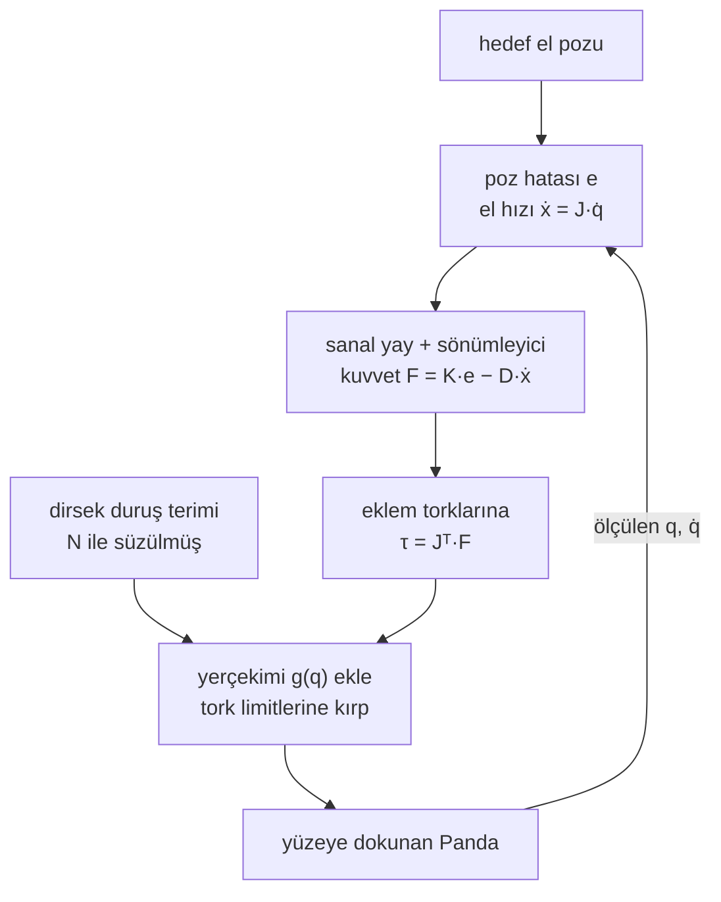

# 14 · Operational-space ve impedance control

<!-- meta -->
| | |
|---|---|
| **Bölüm** | [4 · Dynamics ve control](README.md) |
| **Çalışma türü** | CPU · Mac ya da Colab CPU |
| **Önkoşul** | [11](11-rigid-body-dynamics.md), [12](12-joint-control.md) |
| **Önce öğren** | [Linear Systems](https://aiengineeringfromscratch.com/lesson?path=phases/01-math-foundations/17-linear-systems) |
| **Süre** | ~60 dk |
| **Kod** | [`experiments/14-impedance-control/experiment.py`](../../experiments/14-impedance-control/experiment.py) |
| **Durum** | ✅ tam |
<!-- /meta -->

> Position control "el nerede?" diye sorar. Impedance control "el orada değilken ne kadar sert geri itmeli?" diye sorar.

## Problem

Beklenmedik bir masaya çarpan sert bir position controller bir şey pes edene kadar itmeye devam eder: motorun torque limiti, parça ya da masa. Silme, bir pimi deliğe sokma ya da bir düğmeye basma gibi işler tersini ister: seçilmiş bir stiffness'a sahip yay gibi davranan bir el. libfranka'nın Kartezyen impedance örneği bir Panda'da tam bunu yapıyor: 150 N/m doğrusal stiffness ve 10 N·m/rad dönme stiffness'ı, joint torque'ları her döngüde Jacobian'dan hesaplanıyor ([`cartesian_impedance_control.cpp`](https://github.com/frankarobotics/libfranka/blob/main/examples/cartesian_impedance_control.cpp)). Bu ders o controller'ı ve onun operational-space akrabasını MuJoCo'da torque ile kontrol edilen bir Panda üzerinde kuruyor, sonra stiffness'ın gerçekte ne kazandırdığını görmek için eli sert bir yüzeye bastırıyor.

## Ana fikir

### Sade anlatımla

Position control "tam olarak burada ol" der. Sert gain'lerle, eli rijit bir çubuğa kaynaklanmış gibi davranır: yolda bir masa varsa bir şey pes edene kadar iter. **Impedance control** ise eli hedefine stiffness'ını senin seçtiğin sanal bir yay ve sönümleyiciyle bağlar. Boşlukta el hedefi izler. Masaya dayandığında el durur, yay gerilir ve el *stiffness × hedefin yüzeyin ne kadar gerisinde durduğu* kadar iter. Artık bir konum değil, elin istediğin yerde olmadığında nasıl tepki vereceğini komut ediyorsun. Bir kapı ziline kilitli bir kolla değil, gevşek bir parmakla bastığını düşün.

Eldeki bir itmeyi motor torklarına çevirmek için controller 09. dersin Jacobian'ını tersten kullanır. Jacobian eklem hızlarını el hızına çevirir; transpozu ise bir el kuvvetini eklem torklarına çevirir, bir kaldıraç zinciri gibi.

Gerçek bir kolda çalışması için iki iyileştirme gerekir. Birincisi, kol eli bazı yönlerde iterken diğerlerinden daha ağır hissettirir; yani tek bir yay her eksende farklı bir tepki verir. **Operational-space control** yayı bu hissedilen kütleyle ölçekler, böylece her yön aynı davranır. İkincisi, 7 eklemli bir kolun bir yedek hareketi vardır: el yerinde dururken dirsek salınabilir (**null space**). Eli oynatamayacak şekilde süzülmüş ayrı bir duruş yayı dirseği istediğin yerde tutar.



### Impedance ve operational-space control kod olarak

```python
J = jac_site(q)                       # (6, 7): joint speeds -> hand linear + angular velocity
v = J @ qd                            # hand velocity, (6,)
e = pose_error(x_target, x)           # (6,): position error [m] + orientation error [rad]
Minv = np.linalg.inv(M(q))            # inverse joint-space inertia (lesson 11)
Lam = np.linalg.inv(J @ Minv @ J.T)   # (6, 6): inertia the hand "feels" per direction [kg]

F = K * e - D * v                     # impedance: spring K [N/m], damper D [N s/m] at the hand
# F = Lam @ (kp * e - kd * v)         # operational space: same response in every direction

Jbar = Minv @ J.T @ Lam               # dynamically consistent pseudo-inverse of J
N = np.eye(7) - J.T @ Jbar.T          # null-space filter: keeps only torques that leave the hand still
tau = J.T @ F + N @ (k0 * (q0 - q) - d0 * qd) + g(q)   # hand spring + elbow posture + gravity
```

| Formül | Ne olduğu |
|---|---|
| $\tau = J^\top \big(K e - D\dot x\big) + g(q) \;(+\, C\dot q)$ | task-space PD = impedance control |
| $F = K e$ (bir engele dayanmış, durağan) | tasarladığın contact kuvveti (Hogan 1985) |
| $\Lambda(q) = \big(J M^{-1} J^\top\big)^{-1}$ | kolun elde hissedilen inertia'sı |
| $F = \Lambda\,(k_p e - k_d \dot x)$ | operational-space control: her yönde birim kütle davranışı (Khatib 1987) |
| $N = I - J^\top \bar J^\top, \qquad \bar J = M^{-1}J^\top\Lambda$ | duruş torkları için null-space projector |

Burada $x$, tool centre point'in (TCP, gripper'ın çalışma noktası) pozu, $\dot x = J(q)\dot q$ onun 6 boyutlu hızı (ders 09), $e$ poz hatası (konum ve yönelim için $\tfrac12\sum_i R_i \times R_{d,i}$; şu anki ve istenen rotation matrix'lerin $R_i$ sütunlarından kurulur), $F$ **wrench** (bir kuvvet ile bir torkun birlikte hali, altı sayı), $K, D$ stiffness ve damping, $k_p, k_d$ aynılarının birim kütle başına hali, $M$ joint-space inertia, $g(q)$ yerçekimi, $C\dot q$ Coriolis terimi ve $I$ birim matristir.

Bir engele dayanmış durağan el $F = K e$ ile iter: kuvveti $K$'yi ve hedefin yüzeyin ne kadar ötesinde durduğunu seçerek ayarlarsın. $\Lambda$ yöne ve poza göre değişir; tek bir $K$'nin x, y ve z boyunca farklı tepkiler vermesinin sebebi bu. Tam bir operational-space uygulaması task-space Coriolis terimini de sıfırlar; burada $C\dot q + g$, joint space'te `qfrc_bias` ile sıfırlanıyor (Lynch & Park böl. 11).

**Modelde neyi değiştirdik.** Menagerie'nin Panda'sında position-servo actuator'ler var. Onların `gainprm` ve `biasprm` değerlerini sıfıra çektik (kuvvet üretmiyorlar), kendi torklarımızı `qfrc_applied`'a yazıyoruz ve modelin `forcerange` değerinde kırpıyoruz (joint 1–4 için 87 N·m, joint 5–7 için 12 N·m). `MjSpec` ile flanşın 10,34 cm önüne bir `tcp` site'ı ve hemen önüne 1 cm yarıçaplı bir prob küresi ekliyoruz; B bölümü için elin altına rijit bir blok ekliyoruz ve onunla yalnızca prob çarpışabiliyor (`contype = conaffinity = 2`).

<details>
<summary>Matematik ayrıntısı: J transpoz, elin inertia'sı ve null-space torklarının eli neden rahat bıraktığı</summary>

**Neden $\tau = J^\top F$.** Güç, elde de eklemlerde de sayılsa aynıdır: $F^\top \dot x = F^\top J\dot q = (J^\top F)^\top \dot q$. Yani el wrench'i $F$'yi üreten eklem torkları $J^\top F$'dir (virtual work ilkesi). $J$'nin tersi gerekmez.

**Elin inertia'sı.** $M\ddot q + c = \tau$ ve $\ddot x = J\ddot q + \dot J\dot q$'dan, $\tau = J^\top F + c$ ile: $\ddot x = J M^{-1} J^\top F + \dot J \dot q$. $J M^{-1} J^\top$ matrisi bir el kuvvetini bir el ivmesine çevirir; tersi $\Lambda$ bu yüzden bir kütledir (6 × 6, öteleme bloğu kg cinsinden). $F = \Lambda(k_p e - k_d \dot x)$ seçmek her ekseni $\ddot x \approx k_p e - k_d \dot x$'e, her yönde aynı $\omega_n = \sqrt{k_p}$'ye sahip birim kütleli bir yay–sönümleyiciye çevirir ($\dot J\dot q$ ihmal edilirse).

**Null space.** Bir null-space torku $\tau_0$, $N\tau_0$'a süzülür. Elde yarattığı ivme $J M^{-1} N \tau_0 = \big(J M^{-1} - J M^{-1} J^\top \Lambda J M^{-1}\big)\tau_0 = (JM^{-1} - JM^{-1})\tau_0 = 0$'dır; burada $J M^{-1} J^\top = \Lambda^{-1}$ kullanıldı. "Dynamically consistent"ın anlamı budur: duruş terimi eli itemez, bir el hatasını da düzeltemez.

**Contact kuvveti.** Yerçekimi sıfırlanmış ve el rijit bir yüzeye dayanıp durmuşken controller'ın kuvveti $K e - D\cdot 0$ contact kuvvetiyle dengelenir; yani hiçbir eklem torku kırpılmadığı sürece yüzey $K e$ hisseder. Ondan önceki çarpma farklıdır: hızla gelen $\Lambda_{zz}$ kütleli bir eli contact'ın kendisi durdurur ve tepe kuvvet $K$'ye değil, o contact'ın stiffness'ına bağlıdır.

Daha derine: [Calculus for Machine Learning](https://aiengineeringfromscratch.com/lesson?path=phases/01-math-foundations/04-calculus-for-ml); O. Khatib, [doi:10.1109/JRA.1987.1087068](https://doi.org/10.1109/JRA.1987.1087068); N. Hogan, [doi:10.1115/1.3140702](https://doi.org/10.1115/1.3140702); Lynch & Park, [*Modern Robotics*](https://hades.mech.northwestern.edu/index.php/Modern_Robotics), böl. 11.

</details>

## Deney

Tam script: [`experiments/14-impedance-control/experiment.py`](../../experiments/14-impedance-control/experiment.py). MuJoCo 3.17.0, NumPy 2.5.4, Python 3.14, Apple M5, deterministik, ~3 s. Başlangıç pozu: `home`'dan TCP (50, 0, 30) cm'ye IK, el aşağı bakıyor (q = 0,0, −0,11, −0,0, −2,273, −0,0, 2,163, −0,785).

```python
Lam = np.linalg.inv(J @ Minv @ J.T)
if mode == "impedance":
    F = np.concatenate([K * e[:3] - D * v[:3], Kr * e[3:] - Dr * v[3:]])
else:                                            # operational space
    F = Lam @ (kp * e - kd * v)
tau = J.T @ F + d.qfrc_bias[:7]
tau = np.clip(tau, -lim, lim)
```

**A. x, y, z boyunca 5 cm'lik step'ler** (her biri 2 s; "eksen dışı tepe", hareket etmemesi gereken iki eksen boyunca en büyük hareket). Impedance: K = 600 N/m, D = 50 N·s/m. Operational space: $k_p$ = 100 s⁻², $k_d$ = 14 s⁻¹. *Tahmin et:* hangi controller üç yönde de aynı tepkiyi verir?

| controller | eksen | $\Lambda_{ii}$ | overshoot | ±2 mm'ye giriş süresi | eksen dışı tepe |
|---|---|---|---|---|---|
| impedance | x | 11,87 kg | %13,0 | 0,854 s | 5,43 mm |
| impedance | y | 5,10 kg | %9,8 | 0,532 s | 1,02 mm |
| impedance | z | 6,88 kg | %17,0 | 0,572 s | 5,61 mm |
| operational space | x | 11,87 kg | %3,2 | 0,322 s | 1,70 mm |
| operational space | y | 5,10 kg | %3,8 | 0,304 s | 0,68 mm |
| operational space | z | 6,88 kg | %4,6 | 0,500 s | 2,97 mm |

El x boyunca 11,87 kg, y boyunca ise 5,10 kg hissediyor. Tek bir K ve tek bir D ile impedance control her yönde farklı bir yay–kütle sistemi oluyor (oturma 0,532–0,854 s) ve eksenleri birbirine bağlıyor (5,61 mm eksen dışı). Λ ile ölçeklemek tepkileri birbirine yaklaştırıyor (%3,2–4,6 overshoot) ve eksen dışı hareketi küçültüyor. Kalan farklar bu controller'ın dışarıda bıraktıklarından geliyor (task-space Coriolis, joint damping, torque kırpma).

**A2. Null space.** Operational-space control TCP'yi sabit tutuyor; +y yönünde 20 N'luk bir itme 0,3 s boyunca dirseğe (`link4`) uygulanıyor.

| controller | TCP hatası (en büyük) | sondaki dirsek yer değiştirmesi | sondaki $\|q - q_0\|$ |
|---|---|---|---|
| null-space terimi yok | 14,13 mm | 0,30 cm | 0,124 rad |
| + null-space duruş terimi | 14,14 mm | 0,00 cm | 0,000 rad |

Duruş terimi olmadan fazla serbestlik yönünü hiçbir şey geri getirmiyor: kol, el aynı yerdeyken farklı bir konfigürasyonda kalıyor. İzdüşürülmüş terim el hatasını değiştirmeden onu geri getiriyor.

**B. Bir yüzeye bastır.** Hedef, yüzeyin 3 cm üstünden 5 cm altına rampalanıyor (quintic, 1 s) ve 1,5 s tutuluyor. Impedance control, $D = 2\sqrt{K\Lambda_{zz}}$, $K_r$ = 30 N·m/rad. *Tahmin et:* tutma kuvveti her K için $K \times 5$ cm mi?

| K [N/m] | K × 5 cm | tutma kuvveti | tepe kuvvet | penetration | saturation'daki adımlar | contact kaybı | en büyük eğilme |
|---|---|---|---|---|---|---|---|
| 100 | 5,0 N | 5,00 N | 54,7 N | 0,545 mm | %0,0 | 0 | 0,46° |
| 300 | 15,0 | 14,98 | 74,7 | 0,708 | %0,0 | 0 | 0,56° |
| 1000 | 50,0 | 49,77 | 89,5 | 0,823 | %0,0 | 0 | 0,59° |
| 3000 | 150,0 | 148,45 | 148,5 | 0,888 | %0,0 | 0 | 0,60° |
| 10000 | 500,0 | 483,60 | 1028,1 | 1,823 | %77,9 | 0 | 56,91° |
| 30000 | 1500,0 | 395,95 | 1132,7 | 19,180 | %80,8 | 6 | 96,27° |
| 100000 | 5000,0 | 205,03 | 1245,0 | 21,679 | %81,8 | 10 | 111,22° |


K = 3000'e kadar tutma kuvveti K × 5 cm ile örtüşüyor (K = 3000'de 150 N'a karşı 148,45 N): **kuvvet ölçülmüyor, tasarlanıyor.** Penetration 1 mm'nin altında kalıyor ve onu seçtiğin stiffness değil MuJoCo'nun soft-contact parametreleri belirliyor: kuvvet yaklaşık 30 kat artarken penetration yalnızca 0,545'ten 0,888 mm'ye çıkıyor. Düşük K'daki tepe kuvvet (K = 100'de 5,00 N'luk tutma kuvvetine karşı 54,7 N) çarpmadır: $\Lambda_{zz}$ = 6,88 kg'lık bir el hızla gelir ve arkasında hangi yayı tasarlamış olursan ol, sert contact onu durdurur.

## Boz

K'yı joint'lerin verebileceğinin ötesine çıkar. K = 10000'de komut edilen wrench, adımların %77,9'unda bir joint'in verebileceğinden fazla torque istiyor. Joint başına kırpma her torque'u yasal tutuyor ama gerçekte uygulanan wrench'in yönünü değiştiriyor ve oryantasyon döngüsü kaybediyor: el 56,91° eğiliyor. K = 30000 ve 100000'de eğilme 90°'yi geçiyor, probe yüzeyde zıplıyor (tutma sırasında 6 ve 10 contact kaybı), tutma kuvveti 395,95 ve 205,03 N'a düşüyor ve ölçülen penetration (artık eğilmiş probe boyunca 19,180 ve 21,679 mm) hiç de bir contact özelliği değil. Ders şu: bir stiffness yalnızca torque limitlerine ulaşılmadığı sürece gerçektir. Ulaşıldığında joint'leri tek tek kırpmak yerine komutun tamamını ölçekle ya da wrench'i task space'te sınırla; ders 15 torque limitlerine bir safety aracı olarak geri dönüyor.

## Gerçek robotta

- **Panda.** libfranka'nın örneği $K$ = 150 N/m ve 10 N·m/rad ile $2\sqrt{K}$ damping (birim kütle) kullanıyor ve $\tau_d = J^\top(-K e - D J\dot q) + $ `coriolis` gönderiyor; komuta gravity terimi eklemiyor ([`cartesian_impedance_control.cpp`](https://github.com/frankarobotics/libfranka/blob/main/examples/cartesian_impedance_control.cpp)). Başlamadan önce robotun çarpışma eşiklerini de ayarlıyor (`setCollisionBehavior`). Bizim K = 100–300 satırlarımız bu aralıkta; yukarıdaki sayılar Panda ölçümleri değil, simülasyon sonuçları.
- **SO-101.** LeRobot STS3215 servolarını position modunda çalıştırıyor ([`so_follower.py`](https://github.com/huggingface/lerobot/blob/main/src/lerobot/robots/so_follower/so_follower.py)); joint torque komutu yok, dolayısıyla bu dersin controller'ı onda yazıldığı hâliyle çalışamaz. Oradaki esneklik servonun kendi gain'lerinden ve torque limitinden gelir (ders 12, C bölümü).
- **Contact modelleri farklıdır.** Gerçek contact stiffness'ı, sürtünme ve robotun kendi joint esnekliği çarpma tepesini şekillendirir; 54,7 N'luk sıçrama MuJoCo'nun 2 ms adımdaki soft contact'ının bir özelliğidir ve gerçek bir kuvvet olarak okunmamalıdır.

## Kendini dene

1. **Kolay.** K = 1000 N/m ile 20 N'luk bir bastırma için hedef yüzeyin ne kadar arkasında durmalı?
2. **Orta.** A2 bölümünde TCP hatası null-space terimi olmadan 14,13 mm, onunla 14,14 mm. Null-space terimi neden onu azaltamıyor?
3. **Zor.** B bölümünde joint başına kırpmayı tek tip bir ölçeklemeyle değiştir, $\tau \leftarrow \tau \cdot \min(1, \min_i \tau_{\max,i}/|\tau_i|)$, ve K = 10000'i tekrar koştur. Koşturmadan önce tahmin et: eğilme kaybolur mu? Kuvvete ne olur?

### Cevaplar

1. $e = F/K$ = 20 / 1000 = 2 cm.
2. Dinamik olarak tutarlı izdüşüm $N = I - J^\top \bar J^\top$ ile null-space torque'ları elde hiçbir ivme üretmez; dolayısıyla bir el hatasına ne yol açabilir ne de onu düzeltebilir. 14 mm dirseğe yapılan itmenin kendisinden geliyor ve ona yalnızca controller'ın task-space kısmı direniyor.
3. Burada hesaplanmadı; koştur.

## Akılda kalanlar ve kaynaklar

- $\tau = J^\top F + g$ tasarlanmış bir task-space yayını joint torque'larına çevirir; bir yüzeye karşı kuvvet $K e$'dir (5 cm'de K = 100–3000 için 5,00 / 14,98 / 49,77 / 148,45 N).
- Elin ataleti $\Lambda$ yöne bağlıdır (burada 11,87'ye karşı 5,10 kg); $\Lambda$ ile ölçeklemek (operational space) tekdüze tepkiler verir; null-space izdüşümü fazladan serbestliği olan dirseği eli oynatmadan kontrol eder.
- Stiffness torque limitlerinde biter: onların ötesinde joint başına kırpma eli eğer (K = 10000'de 56,91°) ve kuvvet artık K'yı izlemez.

Sonraki: [ders 15 · Safety: limit'ler, torque cap, e-stop ve watchdog](15-safety.md).

Kaynaklar:
- O. Khatib, "A unified approach for motion and force control of robot manipulators: The operational space formulation", *IEEE Journal on Robotics and Automation* 3(1):43–53, 1987, [doi:10.1109/JRA.1987.1087068](https://doi.org/10.1109/JRA.1987.1087068).
- N. Hogan, "Impedance Control: An Approach to Manipulation: Part I—Theory", *Journal of Dynamic Systems, Measurement, and Control* 107(1):1–7, 1985, [doi:10.1115/1.3140702](https://doi.org/10.1115/1.3140702).
- Lynch & Park, [*Modern Robotics*](https://hades.mech.northwestern.edu/index.php/Modern_Robotics), bölüm 11 (Robot Control: task-space hareket, kuvvet ve impedance control).
- libfranka [`cartesian_impedance_control.cpp`](https://github.com/frankarobotics/libfranka/blob/main/examples/cartesian_impedance_control.cpp); LeRobot [`so_follower.py`](https://github.com/huggingface/lerobot/blob/main/src/lerobot/robots/so_follower/so_follower.py) (27.10.2026'da okundu).
- MuJoCo: [`mj_jacSite`, `mj_fullM`, `mj_contactForce`](https://mujoco.readthedocs.io/en/stable/APIreference/APIfunctions.html); [Menagerie `franka_emika_panda`](https://github.com/google-deepmind/mujoco_menagerie/tree/f3b6013/franka_emika_panda).
- Ölçülen bütün sayılar: [`experiments/14-impedance-control/output.txt`](../../experiments/14-impedance-control/output.txt).
