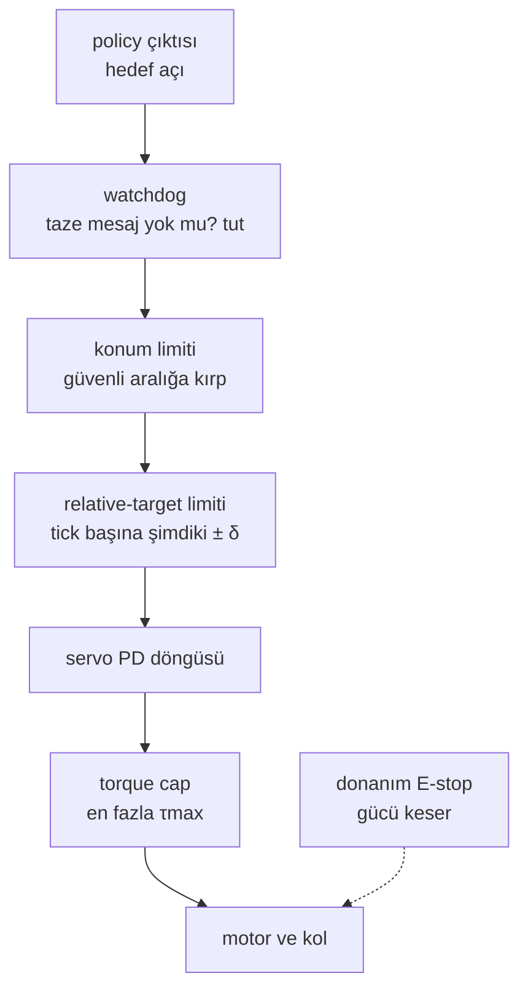
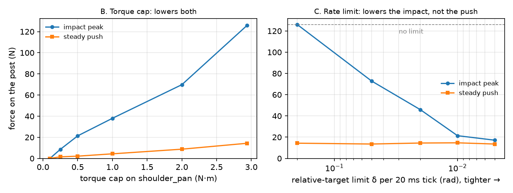

# 15 · Safety: limit'ler, torque cap, e-stop ve watchdog

<!-- meta -->
| | |
|---|---|
| **Bölüm** | [4 · Dynamics ve control](README.md) |
| **Çalışma türü** | CPU · Mac ya da Colab CPU |
| **Önkoşul** | [12](12-joint-control.md) |
| **Önce öğren** | yok |
| **Süre** | ~40 dk |
| **Kod** | [`experiments/15-safety/experiment.py`](../../experiments/15-safety/experiment.py) |
| **Durum** | ✅ tam |
<!-- /meta -->

> Öğrenilmiş bir policy bir gün yanlış bir sayı gönderecek. Safety, o sayı ile motor arasında duran ve yanlış sayıyı ucuza getiren katmandır.

## Problem

LeRobot'un SO-101 follower'ında, yorumuna göre "for safety purposes" var olan bir ayar var: `max_relative_target`, hedefin mevcut pozisyondan ne kadar uzak olabileceğini sınırlıyor ve varsayılan olarak kapalı (`None`) ([`config_so_follower.py`](https://github.com/huggingface/lerobot/blob/main/src/lerobot/robots/so_follower/config_so_follower.py)). Aynı kod tabanı gripper'ın torque limit'ini "to avoid burnout" diye %50'ye ayarlıyor. İkisi de bir policy bir engelin yanında hatalı bir hedef verdiğinde ne olacağını söylemiyor. Bu ders bunu simülasyonda ölçüyor: tek bir hatalı komut, birkaç safeguard, her biriyle ve her biri olmadan kuvvetler.

## Ana fikir

### Sade anlatımla

Öğrenilmiş bir policy'ye yeni bir sürücünün arabasındakini ver. **Konum limiti** bir çittir: hedef güvenli aralığın dışına çıkmaz. **Rate limit** bir hız sınırlayıcıdır: hedef her kontrol tick'inde (komut döngüsünün bir turunda) yalnızca biraz ilerler. **Torque cap** kayan bir debriyajdır: hedef ne kadar yanlış olursa olsun motor daha sert itmez. **Watchdog** trendeki ölü adam pedalıdır: zamanında taze komut yoksa dur. **E-stop** fişi çeker, koruduğu yazılımdan bağımsız olarak.

Her katmanın ne yapabileceğine iki kural karar verir. Birincisi, **bir limit zarar üzerinde değil, tek bir değişken üzerinde çalışır**: torque cap kolun bir engele ne kadar sert itmeye devam ettiğini sınırlar, ama hızlı bir kol yine sert çarpar. İkincisi, **"dur"un ne demek olduğu arayüze bağlıdır**: yeni hedef almayan bir position servo son hedefi tutar; hız komutlarıyla sürülen bir kol hareket etmeye devam eder.



### Güvenlik katmanları kod olarak

```python
def safe_goal(target, q_now, t_now, t_last_msg):
    if t_now - t_last_msg > watchdog_timeout:          # stale command: stop where you are
        return q_now
    goal = np.clip(target, q_min, q_max)               # position limit
    return np.clip(goal, q_now - delta, q_now + delta) # relative-target limit: <= delta rad per tick
# torque cap: set once, enforced by the actuator (MuJoCo: forcerange; STS3215: a register)
```

| Formül | Neyi sınırlar |
|---|---|
| hedef $\leftarrow \text{clip}(\text{hedef},\, q - \delta,\, q + \delta)$ | hedefin hızı: en fazla $\delta/\Delta t$ |
| $F \approx \tau_{\max}/r$ | $r$ kaldıracında bir engele kalıcı itme |
| yol $\approx v\, t_w$ | watchdog devreye girene kadar kolun almaya devam ettiği yol |
| $k_p\,\delta \ge \tau_{\max}$ | doğruysa, takılan bir servo rate limit'e rağmen cap'inde iter |

Burada $q$ şimdiki eklem açısı, $\delta$ hedefin tick başına izin verilen en büyük adımı, $\Delta t$ tick süresi (50 Hz'de 20 ms), $\tau_{\max}$ torque cap, $r$ eklem ekseninden contact'a kaldıraç, $F$ contact kuvveti, $v$ eklem hızı, $t_w$ watchdog timeout'u ve $k_p$ servo'nun stiffness'ıdır (ders 12).

<details>
<summary>Matematik ayrıntısı: torque cap neden itmeyi sınırlar da çarpmayı sınırlamaz</summary>

**Kalıcı itme.** Kol direğe dayanıp durunca eklem torku contact momentini dengeler, $\tau = F r$; cap'te saturation'dayken $F = \tau_{\max}/r$, hız ve contact modeli ne olursa olsun.

**Çarpma.** Kol $\omega$ eklem hızı ve $I$ inertia'sıyla gelir; $k_c$ stiffness'lı bir contact yayı $\tfrac12 I\omega^2$'yi emer, yani tepe $\omega$ ve $\sqrt{k_c}$ ile büyür. Torque cap bunu yalnızca dolaylı sınırlar (daha yavaş ivme); rate limit geliş hızını doğrudan sınırlar.

**Rate limit ve takılan servo.** Bir engele karşı konum değişmeyi bırakır, hedef $\delta$ önde kalır ve servo $k_p\delta$ komut eder; $k_p\delta \ge \tau_{\max}$ olduğunda cap bunu $\tau_{\max}$'a kırpar.

Daha derine: LeRobot [`robots/utils.py`](https://github.com/huggingface/lerobot/blob/main/src/lerobot/robots/utils.py) (`ensure_safe_goal_position`); MuJoCo [Modeling · actuators ve `forcerange`](https://mujoco.readthedocs.io/en/stable/modeling.html); Lynch & Park, [*Modern Robotics*](https://hades.mech.northwestern.edu/index.php/Modern_Robotics), böl. 11.

</details>

## Sıfırdan yaz

Dört katmanı yaklaşık 50 satır NumPy ile yazıp Deney'in komut döngüsüne koyacaksın. Hakem MuJoCo: aynı servo torkları ve katmanların döngüdeyken aynı tablolar. Bitmiş fonksiyonlar [`physai/safety.py`](../../physai/safety.py) içinde; `uv run python experiments/15-safety/build.py` beş adımı yaklaşık 2 s'de koşar (çıktı [`build_output.txt`](../../experiments/15-safety/build_output.txt) içinde).

### Adım 1 · Hedefi kırp

```python
def clamp_goal(target, q_now, q_min=None, q_max=None, delta=None):
    """Position limit, then relative-target limit: the goal stays in [q_min, q_max] and within delta of q_now."""
    goal = target
    if q_min is not None or q_max is not None:
        goal = np.clip(goal, q_min, q_max)                  # a fence around the safe range
    if delta is not None:
        goal = np.clip(goal, q_now - delta, q_now + delta)  # at most delta ahead of where the joint is now
    return goal
```

Önce çit, sonra eklemin *şu anki* yerine göre adım. Kontrol: dört elle hesaplanmış durum, sonra 100.000 rastgele hedef, "mevcut pozisyon artı kırpılmış fark" kuralına karşı:

```text
== Step 1. The goal clamp: position limit 0.3 rad, relative-target limit 0.02 rad ==
  target  q_now    goal
    1.20   0.00   0.020
    1.20   0.29   0.300
    0.25   0.24   0.250
   -1.00  -0.10  -0.120
100000 random: max |goal - q_now| = 0.0200 rad, outside range: 0, vs present + clip(diff): 1.7e-18
goal speed bound delta / tick = 1.00 rad/s
```

İkinci satırda çit kazanıyor (0,31 değil 0,300). 1,00 rad/s'lik sınır eklem için değil hedef için geçerli: Adım 3 1,82 rad/s ölçüyor.

### Adım 2 · Torku sınırla

```python
def servo_torque(goal, q, qd, kp, kv, tau_max):
    """A position servo with a torque cap: kp (goal - q) - kv qd, clipped to +-tau_max."""
    return np.clip(kp * (goal - q) - kv * qd, -tau_max, tau_max)
```

MuJoCo'nun position actuator'ı `ctrl`'ü `ctrlrange`'e kırptıktan sonra `gainprm[0]·ctrl + biasprm[1]·q + biasprm[2]·qdot` hesaplar (`biasprm = (0, −kp, −kv)`) ve sonucu `forcerange`'e kırpar. Kontrol $k_p$, $k_v$ ve aralıkları modelden okur; hedefler joint aralığının çok dışına çıkar:

```text
== Step 2. The capped servo vs MuJoCo's position actuator (SO-101, 2000 random states) ==
kp = 998.22, kv = 2.731, cap = 2.94 N m, pan ctrlrange = [-1.920, 1.920] rad
cap 2.94 N m: max |ours - MuJoCo| = 2.3e-13 N m; cap reached at an error of 2.95 mrad
cap 0.50 N m: max |ours - MuJoCo| = 2.2e-14 N m; cap reached at an error of 0.50 mrad
```

Duran bir eklem 2,94 N·m'lik cap'e 2,95 mrad hatada ulaşıyor; yani her hatalı komutta itmeyi gain'ler değil cap belirler.

### Adım 3 · Katmanları döngüye koy

Döngüde:

```python
lim = (-q_lim, q_lim) if q_lim is not None else (None, None)
d.ctrl[pan] = clamp_goal(target, d.qpos[0], *lim, delta)   # every tick
m.actuator_forcerange[pan] = [-cap, cap]                    # once, before the run
```

Kontrol A bölümünü senin katmanlarınla ve Deney'in döngüsüyle yeniden koşar, sonra contact kaldıracı $r$'yi ölçer:

```text
== Step 3. Part A with our layers in the loop (bad command: pan target 0 -> 1.2 rad at t = 0.1 s) ==
safeguard     peak N  push N  speed   tau  max |ours - Exp.|
none          125.98   14.33   4.49  2.94  0.0e+00
limit 0.3       0.00    0.00   4.02  2.94  0.0e+00
delta 0.02     45.82   14.48   1.82  2.94  0.0e+00
cap 0.5        21.34    2.12   0.75  0.50  0.0e+00
all three       0.00    0.00   0.75  0.50  0.0e+00
steady push vs tau_max / r (r = lever of the post contacts about the pan axis):
  cap 2.94: r = 22.5 cm, tau_max / r = 13.07 N, push 14.33 N
  cap 1.00: r = 22.5 cm, tau_max / r =  4.44 N, push  4.34 N
  cap 0.50: r = 22.6 cm, tau_max / r =  2.22 N, push  2.12 N
stall test: kp * 0.005 = 4.99 N m >= 2.94 N m
```

A bölümünün tablosu, bit bit aynı. $r$ = 22,5 cm ile $\tau_{\max}/r$, ölçülen 2,12 ve 4,34 N'a karşı 2,22 ve 4,44 N, tam cap'te 14,33'e karşı 13,07 N öngörüyor: formül contact'taki sürtünme kuvvetlerini yok sayıyor, oysa onlar da eksen etrafında moment taşıyor. Ve 4,99 N·m ≥ 2,94 N·m: C bölümünün en sıkı δ'sı bile itmeyi sınırlayamaz.

### Adım 4 · Watchdog

```python
class Watchdog:
    """Expires when no fresh command has arrived for longer than `timeout` seconds."""

    def __init__(self, timeout):
        self.timeout, self.last = timeout, None

    def feed(self, t):
        """Call whenever a fresh command arrives at time t."""
        self.last = t

    def expired(self, t):
        return self.last is not None and t - self.last > self.timeout
```

Her mesajda besle; sessiz bir tick'te süresi dolmuş watchdog hızı sıfırlar ve mevcut açıyı tutar:

```python
if msg is not None:
    wd.feed(t)
elif wd.expired(t) and v_cmd != 0.0:
    v_cmd, target = 0.0, d.qpos[0]          # stale command: stop and hold here
```

```text
== Step 4. Watchdog: jog at 1 rad/s, the last message at t = 0.18 s (part D) ==
 timeout s  stopped after s  travel deg  peak N  max |ours - Exp.|
      none            0.350       19.57   24.48  0.0e+00
       0.5            0.350       19.57   24.48  0.0e+00
       0.2            0.230       11.61    0.00  0.0e+00
      0.05            0.090        3.58    0.00  0.0e+00
```

Yine D bölümünün satırları: 0,5 s, kolun direğe ulaşması için gereken 0,350 s'den uzun.

### Adım 5 · E-stop latch'i

```python
class EStop:
    """A latch: one press stops the robot until someone resets it after the cause is gone."""

    def __init__(self):
        self.tripped = False

    def update(self, pressed):
        """Call every tick with the button (or fault) state; returns True while the stop is active."""
        self.tripped = self.tripped or bool(pressed)
        return self.tripped

    def reset(self, pressed):
        """Clear the latch, but only if the button is released."""
        if not pressed:
            self.tripped = False
        return self.tripped
```

Seken bir buton ya da bir tick için kaybolan bir arıza kolu yeniden başlatmamalı; reset ancak buton bırakılınca işler. Kontrol bir tick boyunca basar, sonra E bölümünü latch ile yeniden koşar:

```text
== Step 5. E-stop latch, then part E: stop a 1 rad/s jog at t = 0.2 s ==
pressed for one tick: active [False, True, True, True]; reset while pressed: True; after release: False
stop         travel deg  stopped after s  gripper drop cm  max |ours - Exp.|
hold               0.15            0.030             0.02  0.0e+00
torque off         1.53            0.124            11.74  0.0e+00
```

Latch durup durmamaya karar verir; *nasıl* durulacağı E bölümünün seçimidir. Gerçek bir E-stop ayrıca motor gücünü donanımda keser.

### Elinde kalan

`physai.safety` artık `clamp_goal`, `servo_torque`, `Watchdog` ve `EStop` içeriyor; [ders 40](../part-9-sim-to-real/40-real-so101.md) gerçek SO-101'i bunların arkasında koşar, [ders 41](../part-10-foundation-models-and-agents/41-vla.md) bunları bir modelin çıktısıyla servo'lar arasına koyar. Test: `uv run pytest tests/test_15_safety.py`.

## Kütüphaneyle kullan

MuJoCo'da iki katman `mj_step` içinde uygulanan model özellikleridir, "torque off" ise bir flag'dir:

```python
m.actuator_ctrlrange[pan] = [-0.3, 0.3]          # position limit on the goal (needs ctrllimited)
m.actuator_forcerange[pan] = [-0.5, 0.5]         # torque cap (needs forcelimited)
m.opt.disableflags |= mujoco.mjtDisableBit.mjDSBL_ACTUATION   # every actuator stops producing force
```

```text
== Use it. The position limit and the cap as model attributes (MuJoCo clamps inside mj_step) ==
actuator_ctrlrange = [-0.3, 0.3]: peak   0.00 N, push  0.00 N; vs our layer 0.0e+00
actuator_forcerange = [-0.5, 0.5]: peak  21.34 N, push  2.12 N; vs our layer 0.0e+00
```

Adım limiti, watchdog ve latch senin döngünde yaşar; simülasyonda da robotta da.

| Katman | physai | MuJoCo | LeRobot SO-101 follower | libfranka |
|---|---|---|---|---|
| konum limiti | `clamp_goal(q_min, q_max)` | actuator `ctrlrange` + `ctrllimited` | | |
| adım limiti | `clamp_goal(delta)`, mevcut açıya göre | | `max_relative_target` → `ensure_safe_goal_position`, `Present_Position`'a göre | `limitRate(max_derivatives, commanded, last_commanded)`, son komuta göre |
| torque cap | `servo_torque(tau_max)` | actuator `forcerange` + `forcelimited`; joint `actuatorfrcrange` | gripper `Max_Torque_Limit` 500 | |
| torque off | | `mjDSBL_ACTUATION` | `disable_torque_on_disconnect` | |

Kaynaklar: MuJoCo [XML reference](https://mujoco.readthedocs.io/en/stable/XMLreference.html); LeRobot [`robots/utils.py`](https://github.com/huggingface/lerobot/blob/main/src/lerobot/robots/utils.py), [`so_follower.py`](https://github.com/huggingface/lerobot/blob/main/src/lerobot/robots/so_follower/so_follower.py); libfranka [`rate_limiting.h`](https://github.com/frankarobotics/libfranka/blob/main/include/franka/rate_limiting.h).

Üç tuzak:

- **Mevcut açıya mı, son komuta mı göre?** LeRobot her gönderimden önce `Present_Position`'ı okuyup ona göre kırpar, `clamp_goal` gibi. Son komuta göre çalışan bir limiter (libfranka'nın `limitRate`'i) eklem takılıyken hedefi ilerletmeye devam eder; engel kalkınca kol yetişmek için sıçrar.
- **Birimler.** SO-101 follower beş gövde eklemini varsayılan olarak dereceye (`use_degrees = True`), gripper'ı 0–100'e normalize eder; yani `max_relative_target = 0.02` 0,02 rad değil 0,02° demektir. Ayrıca `ensure_safe_goal_position` `isinstance(max_relative_target, float)` diye bakar: `5` gibi bir tamsayı `TypeError` fırlatır.
- **Bir flag limiti kapatabilir.** `ctrlrange` yalnızca `ctrllimited` açıkken ve global `clampctrl` flag'i kapatılmamışken kırpar; yoksa konum limiti sessizce ortadan kalkar.

## Deney

**Kurulum.** SO-101 (Menagerie `scene.xml`), her joint modelin STS3215 position servo'su ($k_p$ = 998,22, $k_v$ = 2,731, cap ±2,94 N·m; ders 12). Timestep 2 ms, komut döngüsü 50 Hz. Kol pozu: shoulder_lift −0,5, elbow 0,5, wrist 0,8 rad; gripper frame'i (29,4; −0,1; 12,8) cm'de. Sabit bir direk (2 × 2 × 20 cm) gripper'ın savrulma yolunda, pan ≈ 0,6 rad'da duruyor. Döngü Sıfırdan yaz'ın Adım 3'ü; script: [`experiments/15-safety/experiment.py`](../../experiments/15-safety/experiment.py). MuJoCo 3.17.0, NumPy 2.5.4, Python 3.14, Apple M5, deterministik, ~3 s.

**A. Tek bir hatalı komut.** t = 0,1 s'de shoulder_pan hedefi 0 → 1,2 rad sıçrıyor. *Tahmin et:* hangi tek safeguard çarpmayı engeller, hangisi yalnızca yumuşatır?

| safeguard | direkteki tepe kuvvet | kalıcı itme kuvveti | tepe pan hızı | tepe tork |
|---|---|---|---|---|
| yok | 125,98 N | 14,33 N | 4,49 rad/s | 2,94 N·m |
| joint limit \|pan\| ≤ 0,3 rad | 0,00 | 0,00 | 4,02 | 2,94 |
| relative target ≤ 0,02 rad/tick | 45,82 | 14,48 | 1,82 | 2,94 |
| torque cap 0,5 N·m | 21,34 | 2,12 | 0,75 | 0,50 |
| üçü birden | 0,00 | 0,00 | 0,75 | 0,50 |

Contact'ı yalnızca position limit engelliyor, o da yalnızca engelin nerede olduğunu bildiğimiz için. Rate limit çarpmayı azaltıyor (45,82'ye karşı 125,98 N) ama kalıcı itmeyi azaltmıyor. Torque cap ikisini de azaltıyor.

**B. Torque cap sweep'i** (aynı hatalı komut, başka hiçbir şey yok):

| cap [N·m] | 2,94 | 2,00 | 1,00 | 0,50 | 0,25 | 0,10 |
|---|---|---|---|---|---|---|
| tepe kuvvet [N] | 125,98 | 69,79 | 37,96 | 21,34 | 8,57 | 0,00 |
| kalıcı itme [N] | 14,33 | 8,73 | 4,34 | 2,12 | 1,48 | 0,00 |
| tepe hız [rad/s] | 4,49 | 3,16 | 1,58 | 0,75 | 0,33 | 0,08 |

Cap hızı da sınırlıyor; 0,10 N·m'de kol 2 s içinde direğe ulaşmıyor. 0,5 ile 2 N·m arasında kalıcı itme cap ile neredeyse orantılı (2,12, 4,34, 8,73 N): yaklaşık 23 cm'lik bir kaldıraçla $F \approx \tau_{\max}/r$ (Adım 3 22,5 cm ölçüyor).

**C. Relative-target limit δ sweep'i** (hedef her 20 ms'de mevcut ± δ'ya kırpılıyor):

| δ [rad] | yok | 0,2 | 0,05 | 0,02 | 0,01 | 0,005 |
|---|---|---|---|---|---|---|
| çarpma anındaki hız [rad/s] | 4,494 | 4,494 | 2,866 | 1,513 | 0,929 | 0,359 |
| tepe kuvvet [N] | 125,98 | 125,98 | 72,94 | 45,82 | 21,39 | 17,17 |
| kalıcı itme [N] | 14,33 | 14,33 | 13,54 | 14,48 | 14,67 | 13,54 |



Daha küçük δ çarpma hızını ve tepeyi düşürüyor, ama kalıcı itme 14 N civarında kalıyor: kol durunca hedef hâlâ mevcut + δ, ve buradaki her δ için $k_p\,\delta$ ≥ 2,94 N·m (998,22 × 0,005 ≈ 5 N·m).

**D. Watchdog.** Operatör shoulder_pan'ı velocity komutlarıyla 1 rad/s'de jog ediyor (hedef tick başına $v\,\Delta t$ ilerliyor). Son mesaj t = 0,18 s'de geliyor (pan 0,185 rad); bir watchdog mevcut pozisyonu tutana kadar controller o hızı kullanıyor.

| timeout | son mesajdan sonra durdu | sonrasındaki en büyük hareket | direkteki tepe kuvvet |
|---|---|---|---|
| yok | 0,350 s (direk durdurdu) | 19,57° | 24,48 N |
| 1 s | 0,350 s | 19,57° | 24,48 N |
| 0,5 s | 0,350 s | 19,57° | 24,48 N |
| 0,2 s | 0,230 s | 11,61° | 0,00 |
| 0,1 s | 0,130 s | 5,88° | 0,00 |
| 0,05 s | 0,090 s | 3,58° | 0,00 |

Watchdog ancak kol engele ulaşmadan tetiklenirse işe yarar: burada 0,5 s ve 1 s fazla yavaş.

**E. İki durma yolu**, t = 0,2 s'deki aynı 1 rad/s jog'dan:

| durma | durmadan sonraki en büyük pan hareketi | pan şu süre sonra durdu | gripper düşüşü |
|---|---|---|---|
| pozisyonu tut (hedef := mevcut) | 0,15° | 0,030 s | 0,02 cm |
| torque off (actuation kapalı) | 1,53° | 0,124 s | 11,74 cm |

Torque off pan joint'ini yalnızca sürtünmeyle durduruyor ve omzu yerçekimine bırakıyor: gripper 11,74 cm düşüyor, 12,8 cm'den yere. Tutmak daha hızlı durduruyor ve kolu yukarıda tutuyor, ama çalışan bir controller ister.

## Boz

Tek koruma olarak rate limiter'ı kullan. Cömert: tick başına δ = 0,2 rad 10 rad/s demek, servo'nun hiç ulaşmadığı bir hız (4,494 rad/s); koşu limiter yokmuş gibi (125,98 N). Sıkı: δ = 0,005 rad çarpmayı 17,17 N'ye indiriyor, yine de kol hatalı komut sürdükçe 13,54 N ile itiyor. Rate limit bir contact-force limit'i değildir; o iş torque cap'in (B) ya da engellerin yerini bilen bir modelin (A).

## Gerçek robotta

- **SO-101 / LeRobot.** `max_relative_target` varsayılan olarak kapalı (Kütüphaneyle kullan). Bağlanırken LeRobot her STS3215'e position-mode P/I/D katsayılarını 16/0/32 olarak yazıyor ve yalnızca gripper için `Max_Torque_Limit` 500, `Protection_Current` 250 ve `Overload_Torque` 25 ayarlıyor ([`so_follower.py`](https://github.com/huggingface/lerobot/blob/main/src/lerobot/robots/so_follower/so_follower.py)). `disable_torque_on_disconnect = True`, bağlantı kopmasını E bölümünün "torque off"u yapıyor: kolun düşmesini bekle.
- **Gerçek kolda ölçülmedi.** Buradaki çarpma kuvvetleri MuJoCo'nun contact modeline ve 2 ms'lik adıma bağlı. Prosedür: direğin yerine bir mutfak terazisi ya da kuvvet sensörü koy, düşürülmüş torque limit'iyle ona yavaşça jog et (step değil), tepeyi kaydet; en düşük limit'le başla ve yola asla elini koyma. Donanım E-stop'u yukarıdaki tüm yazılım katmanlarından ayrıdır.

## Kendini dene

1. **Kolay.** Torque cap 1,0 N·m ve kol 23 cm iken hangi kalıcı itme kuvvetini beklersin? B bölümüyle karşılaştır.
2. **Orta.** A bölümünde δ = 0,02 rad/tick neden 20 ms'de 0,02 rad'ın ima ettiği 1 rad/s'nin üstünde, 1,82 rad/s'lik bir tepe pan hızı veriyor?
3. **Zor.** Hıza bağlı bir torque cap ekle (0,2 rad/s altında tam cap, üstünde 0,5 N·m) ve A bölümünü yeniden koş. Önce çarpma tepesini ve kalıcı itmeyi tahmin et.

### Cevaplar

1. $1{,}0/0{,}23 \approx 4{,}3$ N; B bölümü 4,34 N ölçüyor.
2. Hedef *mevcut* pozisyona göre ve her 20 ms'de güncelleniyor. Bir tick içinde servo δ kadar hata görüyor ve $k_p\delta$ ≈ 20 N·m, 2,94 N·m'lik cap'ini aşıyor; bu yüzden tam torkla ivmeleniyor, hedefi geçiyor ve frenliyor; hız δ/Δt = 1 rad/s civarında, üstüne çıkan tepelerle salınıyor.
3. Burada hesaplanmadı; koş ve gör.

## Akılda kalanlar ve kaynaklar

- Her safeguard bir değişkeni sınırlar: position limit bilinen çarpışmaları engeller (0 N), torque cap itmeyi sınırlar (0,5 N·m'de 14,33 → 2,12 N), rate limit çarpma hızını sınırlar (4,494 → 0,359 rad/s) ama itmeyi sınırlamaz.
- Watchdog, kol herhangi bir şeye ulaşmadan tetiklenmeli: burada 0,05–0,2 s direkten kaçındı, 0,5 s kaçınamadı.
- "Dur" bir tasarım kararıdır: pozisyonu tutmak 0,030 s'de durduruyor; torque off gripper'ı 11,74 cm düşürüyor.

Sonraki: [ders 16 · Grasping ve scripted pick-and-place](16-grasping-and-pick-place.md).

Kaynaklar:
- LeRobot [`config_so_follower.py`](https://github.com/huggingface/lerobot/blob/main/src/lerobot/robots/so_follower/config_so_follower.py), [`so_follower.py`](https://github.com/huggingface/lerobot/blob/main/src/lerobot/robots/so_follower/so_follower.py), [`robots/utils.py`](https://github.com/huggingface/lerobot/blob/main/src/lerobot/robots/utils.py) (Apache-2.0, 27.10.2026'da okundu).
- libfranka [`rate_limiting.h`](https://github.com/frankarobotics/libfranka/blob/main/include/franka/rate_limiting.h).
- MuJoCo [Modeling · actuator'lar ve `forcerange`](https://mujoco.readthedocs.io/en/stable/modeling.html), [XML reference](https://mujoco.readthedocs.io/en/stable/XMLreference.html), [`mj_contactForce`](https://mujoco.readthedocs.io/en/stable/APIreference/APIfunctions.html); [Menagerie `robotstudio_so101`](https://github.com/google-deepmind/mujoco_menagerie/tree/f3b6013/robotstudio_so101).
- Lynch & Park, [*Modern Robotics*](https://hades.mech.northwestern.edu/index.php/Modern_Robotics), bölüm 11.
- Ölçülen tüm sayılar: [`experiments/15-safety/output.txt`](../../experiments/15-safety/output.txt) ve [`build_output.txt`](../../experiments/15-safety/build_output.txt).
