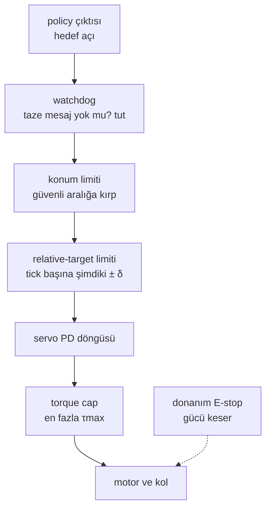

# 15 · Safety: limit'ler, torque cap, e-stop ve watchdog

<!-- meta -->
| | |
|---|---|
| **Bölüm** | [4 · Dynamics ve control](README.md) |
| **Çalışma türü** | CPU · Mac ya da Colab CPU |
| **Önkoşul** | [12](12-joint-control.md) |
| **Önce öğren** | yok |
| **Süre** | ~40 dk |
| **Kod** | [`experiments/15-safety/experiment.py`](../../experiments/15-safety/experiment.py) |
| **Durum** | ✅ tam |
<!-- /meta -->

> Öğrenilmiş bir policy bir gün yanlış bir sayı gönderecek. Safety, o sayı ile motor arasında duran ve yanlış sayıyı ucuza getiren katmandır.

## Problem

LeRobot'un SO-101 follower'ında, kendi yorumuna göre "for safety purposes" var olan bir ayar bulunuyor: `max_relative_target`, hedef pozisyonun mevcut pozisyondan ne kadar uzak olabileceğini sınırlıyor ve varsayılan olarak kapalı (`None`) ([`config_so_follower.py`](https://github.com/huggingface/lerobot/blob/main/src/lerobot/robots/so_follower/config_so_follower.py)). Aynı kod tabanı gripper servo'sunun torque limit'ini "to avoid burnout" diye %50'ye ayarlıyor. İki sayı da bir policy bir insanın ya da bir engelin yanında hatalı bir hedef verdiğinde ne olacağını söylemiyor. Bu ders bunu simülasyonda ölçüyor: tek bir hatalı komut, birkaç safeguard, ve her biriyle ve her biri olmadan çarpma kuvveti, hız ve tork.

## Ana fikir

### Sade anlatımla

Öğrenilmiş bir policy'ye yeni bir sürücü gibi davran ve arabaya güvenlik donanımını tak. **Konum limiti** bir çittir: hedef asla güvenli aralığın dışına çıkamaz. **Hız limiti** (rate limit) bir hız sınırlayıcıdır: hedef her kontrol tick'inde (komut döngüsünün bir turunda) yalnızca biraz ilerleyebilir. **Torque cap** kayan bir debriyajdır: hedef ne kadar yanlış olursa olsun motor bundan sert itmez. **Watchdog** trendeki ölü adam pedalıdır: zamanında taze bir komut gelmezse dur. **E-stop** fişi çeker ve koruduğu yazılıma bağlı olmamalıdır.

Her katmanın ne yapabileceğine iki kural karar verir. Birincisi, **bir limit zarar üzerinde değil, tek bir değişken üzerinde çalışır**: torque cap kolun bir engele ne kadar sert itmeye devam ettiğini sınırlar, ama hızlı bir kol yine sert çarpar; yavaşça savrulan bir çekicin de sert vurması gibi. İkincisi, **"dur"un ne demek olduğu arayüze bağlıdır**: yeni hedef almayan bir position servo son hedefi tutar; hız komutlarıyla sürülen bir kol hareket etmeye devam eder.



### Güvenlik katmanları kod olarak

```python
def safe_goal(target, q_now, t_now, t_last_msg):
    if t_now - t_last_msg > watchdog_timeout:          # stale command: stop where you are
        return q_now
    goal = np.clip(target, q_min, q_max)               # position limit: stay inside the safe range
    goal = np.clip(goal, q_now - delta, q_now + delta) # relative-target limit: <= delta rad per tick
    return goal                                        # the servo then pushes with at most tau_max

# torque cap: set once, enforced by the actuator (MuJoCo: m.actuator_forcerange; STS3215: a register)
```

| Formül | Neyi sınırlar |
|---|---|
| hedef $\leftarrow \text{clip}(\text{hedef},\, q - \delta,\, q + \delta)$ | hedefin hızı: en fazla $\delta/\Delta t$ |
| $F \approx \tau_{\max}/r$ | $r$ kaldıracında bir engele kalıcı itme |
| yol $\approx v\, t_w$ | watchdog devreye girene kadar kolun almaya devam ettiği yol |
| $k_p\,\delta \ge \tau_{\max}$ | doğruysa, takılan bir servo rate limit'e rağmen cap'inde iter |

Burada $q$ şimdiki eklem açısı, $\delta$ hedefin tick başına izin verilen en büyük adımı, $\Delta t$ tick süresi (50 Hz'de 20 ms), $\tau_{\max}$ torque cap, $r$ eklem ekseninden contact noktasına kaldıraç kolu, $F$ contact kuvveti, $v$ eklem hızı, $t_w$ watchdog timeout'u ve $k_p$ servo'nun stiffness'ıdır (ders 12).

| Katman | Neyi sınırlar | Tipik uygulama |
|---|---|---|
| Joint position limit | joint'in nereye gidebileceğini | hedefi mekanik aralığın içindeki bir yazılım aralığına kırp |
| Rate / relative-target limit | hedefin ne hızla değişebileceğini | hedefi her tick'te mevcut ± δ'ya kırp ya da $|\Delta q_{\text{cmd}}|/\Delta t$'yi sınırla |
| Velocity clamp | joint hızını | position-controlled joint'ler için yukarıdakiyle aynı |
| Torque cap | contact'taki kuvveti | actuator force limit'i; servo için torque-limit register'ı |
| Watchdog | bayat komutları | $t_w$ içinde taze mesaj gelmezse: dur ve tut |
| E-stop | her şeyi | gücü kes ya da durma komutu ver; koruduğu yazılıma bağlı olmamalı |

<details>
<summary>Matematik ayrıntısı: torque cap neden itmeyi sınırlar da çarpmayı sınırlamaz</summary>

**Kalıcı itme.** Kol direğe dayanıp durduğunda hiçbir şey ivmelenmez; eklem torku contact kuvvetinin momentini dengeler: $\tau = F r$. Servo cap'inde saturation'dayken $F = \tau_{\max}/r$. Bu, hızdan da contact modelinden de bağımsızdır.

**Çarpma.** Ondan önce kol, eklem etrafında $I$ inertia'sı ve $\omega$ eklem hızıyla gelir. $r$ kaldıracında $k_c$ stiffness'lı basit bir yay-contact modelinde $\tfrac12 I\omega^2$ kinetik enerjisi contact'ı sıkıştırarak emilir; yani tepe kuvvet geliş hızıyla ve $\sqrt{k_c}$ ile büyür. Torque cap tepeyi yalnızca dolaylı olarak, eklemin ne kadar hızlı ivmelenebileceğini sınırlayarak sınırlar (B bölümü hızın cap'le düştüğünü gösteriyor); rate limit ise geliş hızını doğrudan sınırlar.

**Rate limit ve takılan servo.** Hedef şimdiki konumun en fazla $\delta$ önündedir. Serbest harekette bu, hızı $\delta/\Delta t$ civarında sınırlar. Bir engele karşı konum değişmeyi bırakır, hedef $\delta$ önde kalır ve servo $k_p\delta$ komut eder; $k_p\delta \ge \tau_{\max}$ olduğunda cap bunu $\tau_{\max}$'a kırpar.

**Watchdog.** Son mesaj kolu $v$ hızıyla hareket ettiriyorsa kol, timeout devreye girmeden önce yaklaşık $v\, t_w$ kadar yol alır, artı durmak için gereken mesafe. Çarpışmayı ancak bu, engele olan mesafeden kısaysa önler.

Daha derine: LeRobot [`robots/utils.py`](https://github.com/huggingface/lerobot/blob/main/src/lerobot/robots/utils.py) (`ensure_safe_goal_position`); MuJoCo [Modeling · actuators ve `forcerange`](https://mujoco.readthedocs.io/en/stable/modeling.html); Lynch & Park, [*Modern Robotics*](https://hades.mech.northwestern.edu/index.php/Modern_Robotics), böl. 11.

</details>

## Deney

**Kurulum.** SO-101 (Menagerie `scene.xml`), her joint modelin STS3215 position servo'su ($k_p$ = 998,22, $k_v$ = 2,731, cap ±2,94 N·m; ders 12). Timestep 2 ms'ye ayarlı; komut döngüsü 50 Hz'de çalışıyor. Kol pozu: shoulder_lift −0,5, elbow 0,5, wrist 0,8 rad; gripper frame'i (29,4; −0,1; 12,8) cm'de. Sabit bir direk (2 × 2 × 20 cm) gripper'ın savrulma yolunda, pan ≈ 0,6 rad'da duruyor.

```python
goal = target
if pos_limit is not None:
    goal = np.clip(goal, -pos_limit, pos_limit)                       # software joint limit
if rel_limit is not None:
    goal = np.clip(goal, d.qpos[0] - rel_limit, d.qpos[0] + rel_limit)  # LeRobot-style relative target
d.ctrl[pan] = goal                                  # torque cap: m.actuator_forcerange
```

Script'in tamamı: [`experiments/15-safety/experiment.py`](../../experiments/15-safety/experiment.py). MuJoCo 3.17.0, NumPy 2.5.4, Python 3.14, Apple M5, deterministik, ~3 s.

**A. Tek bir hatalı komut.** t = 0,1 s'de shoulder_pan hedefi 0 → 1,2 rad sıçrıyor (bozulmuş bir action). *Tahmin et:* hangi tek safeguard çarpmayı engeller, hangisi yalnızca yumuşatır?

| safeguard | direkteki tepe kuvvet | kalıcı itme kuvveti | tepe pan hızı | tepe tork |
|---|---|---|---|---|
| yok | 125,98 N | 14,33 N | 4,49 rad/s | 2,94 N·m |
| joint limit \|pan\| ≤ 0,3 rad | 0,00 | 0,00 | 4,02 | 2,94 |
| relative target ≤ 0,02 rad/tick | 45,82 | 14,48 | 1,82 | 2,94 |
| torque cap 0,5 N·m | 21,34 | 2,12 | 0,75 | 0,50 |
| üçü birden | 0,00 | 0,00 | 0,75 | 0,50 |

Contact'ı yalnızca position limit engelliyor, o da yalnızca engelin nerede olduğunu bildiğimiz için. Rate limit çarpmayı azaltıyor (45,82'ye karşı 125,98 N) ama kalıcı itmeyi azaltmıyor. Torque cap ikisini de azaltıyor.

**B. Torque cap sweep'i** (aynı hatalı komut, başka hiçbir şey yok):

| cap [N·m] | 2,94 | 2,00 | 1,00 | 0,50 | 0,25 | 0,10 |
|---|---|---|---|---|---|---|
| tepe kuvvet [N] | 125,98 | 69,79 | 37,96 | 21,34 | 8,57 | 0,00 |
| kalıcı itme [N] | 14,33 | 8,73 | 4,34 | 2,12 | 1,48 | 0,00 |
| tepe hız [rad/s] | 4,49 | 3,16 | 1,58 | 0,75 | 0,33 | 0,08 |

Cap hızı da sınırlıyor, çünkü joint daha yavaş ivmeleniyor; 0,10 N·m'de kol 2 s içinde direğe ulaşmıyor. 0,5 ile 2 N·m arasında kalıcı itme cap ile neredeyse orantılı (2,12, 4,34, 8,73 N): yaklaşık 23 cm'lik bir kolla $F \approx \tau_{\max}/r$.

**C. Relative-target limit δ sweep'i** (hedef her 20 ms'de mevcut ± δ'ya kırpılıyor):

| δ [rad] | yok | 0,2 | 0,05 | 0,02 | 0,01 | 0,005 |
|---|---|---|---|---|---|---|
| çarpma anındaki hız [rad/s] | 4,494 | 4,494 | 2,866 | 1,513 | 0,929 | 0,359 |
| tepe kuvvet [N] | 125,98 | 125,98 | 72,94 | 45,82 | 21,39 | 17,17 |
| kalıcı itme [N] | 14,33 | 14,33 | 13,54 | 14,48 | 14,67 | 13,54 |


Tick başına δ = 0,2 rad bu servo için hiç limit değil. Daha küçük δ çarpma hızını ve tepeyi düşürüyor, ama kalıcı itme 14 N civarında kalıyor: kol direğe dayanıp durunca hedef hâlâ mevcut + δ, ve buradaki her δ için $k_p\,\delta$ ≥ 2,94 N·m (998,22 × 0,005 ≈ 5 N·m); yani servo cap'inde itiyor.

**D. Watchdog.** Operatör shoulder_pan'ı velocity komutlarıyla 1 rad/s'de jog ediyor (hedef her tick'te $v\,\Delta t$ kadar ilerliyor). Son mesaj t = 0,18 s'de, pan 0,185 rad'dayken geliyor; bir watchdog tetiklenip mevcut pozisyonu tutmadıkça controller son hızı kullanmaya devam ediyor.

| timeout | son mesajdan sonra durdu | sonrasındaki en büyük hareket | direkteki tepe kuvvet |
|---|---|---|---|
| yok | 0,350 s (direk durdurdu) | 19,57° | 24,48 N |
| 1 s | 0,350 s | 19,57° | 24,48 N |
| 0,5 s | 0,350 s | 19,57° | 24,48 N |
| 0,2 s | 0,230 s | 11,61° | 0,00 |
| 0,1 s | 0,130 s | 5,88° | 0,00 |
| 0,05 s | 0,090 s | 3,58° | 0,00 |

Watchdog ancak kol engele ulaşmadan tetiklenirse işe yarar: burada 0,5 s ve 1 s'lik timeout'lar fazla yavaş. Son mesajdan sonraki hareket, kabaca jog hızıyla, timeout ile birlikte büyüyor.

**E. İki durma yolu**, t = 0,2 s'deki aynı 1 rad/s jog'dan:

| durma | durmadan sonraki en büyük pan hareketi | pan şu süre sonra durdu | gripper düşüşü |
|---|---|---|---|
| pozisyonu tut (hedef := mevcut) | 0,15° | 0,030 s | 0,02 cm |
| torque off (actuation kapalı) | 1,53° | 0,124 s | 11,74 cm |

Torku kesmek pan joint'ini yalnızca sürtünmeyle durduruyor ve omzu yerçekimine bırakıyor: gripper 11,74 cm düşüyor, 12,8 cm'den yere. Pozisyonu tutmak daha hızlı durduruyor ve kolu yukarıda tutuyor, ama controller'ın hâlâ çalışıyor olmasına bağlı.

## Boz

Tek koruma olarak rate limiter'ı kullan ve cömert ayarla: 20 ms'lik tick başına δ = 0,2 rad, 10 rad/s demek; bu servo'nun hiç ulaşmadığı bir hız (4,494 rad/s), dolayısıyla koşu limiter yokmuş gibi aynı (125,98 N). Onun yerine sıkı ayarla: δ = 0,005 rad çarpmayı 17,17 N'ye indiriyor, yine de kol hatalı komut sürdükçe direğe 13,54 N ile itmeye devam ediyor. Normal hareket için ayarlanmış bir limiter bir contact-force limit'i değildir; o iş torque cap'e (B) ya da engellerin nerede olduğunu bilen bir modele (A) düşer.

## Gerçek robotta

- **SO-101 / LeRobot.** `max_relative_target` (varsayılan `None`) her hedefi `ensure_safe_goal_position` ile mevcut ± cap'e kırpıyor ([`robots/utils.py`](https://github.com/huggingface/lerobot/blob/main/src/lerobot/robots/utils.py)); C bölümünde kullanılan kural bu. Bağlanırken LeRobot her STS3215'e position-mode P/I/D katsayılarını 16/0/32 olarak yazıyor ve yalnızca gripper için `Max_Torque_Limit` 500 ("50% of max torque"), `Protection_Current` 250 ve `Overload_Torque` 25 ayarlıyor ([`so_follower.py`](https://github.com/huggingface/lerobot/blob/main/src/lerobot/robots/so_follower/so_follower.py), [`config_so_follower.py`](https://github.com/huggingface/lerobot/blob/main/src/lerobot/robots/so_follower/config_so_follower.py)). `disable_torque_on_disconnect = True`, bağlantı kopmasının E bölümündeki "torque off" gibi davranması demek: kolun düşmesini bekle.
- **Panda.** libfranka'nın impedance örneği harekete başlamadan collision eşiklerini ayarlıyor (`setCollisionBehavior`) ve `rate_limiting.h` dosyası joint ivme, jerk ve torque-rate limit'lerini tanımlıyor (ders 13) ([libfranka](https://github.com/frankarobotics/libfranka)).
- **Gerçek kolda ölçülmedi.** Buradaki çarpma kuvvetleri MuJoCo'nun contact modeline ve 2 ms'lik adıma bağlı. SO-101 için prosedür: direğin olduğu yere bir mutfak terazisi ya da kuvvet sensörü koy, düşürülmüş torque limit'iyle ona doğru yavaş bir jog (step değil) komutla ve tepeyi kaydet; en düşük limit'le başla ve yola asla elini koyma. Motor gücünü kesen bir donanım e-stop'u yukarıdaki tüm yazılım katmanlarından ayrıdır.

## Kendini dene

1. **Kolay.** Torque cap 1,0 N·m ve kol 23 cm iken hangi kalıcı itme kuvvetini beklersin? B bölümüyle karşılaştır.
2. **Orta.** A bölümünde δ = 0,02 rad/tick neden 20 ms'de 0,02 rad'ın ima ettiği 1 rad/s'nin üstünde, 1,82 rad/s'lik bir tepe pan hızı veriyor?
3. **Zor.** Hıza bağlı bir torque cap ekle (0,2 rad/s altında tam cap, üstünde 0,5 N·m) ve A bölümünü yeniden koş. Koşmadan önce tahmin et: çarpma tepesi ve kalıcı itme.

### Cevaplar

1. $1{,}0/0{,}23 \approx 4{,}3$ N; B bölümü 4,34 N ölçüyor.
2. Hedef yalnızca her 20 ms'de güncelleniyor ve *mevcut* pozisyona göre. Bir tick içinde servo δ kadar hata görüyor ve $k_p\delta$ ≈ 20 N·m, 2,94 N·m'lik cap'ini aşıyor; bu yüzden tam torkla ivmeleniyor, hedefi geçiyor ve frenliyor; hız δ/Δt = 1 rad/s civarında, üstüne çıkan tepelerle salınıyor.
3. Burada hesaplanmadı; koş ve gör.

## Akılda kalanlar ve kaynaklar

- Her safeguard bir değişkeni sınırlar: position limit'ler bilinen çarpışmaları engeller (0 N), torque cap'ler itmeyi sınırlar (0,5 N·m'de 14,33 → 2,12 N), rate limit'ler çarpma anındaki hızı sınırlar (4,494 → 0,359 rad/s) ama itmeyi sınırlamaz.
- Watchdog, kol herhangi bir şeye ulaşmadan tetiklenmeli: burada 0,05–0,2 s direkten kaçındı, 0,5 s kaçınamadı.
- "Dur" bir tasarım kararıdır: pozisyonu tutmak 0,030 s'de durduruyor; torque off gripper'ı 11,74 cm düşürüyor.

Sonraki: [ders 16 · Grasping ve scripted pick-and-place](16-grasping-and-pick-place.md).

Kaynaklar:
- LeRobot [`config_so_follower.py`](https://github.com/huggingface/lerobot/blob/main/src/lerobot/robots/so_follower/config_so_follower.py), [`so_follower.py`](https://github.com/huggingface/lerobot/blob/main/src/lerobot/robots/so_follower/so_follower.py), [`robots/utils.py`](https://github.com/huggingface/lerobot/blob/main/src/lerobot/robots/utils.py) (Apache-2.0, 27.10.2026'da okundu).
- libfranka [`cartesian_impedance_control.cpp`](https://github.com/frankarobotics/libfranka/blob/main/examples/cartesian_impedance_control.cpp), [`rate_limiting.h`](https://github.com/frankarobotics/libfranka/blob/main/include/franka/rate_limiting.h).
- MuJoCo [Modeling · actuator'lar ve `forcerange`](https://mujoco.readthedocs.io/en/stable/modeling.html), [`mj_contactForce`](https://mujoco.readthedocs.io/en/stable/APIreference/APIfunctions.html); [Menagerie `robotstudio_so101`](https://github.com/google-deepmind/mujoco_menagerie/tree/f3b6013/robotstudio_so101).
- Lynch & Park, [*Modern Robotics*](https://hades.mech.northwestern.edu/index.php/Modern_Robotics), bölüm 11.
- Ölçülen tüm sayılar: [`experiments/15-safety/output.txt`](../../experiments/15-safety/output.txt).
