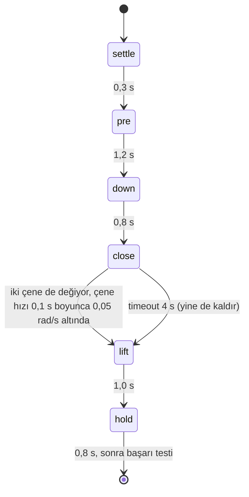
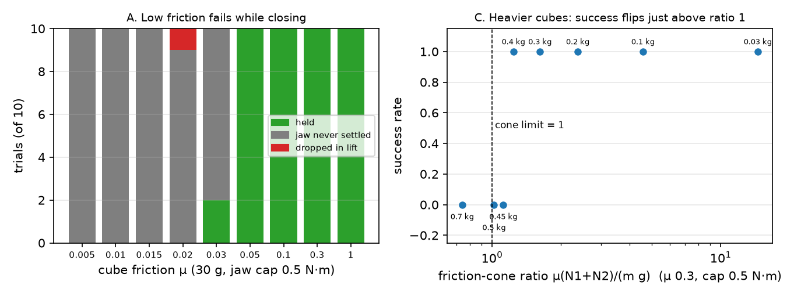

# 16 · Grasping ve scripted pick-and-place

<!-- meta -->
| | |
|---|---|
| **Bölüm** | [4 · Dynamics ve control](README.md) |
| **Çalışma türü** | CPU · Mac ya da Colab CPU |
| **Önkoşul** | [10](../part-3-kinematics/10-inverse-kinematics.md), [13](13-trajectory-generation.md) |
| **Önce öğren** | yok |
| **Süre** | ~60 dk |
| **Kod** | [`experiments/16-grasping-and-pick-place/experiment.py`](../../experiments/16-grasping-and-pick-place/experiment.py) |
| **Durum** | ✅ tam |
<!-- /meta -->

> Bir grasp, yükü sürtünme taşıyabildiğinde tutar. Pick-and-place'teki geri kalan her şey (IK, trajectory'ler, state machine) iki çeneyi bunun doğru olduğu yere koymak için vardır.

## Problem

Bölüm 7 policy'leri demonstration'lardan eğitiyor ve en ucuzları zaten çalışan bir script'ten gelir. Simülasyonda scripted bir pick'i taklit etmek kolaydır: çeneler kapanınca küpü gripper'a weld et, her deneme "başarılı" olsun. Fiziksel soru şu: gerçek bir contact modeliyle ve hiçbir bağlantı olmadan, bir SO-101 3 cm'lik bir küpü ne zaman kaldırır, ne zaman sıkıştırıp fırlatır, düşürür ya da hiç kapanamaz? Cevap [ders 04](../part-1-simulation/04-friction.md)'ün friction cone'undan geliyor ve 240 simüle edilmiş grasp üzerinde ölçülüyor.

## Ana fikir

### Sade anlatımla

Bir küpü iki parmağının arasında sıkıştır: onu alttan hiçbir şey tutmaz, bütün ağırlığı parmak uçlarındaki sürtünme taşır, en fazla *tutunma katsayısı × sıkma* kadar. Daha ağır bir küp kayıp düşer. Islak bir sabun düşük sürtünmeli durumdur: daha sert sıkarsın, parmakların hâlâ hareket ederken sıkarsan sabun fırlar gider.

Script'li bir pick-and-place, bir trafik ışığı gibi küçük bir **state machine**'dir: her state'in bir eylemi (kol hedefi, çene açık ya da kapalı) ve bir çıkış koşulu (bir timer ya da algılanan bir şey) vardır. Script açık çeneleri küpün üstüne getirir, indirir, sensörler grasp'in oluştuğunu söyleyene kadar kapatır, kaldırır ve tutar.



### Grasp testi ve state machine kod olarak

```python
ratio = mu * (N1 + N2) / (m * g)   # N1, N2: normal forces of the two jaws (mj_contactForce)
holds = ratio >= 1.0               # below 1 the cube slides out of the jaws

state = "settle"
while state != "done":
    command_arm_and_jaw(state)     # IK + min-jerk target, jaw open or closed
    if state == "close":           # sensed, not timed (timeout 4 s)
        if both_jaws_touch() and jaw_still(speed=0.05, for_s=0.1) or timed_out(4.0):
            state = "lift"
    elif time_in_state() >= DURATION[state]:
        state = NEXT[state]        # settle -> pre -> down -> close; lift -> hold -> done
```

| Formül | Ne söylüyor |
|---|---|
| $\mu\,(N_1 + N_2) \;\ge\; m g$ | sürtünme ağırlığı taşıyabilir (Lynch & Park, bölüm 12) |
| $\dfrac{\mu (N_1 + N_2)}{m g} \ge 1$ | aynısı oran olarak: friction-cone payı |
| $m_{\max} = \mu (N_1+N_2)/g$ | verilen bir sıkmanın kaldırabileceği en ağır küp |

Burada $\mu$ çene–küp sürtünme katsayısı, $N_1, N_2$ iki çenenin küpe uyguladığı normal kuvvetler, $m$ küpün kütlesi ve $g$ = 9,81 m/s²'dir. Grasp **antipodal**'dır: iki contact normali birbirine bakar, çeneler yatay bastırır ve yukarı doğru yalnızca sürtünme etki eder.

**Gripper ve sürtünme.** SO-101'de sabit bir çene ve menteşeli, hareketli bir çene (`gripper` joint'i) var; bir STS3215 position servo ile sürülüyor. 3 cm'lik bir küpte kapalı limite komutlanan servo torque cap'ine ulaşana kadar iter; sıkmayı cap ve çene kolu belirler. Çene pad'lerinin sürtünmesi 1, priority'si 1; küpe priority 2 veriliyor ki MuJoCo'nun kullandığı onun μ'sü olsun (Kütüphaneyle kullan).

**State'ler.** `pre` açık çeneleri küp merkezinin 5,5 cm üstüne, `down` merkezin 4 mm altına götürür, `close` kol dururken çeneyi 0,3 s'de kapatır, `lift` merkezin 7 cm üstüne çıkar. Kol hedefleri 5 kol joint'i üzerinde damped-least-squares IK'dan gelir (ders 10) ve ders 13'ün quintic'iyle harmanlanır. **Başarı, fiziksel olarak:** sonda küpün altı yerden ≥ 4 cm yukarıda **ve** iki çeneye de değiyor.

<details>
<summary>Matematik ayrıntısı: friction cone, sıkma ve kaldırmanın neden biraz fazlasını istediği</summary>

**Coulomb sürtünmesi.** Her contact'ta teğetsel kuvvet en fazla $\mu N_i$'dir (ders 04). İki teğetsel kuvvet ağırlığı taşır, $f_{t,1} + f_{t,2} = mg$ ve her biri $f_{t,i} \le \mu N_i$; buradan $\mu(N_1 + N_2) \ge mg$.

**Torque cap'ten sıkma.** Takılan bir servo cap'i $\tau_{\max}$ ile iter; $r_j$ çene kolunda hareketli çene yaklaşık $\tau_{\max}/r_j$ ile bastırır, küp dengede kalsın diye sabit çene de aynı kuvvetle karşılık verir. Yani $N_1 + N_2 \approx 2\tau_{\max}/r_j$: kuvvet çeneler arasında bölünmez.

**Kaldırma.** Küpü yukarı $a$ ivmesiyle hızlandırmak $\mu(N_1+N_2) \ge m(g + a)$ ister, durağan oran 1'den biraz fazlasını. Kapanma sırasında çene küpü yana iter; o anda bir contact kuvveti cone'unun dışına çıkarsa küp, durağan test devreye girmeden kayıp gider.

Daha derine: [ders 04 · Friction](../part-1-simulation/04-friction.md); Lynch & Park, [*Modern Robotics*](https://hades.mech.northwestern.edu/index.php/Modern_Robotics), bölüm 12; MuJoCo [Modeling · contact parametreleri](https://mujoco.readthedocs.io/en/stable/modeling.html).

</details>

<!-- figure: 16-grasp-cone -->

## Sıfırdan yaz

Grasp testini, sıkma formülünü ve pick state machine'ini yaklaşık 90 satır NumPy ile yazıp Deney'in SO-101'ini onlarla süreceksin; hakemler MuJoCo'nun contact kuvvetleri ve SciPy. Bitmiş fonksiyonlar [`physai/grasp.py`](../../physai/grasp.py) içinde; `uv run python experiments/16-grasping-and-pick-place/build.py` beş adımı yaklaşık 5 s'de koşar (çıktı [`build_output.txt`](../../experiments/16-grasping-and-pick-place/build_output.txt) içinde).

### Adım 1 · Friction-cone testi

```python
def cone_ratio(mu, normal_forces, mass, g=9.81):
    """Friction-cone margin of an antipodal grasp: mu (N1 + N2) / (m g). Below 1 the object slides out."""
    return mu * np.sum(normal_forces) / (mass * g)
```

```python
def max_mass(mu, normal_forces, g=9.81):
    """The heaviest object this squeeze can hold by friction alone."""
    return mu * np.sum(normal_forces) / g
```

Kontrol, A–C bölümlerinin oran sütunlarını `output.txt`'de basılı sıkma değerlerinden yeniden hesaplar:

```text
== Step 1. The friction-cone ratio from the Experiment's own squeeze forces (output.txt) ==
part A: 6 rows, max |ours - printed ratio| = 0.01
part B: 4 rows, max |ours - printed ratio| = 0.00
part C: 8 rows, max |ours - printed ratio| = 0.00
max_mass: mu 0.05, 12.74 N -> 0.065 kg; mu 0.3, 16.25 N -> 0.497 kg
```

0,01, basılı sıkmanın yuvarlanmasından geliyor. μ = 0,3'te 16,25 N durağan hâlde 0,497 kg tutabilirdi, ama C bölümü 0,45 kg'ı düşürüyor: kaldırma daha fazlasını ister (Adım 5).

### Adım 2 · Tutulan bir grasp'in içine bak

```python
def cone_use(f_contact, mu):
    """How much of its friction cone a contact uses: |tangential| / (mu * normal), from a contact-frame
    force (normal, tangent1, tangent2), the order mj_contactForce returns. Above 1 it slides."""
    f = np.asarray(f_contact, float)
    return np.hypot(f[1], f[2]) / (mu * f[0])
```

Kontrol, bütün çene contact'ları üzerinden küpe gelen dikey kuvveti toplar ve her contact'ın cone'unun ne kadarını kullandığına bakar:

```text
== Step 2. Inside a held grasp (end of the hold, cube in the air) ==
case             contacts  sum Fz N   m g N  max cone use
mu 1.0, 30 g           18     0.294   0.294         0.037
mu 0.3, 0.4 kg          7     3.924   3.924         1.000
```

Ağırlığı tam olarak yalnızca sürtünme taşıyor. 30 g ve μ = 1'de en çok yüklenen contact cone'unun %3,7'sini kullanıyor; 0,4 kg ve μ = 0,3'te (oran 1,24) bazı contact'lar sınırda (1,000), geri kalanını diğerleri taşıyor.

### Adım 3 · Torque cap'ten sıkma

```python
def squeeze_from_cap(tau_max, r_jaw):
    """Squeeze of a stalled parallel jaw: the moving jaw presses tau/r, the fixed jaw pushes back as hard,
    so N1 + N2 = 2 tau / r (the force is not split between the jaws)."""
    return 2 * tau_max / r_jaw
```

Çene kolu $r$ ölçülüyor: hareketli çene contact'larının menteşe etrafındaki moment kolu, normal kuvvetle ağırlıklı. Çenenin statik sürtünmesi, onun $\tau$'nun o kayıp kadar altında ya da üstünde bastırmasına izin verir:

```text
== Step 3. Squeeze from the jaw torque cap (mu = 0.05, 30 g, nominal position) ==
jaw friction loss 0.052 N m; band = 2 (tau +- loss) / r
 cap N m  r_jaw cm  2 tau / r N          band N  squeeze N  N fixed / N moving
    1.00      7.37        27.13  [25.72, 28.54]      26.12               1.002
    0.50      7.42        13.47  [12.07, 14.87]      12.66               1.001
    0.30      7.44         8.07    [6.67, 9.47]       6.68               1.004
```

Sıkma her cap'te bandın içinde ve çeneler eşit bastırıyor (oran 1,00): her biri yaklaşık $\tau/r$ taşıyor, toplam $2\tau/r$. Bunlar nominal pozisyonda tek pick'ler; tablolar 10 pozisyonun ortalaması.

### Adım 4 · State machine

```python
def minjerk(u):
    """Minimum-jerk blend 0 -> 1 over u in [0, 1]: zero velocity and acceleration at both ends."""
    u = min(1.0, max(0.0, u))
    return u ** 3 * (10 - 15 * u + 6 * u * u)
```

```python
class PickMachine:
    """settle -> pre -> down -> close -> lift -> hold -> done. Timed states end after their duration;
    close ends on a sensed condition: both jaws touch and the jaw is still for `still_time` (or a timeout)."""

    NEXT = dict(settle="pre", pre="down", down="close", close="lift", lift="hold", hold="done")
    MOVES = dict(settle=("home", "home"), pre=("home", "pre"), down=("pre", "down"),
                 lift=("down", "lift"), hold=("lift", "lift"))

    def __init__(self, durations, close_timeout=4.0, still_speed=0.05, still_time=0.1, t0=0.0):
        self.dur, self.timeout = durations, close_timeout
        self.still_speed, self.still_time = still_speed, still_time
        self.state, self.t_state, self.still_since, self.close_s = "settle", t0, None, float("nan")

    def command(self, now, poses, jaw_open, jaw_closed):
        """Arm joint targets and jaw target for this step: min-jerk between poses; in close, a jaw ramp."""
        t = now - self.t_state
        if self.state == "close":
            u = minjerk(t / self.dur["close_ramp"])
            return poses["down"], jaw_open + u * (jaw_closed - jaw_open)
        a, b = self.MOVES[self.state]
        q = poses[a] + minjerk(t / self.dur[self.state]) * (poses[b] - poses[a])
        return q, jaw_open if self.state in ("settle", "pre", "down") else jaw_closed

    def update(self, now, both_touch=False, jaw_speed=0.0):
        """Call after every physics step with what the sensors say; returns the (possibly new) state."""
        t = now - self.t_state
        if self.state == "close":
            settled = both_touch and abs(jaw_speed) < self.still_speed and t > self.dur["close_ramp"]
            if not settled:
                self.still_since = None
            elif self.still_since is None:
                self.still_since = now
            if self.still_since is not None and now - self.still_since >= self.still_time:
                self.close_s = t                           # the grip formed: lift
                self.state, self.t_state = "lift", now
            elif t > self.timeout:
                self.state, self.t_state = "lift", now     # lift anyway; the success test will tell
        elif t >= self.dur[self.state] - 1e-9:
            self.state, self.t_state = self.NEXT[self.state], now
        return self.state
```

Döngü hedefleri sorar, MuJoCo'yu adımlar ve çenelerin algıladığını bildirir:

```python
while sm.state != "done":
    d.ctrl[arm], d.ctrl[jaw] = sm.command(d.time, poses, G_OPEN, G_CLOSE)
    mujoco.mj_step(m, d)
    nf, nm = jaw_contacts(m, d)                       # normal force from each jaw (mj_contactForce)
    sm.update(d.time, nf > 0 and nm > 0, d.qvel[jaw_dof])
```

Aynı başlangıçtan Deney'in `scripted_pick`'ine karşı kontrol:

```text
== Step 4. Our state machine vs the Experiment's scripted_pick (nominal pick) ==
minjerk: s(0.5) = 0.500, peak speed 1.8750 (15/8 = 1.875), |v|, |a| at the ends < 6e-04 (finite differences)
ours: held, lift 7.37 cm, jaw forces 39.84 / 39.83 N, close 0.474 s, 2287 steps
Exp.: success True, lift 7.37 cm, jaw forces 39.84 / 39.83 N, close 0.474 s, 2287 steps; max |qpos ours - Exp.| = 0.0e+00
```

2287 adım boyunca son bitine kadar aynı; blend durgun başlıyor ve durgun bitiyor.

### Adım 5 · Sonuçlar ve belirsizlikleri

```python
def pick_outcome(lift, touches_both, closed, min_lift=0.04):
    """Physical success test: lifted at least min_lift (m) and still in both jaws; else why it failed."""
    if lift >= min_lift and touches_both:
        return "held"
    return "dropped" if closed else "not closed"
```

```python
def wilson(k, n, z=1.96):
    """Wilson 95 % interval for a success rate of k out of n trials."""
    p = k / n
    den = 1 + z * z / n
    c = (p + z * z / (2 * n)) / den
    h = z * math.sqrt(p * (1 - p) / n + z * z / (4 * n * n)) / den
    return max(0.0, c - h), min(1.0, c + h)
```

Kontrol üç sweep satırını senin machine'inle yeniden koşar ve Wilson aralığını SciPy'ınkiyle karşılaştırır:

```text
== Step 5. Three sweep rows rerun with our machine (10 positions, seed 0) ==
row           held / not closed / dropped  squeeze N  ratio      Wilson 95%  vs SciPy
A mu 0.03               2 / 8 / 0              12.29   1.25    [0.06, 0.51]   5.6e-06
C 0.4 kg               10 / 0 / 0              16.25   1.24    [0.72, 1.00]   7.4e-06
C 0.45 kg               0 / 0 / 10             16.47   1.12    [0.00, 0.28]   7.4e-06
```

A ve C bölümleri, sayısı sayısına. SciPy $z$ = 1,95996… kullanıyor, sen 1,96; 1e-5 oradan.

### Elinde kalan

`physai.grasp` artık `cone_ratio`, `max_mass`, `cone_use`, `squeeze_from_cap`, `minjerk`, `PickMachine`, `pick_outcome`, `wilson` içeriyor. [Ders 26](../part-7-learning-from-demonstration/26-teleop-replay-data.md) demonstration'ları scripted pick ile kaydeder, [ders 25](../part-7-learning-from-demonstration/25-evaluating-policies.md) başarı oranlarını Wilson aralıklarıyla raporlar. Test: `uv run pytest tests/test_16_grasping_and_pick_place.py`.

## Kütüphaneyle kullan

Contact fiziğine MuJoCo karar verir; senin kodun onu ayarlar ve okur:

```python
geom.priority = 2; geom.friction = [mu, 0.03, 0.003]; geom.condim = 4   # MjSpec: whose mu counts, sliding + torsion
m.opt.cone                                   # 1 = elliptic in the SO-101 model, 0 = pyramidal
mujoco.mj_contactForce(m, d, k, f6)          # contact k: f6[:3] = (normal, tangent1, tangent2), then torques
on_geom2 = d.contact[k].frame.reshape(3, 3).T @ f6[:3]    # world frame; normal points geom1 -> geom2
ci = scipy.stats.binomtest(k, n).proportion_ci(method="wilson")
```

| Parça | physai / bu ders | MuJoCo | SciPy |
|---|---|---|---|
| geçerli sürtünme katsayısı | `cone_ratio`'daki μ | `priority`'si yüksek geom, yoksa `friction`'ın eleman bazında maksimumu | |
| contact kuvveti | `cone_use(f)` girdisi, (normal, t1, t2) | `mj_contactForce`, contact frame'i, önce normal | |
| başarı aralığı | `wilson(k, n)` | | `binomtest(k, n).proportion_ci(method="wilson")` |

Kaynaklar: MuJoCo [Modeling · contact](https://mujoco.readthedocs.io/en/stable/modeling.html), [`mjContact`](https://mujoco.readthedocs.io/en/stable/APIreference/APItypes.html), [`mj_contactForce`](https://mujoco.readthedocs.io/en/stable/APIreference/APIfunctions.html); SciPy [`binomtest`](https://docs.scipy.org/doc/scipy/reference/generated/scipy.stats.binomtest.html).

Üç tuzak:

- **İşaret ve frame.** `mj_contactForce` contact frame'inde verir ve frame'in normali `geom1`'den `geom2`'ye bakar: küp `geom1` ise işareti çevir (Adım 2).
- **Pyramidal cone'ların daha çok satırı var.** `cone="pyramidal"` ile `efc_force` contact başına (normal, teğetler) değil $2(\text{condim} - 1)$ piramit kenarı kuvveti tutar; kuvvetleri `mj_contactForce` üzerinden oku.
- **SciPy'ın varsayılan aralığı Wilson değil.** `proportion_ci()` varsayılan olarak `method="exact"` (Clopper–Pearson, daha geniş) kullanır; tablolarla eşleşmesi için `method="wilson"` ver.

## Deney

Pick, Bölüm 7'nin demonstration kaydetmek için import ettiği tek bir fonksiyon:

```python
def scripted_pick(model, data, cube_pos, record=False):
    """Runs settle -> pre -> down -> close -> lift -> hold in (model, data).
    Returns success, lift_cm, squeeze_N, close_s, ... and with record=True the
    per-step (time, state, qpos, ctrl) trajectory."""
```

Kurulum: SO-101 (Menagerie `scene.xml`, timestep 2 ms), 3 cm küp, `condim` 4, küp sürtünmesi μ, kütle m, çene torque cap'i τ (varsayılan 2,94 N·m). Her sweep değeri (22, 0) cm çevresindeki 2 × 2 cm'lik bir karede düzgün dağılmış 10 küp pozisyonuyla koşuluyor, seed 0. Script: [`experiments/16-grasping-and-pick-place/experiment.py`](../../experiments/16-grasping-and-pick-place/experiment.py). MuJoCo 3.17.0, NumPy 2.5.4, Python 3.14, Apple M5, deterministik, ~30 s.

Nominal pick (μ 1,0, 30 g, varsayılan cap): başarılı, küpün altı 7,37 cm'de, IK hatası 0,18 mm, çene kuvvetleri 39,84 / 39,83 N, kaydedilen 2287 adım. 0,29 N'luk bir küpe yaklaşık 80 N'luk sıkma sürtünmeyi hiç sınamaz; bu yüzden A ve C bölümleri 0,5 N·m'lik cap kullanıyor.

*Tahmin et:* τ = 0,5 N·m'de sıkma yaklaşık 13 N, yani 30 g için cone μ ≈ 0,02'nin altında bozulur. Ölçülen sınır orada mı çıkacak?

**A. Sürtünme sweep'i** (30 g, τ = 0,5 N·m). "close" = close state'inde geçen süre, "sıkma" = state bittiğindeki $N_1 + N_2$ (çenenin kapandığı denemeler üzerinden ortalama). "Wilson %95", n'de k ile tutarlı gerçek başarı oranları aralığıdır; 10 denemeyle geniştir. "Fırladı": küp 30 cm'den uzakta kaldı.

| μ | başarı | Wilson %95 | close | sıkma | $\mu(N_1+N_2)/mg$ | tuttu / kapanmadı / düşürdü; fırladı |
|---|---|---|---|---|---|---|
| 0,005 | 0/10 | [0,00, 0,28] | – | – | – | 0 / 10 / 0; 10 |
| 0,01 | 0/10 | [0,00, 0,28] | – | – | – | 0 / 10 / 0; 10 |
| 0,015 | 0/10 | [0,00, 0,28] | – | – | – | 0 / 10 / 0; 10 |
| 0,02 | 0/10 | [0,00, 0,28] | 1,59 s | 14,21 N | 0,97 | 0 / 9 / 1; 8 |
| 0,03 | 2/10 | [0,06, 0,51] | 1,62 | 12,29 | 1,25 | 2 / 8 / 0; 7 |
| 0,05 | 10/10 | [0,72, 1,00] | 1,63 | 12,74 | 2,16 | 10 / 0 / 0; 0 |
| 0,1 | 10/10 | [0,72, 1,00] | 1,63 | 13,26 | 4,51 | 10 / 0 / 0; 0 |
| 0,3 | 10/10 | [0,72, 1,00] | 1,58 | 14,24 | 14,52 | 10 / 0 / 0; 0 |
| 1,0 | 10/10 | [0,72, 1,00] | 1,56 | 14,91 | 50,65 | 10 / 0 / 0; 0 |

Sınır μ = 0,03 ile 0,05 arasında, tahmine yakın; ama altındaki başarısızlıklar kaldırmadan sonraki düşürmeler **değil**. μ ≤ 0,03'teki 48 başarısız denemenin 47'sinde çene hiç oturmadı: küp çeneler kapanırken onları terk etti (45'i fırladı). Düşük sürtünme, ağırlık önem kazanmadan, sıkma anında başarısız oluyor. Fırlama mesafeleri MuJoCo'nun çok düşük μ'deki soft contact'ını yansıtıyor, gerçek hızları değil.

**B. Çene torque cap'i** (30 g, μ = 0,05):

| τ [N·m] | başarı | close | sıkma | oran | tuttu / kapanmadı / düşürdü; fırladı |
|---|---|---|---|---|---|
| 2,94 | 7/10 | 0,96 s | 88,93 N | 15,11 | 7 / 1 / 2; 3 |
| 1,0 | 10/10 | 0,91 | 27,23 | 4,63 | 10 / 0 / 0; 0 |
| 0,5 | 10/10 | 1,63 | 12,74 | 2,16 | 10 / 0 / 0; 0 |
| 0,3 | 10/10 | 2,65 | 7,04 | 1,20 | 10 / 0 / 0; 0 |
| 0,2 | 0/10 | – | – | – | 0 / 10 / 0; 5 |
| 0,15 | 0/10 | – | – | – | 0 / 10 / 0; 0 |
| 0,1 | 0/10 | – | – | – | 0 / 10 / 0; 0 |

Sıkma cap ile kabaca orantılı artıyor (7,04 → 12,74 → 27,23 N; Adım 3). 0,3 N·m'nin altında çene damping'ine (0,60 N·m·s/rad) ve friction loss'una (0,052 N·m) karşı o kadar yavaş kapanıyor ki 4 s'lik timeout içinde hiç oturmuyor (cap düştükçe close süresi 0,91 → 1,63 → 2,65 s). 2,94 N·m'de 10 küpün 3'ü fırlatılıyor: daha fazla kuvvet her zaman daha iyi grasp demek değil.

**C. Kütle sweep'i** (μ = 0,3, τ = 0,5 N·m):

| m [kg] | 0,03 | 0,1 | 0,2 | 0,3 | 0,4 | 0,45 | 0,5 | 0,7 |
|---|---|---|---|---|---|---|---|---|
| başarı | 10/10 | 10/10 | 10/10 | 10/10 | 10/10 | 0/10 | 0/10 | 0/10 |
| sıkma [N] | 14,24 | 14,95 | 15,52 | 15,87 | 16,25 | 16,47 | 16,61 | 16,90 |
| $\mu(N_1+N_2)/mg$ | 14,52 | 4,57 | 2,37 | 1,62 | 1,24 | 1,12 | 1,02 | 0,74 |
| sonuç | tuttu | tuttu | tuttu | tuttu | tuttu | düşürdü | düşürdü | düşürdü |



Burada hikâyenin tamamı cone: ortalama oranı ≥ 1,24 olan her kütle bütün denemelerde tutuyor, oranı ≤ 1,12 olan her kütle kaldırma sırasında düşüyor. Sınır 1'in biraz üstünde: küpü yukarı ivmelendirmek için gereken ek kuvvet.

## Boz

μ'yü düşür (A bölümü) ya da kütleyi artır (C bölümü); grasp iki şekilde bozulur. Ağır küp, oran ≤ 1,12: cone'un öngördüğü gibi kaldırma sırasında çenelerin arasından aşağı kayıyor. Kaygan küp, μ ≤ 0,015: her değerdeki 10 küpün hepsi çene kapanırken dışarı atılıyor. Statik oranın 1,25 olduğu μ = 0,03'te bile 10 grasp'ten 8'i hiç oluşmuyor. Son grasp üzerindeki cone kontrolü gerekli ama yeterli değil: kapanma da contact'ları cone'larının içinde tutmalı.

## Gerçek robotta

- **SO-101 / LeRobot.** Bağlanırken LeRobot gripper servo'sunu `Max_Torque_Limit` 500, `Protection_Current` 250 ve `Overload_Torque` 25 ile sınırlıyor ([`so_follower.py`](https://github.com/huggingface/lerobot/blob/main/src/lerobot/robots/so_follower/so_follower.py)). Bunların çenede kaç newton-metre olduğu orada belgelenmemiş; Menagerie'deki 2,94 N·m'lik cap bir model parametresi, ölçüm değil.
- **Gerçek kolda henüz ölçülmedi.** Prosedür: iki yüzey bitişinde tartılmış 3 cm'lik küpler; scripted pick'i (kalibrasyondan gelen joint offset'leriyle) sabit pozisyonlarda küp başına 20 kez koş; aynı fiziksel testle puanla (≥ 4 cm kalktı, 1 s tutuldu); k/n'yi Wilson aralığıyla raporla.
- **Sim-to-real farkları.** Gerçek sürtünme statik ve kinetik arasında farklıdır, toz ve aşınmayla değişir (MuJoCo'da tek μ var), pad'ler deforme olur. Sınırın kaymasını bekle; yöntem taşınır.

## Kendini dene

1. **Kolay.** Sıkma $N_1 + N_2$ = 12,74 N ve μ = 0,05 iken cone koşulunun izin verdiği en ağır küp kaç kg?
2. **Orta.** Script `close`'u neden sabit 0,6 s sonra değil de algılanan bir koşulla bitiriyor? B bölümünün close sürelerini kullan.
3. **Zor.** `close` state'i, çene rampası başladığından beri küpün 5 mm'den fazla hareket etmediğini de kontrol etsin; ettiyse iptal etsin (yeniden aç, yeniden yaklaş). A bölümünü yeniden koş. Önce tahmin et: μ = 0,03'teki başarı artar mı?

### Cevaplar

1. $m \le \mu (N_1+N_2)/g = 0{,}05 \cdot 12{,}74 / 9{,}81 \approx 0{,}065$ kg.
2. Close süresi 0,91 s (τ 1,0 N·m) ile 2,65 s (τ 0,3 N·m) arasında değişiyor. Sabit 0,6 s hepsinden kısa; yani çene oturmadan kaldırır. En yavaş cap'e yetecek bir timer ise hızlı cap'lerde zaman kaybettirir.
3. Burada hesaplanmadı; koş ve gör.

## Akılda kalanlar ve kaynaklar

- Friction cone kaldırmayı öngörüyor: sıkma ölçüldüğünde, oranı ≥ 1,24 olanlar 50/50 denemede tuttu, oranı ≤ 1,12 olanlar 30/30 denemede düşürdü (C bölümü).
- Düşük μ'de grasp daha erken, kapanma sırasında bozuluyor (μ ≤ 0,03'te 48 başarısızlığın 47'si); sıkma çene cap'iyle ölçekleniyor ve fazla düşük bir cap 4 s içinde hiç kapanmıyor.
- `scripted_pick` (ve `physai.grasp.PickMachine`) fiziksel olarak doğrulanmış bir demonstration üreticisi: state machine, IK, min-jerk, algılanan bir close koşulu, weld yok.

Sonraki: Bölüm 5 · [ders 17 · Sensor'ler, noise ve filtering](../part-5-perception-and-estimation/17-sensors-noise-filtering.md); demonstration'lar [ders 26](../part-7-learning-from-demonstration/26-teleop-replay-data.md)'da kullanılıyor.

Kaynaklar:
- Lynch & Park, [*Modern Robotics*](https://hades.mech.northwestern.edu/index.php/Modern_Robotics), bölüm 12 (Grasping and Manipulation).
- MuJoCo [Modeling · contact parametreleri (priority, friction)](https://mujoco.readthedocs.io/en/stable/modeling.html), [`mj_contactForce`](https://mujoco.readthedocs.io/en/stable/APIreference/APIfunctions.html); [Menagerie `robotstudio_so101`](https://github.com/google-deepmind/mujoco_menagerie/tree/f3b6013/robotstudio_so101) (Apache-2.0).
- LeRobot [`so_follower.py`](https://github.com/huggingface/lerobot/blob/main/src/lerobot/robots/so_follower/so_follower.py) (27.10.2026'da okundu).
- Ölçülen tüm sayılar: [`experiments/16-grasping-and-pick-place/output.txt`](../../experiments/16-grasping-and-pick-place/output.txt) ve [`build_output.txt`](../../experiments/16-grasping-and-pick-place/build_output.txt).
