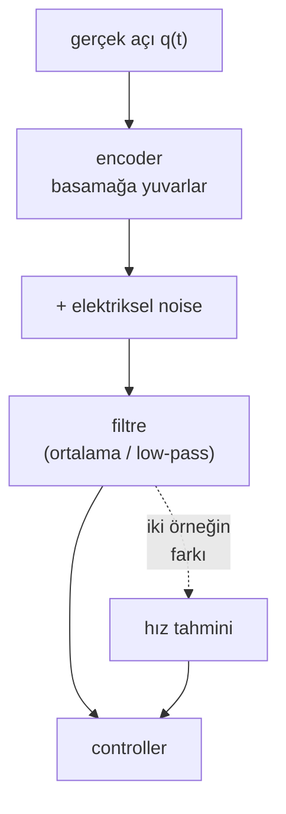

# 17 · Sensor'ler, noise ve filtering

<!-- meta -->
| | |
|---|---|
| **Bölüm** | [5 · Perception ve estimation](README.md) |
| **Çalışma türü** | CPU · Mac ya da Colab CPU |
| **Önkoşul** | [12](../part-4-dynamics-and-control/12-joint-control.md) |
| **Önce öğren** | [Probability and Distributions](https://aiengineeringfromscratch.com/lesson?path=phases/01-math-foundations/06-probability-and-distributions) · [Stochastic Processes](https://aiengineeringfromscratch.com/lesson?path=phases/01-math-foundations/22-stochastic-processes) |
| **Süre** | ~45 dk |
| **Kod** | [`experiments/17-sensors-noise-filtering/experiment.py`](../../experiments/17-sensors-noise-filtering/experiment.py) |
| **Durum** | ✅ tam |
<!-- /meta -->

> Her filtre daha az noise'u delay karşılığında satın alır; doğru pencere, elindeki hareket için iki hatanın eşitlendiği penceredir.

## Problem

Bir joint controller ([ders 12](../part-4-dynamics-and-control/12-joint-control.md)) eklemin konumuna ve hızına ihtiyaç duyar. Gerçek bir kol ikisini de doğrudan vermez. Küçük basamaklarla zıplayan ve elektriksel noise ile titreyen encoder okumaları verir; hızı ise ancak ardışık okumalardan sen hesaplarsan alırsın. Okumaları yumuşatmak titremeyi giderir ama onları geç bırakır; feedback loop'u ise geç veriye kötü tepki verir ([ders 37](../part-9-sim-to-real/37-latency.md)). Bu ders o ödünleşimi simüle edilmiş bir SO-101 ekleminde ölçer ve filtre seçmek için bir kuralla biter.

## Ana fikir

### Sade anlatımla

Titreyen bir hız göstergesi düşün. İbreyi bir kez okursan noisy bir sayı alırsın. Son on okumanın ortalamasını alırsan sayı sakinleşir, ama artık arabanın şu anki değil biraz önceki hızını anlatır. Ne kadar çok okumanın ortalamasını alırsan sayı o kadar sakin ve o kadar eski olur.

Yani her yumuşatma filtresinde ters yöne çeken iki hata vardır:

- **Noise hatası**: titremeden geriye kalan. Daha çok ortalama aldıkça küçülür.
- **Gecikme hatası**: ortalamasını aldığın okumalardan bu yana eklemin ne kadar ilerlediği. Daha çok ortalama aldıkça büyür; eklem hızlı hareket ediyorsa daha da hızlı büyür.

En iyi filtre, ikisinin toplamının en küçük olduğu yerdir. Bu yerin neresi olduğu eklemin ne kadar hızlı hareket ettiğine bağlıdır. Dersin tamamı bu.

### Sinyal zinciri



### İki filtre, kod olarak

Bir sayı akışı üzerinde rolling average yazdıysan ilk filtreyi zaten biliyorsun. Okumalar her `dt` saniyede bir gelir (burada `dt = 0.002`, yani saniyede 500).

```python
# Moving average: son n okumanın ortalaması
def moving_average(z, n):
    return [mean(z[max(0, k - n + 1):k + 1]) for k in range(len(z))]

# Birinci derece low-pass: her yeni okumaya doğru alpha kadar yaklaş
def low_pass(z, fc, dt):
    tau = 1 / (2 * pi * fc)          # filtrenin zaman sabiti (s)
    alpha = dt / (tau + dt)          # küçük alpha = güçlü yumuşatma
    y = [z[0]]
    for zk in z[1:]:
        y.append(y[-1] + alpha * (zk - y[-1]))
    return y
```

Her biri ne kadar geç kalır? `n` okumalık bir moving average, ortalamada penceresinin ortasındaki değeri, yani $(n-1)/2$ örnek önceki değeri raporlar. Low-pass filtre ise yaklaşık zaman sabiti `tau` kadar geç kalır.

| Filtre | Ayar | Delay | Kalan noise (std) |
|---|---|---|---|
| Moving average | pencere $n$ | $\frac{n-1}{2}\,\Delta t$ | $\sigma/\sqrt{n}$ |
| Birinci derece low-pass | cutoff $f_c$ | $\approx \tau = \frac{1}{2\pi f_c}$ | $f_c$ düştükçe azalır |

Burada $\Delta t$ iki okuma arasındaki süre, $\sigma$ tek bir okumanın noise standart sapmasıdır. Gecikme hatası kabaca *hız × delay*'dir: 0,6 rad/s ile dönen bir eklem 16 ms'lik bir filtreden bakınca yaklaşık $0{,}6 \times 0{,}016 \approx 0{,}01$ rad geride görünür.

<details>
<summary>Matematik ayrıntısı: σ/√n ve hata ödünleşimi nereden geliyor</summary>

**Ortalama almak noise'u √n kadar azaltır.** $n$ okuma, varyansı $\sigma^2$ olan bağımsız noise'lar $v_i$ taşıyorsa, ortalamalarındaki noise $\frac1n\sum v_i$'dir ve varyansı $\frac{1}{n^2}\cdot n\sigma^2 = \sigma^2/n$'dir. Standart sapma $\sigma/\sqrt n$ olarak düşer. Bağımsızlık önemlidir: korelasyonlu noise (örneğin yavaş bir drift) bu yolla gitmez.

**Moving average'ın delay'i.** Yavaş değişen bir $q(t)$ sinyali için pencere ortalamasının şu ana göre Taylor açılımı $\frac1n\sum_{i=0}^{n-1} q(t - i\Delta t) \approx q\big(t - \tfrac{n-1}{2}\Delta t\big)$ verir: çıkış, yarım pencere kadar gecikmiş sinyaldir.

**Low-pass filtre.** $y_k = y_{k-1} + \alpha(z_k - y_{k-1})$, $\tau\dot y = z - y$ denkleminin ayrık hâlidir. $f_c = 1/(2\pi\tau)$'nun çok altındaki frekanslarda phase delay'i $\tau$'ya yaklaşır; $f_c$ civarında ve üstünde daha küçüktür. Deney bunu 0,5 Hz'de gösteriyor.

**Ödünleşim.** Delay $t_d$ iken filtrelenmiş konum kabaca $q(t - t_d)$ artı kalan noise'tur; dolayısıyla

$$e_{\text{rms}}^2 \approx \underbrace{\sigma^2\, g(t_d)}_{\text{noise, delay ile düşer}} + \underbrace{\overline{\dot q^{\,2}}\; t_d^2}_{\text{gecikme, delay ile büyür}}$$

burada $g$, $t_d$ büyüdükçe azalır (moving average için $t_d = \frac{n-1}{2}\Delta t$ iken $g = 1/n$). Düşen bir terim ile büyüyen bir terimin toplamının bir minimumu vardır.

**Hız daha zordur.** İki okumadan hız, $(z_{k+1} - z_{k-1})/(2\Delta t)$, onların noise'unu küçük bir sayıya böler: noise yaklaşık $1/\Delta t$ katı büyür. Bu yüzden hız için noise terimi çok daha büyüktür ve minimumu çok daha uzun bir delay'dedir.

Daha derine (random variable, varyans, noise süreçleri): [Probability and Distributions](https://aiengineeringfromscratch.com/lesson?path=phases/01-math-foundations/06-probability-and-distributions), [Stochastic Processes](https://aiengineeringfromscratch.com/lesson?path=phases/01-math-foundations/22-stochastic-processes).
</details>

### Kısaca sensor'ler

| Sensor | Ne raporlar | Tipik hata |
|---|---|---|
| Encoder (turda $N$ sayım) | $2\pi/N$ basamaklarına yuvarlanmış açı | quantization (basamak boyu) + elektriksel noise |
| Gyroscope | açısal hız | yavaş değişen **bias** + noise; bias'ı integre etmek doğrusal olarak kayan bir açı verir |
| Accelerometer | specific force | durağan hâlde sıfır değil **yerçekimi** okur |

MuJoCo sensor'leri (`jointpos`, `jointvel`, `gyro`, `accelerometer`, …) `mjData.sensordata` dizisine tam değerler yazar. `noise` attribute'u yalnızca saklanan metadata'dır: dokümantasyon simülasyonu etkilemediğini söyler ([MuJoCo Modeling · sensors](https://mujoco.readthedocs.io/en/stable/modeling.html#sensor-noise)). Noise'u sen eklersin.

## Deney

**Kurulum.** MuJoCo Menagerie'den SO-101, timestep 2 ms (500 Hz örnekleme). `shoulder_pan`, position actuator'ü üzerinden 10 s boyunca $0{,}5\sin(2\pi\,0{,}2t) + 0{,}2\sin(2\pi\,0{,}5t)$ rad izler. 12-bit bir encoder (turda 4096 sayım, basamak 1,534 mrad) artı beyaz noise $\sigma = 10$ mrad modelliyoruz. Bunlar datasheet değil öğretim değerleri. Hız, filtrelenmiş sinyalin `np.gradient` (central difference) ile türeviyle hesaplanır. Delay, filtrelenmiş sinyalle gerçek sinyali en iyi hizalayan kaydırmadır.

```python
s = spec.add_sensor(name="q_pan", type=mujoco.mjtSensor.mjSENS_JOINTPOS,
                    objname="shoulder_pan", objtype=mujoco.mjtObj.mjOBJ_JOINT)
s.noise = 0.01                          # metadata only
...
z = np.round(q / step) * step + rng.normal(0, SIGMA, q.shape)   # our encoder
y = moving_average(z, n)                # or low_pass(z, fc)
```

**Tahmin et.** Ham hız noise'u yaklaşık $\sqrt2\,\sigma/(2\Delta t) \approx 3{,}5$ rad/s olmalı, yani gerçek hızdan büyük. En iyi konum penceresi kısa, en iyi hız penceresi çok daha uzun olmalı.

**Çalıştır** `uv run python experiments/17-sensors-noise-filtering/experiment.py` (MuJoCo 3.17.0, NumPy 2.5.4, Apple M5, deterministik).

İlk kontroller: `noise=0.01` ile tanımlanan `jointpos` sensor'ü `qpos`'tan tam olarak 0,0 rad farklı. (Sensor'ler `mj_step`'in başında, integrasyondan önceki state'ten hesaplanır; o state ile karşılaştır, yoksa bir adımlık kayma görürsün.) Ham okumanın konum RMS hatası 9,95 mrad, hız RMS hatası 3,50 rad/s; gerçek hız RMS'i ise 0,63 rad/s.


| Filtre | Delay (ms) | Konum RMS (mrad) | Hız RMS (rad/s) |
|---|---|---|---|
| ham | 0,0 | 9,95 | 3,50 |
| MA n=3 | 2,0 | 5,91 | 1,65 |
| **MA n=5** | 4,0 | **5,17** | 1,01 |
| MA n=9 | 8,0 | 6,03 | 0,55 |
| MA n=17 | 16,0 | 10,22 | 0,29 |
| MA n=33 | 32,0 | 19,76 | 0,16 |
| **MA n=65** | 64,0 | 39,01 | **0,12** |
| MA n=129 | 128,0 | 76,52 | 0,19 |
| LPF 50 Hz | 4,0 | 5,30 | 1,35 |
| LPF 20 Hz | 8,0 | 6,02 | 0,71 |
| LPF 10 Hz | 16,0 | 10,16 | 0,39 |
| LPF 2 Hz | 78,0 | 47,33 | 0,14 |
| LPF 0,5 Hz | 274,0 | 152,59 | 0,35 |

**Gözlem.**

1. Ölçülen moving-average delay'i her satırda $(n-1)\Delta t/2$'ye eşit. Low-pass delay'i, $f_c$ sinyal frekanslarına yaklaşana kadar $\tau$ ile örtüşür (10 Hz'de 15,9 → 16,0 ms): 0,5 Hz'de 318,3 ms değil 274 ms'dir, çünkü $\tau$ yalnızca düşük frekans limitidir.
2. Konum hatası yaklaşık 4 ms delay'de en düşük (MA n=5, 5,17 mrad) ve sonrasında neredeyse doğrusal büyür: 17 örnekten itibaren filtre, hiç filtre olmamasından kötüdür.
3. Hız 16 kat delay ister (MA n=65, 64 ms, 0,12 rad/s). Tek bir filtre ikisine birden hizmet edemez. Ders 18'deki Kalman filter bu boşluğu kapatır.
4. Eşit delay'de iki filtre tipi neredeyse aynı (8 ms'de MA n=9: 6,03 mrad; LPF 20 Hz: 6,02 mrad). Filtrenin şeklinden çok, kabul ettiğin delay önemlidir.

IMU kontrolü (aynı script): durağan kolda accelerometer $|a| = 9{,}810$ m/s² okur. 0,02 rad/s bias ve 0,05 rad/s noise'lu bir gyro 10 s integre edilince, hiç dönmeyen bir eklem için 0,209 rad (12,0°) dönüş raporlar.

## Boz

MA n=17'yi (16 ms delay) sabit tut ve iki frekansı $k$ ile ölçekleyerek hareketi hızlandır:

| k | Gerçek hız RMS (rad/s) | Ham konum RMS (mrad) | MA17 konum RMS (mrad) |
|---|---|---|---|
| 0,5 | 0,28 | 9,94 | 5,01 |
| 1 | 0,61 | 9,95 | 10,22 |
| 2 | 1,27 | 9,95 | 20,46 |
| 4 | 2,51 | 9,95 | 40,00 |
| 8 | 3,73 | 9,94 | 59,49 |

Ham hata hıza aldırmaz. Filtrelenmiş hata *hız × delay*'i izler: 0,61 rad/s × 16 ms ≈ 9,8 mrad, ölçülen 10,22. Yavaş bir test hareketinde ayarlanmış pencere, hızlı harekette filtresizden kötü hâle gelir. Filtreyi robotun gerçekten yapacağı en hızlı hareket üzerinde ayarla ya da hareketi ortalamak yerine tahmin eden model tabanlı bir filtre kullan (ders 18).

## Gerçek robotta

- SO-101 follower, 1/345 dişli oranlı altı Feetech STS3215 servo kullanır ([LeRobot SO-101 dokümanı](https://github.com/huggingface/lerobot/blob/main/docs/source/so101.mdx)). Konum, seri bus üzerinden servonun iç encoder'ından gelir; [Menagerie modelinde](https://github.com/google-deepmind/mujoco_menagerie/tree/f3b6013/robotstudio_so101) hız sensor'ü ve IMU yoktur. STS3215 encoder çözünürlüğünü doğrulamadık; yukarıdaki 4096 sayım bizim modelleme seçimimiz.
- Gerçek donanımda okuma hızını 2 ms'lik timestep değil bus belirler; dolayısıyla $\Delta t$ ve yukarıdaki delay'ler değişir. Kendi loop hızın için yeniden hesapla.
- Kendi $\sigma$'nı ölçmek: kolu sabit bir pozda tut, her eklemi 10 s logla, eklem başına standart sapmayı al. Durağan hâlde saf bir quantizer sıfır varyans gösterebilir; bu durumda yavaş bir rampa komutla ve oturtulan doğrudan kalan farka bak. Gerçek kolda henüz ölçülmedi.

## Kendini dene

1. **Kolay.** 64 örneklik bir moving average 200 Hz'de çalışıyor. Delay'i nedir?
2. **Orta.** Tabloda en iyi hız penceresi (65) neden en iyi konum penceresinden (5) çok daha uzun? "Noise'u Δt'ye bölmek" argümanını kullan.
3. **Zor.** `np.gradient` yerine causal backward difference $(y_k - y_{k-1})/\Delta t$ kullan. Ham hız noise'unu tahmin et, sonra çalıştır. En iyi hız penceresi değişiyor mu?

### Cevaplar

1. $(64-1)/2 \times 5$ ms $= 157{,}5$ ms.
2. Türev almak kalan noise'u yaklaşık $1/\Delta t = 500$ s⁻¹ ile çarpar; gecikme terimi ise yalnızca hız × delay'den ivme × delay'e değişir. Noise terimi hızda konumdakinden çok daha büyüktür; bu yüzden noise + gecikme toplamının minimumu çok daha uzun bir delay'e kayar.
3. Tahmin edilen ham noise $\sqrt2\,\sigma/\Delta t \approx 7{,}1$ rad/s; central difference iki örnek aralığını kapsadığı için onun iki katı. Yeni optimumu görmek için çalıştır; biz çalıştırmadık.

## Akılda kalanlar ve kaynaklar

- MuJoCo sensor'leri tamdır; `noise` metadata'dır. Quantization, beyaz noise ve gyro bias'ını sen eklersin.
- Bir filtrenin delay'i tahmin edilebilir ($\frac{n-1}{2}\Delta t$ ya da $\approx\tau$) ve gecikme hatası yaklaşık hız × delay'dir. En iyi pencere eklemin ne kadar hızlı hareket ettiğine bağlıdır ve konum ile hız için farklıdır.
- Bias'lı bir gyro'yu integre etmek doğrusal drift üretir; düzeltmek için ikinci bir sensor ya da model gerekir.

Sıradaki: [ders 18](18-kalman-filter.md), Kalman filter.

Kaynaklar:
- [MuJoCo Modeling · Sensors](https://mujoco.readthedocs.io/en/stable/modeling.html#sensor-noise): sensor'ler simülasyonu etkilemez; `noise` yalnızca saklanan standart sapmadır.
- [MuJoCo XML reference · accelerometer](https://mujoco.readthedocs.io/en/stable/XMLreference.html#sensor-accelerometer): site frame'inde yerçekimi dahil doğrusal ivme verir.
- [LeRobot SO-101 dokümanı](https://github.com/huggingface/lerobot/blob/main/docs/source/so101.mdx): altı STS3215 servolu follower kol.
- [MuJoCo Menagerie · robotstudio_so101](https://github.com/google-deepmind/mujoco_menagerie/tree/f3b6013/robotstudio_so101) (Apache-2.0).
- Yukarıdaki tüm sayılar: [`experiment.py`](../../experiments/17-sensors-noise-filtering/experiment.py), çıktı [`output.txt`](../../experiments/17-sensors-noise-filtering/output.txt).
