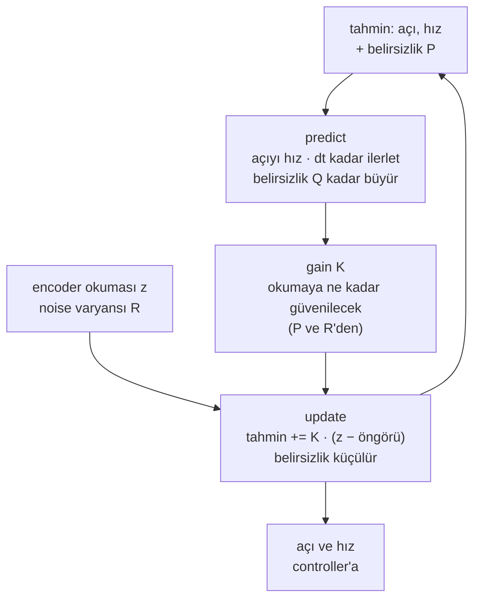

# 18 · Kalman filter

<!-- meta -->
| | |
|---|---|
| **Bölüm** | [5 · Perception ve estimation](README.md) |
| **Çalışma türü** | CPU · Mac ya da Colab CPU |
| **Önkoşul** | [17](17-sensors-noise-filtering.md) |
| **Önce öğren** | [Probability and Distributions](https://aiengineeringfromscratch.com/lesson?path=phases/01-math-foundations/06-probability-and-distributions) · [Bayes' Theorem](https://aiengineeringfromscratch.com/lesson?path=phases/01-math-foundations/07-bayes-theorem) |
| **Süre** | ~60 dk |
| **Kod** | [`experiments/18-kalman-filter/experiment.py`](../../experiments/18-kalman-filter/experiment.py) |
| **Durum** | ✅ tam |
<!-- /meta -->

> Kalman filter, eklemin nasıl hareket ettiğini bilen bir moving average'dır: geride kalmadan yumuşatır ve ne kadar yanıldığını düşündüğünü de söyler.

## Problem

Ders 17, tek bir noisy SO-101 eklem sinyalinde bir çelişkiyle bitti: en iyi konum filtresinin delay'i 4 ms'ydi (5'lik moving average, 5,17 mrad), en iyi hız filtresininki 64 ms (65 örnek, 0,12 rad/s). Bir controller ikisini de tek bir **estimator**'dan (ölçemediğini ölçebildiklerinden çıkaran kod), gecikmesiz ve onlara ne kadar güveneceğini söyleyen bir sayıyla ister. Hareketin doğrusal bir modeli varsa Kalman'ın recursive filtresi ([Kalman 1960](https://doi.org/10.1115/1.3662552)) bunu yapar.

## Ana fikir

### Sade anlatımla

Noisy bir termometresi olan bir hava tahmincisi düşün. Birkaç dakikada bir, az önce bildiklerinden bir tahmin yapar ("ılık ve ısınıyor, şimdi biraz daha sıcak"), termometreyi okur ve ikisini, her biri ne kadar güvenilir çıktıysa o kadar güvenerek harmanlar. Harmanladıktan sonra öncekinden daha emindir ve ne kadar emin olduğunu da aklında tutar.

Kalman filter eklem için bunu saniyede 500 kez yapar: tahmin "eklem hızını korur" modelinden, okuma encoder'dan gelir; harmanlama ağırlığı, yani **gain**, her adımda senin verdiğin iki sayıdan yeniden hesaplanır: encoder ne kadar noisy ve eklem modeli ne kadar şaşırtabilir.

Geride kalmamasının sebebi tahmindir. Ders 17'nin moving average'ı yalnızca geriye bakar, eklemin nerede olduğunu raporlar; Kalman filter ise tahminini önce kendi hesapladığı hızla ileri taşır, sonra yeni okumayla karşılaştırır.

### Predict/update döngüsü



### Filtre, kod olarak

State eklem açısı `q` ve hızı `qd`'dir; `P` 2×2'lik bir **covariance** matrisidir, filtrenin ne kadar yanıldığına dair kendi tahmini (köşegeninin karekökü bir standart sapmadır). Tek adım (Sıfırdan yaz her satırı bir fonksiyon olarak yazar):

```python
x = F @ x;  P = F @ P @ F.T + Q          # predict: forecast one step; uncertainty grows by Q
K = P @ H.T / (H @ P @ H.T + R)          # gain: which share of the surprise to believe
x = x + K @ (z - H @ x)                  # update: z - H x is the surprise ("innovation")
P = (np.eye(2) - K @ H) @ P              # uncertainty shrinks
```

Tek bir sayı için gain $K = P/(P+R)$'dir: belirsiz bir tahmin ($P \gg R$) okumayı kopyalar, noisy bir okuma ($R \gg P$) tahmini korur.

| Adım | Formül |
|---|---|
| State predict | $\hat x^-_k = F\hat x_{k-1}$ |
| Covariance predict | $P^-_k = F P_{k-1} F^\top + Q$ |
| Gain | $K_k = P^-_k H^\top (H P^-_k H^\top + R)^{-1}$ |
| State update | $\hat x_k = \hat x^-_k + K_k(z_k - H\hat x^-_k)$ |
| Covariance update | $P_k = (I - K_k H)P^-_k$ |

Burada $\hat x_k = [q,\ \dot q]^\top$ $k$ adımındaki tahmin, $-$ işareti $z_k$'dan önceki öngörü, $P$ onun covariance'ı, $F$ hareket modeli, $H$ sensor'ün gördüğü, $Q$ modelin adım başına hata covariance'ı, $R$ encoder noise varyansı, $K$ gain'dir.

Ayarladığın iki düğme var:

| Ayar | Fiziksel anlamı | Nasıl belirlenir |
|---|---|---|
| $R$ | ölçüm noise varyansı | ölç: sensor'ü durağanken ya da bilinen bir hareket boyunca logla ([Welch & Bishop](https://techreports.cs.unc.edu/papers/95-041.pdf), §1 "Filter Parameters and Tuning") |
| $q_c$ | eklemin habersizce ne kadar sert ivmelenebileceği | ayarla: tek gerçek tasarım seçimi |

Aşağıda kullanılan iki gerçek: $Q$ ve $R$ sabitse $P_k$ ve $K_k$ yakınsar, yani başlangıçtaki **transient**'ten sonra filtre sabit bir doğrusal filtredir (Welch & Bishop); ondan sonra tahmini yalnızca $q_c/R$ belirler, mutlak ölçek ise raporlanan $P$'yi.

<details>
<summary>Matematik ayrıntısı: model, Q ve R'nin kaynağı ve gain'in neden bir güven oranı olduğu</summary>

**Model.** State $x_k\in\mathbb R^n$, ölçüm $z_k$ ([Welch & Bishop, TR 95-041](https://techreports.cs.unc.edu/papers/95-041.pdf), denklem 1.1–1.2):

$$x_k = F x_{k-1} + w_{k-1},\quad w\sim\mathcal N(0,Q) \qquad z_k = H x_k + v_k,\quad v\sim\mathcal N(0,R)$$

Bu model doğruysa filtre optimaldir (ortalama karesel hatası en küçüktür): doğrusal dinamik, bağımsız Gauss $w$ ve $v$.

**Tek eklem için constant-velocity modeli.** $x = [q,\ \dot q]^\top$; encoder yalnızca $q$'yu görür:

$$F = \begin{bmatrix}1 & \Delta t\\ 0 & 1\end{bmatrix},\quad H = [1\ \ 0],\quad Q = q_c\begin{bmatrix}\Delta t^3/3 & \Delta t^2/2\\ \Delta t^2/2 & \Delta t\end{bmatrix}$$

**Q nereden gelir.** İvme $a(t)$'yi yoğunluğu $q_c$ (rad²/s³) olan beyaz noise olarak modelle. Bir adımda hızı $\int_0^{\Delta t} a(s)\,ds$, açıyı $\int_0^{\Delta t} (\Delta t - s)\,a(s)\,ds$ kadar değiştirir; bunların varyansları ve covariance'ı $q_c\Delta t$, $q_c\Delta t^3/3$ ve $q_c\Delta t^2/2$'dir: yukarıdaki matris.

**R nereden gelir.** Encoder varyansı $\sigma^2 + \Delta^2/12$: beyaz noise artı $\Delta$ boyundaki basamaklara yuvarlama (ders 17, Sıfırdan yaz, Adım 1).

**Güven oranı olarak gain.** Tek boyutta ($F = H = 1$) $K = P^-/(P^- + R)$ ve update

$$\hat x = \frac{R}{P^- + R}\,\hat x^- + \frac{P^-}{P^- + R}\,z$$

ters varyans ağırlıklı bir ortalama: $\mathcal N(\hat x^-, P^-)$ ile $\mathcal N(z, R)$ Gauss'larının çarpımı (bkz. AIEFS: [Bayes' Theorem](https://aiengineeringfromscratch.com/lesson?path=phases/01-math-foundations/07-bayes-theorem)).

**Yalnızca oran önemlidir.** $Q$, $R$ ve başlangıç $P$'sini $c$ ile ölçeklemek her $P^-_k$ ve $P_k$'yi $c$ ile ölçekler, $K_k$'yi değiştirmez; başlangıç $P$'si transient'ten sonra unutulur.

**Coverage.** İddia edilen varyansta Gauss bir hata zamanın yaklaşık %95'inde $\pm 2\sqrt{P_{00}}$ içinde kalır; çok daha azı filtrenin aşırı emin olduğunu gösterir.

Daha derine: "Önce öğren"deki AIEFS dersleri; [Kalman 1960](https://doi.org/10.1115/1.3662552); tutorial [Welch & Bishop, TR 95-041](https://techreports.cs.unc.edu/papers/95-041.pdf).

</details>

<!-- figure: 18-kalman -->

## Sıfırdan yaz

Şimdi filtreyi yaklaşık 60 satır NumPy ile, her adımı kontrol ederek yazacaksın. Deney script'inden yalnızca sinyal geliyor; ikisi aynı 5000 okumada çalışıyor, SciPy yalnızca hakem. Adımları kendi dosyana yaz ve her birinden sonra çalıştır. Bitmiş fonksiyonlar [`physai/estimation.py`](../../physai/estimation.py) içinde; `uv run python experiments/18-kalman-filter/build.py` altı adımı kontrolleriyle birlikte koşturur (çıktı [`build_output.txt`](../../experiments/18-kalman-filter/build_output.txt) dosyasında).

### Adım 1 · Modeli yaz

Eklemi ve encoder'ını dört matris tarif eder; hepsi timestep'ten ve iki ayar düğmenden kurulur:

```python
def cv_model(dt, q_c, r):
    """Constant-velocity model of one joint: state [q, qdot], the sensor reads q.

    q_c: intensity of the white acceleration noise (rad^2/s^3); r: variance of one reading (rad^2).
    """
    F = np.array([[1.0, dt], [0.0, 1.0]])                            # q += qdot * dt, qdot stays
    Q = q_c * np.array([[dt**3 / 3, dt**2 / 2], [dt**2 / 2, dt]])   # white acceleration over one step
    H = np.array([[1.0, 0.0]])                                       # the encoder sees q only
    R = np.array([[r]])
    return F, Q, H, R
```

Kontrol, Matematik ayrıntısındaki integrali bilgisayara bırakır: Van Loan yöntemi sürekli modeli, exponential'ı hem $F$'yi hem de tam $Q$'yu içeren tek bir blok matrise yerleştirir:

```python
A = np.array([[0.0, 1.0], [0.0, 0.0]])                 # d/dt [q, qd] = A x + [0, 1] a
W = np.array([[0.0, 0.0], [0.0, 1.0]])                 # white acceleration of intensity 1 enters qd
C = scipy.linalg.expm(np.block([[-A, W], [np.zeros((2, 2)), A.T]]) * dt)
Phi, Q_vl = C[2:, 2:].T, C[2:, 2:].T @ C[:2, 2:]       # equal to F and Q
```

```text
== Step 1. The model at dt = 2 ms, q_c = 1 rad^2/s^3, R = 1e-4 rad^2 ==
F = [1 0.002; 0 1]   H = [1 0]   R = [0.0001]
Q = [2.667e-09 2e-06; 2e-06 0.002]
max |F - expm(A dt)| = 0.0e+00, max |Q - Q_VanLoan| / max |Q| = 2.1e-19
```

2 ms'lik her adımda beyaz ivme açıyı neredeyse hiç oynatmıyor (2,667e-09 rad²), hızı ise gözle görülür biçimde oynatıyor (0,002 rad²/s²); model ikisini bağladığı için encoder hızı da bilgilendiriyor.

### Adım 2 · Predict

```python
def kf_predict(x, P, F, Q):
    """Forecast one step: the state moves with the model, the uncertainty grows by Q."""
    return F @ x, F @ P @ F.T + Q
```

$x = (0{,}1\ \text{rad},\ 0{,}5\ \text{rad/s})$'den bir adımı elle kontrol et: açı $0{,}1 + 0{,}5 \cdot 0{,}002 = 0{,}101$, $P_{00}$ ise $10^{-4} + \Delta t^2 + \Delta t^3/3$ olur. Sonra okumasız 500 kez öngör: tam $Q$ ile 500 adım, $T = 1$ s'lik tek adıma eşit olmalı, $F^{500} P_0 F^{500\top} + q_c\,[T^3/3,\ T^2/2;\ T^2/2,\ T]$.

```text
== Step 2. Predict: one step from x = (0.1 rad, 0.5 rad/s), P = diag(1e-4, 1) ==
x- = [0.101 0.5]   P- = [0.000104003 0.002002; 0.002002 1.002]
max |x- - hand| = 0.0e+00, max |P- - hand| = 0.0e+00
after 500 predicts (1 s): position sigma 0.010 -> 1.155 rad, max |P - closed form| / max |P| = 2.2e-15
```

Okuma olmadan konum belirsizliği bir saniyede 0,010'dan 1,155 rad'a çıkıyor; büyük kısmı başlangıçtaki 1 rad/s'lik hız belirsizliğinin 1 s boyunca taşınması.

### Adım 3 · Update

```python
def kf_update(x, P, z, H, R):
    """Blend the forecast with a reading z; returns the new state, covariance and the gain."""
    S = H @ P @ H.T + R                            # expected spread of the innovation
    K = P @ H.T @ np.linalg.inv(S)                 # share of the surprise to believe
    x = x + K @ (np.atleast_1d(z) - H @ x)         # z - H x is the innovation
    P = (np.eye(len(x)) - K @ H) @ P               # uncertainty shrinks
    return x, P, K
```

Kontrol aynı Bayes kuralını, basitçe toplanan ters covariance'larla (**information**) yazar: $P^{+\,-1} = P^{-\,-1} + H^\top R^{-1} H$.

```text
== Step 3. Update: the one-step forecast meets a reading z = 0.12 rad ==
K = [0.5098 9.814]   x+ = [0.1107 0.6865]   sigma_q 10.20 -> 7.14 mrad
scalar check K_q = P00/(P00 + R) = 0.5098
max |x+ - info form| = 2.2e-16, max |P+ - info form| = 1.1e-16
```

Öngörü (1,04e-4 rad²) ve okuma (1e-4 rad²) aşağı yukarı eşit belirsiz, bu yüzden $K_q = 0{,}5098$, skaler kuralın sayısı: yolun yaklaşık yarısını git. $K_{\dot q} = 9{,}814$ skaler bir filtrenin veremeyeceği kısım: tek bir açı okuması, $P$'nin köşegen dışı elemanı üzerinden hızı da düzeltiyor.

### Adım 4 · Dersin encoder'ında çalıştır

```python
def kalman_filter(z, dt, q_c, r, x0=None, P0=None):
    """Run the constant-velocity filter over readings z; returns states, covariances and the last gain."""
    F, Q, H, R = cv_model(dt, q_c, r)
    x = np.array([z[0], 0.0]) if x0 is None else x0     # start at the first reading, at rest
    P = np.diag([r, 1.0]) if P0 is None else P0         # sure of q to one reading, unsure of qdot
    xs, Ps = np.zeros((len(z), 2)), np.zeros((len(z), 2, 2))
    for k in range(len(z)):
        x, P = kf_predict(x, P, F, Q)
        x, P, K = kf_update(x, P, z[k], H, R)
        xs[k], Ps[k] = x, P
    return xs, Ps, K
```

Deney'in sinyalini yeniden yazmak yerine yükle; ders 17'nin moving average'ı baseline:

```python
spec = importlib.util.spec_from_file_location("kf_experiment", "experiments/18-kalman-filter/experiment.py")
exp = importlib.util.module_from_spec(spec)
spec.loader.exec_module(exp)
q, v = exp.simulate(exp.reference)                          # true angle and velocity from MuJoCo
z = exp.encoder(q, np.random.default_rng(exp.SEED))         # 12-bit steps + 10 mrad noise
r = exp.SIGMA**2 + (2 * np.pi / exp.COUNTS) ** 2 / 12       # R from Math details
xs, Ps, K = kalman_filter(z, exp.DT, 1.0, r)
```

```python
def moving_average(x, n):
    """Causal moving average: the mean of the last n samples (fewer at the start), as in lesson 17."""
    c = np.cumsum(np.insert(x, 0, 0.0))
    i = np.arange(len(x))
    lo = np.maximum(0, i + 1 - n)
    return (c[i + 1] - c[lo]) / (i + 1 - lo)
```

```text
== Step 4. The lesson's encoder signal (Experiment setup, seed 0) ==
R = 1.002e-04 rad^2, 5000 readings, scored after the first 500
        filter  pos RMS mrad  vel RMS rad/s     K_q    K_qd  max |ours - Exp.|
  KF q_c = 0.1          3.23          0.084  0.0724   1.361            5.6e-15
    KF q_c = 1          3.15          0.093  0.1251   4.179            5.1e-15
      MA N = 5          5.17                                           0.0e+00
```

Bunlar Deney tablosunun sayıları: aynı sinyal, aynı başlangıç (ilk okumada, durağan $x_0$; $P_0 = \text{diag}(R, 1)$) ve 500 örnekten sonraki aynı puanlama. 5e-15'lik fark yuvarlama: sen $S^{-1}$ ile çarpıyorsun, Deney $S$'ye bölüyor.

### Adım 5 · Sabit gain, üç yoldan

Transient'ten sonra gain sabittir. Onu veri olmadan, covariance özyinelemesini oturana kadar döndürerek bul:

```python
def steady_state_gain(F, Q, H, R, rtol=1e-12, max_iter=100_000):
    """Iterate the covariance recursion until it stops changing; returns the constant gain K and forecast P."""
    P = Q.copy()
    for _ in range(max_iter):
        K = P @ H.T @ np.linalg.inv(H @ P @ H.T + R)
        P_next = F @ (P - K @ H @ P) @ F.T + Q     # update, then predict
        done = np.allclose(P_next, P, rtol=rtol, atol=0.0)
        P = P_next
        if done:
            break
    return P @ H.T @ np.linalg.inv(H @ P @ H.T + R), P
```

SciPy sabit noktayı doğrudan çözer. `scipy.linalg.solve_discrete_are(a, b, q, r)` LQR için yazılmıştır: $A^\top X A - X - A^\top X B (R + B^\top X B)^{-1} B^\top X A + Q = 0$ denklemini sağlayan $X$'i döndürür. $A$ yerine $F^\top$, $B$ yerine $H^\top$ ile filtrenin denklemi olur (estimation ile control'ün **duality**'si) ve $X$ kararlı öngörü covariance'ı $P^-$'dir:

```python
P_dare = scipy.linalg.solve_discrete_are(F.T, H.T, Q, R)   # filter = LQR with A -> F^T, B -> H^T
K_dare = P_dare @ H.T @ np.linalg.inv(H @ P_dare @ H.T + R)
```

```text
== Step 5. Steady-state gain: run, Riccati iteration, scipy.linalg.solve_discrete_are ==
    q_c     K_q     K_qd  |K_iter - K_dare|  |K_run - K_dare|
  0.001  0.0235    0.140            3.6e-12           1.4e-14
   0.01  0.0414    0.437            4.9e-12           1.4e-14
    0.1  0.0724    1.361            3.9e-12           6.4e-15
      1  0.1251    4.179            1.9e-12           5.4e-14
     10  0.2116   12.545            1.4e-12           6.2e-14
    100  0.3448   36.165            1.8e-12           7.1e-15
   1000  0.5285   97.018            2.6e-11           8.5e-14
```

Bunlar Deney tablosunun son gain'leri. İterasyonun SciPy ile yaklaşık 1e-12 (durma toleransı), çalışan filtrenin son gain'i yaklaşık 1e-14 farkla örtüşüyor.

### Adım 6 · Belirsizlik dürüst mü?

```python
def coverage(err, sd, k=2.0):
    """Fraction of samples whose error lies within +-k of the filter's own standard deviation."""
    return np.mean(np.abs(err) <= k * sd)
```

Filtrenin iddia ettiği hatayı (koşu sonundaki $\sqrt{P_{00}}$) yaptığı hatayla karşılaştır:

```text
== Step 6. Honest uncertainty: claimed sigma vs actual error ==
    q_c  claimed sigma mrad  actual RMS mrad  2-sigma coverage %
  0.001                1.53            20.71                 8.0
   0.01                2.04             6.91                32.4
    0.1                2.69             3.23                91.0
      1                3.54             3.15                97.8
     10                4.60             4.02                98.1
    100                5.88             5.22                97.8
   1000                7.28             6.61                97.3
q_c and R (and P0) x 100: max |x change| = 7.1e-15 rad, P ratio 100.000
```

$q_c = 0{,}001$'de filtre 1,53 mrad iddia ediyor ama 20,71 mrad yanılıyor: aşırı emin, bandında %8,0. $q_c = 1$'de 3,54 iddia edip 3,15 mrad yanılıyor, biraz karamsar, %97,8. Hiçbir satır %95'e oturmuyor: bu eklem beyaz noise ile değil yumuşak bir sinüsle ivmeleniyor, yuvarlama da Gauss değil; filtrenin kendi modelinden üretilen veride `tests/` altındaki test %93–97 buluyor. Son satır oran gerçeğini ölçüyor: $q_c$, $R$ ve $P_0$'ı 100 ile ölçeklemek tahmini 7,1e-15 rad değiştiriyor, covariance'ı ise tam 100 katına çıkarıyor.

### Elinde kalan

`physai.estimation` artık `cv_model`, `kf_predict`, `kf_update`, `kalman_filter`, `steady_state_gain` ve `coverage` de içeriyor. Eklem hızı gereken sonraki bir script, noise'un türevini almak yerine `kalman_filter`'ı import edebilir; [ders 24](../part-6-planning-and-optimal-control/24-lqr-and-mpc.md) `solve_discrete_are`'yi LQR için yeniden çağırıyor. [`tests/test_18_kalman_filter.py`](../../tests/test_18_kalman_filter.py) bunları SciPy'a ve elle hesaplanan değerlere sabitliyor: `uv run pytest tests/test_18_kalman_filter.py`.

## Kütüphaneyle kullan

NumPy'da ve SciPy'da Kalman filter sınıfı yok (SciPy kararlı durumu verir, Adım 5); OpenCV'de var. Adım 4'teki filtrenin aynısı:

```python
kf = cv2.KalmanFilter(2, 1, 0, cv2.CV_64F)           # 2 states, 1 measurement, no control; default is CV_32F
F, Q, H, R = cv_model(dt, 1.0, r)
kf.transitionMatrix, kf.measurementMatrix = F, H
kf.processNoiseCov, kf.measurementNoiseCov = Q, R
kf.statePost = np.array([[z[0]], [0.0]])
kf.errorCovPost = np.diag([r, 1.0])
est = []
for zk in z:
    kf.predict()
    est.append(kf.correct(np.array([[zk]])).ravel().copy())   # correct() returns its internal Mat
```

`np.array(est)`'yi Adım 4'ün `xs`'i ile kendin karşılaştır. Adlar araçtan araca değişir:

| Parça | Bu ders / physai | filterpy `KalmanFilter` | OpenCV `cv2.KalmanFilter` |
|---|---|---|---|
| hareket modeli | $F$ | `F` | `transitionMatrix` |
| sensor'ün gördüğü | $H$ | `H` | `measurementMatrix` |
| process noise (adım başına) | $Q$ | `Q` | `processNoiseCov` |
| ölçüm noise'u (varyans) | $R$ | `R` | `measurementNoiseCov` |
| okumadan önce / sonra covariance | $P^-$, $P$ | `P_prior`, `P_post` (ve `P`) | `errorCovPre`, `errorCovPost` |
| gain | $K$ | `K` | `gain` |
| iki adım | `kf_predict`, `kf_update` | `predict()`, `update(z)` | `predict()`, `correct(z)` |

Kaynaklar: [filterpy KalmanFilter](https://filterpy.readthedocs.io/en/latest/kalman/KalmanFilter.html), OpenCV'nin [`tracking.hpp`](https://github.com/opencv/opencv/blob/4.x/modules/video/include/opencv2/video/tracking.hpp) dosyası; OpenCV varsayılanlarını OpenCV 5.0.0'da `cv2.KalmanFilter(2, 1)` yazdırıyor.

Üç tuzak:

- **Hangi $Q$?** filterpy'ın `Q_continuous_white_noise(dim=2, dt, spectral_density)` yardımcısı bu dersin $Q$'sudur, $q_c$ rad²/s³ biriminde; `Q_discrete_white_noise(dim=2, dt, var)` ise ivmenin adım içinde sabit olduğunu varsayar, $G = [\Delta t^2/2,\ \Delta t]^\top$ ile $Q = G G^\top \cdot$`var`, `var` rad²/s⁴ biriminde ([filterpy.common](https://filterpy.readthedocs.io/en/latest/common/common.html)): aynı düğme değeri farklı bir filtre verir.
- **$R$ bir varyanstır, standart sapma değil.** Bu encoder'ın $R$'si 1,002e-4 rad² (σ 10,01 mrad). $R$ yerine σ = 0,01 verirsen filtre encoder'ı yaklaşık 100 kat daha noisy sanar: Boz'daki $R_{\text{used}}/R = 100$ satırı, 3,15 yerine 6,91 mrad ve işe yaramaz bir %100 coverage. `sensor_msgs/Imu` covariance'ları da varyanstır, row-major; hepsi sıfırsa "bilinmiyor", 0. eleman −1 ise "tahmin yok" ([`Imu.msg`](https://github.com/ros2/common_interfaces/blob/rolling/sensor_msgs/msg/Imu.msg)).
- **Sessiz varsayılanlar ve float32.** OpenCV'nin `measurementMatrix`'i sıfırlarla başlar, yani ayarlanmamış bir filtre okumalarını hata vermeden yok sayar; sıfırdan başlayan `errorCovPost` ilk state'i kesin kabul eder. Kod parçası varsayılan `CV_32F` yerine `CV_64F` istiyor, çünkü $Q$ 2,667e-09 ile 0,002 arasında yayılıyor.

## Deney

**Kurulum.** Ders 17'nin sinyali: MuJoCo'da SO-101 `shoulder_pan`, 2 ms timestep, 12-bit encoder artı 10 mrad beyaz noise, aynı seed ve noise dizisi. $R = 1{,}002\times10^{-4}$ rad² (σ 10,01 mrad). $q_c$'yi altı dekad boyunca sweep ediyor; konum ve hız RMS hatasını, delay'i ve **2σ coverage**'ı ölçüyoruz: gerçek konumun $\pm2\sqrt{P_{00}}$ içinde kaldığı örneklerin oranı (dürüst Gauss bir hata için yaklaşık %95).

```python
F = np.array([[1.0, DT], [0.0, 1.0]]); H = np.array([[1.0, 0.0]])
Q = q_psd * np.array([[DT**3 / 3, DT**2 / 2], [DT**2 / 2, DT]])
for k in range(len(z)):
    x = F @ x;  P = F @ P @ F.T + Q                       # predict
    S = H @ P @ H.T + r;  K = (P @ H.T) / S               # gain
    x = x + (K * (z[k] - H @ x)).ravel();  P = (np.eye(2) - K @ H) @ P   # update
```

**Tahmin.** $q_c$ çok küçükse filtre modele güvenir, çok yumuşatır, geride kalır ve aşırı emin olur. Çok büyükse noise'u takip eder.

**Çalıştır:** `uv run python experiments/18-kalman-filter/experiment.py` (MuJoCo 3.17.0, NumPy 2.5.4, Apple M5, deterministic).


| $q_c$ | Konum RMS (mrad) | Delay (ms) | Hız RMS (rad/s) | $K_q$ | $K_{\dot q}$ | 2σ coverage (%) |
|---|---|---|---|---|---|---|
| 0,001 | 20,71 | 16,0 | 0,250 | 0,0235 | 0,140 | 8,0 |
| 0,01 | 6,91 | 4,0 | 0,138 | 0,0414 | 0,437 | 32,4 |
| 0,1 | 3,23 | 0,0 | **0,084** | 0,0724 | 1,361 | 91,0 |
| **1** | **3,15** | 0,0 | 0,093 | 0,1251 | 4,179 | 97,8 |
| 10 | 4,02 | 0,0 | 0,203 | 0,2116 | 12,545 | 98,1 |
| 100 | 5,22 | 0,0 | 0,482 | 0,3448 | 36,165 | 97,8 |
| 1000 | 6,61 | 0,0 | 1,136 | 0,5285 | 97,018 | 97,3 |

Aynı veride ders 17 baseline'ları: MA N=5, 4,0 ms delay ile 5,17 mrad; MA N=65, 0,120 rad/s hız hatası.

**Gözlem.**

1. $q_c = 1$'de tek filtre ders 17'nin en iyi konum filtresini sıfır ölçülen delay ile geçer (3,15'e karşı 5,17 mrad), $q_c = 0{,}1$'de en iyi hız filtresini (0,084'e karşı 0,120 rad/s). Baseline'lar bir örnek ileriye bakan `np.gradient` kullandı; Kalman filter tamamen **causal** ve yine kazanıyor.
2. Tablo son $K$'yı gösteriyor, transient'ten sonra sabit: koda gömebileceğin gain'ler.
3. $q_c = 0{,}001$'de filtre 16 ms geride kalırken küçük bir $P$ iddia ediyor: %8,0 coverage. Ayarı bozuk bir filtrenin $P$'sini outlier eleme ya da sensor füzyonu için asla kullanma.

## Boz

**Yanlış R.** Gerçek noise sabit; filtreye $R_{\text{used}} = f\cdot R$ söyleniyor, $q_c = 1$:

| $R_{\text{used}}/R$ | Konum RMS (mrad) | Hız RMS (rad/s) | 2σ coverage (%) |
|---|---|---|---|
| 0,01 | 5,22 | 0,482 | 17,5 |
| 0,1 | 4,02 | 0,203 | 53,9 |
| 1 | 3,15 | 0,093 | 97,8 |
| 10 | 3,23 | 0,084 | 100,0 |
| 100 | 6,91 | 0,138 | 100,0 |

RMS sütunları $q_c$ sweep'ini birebir tekrarlar ($q_c=1$'de $R\times0{,}01$, $q_c = 100$'ün 5,22 mrad / 0,482 rad/s'sini verir): tahmin yalnızca $q_c/R$'yi görür. Coverage tekrarlanmaz: $R$'yi küçük tahmin etmek filtreyi aşırı emin (%17,5), büyük tahmin etmek karamsar yapar (%100). RMS hatası iyi görünürken covariance yanlış olabilir.

**Modellenmemiş ivme.** $t = 5$ s'de eklem komutundaki 0,3 rad'lık bir basamak 4,05 rad/s'lik gerçek tepe hız verir; model bu ivmeye "noise" der.

| $q_c$ | Basamaktan sonraki 0,5 s'de en büyük konum hatası (mrad) | En büyük hız hatası (rad/s) | Basamaktan önce konum RMS (mrad) |
|---|---|---|---|
| 1 | 44,1 | 2,92 | 3,22 |
| 100 | 19,6 | 2,57 | 5,26 |
| 10000 | 22,3 | 7,74 | 7,98 |

Ayarlı filtre basamakta 44,1 mrad'a kadar geride kalır. Yüz kat $q_c$ geçişi yarıya indirir ama yumuşak hareketteki doğruluğu düşürür (3,22'ye karşı 5,26 mrad); $10^4$'te hız hatası patlar. Model bilinen bir komutu temsil edemiyor; $Q$'yu değil modeli düzelt: komut edilen ivmeyi ya da motor torkunu **control input** $Bu$ olarak, yani öngörüye eklenen bilinen bir terim olarak ver (Welch & Bishop denklem 1.1) ya da bilinen geçişlerde $Q$'yu değiştir.

## Gerçek robotta

- $R$ tahmin edilmez, ölçülür: her SO-101 eklemini sabit bir pozda ve yavaş bir rampa boyunca logla (prosedür [ders 17](17-sensors-noise-filtering.md)'de). Gerçek kolda henüz ölçülmedi.
- Seri bus okumaları jitter'lı (zamanda düzensiz aralıklarla) gelir: $F$ ve $Q$'yu nominal $\Delta t$ ile değil, son örnekten bu yana geçen gerçek süreyle kur.
- SO-101 servoları kendi position loop'larını kapatır (LeRobot onları position moduna alır ve PID gain'lerini yazar, [`so_follower.py`](https://github.com/huggingface/lerobot/blob/main/src/lerobot/robots/so_follower/so_follower.py)); host tarafındaki bir Kalman filter servonun döngüsünü değil, logladığın, policy'ye verdiğin ya da collision tespitinde kullandığın tahminleri iyileştirir.
- Her ekleme gönderdiğin komutu biliyorsun: $Q$'yu büyütmeden önce onu modele koy, yoksa her hızlı kalkış ve duruşta basamak testindeki gecikmeyi görürsün.

## Kendini dene

1. **Kolay.** Tabloda yalnızca hızı önemseseydin hangi $q_c$'yi seçerdin? Yalnızca konumu?
2. **Orta.** $q_c = 1$'de $R_{\text{used}} = 0{,}1R$'nin, gerçek $R$ ile $q_c = 10$'la neden birebir aynı RMS'yi verdiğini açıkla.
3. **Zor.** State'i $[q,\dot q,\ddot q]$'ya genişlet (constant-acceleration modeli) ve basamak testini tekrar çalıştır. Geçiş, yumuşak kısmı bozmadan küçülüyor mu?

### Cevaplar

1. Hız: $q_c = 0{,}1$ (0,084 rad/s). Konum: $q_c = 1$ (3,15 mrad).
2. $Q$, $R$'yi (ve transient'ten sonra unutulan başlangıç $P$'sini) aynı katsayıyla ölçeklemek $P$'yi ölçekler, $K$'yi değiştirmez; $q_c=1, R/10$, $q_c=10, R$ ile aynı orandır.
3. Burada hesaplanmadı; çalıştır. Basamakta daha küçük bir gecikme ve yumuşak kısımda daha noisy bir hız bekle: ek state de yalnızca konumdan tahmin ediliyor.

## Akılda kalanlar ve kaynaklar

- Constant-velocity Kalman filter, tek bir noisy encoder'dan konumu ve hızı causal olarak, ortalama delay'i olmadan verir (burada 3,15 mrad, 0,084–0,093 rad/s).
- Tahmini yalnızca $q_c/R$ belirler; mutlak değerler covariance'ı belirler. $P$'ye güvenmeden önce coverage'a bak.
- Modellenmemiş ivme geçici gecikme olarak görünür; $Q$'yu şişirmeden önce modeli düzelt (control input).

Sıradaki: [ders 19](19-camera-calibration.md), camera model ve calibration.

Kaynaklar:
- R. E. Kalman, "A New Approach to Linear Filtering and Prediction Problems", *Journal of Basic Engineering* 82(1):35–45, 1960. [doi:10.1115/1.3662552](https://doi.org/10.1115/1.3662552)
- G. Welch, G. Bishop, "An Introduction to the Kalman Filter", TR 95-041, UNC Chapel Hill (2004 güncellemesi). [PDF](https://techreports.cs.unc.edu/papers/95-041.pdf)
- Sinyal ve noise modeli: [ders 17](17-sensors-noise-filtering.md).
- Yukarıdaki tüm sayılar: [`experiment.py`](../../experiments/18-kalman-filter/experiment.py), çıktı [`output.txt`](../../experiments/18-kalman-filter/output.txt).
