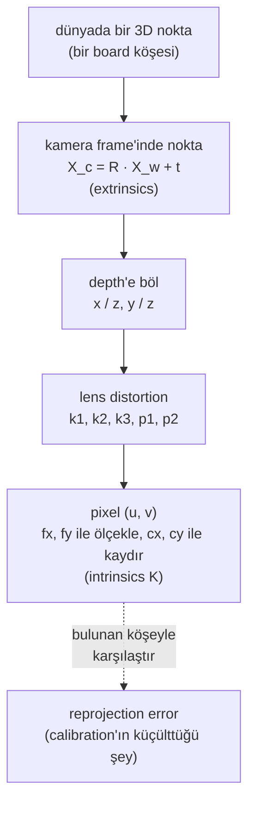

# 19 · Camera model, calibration ve hand-eye calibration

<!-- meta -->
| | |
|---|---|
| **Bölüm** | [5 · Perception ve estimation](README.md) |
| **Çalışma türü** | CPU · Mac ya da Colab CPU |
| **Önkoşul** | [07](../part-2-spatial-math/07-rigid-transforms.md) |
| **Önce öğren** | [Image Fundamentals — Pixels, Channels, Color Spaces](https://aiengineeringfromscratch.com/lesson?path=phases/04-computer-vision/01-image-fundamentals) · [Linear Systems](https://aiengineeringfromscratch.com/lesson?path=phases/01-math-foundations/17-linear-systems) |
| **Süre** | ~60 dk |
| **Kod** | [`experiments/19-camera-calibration/experiment.py`](../../experiments/19-camera-calibration/experiment.py) |
| **Durum** | ✅ tam |
<!-- /meta -->

> Kamera bir 3×3 matris, birkaç distortion sayısı ve bir pozdur; calibration bunları ancak verin onları gözlemlenebilir kılıyorsa bulur.

## Problem

Pixel'den masaya her hesap (ders 20) ve görüntüden her grasp (ders 21) kamera matrisi $K$ ve kamera pozuyla çarpar. %1 hatalı bir focal length, görüntüden hesaplanan her yanal mesafeyi %1 ölçekler; yanlış bir camera-to-gripper dönüşümü her grasp'i kaydırır. OpenCV'nin `calibrateCamera`'sı neredeyse her zaman küçük bir reprojection error döndürür, $K$ yanlışken de. Bu ders gerçek $K$'sı bilinen bir MuJoCo kamerasını kalibre eder; böylece hata sayısının ne zaman yalan söylediğini görürsün.

## Ana fikir

### Sade anlatımla

Kamera, 3D bir noktadan pixel'e giden bir fonksiyondur. **Extrinsics**, kameranın nerede olduğunu ve nereye baktığını söyler: dünyadan kameranın frame'ine giden bir rigid transform ([ders 07](../part-2-spatial-math/07-rigid-transforms.md)). **Intrinsics** içini anlatır: pixel cinsinden focal length ve optik eksenin görüntüyü deldiği yer (principal point). Birkaç **distortion** katsayısı, gerçek bir lensin düz çizgileri nasıl büktüğünü tarif eder.

**Calibration**, bu parametreleri köşelerini milimetresine kadar bildiğin bir checkerboard'a uydurmaktır: köşeleri bul, sonra öngörülen pixel'leri onların üstüne düşüren parametreleri ara. Geriye kalan uyumsuzluk **reprojection error**'dır. Training loss gibi, modelin bu örneklere ne kadar iyi oturduğunu söyler, parametrelerin doğru olup olmadığını değil. Kameranın önünde düz tutulan bir board klasik tuzaktır: "uzun lens, uzaktaki board" ile "kısa lens, yakındaki board" aynı görüntüyü üretir.

**Hand-eye calibration**, bilekteki bir kameranın gripper'da nerede durduğunu bulur. Gripper pozu eklem açılarından, board pozu görüntüden gelir; board hiç hareket etmez, dolayısıyla her kol pozu çifti bilinmeyen montaj için bir denklem verir ve montaj ancak bilek farklı eksenler etrafında dönerse sabitlenir.

### Pipeline olarak kamera



### Kamera, kod olarak

```python
X_c = R @ X_w + t                            # world -> camera (x right, y down, z forward), metres
x, y = X_c[0] / X_c[2], X_c[1] / X_c[2]      # divide by depth: farther points move less on the image
u, v = fx * x + cx, fy * y + cy              # to pixels (distortion bends x, y just before this line)
fy = (height / 2) / np.tan(np.radians(fovy) / 2)   # MuJoCo: 480 px tall, fovy 50 deg -> 514.68 px
# calibration: K, dist and one (R_i, t_i) per view that minimize the squared pixel error over all corners
```

| Parça | Formül |
|---|---|
| Projeksiyon | $[u,\ v,\ 1]^\top \sim K\,[x/z,\ y/z,\ 1]^\top$ |
| Intrinsics | $K = \begin{bmatrix}f_x & 0 & c_x\\ 0 & f_y & c_y\\ 0&0&1\end{bmatrix}$ |
| Extrinsics | $X_c = R\,X_w + t$ |
| Radyal distortion | $x_d = x_n(1 + k_1 r^2 + k_2 r^4 + k_3 r^6)$ |
| MuJoCo kamerasının $K$'sı | $f_x = f_y = \dfrac{H/2}{\tan(\mathrm{fovy}/2)},\ c_x = \dfrac{W-1}{2},\ c_y = \dfrac{H-1}{2}$ |
| Hand-eye | $A_{ij}X = XB_{ij}$ |

$(u, v)$: pixel; $(x, y, z)$: kamera frame'indeki nokta; $\sim$: ölçek dışında eşit; $f_x, f_y$: focal length'ler (px); $(c_x, c_y)$: principal point; $(R, t)$: dünyadan kameraya; $x_n = x/z$, $r^2 = x_n^2 + y_n^2$; $k_i$: radyal katsayılar; $W \times H$: görüntü boyutu; $X$: kameranın gripper frame'indeki pozu; $A_{ij}$, $B_{ij}$: ölçülmüş gripper ve board hareketleri (Matematik ayrıntısı).

<details>
<summary>Matematik ayrıntısı: konvansiyonlar, Zhang yöntemi ve hand-eye denklemi</summary>

**Pinhole model** (Hartley & Zisserman, kamera modelleri). Kamera frame'i OpenCV'yi izler: $x$ sağa, $y$ aşağı, $z$ ileri. Distortion $K$'dan önce normalize koordinatlara etki eder; radyal kısmın yanında tanjansiyel terimler $p_1, p_2$ de vardır ([OpenCV calib3d](https://github.com/opencv/opencv/blob/4.x/modules/calib3d/include/opencv2/calib3d.hpp)).

**MuJoCo'dan K.** Bir kameranın `fovy`'si derece cinsinden dikey görüş açısıdır; yatay açı görüntü boyutundan hesaplanır ([MuJoCo XML · camera/fovy](https://mujoco.readthedocs.io/en/stable/XMLreference.html#body-camera-fovy)). Yani pixel'ler karedir ve $f_x = f_y$. $c_x = (W-1)/2$'deki $-1$, OpenCV'nin pixel merkezlerini tam sayı koordinatlara koyma konvansiyonundan gelir. MuJoCo kameraları $y$ yukarıyken kendi $-z$ eksenine bakar; dolayısıyla eksenler ters döner: kameradan dünyaya rotation (`cam_xmat`) için $R^{wc}_{\text{OpenCV}} = R^{wc}_{\text{MuJoCo}}\,\mathrm{diag}(1,-1,-1)$, $X_c = R\,X_w + t$'deki dünyadan kameraya $R$ için ise çarpan sola geçer: $R = \mathrm{diag}(1,-1,-1)\,(R^{wc}_{\text{MuJoCo}})^\top$.

**Calibration.** `calibrateCamera`, Zhang'ın düzlemsel yöntemini izler ([Zhang 2000](https://doi.org/10.1109/34.888718)): düzlem-görüntü **homography**'lerinden (board noktalarından pixel'lere giden 3×3'lük dönüşümler) intrinsics, board pozları, ardından toplam reprojection error üzerinde Levenberg–Marquardt. Sıfırdan yaz üçünü de yazıyor.

**Düz board'lar neden başarısız olur.** Görüntüye paralel, $Z$ derinliğindeki bir board için $u = f_x X/Z + c_x$: yalnızca $f_x/Z$ oranı kısıtlanır. Tilt, $Z$'yi board boyunca değiştirir; değişen perspektif kısalması $f$'yi $Z$'den ayırır.

**Hand-eye.** Gripper pozları $G_i$ (forward kinematics), kameradaki board pozları $C_i$ (PnP: bilinen 3D noktalardan ve pixel'lerinden kamera pozu) ve base'te sabit board ile $G_i X C_i = G_j X C_j$; buradan

$$A_{ij}X = XB_{ij},\qquad A_{ij} = G_j^{-1}G_i,\quad B_{ij} = C_jC_i^{-1}$$

Park & Martin'in kapalı çözümü ([Park & Martin 1994](https://doi.org/10.1109/70.326576)): rotation vektörleri $\alpha = \log R_A$, $\beta = \log R_B$ ve $M = \sum\beta\alpha^\top$ ile $R_X = (M^\top M)^{-1/2}M^\top$; ardından $t_X$, üst üste dizilmiş doğrusal sistem $(R_A - I)\,t_X = R_X t_B - t_A$'dan. OpenCV'nin `calibrateHandEye`'ı bunu ve dört yöntem daha sunar; dönme eksenleri paralel olmayan en az iki hareket ister. Dönmeler küçükse $R_A - I \approx 0$ olur ve translation zayıf belirlenir.

Daha derine: [Image Fundamentals — Pixels, Channels, Color Spaces](https://aiengineeringfromscratch.com/lesson?path=phases/04-computer-vision/01-image-fundamentals), [Linear Systems](https://aiengineeringfromscratch.com/lesson?path=phases/01-math-foundations/17-linear-systems); [Zhang 2000](https://doi.org/10.1109/34.888718); [Park & Martin 1994](https://doi.org/10.1109/70.326576); Hartley & Zisserman ([kitap sayfası](https://www.robots.ox.ac.uk/~vgg/hzbook/)).

</details>

<!-- figure: 19-pinhole -->

## Sıfırdan yaz

Şimdi kamera modelini, Zhang calibration'ını ve hand-eye çözücüsünü NumPy ile kendin yazacak, her adımı kontrol edeceksin. Veri Deney'in verisi: aynı render edilmiş board görüntüleri (aynı seed), OpenCV'nin bunlarda bulduğu köşeler ve SO-101 pozları. OpenCV yalnızca köşeleri bulur ve hakemlik eder.

Adımları kendi dosyana yaz ve her adımdan sonra çalıştır. Bitmiş fonksiyonlar [`physai/vision.py`](../../physai/vision.py) içinde; `uv run python experiments/19-camera-calibration/build.py` beş adımı kontrolleriyle birlikte koşturur (çıktı [`build_output.txt`](../../experiments/19-camera-calibration/build_output.txt) dosyasında).

### Adım 1 · K ve projeksiyon

```python
def intrinsics_from_fovy(fovy, width, height):
    """Camera matrix K of a MuJoCo camera: square pixels, vertical field of view fovy (degrees)."""
    f = (height / 2) / np.tan(np.radians(fovy) / 2)
    return np.array([[f, 0.0, (width - 1) / 2], [0.0, f, (height - 1) / 2], [0.0, 0.0, 1.0]])
```

```python
def project_points(X, R, t, K, dist=(0.0, 0.0, 0.0, 0.0, 0.0)):
    """World points X (N, 3) to pixels (N, 2). R, t: world -> camera; dist = (k1, k2, p1, p2, k3), OpenCV's order."""
    Xc = X @ R.T + t                                    # camera frame: x right, y down, z forward
    x, y = Xc[:, 0] / Xc[:, 2], Xc[:, 1] / Xc[:, 2]     # divide by depth
    k1, k2, p1, p2, k3 = dist
    r2 = x * x + y * y
    radial = 1 + k1 * r2 + k2 * r2**2 + k3 * r2**3
    xd = x * radial + 2 * p1 * x * y + p2 * (r2 + 2 * x * x)     # tangential terms p1, p2
    yd = y * radial + p1 * (r2 + 2 * y * y) + 2 * p2 * x * y
    return np.c_[K[0, 0] * xd + K[0, 1] * yd + K[0, 2], K[1, 1] * yd + K[1, 2]]
```

Distortion terimleri OpenCV'nin sırasını ve formülünü izler. $K$'yı Deney'in ground truth'una, her gerçek board pozunun projeksiyonunu MuJoCo görüntülerinde bulunan köşelere, distortion'lı projeksiyonu da `cv2.projectPoints`'e karşı kontrol et:

```text
== Step 1. K from fovy and the pinhole projection ==
fovy 50 deg, 640x480: fx = fy = 514.68 px, cx = 319.5, cy = 239.5   max |K - Experiment's k_true()| = 0.0e+00
60 rendered views: detected corners vs our projection, mean 0.220 px, max 0.525 px
with dist (k1, k2, p1, p2, k3) = (-0.15, 0.03, 0.001, -0.002, 0.01): max |ours - cv2.projectPoints| = 2.6e-13 px
```

Bunlar Deney'in köşe tespiti sayıları: MuJoCo ideal bir pinhole render ediyor, geriye kalan dedektör. Distortion'la senin kodun ve OpenCV 1e-13 px içinde aynı.

### Adım 2 · Görüntü başına bir homography

Board bir düzlem; köşeleri pixel'lere 3×3'lük bir homography ile gider (Matematik ayrıntısı). Her köşe $H$'nin dokuz elemanı için iki doğrusal denklem verir; üst üste dizilmiş sistemin en iyi çözümü son sağ tekil vektördür. İki nokta kümesini önce birim ölçeğe taşımak (Hartley normalizasyonu) sistemi iyi koşullu tutar.

```python
def homography_dlt(src, dst):
    """3x3 H with dst ~ H src from N >= 4 point pairs (N, 2 arrays): the normalized direct linear transform."""
    def normalizer(p):                                   # centroid to 0, mean distance to sqrt(2)
        c = p.mean(axis=0)
        s = np.sqrt(2) / np.mean(np.linalg.norm(p - c, axis=1))
        return np.array([[s, 0, -s * c[0]], [0, s, -s * c[1]], [0, 0, 1]])
    Ts, Td = normalizer(src), normalizer(dst)
    a = np.c_[src, np.ones(len(src))] @ Ts.T
    b = np.c_[dst, np.ones(len(dst))] @ Td.T
    A = []
    for (x, y, _), (u, v, _) in zip(a, b):               # u = (h1 . a) / (h3 . a), same for v: two rows
        A.append([x, y, 1, 0, 0, 0, -u * x, -u * y, -u])
        A.append([0, 0, 0, x, y, 1, -v * x, -v * y, -v])
    Hn = np.linalg.svd(np.array(A))[2][-1].reshape(3, 3)  # least-squares null vector of A
    H = np.linalg.inv(Td) @ Hn @ Ts                      # undo the normalization
    return H / H[2, 2]
```

```text
== Step 2. One homography per view (board plane -> pixels) ==
RMS distance of the 54 corners from H(board point): 0.091 px
max |ours - cv2.findHomography| = 0.0068 px, max |ours - true K[r1 r2 t]| = 0.352 px
on exact projected corners: max |ours - true| = 2.3e-13 px
```

Hatasız köşelerde tam (2,3e-13 px); bulunan köşelerde `cv2.findHomography`'ye (biraz farklı bir hatayı iyileştirir) 0,0068 px, gerçek homography'ye 0,352 px uzaklıkta: yine tespit hatası.

### Adım 3 · Zhang'ın kapalı çözümü

Her homography $H \sim K[r_1\ r_2\ t]$'dir. $r_1$ ve $r_2$ ortonormal olduğu için her görüntü $B = K^{-\top}K^{-1}$'in altı elemanı için iki doğrusal denklem verir: $h_1^\top B h_2 = 0$ ve $h_1^\top B h_1 = h_2^\top B h_2$. Bunları üst üste diz, null vektörü al ve $K$'yı $B$'den oku ([Zhang 2000](https://doi.org/10.1109/34.888718), bölüm 3.1):

```python
def zhang_intrinsics(Hs):
    """Closed-form K from >= 3 board-to-image homographies (Zhang 2000); also returns the singular values of V."""
    def v(H, i, j):                                      # h_i^T B h_j as a linear function of b
        a, c = H[:, i], H[:, j]
        return np.array([a[0] * c[0], a[0] * c[1] + a[1] * c[0], a[1] * c[1],
                         a[2] * c[0] + a[0] * c[2], a[2] * c[1] + a[1] * c[2], a[2] * c[2]])
    V = np.array([row for H in Hs for row in (v(H, 0, 1), v(H, 0, 0) - v(H, 1, 1))])
    _, sv, Vt = np.linalg.svd(V)
    b11, b12, b22, b13, b23, b33 = Vt[-1] * np.sign(Vt[-1][0])  # B = K^-T K^-1, up to scale
    cy = (b12 * b13 - b11 * b23) / (b11 * b22 - b12**2)
    lam = b33 - (b13**2 + cy * (b12 * b13 - b11 * b23)) / b11
    fx = np.sqrt(lam / b11)
    fy = np.sqrt(lam * b11 / (b11 * b22 - b12**2))
    skew = -b12 * fx**2 * fy / lam
    cx = skew * cy / fy - b13 * fx**2 / lam
    return np.array([[fx, skew, cx], [0.0, fy, cy], [0.0, 0.0, 1.0]]), sv
```

```text
== Step 3. Zhang's closed form: K from the homographies ==
from the 60 true homographies: max |K - K_true| = 8.3e-13 px
 views      fx      fy      cx      cy   skew  fx err %
     3  511.70  512.07  319.94  238.44  0.135     0.579
     5  513.44  513.44  319.45  239.33  0.097     0.242
    10  514.89  514.85  318.71  239.23  0.003     0.040
    20  514.40  514.38  319.00  239.51 -0.022     0.055
    60  514.40  514.47  319.28  239.32  0.031     0.054
singular values of V / largest, 10 views (the last one is the solution, the one before decides):
  tilt 35 deg: 1.0e+00 9.6e-01 2.7e-01 7.7e-04 3.4e-04 2.3e-09
  tilt  0 deg: 1.0e+00 8.6e-01 1.2e-03 3.6e-06 6.7e-07 1.1e-11   -> fx = 24982 px
```

Hatasız homography'lerde formül $K$'yı 8,3e-13 px içinde döndürüyor. Bulunan köşelerde %0,05 focal hatası civarında takılıyor: pixel'leri değil cebirsel bir büyüklüğü küçültüyor; bunu Adım 4 düzeltir. Tekil değerler Boz'daki başarısızlığı daha hiçbir uydurma yapılmadan gösteriyor: sondan ikinci değer tilt'li board'larda en büyüğün 3,4e-4'ü, düz board'larda 6,7e-7'si; yani $b$'nin iki yönü neredeyse eşit iyi uyuyor ve "çözüm", $f_x$ = 24982 px, noise.

### Adım 4 · Pozlar, ardından Levenberg–Marquardt

$K$ bilinince $K^{-1}H$ ölçeklenmiş bir $[r_1\ r_2\ t]$'dir; $r_3 = r_1 \times r_2$ ile tamamla ve en yakın rotation'a oturt:

```python
def pose_from_homography(H, K):
    """Board pose (R, t) in the camera from its homography: K^-1 H = scale * [r1 r2 t]."""
    A = np.linalg.inv(K) @ H
    s = np.sign(A[2, 2]) / np.linalg.norm(A[:, 0])       # the board lies in front: t_z > 0
    r1, r2, t = s * A[:, 0], s * A[:, 1], s * A[:, 2]
    U, _, Vt = np.linalg.svd(np.c_[r1, r2, np.cross(r1, r2)])
    return U @ Vt, t                                     # nearest rotation matrix
```

Bu başlangıçlar 0,090° ve 0,44 mm içinde doğru. Son uydurma $f_x, f_y, c_x, c_y, k_1, k_2$ ve 60 pozun tamamı üzerinden kare pixel hatalarını birlikte küçültüyor; Jacobian sonlu farklarla, görüntü görüntü kuruluyor (bir poz yalnızca kendi görüntüsünün pixel'lerini oynatır); damping, Gauss–Newton adımıyla kısa bir gradient adımı arasında seçim yapıyor. Rotation'lar $R \cdot \exp(w)$ olarak güncelleniyor:

```python
def rotvec_to_mat(w):
    """Rotation vector (axis * angle, rad) to a 3x3 matrix (Rodrigues' formula, safe at w = 0)."""
    a = np.linalg.norm(w)
    k = np.array([[0, -w[2], w[1]], [w[2], 0, -w[0]], [-w[1], w[0], 0]])
    if a < 1e-12:
        return np.eye(3) + k
    return np.eye(3) + np.sin(a) / a * k + (1 - np.cos(a)) / a**2 * (k @ k)
```

```python
def mat_to_rotvec(R):
    """3x3 rotation matrix to its rotation vector (angle below pi)."""
    a = np.arccos(np.clip((np.trace(R) - 1) / 2, -1.0, 1.0))
    v = np.array([R[2, 1] - R[1, 2], R[0, 2] - R[2, 0], R[1, 0] - R[0, 1]])
    return v / 2 if a < 1e-12 else a / (2 * np.sin(a)) * v
```

```python
def refine_calibration(obj, views, K, poses, iters=10):
    """Levenberg-Marquardt on the total reprojection error over fx, fy, cx, cy, k1, k2 and every board pose.

    obj: (N, 3) board corners; views: list of (N, 2) detected pixels; poses: list of (R, t) starting guesses.
    Pose i moves by a small correction c_i = (w, dt): R @ rotvec_to_mat(w), t + dt. Returns K, dist, poses, RMS.
    """
    def view_residual(q, pose, c, uv):                   # q = (fx, fy, cx, cy, k1, k2)
        Kq = np.array([[q[0], 0.0, q[2]], [0.0, q[1], q[3]], [0.0, 0.0, 1.0]])
        R, t = pose[0] @ rotvec_to_mat(c[:3]), pose[1] + c[3:]
        return (project_points(obj, R, t, Kq, (q[4], q[5], 0.0, 0.0, 0.0)) - uv).ravel()

    def residual(q, c):
        return np.concatenate([view_residual(q, p, ci, uv) for p, ci, uv in zip(poses, c, views)])

    n, m = len(views), 2 * len(obj)
    q, c = np.r_[K[0, 0], K[1, 1], K[0, 2], K[1, 2], 0.0, 0.0], np.zeros((n, 6))
    r, damping = residual(q, c), 1e-3
    for _ in range(iters):
        J = np.zeros((n * m, 6 + 6 * n))                 # pose i only moves the pixels of view i
        for i, (p, uv) in enumerate(zip(poses, views)):
            rows, x = slice(i * m, (i + 1) * m), np.r_[q, c[i]]
            for j in range(12):                          # forward differences: 6 shared + 6 own parameters
                h = 1e-6 * max(1.0, abs(x[j]))
                xh = x.copy()
                xh[j] += h
                J[rows, j if j < 6 else 6 * i + j] = (view_residual(xh[:6], p, xh[6:], uv) - r[rows]) / h
        JtJ = J.T @ J
        step = np.linalg.solve(JtJ + damping * np.diag(np.diag(JtJ)), -J.T @ r)
        q_new, c_new = q + step[:6], c + step[6:].reshape(n, 6)
        r_new = residual(q_new, c_new)
        if r_new @ r_new < r @ r:                        # better: accept, trust the linear model more
            q, c, r, damping = q_new, c_new, r_new, damping / 10
        else:                                            # worse: reject, take a shorter step
            damping *= 10
    Kq = np.array([[q[0], 0.0, q[2]], [0.0, q[1], q[3]], [0.0, 0.0, 1.0]])
    new = [(R @ rotvec_to_mat(ci[:3]), t + ci[3:]) for (R, t), ci in zip(poses, c)]
    return Kq, np.array([q[4], q[5], 0.0, 0.0, 0.0]), new, np.sqrt(2 * np.mean(r**2))
```

```text
== Step 4. Poses from the homographies, then Levenberg-Marquardt on all 60 views ==
start poses vs truth: median 0.090 deg, 0.44 mm
                                       fx      fy      cx      cy       k1       k2  RMS px
ours (k1, k2)                         514.56  514.55  319.30  239.25  +0.0034  -0.0214   0.091
cv2.calibrateCamera, k1 k2 only       514.56  514.55  319.30  239.25  +0.0034  -0.0214   0.091
cv2.calibrateCamera, default 5 coef   514.58  514.58  319.57  239.33  +0.0005  +0.0461   0.091
max |K ours - K cv2 (same model)| = 7.0e-08 px, fx error vs truth 0.025 %
fitted poses vs truth: median 0.051 deg, 0.49 mm
```

Senin uydurman ile aynı modeldeki (yalnızca $k_1, k_2$) `cv2.calibrateCamera` 7,0e-08 px içinde aynı. OpenCV'nin varsayılan modeli $p_1, p_2, k_3$'ü de ekliyor; bu, Deney'in "60 görüntünün tamamı" satırı (514,58, 319,57, 239,33). Hiç distortion'ı olmayan bir lenste fazladan katsayılar $c_x$'i 0,27 px kaydırıyor, RMS ise 0,091 px'te kalıyor: hata sayısının yargılayamadığı bir uydurma daha.

### Adım 5 · Hand-eye

```python
def hand_eye_park(As, Bs):
    """Solve A X = X B (Park & Martin 1994). As: gripper motions, Bs: camera motions (4x4); X: camera in gripper."""
    M = sum(np.outer(mat_to_rotvec(B[:3, :3]), mat_to_rotvec(A[:3, :3])) for A, B in zip(As, Bs))
    w, V = np.linalg.eigh(M.T @ M)
    Rx = V @ np.diag(w ** -0.5) @ V.T @ M.T              # rotation: (M^T M)^(-1/2) M^T
    C = np.vstack([A[:3, :3] - np.eye(3) for A, _ in zip(As, Bs)])
    d = np.concatenate([Rx @ B[:3, 3] - A[:3, 3] for A, B in zip(As, Bs)])
    X = np.eye(4)
    X[:3, :3], X[:3, 3] = Rx, np.linalg.lstsq(C, d, rcond=None)[0]   # translation: (R_A - I) t = R_X t_B - t_A
    return X
```

`cv2.calibrateHandEye` burada kullanılan OpenCV 5.0.0 Python build'inde yok; Deney de bu çözücüyü kullanıyor. Kontrol onun döngüsünü aynı seed ile yeniden oynatıyor:

```text
== Step 5. Hand-eye AX = XB on the Experiment's SO-101 poses (same seed, 15 poses, 20 trials) ==
true camera offset in the gripper frame: 76.0 mm
 rot noise deg  trans noise mm  X rot err deg  X trans err mm  max |X ours - X Exp.|
             0               0          0.000            0.00               1.8e-15
           0.1             0.5          0.050            0.31               2.3e-14
           0.2               1          0.105            0.68               9.5e-14
           0.5               2          0.177            1.55               2.7e-14
             1               5          0.389            2.84               1.9e-12
             2              10          0.905            6.87               8.2e-15
```

Bunlar satır satır Deney tablosunun sayıları; senin $X$'in Deney'inkiyle 1e-12 içinde aynı (`cv2.Rodrigues`'in yerini `mat_to_rotvec` alıyor).

### Elinde kalan

`physai.vision` artık `intrinsics_from_fovy`, `project_points`, `homography_dlt`, `zhang_intrinsics`, `pose_from_homography`, `rotvec_to_mat`, `mat_to_rotvec`, `refine_calibration` ve `hand_eye_park` içeriyor. [Ders 20](20-pixels-to-table.md), pixel'lerden masaya dönerken `homography_dlt` ve `project_points`'i yeniden kullanıyor. [`tests/test_19_camera_calibration.py`](../../tests/test_19_camera_calibration.py) bunları hatasız sentetik veriye, SciPy'a ve OpenCV'ye sabitliyor; bir şey değiştirdikten sonra `uv run pytest tests/test_19_camera_calibration.py` çalıştır.

## Kütüphaneyle kullan

OpenCV bütün pipeline'ı yapar: bul, iyileştir, kalibre et, sonra held-out görüntülerde kontrol et.

```python
objp = board_corners_m.astype(np.float32)                     # (54, 3), z = 0, in metres: sets the unit of t
ok, c = cv2.findChessboardCorners(gray, (9, 6))               # inner corners (columns, rows)
c = cv2.cornerSubPix(gray, c, (5, 5), (-1, -1), criteria)     # sub-pixel refinement
rms, K, dist, rvecs, tvecs = cv2.calibrateCamera([objp] * n, views, (640, 480), None, None)   # size = (width, height)
_, rvec, tvec = cv2.solvePnP(objp, held_out, K, dist)         # board pose under the estimated K
px, _ = cv2.projectPoints(objp, rvec, tvec, K, dist)          # reproject and compare
```

`calibrateCameraExtended` aynısını ve her intrinsic'in standart sapmasını döndürür: RMS'le birlikte onu da raporla. Başka araçlar aynı parçalara farklı adlar verir:

| Parça | Bu ders / physai | OpenCV | MuJoCo | ROS `sensor_msgs/CameraInfo` |
|---|---|---|---|---|
| intrinsics | $K$ | `cameraMatrix` | `fovy` + görüntü boyutu ya da `focal`/`principal`/`sensorsize` | `k`, 9 değer, row-major |
| distortion | `dist` = $(k_1, k_2, p_1, p_2, k_3)$ | `distCoeffs`, aynı sıra | attribute yok: ideal pinhole | `d`, `distortion_model` `"plumb_bob"` ile: $(k_1, k_2, t_1, t_2, k_3)$ |
| kamera eksenleri | $x$ sağa, $y$ aşağı, $z$ ileri | aynı | $x$ sağa, $y$ yukarı, $-z$'ye bakar | optical frame: $x$ sağa, $y$ aşağı, $z$ görüntünün içine |
| board pozu | $(R, t)$, dünyadan kameraya | `rvec` (rotation vektörü), `tvec` | — | — |

Kaynaklar: [OpenCV calib3d](https://docs.opencv.org/4.x/d9/d0c/group__calib3d.html), [MuJoCo XML · camera](https://mujoco.readthedocs.io/en/stable/XMLreference.html#body-camera-fovy), [`CameraInfo.msg`](https://github.com/ros2/common_interfaces/blob/rolling/sensor_msgs/msg/CameraInfo.msg).

Tuzaklar:

- **Görüntü boyutu (genişlik, yükseklik)'tir.** `calibrateCamera` `(640, 480)` alır; NumPy görüntüsü `(480, 640)`'tır. `gray.shape[::-1]` ver.
- **Birimler `objp`'den gelir.** Milimetre cinsinden kareler `tvec`'i milimetre yapar. %98 ölçekle basılmış bir board her translation'ı %2 yanlış yapar ve RMS'e dokunmaz.
- **MuJoCo kamerası OpenCV'ninki değildir.** Pozları karşılaştırmadan önce $y$ ve $z$'yi çevir (`diag(1, -1, -1)`, Matematik ayrıntısı); unutursan board kameranın arkasına düşer.

## Deney

**Kurulum.** 25 mm karelerden oluşan, 9×6 iç köşeli bir checkerboard; box geom'lardan kurulu (tam geometri), mocap body (fizik olmadan doğrudan yerleştirilen bir body) olarak rastgele pozlara taşınıyor (x ve y etrafında ±35° tilt, z etrafında ±20°), `fovy = 50` olan 640×480 bir kameranın 0,5–0,65 m önünde. Ground truth: $f_x = f_y = 514{,}68$ px, $c_x = 319{,}5$, $c_y = 239{,}5$. Köşeler `findChessboardCorners` + `cornerSubPix` ile. 60 eğitim görüntüsü, 15 ayrılmış (**held-out**, bir test kümesi) görüntü: her held-out board pozunu tahmin edilen $K$ ve distortion ile `solvePnP`'yle bul, sonra yeniden projekte et.

```python
r.update_scene(d, camera="cam"); img = r.render()
ok, c = cv2.findChessboardCorners(gray, (9, 6))
c = cv2.cornerSubPix(gray, c, (5, 5), (-1, -1), crit)
rms, K, dist, _, _ = cv2.calibrateCamera([objp] * n, views, (640, 480), None, None)
```

**Tahmin.** Az görüntü küçük bir eğitim hatası ama yanlış bir $K$ vermeli.

**Çalıştır:** `uv run python experiments/19-camera-calibration/experiment.py` (MuJoCo 3.17.0, OpenCV 5.0.0, NumPy 2.5.4, Apple M5, deterministic: iki çalıştırma birebir aynı çıktıyı verdi).

Renderer ideal bir pinhole kameradır: bulunan köşeler, ground-truth $K$ ile yapılan projeksiyondan ortalama 0,220 px, en fazla 0,525 px uzakta. 60 görüntünün tamamıyla: $f_x = f_y = 514{,}58$, $c_x = 319{,}57$, $c_y = 239{,}33$, $k_1 = +0{,}0005$, eğitim RMS 0,091 px.

| Görüntü | Eğitim RMS (px) | Held-out RMS (px) | $f_x$ hatası (%) | $f_y$ hatası (%) | $c_x$ hatası (px) | $c_y$ hatası (px) |
|---|---|---|---|---|---|---|
| 3 | 0,088 | 0,103 | 0,292 | 0,230 | 1,17 | 0,89 |
| 5 | 0,089 | 0,101 | 0,145 | 0,146 | 0,93 | 0,54 |
| 10 | 0,093 | 0,101 | 0,066 | 0,064 | 0,41 | 0,30 |
| 20 | 0,093 | 0,101 | 0,043 | 0,046 | 0,40 | 0,24 |
| 40 | 0,091 | 0,101 | 0,021 | 0,025 | 0,23 | 0,18 |

(satır başına 10 rastgele alt kümenin medyanı)


**Gözlem.** Eğitim RMS'i düz (0,088–0,093 px) kalırken focal hatası 3'ten 40 görüntüye yaklaşık 14 kat düşüyor. Held-out RMS de aynı şekilde düz (0,101–0,103 px): `solvePnP` her held-out pozu yeniden oturtur ve küçük bir focal hatasını yutar, bu yüzden yalnızca kaba hataları yakalar (aşağıdaki tilt testinde 2,441 px). Tek dürüst kontrol ground truth'tur; gerçek kamerada buna `calibrateCameraExtended`'ın döndürdüğü parametre standart sapmalarını ekle.

**Distortion.** 20 görüntüyü bilinen $k_1 = -0{,}15$ ile bükerek (`cv2.remap`) veriyoruz. Calibration $k_1 = -0{,}1558$'i %0,096 focal hatasıyla buluyor. Aynı görüntülerde distortion'ı sıfıra zorlamak RMS'i 0,252 px'e, focal hatasını %1,24'e çıkarıyor: modellenmemiş bir lens $f$'yi büker.

**Hand-eye.** SO-101 gripper pozları rastgele eklem açılarında (her aralığın %60'ı) forward kinematics'ten; $X$, Menagerie `wrist_cam`'in gripper frame'indeki pozu (ofset 76,0 mm). Kameradaki board pozlarına eklenen noise PnP hatalarının yerini tutuyor; çözüm başına 15 poz, 20 deneme, Park & Martin çözücüsü.

| Rotation noise (°) | Translation noise (mm) | $X$ rotation hatası (°) | $X$ translation hatası (mm) |
|---|---|---|---|
| 0 | 0 | 0,000 | 0,00 |
| 0,1 | 0,5 | 0,050 | 0,31 |
| 0,2 | 1 | 0,105 | 0,68 |
| 0,5 | 2 | 0,177 | 1,55 |
| 1 | 5 | 0,389 | 2,84 |
| 2 | 10 | 0,905 | 6,87 |

Hatasız veri tam $X$ verir; 105 hareket çiftiyle hata, poz başına noise'un altında kalır.

## Boz

**Tilt'i kaldır.** 10 görüntü, tilt ±t ile sınırlı:

| Tilt (°) | Eğitim RMS (px) | Held-out RMS (px) | $f_x$ hatası (%) |
|---|---|---|---|
| 0 | 0,088 | 2,441 | 1193 |
| 2 | 0,087 | 0,179 | 5,61 |
| 5 | 0,083 | 0,114 | 1,93 |
| 15 | 0,092 | 0,102 | 0,48 |
| 35 | 0,091 | 0,101 | 0,02 |

Görüntü düzlemine paralel (kameraya dümdüz bakan) board'larla eğitim RMS'i yine 0,088 px ve focal length %1193 hatalı: daha uzun bir lens ve daha uzaktaki bir board aynı köşeleri açıklar (Matematik ayrıntısı; Sıfırdan yaz, Adım 3 bunu doğrusal sistemin içinde gösteriyor). OpenCV'nin kendi `calibrateCamera` dokümanı da "multiple board poses with significant tilt" ister ([calib3d.hpp](https://github.com/opencv/opencv/blob/4.x/modules/calib3d/include/opencv2/calib3d.hpp)).

**Rotation çeşitliliğini kaldır** (hand-eye, noise 0,5° / 2 mm, eklemler aralıklarının bir kesrinde örnekleniyor; her satırda yeni bir rastgele poz havuzu):

| Aralık kesri | Pozlar arası medyan dönme (°) | $X$ rotation hatası (°) | $X$ translation hatası (mm) |
|---|---|---|---|
| 0,02 | 3,6 | 4,818 | 27,18 |
| 0,05 | 9,2 | 2,200 | 13,68 |
| 0,1 | 18,8 | 0,977 | 4,89 |
| 0,3 | 54,8 | 0,348 | 1,85 |
| 0,6 | 116,4 | 0,274 | 1,33 |

Translation $(R_A - I)\,t_X$ üzerinden girer; kol neredeyse hiç dönmezse $R_A - I \approx 0$ olur ve noise sıfıra yakın bir matrise bölünür: düz board'un hand-eye karşılığı.

## Gerçek robotta

- Menagerie SO-101'in model dosyasında `fovy = 61` olan bir `wrist_cam` var ([robotstudio_so101](https://github.com/google-deepmind/mujoco_menagerie/tree/f3b6013/robotstudio_so101)); gerçek bir webcam'in kendi $K$'sı ve distortion'ı vardır. Gerçek kolda henüz ölçülmedi.
- Intrinsics: bir checkerboard bas, kareleri kumpasla ölç (ölçek hatası doğrudan $t$'ye girer), düz yapıştır, güçlü tilt'li ve farklı mesafelerden 20+ görüntü al; yalnızca RMS'e değil held-out hataya ve parametre standart sapmalarına bak.
- Hand-eye: board'u sabitle, kolu büyük bilek dönmeleriyle 15+ pozdan geçir, eklem açılarını (forward kinematics, [ders 08](../part-3-kinematics/08-forward-kinematics.md)) ve PnP board pozunu kaydet, sonra $AX = XB$'yi çöz. Eklem açısı hataları ve servo backlash'i (dişlilerdeki boşluk) doğrudan $A$'ya girer.
- Autofocus ve otomatik zoom $K$'yı değiştirir; kalibre etmeden önce kilitle.

## Kendini dene

1. **Kolay.** 1280×720 bir görüntü ve `fovy = 61` için $f_y$'yi hesapla.
2. **Orta.** 0,09 px eğitim RMS'i neden iyi bir calibration'ın kanıtı değildir? İki tabloyu göster.
3. **Zor.** `CALIB_FIX_ASPECT_RATIO` ve `CALIB_FIX_PRINCIPAL_POINT`'i ayarla ve 0° tilt satırını tekrarla. Parametreleri sabitlemek dejenere durumu kurtarır mı?

### Cevaplar

1. $f_y = 360/\tan(30{,}5°) = 611{,}2$ px.
2. Görüntü sayısı sweep'i, $f_x$ hatası yaklaşık 14 kat değişirken eğitim RMS'inin düz kaldığını gösteriyor; tilt sweep'i %1193 focal hatasıyla 0,088 px gösteriyor. RMS uyumu ölçer, gözlemlenebilirliği değil.
3. Burada hesaplanmadı. $c_x, c_y$ ve en-boy oranını sabitlemek paralel düzlemlerin $f/Z$ belirsizliğini ortadan kaldırmaz; görmek için çalıştır.

## Akılda kalanlar ve kaynaklar

- MuJoCo'da $K$, `fovy` ve görüntü boyutundan çıkar; calibration pipeline'ını test etmek için ground truth olarak kullan.
- Calibration doğruluğu küçük bir reprojection error'dan değil, görüntü çeşitliliğinden (tilt, mesafe, dönme) gelir.
- Hand-eye büyük ve paralel olmayan dönmeler ister; translation hatası kabaca $1/\|R_A - I\|$ gibi büyür.

Sıradaki: [ders 20](20-pixels-to-table.md), pixel'den masaya.

Kaynaklar:
- Z. Zhang, "A flexible new technique for camera calibration", *IEEE TPAMI* 22(11):1330–1334, 2000. [doi:10.1109/34.888718](https://doi.org/10.1109/34.888718)
- F. C. Park, B. J. Martin, "Robot sensor calibration: solving AX=XB on the Euclidean group", *IEEE Trans. Robotics and Automation* 10(5):717–721, 1994. [doi:10.1109/70.326576](https://doi.org/10.1109/70.326576)
- [OpenCV calib3d dokümanı](https://docs.opencv.org/4.x/d9/d0c/group__calib3d.html) ve [kaynak header](https://github.com/opencv/opencv/blob/4.x/modules/calib3d/include/opencv2/calib3d.hpp): `calibrateCamera` algoritması, distortion modeli, `calibrateHandEye` yöntemleri ve en az hareket sayısı.
- [MuJoCo XML reference · camera](https://mujoco.readthedocs.io/en/stable/XMLreference.html#body-camera-fovy): `fovy` anlamı. [ROS 2 `CameraInfo.msg`](https://github.com/ros2/common_interfaces/blob/rolling/sensor_msgs/msg/CameraInfo.msg): ROS kamera alanları.
- R. Hartley, A. Zisserman, *Multiple View Geometry in Computer Vision*, 2. baskı, Cambridge University Press, 2004 ([kitap sayfası](https://www.robots.ox.ac.uk/~vgg/hzbook/)).
- Yukarıdaki tüm sayılar: [`experiment.py`](../../experiments/19-camera-calibration/experiment.py), çıktı [`output.txt`](../../experiments/19-camera-calibration/output.txt); Sıfırdan yaz: [`build.py`](../../experiments/19-camera-calibration/build.py), [`build_output.txt`](../../experiments/19-camera-calibration/build_output.txt).
