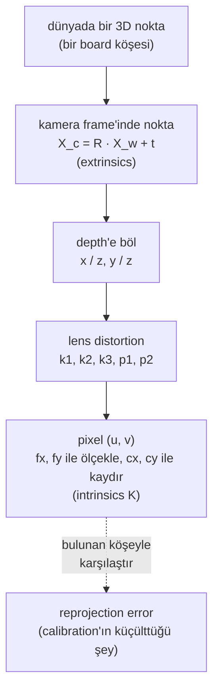

# 19 · Camera model, calibration ve hand-eye calibration

<!-- meta -->
| | |
|---|---|
| **Bölüm** | [5 · Perception ve estimation](README.md) |
| **Çalışma türü** | CPU · Mac ya da Colab CPU |
| **Önkoşul** | [07](../part-2-spatial-math/07-rigid-transforms.md) |
| **Önce öğren** | [Image Fundamentals — Pixels, Channels, Color Spaces](https://aiengineeringfromscratch.com/lesson?path=phases/04-computer-vision/01-image-fundamentals) · [Linear Systems](https://aiengineeringfromscratch.com/lesson?path=phases/01-math-foundations/17-linear-systems) |
| **Süre** | ~60 dk |
| **Kod** | [`experiments/19-camera-calibration/experiment.py`](../../experiments/19-camera-calibration/experiment.py) |
| **Durum** | ✅ tam |
<!-- /meta -->

> Kamera bir 3×3 matris, birkaç distortion sayısı ve bir pozdur; calibration bunları ancak verin onları gözlemlenebilir kılıyorsa bulur.

## Problem

Pixel'den masaya her hesap (ders 20) ve görüntüden her grasp (ders 21) kamera matrisi $K$ ve kamera pozuyla çarpar. %1 hatalı bir focal length, görüntüden hesaplanan her yanal mesafeyi %1 ölçekler; yanlış bir camera-to-gripper dönüşümü her grasp'i aynı hata kadar kaydırır. OpenCV'nin `calibrateCamera`'sı neredeyse her zaman küçük bir reprojection error döndürür, $K$ yanlışken bile. Bu ders gerçek $K$'sı bilinen bir MuJoCo kamerasını kalibre eder; böylece hata sayısının ne zaman yalan söylediğini görürsün.

## Ana fikir

### Sade anlatımla

Kamerayı bir fonksiyon olarak düşün: ona bir 3D nokta verirsin, sana bir pixel döndürür. Fonksiyonun iki grup parametresi var. **Extrinsics**, kameranın nerede olduğunu ve nereye baktığını söyler: dünyadan kameranın kendi frame'ine giden bir rigid transform ([ders 07](../part-2-spatial-math/07-rigid-transforms.md)). **Intrinsics** içini anlatır: "ileri gidilen birim başına yana kayma"nın kaç pixel'e denk geldiği (pixel cinsinden focal length) ve optik eksenin görüntüyü nerede deldiği (principal point). Gerçek bir lens düz çizgileri biraz da büker; birkaç **distortion** katsayısı bu bükülmeyi tarif eder.

**Calibration**, bu parametreleri örneklerden uydurmaktır. Kameraya köşe konumlarını milimetresine kadar bildiğin bir checkerboard gösterirsin, köşeleri görüntüde bulursun ve fonksiyonun öngördüğü pixel'leri bulunan köşelerin üstüne düşüren parametreleri ararsın. Geriye kalan uyumsuzluk **reprojection error**'dır. Makine öğrenmesindeki training loss'un rolünü oynar: modelin bu örneklere ne kadar iyi oturduğunu söyler, parametrelerin doğru olup olmadığını değil. Örnekler parametreleri sabitlemiyorsa yanlış bir kamera da aynı iyilikte oturur. Kameranın önünde düz tutulan bir board böyle bir durumdur: "uzun lens, uzaktaki board" ile "kısa lens, yakındaki board" aynı görüntüyü üretir.

**Hand-eye calibration** başka bir bilinmeyeni çözer: bileğe takılı bir kameranın gripper'a göre tam olarak nerede durduğunu. Gripper pozunu eklem açılarından, board'un kameraya göre pozunu görüntüden bilirsin. Board hiç hareket etmez; dolayısıyla her kol pozu çifti bilinmeyen montaj için bir denklem verir. Bu denklemler montajı ancak bilek farklı eksenler etrafında dönerse sabitler.

### Pipeline olarak kamera



### Kamera, kod olarak

```python
def project(X_w, R, t, fx, fy, cx, cy, k1=0.0):
    X_c = R @ X_w + t                         # world -> camera (x right, y down, z forward), metres
    x, y = X_c[0] / X_c[2], X_c[1] / X_c[2]   # perspective: farther points move less on the image
    r2 = x * x + y * y                        # squared distance from the image centre
    x, y = x * (1 + k1 * r2), y * (1 + k1 * r2)   # radial distortion, first term only
    return fx * x + cx, fy * y + cy           # to pixels

# A MuJoCo camera has square pixels; K follows from fovy and the image size
fy = (height / 2) / np.tan(np.radians(fovy) / 2)   # 480 px tall, fovy 50 deg -> 514.68 px
fx, cx, cy = fy, (width - 1) / 2, (height - 1) / 2

# Calibration: find K, dist and one board pose (R_i, t_i) per view that minimize
#   sum over views i and corners j of |project(corner_j, R_i, t_i, K, dist) - detected_ij|^2
```

| Parça | Formül |
|---|---|
| Projeksiyon | $[u,\ v,\ 1]^\top \sim K\,[x/z,\ y/z,\ 1]^\top$ |
| Intrinsics | $K = \begin{bmatrix}f_x & 0 & c_x\\ 0 & f_y & c_y\\ 0&0&1\end{bmatrix}$ |
| Extrinsics | $X_c = R\,X_w + t$ |
| Radyal distortion | $x_d = x_n(1 + k_1 r^2 + k_2 r^4 + k_3 r^6)$ |
| MuJoCo kamerasının $K$'sı | $f_x = f_y = \dfrac{H/2}{\tan(\mathrm{fovy}/2)},\ c_x = \dfrac{W-1}{2},\ c_y = \dfrac{H-1}{2}$ |
| Hand-eye | $A_{ij}X = XB_{ij}$ |

$(u, v)$ pixel, $(x, y, z)$ kamera frame'indeki nokta, $\sim$ "bir ölçek çarpanı dışında eşit", $f_x, f_y$ pixel cinsinden focal length'ler, $(c_x, c_y)$ principal point, $(R, t)$ dünyadan kameraya rotation ve translation, $x_n$ normalize bir koordinat ($x/z$) ve $r^2 = x_n^2 + y_n^2$, $k_1, k_2, k_3$ radyal distortion katsayıları, $W \times H$ görüntü boyutu, $X$ ise kameranın gripper frame'indeki bilinmeyen pozudur; $A_{ij}$ ve $B_{ij}$ aşağıda tanımlanan, ölçülmüş gripper ve board hareketleridir.

<details>
<summary>Matematik ayrıntısı: konvansiyonlar, Zhang yöntemi ve hand-eye denklemi</summary>

**Pinhole model** (bkz. Hartley & Zisserman, *Multiple View Geometry*, kamera modelleri bölümü). Kamera frame'inde (OpenCV konvansiyonu: $x$ sağa, $y$ aşağı, $z$ ileri) $X_c = (x, y, z)$ noktası şuraya düşer:

$$\begin{bmatrix}u\\v\\1\end{bmatrix} \sim K\begin{bmatrix}x/z\\y/z\\1\end{bmatrix},\qquad K = \begin{bmatrix}f_x & 0 & c_x\\ 0 & f_y & c_y\\ 0&0&1\end{bmatrix},\qquad X_c = R\,X_w + t$$

Lens distortion'ı $K$'dan önce normalize koordinatlara uygulanır; radyal kısmın yanında tanjansiyel terimler $p_1, p_2$ de vardır ([OpenCV calib3d](https://github.com/opencv/opencv/blob/4.x/modules/calib3d/include/opencv2/calib3d.hpp)).

**MuJoCo'dan K.** Bir kameranın `fovy`'si derece cinsinden dikey görüş açısıdır; yatay açı görüntü boyutundan hesaplanır ([MuJoCo XML · camera/fovy](https://mujoco.readthedocs.io/en/stable/XMLreference.html#body-camera-fovy)). Yani pixel'ler karedir ve $f_x = f_y$. $c_x = (W-1)/2$'deki $-1$, OpenCV'nin pixel merkezlerini tam sayı koordinatlara koyma konvansiyonundan gelir. MuJoCo kameraları $y$ yukarıyken kendi $-z$ eksenine bakar; dolayısıyla eksenler ters döner: kameradan dünyaya rotation (`cam_xmat`) için $R^{wc}_{\text{OpenCV}} = R^{wc}_{\text{MuJoCo}}\,\mathrm{diag}(1,-1,-1)$, $X_c = R\,X_w + t$'deki dünyadan kameraya $R$ için ise çarpan sola geçer: $R = \mathrm{diag}(1,-1,-1)\,(R^{wc}_{\text{MuJoCo}})^\top$.

**Calibration.** `calibrateCamera`, Zhang'ın düzlemsel yöntemini izler ([Zhang 2000](https://doi.org/10.1109/34.888718)): düzlem-görüntü **homography**'lerinden (board koordinatlarından pixel'lere giden 3×3'lük dönüşümler, ders 20) başlangıç intrinsics'i, `solvePnP` (bilinen 3D noktalardan ve pixel'lerinden kamera pozu) ile başlangıç board pozları, ardından toplam reprojection error üzerinde doğrusal olmayan bir least-squares çözücüsü olan Levenberg–Marquardt ([OpenCV calib3d dokümanı](https://docs.opencv.org/4.x/d9/d0c/group__calib3d.html)).

**Düz board'lar neden başarısız olur.** Görüntüye paralel, $Z$ derinliğindeki bir board için $u = f_x X/Z + c_x$: yalnızca $f_x/Z$ oranı kısıtlanır. Tilt, $Z$'yi board boyunca değiştirir; değişen perspektif kısalması $f$'yi $Z$'den ayırır.

**Hand-eye.** Gripper üzerindeki bir kamerada bilinmeyen $X$'tir: kameranın gripper frame'indeki pozu. Gripper pozları $G_i$ (forward kinematics) ve kameradaki board pozları $C_i$ (PnP) ile board base'te sabittir, $G_i X C_i = G_j X C_j$; buradan

$$A_{ij}X = XB_{ij},\qquad A_{ij} = G_j^{-1}G_i,\quad B_{ij} = C_jC_i^{-1}$$

Park & Martin'in kapalı çözümü ([Park & Martin 1994](https://doi.org/10.1109/70.326576)): $\alpha = \log R_A$, $\beta = \log R_B$ (rotation vektörleri), $M = \sum\beta\alpha^\top$ ile $R_X = (M^\top M)^{-1/2}M^\top$; ardından $t_X$, üst üste dizilmiş doğrusal sistem $(R_A - I)\,t_X = R_X t_B - t_A$'dan. OpenCV'nin `calibrateHandEye`'ı bunu ve dört yöntem daha sunar; dönme eksenleri paralel olmayan en az iki hareket ister. Dönmeler küçükse $R_A - I \approx 0$ olur ve translation zayıf belirlenir.

Daha derine: [Image Fundamentals — Pixels, Channels, Color Spaces](https://aiengineeringfromscratch.com/lesson?path=phases/04-computer-vision/01-image-fundamentals), [Linear Systems](https://aiengineeringfromscratch.com/lesson?path=phases/01-math-foundations/17-linear-systems); [Zhang 2000](https://doi.org/10.1109/34.888718); [Park & Martin 1994](https://doi.org/10.1109/70.326576); Hartley & Zisserman ([kitap sayfası](https://www.robots.ox.ac.uk/~vgg/hzbook/)).

</details>

<!-- figure: 19-pinhole -->

## Deney

**Kurulum.** 25 mm karelerden oluşan, 9×6 iç köşeli bir checkerboard; box geom'lardan kurulu (tam geometri, texture mapping yok), mocap body (fizik olmadan doğrudan yerleştirilen bir body) olarak rastgele pozlara taşınıyor (x ve y etrafında ±35° tilt, z etrafında ±20°), `fovy = 50` olan 640×480 bir kameranın 0,5–0,65 m önünde. Ground truth: $f_x = f_y = 514{,}68$ px, $c_x = 319{,}5$, $c_y = 239{,}5$. Köşeler `findChessboardCorners` + `cornerSubPix` ile. 60 eğitim görüntüsü, 15 ayrılmış (**held-out**, uydurmada kullanılmayan, bir test kümesi gibi) görüntü. Held-out hata = her held-out board pozunu tahmin edilen $K$ ve distortion ile `solvePnP`'yle bulup yeniden projekte etmek.

```python
r.update_scene(d, camera="cam"); img = r.render()
ok, c = cv2.findChessboardCorners(gray, (9, 6))
c = cv2.cornerSubPix(gray, c, (5, 5), (-1, -1), crit)
rms, K, dist, _, _ = cv2.calibrateCamera([objp] * n, views, (640, 480), None, None)
```

**Tahmin.** Az görüntü küçük bir eğitim hatası ama yanlış bir $K$ vermeli.

**Çalıştır:** `uv run python experiments/19-camera-calibration/experiment.py` (MuJoCo 3.17.0, OpenCV 5.0.0, NumPy 2.5.4, Apple M5, deterministic: iki çalıştırma birebir aynı çıktıyı verdi).

Renderer ideal bir pinhole kameradır (lens distortion'ı yok): bulunan köşeler, ground-truth $K$ ile yapılan projeksiyondan ortalama 0,220 px, en fazla 0,525 px uzakta. 60 görüntünün tamamıyla: $f_x = f_y = 514{,}58$, $c_x = 319{,}57$, $c_y = 239{,}33$, $k_1 = +0{,}0005$, eğitim RMS 0,091 px.

| Görüntü | Eğitim RMS (px) | Held-out RMS (px) | $f_x$ hatası (%) | $f_y$ hatası (%) | $c_x$ hatası (px) | $c_y$ hatası (px) |
|---|---|---|---|---|---|---|
| 3 | 0,088 | 0,103 | 0,292 | 0,230 | 1,17 | 0,89 |
| 5 | 0,089 | 0,101 | 0,145 | 0,146 | 0,93 | 0,54 |
| 10 | 0,093 | 0,101 | 0,066 | 0,064 | 0,41 | 0,30 |
| 20 | 0,093 | 0,101 | 0,043 | 0,046 | 0,40 | 0,24 |
| 40 | 0,091 | 0,101 | 0,021 | 0,025 | 0,23 | 0,18 |

(satır başına 10 rastgele alt kümenin medyanı)


**Gözlem.** Eğitim RMS'i düz (0,088–0,093 px) kalırken focal hatası 3'ten 40 görüntüye yaklaşık 14 kat düşüyor. Reprojection error, modelin bu köşelere ne kadar iyi oturduğunu ölçer, $K$'nın ne kadar doğru olduğunu değil. Held-out RMS de aynı şekilde düz (0,101–0,103 px): `solvePnP` her held-out pozu yeniden oturtur ve küçük bir focal hatasını yutar; yalnızca kaba hataları yakalar (aşağıdaki tilt testinde 2,441 px). Tek dürüst kontrol ground truth'tur; gerçek kamerada buna `calibrateCameraExtended`'ın döndürdüğü parametre standart sapmalarını ekle.

**Distortion.** 20 görüntüyü bilinen $k_1 = -0{,}15$ ile bükerek (`cv2.remap`) veriyoruz. Calibration $k_1 = -0{,}1558$'i %0,096 focal hatasıyla buluyor. Aynı görüntülerde distortion'ı sıfıra zorlamak RMS'i 0,252 px'e, focal hatasını %1,24'e çıkarıyor: modellenmemiş bir lens $f$'yi büker.

**Hand-eye.** SO-101 gripper pozları rastgele eklem açılarında (her aralığın %60'ı) forward kinematics'ten; $X$, Menagerie `wrist_cam`'in gripper frame'indeki pozu (ofset 76,0 mm). Kameradaki board pozlarına (PnP hatalarının yapacağı gibi) noise ekleniyor, çözüm başına 15 poz, 20 deneme. `cv2.calibrateHandEye` burada kullanılan OpenCV 5.0.0 Python build'inde yok; script Park & Martin'i doğrudan uyguluyor (`hand_eye_park`).

| Rotation noise (°) | Translation noise (mm) | $X$ rotation hatası (°) | $X$ translation hatası (mm) |
|---|---|---|---|
| 0 | 0 | 0,000 | 0,00 |
| 0,1 | 0,5 | 0,050 | 0,31 |
| 0,2 | 1 | 0,105 | 0,68 |
| 0,5 | 2 | 0,177 | 1,55 |
| 1 | 5 | 0,389 | 2,84 |
| 2 | 10 | 0,905 | 6,87 |

Hatasız veri tam $X$ verir; 105 hareket çiftiyle hata, poz başına noise'un altında kalır.

## Boz

**Tilt'i kaldır.** 10 görüntü, tilt ±t ile sınırlı:

| Tilt (°) | Eğitim RMS (px) | Held-out RMS (px) | $f_x$ hatası (%) |
|---|---|---|---|
| 0 | 0,088 | 2,441 | 1193 |
| 2 | 0,087 | 0,179 | 5,61 |
| 5 | 0,083 | 0,114 | 1,93 |
| 15 | 0,092 | 0,102 | 0,48 |
| 35 | 0,091 | 0,101 | 0,02 |

Görüntü düzlemine paralel (kameraya dümdüz bakan) board'larla eğitim RMS'i yine 0,088 px ve focal length %1193 hatalı. Mekanizma: görüntüye paralel bir düzlem için $u = f_x X/Z + c_x$ yalnızca $f_x/Z$'yi kısıtlar; daha uzun bir focal length ve daha uzaktaki bir board aynı köşeleri açıklar. Tilt, board boyunca perspektif kısalması yaratır ve $f$'yi $Z$'den ayırır. OpenCV'nin kendi `calibrateCamera` dokümanı da "multiple board poses with significant tilt" ister ([calib3d.hpp](https://github.com/opencv/opencv/blob/4.x/modules/calib3d/include/opencv2/calib3d.hpp)).

**Rotation çeşitliliğini kaldır** (hand-eye, noise 0,5° / 2 mm, eklemler aralıklarının bir kesrinde örnekleniyor; her satırda yeni bir rastgele poz havuzu):

| Aralık kesri | Pozlar arası medyan dönme (°) | $X$ rotation hatası (°) | $X$ translation hatası (mm) |
|---|---|---|---|
| 0,02 | 3,6 | 4,818 | 27,18 |
| 0,05 | 9,2 | 2,200 | 13,68 |
| 0,1 | 18,8 | 0,977 | 4,89 |
| 0,3 | 54,8 | 0,348 | 1,85 |
| 0,6 | 116,4 | 0,274 | 1,33 |

Translation $(R_A - I)\,t_X$ üzerinden girer; kol neredeyse hiç dönmezse $R_A - I \approx 0$ olur ve noise sıfıra yakın bir matrise bölünür. Bu, düz board'un hand-eye karşılığıdır: veri bilinmeyeni kısıtlamaz.

## Gerçek robotta

- Menagerie SO-101'in model dosyasında `fovy = 61` olan bir `wrist_cam` var ([robotstudio_so101](https://github.com/google-deepmind/mujoco_menagerie/tree/f3b6013/robotstudio_so101)); gerçek bir webcam'in kendi $K$'sı ve distortion'ı vardır. Gerçek kolda henüz ölçülmedi.
- Intrinsics prosedürü: bir checkerboard bas, kare boyunu kumpasla ölç (ölçek hatası doğrudan $t$'ye girer), düz bir yüzeye yapıştır, güçlü tilt'li ve farklı mesafelerden 20+ görüntü al; yalnızca RMS'e değil held-out hataya ve parametre standart sapmalarına bak.
- Hand-eye prosedürü: board'u masaya sabitle, kolu büyük bilek dönmeleriyle 15+ pozdan geçir, her biri için eklem açılarını (forward kinematics, [ders 08](../part-3-kinematics/08-forward-kinematics.md)) ve PnP board pozunu kaydet, sonra $AX = XB$'yi çöz. Eklem açısı hataları ve servo backlash'i (dişlilerdeki boşluk) doğrudan $A$'ya girer.
- Autofocus ve otomatik zoom $K$'yı değiştirir; kalibre etmeden önce kilitle.

## Kendini dene

1. **Kolay.** 1280×720 bir görüntü ve `fovy = 61` için $f_y$'yi hesapla.
2. **Orta.** 0,09 px eğitim RMS'i neden iyi bir calibration'ın kanıtı değildir? İki tabloyu göster.
3. **Zor.** `CALIB_FIX_ASPECT_RATIO` ve `CALIB_FIX_PRINCIPAL_POINT`'i ayarla ve 0° tilt satırını tekrarla. Parametreleri sabitlemek dejenere durumu kurtarır mı?

### Cevaplar

1. $f_y = 360/\tan(30{,}5°) = 611{,}2$ px.
2. Görüntü sayısı sweep'i, $f_x$ hatası yaklaşık 14 kat değişirken eğitim RMS'inin düz kaldığını gösteriyor; tilt sweep'i %1193 focal hatasıyla 0,088 px gösteriyor. RMS uyumu ölçer, gözlemlenebilirliği değil.
3. Burada hesaplanmadı. $c_x, c_y$ ve en-boy oranını sabitlemek paralel düzlemlerin $f/Z$ belirsizliğini ortadan kaldırmaz; görmek için çalıştır.

## Akılda kalanlar ve kaynaklar

- MuJoCo'da $K$, `fovy` ve görüntü boyutundan çıkar; calibration pipeline'ını test etmek için ground truth olarak kullan.
- Calibration doğruluğu küçük bir reprojection error'dan değil, görüntü çeşitliliğinden (tilt, mesafe, dönme) gelir.
- Hand-eye büyük ve paralel olmayan dönmeler ister; translation hatası kabaca $1/\|R_A - I\|$ gibi büyür.

Sıradaki: [ders 20](20-pixels-to-table.md), pixel'den masaya.

Kaynaklar:
- Z. Zhang, "A flexible new technique for camera calibration", *IEEE TPAMI* 22(11):1330–1334, 2000. [doi:10.1109/34.888718](https://doi.org/10.1109/34.888718)
- F. C. Park, B. J. Martin, "Robot sensor calibration: solving AX=XB on the Euclidean group", *IEEE Trans. Robotics and Automation* 10(5):717–721, 1994. [doi:10.1109/70.326576](https://doi.org/10.1109/70.326576)
- [OpenCV calib3d dokümanı](https://docs.opencv.org/4.x/d9/d0c/group__calib3d.html) ve [kaynak header](https://github.com/opencv/opencv/blob/4.x/modules/calib3d/include/opencv2/calib3d.hpp): `calibrateCamera` algoritması, distortion modeli, `calibrateHandEye` yöntemleri ve en az hareket sayısı.
- [MuJoCo XML reference · camera](https://mujoco.readthedocs.io/en/stable/XMLreference.html#body-camera-fovy): `fovy` anlamı.
- R. Hartley, A. Zisserman, *Multiple View Geometry in Computer Vision*, 2. baskı, Cambridge University Press, 2004 ([kitap sayfası](https://www.robots.ox.ac.uk/~vgg/hzbook/)).
- Yukarıdaki tüm sayılar: [`experiment.py`](../../experiments/19-camera-calibration/experiment.py), çıktı [`output.txt`](../../experiments/19-camera-calibration/output.txt).
