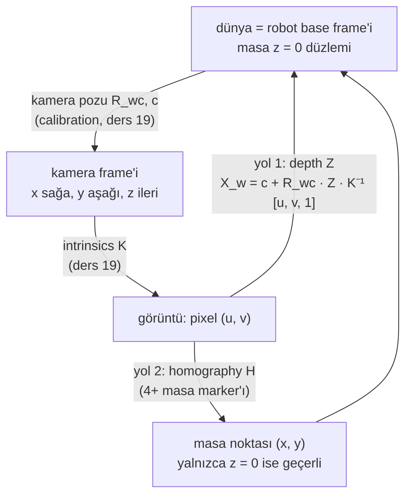

# 20 · Pixel'den masaya: homography ve depth back-projection

<!-- meta -->
| | |
|---|---|
| **Bölüm** | [5 · Perception ve estimation](README.md) |
| **Çalışma türü** | CPU · Mac ya da Colab CPU |
| **Önkoşul** | [19](19-camera-calibration.md) |
| **Önce öğren** | [Linear Systems](https://aiengineeringfromscratch.com/lesson?path=phases/01-math-foundations/17-linear-systems) · [Monocular Depth & Geometry Estimation](https://aiengineeringfromscratch.com/lesson?path=phases/04-computer-vision/26-monocular-depth) |
| **Süre** | ~45 dk |
| **Kod** | [`experiments/20-pixels-to-table/experiment.py`](../../experiments/20-pixels-to-table/experiment.py) |
| **Durum** | ✅ tam |
<!-- /meta -->

> Bir pixel bir ışındır; onu noktaya çevirmek için bir bilgi daha gerekir: bilinen bir düzlem (homography) ya da ölçülmüş bir depth.

## Problem

Ders 21'deki detector "küp (u, v) pixel'inde" diyecek. Kolun ise base frame'inde (x, y, z) bilgisine ihtiyacı var. Bir pixel yalnızca kamera merkezinden çıkan bir ışını belirler; o ışın üzerindeki her nokta aynı pixel'e düşer. Noktayı seçmenin iki standart yolu var: nesnenin masa düzleminde olduğunu varsayıp homography kullanmak ya da depth görüntüsünü okuyup back-projection yapmak. İkisinde de ince hata yapmak kolaydır: homography düzlemin üstündeki her şey için sessizce yanlıştır, depth görüntüsü de değerlerinin ne anlama geldiğini yanlış okursan sessizce yanlıştır.

## Ana fikir

### Sade anlatımla

Bir pixel sana mesafe değil, yön söyler: lense tutulmuş, o pixel'in içinden nişan alan bir lazer işaretleyici düşün; ışın boyunca her nokta aynı pixel'e düşer. 3D bir nokta için bir bilgi daha gerekir; yaygın iki tanesi var.

- **Işının nerede durduğu.** Depth görüntüsü her pixel için yüzeyin ne kadar uzakta olduğunu saklar. Işın boyunca o kadar yürürsen noktayı bulursun. Bu **back-projection**'dır, ders 19'daki kamera fonksiyonunun tersi.
- **Nesnenin hangi yüzeyde durduğu.** Nesne masanın üstündeyse nokta, ışının masa düzlemine çarptığı yerdir. **Homography** bu durum için bir kısayoldur: birkaç işaretli noktadan uydurulan, görüntüden masaya giden 3×3'lük bir dönüşüm; hiç kamera modeli gerektirmez, bir hava fotoğrafını bilinen işaret noktalarıyla haritaya oturtmak gibi. Düz yatan şeyler için tamdır, yukarı çıkıntı yapan her şey için yanlıştır.

İkisi de robotun ve kameranın frame'lerde anlaşmasını ister: masa ve robot base aynı dünya frame'ini paylaşır, kameranın bu frame'deki pozu calibration'dan gelir.

### Frame'ler ve iki yol



### İki yol, kod olarak

```python
X_w = c + R_wc @ (Z * np.linalg.inv(K) @ [u, v, 1.0])   # route 1: Z = depth along the optical axis
x, y, w = H @ [u, v, 1.0]                               # route 2: homography pixel -> table ...
x, y = x / w, y / w                                     # ... divide the scale out; z assumed 0
```

| Parça | Formül |
|---|---|
| Back-projection, $Z$ optik eksen boyunca | $X_c = Z\,K^{-1}[u,\ v,\ 1]^\top,\quad X_w = R_{wc}X_c + c$ |
| Sensor bunun yerine ışın uzunluğu $\rho$ raporlarsa | $X_c = \rho\,\dfrac{K^{-1}[u,v,1]^\top}{\lVert K^{-1}[u,v,1]^\top\rVert}$ |
| Homography (masa düzlemi) | $[x,\ y,\ 1]^\top \sim H\,[u,\ v,\ 1]^\top$ |
| Depth buffer'dan metreye (klasik / ters) | $Z = \dfrac{nf}{f - d\,(f-n)}$ / $Z = \dfrac{nf}{n + d\,(f-n)}$ |

$(u, v)$ pixel, $K$ kamera matrisi, $Z$ kameranın optik ekseni boyunca ölçülen depth, $\rho$ ışın boyunca Öklid mesafesi, $X_c$ ve $X_w$ noktanın kamera ve dünya koordinatları, $R_{wc}$ sütunları dünyada ifade edilmiş kamera eksenleri olan rotation, $c$ kamera merkezinin dünyadaki konumu, $H$ 3×3'lük homography, $\sim$ "ölçek dışında eşit", $d$ ham depth buffer değeri, $n, f$ ise near ve far kırpma mesafeleridir.

| Yöntem | Gerekenler | Geçerli olduğu yer | Bozulduğu durum |
|---|---|---|---|
| Homography | 4+ bilinen masa noktası | düzlemdeki noktalar | nesnenin yüksekliği var, masa düz değil |
| Depth back-projection | $K$, kamera pozu, depth görüntüsü | görünen her yüzey | depth yanlış okunmuş, depth noise'u, eksik depth |

<details>
<summary>Matematik ayrıntısı: z-depth ile ışın uzunluğu, MuJoCo depth buffer'ı ve homography'nin kaynağı</summary>

**Z-depth ile ışın uzunluğu.** $K^{-1}[u,v,1]^\top$'nin üçüncü bileşeni 1'dir; onu $Z$ ile çarpmak, kamera $z$'si tam olarak $Z$ olan bir nokta verir. Back-projection'ın **optik eksen boyunca** depth istemesinin sebebi budur. $Z$ bunun yerine ışın boyunca Öklid mesafesi olsaydı, önce $\|K^{-1}[u,v,1]^\top\|$'ye bölmen gerekirdi; ikisi yalnızca görüntü merkezinde örtüşür, en çok köşelerde ayrışır.

**Ders 19'un extrinsics'inden.** Ders 19 $X_c = R\,X_w + t$ yazdı. $X_w$ için çözersek $X_w = R^\top X_c - R^\top t$; yani $R_{wc} = R^\top$ ve kamera merkezi $c = -R^\top t$.

**MuJoCo'dan depth.** GPU metre değil, doğrusal olmayan bir z-buffer değeri $d\in[0;\,1]$ saklar. Near/far kırpma mesafeleri $n = \texttt{znear}\cdot\text{extent}$ ve $f = \texttt{zfar}\cdot\text{extent}$ ile (extent = modelin genel boyutu; `znear` ve `zfar` varsayılan olarak 0,01 ve 50, [MuJoCo XML · visual/map](https://mujoco.readthedocs.io/en/stable/XMLreference.html#visual-map-znear)), klasik bir OpenGL buffer'ı $Z = \dfrac{nf}{f - d\,(f-n)}$ verir. MuJoCo 3.17'nin Python `Renderer`'ı ters çevrilmiş bir buffer okur (near'da 1, far'da 0), $Z = \dfrac{nf}{n + d\,(f-n)}$'yi float64'te uygular ve float32 metre döndürür ([`renderer.py`, tag 3.17.0](https://github.com/google-deepmind/mujoco/blob/3.17.0/python/mujoco/rendering/classic/renderer.py)); Sıfırdan yaz, Adım 2 aynısını `mjr_readPixels`'ten yapıyor. Dokümantasyon, near düzlemini fazla yakın koymanın depth çözünürlüğüne mal olduğu konusunda uyarır.

**Homography.** Bir düzlemdeki noktalar görüntüye 3×3'lük bir projektif dönüşümle gider. Masa $z=0$ için ders 19'daki projeksiyon $R$'nin üçüncü sütununu kaybeder: $s\,[u,v,1]^\top = K[r_1\ r_2\ t]\,[x,y,1]^\top$, yani $H = (K[r_1\ r_2\ t])^{-1}$ ile $[x,y,1]^\top \sim H\,[u,v,1]^\top$. $H$'nin 8 serbestlik derecesi var (9 eleman, ölçek dışında tanımlı); 4 nokta çifti (hiçbir üçü aynı doğru üzerinde olmayan) onu belirler, daha fazlası least-squares uyumu verir (`cv2.findHomography`, method 0; outlier'lar için RANSAC/LMEDS/RHO, [OpenCV calib3d](https://github.com/opencv/opencv/blob/4.x/modules/calib3d/include/opencv2/calib3d.hpp)). $K$ ya da depth gerekmez, yalnızca bilinen masa noktaları. Bedeli: formül yalnızca $z = 0$ için doğrudur.

**Düzlemin üstündeki hata.** Dikeyle $\theta$ açısı yapan bir ışın üzerinde $h$ yüksekliğindeki bir nokta, o ışının $z = 0$'a ulaştığı yere, yatayda $h\tan\theta$ daha öteye eşlenir. Hata tek bir ışın boyunca $h$'de doğrusaldır ve eğik ışınlarda daha büyüktür.

Daha derine: [Linear Systems](https://aiengineeringfromscratch.com/lesson?path=phases/01-math-foundations/17-linear-systems), [Monocular Depth & Geometry Estimation](https://aiengineeringfromscratch.com/lesson?path=phases/04-computer-vision/26-monocular-depth); düzlemin indüklediği homography'ler ve back-projection için Hartley & Zisserman ([kitap sayfası](https://www.robots.ox.ac.uk/~vgg/hzbook/)).

</details>

## Sıfırdan yaz

Şimdi pixel'den masaya giden iki yolu da NumPy ile yazacaksın: ışınlar ve back-projection, depth buffer dönüşümü ve masa homography'si; ardından Deney'in sweep'lerini kendi kodunla tekrar koşturacaksın. Sahne, 300 masa pixel'i, marker'lar ve rastgele noise Deney script'inden geliyor (aynı seed); MuJoCo render ediyor, OpenCV hakemlik ediyor.

Adımları kendi dosyana yaz ve her adımdan sonra çalıştır. Bitmiş fonksiyonlar [`physai/vision.py`](../../physai/vision.py) içinde; `uv run python experiments/20-pixels-to-table/build.py` beş adımı kontrolleriyle birlikte koşturur (çıktı [`build_output.txt`](../../experiments/20-pixels-to-table/build_output.txt) dosyasında).

### Adım 1 · Işınlar ve back-projection

Bir pixel'in ışını, dünyaya çevrilmiş $K^{-1}[u, v, 1]^\top$'dir. Kamera $z$'si 1 olacak şekilde ölçeklenince, onun boyunca $Z$ kadar yürümek $Z$ depth'ine götürür; bir düzlemle kesiştirmek için yalnızca kamera yüksekliği gerekir.

```python
def pixel_rays(uv, K, R_wc):
    """World-frame directions of the rays through pixels uv (N, 2), scaled so each has camera z = 1."""
    p = np.c_[uv, np.ones(len(uv))] @ np.linalg.inv(K).T      # [x/z, y/z, 1] in the camera frame
    return p @ R_wc.T                                         # rotate into the world
```

```python
def back_project(uv, Z, K, R_wc, c):
    """World points seen at pixels uv with depth Z (N,) measured along the optical axis, not along the ray."""
    return c + Z[:, None] * pixel_rays(uv, K, R_wc)
```

```python
def ray_plane(uv, K, R_wc, c, z0=0.0):
    """Where the pixel rays meet the horizontal plane z = z0; also returns the z-depth of each hit."""
    r = pixel_rays(uv, K, R_wc)
    s = (z0 - c[2]) / r[:, 2]                                 # how far to walk along each ray
    return c + s[:, None] * r, s
```

Noisy pixel'ler pixel merkezlerinin arasına düşer; bu yüzden depth okuması interpolasyon yapar:

```python
def bilinear(img, uv):
    """Sample img at sub-pixel positions uv (N, 2) from the four nearest pixels (pixel centres on integers)."""
    u0 = np.clip(np.floor(uv[:, 0]).astype(int), 0, img.shape[1] - 2)
    v0 = np.clip(np.floor(uv[:, 1]).astype(int), 0, img.shape[0] - 2)
    a, b = uv[:, 0] - u0, uv[:, 1] - v0                       # weights inside the pixel square
    return ((1 - a) * (1 - b) * img[v0, u0] + a * (1 - b) * img[v0, u0 + 1]
            + (1 - a) * b * img[v0 + 1, u0] + a * b * img[v0 + 1, u0 + 1])
```

```text
== Step 1. Rays, the table plane and depth back-projection (camera 0.6 m, 300 table pixels) ==
max |ray_plane - Experiment's hit_plane| = 0.0e+00 m
rendered depth vs z-depth s:           median 0.001 mm, max 0.008 mm
rendered depth vs ray length:          median 45.8 mm, max 138.0 mm
back_project, depth used as Z:         median 0.001 mm, max 0.009 mm
back_project, depth misused as length: median 45.8 mm, max 138.0 mm
sub-pixel lookup: max |bilinear - cv2.remap| = 3.5e-08 m
```

Bunlar Deney'in ilk tablosu, bu kez senin kodundan: MuJoCo'nun depth'i her ışın-düzlem kesişiminin z-depth'iyle 0,008 mm içinde aynı; onu ışın uzunluğu saymak 138,0 mm'ye kadar hataya mal oluyor. Senin bilinear okuman `cv2.remap` ile 3,5e-08 m içinde aynı.

### Adım 2 · Ham depth buffer

`Renderer` bir dönüşümü gizliyor. Aynı karenin depth buffer'ını `mjr_readPixels` ile kendin oku ve çevir:

```python
def linearize_depth(d, near, far):
    """Reversed-Z depth-buffer value d (1 at near, 0 at far) to metres along the optical axis."""
    return near * far / (near + d * (far - near))
```

```text
== Step 2. The raw depth buffer ==
near 5.0 mm, far 24.9 m; raw values 0.005052 .. 0.008911 (1 = near, 0 = far)
max |linearize_depth(raw) - Renderer| = 0.0012 mm
image centre: Renderer 0.6924 m, ours 0.6924 m, conventional formula 0.0050 m
```

Ham değerler metre değil: görüşteki her şey için 0,005 ile 0,009 arası, çünkü buffer kabaca near/depth saklıyor (near düzleminde 1, far düzleminde 0). Senin dönüşümün Renderer'la 0,0012 mm içinde aynı; bu, sabitlerinin float32 yuvarlaması. Klasik buffer için ders kitabı formülü, bu ters buffer'a uygulanınca masayı lensten 5,0 mm uzağa, yani near düzlemine koyuyor. Buffer ayrıca alttaki satırdan başlıyor (OpenGL); `flipud` bu yüzden.

### Adım 3 · Masa homography'si

$z = 0$ düzlemi için kamera modeli homography'yi doğrudan verir (Matematik ayrıntısı):

```python
def plane_homography(K, R_wc, c):
    """Pixel -> table (x, y) homography of the plane z = 0, from the camera model: (K [r1 r2 t])^-1."""
    R = R_wc.T                                                # world -> camera, as in lesson 19
    t = -R @ c
    H = np.linalg.inv(K @ np.c_[R[:, 0], R[:, 1], t])
    return H / H[2, 2]
```

```python
def apply_homography(H, p):
    """Map points p (N, 2) with H and divide out the scale."""
    q = np.c_[p, np.ones(len(p))] @ H.T
    return q[:, :2] / q[:, 2:3]
```

Bunun yerine onu marker'lardan [ders 19](19-camera-calibration.md)'daki `homography_dlt` ile uydur; kaynak pixel'ler, hedef masa noktaları:

```text
== Step 3. The table homography: from the camera model and from markers ==
plane_homography vs ray_plane on the 300 pixels: max 2.8e-16 m
 4 markers: exact pixels, max |H_fit - H_cam| on the table 1.0e-15 m; 1 px noise, ours vs cv2: median 0.000 mm, max 0.000 mm
12 markers: exact pixels, max |H_fit - H_cam| on the table 1.2e-15 m; 1 px noise, ours vs cv2: median 0.181 mm, max 1.380 mm
```

Hatasız marker pixel'lerinden 4 ya da 12 marker, kamera modelinin homography'sini 1e-15 m içinde veriyor. 1 px noise'la 4 nokta $H$'yi yine tam belirliyor, dolayısıyla sonucun OpenCV'ninkiyle aynı. 12 noktada ikisi medyan 0,181 mm farklı: senin DLT'n cebirsel bir hatayı küçültüyor, `findHomography` sonucu reprojection error üzerinde iyileştiriyor.

### Adım 4 · Noise sweep'i senin kodunla

Deney'in döngüsü, seed'i ve pixel'leri; `cv2.findHomography` yerine `homography_dlt`, `cv2.remap` yerine `bilinear`:

```text
== Step 4. The pixel-noise sweep with your functions (Experiment seed and loop, 200 pixels x 50 trials) ==
 noise px  H from 4 pts  H from 12 pts  depth back-proj   (median mm)
        0          0.00           0.00             0.00
      0.5          2.15           1.76             0.81
        1          4.33           3.33             1.60
        2          8.90           7.59             3.21
        4         17.08          13.92             6.37
```

4 noktalı ve depth sütunları Deney tablosuyla aynı (1 px'te 4,33 ve 1,60 mm). 12 noktalı sütun Adım 3'teki iyileştirme farkı yüzünden biraz farklı (1 px'te 3,27 yerine 3,33 mm, 4 px'te 14,17 yerine 13,92 mm); sıralama ve sonuç değişmiyor.

### Adım 5 · Boz, senin fonksiyonlarınla

```text
== Step 5. Break it: the top face of each box (no pixel noise) ==
 box height mm  homography mm  depth back-proj mm  ray_plane at z = 0.6 h mm
            10            4.7                0.00                        1.9
            20           10.8                0.00                        4.3
            50           36.7                0.00                       14.7
           100           88.5                0.01                       35.4
```

Homography hataları Boz tablosu. Son sütun Kendini dene 3'ü çalıştırarak cevaplıyor: her ışını tahmin edilen 0,6 $h$ yüksekliğiyle (50 mm'lik kutu için 30 mm) kesiştirmek 14,7 mm bırakıyor, homography hatasının %40'ı; çünkü tek bir ışın boyunca yatay kayma yükseklikte doğrusal.

### Elinde kalan

`physai.vision` artık `pixel_rays`, `back_project`, `ray_plane`, `linearize_depth`, `bilinear`, `plane_homography` ve `apply_homography` de içeriyor. [Ders 21](21-object-perception.md), tespit edilen bir blob'u aynı back-projection ile masa noktasına çeviriyor. [`tests/test_20_pixels_to_table.py`](../../tests/test_20_pixels_to_table.py) bunları tam geometriye, SciPy'a ve OpenCV'ye sabitliyor; bir şey değiştirdikten sonra `uv run pytest tests/test_20_pixels_to_table.py` çalıştır.

## Kütüphaneyle kullan

MuJoCo metrik depth render eder; OpenCV homography'leri uydurur ve uygular.

```python
r = mujoco.Renderer(m, 480, 640)
r.enable_depth_rendering()
r.update_scene(d, camera="cam")
depth = r.render()                                      # (480, 640) float32, metres along the optical axis
H, inliers = cv2.findHomography(marker_px, marker_xy, 0)            # 0 = all points; cv2.RANSAC for outliers
xy = cv2.perspectiveTransform(px.reshape(-1, 1, 2), H).reshape(-1, 2)   # needs shape (N, 1, 2)
```

| Parça | Bu ders / physai | OpenCV | MuJoCo |
|---|---|---|---|
| $H$'yi uydur | `homography_dlt(src, dst)` | `findHomography(srcPoints, dstPoints, method)`, `(H, mask)` döndürür | — |
| $H$'yi uygula | `apply_homography(H, p)`, $p$ (N, 2) | `perspectiveTransform(src, H)`, src (N, 1, 2) | — |
| metrik depth | optik eksen boyunca $Z$ | — | `enable_depth_rendering()` ile `Renderer` |
| ham depth buffer | `linearize_depth(d, near, far)` | — | `mjr_readPixels`; near, far = `znear`, `zfar` × `stat.extent` |

Kaynaklar: [OpenCV calib3d](https://github.com/opencv/opencv/blob/4.x/modules/calib3d/include/opencv2/calib3d.hpp), [MuJoCo renderer, 3.17.0](https://github.com/google-deepmind/mujoco/blob/3.17.0/python/mujoco/rendering/classic/renderer.py), [MuJoCo XML · visual/map](https://mujoco.readthedocs.io/en/stable/XMLreference.html#visual-map-znear); (N, 1, 2) şartı, OpenCV 5.0.0'ın burada dayattığı şey.

Tuzaklar:

- **Range değil, z-depth.** Depth'i birim ışınla değil $K^{-1}[u,v,1]^\top$ ile çarp (Adım 1: 138,0 mm'ye kadar).
- **Ham buffer ters ve baş aşağı.** Ters formülü kullan ve satırları çevir (Adım 2: klasik formül 5,0 mm veriyor).
- **$H$'nin yönü.** `findHomography(src, dst)` src'yi dst'ye götürür. Burada src pixel'ler, dst masa noktaları; yer değiştirirsen masadan görüntüye giden dönüşümü alırsın ve onun tersi gerekir.

## Deney

**Kurulum.** MuJoCo sahnesi: gri masa düzlemi, 10/20/50/100 mm yüksekliğinde dört kutu, dikeyden 30° eğik, (0,25, 0, 0)'a bakan 640×480'lik bir kamera (`fovy = 50`). Bir pixel'in ground truth'u, ışınının gördüğü yüzeyle tam kesişimidir. Homography marker'ları: 20 × 20 cm'lik bir bölgedeki 4 ya da 12 bilinen masa noktası, pixel'leri $\sigma$ Gauss noise'uyla bozulmuş (tespit hatası); test pixel'leri görüş boyunca rastgele masa pixel'leri, onlar da bozulmuş. Depth back-projection, render edilen depth'i bilinear okumayla kullanır.

```python
r.enable_depth_rendering(); depth = r.render()            # metres along the optical axis
P = c + depth_at(uv)[:, None] * (np.c_[uv, ones] @ np.linalg.inv(K).T @ R_wc.T)
H, _ = cv2.findHomography(marker_px, marker_xy, 0)       # pixel -> table (x, y)
```

**Tahmin.** Simülasyonda depth tamdır, dolayısıyla hatası pixel noise'u çarpı pixel izdüşümü (bir pixel'in masadaki boyu) olmalı. Homography kendi uydurma hatasını eklemeli ve düzlemin üstünde bozulmalı.

**Çalıştır:** `uv run python experiments/20-pixels-to-table/experiment.py` (MuJoCo 3.17.0, OpenCV 5.0.0, NumPy 2.5.4, Apple M5, deterministic). Bu Mac'te MuJoCo, stderr'e `ARB_clip_control`'ün olmadığını ve depth doğruluğunun sınırlı olacağını yazan bir uyarı basar; aşağıdaki ölçümler buna rağmen elde edilenlerdir.

**Depth görüntüsünde ne var** (kamera 0,6 m'de; extent 0,497 m, yani near 5,0 mm, far 24,9 m; 300 masa pixel'i):

| Karşılaştırma | Medyan | En büyük |
|---|---|---|
| render edilen depth - optik eksen boyunca z-depth | 0,001 mm | 0,008 mm |
| render edilen depth - Öklid ışın uzunluğu | 45,8 mm | 138,0 mm |
| back-projection, depth $Z$ olarak | 0,001 mm | 0,009 mm |
| back-projection, depth yanlışlıkla ışın uzunluğu olarak | 45,8 mm | 138,0 mm |

Dönen değerler z-depth'tir. Onları ışın uzunluğu saymak görüntü köşelerinde 138,0 mm'ye kadar hataya mal olur.


**Pixel noise'u** (kamera 0,6 m; 200 test pixel'i × 50 deneme, mm cinsinden medyan hata):

| Noise (px) | 4 noktadan H | 12 noktadan H | Depth back-projection |
|---|---|---|---|
| 0 | 0,00 | 0,00 | 0,00 |
| 0,5 | 2,15 | 1,81 | 0,81 |
| 1 | 4,33 | 3,27 | 1,60 |
| 2 | 8,90 | 7,67 | 3,21 |
| 4 | 17,08 | 14,17 | 6,37 |

**Kamera yüksekliği** (1 px noise, 12 noktalı H):

| Yükseklik (m) | Hedefte pixel başına mm | Homography (mm) | Depth back-projection (mm) |
|---|---|---|---|
| 0,3 | 0,67 | 1,13 | 0,88 |
| 0,5 | 1,12 | 2,76 | 1,43 |
| 0,8 | 1,79 | 5,13 | 2,18 |
| 1,2 | 2,69 | 9,56 | 3,28 |
| 2,0 | 4,49 | 13,92 | 5,72 |

**Gözlem.**

1. Tüm hatalar pixel noise'unda doğrusal. Depth back-projection hatası, hedefteki pixel izdüşümünün 1,2–1,3 katı: depth kusursuzken hata bütçesinin tamamı pixel noise'udur.
2. Homography eşit noise'ta yaklaşık 3 kata kadar daha kötü: 8 parametresi yalnızca 20 × 20 cm'lik bir bölgeyi kaplayan noisy marker'lardan uyduruluyor ve test pixel'leri bunun dışına extrapolate ediliyor. 12 marker 4'ü yener (1 px'te 3,27'ye karşı 4,33 mm).
3. Yükseklikle depth hatası izdüşüm gibi büyür (0,88 → 5,72 mm, izdüşüm 0,67 → 4,49 mm), homography hatası daha hızlı (1,13 → 13,92 mm): kamera yükseldikçe sabit marker bölgesi daha az pixel kaplar.
4. Simüle edilen depth noise'suzdur; gerçek depth sensor'leri kendi noise'unu ekler, dolayısıyla depth sütunu bir alt sınırdır.

## Boz

Her kutunun üst yüzünün merkezini gören pixel'i sorgula (pixel noise'u yok):

| Kutu yüksekliği (mm) | Homography xy hatası (mm) | Depth back-projection hatası (mm) |
|---|---|---|
| 10 | 4,7 | 0,00 |
| 20 | 10,8 | 0,00 |
| 50 | 36,7 | 0,00 |
| 100 | 88,5 | 0,01 |

Homography her pixel'i, ışınının $z = 0$'a çarptığı yere götürür; $h$ yüksekliğindeki bir nokta ışın boyunca kameradan uzağa kayar: hata $h$ ile ve ışının ne kadar eğik olduğuyla büyür. 10 mm'lik bir nesne bile 4,7 mm'ye mal olur. Çözüm: yükseklik $h$ biliniyorsa ışını $z = h$ ile kesiştir (bu yalnızca $H$'yi değil, $K$'yı ve pozu gerektirir) ya da depth kullan.

## Gerçek robotta

- Masa üstü bir SO-101 kurulumunda, ölçülmüş konumlara yapıştırılan 4–12 marker'dan bir homography hızlı bir calibration'dır ve düz, ince nesneler için yeterlidir. Marker konumlarını göz kararı değil, robot base frame'inde ölç. Gerçek kolda henüz ölçülmedi.
- Gerçek depth kameraları geçerli depth'i olmayan pixel'ler döndürür; driver'ının bunları nasıl işaretlediğine bak ve ortalamadan önce maskele. Sensor'ünün z-depth mi range mi raporladığını dokümanından kontrol et; hiçbir gerçek depth kamerasını test etmedik.
- Kamera pozu $(R_{wc}, c)$, extrinsic calibration'dan (base'te bilinen bir konumdaki board) ya da bilek kamerası için hand-eye calibration'dan gelir ([ders 19](19-camera-calibration.md)); hatası back-project edilen her noktaya doğrudan eklenir.

## Kendini dene

1. **Kolay.** $H$ neden en az 4 nokta çifti ister?
2. **Orta.** 0,6 m'de ve 1 px noise'ta depth back-projection 1,60 mm veriyor. Gerçek robotta bu simülasyonun dışarıda bıraktığı iki hata kaynağını say.
3. **Zor.** "Bilinen yükseklik" back-projection'ını uygula: pixel ışınını $z = h$ ile kesiştir ve Boz tablosunu tekrar çalıştır. 50 mm'lik kutu için $h = 30$ mm varsayarsan ne kadar hata alırsın?

### Cevaplar

1. $H$ ölçek dışında tanımlıdır: 9 eleman eksi 1 = 8 bilinmeyen; her nokta çifti 2 denklem verir.
2. Depth sensor noise'u ve $K$ ile kamera pozundaki calibration hatası (ayrıca hareket eden robotta rolling shutter ve zamanlama kaymaları).
3. Doğru $h$ ile ışın gerçek noktaya çarpar. Tek bir ışın boyunca yatay kayma yükseklikte doğrusaldır ve homography $h = 0$ durumudur; dolayısıyla 50 mm'lik kutu için 30 mm $36{,}7 \times 20/50 \approx 14{,}7$ mm verir; Sıfırdan yaz, Adım 5 bunu çalıştırıyor: 14,7 mm.

## Akılda kalanlar ve kaynaklar

- `mujoco.Renderer` depth'i optik eksen boyunca metrik z-depth'tir (burada en fazla 0,008 mm sapma); onu ışın uzunluğu saymak 138,0 mm'ye kadar hataya mal olur.
- Homography: intrinsics gerekmez ama yalnızca düzlemde geçerlidir; 10 mm nesne yüksekliği bile 4,7 mm'ye mal olur.
- İki yöntem de pixel noise'u ve pixel izdüşümüyle doğrusal ölçeklenir; kameraları yakına yerleştir ve 4'ten fazla marker kullan.

Sıradaki: [ders 21](21-object-perception.md), manipulation için object perception.

Kaynaklar:
- [MuJoCo XML reference · visual/map znear, zfar](https://mujoco.readthedocs.io/en/stable/XMLreference.html#visual-map-znear): model extent'inin kesri olarak kırpma düzlemleri; yakın near düzlemi için çözünürlük uyarısı.
- [MuJoCo `rendering/classic/renderer.py`, 3.17.0](https://github.com/google-deepmind/mujoco/blob/3.17.0/python/mujoco/rendering/classic/renderer.py): ters Z okuma ve metreye dönüşüm.
- [OpenCV calib3d](https://github.com/opencv/opencv/blob/4.x/modules/calib3d/include/opencv2/calib3d.hpp): `findHomography` yöntemleri.
- R. Hartley, A. Zisserman, *Multiple View Geometry in Computer Vision*, 2. baskı, Cambridge University Press, 2004 ([kitap sayfası](https://www.robots.ox.ac.uk/~vgg/hzbook/)): düzlemin indüklediği homography'ler ve back-projection.
- Yukarıdaki tüm sayılar: [`experiment.py`](../../experiments/20-pixels-to-table/experiment.py), çıktı [`output.txt`](../../experiments/20-pixels-to-table/output.txt); Sıfırdan yaz: [`build.py`](../../experiments/20-pixels-to-table/build.py), [`build_output.txt`](../../experiments/20-pixels-to-table/build_output.txt).
