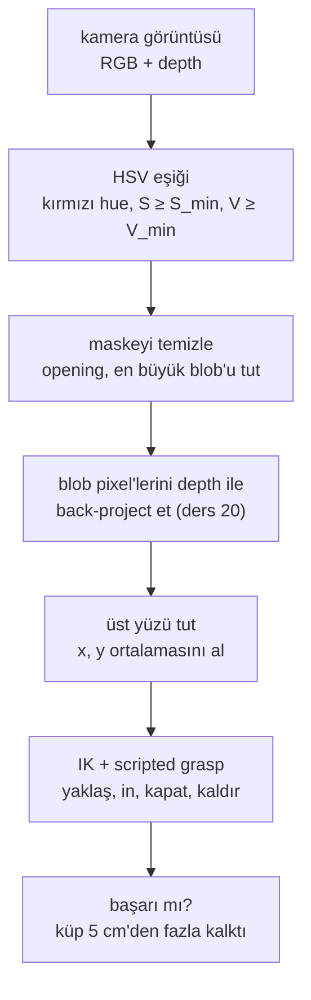

# 21 · Manipulation için object perception

<!-- meta -->
| | |
|---|---|
| **Bölüm** | [5 · Perception ve estimation](README.md) |
| **Çalışma türü** | CPU · Mac ya da Colab CPU |
| **Önkoşul** | [16](../part-4-dynamics-and-control/16-grasping-and-pick-place.md), [20](20-pixels-to-table.md) |
| **Önce öğren** | [Image Fundamentals — Pixels, Channels, Color Spaces](https://aiengineeringfromscratch.com/lesson?path=phases/04-computer-vision/01-image-fundamentals) · [Object Detection — YOLO from Scratch](https://aiengineeringfromscratch.com/lesson?path=phases/04-computer-vision/06-object-detection-yolo) · [Open-Vocabulary Vision — CLIP](https://aiengineeringfromscratch.com/lesson?path=phases/04-computer-vision/18-open-vocab-clip) · [SAM 3 & Open-Vocabulary Segmentation](https://aiengineeringfromscratch.com/lesson?path=phases/04-computer-vision/24-sam3-open-vocab-segmentation) |
| **Süre** | ~60 dk |
| **Kod** | [`experiments/21-object-perception/experiment.py`](../../experiments/21-object-perception/experiment.py) |
| **Durum** | ✅ tam |
<!-- /meta -->

> Grasping için perception tek bir sayıyla ölçülür: gripper nesnenin üstüne kapanıyor mu. Pixel'i değil, pick'i ölç.

## Problem

Scripted bir pick ([ders 16](../part-4-dynamics-and-control/16-grasping-and-pick-place.md)) nesnenin robot frame'indeki konumunu ister. Ders 20 pixel'leri masa koordinatlarına çevirdi; şimdi bir şeyin nesnenin pixel'lerini bulması gerekiyor. En basit detector, yani renk eşiği, ayarlandığı ışıkta çalışır. Bu ders döngüyü simülasyonda kapatır (render et, tespit et, back-project et, SO-101 ile al) ve ışığı sweep ederken başarılı kaldırışları sayar.

## Ana fikir

### Sade anlatımla

En basit detector elle yazılmış bir kuraldır: "bir pixel yeterince kırmızı, yeterince renkli ve yeterince parlaksa küpe aittir". Koda gömülü bir `if` gibi ayarlandığı girdilerde çalışır; ışık kayınca birbirine yakın iki seviye arasında "çalışıyor"dan "hiçbir şey görmüyor"a atlar.

Kural RGB yerine **HSV**'de yazılır, çünkü HSV soruları birbirinden ayırır. **Hue** hangi renk olduğudur, renk çemberinde bir açı (kırmızı 0°'de). **Saturation** gri yerine ne kadar renkli olduğudur. **Value** ne kadar parlak olduğudur. Kırmızı bir küpü karartmak çoğunlukla V'yi düşürür, hue'ya pek dokunmaz.

Kırmızı pixel maskesi sonra depth görüntüsüyle 3D bir konuma dönüşür ([ders 20](20-pixels-to-table.md)) ve kol oraya gider. Önemli olan skor bu zincirin sonundadır; bu yüzden pixel hatasını değil, **pick başarısını** ölçeriz.

### Önce algıla, sonra al



### Detector, kod olarak

```python
hsv = rgb_to_hsv8(rgb)                            # H in 0..179 (degrees / 2), S and V in 0..255
red = (hsv[..., 0] <= 10) | (hsv[..., 0] >= 170)  # red wraps around hue 0
mask = red & (hsv[..., 1] >= 120) & (hsv[..., 2] >= 70)   # S_min, V_min tuned at nominal light
cube = largest_blob(open3x3(mask))                # drop speckles, keep the biggest group of pixels
xy = mask_to_table_xy(cube, depth, K, R_wc, c)    # back-project, average the top face
```

| Parça | Formül |
|---|---|
| Value | $V = \max(R, G, B)$ |
| Saturation | $S = (\max - \min)/\max$ |
| "Kırmızı" testi | $H \in [0;10]\cup[170;179],\quad S \ge S_{\min},\quad V \ge V_{\min}$ |
| Grasp noktası | $(x, y) =$ 20 mm'den yüksek back-project edilmiş noktaların ortalaması |
| Metrik | pick başarısı = küp başlangıç yüksekliğinin 5 cm'den fazla üstünde |

$R, G, B$ pixel'in renk kanalları, $\max$ ve $\min$ bunların en büyüğü ve en küçüğü, $H$ OpenCV'nin 8-bit biriminde (derece/2) hue, $S_{\min}, V_{\min}$ ise ayarladığın iki eşiktir (S ve V 0–255'e ölçekli).

| Detector | Frame başına maliyet | Ayar | Tipik hata |
|---|---|---|---|
| HSV eşiği | birkaç dizi işlemi | renk başına 6 sayı | ışık, benzer renkli arka plan |
| Open-vocabulary (OWL-ViT, maske için + SAM) | bir ağ forward pass'i | bir metin prompt'u | yanlış nesne, belirsiz prompt; burada ölçülmedi |

<details>
<summary>Matematik ayrıntısı: eşikler neden uçurum gibi bozulur ve öğrenilmiş detector'ler neyi değiştirir</summary>

**HSV eşikleme.** Hue parlaklık değişimlerine karşı görece kararlıdır; S ve V değildir (bkz. AIEFS: [Image Fundamentals](https://aiengineeringfromscratch.com/lesson?path=phases/04-computer-vision/01-image-fundamentals)). Morfolojik **opening** (önce erode, sonra dilate) kernel'den küçük benekleri siler; en büyük **bağlı bileşen** (birbirine değen pixel grubu) nesnedir.

**Nerede bozulur.** Az ışık: V ya da S kendi sınırının altına düşer. Fazla ışık: kanallar 255'te kırpılır; $\max$ orada takılı kalırken $\min$ artmaya devam ettikçe $S = (\max-\min)/\max$ düşmek zorundadır. Yatay gelen ışık: kameranın gördüğü yüz karanlıktır, bir yan yüz ise parlaktır. Bir yüzün bütün pixel'leri hemen hemen aynı renktedir, dolayısıyla eşiği birlikte geçerler: hata ani olur. Nesnenin yalnızca bir kısmı geçerse ağırlık merkezi nesne boyunun bir kesri kadar kayar.

**Öğrenilmiş detector'ler.** OWL-ViT gibi open-vocabulary detector'ler ([Minderer vd. 2022, arXiv 2205.06230](https://arxiv.org/abs/2205.06230)) elle ayarlanmış bir renk penceresi yerine bir metin sorgusu alır ("red cube") (bkz. AIEFS: [Object Detection — YOLO from Scratch](https://aiengineeringfromscratch.com/lesson?path=phases/04-computer-vision/06-object-detection-yolo), [Open-Vocabulary Vision — CLIP](https://aiengineeringfromscratch.com/lesson?path=phases/04-computer-vision/18-open-vocab-clip), [SAM 3 & Open-Vocabulary Segmentation](https://aiengineeringfromscratch.com/lesson?path=phases/04-computer-vision/24-sam3-open-vocab-segmentation)). Burada çalıştırmadık (bu ortamda `transformers` yok); bu ders onlar için sayı vermez.

Daha derine: yukarıdaki AIEFS dersleri; [Minderer vd. 2022](https://arxiv.org/abs/2205.06230); [OpenCV · color conversions](https://github.com/opencv/opencv/blob/4.x/modules/imgproc/doc/colors.markdown).

</details>

## Sıfırdan yaz

Şimdi detector'ü yaklaşık 60 satır NumPy ile yazacaksın. Sahne, kamera, ışık ve pick rutini Deney script'inden geliyor; böylece Sıfırdan yaz aynı 30 frame'i görüyor, OpenCV ve SciPy yalnızca hakem. Adımları kendi dosyana yaz ve her adımdan sonra çalıştır. Bitmiş fonksiyonlar [`physai/vision.py`](../../physai/vision.py) içinde; `uv run python experiments/21-object-perception/build.py` beş adımı kontrolleriyle birlikte koşturur (çıktı [`build_output.txt`](../../experiments/21-object-perception/build_output.txt) dosyasında).

### Adım 1 · RGB'den HSV'ye

$H$, hangi kanalın en büyük olduğunu ve bir sonrakine doğru ne kadar gittiğini OpenCV'nin yarım derece biriminde söyler:

```python
def rgb_to_hsv8(rgb):
    """8-bit RGB image -> HSV in OpenCV's 8-bit units: H = degrees / 2 in 0..179, S and V in 0..255."""
    x = rgb.astype(np.float64)
    r, g, b = x[..., 0], x[..., 1], x[..., 2]
    v = x.max(axis=-1)                                   # value: the brightest channel
    diff = v - x.min(axis=-1)                            # 0 for a grey pixel
    s = np.where(v > 0, 255 * diff / np.maximum(v, 1), 0)  # saturation: colourful vs grey
    dd = np.maximum(diff, 1)
    h = np.where(v == r, 30 * (g - b) / dd,              # hue in half-degrees, sector by sector
                 np.where(v == g, 60 + 30 * (b - r) / dd, 120 + 30 * (r - g) / dd))
    h = np.floor(np.where(diff > 0, h, 0) + 0.5)         # round first ...
    h = np.where(h < 0, h + 180, h)                      # ... then wrap: red sits at both ends
    return np.stack([h, np.floor(s + 0.5), v], axis=-1).astype(np.uint8)
```

Önce yuvarla, sonra sar: −0,4 yarım derecelik bir hue 0'a yuvarlanır; önce sarsaydın 179,6 olurdu, o da aralığın dışındaki 180'e yuvarlanırdı.

```text
== Step 1. RGB -> HSV (OpenCV 8-bit units) vs cv2.cvtColor ==
1,000,000 random colours: H differs on 1.65 % (max 1), S on 0.75 % (max 1), V on 0.00 %
rendered frame (position 1, light scale 1.0, 640 x 480): 49817 pixels off by 1, median OpenCV hue of those 106, 0 of them with a red hue
 scale  top HSV ours  top HSV OpenCV
   0.1    (0,110,72)      (0,110,72)
   1.0   (0,177,255)     (0,177,255)
   3.0    (0,95,255)      (0,95,255)
```

OpenCV'nin 8-bit yolu tamsayı lookup tablolarıyla böler; bu yüzden hue'ların %1,65'i ve saturation'ların %0,75'i bir birim kayar. Frame'de bunlar mavimsi zemindir (hue 106), hiçbiri kırmızı pixel değildir. Üst yüzde ikisi de Deney'in "üst HSV" sütununu birebir verir.

### Adım 2 · Eşik

```python
def color_mask(hsv, ranges):
    """Pixels inside any of the (lo, hi) HSV boxes, bounds inclusive; red needs two boxes (hue wraps)."""
    mask = np.zeros(hsv.shape[:2], bool)
    for lo, hi in ranges:
        mask |= np.all((hsv >= np.asarray(lo)) & (hsv <= np.asarray(hi)), axis=-1)
    return mask
```

```text
== Step 2. The red threshold vs cv2.inRange ==
same HSV input: our mask differs from inRange on 0 pixels
our HSV input:  742 red pixels, differs on 0 pixels
red pixels in the hue box near 0: 712, near 179: 30
```

Kendi HSV'nle de maske birebir aynı. Son satır kırmızının neden iki kutu istediğini gösteriyor: küpün 742 pixel'inin 30'unun hue'su 179 civarında.

### Adım 3 · Maskeyi temizle, en büyük blob'u tut

Görüntüyü her yöne bir pixel kaydır ve dokuz kopyayı birleştir: *hepsi* dolu ise erosion, *herhangi biri* dolu ise dilation, önce erosion sonra dilation ise opening. Etiketleme aynı kaydırmaları kullanır: her pixel, hiçbir şey değişmeyene kadar komşularının en büyük id'sini alır; böylece her 8-bağlı blob tek bir id ile biter.

```python
def _shifts(a, fill):
    """The 9 copies of a 2D array shifted by -1, 0, +1 pixels in each direction; outside = fill."""
    p = np.pad(a, 1, constant_values=fill)
    h, w = a.shape
    return [p[i:i + h, j:j + w] for i in range(3) for j in range(3)]
```

```python
def open3x3(mask):
    """Morphological opening with a 3x3 square: erode (keep a pixel if all 9 are set), then dilate."""
    eroded = np.logical_and.reduce(_shifts(mask, True))   # outside the image counts as set, as in OpenCV
    return np.logical_or.reduce(_shifts(eroded, False))
```

```python
def label_blobs(mask):
    """Label 8-connected blobs: every pixel takes the largest id among its neighbours until nothing changes."""
    lab = np.where(mask, np.arange(1, mask.size + 1).reshape(mask.shape), 0)
    while True:
        new = np.where(mask, np.maximum.reduce(_shifts(lab, 0)), 0)
        if np.array_equal(new, lab):
            return lab                                    # one id per blob (not numbered 1, 2, 3 ...)
        lab = new
```

```python
def largest_blob(mask, min_area=30):
    """The biggest blob as a boolean mask, or None if there is none of at least min_area pixels."""
    if not mask.any():
        return None
    rows, cols = np.nonzero(mask.any(axis=1))[0], np.nonzero(mask.any(axis=0))[0]
    box = (slice(rows[0], rows[-1] + 1), slice(cols[0], cols[-1] + 1))   # label only the bounding box
    lab = label_blobs(mask[box])
    ids, area = np.unique(lab[lab > 0], return_counts=True)
    if area.max() < min_area:
        return None
    out = np.zeros_like(mask)
    out[box] = lab == ids[np.argmax(area)]
    return out
```

Kontrol, Adım 2'nin maskesine üç başıboş pixel ekliyor: 2 pixel'lik ve 1 pixel'lik bir benek:

```text
== Step 3. Opening and the largest blob vs OpenCV and SciPy ==
opening: 745 -> 740 pixels, differs from cv2.morphologyEx on 0
blobs before opening: ours 3, OpenCV 3, scipy.ndimage.label 3
largest blob: 740 pixels, differs from the Experiment's detect() on 0
```

Opening iki beneği de (ve küpün iki pürüzlü pixel'ini) siliyor, üç etiketleyici de üç blob sayıyor ve en büyük blob pixel pixel Deney'in `detect()` maskesi.

### Adım 4 · Blob'dan masa konumuna

Ağırlık merkezi ortalama pixel koordinatıdır; image moment'lerle $m_{10}/m_{00},\ m_{01}/m_{00}$. Masa konumu için her blob pixel'ini depth'iyle back-project et (ders 20) ve ortalamasını al:

```python
def mask_centroid(mask):
    """Pixel centroid (u, v) from the image moments m00, m10, m01 of a binary mask."""
    v, u = np.nonzero(mask)
    m00, m10, m01 = len(u), u.sum(), v.sum()
    return np.array([m10 / m00, m01 / m00])
```

```python
def mask_to_table_xy(mask, depth, K, R_wc, c, z_min=0.02):
    """Back-project every mask pixel with its depth (lesson 20) and average (x, y) of the points above z_min."""
    v, u = np.nonzero(mask)
    rays = np.c_[u, v, np.ones(len(u))] @ np.linalg.inv(K).T @ R_wc.T   # camera ray of each pixel, world frame
    P = c + depth[v, u][:, None] * rays                                   # depth is the distance along the axis
    top = P[P[:, 2] > z_min]                                              # the top face of the object
    return (top if len(top) else P)[:, :2].mean(axis=0)
```

```text
== Step 4. Centroid and table position ==
centroid (u, v) = (326.092, 268.359) px, max |ours - cv2.moments| = 0.0e+00
30 positions, light scale 1.0              median mm  max mm
  centroid pixel, back-projected            0.57    1.09
  mean of all blob points                   0.32    0.47
  mean of top-face points (z > 20 mm)       0.29    0.45
max |ours - Experiment's locate()| = 0.0e+00 m
one pixel at the top face (0.57 m from the camera) spans 1.11 mm
```

Ağırlık merkezi pixel'ini back-project etmek en kötüsü (en fazla 1,09 mm): tam bir pixel'e yuvarlanmak zorunda ve bir pixel üst yüzde 1,11 mm kaplıyor. Bütün blob noktalarının ortalaması yuvarlamayı ortadan kaldırıyor; yan yüz noktalarını ($z \le 20$ mm) atmak 0,29 mm medyan ve 0,45 mm en büyük hata veriyor. Bu, Deney'in `locate()`'iyle birebir aynı; Deney tablosu aynı hataları 0,3 ve 0,4 mm'ye yuvarlıyor.

### Adım 5 · Döngüyü kapat

Tek bir fonksiyon pipeline'ı birleştiriyor:

```python
def detect_color(rgb, ranges, min_area=30):
    """HSV threshold -> opening -> largest blob: the object's mask, or None."""
    return largest_blob(open3x3(color_mask(rgb_to_hsv8(rgb), ranges)), min_area)
```

pick ise Deney'in kendi rutini:

```python
blob = detect_color(rgb, RED)                                  # None if nothing passes
xy = mask_to_table_xy(blob, depth, cam.K, cam.R_wc, cam.c)     # top face, world frame
ok = exp.pick(m, d, xy)                                        # IK, approach, close, lift > 5 cm
```

```text
== Step 5. Close the loop: our detector + the Experiment's pick ==
 scale  detected  median err mm  max err mm  picks ok
   0.1      0/30              -           -      0/30
   1.0     30/30            0.3         0.4     30/30
   3.0      1/30           14.9        14.9      0/30
```

Bunlar, Deney tablosunun ölçek 0,1, 1,0 ve 3,0 satırları, sayısı sayısına; 3,0'daki, pick'i başarısız olan tek 14,9 mm'lik tespit dahil.

### Elinde kalan

`physai.vision` artık `rgb_to_hsv8`, `color_mask`, `open3x3`, `label_blobs`, `largest_blob`, `mask_centroid`, `mask_to_table_xy` ve `detect_color` içeriyor. Bitirme projesi ([ders 44](../../capstone/44-capstone.md)) üç küpünü aynı HSV maskesi ve back-projection ile buluyor. [`tests/test_21_object_perception.py`](../../tests/test_21_object_perception.py) onları SciPy'ye (OpenCV kuruluysa ona da) bağlıyor; bir şeyi değiştirdikten sonra `uv run pytest tests/test_21_object_perception.py` çalıştır.

## Kütüphaneyle kullan

Pratikte bütün detector, MuJoCo görüntüleri üzerinde beş OpenCV çağrısıdır:

```python
renderer = mujoco.Renderer(m, 480, 640)                  # RGB, uint8, H x W x 3, channel order R, G, B
renderer.update_scene(d, "top"); rgb = renderer.render()
hsv = cv2.cvtColor(rgb, cv2.COLOR_RGB2HSV)               # RGB2HSV, not BGR2HSV, for MuJoCo images
mask = cv2.inRange(hsv, (0, 120, 70), (10, 255, 255)) | cv2.inRange(hsv, (170, 120, 70), (179, 255, 255))
mask = cv2.morphologyEx(mask, cv2.MORPH_OPEN, np.ones((3, 3), np.uint8))
n, labels, stats, centroids = cv2.connectedComponentsWithStats(mask)   # label 0 is the background
k = 1 + np.argmax(stats[1:, cv2.CC_STAT_AREA])
cube = labels == k                                       # centroids[k] is the pixel centroid of Step 4
```

Önkoşullar: bir depth renderer (`renderer.enable_depth_rendering()`, kamera ekseni boyunca uzaklık), $K$ ve kamera pozu (ders 19–20), aynı kamera ayarlarıyla ayarlanmış eşikler. Sonra Adım 4'teki gibi back-project et.

Başka araçlar aynı renge başka sayılar verir. Saf mavi, her çağrının yazdırdığı gibi (OpenCV 5.0.0, Pillow 13.0.0, Matplotlib 3.11.2):

| Araç ve çağrı | Girdi | Saf mavinin hue'su | $S$, $V$ aralığı |
|---|---|---|---|
| physai `rgb_to_hsv8`, `uint8` üzerinde OpenCV `cvtColor` | 0–255 | 120 (0–179 içinde) | 0–255 |
| `float32` üzerinde OpenCV `cvtColor` | 0–1 | 240 (0–360 içinde) | 0–1 |
| Pillow `Image.convert("HSV")` | 0–255 | 170 (0–255 içinde) | 0–255 |
| Matplotlib `colors.rgb_to_hsv`, Python `colorsys.rgb_to_hsv` | 0–1 | 0,667 (0–1 içinde) | 0–1 |

Kaynaklar: [OpenCV · color conversions](https://github.com/opencv/opencv/blob/4.x/modules/imgproc/doc/colors.markdown), [Python `colorsys`](https://docs.python.org/3/library/colorsys.html), [Matplotlib `rgb_to_hsv`](https://matplotlib.org/stable/api/_as_gen/matplotlib.colors.rgb_to_hsv.html), [Pillow modes](https://pillow.readthedocs.io/en/stable/handbook/concepts.html#modes).

Tuzaklar:

- **Kanal sırası.** MuJoCo'nun renderer'ı RGB döndürür; `cv2.imread` ve `cv2.VideoCapture` BGR döndürür. RGB'yi `COLOR_BGR2HSV` ile çevirirsen saf kırmızı hue 120 (mavi) olarak çıkar: detector sessizce hiçbir şey görmez.
- **Hue birimi.** Başka bir konvansiyonu kullanan araçtan kopyalanan eşik (yukarıdaki tablo) sessizce başka bir renk seçer.
- **Kırmızı sarar.** Tek bir $[0, 10]$ kutusu 179 civarındaki pixel'leri kaçırır (Adım 2'de 742'nin 30'u).
- **Bağlantı ve kenarlar.** `cv2.connectedComponentsWithStats` varsayılan olarak çapraz komşuları birleştirir (8-bağlantı); `scipy.ndimage.label`, `structure=np.ones((3, 3))` vermezsen birleştirmez. SciPy'nin `binary_erosion`'ı görüntü dışını boş sayar (`border_value=0`) ve görüntü kenarına değen bir blob'u yer; OpenCV'nin varsayılanı yemez ([`scipy.ndimage.label`](https://docs.scipy.org/doc/scipy/reference/generated/scipy.ndimage.label.html), [`binary_erosion`](https://docs.scipy.org/doc/scipy/reference/generated/scipy.ndimage.binary_erosion.html)).

## Deney

**Kurulum.** Menagerie'den SO-101 (5 ms timestep) ve 30 rastgele konumda kırmızı, 30 mm'lik bir küp (0,05 kg), $x\in[0{,}15, 0{,}24]$ m, $y\in[-0{,}07, 0{,}07]$ m; küp robota bakacak şekilde döndürülmüş (yalnızca konumu tahmin ediyoruz). Bir kamera 0,6 m'den dik aşağı bakıyor; $K$ `fovy`'den (ders 19), poz modelden. Görüntü alınırken kol görüş alanının dışında park hâlinde.

**Pick rutini:** çeneler arasındaki nokta üzerinde damped least squares IK ([ders 10](../part-3-kinematics/10-inverse-kinematics.md)); gripper aşağı bakıyor, çene ekseni omuz–hedef doğrusu boyunca; 7 cm yukarıdan yaklaş, in, kapat, 10 cm kaldır. Başarı = küp başlangıç yüksekliğinin 5 cm'den fazla üstünde.

```python
mask = detect(rgb)                                   # HSV threshold + opening + largest blob
xy = locate(mask, depth, K, R_wc, c)                 # back-project, mean of the top face
ok = pick(m, d, xy)                                  # IK + scripted grasp, lift test
```

**Çalıştır:** `uv run python experiments/21-object-perception/experiment.py` (MuJoCo 3.17.0, OpenCV 5.0.0, NumPy 2.5.4, Apple M5, deterministic).

**Adım 1: perception ne kadar doğru olmalı?** Gerçek konuma, rastgele bir yönde sabit büyüklükte bir hata ekleyerek nişan al:

| Nişan hatası (mm) | 0 | 4 | 8 | 12 | 16 | 20 |
|---|---|---|---|---|---|---|
| Başarılı pick (30'da) | 30 | 29 | 21 | 15 | 11 | 7 |

Ground truth ile rutin 30/30 alır. Bu gripper ve küp için hata bütçesi birkaç milimetredir: 8 mm'de 30 pick'in 9'u başarısız.


**Adım 2: ışık şiddeti** (headlight, yani bakış noktasına bağlı ışık, ve directional light birlikte ölçekleniyor; eşikler $S\ge120$, $V\ge70$'te dondurulmuş; "üst HSV", 1. konumda üst yüzün merkezindeki pixel):

| Ölçek | Üst HSV | Tespit | Medyan hata (mm) | En büyük hata (mm) | Başarılı pick |
|---|---|---|---|---|---|
| 0,1 | (0; 110; 72) | 0/30 | – | – | 0/30 |
| 0,2 | (0; 145; 107) | 30/30 | 0,1 | 0,2 | 30/30 |
| 0,35 | (0; 173; 158) | 30/30 | 0,1 | 0,2 | 30/30 |
| 0,5 | (0; 186; 211) | 30/30 | 0,2 | 0,3 | 30/30 |
| 1,0 | (0; 177; 255) | 30/30 | 0,3 | 0,4 | 30/30 |
| 1,5 | (0; 157; 255) | 30/30 | 0,3 | 0,7 | 30/30 |
| 2,0 | (0; 136; 255) | 30/30 | 0,5 | 0,8 | 30/30 |
| 3,0 | (0; 95; 255) | 1/30 | 14,9 | 14,9 | 0/30 |

**Gözlem.**

1. Küp tespit edildiğinde hata 1 mm'nin altında kalıyor (en fazla 0,8 mm) ve her pick başarılı: simülasyonda calibration ve depth kusursuz olduğundan darboğaz konumlandırma değil.
2. Hata bir uçurum: ölçek 0,2 ile 0,1 arasında 30/30'dan 0/30'a, 3,0'da 1/30'a. Loş ışık S'yi 110'a düşürüyor (< 120); aşırı pozlama V'yi 255'te doyuruyor ve S'yi 95'e kadar solduruyor.
3. Ölçek 3,0'daki tek tespit 14,9 mm sapmış: eşiği yalnızca daha koyu bir yan yüz geçebildi, ağırlık merkezi yaklaşık yarım küp ötede ve pick başarısız. Kısmi tespit hiç tespitten kötüdür, çünkü robot ona göre davranır.

## Boz

Headlight'ı kapat (ambient ışık 0,1) ve güneşi (directional light'ı) tepeden yataya, robotun ters tarafından gelecek şekilde alçalt:

| Yükseklik açısı (°) | Üst HSV | Tespit | Medyan hata (mm) | En büyük hata (mm) | Başarılı pick |
|---|---|---|---|---|---|
| 90 | (0; 185; 211) | 30/30 | 0,1 | 0,2 | 30/30 |
| 45 | (0; 224; 130) | 30/30 | 0,1 | 0,5 | 30/30 |
| 20 | (0; 224; 74) | 30/30 | 0,3 | 0,8 | 30/30 |
| 10 | (0; 223; 48) | 1/30 | 15,8 | 15,8 | 0/30 |
| 5 | (0; 219; 35) | 0/30 | – | – | 0/30 |

Hue 0'da kalıyor, saturation hatta artıyor; ama üst yüzün V'si güneşle birlikte düşüyor: 20°'de 74, 10°'de 48, yani $V_{\min} = 70$'in altında. Aydınlanan yan yüz kameraya neredeyse kenardan görünüyor. Detector ya hiçbir şey raporlamıyor ya da 15,8 mm sapmış bir şerit.

Aynı sahnelerde $V_{\min}$'i 70'ten 25'e indirmek her şeyi geri getirir:

| Yükseklik açısı (°) | Tespit | Medyan hata (mm) | En büyük hata (mm) | Başarılı pick |
|---|---|---|---|---|
| 20 | 30/30 | 0,2 | 0,6 | 30/30 |
| 10 | 30/30 | 0,2 | 0,6 | 30/30 |
| 5 | 30/30 | 0,3 | 0,6 | 30/30 |
| nominal (ölçek 1,0) | 30/30 | 0,3 | 0,7 | 30/30 |

Bu bedava bir çözüm değil: daha düşük bir $V$ tabanı koyu kırmızı-kahverengi pixel'leri de kabul eder; bu sahnede dikkat dağıtıcı yok, dolayısıyla **false positive**'leri (küp diye raporlanan yanlış nesneleri) ölçmedik. Gerçek bir masada kahverengi bir kutuyu ya da ahşap bir yüzeyi de yakalamasını bekle; öğrenilmiş bir detector'ün hesap maliyetini hak ettiği yer burasıdır.

## Gerçek robotta

- Webcam'ler auto-exposure ve auto-white-balance çalıştırır; bunlar V'yi ve hue'yu frame'den frame'e değiştirir. İkisini de kilitle, sonra robotun göreceği en kötü ışıkta ayarla. Gerçek kolda henüz ölçülmedi.
- Gerçek hata kaynakları yukarıdaki birkaç milimetrelik bütçeye karşı toplanır: pixel noise'u ve izdüşümü (ders 20: simülasyonda 0,6 m'den 1 px'te medyan 1,60 mm), extrinsic ya da hand-eye calibration hatası (ders 19), depth noise'u ve kolun kendi eklem hatası. Milimetre altı sayılarımız, kusursuz calibration ve depth ile alınmış simülasyon sonuçlarıdır.
- Başarısız her pick'i görüntüsü ve nesnedeki HSV değerleriyle birlikte logla; bir eşik hatası orada görünür.

## Kendini dene

1. **Kolay.** OpenCV'de kırmızı neden iki hue aralığı ister?
2. **Orta.** Ölçek 3,0'da ışık daha parlak olduğu hâlde küp neden *daha az* doygun görünüyor?
3. **Zor.** Küpün yanına koyu kırmızı bir dikkat dağıtıcı kutu (rgba 0,4; 0,15; 0,1) ekle ve Adım 2'yi $V_{\min} = 25$ ve $V_{\min} = 70$ ile tekrar çalıştır. Hangi eşik artık yanlış nesneyi alıyor ve onu nasıl elersin (boyut, şekil, depth)?

### Cevaplar

1. Hue bir açıdır; kırmızı 0°/360°'tedir ve OpenCV bunu 0–179'un iki ucuna eşler (Sıfırdan yaz, Adım 2: küpün 742 pixel'inin 30'u 179 civarında).
2. Renderer her kanalı 255'te kırpar. Önce kırmızı kanal doyar, yeşil ve mavi ise artmaya devam eder; renk beyaza kayar ve $S = (\max-\min)/\max$ düşer (ölçek 3,0'da 95).
3. Burada hesaplanmadı; çalıştır. Dikkat dağıtıcının temel renginin hue'su 10° (OpenCV'de H = 5), S'si 0,75 (8 bit'te 191); ikisi de pencerelerin içinde, yani onu yalnızca V ayırır; V = 70'in üstünde kararı en büyük blob kuralı verir. Blob boyutu, karelik ya da üst yüzünün yüksekliği onu eleyebilir.

## Akılda kalanlar ve kaynaklar

- Döngüyü kapat: metrik pick başarısıdır. Burada 4 mm nişan hatası hâlâ 29/30 pick verdi, 8 mm yalnızca 21/30.
- Renk eşiği, V ya da S'nin sınırını geçtiği ışıkta aniden bozulur (ölçek 0,1, ölçek 3,0, 10°'de güneş); tespit ettiğinde simülasyondaki konumlandırma milimetrenin altındadır.
- Open-vocabulary detector'ler, tek bir renk penceresine bağlı olmamak için frame başına hesap maliyeti öder; hızları ve sağlamlıkları burada ölçülmedi.

Sıradaki: [ders 22](../part-6-planning-and-optimal-control/22-motion-planning.md), motion planning.

Kaynaklar:
- M. Minderer vd., "Simple Open-Vocabulary Object Detection with Vision Transformers", ECCV 2022. [arXiv:2205.06230](https://arxiv.org/abs/2205.06230)
- [OpenCV · color conversions](https://github.com/opencv/opencv/blob/4.x/modules/imgproc/doc/colors.markdown): HSV formülleri; 8-bit görüntülerde H, H/2 olarak saklanır, yani hue 0–179 aralığındadır.
- [MuJoCo Menagerie · robotstudio_so101](https://github.com/google-deepmind/mujoco_menagerie/tree/f3b6013/robotstudio_so101) (Apache-2.0).
- Back-projection ve depth: [ders 20](20-pixels-to-table.md). Calibration: [ders 19](19-camera-calibration.md).
- Yukarıdaki tüm sayılar: [`experiment.py`](../../experiments/21-object-perception/experiment.py), çıktı [`output.txt`](../../experiments/21-object-perception/output.txt); Sıfırdan yaz: [`build.py`](../../experiments/21-object-perception/build.py), [`build_output.txt`](../../experiments/21-object-perception/build_output.txt).
