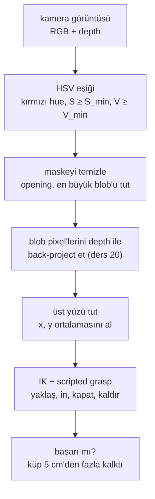

# 21 · Manipulation için object perception

<!-- meta -->
| | |
|---|---|
| **Bölüm** | [5 · Perception ve estimation](README.md) |
| **Çalışma türü** | CPU · Mac ya da Colab CPU |
| **Önkoşul** | [16](../part-4-dynamics-and-control/16-grasping-and-pick-place.md), [20](20-pixels-to-table.md) |
| **Önce öğren** | [Image Fundamentals — Pixels, Channels, Color Spaces](https://aiengineeringfromscratch.com/lesson?path=phases/04-computer-vision/01-image-fundamentals) · [Object Detection — YOLO from Scratch](https://aiengineeringfromscratch.com/lesson?path=phases/04-computer-vision/06-object-detection-yolo) · [Open-Vocabulary Vision — CLIP](https://aiengineeringfromscratch.com/lesson?path=phases/04-computer-vision/18-open-vocab-clip) · [SAM 3 & Open-Vocabulary Segmentation](https://aiengineeringfromscratch.com/lesson?path=phases/04-computer-vision/24-sam3-open-vocab-segmentation) |
| **Süre** | ~60 dk |
| **Kod** | [`experiments/21-object-perception/experiment.py`](../../experiments/21-object-perception/experiment.py) |
| **Durum** | ✅ tam |
<!-- /meta -->

> Grasping için perception tek bir sayıyla ölçülür: gripper nesnenin üstüne kapanıyor mu. Pixel'i değil, pick'i ölç.

## Problem

Scripted bir pick ([ders 16](../part-4-dynamics-and-control/16-grasping-and-pick-place.md)) nesnenin robot frame'indeki konumunu ister. Ders 20 pixel'leri masa koordinatlarına çevirdi; şimdi bir şeyin nesnenin pixel'lerini bulması gerekiyor. En basit detector, yani renk eşiği, laboratuvarda ayarlandığı ışıkta çalışır ve ışık değişince bozulur. Bu ders döngüyü simülasyonda kapatır: render et, tespit et, back-project et, SO-101 ile al ve başarılı kaldırışları say; bu sırada ışığı sweep et.

## Ana fikir

### Sade anlatımla

En basit detector elle yazılmış bir kuraldır: "bir pixel yeterince kırmızı, yeterince renkli ve yeterince parlaksa küpe aittir". Bir veri akışı üzerindeki koda gömülü bir `if` gibi çalışır: ayarlandığı girdilerde iyidir, girdi kayınca (burada: ışık değişince) yavaş yavaş kötüleşmez. Bir pixel ya testi geçer ya geçmez; dolayısıyla detector'ün tamamı birbirine yakın iki ışık seviyesi arasında "çalışıyor"dan "hiçbir şey görmüyor"a atlar.

Kural RGB yerine **HSV**'de yazılır, çünkü HSV soruları birbirinden ayırır. **Hue** hangi renk olduğudur, renk çemberinde bir açı (kırmızı 0°'de). **Saturation** gri yerine ne kadar renkli olduğudur. **Value** ne kadar parlak olduğudur. Kırmızı bir küpü karartmak çoğunlukla V'yi düşürür, hue'ya pek dokunmaz; kuralın en güvenilir kısmının hue olması bu yüzdendir.

Tespit işin yalnızca yarısıdır. Kırmızı pixel maskesi depth görüntüsüyle 3D bir konuma dönüşür ([ders 20](20-pixels-to-table.md)), kol oraya gider ve gripper'ı kapatır. Önemli olan skor bu zincirin sonundadır: küp kalktı mı? Bu yüzden pixel hatasını değil, **pick başarısını** ölçeriz.

### Önce algıla, sonra al



### Detector, kod olarak

```python
hsv = cv2.cvtColor(rgb, cv2.COLOR_RGB2HSV)       # 8-bit: H in 0..179 (degrees / 2), S and V in 0..255
h, s, v = hsv[..., 0], hsv[..., 1], hsv[..., 2]
red = (h <= 10) | (h >= 170)                     # red wraps around hue 0
mask = red & (s >= 120) & (v >= 70)              # S_min = 120, V_min = 70, tuned at nominal light
mask = cv2.morphologyEx(mask.astype(np.uint8), cv2.MORPH_OPEN, np.ones((3, 3), np.uint8))  # drop speckles
n, labels, stats, _ = cv2.connectedComponentsWithStats(mask)   # group touching pixels into blobs
cube = labels == 1 + np.argmax(stats[1:, cv2.CC_STAT_AREA])    # the largest blob is the object
```

| Parça | Formül |
|---|---|
| Value | $V = \max(R, G, B)$ |
| Saturation | $S = (\max - \min)/\max$ |
| "Kırmızı" testi | $H \in [0;10]\cup[170;179],\quad S \ge S_{\min},\quad V \ge V_{\min}$ |
| Grasp noktası | $(x, y) =$ 20 mm'den yüksek back-project edilmiş noktaların ortalaması |
| Metrik | pick başarısı = küp başlangıç yüksekliğinin 5 cm'den fazla üstünde |

$R, G, B$ pixel'in renk kanalları, $\max$ ve $\min$ bunların en büyüğü ve en küçüğü, $H$ OpenCV'nin 8-bit biriminde (derece/2) hue, $S_{\min}, V_{\min}$ ise ayarladığın iki eşiktir (8-bit formüllerde saturation ve value 0–255'e ölçeklenir).

| Detector | Frame başına maliyet | Ayar | Tipik hata |
|---|---|---|---|
| HSV eşiği | birkaç dizi işlemi | renk başına 6 sayı | ışık, benzer renkli arka plan |
| Open-vocabulary (OWL-ViT, maske için + SAM) | bir ağ forward pass'i | bir metin prompt'u | yanlış nesne, belirsiz prompt; burada ölçülmedi |

<details>
<summary>Matematik ayrıntısı: eşikler neden uçurum gibi bozulur ve öğrenilmiş detector'ler neyi değiştirir</summary>

**HSV eşikleme.** RGB'yi hue–saturation–value'ya çevir (bkz. AIEFS: [Image Fundamentals](https://aiengineeringfromscratch.com/lesson?path=phases/04-computer-vision/01-image-fundamentals)). Hue rengi kodlar ve parlaklık değişimlerine karşı görece kararlıdır; S ve V değildir. 8-bit görüntülerde OpenCV hue'yu derece/2 olarak saklar, yani 0–179; kırmızı 0'ın etrafında sarar ([OpenCV · color conversions](https://github.com/opencv/opencv/blob/4.x/modules/imgproc/doc/colors.markdown)). Eşikten sonra morfolojik **opening** (önce erode, sonra dilate) kernel'den küçük benekleri siler, en büyük **bağlı bileşen** (birbirine değen pixel grubu) nesne olarak alınır ve pixel'leri depth ile back-project edilir ([ders 20](20-pixels-to-table.md)). Yalnızca 20 mm'den yüksek noktaları, yani 30 mm'lik küpün üst yüzünü tutar ve $(x, y)$ ortalamalarını alırız.

**Nerede bozulur.** Az ışık: V ya da S kendi sınırının altına düşer (aşağıda Adım 2'de S). Fazla ışık: kanallar 255'te kırpılır, renk beyaza doğru solar ve S, $S_{\min}$'in altına düşer: $\max$ 255'te takılı kalırken $\min$ artmaya devam ettikçe $S = (\max-\min)/\max$ düşmek zorundadır. Yatay gelen ışık: kameranın gördüğü yüz karanlıktır, bir yan yüz ise parlaktır. Her hata bir eşik geçişidir. Bir yüzün bütün pixel'leri hemen hemen aynı renktedir, dolayısıyla eşiği birlikte geçerler: hata kademeli değil, ani olur.

**Kısmi tespitler yanlıdır.** Nesnenin yalnızca bir kısmı eşiği geçerse, o kısmın ağırlık merkezi nesnenin ağırlık merkezi değildir. Hata nesne boyunun bir kesridir ve robot ona göre davranır.

**Öğrenilmiş detector'ler.** OWL-ViT gibi open-vocabulary detector'ler ([Minderer vd. 2022, arXiv 2205.06230](https://arxiv.org/abs/2205.06230)) bir metin sorgusu alır ("red cube") ve büyük görüntü–metin verisiyle eğitilir; dolayısıyla elle ayarlanmış tek bir renk penceresine bağlı değildir (bkz. AIEFS: [Object Detection — YOLO from Scratch](https://aiengineeringfromscratch.com/lesson?path=phases/04-computer-vision/06-object-detection-yolo), [Open-Vocabulary Vision — CLIP](https://aiengineeringfromscratch.com/lesson?path=phases/04-computer-vision/18-open-vocab-clip), [SAM 3 & Open-Vocabulary Segmentation](https://aiengineeringfromscratch.com/lesson?path=phases/04-computer-vision/24-sam3-open-vocab-segmentation)). Bedelleri, birkaç dizi karşılaştırması yerine frame başına bir sinir ağı forward pass'idir. Burada çalıştırmadık (bu ortamda `transformers` yok); bu ders onlar için sağlamlık ya da hız sayısı vermez.

Daha derine: [Image Fundamentals — Pixels, Channels, Color Spaces](https://aiengineeringfromscratch.com/lesson?path=phases/04-computer-vision/01-image-fundamentals), [Object Detection — YOLO from Scratch](https://aiengineeringfromscratch.com/lesson?path=phases/04-computer-vision/06-object-detection-yolo), [Open-Vocabulary Vision — CLIP](https://aiengineeringfromscratch.com/lesson?path=phases/04-computer-vision/18-open-vocab-clip), [SAM 3 & Open-Vocabulary Segmentation](https://aiengineeringfromscratch.com/lesson?path=phases/04-computer-vision/24-sam3-open-vocab-segmentation); [Minderer vd. 2022](https://arxiv.org/abs/2205.06230); [OpenCV · color conversions](https://github.com/opencv/opencv/blob/4.x/modules/imgproc/doc/colors.markdown).

</details>

## Deney

**Kurulum.** Menagerie'den SO-101 (5 ms timestep) ve 30 rastgele konumda kırmızı, 30 mm'lik bir küp (0,05 kg), $x\in[0{,}15, 0{,}24]$ m, $y\in[-0{,}07, 0{,}07]$ m; küp robota bakacak şekilde döndürülmüş (bir basitleştirme: yalnızca konumu tahmin ediyoruz). Bir kamera 0,6 m'den dik aşağı bakıyor; $K$ `fovy`'den (ders 19), poz modelden, sanki kalibre edilmiş gibi. Görüntü alınırken kol dik konumda, görüş alanının dışında park hâlinde.

**Pick rutini** (kendi içinde, ders 10 ya da 16'dan import yok): çeneler arasındaki grasp noktası üzerinde damped least squares IK (singular pozlara yakınken de kararlı kalan inverse kinematics, [ders 10](../part-3-kinematics/10-inverse-kinematics.md)); gripper aşağı bakıyor, çene ekseni omuzdan hedefe uzanan doğru boyunca; 7 cm yukarıdan yaklaş, in, çeneyi position actuator ile kapat, 10 cm kaldır. Başarı = küp başlangıç yüksekliğinin 5 cm'den fazla üstünde.

```python
mask = detect(rgb)                                   # HSV threshold + opening + largest blob
v, u = np.nonzero(mask)
P = c + depth[v, u][:, None] * (np.c_[u, v, ones] @ np.linalg.inv(K).T @ R_wc.T)
xy = P[P[:, 2] > 0.02, :2].mean(axis=0)              # top face only
ok = pick(m, d, xy)                                  # IK + scripted grasp, lift test
```

**Çalıştır:** `uv run python experiments/21-object-perception/experiment.py` (MuJoCo 3.17.0, OpenCV 5.0.0, NumPy 2.5.4, Apple M5, deterministic).

**Adım 1: perception ne kadar doğru olmalı?** Gerçek konuma, rastgele bir yönde sabit büyüklükte bir hata ekleyerek nişan al:

| Nişan hatası (mm) | 0 | 4 | 8 | 12 | 16 | 20 |
|---|---|---|---|---|---|---|
| Başarılı pick (30'da) | 30 | 29 | 21 | 15 | 11 | 7 |

Ground truth ile rutin 30/30 alır. Bu gripper ve küp için hata bütçesi birkaç milimetredir: 8 mm'de 30 pick'in 9'u başarısız.


**Adım 2: ışık şiddeti** (headlight, yani bakış noktasına bağlı ışık, ve directional light birlikte ölçekleniyor; eşikler $S\ge120$, $V\ge70$'te dondurulmuş; "üst HSV", 1. konumda üst yüzün merkezindeki pixel):

| Ölçek | Üst HSV | Tespit | Medyan hata (mm) | En büyük hata (mm) | Başarılı pick |
|---|---|---|---|---|---|
| 0,1 | (0; 110; 72) | 0/30 | – | – | 0/30 |
| 0,2 | (0; 145; 107) | 30/30 | 0,1 | 0,2 | 30/30 |
| 0,35 | (0; 173; 158) | 30/30 | 0,1 | 0,2 | 30/30 |
| 0,5 | (0; 186; 211) | 30/30 | 0,2 | 0,3 | 30/30 |
| 1,0 | (0; 177; 255) | 30/30 | 0,3 | 0,4 | 30/30 |
| 1,5 | (0; 157; 255) | 30/30 | 0,3 | 0,7 | 30/30 |
| 2,0 | (0; 136; 255) | 30/30 | 0,5 | 0,8 | 30/30 |
| 3,0 | (0; 95; 255) | 1/30 | 14,9 | 14,9 | 0/30 |

**Gözlem.**

1. Küp tespit edildiğinde konum hatası 1 mm'nin altında (en fazla 0,8 mm), Adım 1'de zaten bir pick'e mal olan 4 mm'lik nişan hatasının çok altında, ve her pick başarılı. Simülasyonda calibration ve depth kusursuzdur; dolayısıyla darboğaz konumlandırma değildir.
2. Hata bir yokuş değil, uçurum: ölçek 0,2 ile 0,1 arasında 30/30'dan 0/30'a, 3,0'da 1/30'a. HSV sütunu nedenini gösteriyor: loş ışık S'yi 110'a düşürür (< 120); aşırı pozlama V'yi 255'te doyurur ve S'yi 95'e kadar soldurur.
3. Ölçek 3,0'daki tek tespit 14,9 mm sapmış: eşiği yalnızca daha koyu bir yan yüz geçebildi, ağırlık merkezi yaklaşık yarım küp ötede ve pick başarısız. Kısmi tespit hiç tespitten kötüdür, çünkü robot ona göre davranır.

## Boz

Headlight'ı kapat (ambient ışık 0,1, her yeri eşit aydınlatan taban parlaklık) ve güneşi (directional light'ı) tepeden yataya, robotun ters tarafından gelecek şekilde alçalt:

| Yükseklik açısı (°) | Üst HSV | Tespit | Medyan hata (mm) | En büyük hata (mm) | Başarılı pick |
|---|---|---|---|---|---|
| 90 | (0; 185; 211) | 30/30 | 0,1 | 0,2 | 30/30 |
| 45 | (0; 224; 130) | 30/30 | 0,1 | 0,5 | 30/30 |
| 20 | (0; 224; 74) | 30/30 | 0,3 | 0,8 | 30/30 |
| 10 | (0; 223; 48) | 1/30 | 15,8 | 15,8 | 0/30 |
| 5 | (0; 219; 35) | 0/30 | – | – | 0/30 |

Hue 0'da kalıyor, saturation hatta artıyor; ama güneş alçaldıkça üst yüzün V'si düşüyor: 20°'de 74, 10°'de 48, yani $V_{\min} = 70$ eşiğinin altında. Kamera üst yüzü görür; aydınlanan yan yüz neredeyse kenardan görünür. Detector ya hiçbir şey raporlamaz ya da 15,8 mm sapmış bir şerit.

Aynı sahnelerde $V_{\min}$'i 70'ten 25'e indirmek her şeyi geri getirir:

| Yükseklik açısı (°) | Tespit | Medyan hata (mm) | En büyük hata (mm) | Başarılı pick |
|---|---|---|---|---|
| 20 | 30/30 | 0,2 | 0,6 | 30/30 |
| 10 | 30/30 | 0,2 | 0,6 | 30/30 |
| 5 | 30/30 | 0,3 | 0,6 | 30/30 |
| nominal (ölçek 1,0) | 30/30 | 0,3 | 0,7 | 30/30 |

Bu bedava bir çözüm değil: daha düşük bir $V$ tabanı koyu kırmızı-kahverengi pixel'leri de kabul eder; bu sahnede dikkat dağıtıcı nesne ya da başka şeylerin gölgesi yok, dolayısıyla **false positive**'leri (küp diye raporlanan yanlış nesneleri) ölçmedik. Gerçek bir masada, yatay ışığa dayanan eşiğin kahverengi bir kutuyu ya da ahşap bir yüzeyi de yakalamasını bekle. Öğrenilmiş bir detector'ün hesap maliyetini hak ettiği yer burasıdır.

## Gerçek robotta

- Webcam'ler auto-exposure ve auto-white-balance (kameranın parlaklığı ve renk dengesini kendi kendine ayarlaması) çalıştırır; bunlar V'yi ve hue'yu frame'den frame'e değiştirir. Eşikleri ayarlamadan önce ikisini de kilitle ve robotun göreceği en iyi değil en kötü ışıkta ayarla. Gerçek kolda henüz ölçülmedi.
- Gerçek hata kaynakları, yukarıda ölçülen birkaç milimetrelik bütçeye karşı toplanır: pixel noise'u ve izdüşümü (ders 20: simülasyonda 0,6 m'den 1 px'te medyan 1,60 mm), extrinsic ya da hand-eye calibration hatası (ders 19), depth sensor noise'u ve kolun kendi eklem açısı hatası. Milimetre altı sayılarımız, kusursuz calibration ve depth ile alınmış simülasyon sonuçlarıdır.
- Başarısız her pick'i ona sebep olan görüntüyle birlikte logla ve yukarıdaki tablolar gibi nesnedeki HSV değerlerini yazdır; bir eşik hatası orada görünür.

## Kendini dene

1. **Kolay.** OpenCV'de kırmızı neden iki hue aralığı ister?
2. **Orta.** Ölçek 3,0'da ışık daha parlak olduğu hâlde küp neden *daha az* doygun görünüyor?
3. **Zor.** Küpün yanına koyu kırmızı bir dikkat dağıtıcı kutu (rgba 0,4; 0,15; 0,1) ekle ve Adım 2'yi $V_{\min} = 25$ ve $V_{\min} = 70$ ile tekrar çalıştır. Hangi eşik artık yanlış nesneyi alıyor ve onu nasıl elersin (boyut, şekil, depth)?

### Cevaplar

1. Hue bir açıdır; kırmızı 0°/360°'tedir ve OpenCV bunu 0–179'un iki ucuna eşler.
2. Renderer her kanalı 255'te kırpar. Önce kırmızı kanal doyar; yeşil ve mavi ise ışıkla artmaya devam eder; renk beyaza kayar ve $S = (\max-\min)/\max$ düşer (ölçek 3,0'da 95).
3. Burada hesaplanmadı; çalıştır. Dikkat dağıtıcının temel renginin hue'su 10° (OpenCV'de H = 5), S'si 0,75 (8 bit'te 191); ikisi de hue ve saturation penceresinin içinde, yani onu küpten yalnızca V ayırır. Render edilen V'si 70'i aşarsa iki eşiği de geçer ve kararı en büyük blob kuralı verir. Blob boyutu, karelik ya da back-project edilen üst yüzün yüksekliği onu eleyebilir.

## Akılda kalanlar ve kaynaklar

- Döngüyü kapat: metrik pick başarısıdır. Burada 4 mm nişan hatası hâlâ 29/30 pick verdi, 8 mm yalnızca 21/30.
- Renk eşiği, V ya da S'nin sınırını geçtiği ışıkta aniden bozulur (ölçek 0,1, ölçek 3,0, 10°'de güneş); tespit ettiğinde simülasyondaki konumlandırma milimetrenin altındadır.
- Open-vocabulary detector'ler, tek bir renk penceresine bağlı olmamak için frame başına hesap maliyeti öder; hızları ve sağlamlıkları burada ölçülmedi.

Sıradaki: [ders 22](../part-6-planning-and-optimal-control/22-motion-planning.md), motion planning.

Kaynaklar:
- M. Minderer vd., "Simple Open-Vocabulary Object Detection with Vision Transformers", ECCV 2022. [arXiv:2205.06230](https://arxiv.org/abs/2205.06230)
- [OpenCV · color conversions](https://github.com/opencv/opencv/blob/4.x/modules/imgproc/doc/colors.markdown): HSV formülleri; 8-bit görüntülerde H, H/2 olarak saklanır, yani hue 0–179 aralığındadır.
- [MuJoCo Menagerie · robotstudio_so101](https://github.com/google-deepmind/mujoco_menagerie/tree/f3b6013/robotstudio_so101) (Apache-2.0).
- Back-projection ve depth: [ders 20](20-pixels-to-table.md). Calibration: [ders 19](19-camera-calibration.md).
- Yukarıdaki tüm sayılar: [`experiment.py`](../../experiments/21-object-perception/experiment.py), çıktı [`output.txt`](../../experiments/21-object-perception/output.txt).
