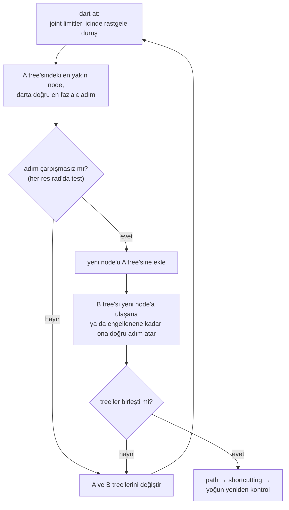

# 22 · Configuration space ve sampling-based planning

<!-- meta -->
| | |
|---|---|
| **Bölüm** | [6 · Planning ve optimal control](README.md) |
| **Çalışma türü** | CPU · Mac ya da Colab CPU |
| **Önkoşul** | [10](../part-3-kinematics/10-inverse-kinematics.md) |
| **Önce öğren** | [Probability and Distributions](https://aiengineeringfromscratch.com/lesson?path=phases/01-math-foundations/06-probability-and-distributions) |
| **Süre** | ~60 dk |
| **Kod** | [`experiments/22-motion-planning/experiment.py`](../../experiments/22-motion-planning/experiment.py) |
| **Durum** | ✅ tam |
<!-- /meta -->

> Sampling-based bir planner engeli hiç görmez. Yalnızca sorduğu configuration'larda collision checker'ın verdiği cevapları görür.

## Problem

Inverse kinematics ([ders 10](../part-3-kinematics/10-inverse-kinematics.md)) hedef configuration'ı (tek bir eklem açıları takımını) verir, oraya nasıl gidileceğini vermez. Bir Franka Panda'nın önüne 20 × 20 × 50 cm'lik bir kutu koy; el başlangıçta kutunun solunda, hedefte sağında. İki configuration da çarpışmasız; joint space'te aralarındaki düz çizgi ise değil: her 0,005 rad'da yeniden kontrol edildiğinde kol kutuya 139,0 mm giriyor. 7 boyutlu joint space'in boş kısmından geçen bir path'e ve "bulunan path"in gerçekten boş olup olmadığını bilmeye ihtiyacımız var.

## Ana fikir

### Sade anlatımla

Koordinatları metre değil eklem açısı olan bir labirent düşün: 7 eklemli bir kol için içindeki tek bir nokta eksiksiz bir duruştur, yedi sayı. Duvarlar, kolun herhangi bir parçasının bir engelle iç içe geçtiği bütün duruşlardır. Bu labirent **configuration space**'tir (C-space). Odadaki sıradan bir kutu burada kimsenin çizmediği eğri bir duvara dönüşür: 7 boyutta bu çok pahalıdır.

Ucuz olan, bir **collision checker**'a tek tek duruş sormaktır: "kolu buraya koy; bir şey iç içe geçiyor mu?" Sampling-based bir planner labirenti yalnızca bu evet/hayır kâhiniyle keşfeder. **RRT** (rapidly-exploring random tree) dart atarak keşfeder: rastgele bir duruş seç, tree'nin zaten ulaştığı en yakın duruşu bul, ondan darta doğru kısa bir adım at ve adım çarpışmasızsa tut. Keşfedilmemiş büyük bölgeler dartların çoğunu yakalar, bu yüzden tree hızla yayılır. **RRT-Connect** biri başlangıçtan, biri hedeften iki tree büyütür ve her adımdan sonra onları birleştirmeyi dener.

Sorun adımın kendisinde: joint space'te her *res* radyanda bir duruşu test edilen düz bir doğru parçası. Test edilen iki duruş arasında olan her şey boş varsayılır; *res* kaba olursa bir adım duvarın ince bir yerinin içinden atlayabilir ve planner yine başarı raporlar. Aramadan sonra **shortcutting**, zikzaklı sonuçtaki dolambaçları aynı kontrolden geçen düz parçalarla değiştirir.

### RRT-Connect döngüsü



### RRT-Connect kod olarak

```python
A, B = Tree(q_start), Tree(q_goal)              # one tree grows from each end
for _ in range(budget):
    q_rand = uniform(joint_lo, joint_hi)        # the dart: a random pose inside the joint limits
    q_near = A.nearest(q_rand)                  # closest pose tree A has already reached
    q_new = step(q_near, q_rand, eps)           # move at most eps rad (L2) toward the dart
    if edge_free(q_near, q_new, res):           # test poses every res rad along the step
        A.add(q_new, parent=q_near)
        if B.connect_greedily(q_new):           # tree B walks toward q_new until blocked or there
            return join(A, B, q_new)            # start ... q_new ... goal, then shortcut it
    A, B = B, A                                 # alternate which tree grows
return None                                     # budget used up (not proof that no path exists)
```

| Büyüklük | Formül |
|---|---|
| Boş uzay | $\mathcal{C}_{free} = \mathcal{C} \setminus \mathcal{C}_{obs}$ |
| Bir edge üzerinde test edilen duruş sayısı | $n = \lceil \lVert q_b - q_a \rVert / \text{res} \rceil$ |
| İki test arasında bir noktanın en kötü hareketi | $\sum_i r_i\,\lvert \Delta q_i \rvert$ |

Burada $q$ tek bir duruş (joint vektörü), $\mathcal{C}$ joint limitleri içindeki duruşların kutusu, $\mathcal{C}_{obs}$ çarpışan duruşlar, $q_a$ ve $q_b$ bir tree edge'inin uçları, res radyan cinsinden edge-check çözünürlüğü, $\Delta q_i$ test edilen iki duruş arasında $i$. joint'in değişimi, $r_i$ ise koldaki bir noktanın $i$. joint axis'ine uzaklığıdır.

Deney RRT-Connect'i ([Kuffner & LaValle 2000](http://lavalle.pl/papers/KufLav00.pdf)) sade, tek tree'li RRT ile ([LaValle 1998](http://lavalle.pl/papers/Lav98c.pdf)) karşılaştırıyor. RRT iki noktada farklıdır: %5 olasılıkla hedefin kendisini örnekler (goal bias) ve yeni bir node hedefe $\varepsilon$ kadar yaklaşıp hedefe giden edge boş olduğunda durur.

<details>
<summary>Matematik ayrıntısı: C-space, collision sorguları, edge kontrolü ve tamlık</summary>

**Configuration space.** Bir configuration $q \in \mathcal{C} \subset \mathbb{R}^7$ tek bir joint vektörüdür; joint limitleri $\mathcal{C}$'yi bir kutu yapar. Engel bölgesi ve boş uzay:

$$\mathcal{C}_{obs} = \{\, q : \text{robot}(q) \cap \text{engeller} \neq \emptyset \,\}, \qquad \mathcal{C}_{free} = \mathcal{C} \setminus \mathcal{C}_{obs}.$$

Workspace'teki bir kutu, $\mathcal{C}$'de kimsenin açıkça hesaplamadığı eğri bir 7 boyutlu kümeye dönüşür ([Lynch & Park böl. 10](https://hades.mech.northwestern.edu/index.php/Modern_Robotics); [LaValle böl. 4](http://lavalle.pl/planning/)). Sampling-based planner'lar yalnızca bir üyelik sorusu sorar: $q$ boş mu? $\mathcal{C}_{free}$ genelde convex değildir; iki boş duruş, aralarındaki doğru parçasının boş olduğu anlamına gelmez.

**Edge kontrolü neyi garanti eder.** $q_a$'dan $q_b$'ye bir tree edge'i $q(s) = q_a + s\,(q_b - q_a)$, $s \in [0, 1]$ doğru parçasıdır ve $n = \lceil \lVert q_b - q_a \rVert / \text{res} \rceil$ noktada test edilir. Bir joint axis'ten $r$ uzaklıktaki nokta, o joint $\Delta q$ döndüğünde $r\,\Delta q$ kadar yer değiştirir; yani test edilen iki duruş arasında hiçbir nokta $\sum_i r_i\,\lvert \Delta q_i \rvert$'den fazla hareket etmez. Cauchy–Schwarz eşitsizliği ve $r_i \le r_{max}$ ile bu en fazla $r_{max}\sqrt{7}\,\lVert \Delta q \rVert_2$'dir. Bu sınırdan sığ bir iç içe geçme iki testin arasında başlayıp bitebilir ve hiç görülmez.

**Olasılıksal olarak tam, optimal değil.** Boş bir path varsa, iterasyon sayısı arttıkça iki RRT türünün de birini bulma olasılığı 1'e gider. Bu, kaç iterasyon gerektiği ya da path'in kalitesi hakkında hiçbir şey söylemez ([LaValle böl. 5](http://lavalle.pl/planning/)).

**Narrow passage'lar.** Uniform bir örnek bir bölgeye, $\mathcal{C}$ hacmindeki payına eşit olasılıkla düşer; aynı anda birkaç joint yönünde ince olan bir geçidin 7 boyutlu hacmi çok küçüktür (Boz).

Daha derine: [Probability and Distributions](https://aiengineeringfromscratch.com/lesson?path=phases/01-math-foundations/06-probability-and-distributions) (uniform sampling, hacim payı olarak olasılık); [LaValle 1998](http://lavalle.pl/papers/Lav98c.pdf) (RRT); [Kuffner & LaValle 2000](http://lavalle.pl/papers/KufLav00.pdf) (RRT-Connect); [LaValle, *Planning Algorithms*, böl. 4–5](http://lavalle.pl/planning/); [Lynch & Park böl. 10](https://hades.mech.northwestern.edu/index.php/Modern_Robotics).

</details>

<!-- figure: 22-rrt -->

## Sıfırdan yaz

Şimdi RRT-Connect'i kendin yazacaksın, yaklaşık 80 satır NumPy: edge kontrolü, bir tree, planner ve shortcut. MuJoCo yalnız tek bir soruyu cevaplıyor: "bu duruş boş mu?". Adımları kendi dosyana yaz ve her adımdan sonra çalıştır. Bitmiş fonksiyonlar [`physai/planning.py`](../../physai/planning.py) içinde; `uv run python experiments/22-motion-planning/build.py` beş adımı kontrolleriyle birlikte koşturur (çıktı [`build_output.txt`](../../experiments/22-motion-planning/build_output.txt) dosyasında).

### Adım 1 · Kâhin ve edge kontrolü

Kâhin, Deney'deki `depth(q)`: kolu `q`'ya koy, `mj_kinematics` ve `mj_collision`'ı çalıştır, en derin contact'ı döndür; `free(q)` ise `depth(q) == 0`. Edge kontrolü aralarında en fazla `res` olan eşit aralıklı duruşları test eder; `all()` ilk çarpışmada durur:

```python
def edge_free(free, a, b, res):
    """True if free(q) holds at points spaced at most res (L2, rad) along the segment a -> b."""
    n = max(1, int(np.ceil(np.linalg.norm(b - a) / res)))
    return all(free(a + (b - a) * (k / n)) for k in range(1, n + 1))
```

```python
def worst_along(f, path, res):
    """Largest f(q) at points spaced at most res along a piecewise-linear path, both ends included."""
    worst = 0.0
    for a, b in zip(path[:-1], path[1:]):
        n = max(1, int(np.ceil(np.linalg.norm(b - a) / res)))
        worst = max(worst, max(f(a + (b - a) * (k / n)) for k in range(n + 1)))
    return worst
```

`worst_along` yoğun yeniden kontroldür: bütün bir path boyunca herhangi bir fonksiyonun, burada penetrasyon derinliğinin, en büyük değeri. Başlangıçtan hedefe düz çizgide:

== Step 1. The edge check on the straight line start -> goal ==
start free: True | goal free: True | length 1.60 rad
res (rad)  poses on edge  tested until answer  edge_free says
    0.005            320                   98           False
    0.050             32                   10           False
    0.250              7                    3           False
    0.500              4                    2           False
    1.000              2                    1           False
dense truth: worst penetration on the line = 139.0 mm

Her çözünürlük bu çizgiyi reddediyor, çünkü çizgi kutunun ortasından geçiyor: Deney'deki gibi 139,0 mm derinde. Kontrolden kaçan edge'ler bir köşeyi sıyıranlar (Adım 5).

### Adım 2 · Steer ve bir tree

```python
def steer(a, b, eps):
    """Move from a toward b by at most eps (L2)."""
    v = b - a
    dist = np.linalg.norm(v)
    return b.copy() if dist <= eps else a + v * (eps / dist)
```

```python
class Tree:
    """Poses in a preallocated array; parent[i] is the index of node i's parent (-1 for the root)."""

    def __init__(self, root, capacity=100_000):
        self.q = np.zeros((capacity, len(root)))
        self.parent = np.full(capacity, -1)
        self.q[0], self.n = root, 1

    def nearest(self, x):
        return int(np.argmin(np.sum((self.q[:self.n] - x) ** 2, axis=1)))

    def add(self, x, parent):
        self.q[self.n], self.parent[self.n] = x, parent
        self.n += 1
        return self.n - 1

    def branch(self, i):
        """Poses from node i back to the root."""
        out = []
        while i != -1:
            out.append(self.q[i].copy())
            i = self.parent[i]
        return out
```

Tree duruşları tek bir dizide, her node için de ebeveyninin indeksini tutar; `branch` köke kadar geri yürür. Kaba kuvvetle en yakın komşu, her node için tek bir vektörel mesafe hesabı; birkaç bin node için yeterince hızlı:

== Step 2. Steer and nearest neighbour vs scipy cKDTree (1000 random nodes, 200 queries) ==
nearest index identical in 200/200 queries
steer 0.5 rad toward the goal: step length 0.5000 rad; with eps = 2 it returns the goal itself: True

### Adım 3 · RRT-Connect

Ana fikirdeki döngü; iki tree her iterasyondan sonra rol değiştirir:

```python
def rrt_connect(free, lo, hi, q_start, q_goal, rng, eps=0.5, res=0.05, budget=2000):
    """RRT-Connect (Kuffner & LaValle 2000). Returns (path as a list of poses, or None; iterations used)."""
    ta, tb, a_is_start = Tree(q_start), Tree(q_goal), True
    for it in range(1, budget + 1):
        x = rng.uniform(lo, hi)                          # the dart
        i = ta.nearest(x)
        y = steer(ta.q[i], x, eps)
        if edge_free(free, ta.q[i], y, res):
            ja = ta.add(y, i)
            jb = tb.nearest(y)                           # CONNECT: tree b walks toward y
            while True:
                z = steer(tb.q[jb], y, eps)
                if not edge_free(free, tb.q[jb], z, res):
                    break                                # tree b is blocked
                jb = tb.add(z, jb)
                if np.allclose(z, y):                    # the trees touch
                    path = ta.branch(ja)[::-1] + tb.branch(jb)[1:]
                    return (path if a_is_start else path[::-1]), it
        ta, tb, a_is_start = tb, ta, not a_is_start      # alternate which tree grows
    return None, budget
```

Deney'in parametreleri ve seed'leriyle:

== Step 3. RRT-Connect, res 0.05 rad, 100 seeds, budget 2000 iterations ==
success 100/100 | median iterations 33 | median collision checks 431

Bu, Deney'in res 0,05 satırının birebir aynısı: aynı algoritma aynı seed'lerle aynı dartları atıyor.

### Adım 4 · Shortcut

```python
def path_length(path):
    """Sum of the L2 lengths of the segments (rad)."""
    return float(sum(np.linalg.norm(b - a) for a, b in zip(path[:-1], path[1:])))
```

```python
def shortcut(free, path, res, rng, tries=200):
    """Random shortcutting: replace the poses between two waypoints by a straight edge if it is free."""
    p = [q.copy() for q in path]
    for _ in range(tries):
        if len(p) < 3:
            break
        i, j = sorted(rng.choice(len(p), 2, replace=False))
        if j - i >= 2 and edge_free(free, p[i], p[j], res):
            p = p[:i + 1] + p[j:]
    return p
```

== Step 4. Shortcutting (200 tries, same res) ==
median length raw 5.57 rad -> shortcut 3.59 rad | median waypoints after: 4

Shortcut planner'ın generator'ını kullanmaya devam ediyor; bu yüzden uzunluklar da Deney'deki 5,57 → 3,59 rad ile örtüşüyor.

### Adım 5 · Yoğun yeniden kontrol

Dönen her path'i `worst_along(depth, path, 0.005)` ile yeniden kontrol et:

== Step 5. Dense re-check of every returned path at 0.005 rad ==
paths in collision: 7/100 | worst penetration 4.5 mm

100 path'in hepsi 0,05 rad'da `edge_free`'den geçti; 7'si yine de kutuyu 4,5 mm'ye kadar sıyırıyor. "Planner boş diyor" ile "gerçekten boş" arasındaki fark bu; Deney onu sweep ediyor.

### Elinde kalan

`physai.planning` artık `edge_free`, `worst_along`, `steer`, `Tree`, `rrt_connect`, `path_length` ve `shortcut` içeriyor. Hepsi herhangi bir `free(q)` alıyor; aynı kod 5 joint'li SO-101 ya da 2 boyutlu bir oyuncak dünya için de plan yapar. Ders 23 böyle geometrik bir path'i trajectory'ye çeviriyor. [`tests/test_22_motion_planning.py`](../../tests/test_22_motion_planning.py) onları boşluklu 2 boyutlu bir duvarda ve Panda sahnesinde kontrol ediyor; bir şey değiştirdikten sonra `uv run pytest tests/test_22_motion_planning.py` çalıştır.

## Kütüphaneyle kullan

MuJoCo'da, NumPy'da ve SciPy'da sampling planner yok. Kâhini MuJoCo sağlar: `mj_collision` bir broad phase (ucuz sınırlayıcı hacimler birbirine değebilecek geom çiftlerini bulur) ve bir narrow phase (bu çiftler için tam mesafe) çalıştırır; dinamik hesaplanmadan `mj_forward`'ın üreteceği contact'ların aynısı çıkar. SciPy daha hızlı bir en yakın komşu araması sağlar:

```python
d.qpos[:7] = q
mujoco.mj_kinematics(m, d)                 # place every body for this pose
mujoco.mj_collision(m, d)                  # broad + narrow phase -> d.contact[:d.ncon]
depth = -min(d.contact[i].dist for i in range(d.ncon)) if d.ncon else 0.0
gap = mujoco.mj_geomDistance(m, d, g1, g2, 0.1, None)   # signed distance of two geoms (clearance)

from scipy.spatial import cKDTree           # nearest neighbour for large trees
dist, i = cKDTree(tree.q[:tree.n]).query(q_rand)
```

Planning kütüphaneleri aynı iki düğmeye farklı adlar verir:

| Araç | Extend adımı ε | Edge-check çözünürlüğü |
|---|---|---|
| physai | `rrt_connect(..., eps=0.5)` (rad, L2) | `res=0.05` (rad, L2) |
| OMPL | `RRTConnect::setRange`: "the maximum length of a motion to be added in the tree" | `StateSpace::setLongestValidSegmentFraction`: uzayın en büyük uzanımının bir kesri |
| MoveIt (OMPL arayüzü) | planner'ın YAML config'indeki `range` | `longest_valid_segment_fraction` / `maximum_waypoint_distance` |

Kaynaklar: OMPL [RRTConnect](https://ompl.kavrakilab.org/classompl_1_1geometric_1_1RRTConnect.html) ve [StateSpace](https://ompl.kavrakilab.org/classompl_1_1base_1_1StateSpace.html) referansı; [MoveIt OMPL tutorial](https://moveit.picknik.ai/main/doc/examples/ompl_interface/ompl_interface_tutorial.html).

Tuzaklar:

- **Plan etmediğin joint'ler de çarpışır.** Planner'ın kontrol etmediği her `qpos`'u (burada parmaklar, 0,04 m) her sorgudan önce ayarla; yoksa başka bir robotu kontrol edersin.
- **`d.ncon` her şeyi sayar.** Self-collision'lar ve zemin contact'ları da sayılır; başlangıç ya da hedef beklenmedik şekilde "boş değil" çıkarsa `contact.geom1` / `geom2`'ye bak. Sıfırdan büyük bir geom `margin`'inde pozitif `dist`'li contact'lar da çıkar; bu yüzden `ncon > 0`'ı değil `dist < 0`'ı test et.
- **Bir radyan bir radyan değildir.** L2 çözünürlük omuzdaki bir radyanı bilekteki bir radyanla aynı sayar, oysa omuz eli çok daha fazla oynatır (Matematik ayrıntısı).

## Deney

**Tahmin.** Daha kaba bir edge-check çözünürlüğü daha az collision check ister ve daha hızlı plan yapar. Ama bazı edge'lerin kutunun köşesinin üstünden atlamasına da izin vermeli.

Tam script: [`experiments/22-motion-planning/experiment.py`](../../experiments/22-motion-planning/experiment.py). Collision sorgusu:

```python
def depth(self, q):                       # penetration (m) at q, 0 if free
    d.qpos[:7] = q; d.qpos[7:] = 0.04     # fingers fixed open
    mujoco.mj_kinematics(m, d)
    mujoco.mj_collision(m, d)
    return 0.0 if d.ncon == 0 else -min(d.contact[i].dist for i in range(d.ncon))

# free(q) is depth(q) == 0; edge_free(a, b, res) is physai.planning.edge_free (Build it)
```

RRT-Connect $\varepsilon = 0{,}5$ rad (7 joint üzerinde L2), 2000 iterasyon bütçesi ve 200 shortcut denemesi kullanır; dönen her path 0,005 rad'da yeniden kontrol edilir, "çarpışan path" için referans budur. MuJoCo 3.17.0, NumPy 2.5.4, Apple Silicon Mac (Apple M5), sabit seed'ler, satır başına 100 seed.

| res (rad) | başarı | medyan iterasyon | medyan collision check | medyan uzunluk ham → shortcut (rad) | çarpışan path | en kötü penetrasyon (mm) |
|---|---|---|---|---|---|---|
| 0,01 | 100/100 | 33 | 2070 | 5,62 → 3,61 | 0/100 | 0,0 |
| 0,05 | 100/100 | 33 | 431 | 5,57 → 3,59 | 7/100 | 4,5 |
| 0,10 | 100/100 | 33 | 225 | 5,55 → 3,58 | 17/100 | 8,0 |
| 0,25 | 100/100 | 29 | 96 | 5,37 → 3,44 | 42/100 | 26,5 |
| 0,50 | 100/100 | 26 | 52 | 5,01 → 3,12 | 66/100 | 72,0 |
| 1,00 | 100/100 | 25 | 48 | 4,98 → 3,00 | 80/100 | 156,4 |


Verinin söyledikleri:

1. **Başarı oranı burada kalite ölçüsü olarak işe yaramaz.** Her satır 100/100 diyor; yalnız yoğun yeniden kontrol, 1,0 rad'da 100 "çözüm"ün 80'inin kutunun içinden geçtiğini gösteriyor, en kötüsü 156,4 mm derinde, saf düz çizgiden (139,0 mm) bile derin.
2. **Kaba kontrol, varsayılan olarak log'layacağın her metrikte daha iyi görünür.** Collision check sayısı 2070'ten 48'e, iterasyon 33'ten 25'e düşer, shortcut'lı path kısalır (3,61 → 3,00 rad), çünkü shortcut'lar artık engelin içinden kesebilir.
3. **0,05 rad bile güvenli değil.** 100 path'in 7'si kutuyu 4,5 mm'ye kadar sıyırıyor. $r = 0{,}6$ m ile tek bir joint'in 0,05 rad'lık adımı bir noktayı 3 cm oynatır; daha sığ bir iç içe geçme iki kontrolün arasında başlayıp bitebilir.

**RRT ve RRT-Connect** (res 0,05 rad, 100 seed, aynı bütçe):

| planner | başarı | medyan iterasyon | medyan check | medyan uzunluk ham → shortcut (rad) |
|---|---|---|---|---|
| RRT | 42/100 | 151 | 1438 | 5,47 → 3,33 |
| RRT-Connect | 100/100 | 33 | 431 | 5,57 → 3,59 |

İki uçtan büyüyüp açgözlü bağlanmak bu sorguyu birkaç düzine iterasyonda çözüyor; tek tree'li RRT 100 seed'in yalnızca 42'sinde başardı.

## Boz

Kutuyu, $x = 0{,}40$ m'de 2 m genişliğinde, ortası $z = 0{,}45$ m'de yatay bir yarığı olan bir duvarla değiştir. Hedefte el duvarın arkasında, önkol yarığın içinde; yani her çözüm yarıktan geçmek zorunda. Yarığı daralt (RRT-Connect, res 0,05 rad, 30 seed, 3000 iterasyon bütçesi):

| yarık yüksekliği (m) | başarı | medyan iterasyon | medyan check | çarpışan path |
|---|---|---|---|---|
| 0,40 | 30/30 | 9 | 128 | 2/30 |
| 0,30 | 30/30 | 102 | 896 | 4/30 |
| 0,25 | 30/30 | 360 | 2747 | 5/30 |
| 0,22 | 30/30 | 856 | 6372 | 5/30 |
| 0,20 | 25/30 | 1487 | 10520 | 0/25 |

0,40 m'den 0,20 m'ye medyan iterasyon 9'dan 1487'ye çıkıyor ve 30 seed'in 5'i bütçeyi bitiriyor. 0,20 m'de başarılı 25 path yoğun yeniden kontrolden geçiyor; yani boş bir yol var: başarısızlıklar problemin çözümsüz olmasından değil, planner'ın bütçeyi bitirmesinden.

Mekanizma: yarık yüksekliğini yarıya indirmek, içinden geçen boş tüpü aynı anda birkaç joint yönünde daraltır; 7 boyutlu hacmi, onunla birlikte de uniform bir dartın içine düşme şansı, odadaki boşluktan çok daha hızlı küçülür. **Narrow passage problemi** budur. Daha geniş dört satırda res 0,05 rad'da 30 path'in 2 ila 5'i hâlâ duvarı sıyırıyor: kaba edge kontrolünün yanıldığı yer tam da açıklığın az olduğu yer.

## Gerçek robotta

- **Edge çözünürlüğü gerçek bir parametredir.** MoveIt'in OMPL arayüzü bunu `longest_valid_segment_fraction` / `maximum_waypoint_distance` olarak sunar ve dokümantasyonu uyarır: "Set too high and collisions will be missed around small or narrow objects" ([MoveIt OMPL tutorial](https://moveit.picknik.ai/main/doc/examples/ompl_interface/ompl_interface_tutorial.html)). Tablomuz bu cümlenin sayılarla hâli.
- **Panda.** Joint limitleri Menagerie [`panda.xml`](https://github.com/google-deepmind/mujoco_menagerie/blob/f3b6013/franka_emika_panda/panda.xml)'den gelir (ör. joint 4: [−3,0718, −0,0698] rad). MuJoCo gerçek kol yüzeyini değil, link mesh'lerinin convex hull'larını çarpıştırır.
- **SO-101.** Menagerie [`so101.xml`](https://github.com/google-deepmind/mujoco_menagerie/blob/f3b6013/robotstudio_so101/so101.xml)'de 5 kol joint'i ve bir gripper var: gripper sabitken 5 boyutlu bir planning uzayı. Prosedür: engelleri ölç ve şişir, MuJoCo'da plan yap, son path'i yoğun yeniden kontrol et, position servo'lar üzerinden yavaşça uygula. Gerçek kolda henüz ölçülmedi.
- **Model hatası collision hatasıdır.** Gerçekte 1 cm kaymış bir kutu, modellenmemiş 1 cm'lik bir penetrasyondur. Engelleri (ya da contact `margin`'ini) en az kalibrasyon hatan kadar şişir (bkz. [ders 20](../part-5-perception-and-estimation/20-pixels-to-table.md)).

## Kendini dene

1. **Kolay.** Başlangıç da hedef de boş, ama aradaki düz doğru parçası değil. Bu, $\mathcal{C}_{free}$'nin hangi özelliğini gösterir?
2. **Orta.** Panda'nın hiçbir noktasının herhangi bir joint axis'ten $r_{max} = 1$ m'den uzak olmadığını varsay. Hangi L2 edge çözünürlüğü, iki kontrol arasında hiçbir noktanın 1 cm'den fazla oynamayacağını garanti eder? ($\sum_i r_i \lvert\Delta q_i\rvert \le r_{max}\sqrt{7}\,\lVert \Delta q \rVert_2$ kullan.)
3. **Zor.** 2 cm şişirilmiş kutuya karşı res 0,25 rad ile plan yap, sonra path'leri orijinal kutuya karşı 0,005 rad'da yeniden kontrol et. Şişirme, res 0,01 rad'ın maliyeti olmadan güvenliği geri getiriyor mu?

### Cevaplar

1. $\mathcal{C}_{free}$ convex değildir: iki boş nokta, boş bir doğru parçası anlamına gelmez. Ölçülen düz çizgi penetrasyonu 139,0 mm.
2. $\text{res} \le 0{,}01 / \sqrt{7} \approx 0{,}0038$ rad. Sınır muhafazakârdır; gerçek yer değiştirmeler daha küçüktür.
3. Burada hesaplanmadı; çalıştır. 0,25 rad'daki 42/100'den daha az çarpışan path bekle, ama kontroller arasındaki en büyük boşluktan küçük bir şişirme yine aşılabilir.

## Akılda kalanlar ve kaynaklar

- Bir planner başarıyı kendi collision checker'ına göre raporlar. Son path'i her zaman ince çözünürlükte yeniden kontrol et; 1,0 rad'da "başarılı" 100 path'in 80'i kutudan geçti.
- RRT-Connect kutu sorgusunu medyan 33 iterasyonda çözdü; tek tree'li RRT 100 seed'in yalnızca 42'sinde başardı. Shortcutting medyan path'i 5,62'den 3,61 rad'a indirdi.
- Narrow passage'lar uniform sampling'i bozar: 0,20 m'lik yarık medyan 1487 iterasyon istedi (0,40 m'de 9) ve 30 seed'in 5'i başarısız oldu.

Sonraki: [ders 23](23-trajectory-optimization.md), geometrik bir path'i dinamik olarak uygulanabilir, torque sınırlı bir trajectory'ye çevirmek.

**Kaynaklar**

- K. M. Lynch, F. C. Park, *Modern Robotics*, böl. 10 "Motion Planning". [Kitap sayfası ve PDF](https://hades.mech.northwestern.edu/index.php/Modern_Robotics).
- S. M. LaValle, *Planning Algorithms*, Cambridge University Press 2006, böl. 4 "The Configuration Space", böl. 5 "Sampling-Based Motion Planning". [lavalle.pl/planning](http://lavalle.pl/planning/).
- S. M. LaValle, "Rapidly-exploring random trees: A new tool for path planning", TR 98-11, Iowa State University, 1998. [PDF](http://lavalle.pl/papers/Lav98c.pdf).
- J. J. Kuffner, S. M. LaValle, "RRT-connect: An efficient approach to single-query path planning", ICRA 2000, s. 995–1001. [PDF](http://lavalle.pl/papers/KufLav00.pdf).
- MuJoCo API referansı: [`mj_kinematics`, `mj_collision`](https://mujoco.readthedocs.io/en/stable/APIreference/APIfunctions.html).
- MoveIt, [OMPL interface tutorial](https://moveit.picknik.ai/main/doc/examples/ompl_interface/ompl_interface_tutorial.html).
- Tüm tablolar: [`experiments/22-motion-planning/output.txt`](../../experiments/22-motion-planning/output.txt) (MuJoCo 3.17.0, 2026-10-27).
