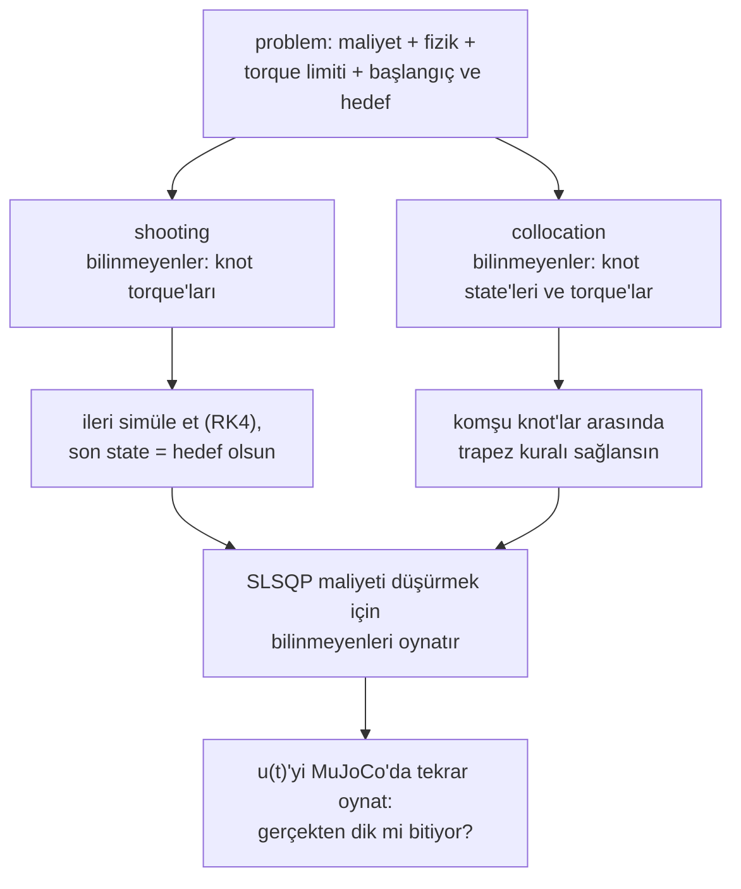

# 23 · Trajectory optimization

<!-- meta -->
| | |
|---|---|
| **Bölüm** | [6 · Planning ve optimal control](README.md) |
| **Çalışma türü** | CPU · Mac ya da Colab CPU |
| **Önkoşul** | [13](../part-4-dynamics-and-control/13-trajectory-generation.md), [22](22-motion-planning.md) |
| **Önce öğren** | [Optimization](https://aiengineeringfromscratch.com/lesson?path=phases/01-math-foundations/08-optimization) |
| **Süre** | ~60 dk |
| **Kod** | [`experiments/23-trajectory-optimization/experiment.py`](../../experiments/23-trajectory-optimization/experiment.py) |
| **Durum** | ✅ tam |
<!-- /meta -->

> Trajectory optimization "bir hareket bul"u "dinamiğe uyarak bir maliyeti minimize et"e çevirir. Dinamiği nasıl dayattığın, "yakınsadı"nın ne anlama geldiğini belirler.

## Problem

Bir sarkaç (1 m'de 1 kg, $mgl = 9{,}81$ N·m, joint damping 0,1 N·m·s) aşağı sarkıyor ve 4 s sonunda dik ve durgun olmalı. Motor en fazla 5 N·m veriyor, yatayda yerçekiminin istediğinin yaklaşık yarısı; yani sarkacı doğrudan kaldıramaz, enerji pompalamak zorunda. [Ders 13](../part-4-dynamics-and-control/13-trajectory-generation.md)'teki zaman polinomu ne dinamiği ne torque limitini bilir; [ders 22](22-motion-planning.md)'deki path ise yalnızca geometridir. İstediğimiz şey girdinin kendisi, $u(t)$: dinamik ve limit altında uygulanabilir ve olabildiğince ucuz.

## Ana fikir

### Sade anlatımla

Trajectory optimization, kısıtlar altında eğri uydurmaktır. Motor torque'unu 4 s boyunca düz çizgilerle birleşen bir avuç kontrol noktasıyla, **knot**'larla anlat; bir çizim programındaki eğri tutamaçları gibi. En az eforlu ve en yumuşak değişen torque eğrisini istiyorsun; ama bazı kurallar tam sağlanmalı: sarkaç fiziğine uyar, torque limit içinde kalır, hareket aşağı sarkarak başlar, dik ve durgun biter. Sayısal bir optimizer (burada SLSQP, sequential quadratic programming: kısıtları doğrusallaştırılmış kuadratik bir yaklaşımı tekrar tekrar çözüp adım atar) knot'ları, hiçbir küçük değişiklik bir kuralı bozmadan maliyeti düşüremeyene kadar oynatır.

İlginç olan seçim, "fiziğine uyar" kuralının nasıl dayatılacağıdır. İki standart yol var:

- **Direct shooting** top atışına nişan almaktır. Bilinmeyen yalnız torque'lardır: ileri doğru simüle et ve sarkacın 4 s'de hedefe inmesini iste. Her torque inişi etkiler, erkenler geçlerden çok daha fazla.
- **Direct collocation** noktaları birleştirme bulmacasıdır. Sarkacın her knot'taki state'ini (açı ve açısal hız) de tahmin eder ve komşu noktaların basit bir integrasyon kuralına göre fizikle uyuşmasını istersin. Hiçbir şey simüle edilmez ve her kural yalnız iki komşuyu bağlar; problem solver için kolaydır. Ama "basit kurala göre uyuşuyor", "noktalar arasındaki gerçek hareketle uyuşuyor" demek değildir: dersin dönüm noktası o boşluk.

### İki transcription



### Shooting ve collocation kod olarak

```python
# x = (theta, omega), theta = 0 hanging down; u = torque, piecewise linear through N+1 knots
cost = h * sum((u[:-1]**2 + u[1:]**2) / 2) + w_s * sum(diff(u)**2) / h   # effort + smoothness

# shooting: unknowns u; simulate (RK4) and require the final state to be the goal (2 equations)
constraints = rollout(f, x0, u)[-1] - x_goal

# collocation: unknowns X and u; require the trapezoid rule between neighbours (2N equations)
F = f(X, u)
constraints = concat(X[1:] - X[:-1] - h / 2 * (F[1:] + F[:-1]), X[0] - x0, X[-1] - x_goal)
```

| Büyüklük | Formül |
|---|---|
| Maliyet | $J = \int_0^T u^2\,dt + w_s \int_0^T \dot u^2\,dt$ |
| Dinamik | $\dot x = f(x, u)$ |
| Knot aralığı | $h = T/N$ |
| Trapez defect'i | $x_{k+1} - x_k - \tfrac{h}{2}\bigl(f(x_k,u_k) + f(x_{k+1},u_{k+1})\bigr) = 0$ |

Burada $u$ torque, $\dot u$ değişim hızı, $w_s$ yumuşaklık ağırlığı, $T$ süre, $x = (\theta, \omega)$ açı ve açısal hız, $f$ dinamik, $N$ aralık sayısı ($N+1$ knot), $x_k, u_k$ ise $k$. knot'taki state ve torque'tur. **Defect**, bir aralığın integrasyon kuralını ne kadar bozduğudur; collocation her defect'in sıfır olmasını ister.

| | Direct shooting | Direct collocation |
|---|---|---|
| karar değişkenleri | knot girdileri $u_0..u_N$ | knot state'leri $x_0..x_N$ ve girdiler $u_0..u_N$ |
| dinamik | ileri doğru integre edilir (burada RK4, aralık başına 20 alt adım) | yalnızca knot'larda eşitlik "defect"leri |
| kısıtlar | $x_N(u) = x_{goal}$ (2 denklem) | $2N$ defect + sınır state'leri |
| kesin olan | simüle edilen trajectory | ayrıklaştırılmış denklemler |
| ilk tahmin | yalnızca girdiler | state'ler ve girdiler |

<details>
<summary>Matematik ayrıntısı: sürekli problem, iki transcription ve ödünleşimleri</summary>

**Sürekli problem.**

$$\min_{u(\cdot)} \int_0^T u^2\,dt + w_s \int_0^T \dot u^2\,dt \quad \text{s.t.}\quad \dot x = f(x,u),\ \ \lvert u\rvert \le u_{max},\ \ x(0)=x_0,\ \ x(T)=x_{goal}.$$

Hedef sert bir terminal kısıt (yumuşak alternatifi terminal ceza $w_g\lVert x(T)-x_{goal}\rVert^2$). $N+1$ knot'tan geçen parçalı doğrusal bir $u(t)$ bunu sonlu bir doğrusal olmayan programa çevirir ([Tedrake, böl. 10](https://underactuated.csail.mit.edu/trajopt.html)); efor integrali trapez kuralıyla hesaplanır ve $\int \dot u^2 dt \approx \sum (\Delta u)^2 / h$.

**Trapez kuralının doğruluğu.** İkinci dereceden bir kural: aralık başına hatası $h^3$ gibi, biriken hatası $h^2$ gibi küçülür. Tedrake'in bölümü daha doğru Hermite–Simpson şemasını (kübik state, doğrusal girdi) kullanır. Solver defect'leri makine hassasiyetinde sağlar, ama defect'lerin kendisi knot'lar arasında $\dot x = f(x,u)$'yu yalnızca yaklaşık olarak temsil eder; replay hatasının $N$ büyüdükçe düşmesinin sebebi budur.

**Kısıtların yapısı.** Collocation'ın kısıt Jacobian'ı seyrek ve bantlıdır. Shooting'in değişkeni azdır ama her kısıt tüm rollout boyunca her girdiye bağlıdır ve erken girdiler terminal state'i geçlerden çok daha fazla oynatır (Tedrake'in "tail wagging the dog"u): sayısal olarak daha zor, Jacobian'ı da knot başına bir ek rollout'a mal olur.

**Global değil, yerel.** Dinamik $\sin\theta$ içeriyor, yani uygulanabilir küme convex değil. SQP birinci dereceden optimallik (KKT, Karush–Kuhn–Tucker) koşullarını sağlayan bir noktaya yakınsar: en iyi ihtimalle bir local minimum, hangisi olduğu da ilk tahmine bağlı (Boz). Takılan yerel bir solver, problemin uygulanamaz mı olduğunu yoksa sadece takılıp mı kaldığını söyleyemez.

Daha derine: [Optimization](https://aiengineeringfromscratch.com/lesson?path=phases/01-math-foundations/08-optimization) (gradient, kısıtlar, local minimum'lar); [Tedrake, *Underactuated Robotics*, böl. 10](https://underactuated.csail.mit.edu/trajopt.html) (direct transcription, shooting, collocation); [SciPy SLSQP](https://docs.scipy.org/doc/scipy/reference/optimize.minimize-slsqp.html).

</details>

## Sıfırdan yaz

Şimdi iki transcription'ı da kendin yazıp SciPy'ın SLSQP'sine vereceksin: dinamik, gradient'iyle birlikte maliyet, Jacobian'ıyla birlikte trapez defect'leri ve iki solver kurulumu. SciPy yalnız doğrusal olmayan programı çözüyor; çağırdığı her fonksiyon senin. Adımları kendi dosyana yaz ve her adımdan sonra çalıştır. Bitmiş fonksiyonlar [`physai/optimal.py`](../../physai/optimal.py) içinde; `uv run python experiments/23-trajectory-optimization/build.py` beş adımı kontrolleriyle birlikte koşturur (çıktı [`build_output.txt`](../../experiments/23-trajectory-optimization/build_output.txt) dosyasında).

### Adım 1 · Dinamik ve bir rollout

```python
def pendulum_f(x, u, m=1.0, l=1.0, b=0.1, g=9.81):
    """Pendulum dynamics, vectorized over leading dims. x = (theta, omega), theta = 0 hanging down."""
    th, w = x[..., 0], x[..., 1]
    return np.stack([w, (u - b * w - m * g * l * np.sin(th)) / (m * l * l)], axis=-1)
```

```python
def rk4_rollout(f, x0, U, T, sub=20):
    """Final state for knot torques U (rows: one control sequence each), u linear between knots, RK4."""
    U = np.atleast_2d(U)
    N = U.shape[1] - 1
    h = T / N / sub
    x = np.tile(x0, (U.shape[0], 1))
    for k in range(N):
        for s in range(sub):
            a = s / sub
            u0 = U[:, k] * (1 - a) + U[:, k + 1] * a                         # start of the sub-step
            um = U[:, k] * (1 - a - 0.5 / sub) + U[:, k + 1] * (a + 0.5 / sub)  # its midpoint
            u1 = U[:, k] * (1 - a - 1.0 / sub) + U[:, k + 1] * (a + 1.0 / sub)  # its end
            k1 = f(x, u0)
            k2 = f(x + h / 2 * k1, um)
            k3 = f(x + h / 2 * k2, um)
            k4 = f(x + h * k3, u1)
            x = x + h / 6 * (k1 + 2 * k2 + 2 * k3 + k4)
    return x
```

Rollout `U`'nun her satırını aynı anda integre eder (shooting'in finite difference'ları bunu ister). Deney'deki MuJoCo sarkacıyla (RK4, 1 ms) karşılaştır:

== Step 1. RK4 rollout of the pendulum vs MuJoCo (u(t) = 4 sin(1.5 t) through 11 knots) ==
final state ours (theta, omega) = (-0.036999, 0.225944) | MuJoCo = (-0.036999, 0.225943)
max difference 8.2e-07

### Adım 2 · Maliyet ve gradient

```python
def effort_cost(U, h, w_smooth):
    """J = int u^2 dt (trapezoid) + w_smooth * sum (du)^2 / h, and its gradient dJ/dU."""
    du = np.diff(U)
    J = h * np.sum((U[:-1] ** 2 + U[1:] ** 2) / 2) + w_smooth * np.sum(du ** 2) / h
    g = 2 * h * U
    g[0] *= 0.5
    g[-1] *= 0.5
    gs = 2 * w_smooth * du / h
    g[:-1] -= gs
    g[1:] += gs
    return J, g
```

Her knot iki trapezde ve iki farkta yer alır; gradient buradan gelir. Finite difference ile karşılaştır:

== Step 2. Cost gradient vs finite differences (N = 10, random torques) ==
J = 57.5086 | max |grad - finite difference| = 6.6e-07

### Adım 3 · Trapez defect'leri

```python
def trapezoid_defects(f, X, U, h):
    """x_{k+1} - x_k - h/2 (f_k + f_{k+1}) for every interval: an N x 2 array, zero when the knots obey the rule."""
    F = f(X, U)
    return X[1:] - X[:-1] - h / 2 * (F[1:] + F[:-1])
```

Solver türevlerini de ister. Her defect yalnız $k$ ve $k+1$ knot'larına dokunur; Jacobian bu yüzden bantlıdır ve $f$'nin 2 × 2 türevlerinden kurulur:

```python
def pendulum_jac(x, u, m=1.0, l=1.0, b=0.1, g=9.81):
    """df/dx (2 x 2) and df/du (2,) of pendulum_f at one knot."""
    inertia = m * l * l
    return np.array([[0.0, 1.0], [-m * g * l * np.cos(x[0]) / inertia, -b / inertia]]), np.array([0.0, 1 / inertia])
```

```python
def trapezoid_jacobian(jac, X, U, h):
    """Derivative of the flattened defects w.r.t. z = [X.ravel(), U]: (2N) x 3(N+1), banded."""
    n = len(U)
    J = np.zeros((2 * (n - 1), 3 * n))
    for k in range(n - 1):
        r = slice(2 * k, 2 * k + 2)
        for j, sign in ((k, -1.0), (k + 1, 1.0)):
            dfx, dfu = jac(X[j], U[j])
            J[r, 2 * j:2 * j + 2] = sign * np.eye(2) - h / 2 * dfx
            J[r, 2 * n + j] = -h / 2 * dfu
    return J
```

İki kontrol: Jacobian'a karşı finite difference ve üç knot aralığı için *gerçek* hareketin (knot'lar ince bir RK4 koşusundan alınıyor) defect'leri:

== Step 3. Trapezoidal defects ==
Jacobian 20 x 33, nonzeros 100 | max |analytic - finite difference| = 8.0e-08
defects of the true motion (u linear through the knots of 4 sin(1.5 t), RK4 with 200 sub-steps per interval):
  N = 10  h = 0.40 s  max |defect| = 1.41e-01
  N = 20  h = 0.20 s  max |defect| = 1.95e-02
  N = 40  h = 0.10 s  max |defect| = 2.50e-03

660 girdinin 100'ü sıfırdan farklı. Gerçek hareketin defect'leri sıfır değil ve $h$ her yarıya indiğinde yaklaşık 8 kat küçülüyor: trapez kuralının $h^3$'ü (Matematik ayrıntısı). Solver defect'leri sıfıra indirdiğinde bu yüzden hareketin değil, kuralın uyduğu knot'ları bulur.

### Adım 4 · SLSQP ile collocation

```python
def collocate(f, jac, x0, xg, N, T, umax, w_smooth, X_init, U_init, maxiter=500):
    """Direct collocation: unknowns are knot states and torques, constraints are the trapezoidal defects."""
    h, n = T / N, N + 1

    def unpack(z):
        return z[:2 * n].reshape(n, 2), z[2 * n:]

    def cons(z):
        X, U = unpack(z)
        return np.concatenate([trapezoid_defects(f, X, U, h).ravel(), X[0] - x0, X[-1] - xg])

    def cons_jac(z):
        X, U = unpack(z)
        B = np.zeros((4, 3 * n))
        B[0:2, 0:2], B[2:4, 2 * n - 2:2 * n] = np.eye(2), np.eye(2)    # boundary states
        return np.vstack([trapezoid_jacobian(jac, X, U, h), B])

    def grad(z):
        g = np.zeros_like(z)
        g[2 * n:] = effort_cost(unpack(z)[1], h, w_smooth)[1]
        return g

    r = minimize(lambda z: effort_cost(unpack(z)[1], h, w_smooth)[0], np.r_[X_init.ravel(), U_init], jac=grad,
                 method="SLSQP", bounds=[(None, None)] * (2 * n) + [(-umax, umax)] * n,
                 constraints=[{"type": "eq", "fun": cons, "jac": cons_jac}],
                 options=dict(maxiter=maxiter, ftol=1e-9))
    X, U = unpack(r.x)
    return r, X, U, float(np.abs(cons(r.x)).max())
```

Dipte dururken başlayarak çöz ve her $u(t)$'yi MuJoCo'da tekrar oynat:

== Step 4. Direct collocation, SLSQP from rest at the bottom, replayed in MuJoCo ==
  N converged iters    cost solver residual replay err theta (deg)
 10      True    22   45.56         5.9e-12                  23.82
 20      True    32   39.63         3.2e-12                   6.73
 40      True    54   38.41         2.9e-12                   2.27

Bunlar Deney'in collocation satırları: aynı fonksiyonlar, aynı başlangıç noktası, aynı SLSQP iterasyonları. Residual 10⁻¹², yine de $N = 10$'da sarkaç dik konumu 23,82° ıskalıyor: Adım 3'teki defect'ler iş başında.

### Adım 5 · SLSQP ile shooting

```python
def shoot(f, x0, xg, N, T, umax, w_smooth, U_init, sub=20, eps=1e-6, maxiter=500):
    """Direct shooting: unknowns are the knot torques, the constraint is the RK4 rollout's final state."""
    h = T / N

    def term(U):
        return rk4_rollout(f, x0, U, T, sub)[0] - xg

    def term_jac(U):                     # forward differences, all perturbations in one batched rollout
        xs = rk4_rollout(f, x0, np.vstack([U, U + eps * np.eye(N + 1)]), T, sub)
        return ((xs[1:] - xs[0]) / eps).T

    r = minimize(lambda U: effort_cost(U, h, w_smooth)[0], U_init, jac=lambda U: effort_cost(U, h, w_smooth)[1],
                 method="SLSQP", bounds=[(-umax, umax)] * (N + 1),
                 constraints=[{"type": "eq", "fun": term, "jac": term_jac}],
                 options=dict(maxiter=maxiter, ftol=1e-9))
    return r, r.x, float(np.abs(term(r.x)).max())
```

== Step 5. Direct shooting, N = 10, SLSQP from zero torque, replayed in MuJoCo ==
converged True | iterations 158 | cost 43.51 | solver residual 1.1e-13 | replay error 0.00 deg, 0.00 deg/s

Yine Deney'in satırı: 158 iterasyon, maliyet 43,51 ve dik konuma inen bir replay, çünkü kısıt RK4 rollout'unun kendisi.

### Elinde kalan

`physai.optimal` artık `pendulum_f`, `pendulum_jac`, `rk4_rollout`, `effort_cost`, `trapezoid_defects`, `trapezoid_jacobian`, `collocate` ve `shoot` içeriyor. Ders 24 aynı modüle LQR ve MPPI ekliyor. [`tests/test_23_trajectory_optimization.py`](../../tests/test_23_trajectory_optimization.py) gradient'leri, $h^3$ davranışını ve rollout'u MuJoCo'ya karşı kontrol ediyor; `uv run pytest tests/test_23_trajectory_optimization.py` çalıştır.

## Kütüphaneyle kullan

Solver SciPy'ın `minimize`'ı; senin seçtiğin yöntem, hangi türevleri verdiğin ve kısıtları nasıl yazdığın:

```python
from scipy.optimize import Bounds, NonlinearConstraint, minimize
r = minimize(cost, z0, jac=cost_grad, method="SLSQP", bounds=bounds,
             constraints=[{"type": "eq", "fun": defects, "jac": defects_jac}],
             options=dict(maxiter=500, ftol=1e-9))
# trust-constr takes NonlinearConstraint(fun, lb, ub, jac=...) and accepts sparse Jacobians
r = minimize(cost, z0, jac=cost_grad, method="trust-constr", bounds=Bounds(lo, hi),
             constraints=[NonlinearConstraint(defects, 0.0, 0.0, jac=defects_jac)])
r.success, r.nit, r.fun, r.x                 # converged flag, iterations, cost, solution
```

| Araç | Eşitlik kısıtı ne demek | Jacobian |
|---|---|---|
| physai `collocate` | `cons(z) = 0` (defect'ler, sınır state'leri) | yoğun, bantlı (`trapezoid_jacobian`) |
| SciPy SLSQP | `{"type": "eq", "fun": ...}` sözlüğü: `fun(z) == 0`; `"ineq"` ise `fun(z) >= 0` | yoğun dizi |
| SciPy trust-constr | `lb = ub` olan `NonlinearConstraint(fun, lb, ub)` | yoğun ya da seyrek |

Kaynak: SciPy [`minimize`](https://docs.scipy.org/doc/scipy/reference/generated/scipy.optimize.minimize.html) ve [SLSQP](https://docs.scipy.org/doc/scipy/reference/optimize.minimize-slsqp.html) referansı.

Tuzaklar:

- **`success` ayrıklaştırılmış problem hakkındadır.** $N = 10$'da `r.success` ve 10⁻¹²'lik residual geçerliydi, replay ise 23,82° ıskaladı. Her zaman replay et.
- **Eşitsizlik işareti.** SLSQP'nin `"ineq"`'i `fun(z) >= 0` demek; `u_max - u` yerine `u - u_max` diye yazılan bir torque limiti uygun tarafı sessizce ters çevirir. Kutu limitleri için bounds daha basit.
- **Eksik `jac`.** Verilmezse SciPy her iterasyonda her kısıtı finite difference ile hesaplar; shooting için bu knot başına bir ek rollout demek, bizim toplu `term_jac`'imiz bunu tek seferde yapıyor.

## Deney

**Tahmin.** Yeterli knot ile iki yöntem de yakınsamalı, yaklaşık aynı maliyete. "Yakınsadı" ikisi için aynı şeyi ifade etmeyebilir.

Tam script: [`experiments/23-trajectory-optimization/experiment.py`](../../experiments/23-trajectory-optimization/experiment.py); iki solver'ı Sıfırdan yaz'daki `collocate` ve `shoot`'un yaptığını iterasyon iterasyon yapıyor.

```python
r, X, U, residual = collocate(pendulum_f, pendulum_jac, X0, XG, N, T, UMAX, 0.05, X_init, U_init)
r, U, residual = shoot(pendulum_f, X0, XG, N, T, UMAX, 0.05, U_init)
```

Maliyet: $J = \int u^2 dt + 0{,}05 \int \dot u^2 dt$. İkisi de sıfır torque ve dipte duran state ile başlıyor. Her $u(t)$ sonra **bir MuJoCo sarkacında open-loop tekrar oynatılıyor** (sabit bir torque programı, feedback yok; RK4, 1 ms): replay hatası gerçekte elde edeceğin hareketin hedef hatası, solver residual ise solver'ın gördüğü en büyük kısıt ihlali. MuJoCo 3.17.0, NumPy 2.5.4, SciPy 1.18.1, Apple Silicon Mac (Apple M5), deterministik.

| yöntem | N | yakınsadı | iterasyon | maliyet | solver residual | replay hatası θ (derece) | replay hatası ω (derece/s) |
|---|---|---|---|---|---|---|---|
| shooting | 5 | False | 438 | 104,44 | 3,9e-01 | 21,33 | 22,41 |
| collocation | 5 | False | 500 | 89,74 | 3,5e+00 | 174,73 | 527,46 |
| shooting | 10 | True | 158 | 43,51 | 1,1e-13 | 0,00 | 0,00 |
| collocation | 10 | True | 22 | 45,56 | 5,9e-12 | 23,82 | 71,61 |
| shooting | 20 | True | 123 | 39,33 | 5,5e-11 | 0,00 | 0,00 |
| collocation | 20 | True | 32 | 39,63 | 3,2e-12 | 6,73 | 20,45 |
| shooting | 40 | True | 147 | 38,34 | 5,1e-12 | 0,00 | 0,00 |
| collocation | 40 | True | 54 | 38,41 | 2,9e-12 | 2,27 | 6,92 |
| shooting | 80 | True | 158 | 38,09 | 1,4e-11 | 0,00 | 0,00 |
| collocation | 80 | True | 91 | 38,11 | 3,4e-13 | 0,61 | 1,87 |


1. **Aynı maliyet, farklı gerçek.** $N=10$'dan itibaren ikisi de $10^{-10}$ veya daha küçük residual ile yakınsadığını bildiriyor ve maliyetler buluşuyor ($N=80$'de 38,09 ve 38,11). Ama collocation'ın $N=10$'daki $u(t)$'si simüle edilince dik konumun 23,82° gerisinde bitiyor: ayrıklaştırılmış denklemler tam çözülmüş, yanlış olan knot'lar arasındaki trapez kuralı. Knot ekledikçe hata düşüyor: 23,82 → 6,73 → 2,27 → 0,61°.
2. **Shooting'in kısıtı simülasyonun kendisi.** Terminal kısıtı aynı parçalı doğrusal girdinin RK4 rollout'u üzerinde hesaplanıyor; bu yüzden replay, yazdırılan hassasiyette hedefe iniyor.
3. **Collocation'ı çözmek daha ucuz.** 123–158'e karşı 22–91 iterasyon; üstelik her shooting iterasyonu, finite-difference Jacobian'ı için $N+1$ ek rollout istiyor.
4. **$N=5$ ikisinde de başarısız.** Altı knot torque'u ile iki solver da uygulanabilir bir noktaya ulaşmadı; yerel bir solver bu problemin uygulanamaz mı olduğunu yoksa sadece takılıp mı kaldığını söyleyemez.

Reçete: collocation ile çöz, simülasyonla kontrol et (ya da collocation cevabından başlayıp shooting ile iyileştir), asla tek başına residual'a güvenme.

## Boz

Aynı problem, $N = 40$ ile collocation, farklı ilk tahminler. Sekiz gürültülü tahmin tek bir generator'dan (seed 0) sırayla çekiliyor: düz çizgi artı her knot state'ine Gauss gürültüsü ($\sigma = 1$) ve $\pm 5$ N·m içinde uniform torque'lar.

| ilk tahmin | yakınsadı | iterasyon | maliyet | replay hatası θ (derece) | torque işaret değişimi | θ aralığı (derece) |
|---|---|---|---|---|---|---|
| dipte duruyor, u = 0 | True | 54 | 38,41 | 2,27 | 3 | −77 .. 180 |
| düz çizgi θ 0 → π, u = 0 | True | 33 | 50,63 | 58,03 | 1 | −56 .. 180 |
| çizgi + gürültü, çekiliş 0, 1, 4, 5, 7 | True | 33–41 | 50,63 | 58,03 | 1 | −56 .. 180 |
| çizgi + gürültü, çekiliş 2, 3 | True | 50, 58 | 38,41 | 2,27 | 3 | −77 .. 180 |
| çizgi + gürültü, çekiliş 6 | False | 76 | 134,04 | 160,58 | 2 | −29 .. 197 |

Akla gelen ilk tahmin, aşağıdan yukarıya düz bir çizgi, temiz yakınsıyor ve başarı bildiriyor; ama farklı bir **local minimum**'a (hiçbir küçük değişiklik iyileştiremiyor, ama çok farklı bir çözüm daha iyi): üç dönüşlü bir pompalama yerine tek büyük bir geri salınım (θ −56°'ye kadar), maliyet 38,41 yerine 50,63. Sekiz gürültülü tahminin beşi aynı havzaya (o minimum'a varan başlangıç noktalarına), ikisi daha iyisine düşüyor, biri yakınsamıyor. Tedrake, kendi acrobot ve cart-pole swing-up örneklerinde düz çizgi tahmininin gerekli olduğunu yazıyor; bizim sarkaçta işe yarıyor ama kötü minimum'a iniyor. Başarı bayrağı hangi minimum'u bulduğun hakkında hiçbir şey söylemez. Çareler: multi-start yapıp en iyisini tut, makul bir rollout'tan (ya da bir MPC koşusundan, ders 24) başlat veya continuation (önce kolay bir problemi çöz, ör. daha büyük torque limiti, sonra sıkılaştır). Tek salınımlı çözümün aynı $N$'de neden çok daha kötü replay ettiğini ayrıştırmadık; her durumda, kararsız bir dengede biten open-loop bir planı izlemek için feedback gerekir.

## Gerçek robotta

- **Torque limitleri model verisidir.** Menagerie Panda, actuator kuvvetini joint 1–4'te ±87 N·m, joint 5–7'de ±12 N·m ile sınırlar ([`panda.xml`](https://github.com/google-deepmind/mujoco_menagerie/blob/f3b6013/franka_emika_panda/panda.xml)); SO-101 modeli STS3215 servo sınıfı için ±2,94 N·m kullanır ([`so101.xml`](https://github.com/google-deepmind/mujoco_menagerie/blob/f3b6013/robotstudio_so101/so101.xml)). Bu sayılar doğrudan sınırlara girer; modeldeki limit ölçülmüş bir donanım limiti olmadığı için altında pay bırak.
- **SO-101 prosedürü.** Modelde actuator'lar position servo'dur (`<position kp=...>`); yani optimize edilen hareket joint position trajectory'si olarak uygulanır ve torque yalnızca dolaylı olarak gözetilir. Model limitinin altında torque sınırlarıyla bir uzanma hareketi optimize et, position actuator'larla MuJoCo'da tekrar oynat, actuator kuvvetlerini sınırla karşılaştır, sonra pozisyonları yavaşça gönder. Gerçek kolda henüz ölçülmedi.
- **Open-loop yetmez.** Simülasyonda bile tam yakınsamış bir collocation planı 0,61° ile 23,82° arasında ıskaladı. Donanımda model hatası ayrıklaştırma hatasının üstüne eklenir; plan bir feedback controller ile izlenmeli (ders 12 PD ya da trajectory etrafında LQR, ders 24).

## Kendini dene

1. **Kolay.** Yakınsamış her shooting çözümü neden 0,00° hatayla replay ediyor da collocation etmiyor?
2. **Orta.** Trapez defect'ini Hermite–Simpson ile değiştir (kübik state, aralık ortasında defect). $N=10$ replay hatasının nasıl değişeceğini tahmin et, sonra ölç.
3. **Zor.** $N=40$'ta 20 rastgele ilk tahmin çalıştır ve son maliyetleri kümele. Kaç farklı local minimum buluyorsun ve en iyisine en sık hangi tahmin ailesi ulaşıyor?

### Cevaplar

1. Shooting'in kısıtı, replay'in integre ettiği girdinin aynısının RK4 rollout'u üzerinde hesaplanıyor (MuJoCo'nun 1 ms'lik RK4'ü aynı girdinin bir başka ince adımlı integrasyonu); residual, integrasyon hatası dışında gerçek terminal hatayı ölçüyor. Collocation'ın residual'ı yalnızca trapez denklemlerini ölçer; ayrıklaştırma hataları kalır ($N=10$'da 23,82°).
2. Burada hesaplanmadı. Üçüncü dereceden bir şema aynı $N$'de daha küçük hata vermeli; ölç.
3. Bizim 10 tahminimizle: iki minimum (38,41 ve 50,63) ve yakınsamayan bir koşu (134,04). 20 tahmin için çalıştır.

## Akılda kalanlar ve kaynaklar

- Collocation ve shooting aynı maliyete ulaştı ($N=80$'de 38,11 ve 38,09), ama collocation'ın $N=10$'daki "yakınsamış" planı simüle edilince dik konumu 23,82° ıskaladı. Her zaman replay et.
- Collocation daha az iterasyon istedi (22–91'e karşı 123–158) ve state ilk tahmini kabul ediyor; shooting kullandığı integrator için kesin.
- Convex olmayan problemler ilk tahminin havzasına yakınsar: düz çizgi tahmini 50,63, dipte duran tahmin 38,41 maliyet verdi.

Sonraki: [ders 24](24-lqr-and-mpc.md), optimization'dan feedback: bir denge etrafında LQR ve her adımda yeniden çözen MPC.

**Kaynaklar**

- R. Tedrake, *Underactuated Robotics*, böl. 10 "Trajectory Optimization" (direct transcription, direct shooting, direct collocation, local minimum'lar). [underactuated.csail.mit.edu/trajopt.html](https://underactuated.csail.mit.edu/trajopt.html).
- SciPy, [`scipy.optimize.minimize` (SLSQP)](https://docs.scipy.org/doc/scipy/reference/optimize.minimize-slsqp.html).
- MuJoCo Menagerie, [`franka_emika_panda/panda.xml`](https://github.com/google-deepmind/mujoco_menagerie/blob/f3b6013/franka_emika_panda/panda.xml), [`robotstudio_so101/so101.xml`](https://github.com/google-deepmind/mujoco_menagerie/blob/f3b6013/robotstudio_so101/so101.xml).
- Tüm tablolar: [`experiments/23-trajectory-optimization/output.txt`](../../experiments/23-trajectory-optimization/output.txt) (MuJoCo 3.17.0, SciPy 1.18.1, 2026-10-27).
