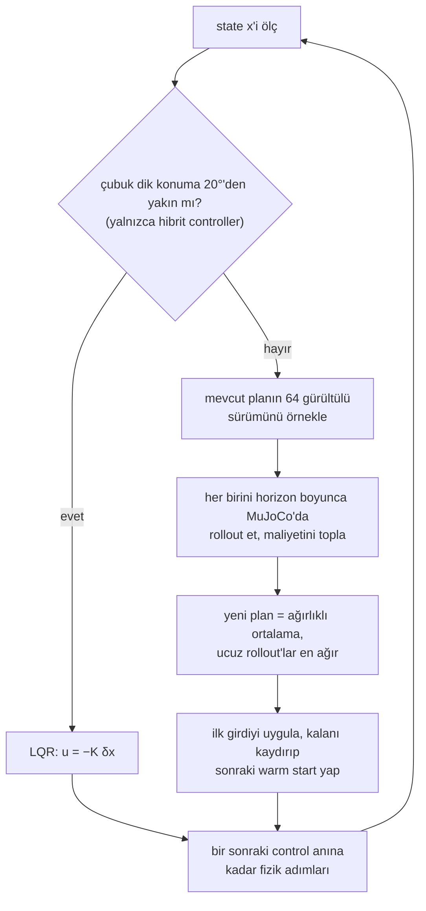

# 24 · LQR ve model predictive control

<!-- meta -->
| | |
|---|---|
| **Bölüm** | [6 · Planning ve optimal control](README.md) |
| **Çalışma türü** | CPU · Mac ya da Colab CPU |
| **Önkoşul** | [11](../part-4-dynamics-and-control/11-rigid-body-dynamics.md), [23](23-trajectory-optimization.md) |
| **Önce öğren** | [Optimization](https://aiengineeringfromscratch.com/lesson?path=phases/01-math-foundations/08-optimization) · [Convex Optimization](https://aiengineeringfromscratch.com/lesson?path=phases/01-math-foundations/18-convex-optimization) |
| **Süre** | ~75 dk |
| **Kod** | [`experiments/24-lqr-and-mpc/experiment.py`](../../experiments/24-lqr-and-mpc/experiment.py) |
| **Durum** | ✅ tam |
<!-- /meta -->

> LQR, bir kez sorulan doğrusal bir sorunun kesin cevabıdır. MPC ise doğrusal olmayan soruyu her control adımında yeniden sorar.

## Problem

Bir cart-pole: 3 m'lik bir rayda 1 kg'lık bir araba, bir menteşede 0,2 kg, 0,6 m'lik bir çubuk, tek bir yatay kuvvet. İki iş var: çubuğu dik tutmak ve aşağı sarkarken yukarı getirmek. Ders 23, simülasyonda hedefi 23,82°'ye kadar ıskalayan yakınsamış open-loop planlar üretti; gerçek her controller döngüyü kapatmak zorunda. Bu dersin soruları: doğrusal bir feedback yasası dik konumdan ne kadar uzakta hâlâ çalışır ve o bölgenin dışında ne kullanırsın?

## Ana fikir

### Sade anlatımla

Avucunda bir süpürge sapını dengede tutmak, **LQR**'ın (linear-quadratic regulator) iyi bir resmidir. Dik konuma yakın, sapın davranışı neredeyse doğrusaldır: küçük bir eğim, sapı eğimle kabaca orantılı bir ivmeyle düşürür. Doğrusal bir fizik ve karesel hataları ile karesel eforu toplayan bir maliyet için mümkün olan en iyi controller kapalı biçimde bilinir ve bir kez, önceden hesaplanır: sabit bir gain satırı $K$. Çalışırken controller tek bir nokta çarpımıdır: "state'in dik konumdan ne kadar uzak olduğunun eksi $K$ katı kadar it". Zayıflığı, yalnızca o yakın çevreyi bilmesidir. Motorun bir azami kuvveti olduğunu ya da rayın bittiğini bilmez; aşağı sarkarken ise doğrusal resmi düpedüz yanlıştır.

**MPC** (model predictive control), her kavşakta rotayı yeniden hesaplayan bir GPS'tir. Her control adımında gerçekten ölçtüğü state'i alır, saniyenin bir kesri kadar ilerisini (**horizon**) tam, doğrusal olmayan simülatörle planlar, bu planın yalnızca ilk anını uygular ve sonra sistem gerçekte nereye vardıysa oradan yeniden planlar. Hatalar birikmez, çünkü hiçbir şey uzun süre körü körüne izlenmez. Bizim MPC'miz örneklemeli bir türü, MPPI: gradient hesaplamak yerine mevcut planın 64 gürültülü varyasyonunu MuJoCo'da dener ve ucuz olanlara çok daha fazla ağırlık vererek ortalamasını alır. Ayar düğmesi horizon'dur: çok kısaysa zamanında frenlemeye yetecek kadar ileriyi göremez, çok uzunsa 64 örnek uzayan planı fazla seyrek kaplar.

### MPC döngüsü ve LQR'a devir



### LQR ve MPPI kod olarak

```python
# LQR, offline and once: linearize at the upright, solve the Riccati equation
A, B = linearize(model, x_up, u=0)               # mjd_transitionFD: dx[t+1] ≈ A dx[t] + B du[t]
P = solve_discrete_are(A, B, Q, R)               # Q penalizes state error, R penalizes force
K = solve(R + B.T @ P @ B, B.T @ P @ A)          # 1 x 4 row of gains

def lqr(x):                                      # online: one dot product, then the force limit
    return clip(-K @ (x - x_up), -F, F)

# MPPI, online at every control step (50 Hz, i.e. every 20 ms)
def mppi_step(x, U, n_samples=64, sigma=8.0, lam=0.5):
    Uk = clip(U + normal(0, sigma, (n_samples, len(U))), -F, F)   # noisy variations of plan U
    S = array([rollout_cost(x, u_seq) for u_seq in Uk])          # simulate each from x, sum the cost
    w = exp(-(S - S.min()) / lam)                # cheap rollouts get exponentially more weight
    U = (w / w.sum()) @ Uk                       # new plan: weighted average of the samples
    return U[0], append(U[1:], U[-1])            # apply the first input; shifted plan is the next guess

while True:                                      # receding horizon: always replan from the real state
    x = measure()
    u, U = mppi_step(x, U)                       # hybrid: u = lqr(x) once |theta| < 20 deg
    apply(u)
```

| Büyüklük | Formül |
|---|---|
| Denge yakınında doğrusal model | $\delta x_{t+1} \approx A\,\delta x_t + B\,\delta u_t$ |
| LQR maliyeti | $\sum_t \delta x_t^\top Q\,\delta x_t + \delta u_t^\top R\,\delta u_t$ |
| LQR yasası | $u = -K\,\delta x, \quad K = (R + B^\top P B)^{-1} B^\top P A$ |
| MPPI güncellemesi | $\bar U \leftarrow \sum_k w_k U_k, \quad w_k \propto \exp\!\bigl(-(S_k - \min_j S_j)/\lambda\bigr)$ |

Burada $x = (x_{cart}, \theta, \dot x_{cart}, \dot\theta)$ state'tir (araba konumu, çubuğun dik konumdan açısı ve bunların hızları), $\delta x$ ve $\delta u$ dengeden sapmalardır, $A$ ve $B$ tek bir simülatör adımının bu sapmaları nasıl taşıdığını anlatır, $Q$ ve $R$ state hatasını kuvvete karşı tartar, $P$ Riccati denkleminin çözümüdür (cost-to-go matrisi), $K$ gain satırıdır, $\bar U$ horizon boyunca mevcut girdi planı, $U_k$ onun $k$. gürültülü örneği, $S_k$ o örneğin rollout maliyeti, $\lambda$ ise bir sıcaklıktır: küçük $\lambda$ yalnızca en iyi örneklere güvenir, büyük $\lambda$ onları daha eşit ortalar.

<details>
<summary>Matematik ayrıntısı: MuJoCo'yu doğrusallaştırmak, Riccati denklemi, kararlılık ve MPPI</summary>

**Simülatörü doğrusallaştır.** Bir denge $(\bar x, \bar u)$ etrafında MuJoCo adımı yaklaşık doğrusaldır, $\delta x_{t+1} \approx A\,\delta x_t + B\,\delta u_t$. `mujoco.mjd_transitionFD(m, d, eps, flg_centered, A, B, C, D)`, `mj_step`'i finite-difference ile türeterek $A$'yı ($2n_v{+}n_a$ kare) ve $B$'yi ($2n_v{+}n_a \times n_u$) hesaplar; `flg_centered` true ise merkezi farkla. RK4 integrator'ı desteklemez ([MuJoCo API](https://mujoco.readthedocs.io/en/stable/APIreference/APIfunctions.html)); bu yüzden modelimiz $dt = 0{,}01$ s'de Euler kullanıyor.

**Ayrık zamanlı LQR.** Doğrusal model altında $\sum_t \delta x_t^\top Q\,\delta x_t + \delta u_t^\top R\,\delta u_t$'yi minimize et. Optimal yasa doğrusal state feedback'tir ([Tedrake böl. 8](https://underactuated.csail.mit.edu/lqr.html)):

$$P = A^\top P A - A^\top P B\,(R + B^\top P B)^{-1} B^\top P A + Q, \qquad K = (R + B^\top P B)^{-1} B^\top P A, \qquad u = -K\,\delta x.$$

İlk denklem ayrık cebirsel Riccati denklemidir; $\delta x^\top P\,\delta x$, $\delta x$ state'inden itibaren optimal maliyettir. `scipy.linalg.solve_discrete_are(A, B, Q, R)` $P$'yi döndürür. Sabit bir doğrusal model ve $Q \succeq 0$, $R \succ 0$ olan karesel maliyet için problem convex'tir, yani optimum globaldir; dynamic programming de onu bu Riccati denklemiyle kapalı formda verir (bkz. AIEFS: [Convex Optimization](https://aiengineeringfromscratch.com/lesson?path=phases/01-math-foundations/18-convex-optimization)). Garanti doğrusal model içindir; kuvvet limiti ve ray sonu yoktur.

**Ayrık zamanda kararlılık.** Her adım, bir özvektör boyunca sapmayı o özdeğerle çarpar. Herhangi bir özdeğerin mutlak değeri 1'den büyükse sapma adım adım büyür (kararsız); $A - BK$'nın bütün closed-loop özdeğerleri birim çemberin içindeyse küçük sapmalar sıfıra söner. **Region of attraction**, gerçek, doğrusal olmayan ve kuvvet sınırlı sistemin dengeye hâlâ ulaştığı başlangıç state'lerinin kümesidir; doğrusal analiz bu kümenin boş olmadığını söyler ama ne kadar büyük olduğunu söylemez, bu yüzden ölçülmelidir.

**MPC ve MPPI.** Her control adımında ölçülen state'ten sonlu ufuklu bir trajectory optimization çöz, ilk girdiyi uygula, kalanı at, tekrarla ([Tedrake böl. 10, MPC](https://underactuated.csail.mit.edu/trajopt.html)). Basitleştirilmiş bir MPPI kullanıyoruz ([Williams vd. 2017](https://homes.cs.washington.edu/~bboots/files/InformationTheoreticMPC.pdf)): $K$ adet bozulmuş girdi dizisi $U_k = \bar U + \epsilon_k$ örnekle, her birini MuJoCo'da rollout et (`mujoco.rollout`, çok thread'li), $S_k$ maliyetiyle puanla, $\bar U$'yu yukarıdaki üstel ağırlıklarla güncelle, sonra $\bar U$'yu bir adım kaydırıp bir sonraki warm start yap. $\min_j S_j$'yi çıkarmak normalize edilmiş ağırlıkları değiştirmez; yalnızca sayısal underflow'u önler. Doğrusallaştırma yok, gradient yok, maliyet serbest: burada $5(1-\cos\theta) + 0{,}5x^2 + 0{,}01(\dot x^2 + \dot\theta^2) + 10^{-4}u^2$, artı ray uçlarına yakın bir ceza.

Daha derine: [Optimization](https://aiengineeringfromscratch.com/lesson?path=phases/01-math-foundations/08-optimization), [Convex Optimization](https://aiengineeringfromscratch.com/lesson?path=phases/01-math-foundations/18-convex-optimization); [Tedrake böl. 8 (LQR)](https://underactuated.csail.mit.edu/lqr.html) ve [böl. 10 (MPC)](https://underactuated.csail.mit.edu/trajopt.html); [Williams vd. 2017](https://homes.cs.washington.edu/~bboots/files/InformationTheoreticMPC.pdf) (MPPI).

</details>

<!-- figure: 24-lqr-cartpole -->

## Deney

Tam script: [`experiments/24-lqr-and-mpc/experiment.py`](../../experiments/24-lqr-and-mpc/experiment.py). MuJoCo 3.17.0, NumPy 2.5.4, SciPy 1.18.1, Apple Silicon Mac (Apple M5), sabit seed'ler.

```python
mujoco.mj_forward(m, d)                                  # upright, at rest, u = 0
A = np.zeros((4, 4)); B = np.zeros((4, 1))
mujoco.mjd_transitionFD(m, d, 1e-6, True, A, B, None, None)
P = solve_discrete_are(A, B, Q, R)                       # Q = diag(1, 10, 0.1, 0.1), R = 0.01
K = np.linalg.solve(R + B.T @ P @ B, B.T @ P @ A)
```

**Bölüm A.** Open-loop özdeğerlerin en büyük mutlak değeri 1,0536 (> 1: kontrol olmadan küçük bir eğim her adımda büyür). $K = [-9{,}081;\ -65{,}8771;\ -10{,}3669;\ -11{,}81]$; closed-loop mutlak değerler 0,9202 ve 0,9869 (çiftler hâlinde), hepsi birim çemberin içinde.

**Bölüm B, region of attraction** (controller'ın çubuğu hâlâ dikleştirebildiği başlangıç state'leri). Çubuğu $\theta_0$ açısında durgun bırak, araba $x=0$'da, 5 s boyunca $u = \text{clip}(-K\delta x, \pm F)$ uygula. Başarı: sonda $\lvert\theta\rvert < 2°$. Tahmin: büyük kuvvet limitleri yardım eder, ama bir yere kadar.

| $\theta_0$ (derece) | F = 5 N | F = 10 N | F = 20 N | F = 50 N |
|---|---|---|---|---|
| 0–15 | ok | ok | ok | ok |
| 20–30 | düştü | ok | ok | ok |
| 35–40 | düştü | ray sonu | ok | ok |
| 45–50 | düştü | düştü | ray sonu | ok |
| 55–60 | düştü | düştü | ray sonu | ray sonu |
| 180 (aşağı) | çıkmadı | çıkmadı | çıkmadı | çıkmadı |

İki farklı başarısızlık biçimi. Küçük kuvvet limitinde doğrusal yasa var olandan fazla kuvvet ister; komut doyuma girer (limitte kırpılır) ve çubuk düşer. Yeterli kuvvetle çubuk yakalanır ama araba rayın sonuna çarpar: LQR $x$ üzerindeki karesel cezayı bilir, $\lvert x\rvert \le 1{,}5$ m kısıtını bilmez. 50 N'de bile bu 5°'lik sweep'te bölge 50° ile 55° arasında bitiyor. Aşağı sarkarken ("düşemeyen", bu yüzden 5 s'nin tamamı koşan bir deneme) LQR çubuğu hiçbir kuvvette yukarı çıkaramıyor: dik konumdaki doğrusallaştırma orada hiçbir şey söylemez.

**Bölüm C, MPPI swing-up.** Aşağı sarkarken, $\lvert F\rvert \le 20$ N, 64 örnek, $\sigma = 8$ N, $\lambda = 0{,}5$, 50 Hz, 6 s, satır başına 8 seed. Horizon'u sweep et. "Tuttu": son 1 s boyunca $\lvert\theta\rvert < 10°$; "en kötü": son 1 s içindeki en büyük $\lvert\theta\rvert$'nın seed'ler üzerinden medyanı.

| horizon (s) | adım | dikten geçti | tuttu | medyan ilk dik zamanı (s) | en kötü $\lvert\theta\rvert$, son 1 s (derece) | medyan maliyet |
|---|---|---|---|---|---|---|
| 0,2 | 10 | 8/8 | 0/8 | 0,80 | 178,2 | 30,97 |
| 0,3 | 15 | 8/8 | 0/8 | 0,72 | 177,2 | 29,84 |
| 0,5 | 25 | 8/8 | 8/8 | 0,90 | 3,1 | 10,79 |
| 0,7 | 35 | 8/8 | 8/8 | 1,27 | 5,1 | 9,12 |
| 1,0 | 50 | 8/8 | 3/8 | 1,09 | 11,8 | 7,57 |
| 1,5 | 75 | 8/8 | 1/8 | 1,51 | 16,0 | 10,08 |

- **Çok kısa (0,2–0,3 s):** çubuk dikten geçiriliyor ama hiç yakalanmıyor; son 1 s içinde hâlâ dipten geçerek sallanıyor (178,2°). Controller miyop: zamanında frenlemeye yetecek kadar ileriyi göremiyor.
- **0,5–0,7 s:** 8 seed'in hepsinde swing-up ve denge, medyan en kötü açı 3,1° ve 5,1°.
- **Daha uzun (1,0–1,5 s):** yine her seferinde yukarı çıkıyor, 1,0 s horizon en düşük medyan maliyeti veriyor (7,57), ama denge gevşiyor (11,8°, 16,0°). Bu sayılarla tutarlı bir açıklama: 64 örnek sabitken 50 ya da 75 adımlık bir girdi dizisi daha seyrek örneklenir, ortalaması alınan ilk girdi daha gürültülü olur. Bunu doğrulamak için örnek sayısını sweep etmedik.

**Mühendislik cevabı: ikisini birden kullan.** Aynı MPPI, ama $\lvert\theta\rvert < 20°$ olur olmaz LQR'a geç:

| horizon (s) | dikten geçti | tuttu | medyan ilk dik zamanı (s) | en kötü $\lvert\theta\rvert$, son 1 s (derece) | medyan maliyet |
|---|---|---|---|---|---|
| 0,5 | 8/8 | 7/8 | 1,09 | 0,1 | 7,61 |
| 1,0 | 8/8 | 8/8 | 1,12 | 0,0 | 7,16 |
| 1,5 | 8/8 | 8/8 | 1,66 | 0,1 | 9,00 |

MPC, LQR'ın yapamadığı doğrusal olmayan kısmı yapıyor; LQR dengeyi sampling'in erişemediği bir hassasiyetle tutuyor. 0,5 s'lik bir koşu tutmadı. Muhtemel sebep (burada ayrıştırılmadı): Bölüm B bölgeyi yalnızca durgun bırakılan çubuk için ölçtü, devir ise hızla olur; yani 20° kendiliğinden bölgenin içinde değildir.


## Boz

Bozulma zaten tablolarda: LQR bölgesi kuvvetin doyduğu ya da rayın bittiği yerde bitiyor (Bölüm B), MPPI de horizon sweep'inin iki ucunda bozuluyor; bu örnek bütçesiyle 0,5 s altında miyop, 0,7 s üstünde gürültülü (Bölüm C). Hangisinin ne zaman yettiğinin özeti:

| durum | LQR | MPC |
|---|---|---|
| tek bir denge etrafında küçük sapmalar, girdiler limitlerin epey içinde | yeterli ve en ucuzu (tek matris-vektör çarpımı) | gereksiz |
| büyük sapmalar, doğrusal olmayan hareket (swing-up) | başarısız (180°: hiçbir kuvvette çıkmadı) | gerekli |
| sert kısıtlar (kuvvet, ray, contact) | yok sayılır, yalnızca $Q$, $R$ üzerinden cezalandırılır | maliyette ya da kısıt olarak |
| adım başına hesap | $O(n\,m)$ | $H$ adımlık $K$ rollout (burada en fazla 75 control adımlık 64 rollout) |

## Gerçek robotta

- **MPC gerçek bacaklı robotlarda çalışıyor.** MIT Cheetah 3 controller'ı problemi convex yapmak için dinamiği basitleştirir, 0,5 s'ye kadar prediction horizon kullanır ve 20–30 Hz'de 1 ms'nin altında çözer ([Di Carlo vd., IROS 2018](https://dspace.mit.edu/handle/1721.1/138000.2)). Solver control periyoduna yetişene kadar modeli basitleştir: horizon sweep'imizdekiyle aynı ödünleşim.
- **SO-101.** Menagerie modeli her joint'i position servo ile sürer (`kp="998.22" kv="2.731"`, kuvvet limiti ±2,94 N·m, [`so101.xml`](https://github.com/google-deepmind/mujoco_menagerie/blob/f3b6013/robotstudio_so101/so101.xml)). `mjd_transitionFD` modelde hangi actuator varsa onu doğrusallaştırır; elde ettiğin $B$ torque'u değil, position hedeflerini bir sonraki state'e bağlar. LQR'ı bu servo-döngü-içinde modelde tasarla, kuvvet kırpmasıyla simüle et, sonra kolda düşük gain ile dene. Gerçek kolda henüz ölçülmedi.
- **Region of attraction ölçülmeli.** Tablomuz kesin bir modelle simülasyonda. Donanımda gecikmeler, sürtünme ve kestirim gürültüsü bölgeyi küçültür. Başlangıç koşulunu gerçek sistemde burada yaptığımız gibi sweep et; sadece açıyı değil hızı da kat.

## Kendini dene

1. **Kolay.** Aşağı sarkarken başlatılan LQR neden kuvvet limitinden bağımsız olarak başarısız oluyor?
2. **Orta.** F = 10 N'de 35–40°'deki başarısızlıklar "ray sonu". $Q$'nun hangi elemanını büyütürdün ve "düştü" sınırına ne olmasını beklersin?
3. **Zor.** Uzun horizon'daki salınım açıklamasını test et: 1,0 s horizon'da örnek sayısını sweep et (64, 128, 256) ve "tuttu"yu ve en kötü açıyı ölç.

### Cevaplar

1. Doğrusal model yalnızca $\theta = 0$ yakınında geçerlidir. $\theta = \pi$ yakınında araba kuvvetinden çubuk ivmesine giden bağ ($\propto \cos\theta$) ters işaretlidir; tepede çubuğu doğrultacak bir itiş dipte onu öbür yöne çevirir ve sabit bir doğrusal yasa salınıma enerji pompalayamaz. Ölçülen: dört kuvvetin hepsinde "çıkmadı".
2. Araba pozisyonu ağırlığı $Q_{11}$. Araba merkeze daha yakın kalmalı, bedeli daha agresif bir çubuk kurtarması; yani 10 N'de bazı ray sonu durumları "düştü"ye dönebilir. Burada hesaplanmadı.
3. Burada hesaplanmadı; çalıştır.

## Akılda kalanlar ve kaynaklar

- `mjd_transitionFD` + `solve_discrete_are` herhangi bir MuJoCo modelinden birkaç satırda LQR verir; burada çubuğu 5 N'de 15°'ye, 50 N'de 50°'ye kadar yakaladı, ötesinde doyum ya da ray sonu yüzünden başarısız oldu.
- MPPI çubuğu her horizon'da 8/8 seed'de aşağıdan yukarı çıkardı, ama 64 örnekle yalnızca 0,5–0,7 s horizon'larda tuttu.
- Doğrusal olmayan swing-up için MPC artı denge için LQR, 1,0 ve 1,5 s'de 8/8 tuttu, en kötü açı en fazla 0,1°.

Sonraki: [ders 25](../part-7-learning-from-demonstration/25-evaluating-policies.md), başarı oranına güvenmek için bir policy'yi yeterli denemeyle nasıl değerlendireceğin.

**Kaynaklar**

- R. Tedrake, *Underactuated Robotics*, böl. 8 "Linear Quadratic Regulators" ([lqr.html](https://underactuated.csail.mit.edu/lqr.html)) ve böl. 10, model-predictive control kısmı ([trajopt.html](https://underactuated.csail.mit.edu/trajopt.html)).
- MuJoCo API referansı, [`mjd_transitionFD`](https://mujoco.readthedocs.io/en/stable/APIreference/APIfunctions.html); Python binding'leri, [`mujoco.rollout`](https://mujoco.readthedocs.io/en/stable/python.html).
- SciPy, [`scipy.linalg.solve_discrete_are`](https://docs.scipy.org/doc/scipy/reference/generated/scipy.linalg.solve_discrete_are.html).
- G. Williams vd., "Information Theoretic MPC for Model-Based Reinforcement Learning", ICRA 2017. [PDF](https://homes.cs.washington.edu/~bboots/files/InformationTheoreticMPC.pdf).
- J. Di Carlo, P. M. Wensing, B. Katz, G. Bledt, S. Kim, "Dynamic Locomotion in the MIT Cheetah 3 Through Convex Model-Predictive Control", IROS 2018. [MIT DSpace](https://dspace.mit.edu/handle/1721.1/138000.2).
- Tüm tablolar: [`experiments/24-lqr-and-mpc/output.txt`](../../experiments/24-lqr-and-mpc/output.txt) (MuJoCo 3.17.0, 2026-10-27).
