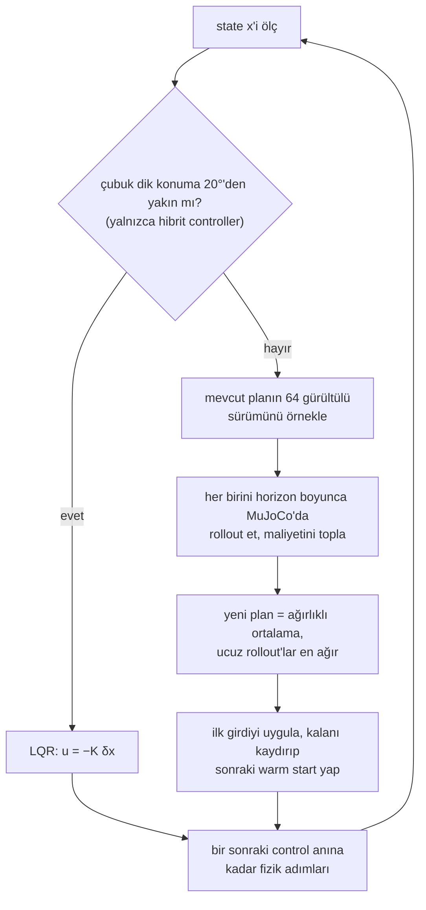

# 24 · LQR ve model predictive control

<!-- meta -->
| | |
|---|---|
| **Bölüm** | [6 · Planning ve optimal control](README.md) |
| **Çalışma türü** | CPU · Mac ya da Colab CPU |
| **Önkoşul** | [11](../part-4-dynamics-and-control/11-rigid-body-dynamics.md), [23](23-trajectory-optimization.md) |
| **Önce öğren** | [Optimization](https://aiengineeringfromscratch.com/lesson?path=phases/01-math-foundations/08-optimization) · [Convex Optimization](https://aiengineeringfromscratch.com/lesson?path=phases/01-math-foundations/18-convex-optimization) |
| **Süre** | ~75 dk |
| **Kod** | [`experiments/24-lqr-and-mpc/experiment.py`](../../experiments/24-lqr-and-mpc/experiment.py) |
| **Durum** | ✅ tam |
<!-- /meta -->

> LQR, bir kez sorulan doğrusal bir sorunun kesin cevabıdır. MPC ise doğrusal olmayan soruyu her control adımında yeniden sorar.

## Problem

Bir cart-pole: 3 m'lik bir rayda 1 kg'lık bir araba, bir menteşede 0,2 kg, 0,6 m'lik bir çubuk, tek bir yatay kuvvet. İki iş var: çubuğu dik tutmak ve aşağı sarkarken yukarı getirmek. Ders 23'ün yakınsamış open-loop planları simülasyonda hedefi 23,82°'ye kadar ıskaladı; gerçek bir controller döngüyü kapatmak zorunda. Doğrusal bir feedback yasası dik konumdan ne kadar uzakta hâlâ çalışır ve o bölgenin dışında ne kullanırsın?

## Ana fikir

### Sade anlatımla

Avucunda bir süpürge sapını dengede tutmak, **LQR**'ın (linear-quadratic regulator) iyi bir resmidir. Dik konuma yakın sap neredeyse doğrusaldır: küçük bir eğim onu eğimle kabaca orantılı bir ivmeyle düşürür. Doğrusal fizik ve karesel hataları ile karesel eforu toplayan bir maliyet için en iyi controller kapalı biçimde bilinir ve bir kez, önceden hesaplanır: sabit bir gain satırı $K$. Çalışırken tek bir nokta çarpımıdır: "state'in dik konumdan uzaklığının eksi $K$ katı kadar it". Yalnız o yakın çevreyi bilir: motorun azami kuvvetini, rayın bittiğini bilmez; aşağı sarkarken doğrusal resmi düpedüz yanlıştır.

**MPC** (model predictive control), her kavşakta rotayı yeniden hesaplayan bir GPS'tir. Her control adımında ölçülen state'ten saniyenin bir kesri kadar ilerisini (**horizon**) tam, doğrusal olmayan simülatörle planlar, yalnız ilk anı uygular ve sistem gerçekte nereye vardıysa oradan yeniden planlar; hatalar birikmez. Bizim MPC'miz örneklemeli bir türü, MPPI: mevcut planın 64 gürültülü varyasyonunu MuJoCo'da dener ve ucuz olanlara çok daha fazla ağırlık vererek ortalar. Ayar düğmesi horizon'dur: çok kısaysa zamanında frenleyecek kadar ileriyi göremez, çok uzunsa 64 örnek uzayan planı fazla seyrek kaplar.

### MPC döngüsü ve LQR'a devir



### LQR ve MPPI kod olarak

```python
# LQR, offline and once: linearize at the upright, solve the Riccati equation
A, B = linearize(model, x_up, u=0)               # mjd_transitionFD: dx[t+1] ≈ A dx[t] + B du[t]
P = solve_discrete_are(A, B, Q, R)               # Q penalizes state error, R penalizes force
K = solve(R + B.T @ P @ B, B.T @ P @ A)          # 1 x 4 row of gains

def lqr(x):                                      # online: one dot product, then the force limit
    return clip(-K @ (x - x_up), -F, F)

# MPPI, online at every control step (50 Hz, i.e. every 20 ms)
def mppi_step(x, U, n_samples=64, sigma=8.0, lam=0.5):
    Uk = clip(U + normal(0, sigma, (n_samples, len(U))), -F, F)   # noisy variations of plan U
    S = array([rollout_cost(x, u_seq) for u_seq in Uk])          # simulate each from x, sum the cost
    w = exp(-(S - S.min()) / lam)                # cheap rollouts get exponentially more weight
    U = (w / w.sum()) @ Uk                       # new plan: weighted average of the samples
    return U[0], append(U[1:], U[-1])            # apply the first input; shifted plan is the next guess

while True:                                      # receding horizon: always replan from the real state
    x = measure()
    u, U = mppi_step(x, U)                       # hybrid: u = lqr(x) once |theta| < 20 deg
    apply(u)
```

| Büyüklük | Formül |
|---|---|
| Denge yakınında doğrusal model | $\delta x_{t+1} \approx A\,\delta x_t + B\,\delta u_t$ |
| LQR maliyeti | $\sum_t \delta x_t^\top Q\,\delta x_t + \delta u_t^\top R\,\delta u_t$ |
| LQR yasası | $u = -K\,\delta x, \quad K = (R + B^\top P B)^{-1} B^\top P A$ |
| MPPI güncellemesi | $\bar U \leftarrow \sum_k w_k U_k, \quad w_k \propto \exp\!\bigl(-(S_k - \min_j S_j)/\lambda\bigr)$ |

Burada $x = (x_{cart}, \theta, \dot x_{cart}, \dot\theta)$ state'tir (çubuğun dik konumdan açısı), $\delta x, \delta u$ dengeden sapmalar, $A, B$ tek bir simülatör adımının bu sapmaları taşıması, $Q, R$ state hatası ve kuvvet ağırlıkları, $P$ Riccati çözümü (cost-to-go matrisi), $K$ gain satırı, $\bar U$ horizon boyunca girdi planı, $U_k$ onun rollout maliyeti $S_k$ olan $k$. gürültülü örneği, $\lambda$ ise bir sıcaklıktır: küçük $\lambda$ yalnız en iyi örneklere güvenir.

<details>
<summary>Matematik ayrıntısı: MuJoCo'yu doğrusallaştırmak, Riccati denklemi, kararlılık ve MPPI</summary>

**Simülatörü doğrusallaştır.** `mjd_transitionFD`, `mj_step`'i finite difference ile türetir (Sıfırdan yaz, Adım 1). RK4 integrator'ı desteklemez ([MuJoCo API](https://mujoco.readthedocs.io/en/stable/APIreference/APIfunctions.html)); bu yüzden modelimiz $dt = 0{,}01$ s'de Euler kullanıyor.

**Ayrık zamanlı LQR.** Doğrusal model altında $\sum_t \delta x_t^\top Q\,\delta x_t + \delta u_t^\top R\,\delta u_t$'yi minimize et. Optimal yasa doğrusal state feedback'tir ([Tedrake böl. 8](https://underactuated.csail.mit.edu/lqr.html)):

$$P = A^\top P A - A^\top P B\,(R + B^\top P B)^{-1} B^\top P A + Q, \qquad K = (R + B^\top P B)^{-1} B^\top P A, \qquad u = -K\,\delta x.$$

İlk denklem ayrık cebirsel Riccati denklemidir; $\delta x^\top P\,\delta x$, $\delta x$'ten itibaren optimal maliyettir. $Q \succeq 0$, $R \succ 0$ ile problem convex'tir, yani optimum globaldir (bkz. AIEFS: [Convex Optimization](https://aiengineeringfromscratch.com/lesson?path=phases/01-math-foundations/18-convex-optimization)); doğrusal model için, kuvvet limiti ve ray sonu olmadan.

**Ayrık zamanda kararlılık.** Her adım, bir özvektör boyunca sapmayı o özdeğerle çarpar; $A - BK$'nın bütün özdeğerleri birim çemberin içindeyse küçük sapmalar sıfıra söner. **Region of attraction**, yani gerçek, doğrusal olmayan ve kuvvet sınırlı sistemin dengeye hâlâ ulaştığı başlangıç state'leri, boş değildir; ama büyüklüğü ölçülmelidir.

**MPC ve MPPI.** Ölçülen state'ten sonlu ufuklu bir trajectory optimization çöz, ilk girdiyi uygula, tekrarla ([Tedrake böl. 10, MPC](https://underactuated.csail.mit.edu/trajopt.html)). Basitleştirilmiş bir MPPI kullanıyoruz ([Williams vd. 2017](https://homes.cs.washington.edu/~bboots/files/InformationTheoreticMPC.pdf)): bozulmuş diziler $U_k = \bar U + \epsilon_k$, `mujoco.rollout` ile rollout, yukarıdaki gibi ağırlıklandırma, sonra bir sonraki warm start için bir adım kaydırılan $\bar U$. $\min_j S_j$'yi çıkarmak yalnız underflow'u önler. Doğrusallaştırma yok, gradient yok, maliyet serbest: burada $5(1-\cos\theta) + 0{,}5x^2 + 0{,}01(\dot x^2 + \dot\theta^2) + 10^{-4}u^2$, artı ray uçlarına yakın bir ceza.

Daha derine: [Optimization](https://aiengineeringfromscratch.com/lesson?path=phases/01-math-foundations/08-optimization), [Convex Optimization](https://aiengineeringfromscratch.com/lesson?path=phases/01-math-foundations/18-convex-optimization); [Tedrake böl. 8 (LQR)](https://underactuated.csail.mit.edu/lqr.html) ve [böl. 10 (MPC)](https://underactuated.csail.mit.edu/trajopt.html); [Williams vd. 2017](https://homes.cs.washington.edu/~bboots/files/InformationTheoreticMPC.pdf) (MPPI).

</details>

<!-- figure: 24-lqr-cartpole -->

## Sıfırdan yaz

Şimdi LQR hattını, linearization dahil, ve MPPI güncellemesini kuracaksın. MuJoCo yalnız fiziği adımlıyor; SciPy yalnız Riccati çözümünü kontrol ediyor. Adımları kendi dosyana yaz ve her adımdan sonra çalıştır. Bitmiş fonksiyonlar [`physai/optimal.py`](../../physai/optimal.py) içinde; `uv run python experiments/24-lqr-and-mpc/build.py` beş adımı kontrolleriyle birlikte koşturur (çıktı [`build_output.txt`](../../experiments/24-lqr-and-mpc/build_output.txt) dosyasında).

### Adım 1 · Finite difference ile linearize et

Her simülatör adımı bir `step(x, u)` fonksiyonudur. Her state ve girdi bileşenini iki yöne dürt ve farkını al:

```python
def linearize(step, x, u, eps=1e-6):
    """A = d step / d x, B = d step / d u by central differences of any step(x, u) -> next state."""
    A = np.column_stack([(step(x + e, u) - step(x - e, u)) / (2 * eps) for e in eps * np.eye(len(x))])
    B = np.column_stack([(step(x, u + e) - step(x, u - e)) / (2 * eps) for e in eps * np.eye(len(u))])
    return A, B
```

Burada `step` `qpos`, `qvel` ve `ctrl`'ü taze bir `MjData`'ya yazar, `mj_step`'i çağırır ve state'i geri okur. Dik konumda MuJoCo'nun `mjd_transitionFD`'sine karşı:

== Step 1. Linearize at the upright: central differences of mj_step vs mjd_transitionFD ==
theta row of A: [0.     1.0027 0.     0.01  ] | B: [ 0.0001 -0.0002  0.0095 -0.0232]
max |A - A_mj| = 2.2e-16 | max |B - B_mj| = 2.7e-20
open-loop max |eig(A)| = 1.0536

Yuvarlama hatasına kadar aynı matrisler ve A kısmının kararsız özdeğeri 1,0536.

### Adım 2 · Riccati özyinelemesi, sonlu ufuk

Zamanda geriye doğru dynamic programming: $t+1$ adımından itibaren cost-to-go $\delta x^\top P\,\delta x$ ise, bir adım daha doğrusal bir yasa ve yeni bir kuadratik cost-to-go verir.

```python
def riccati_step(A, B, Q, R, P):
    """One backward step of the Riccati recursion: (P one step earlier, the gain K for that step)."""
    K = np.linalg.solve(R + B.T @ P @ B, B.T @ P @ A)
    return Q + A.T @ P @ (A - B @ K), K
```

```python
def lqr_finite(A, B, Q, R, Qf, N):
    """Finite-horizon discrete LQR: gains K_0 .. K_{N-1} (u_t = -K_t dx_t) and the cost-to-go matrix P_0."""
    P, gains = Qf, []
    for _ in range(N):
        P, K = riccati_step(A, B, Q, R, P)
        gains.append(K)
    return gains[::-1], P
```

$N$ adımlık bir ufkun ilk gain'i:

== Step 2. Finite-horizon LQR (Qf = Q): the first gain K_0 for growing horizons ==
N =   10 steps (  0.1 s)  K_0 = [  0.4182 -14.1056   0.7483  -2.6585]
N =   50 steps (  0.5 s)  K_0 = [ -0.2921 -45.6948  -0.9843  -7.1108]
N =  200 steps (  2.0 s)  K_0 = [ -8.9347 -65.5536 -10.2164 -11.7349]
N = 1000 steps ( 10.0 s)  K_0 = [ -9.081  -65.8771 -10.3669 -11.81  ]

0,1 s'lik ufuk farklı bir yasa veriyor (arabayı ters yöne bile itiyor); 10 s'de gain artık ufka bağlı değil.

### Adım 3 · Sonsuz ufuk

Aynı adımı $P$ değişmeyi bırakana kadar tekrarla:

```python
def dlqr(A, B, Q, R, tol=1e-12, max_iter=100_000):
    """Infinite-horizon discrete LQR: iterate the Riccati recursion until P stops changing. Returns (K, P, steps)."""
    P = Q.copy()
    for i in range(1, max_iter + 1):
        P_new, K = riccati_step(A, B, Q, R, P)
        if np.abs(P_new - P).max() <= tol * np.abs(P_new).max():
            return K, P_new, i
        P = P_new
    raise RuntimeError("Riccati iteration did not converge")
```

== Step 3. Infinite horizon: iterate Riccati to a fixed point vs solve_discrete_are ==
converged after 978 iterations | max |P - P_scipy| / max |P| = 3.0e-11
K = [ -9.081  -65.8771 -10.3669 -11.81  ]
closed-loop |eig(A - B K)| = [0.9202 0.9202 0.9869 0.9869]

Yazdırılan basamaklara kadar Deney'in $K$'si ve kapalı döngü büyüklükleri 0,9202 ile 0,9869. Yineleme en yavaş kapalı döngü özdeğerinin belirlediği bir hızla geometrik yakınsıyor; yaklaşık bin adım bu yüzden.

### Adım 4 · Gain'i kullan

Deney'in kuralı, açı $(-\pi, \pi]$'ye sarılmışken $u = \text{clip}(-K\,\delta x, \pm F)$:

== Step 4. Use the gain: release at rest, u = clip(-K x, +-F), 5 s ==
theta0 (deg) |     F=5 N |    F=10 N |    F=50 N
          15 |        ok |        ok |        ok
          20 |      fell |        ok |        ok
          35 |      fell | track end |        ok
          50 |      fell |      fell |        ok
          55 |      fell |      fell | track end

Her hücre B kısmının region of attraction tablosuyla örtüşüyor.

### Adım 5 · MPPI güncellemesi

```python
def mppi_update(samples, costs, lam):
    """MPPI: weights exp(-(S_k - min S) / lam), normalized; returns (new plan = weighted mean of samples, weights)."""
    w = np.exp(-(costs - costs.min()) / lam)
    w = w / w.sum()
    return w @ samples, w
```

Etrafındaki döngü Ana fikirdeki `mppi_step`; 64 örneği `mujoco.rollout` simüle ediyor. Ufuk 0,5 s, 8 seed:

== Step 5. MPPI swing-up from hanging down (|F| <= 20 N, 64 samples, sigma 8 N, lambda 0.5, 50 Hz) ==
horizon 0.5 s, 8 seeds: held (|theta| < 10 deg for the last 1 s) 8/8 | median worst |theta| 3.1 deg | median cost 10.79

Deney'in 0,5 s satırı, birebir.

### Elinde kalan

`physai.optimal` artık `linearize`, `riccati_step`, `lqr_finite`, `dlqr` ve `mppi_update`'i de içeriyor; `linearize` öğrenilmiş bir model dahil her `step(x, u)` ile çalışır. [`tests/test_24_lqr_and_mpc.py`](../../tests/test_24_lqr_and_mpc.py) onları `solve_discrete_are`, `mjd_transitionFD` ve MPPI ağırlıklarının özelliklerine karşı kontrol ediyor; `uv run pytest tests/test_24_lqr_and_mpc.py` çalıştır.

## Kütüphaneyle kullan

Kütüphane yolu: model için iki çağrı, Riccati denklemi için bir çağrı, gain için bir satır:

```python
mujoco.mj_forward(m, d)                                    # d holds the equilibrium (qpos, qvel, ctrl)
A = np.zeros((2 * m.nv + m.na, 2 * m.nv + m.na)); B = np.zeros((2 * m.nv + m.na, m.nu))
mujoco.mjd_transitionFD(m, d, 1e-6, True, A, B, None, None)   # centered differences of mj_step
P = scipy.linalg.solve_discrete_are(A, B, Q, R)            # returns P, not K
K = np.linalg.solve(R + B.T @ P @ B, B.T @ P @ A)          # the discrete-time gain
states, sensordata = rollout.rollout(m, datas, state0, ctrl)  # many MPPI samples, multithreaded
```

| Araç | Çağrı | Döndürdüğü |
|---|---|---|
| physai | `dlqr(A, B, Q, R)` | `K, P, iterations`, yasa $u = -K\,\delta x$ |
| SciPy | `solve_discrete_are(a, b, q, r)` | yalnız $P$ |
| python-control | `control.dlqr(A, B, Q, R)` | `K, S, E` (gain, Riccati çözümü, kapalı döngü özdeğerleri), yasa $u[n] = -K x[n]$ |

Kaynaklar: [SciPy `solve_discrete_are`](https://docs.scipy.org/doc/scipy/reference/generated/scipy.linalg.solve_discrete_are.html), [python-control `dlqr`](https://python-control.readthedocs.io/en/latest/generated/control.dlqr.html), [MuJoCo API](https://mujoco.readthedocs.io/en/stable/APIreference/APIfunctions.html).

Tuzaklar:

- **Sürekli ve ayrık gain.** $K = R^{-1}B^\top P$ sürekli zaman formülüdür; `mjd_transitionFD`'nin ayrık $A$, $B$'siyle $(R + B^\top P B)^{-1}B^\top P A$ kullan.
- **Açıyı sar.** Bir tur dönmüş bir çubuk $\delta x$ onu $(-\pi, \pi]$'ye sarmazsa 2π fazla okunur ve dev bir itme alır.
- **State düzeni.** `mjd_transitionFD`'nin state'i `nq + nv` değil $2n_v + n_a$ boyutludur (hız koordinatlarında konumlar, hızlar, actuator state'leri); free ve ball joint'ler ikisini farklılaştırır.

## Deney

Tam script: [`experiments/24-lqr-and-mpc/experiment.py`](../../experiments/24-lqr-and-mpc/experiment.py). MuJoCo 3.17.0, NumPy 2.5.4, SciPy 1.18.1, Apple Silicon Mac (Apple M5), sabit seed'ler.

**Bölüm A.** Kütüphaneyle kullan'daki çağrılar, $Q = \text{diag}(1, 10, 0{,}1, 0{,}1)$, $R = 0{,}01$. Open-loop özdeğerlerin en büyük mutlak değeri 1,0536 (küçük bir eğim her adımda büyür). $K = [-9{,}081;\ -65{,}8771;\ -10{,}3669;\ -11{,}81]$; closed-loop mutlak değerler 0,9202 ve 0,9869 (çiftler hâlinde), birim çemberin içinde.

**Bölüm B, region of attraction.** Çubuğu $\theta_0$'da durgun bırak, araba $x=0$'da, 5 s boyunca $u = \text{clip}(-K\delta x, \pm F)$ uygula; başarı sonda $\lvert\theta\rvert < 2°$. Tahmin: büyük kuvvet limitleri yardım eder, ama bir yere kadar.

| $\theta_0$ (derece) | F = 5 N | F = 10 N | F = 20 N | F = 50 N |
|---|---|---|---|---|
| 0–15 | ok | ok | ok | ok |
| 20–30 | düştü | ok | ok | ok |
| 35–40 | düştü | ray sonu | ok | ok |
| 45–50 | düştü | düştü | ray sonu | ok |
| 55–60 | düştü | düştü | ray sonu | ray sonu |
| 180 (aşağı) | çıkmadı | çıkmadı | çıkmadı | çıkmadı |

İki başarısızlık biçimi. Küçük kuvvet limitinde doğrusal yasa var olandan fazla kuvvet ister, komut doyuma girer ve çubuk düşer. Yeterli kuvvetle çubuk yakalanır ama araba ray sonuna çarpar: LQR $x$ üzerindeki karesel cezayı bilir, $\lvert x\rvert \le 1{,}5$ m kısıtını bilmez. Aşağı sarkarken ("düşemeyen" ve 5 s'nin tamamını koşan bir deneme) LQR çubuğu hiç yukarı çıkaramıyor: dik konumdaki doğrusallaştırma orada hiçbir şey söylemez.

**Bölüm C, MPPI swing-up.** Aşağı sarkarken, $\lvert F\rvert \le 20$ N, 64 örnek, $\sigma = 8$ N, $\lambda = 0{,}5$, 50 Hz, 6 s, satır başına 8 seed. Horizon'u sweep et. "Tuttu": son 1 s boyunca $\lvert\theta\rvert < 10°$; "en kötü": son 1 s içindeki en büyük $\lvert\theta\rvert$'nın seed'ler üzerinden medyanı.

| horizon (s) | adım | dikten geçti | tuttu | medyan ilk dik zamanı (s) | en kötü $\lvert\theta\rvert$, son 1 s (derece) | medyan maliyet |
|---|---|---|---|---|---|---|
| 0,2 | 10 | 8/8 | 0/8 | 0,80 | 178,2 | 30,97 |
| 0,3 | 15 | 8/8 | 0/8 | 0,72 | 177,2 | 29,84 |
| 0,5 | 25 | 8/8 | 8/8 | 0,90 | 3,1 | 10,79 |
| 0,7 | 35 | 8/8 | 8/8 | 1,27 | 5,1 | 9,12 |
| 1,0 | 50 | 8/8 | 3/8 | 1,09 | 11,8 | 7,57 |
| 1,5 | 75 | 8/8 | 1/8 | 1,51 | 16,0 | 10,08 |

- **Çok kısa (0,2–0,3 s):** çubuk dikten geçiyor ama hiç yakalanmıyor (son 1 s'de 178,2°): controller zamanında frenleyecek kadar ileriyi göremiyor.
- **0,5–0,7 s:** 8 seed'in hepsinde swing-up ve denge (3,1°, 5,1°).
- **Daha uzun (1,0–1,5 s):** yine her seferinde yukarı çıkıyor ve 1,0 s en düşük medyan maliyeti veriyor (7,57), ama denge gevşiyor (11,8°, 16,0°). Bu sayılarla tutarlı, örnek sayısı sweep'iyle doğrulanmamış: 64 örnek 50 ya da 75 adımlık bir diziyi daha seyrek kaplar, ortalanan ilk girdi daha gürültülü olur.

**Mühendislik cevabı: ikisini birden kullan.** $\lvert\theta\rvert < 20°$ olunca MPPI'dan LQR'a geç:

| horizon (s) | dikten geçti | tuttu | medyan ilk dik zamanı (s) | en kötü $\lvert\theta\rvert$, son 1 s (derece) | medyan maliyet |
|---|---|---|---|---|---|
| 0,5 | 8/8 | 7/8 | 1,09 | 0,1 | 7,61 |
| 1,0 | 8/8 | 8/8 | 1,12 | 0,0 | 7,16 |
| 1,5 | 8/8 | 8/8 | 1,66 | 0,1 | 9,00 |

MPC doğrusal olmayan kısmı yapıyor, LQR dengeyi sampling'in erişemediği bir hassasiyetle tutuyor. 0,5 s'lik bir koşu tutmadı; muhtemelen (ayrıştırılmadı) Bölüm B bölgeyi durgun çubukla ölçtüğü, devir ise hızla olduğu için.


## Boz

Bozulma zaten tablolarda: LQR bölgesi kuvvetin doyduğu ya da rayın bittiği yerde bitiyor (Bölüm B), MPPI de horizon sweep'inin iki ucunda bozuluyor; bu örnek bütçesiyle 0,5 s altında miyop, 0,7 s üstünde gürültülü (Bölüm C). Hangisinin ne zaman yettiğinin özeti:

| durum | LQR | MPC |
|---|---|---|
| tek bir denge etrafında küçük sapmalar, girdiler limitlerin epey içinde | yeterli ve en ucuzu (tek matris-vektör çarpımı) | gereksiz |
| büyük sapmalar, doğrusal olmayan hareket (swing-up) | başarısız (180°: hiçbir kuvvette çıkmadı) | gerekli |
| sert kısıtlar (kuvvet, ray, contact) | yok sayılır, yalnızca $Q$, $R$ üzerinden cezalandırılır | maliyette ya da kısıt olarak |
| adım başına hesap | $O(n\,m)$ | $H$ adımlık $K$ rollout (burada en fazla 75 control adımlık 64 rollout) |

## Gerçek robotta

- **MPC gerçek bacaklı robotlarda çalışıyor.** MIT Cheetah 3 controller'ı problem convex olana kadar dinamiği basitleştirir, 0,5 s'ye kadar öngörür ve 20–30 Hz'de 1 ms'nin altında çözer ([Di Carlo vd., IROS 2018](https://dspace.mit.edu/handle/1721.1/138000.2)): solver control periyoduna yetişene kadar modeli basitleştir.
- **SO-101.** Menagerie modeli her joint'i position servo ile sürer (`kp="998.22" kv="2.731"`, kuvvet limiti ±2,94 N·m, [`so101.xml`](https://github.com/google-deepmind/mujoco_menagerie/blob/f3b6013/robotstudio_so101/so101.xml)); yani `mjd_transitionFD`'nin $B$'si torque'u değil, position hedeflerini bir sonraki state'e bağlar. LQR'ı bu servo-döngü-içinde modelde tasarla, kuvvet kırpmasıyla simüle et, sonra kolda düşük gain ile dene. Gerçek kolda henüz ölçülmedi.
- **Region of attraction ölçülmeli.** Tablomuz kesin bir modelle simülasyon; donanımda gecikmeler, sürtünme ve kestirim gürültüsü bölgeyi küçültür. Başlangıç koşulunu gerçek sistemde hız dahil sweep et.

## Kendini dene

1. **Kolay.** Aşağı sarkarken başlatılan LQR neden kuvvet limitinden bağımsız olarak başarısız oluyor?
2. **Orta.** F = 10 N'de 35–40°'deki başarısızlıklar "ray sonu". $Q$'nun hangi elemanını büyütürdün ve "düştü" sınırına ne olmasını beklersin?
3. **Zor.** Uzun horizon'daki salınım açıklamasını test et: 1,0 s horizon'da örnek sayısını sweep et (64, 128, 256) ve "tuttu"yu ve en kötü açıyı ölç.

### Cevaplar

1. Doğrusal model yalnızca $\theta = 0$ yakınında geçerlidir. $\theta = \pi$ yakınında araba kuvvetinden çubuk ivmesine giden bağ ($\propto \cos\theta$) ters işaretlidir ve sabit bir doğrusal yasa salınıma enerji pompalayamaz. Ölçülen: dört kuvvetin hepsinde "çıkmadı".
2. Araba pozisyonu ağırlığı $Q_{11}$. Araba merkeze daha yakın kalmalı, bedeli daha agresif bir çubuk kurtarması; yani 10 N'de bazı ray sonu durumları "düştü"ye dönebilir. Burada hesaplanmadı.
3. Burada hesaplanmadı; çalıştır.

## Akılda kalanlar ve kaynaklar

- Linearize et, Riccati'yi yinele, bitti: herhangi bir MuJoCo modelinden birkaç satırda LQR. Çubuğu 5 N'de 15°'ye, 50 N'de 50°'ye kadar yakaladı, ötesinde doyum ya da ray sonu yüzünden başarısız oldu.
- MPPI çubuğu her horizon'da 8/8 seed'de yukarı çıkardı, ama 64 örnekle yalnız 0,5–0,7 s'de tuttu.
- Swing-up için MPC artı denge için LQR, 1,0 ve 1,5 s'de 8/8 tuttu, en kötü açı en fazla 0,1°.

Sonraki: [ders 25](../part-7-learning-from-demonstration/25-evaluating-policies.md), başarı oranına güvenmek için bir policy'yi yeterli denemeyle nasıl değerlendireceğin.

**Kaynaklar**

- R. Tedrake, *Underactuated Robotics*, böl. 8 "Linear Quadratic Regulators" ([lqr.html](https://underactuated.csail.mit.edu/lqr.html)) ve böl. 10, model-predictive control kısmı ([trajopt.html](https://underactuated.csail.mit.edu/trajopt.html)).
- MuJoCo API referansı, [`mjd_transitionFD`](https://mujoco.readthedocs.io/en/stable/APIreference/APIfunctions.html); Python binding'leri, [`mujoco.rollout`](https://mujoco.readthedocs.io/en/stable/python.html).
- SciPy, [`scipy.linalg.solve_discrete_are`](https://docs.scipy.org/doc/scipy/reference/generated/scipy.linalg.solve_discrete_are.html).
- G. Williams vd., "Information Theoretic MPC for Model-Based Reinforcement Learning", ICRA 2017. [PDF](https://homes.cs.washington.edu/~bboots/files/InformationTheoreticMPC.pdf).
- J. Di Carlo, P. M. Wensing, B. Katz, G. Bledt, S. Kim, "Dynamic Locomotion in the MIT Cheetah 3 Through Convex Model-Predictive Control", IROS 2018. [MIT DSpace](https://dspace.mit.edu/handle/1721.1/138000.2).
- Tüm tablolar: [`experiments/24-lqr-and-mpc/output.txt`](../../experiments/24-lqr-and-mpc/output.txt) (MuJoCo 3.17.0, 2026-10-27).
