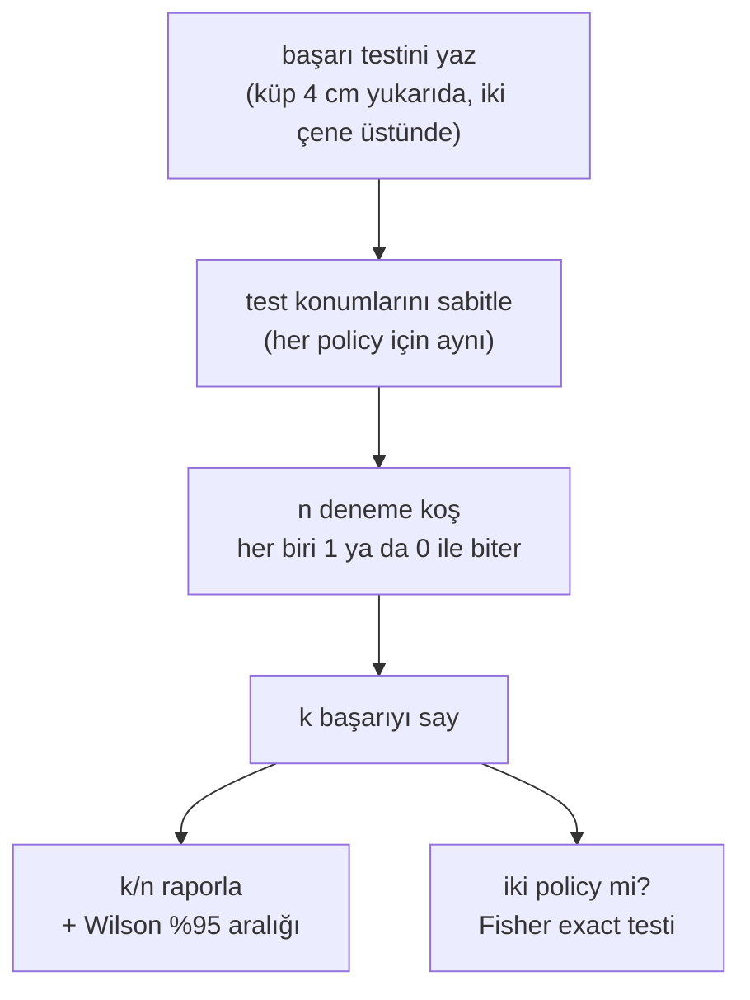
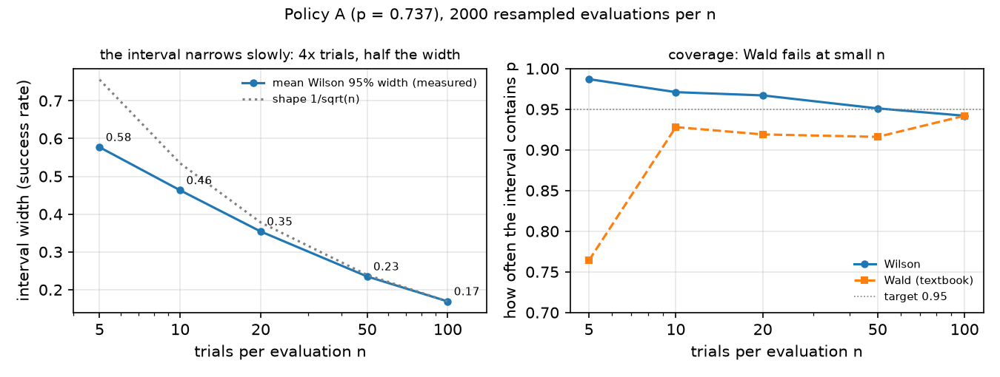

# 25 · Robot policy'lerini evaluate etmek

<!-- meta -->
| | |
|---|---|
| **Bölüm** | [7 · Learning from demonstration](README.md) |
| **Çalışma türü** | CPU · Mac ya da Colab CPU |
| **Önkoşul** | [16](../part-4-dynamics-and-control/16-grasping-and-pick-place.md) |
| **Önce öğren** | [Statistics for Machine Learning](https://aiengineeringfromscratch.com/lesson?path=phases/01-math-foundations/15-statistics-for-ml) · [Model Evaluation](https://aiengineeringfromscratch.com/lesson?path=phases/02-ml-fundamentals/09-model-evaluation) |
| **Süre** | ~40 dk |
| **Kod** | [`experiments/25-evaluating-policies/experiment.py`](../../experiments/25-evaluating-policies/experiment.py) |
| **Durum** | ✅ tam |
<!-- /meta -->

> Deneme sayısı olmayan bir başarı oranı ölçüm değildir. k/n'yi, bir Wilson aralığını ve her denemeye karar veren fiziksel testi raporla.

## Problem

Bölüm 7 policy'ler eğitiyor ve her birine tek bir soru soruyor: küpü kaldırıyor mu? "%90 başarı" gibi cevaplar genellikle 10 ya da 20 rollout'a dayanır (bir rollout = policy'nin baştan sona bir koşusu). 10 denemeyle, uzun vadeli oranı 0,74 olan bir policy beş evaluation'dan birinde 9/10 ya da daha iyisini yapar (aşağıda ölçüldü); yani tek bir "9/10", 0,74'lük bir policy'yi 0,88'lik birinden ayıramaz. Bir şey eğitmeden önce bu ders kitabın geri kalanının kullandığı evaluation protokolünü kuruyor: neyin başarı sayıldığı, kaç deneme gerektiği, hangi aralığın raporlanacağı ve iki policy'nin gerçekten ne zaman farklı olduğu.

## Ana fikir

### Sade anlatımla

Bir avuç denemeyle ölçülen bir success rate (başarı oranı), örneklemi çok küçük bir kamuoyu anketidir. Bir anketçi 10 kişiye sorsa ve 9'u evet dese, ciddi hiç kimse "ülkenin %90'ı katılıyor" diye yazmaz; "yaklaşık %90, ama hata payı geniş" der. Robot evaluation'ı da aynı biçimde işler. Her deneme bir katılımcıdır, policy'nin uzun vadeli success rate'i bütün ülkenin görüşüdür ve hata payını deneme sayısı belirler. İstatistikçiler bu hata payına **confidence interval** der: birçok evaluation boyunca gerçek oranı belirtilen bir sıklıkla (burada %95) içerecek biçimde hesaplanan bir aralık.

Buradan üç kural çıkar. Başlamadan önce neyin "evet" sayılacağına karar ver: bir denemeyi başarılı sayan fiziksel bir test. Sonucu hata payıyla birlikte raporla: n denemede k başarı, artı bir aralık. Ve iki policy'yi, aralıklarının örtüşüp örtüşmediğine göz kararı bakarak değil, karşılaştırma için yapılmış bir testle karşılaştır.

Hata payı yavaş küçülür. Onu yarıya indirmek dört kat deneme ister; her deneme de robot zamanı ve bir küp reset'i demektir.

### Evaluation protokolü



### Aralık, kod olarak

Her deneme, hileli bir yazı-tura gibi 1 (başarı) ya da 0 (başarısızlık) ile biter: bir Bernoulli denemesi; n atıştaki tura sayısı da binom sayımı. Ders kitabındaki aralık (Wald) ve bu kitabın kullandığı aralık (Wilson, 1927), birkaç satırda (tam kod Sıfırdan yaz'da):

```python
p = k / n                                                    # observed success rate
wald = (p - z * sqrt(p * (1 - p) / n), p + z * sqrt(p * (1 - p) / n))   # zero width at p = 0 or 1
center = (p + z * z / (2 * n)) / (1 + z * z / n)             # Wilson: pulled toward 0.5
half = z * sqrt(p * (1 - p) / n + z * z / (4 * n * n)) / (1 + z * z / n)  # never zero
wilson(9, 10)    # (0.596, 0.982): a "9/10" fits a mediocre or an excellent policy
wald(10, 10)     # (1.0, 1.0): claims certainty after ten trials
```

| Büyüklük | Formül |
|---|---|
| gözlenen oran | $\hat p = k/n$ |
| Wald aralığı | $\hat p \pm z\sqrt{\hat p(1-\hat p)/n}$ |
| Wilson aralığı | $\dfrac{\hat p + \frac{z^2}{2n}}{1 + \frac{z^2}{n}} \;\pm\; \dfrac{z}{1 + \frac{z^2}{n}}\sqrt{\dfrac{\hat p(1-\hat p)}{n} + \dfrac{z^2}{4n^2}}$ |
| yarı genişlik | $1/\sqrt n$ gibi küçülür |

Burada $k$ başarılı deneme sayısı, $n$ deneme sayısı, $\hat p$ gözlenen oran, $p$ onun tahmin ettiği uzun vadeli oran ve $z = 1{,}96$ de %95 güven veren çarpandır. Başarı testimiz [ders 16](../part-4-dynamics-and-control/16-grasping-and-pick-place.md)'dan: sonda küpün altı zeminden ≥ 4 cm yukarıda ve iki çene de küpe değiyor; weld ya da bağlantı yok.

<details>
<summary>Matematik ayrıntısı: iki aralık nereden geliyor</summary>

**Binom modeli.** Deneme $i$, $X_i \in \{0, 1\}$ ile biter. Denemeler bağımsızsa ve aynı oran $p$'yi paylaşıyorsa $k = \sum X_i$ binom dağılır; $\hat p = k/n$'nin ortalaması $p$, varyansı $p(1-p)/n$'dir (bkz. AIEFS: [Statistics for Machine Learning](https://aiengineeringfromscratch.com/lesson?path=phases/01-math-foundations/15-statistics-for-ml)). Normal yaklaşımla $z = 1{,}96$ için $|\hat p - p| \le z\sqrt{p(1-p)/n}$ yaklaşık %95 olasılıkla sağlanır.

**Wald**, karekökün altındaki bilinmeyen $p$'nin yerine $\hat p$ koyar. $k = 0$ ya da $k = n$'de tahmin edilen varyans tam sıfırdır ve aralık bir noktaya çöker; $np$ ya da $n(1-p)$ küçükken normal yaklaşım kötüdür ve kapsama %95'in altına düşer.

**Wilson**, $p$'yi varyansta tutar ve eşitsizliği $p$ için çözer ("score testini tersine çevirir"). Karesini almak $(\hat p - p)^2 = z^2 p(1-p)/n$ ikinci derece denklemini verir, yani

$$p^2\Big(1 + \tfrac{z^2}{n}\Big) - p\Big(2\hat p + \tfrac{z^2}{n}\Big) + \hat p^2 = 0;$$

iki kökü yukarıdaki Wilson sınırlarıdır. Merkez $z^2/2n$ kadar 0,5'e doğru kayar ve $z^2/4n^2$ terimi $\hat p = 0$ ya da 1'de bile genişliği pozitif tutar. Brown, Cai ve DasGupta (2001), Wald aralığının kapsamasının düzensiz olduğunu gösterir ve küçük $n$ için Wilson'ı (ya da Jeffreys'i) önerir.

**Neden dört kat deneme.** Yarı genişlik yaklaşık $z\sqrt{p(1-p)/n}$'dir; yarıya indirmek için $n$ dört kat büyümeli. $p = 0{,}5$ civarında varyans $p(1-p)$ en büyüktür; aynı hassasiyet en çok denemeyi orada ister.

**İlk bozulan varsayım** bağımsızlıktır: servolarda, kamerada ya da reset'lerde kayma denemeleri birbirine bağlar ve binom aralığı o zaman fazla dar kalır.

Daha derine: [Statistics for Machine Learning](https://aiengineeringfromscratch.com/lesson?path=phases/01-math-foundations/15-statistics-for-ml), [Model Evaluation](https://aiengineeringfromscratch.com/lesson?path=phases/02-ml-fundamentals/09-model-evaluation); aşağıdaki kaynaklarda Wilson (1927) ve Brown, Cai, DasGupta (2001).

</details>

<!-- figure: 25-wilson -->

### Aralığın kapsamadıkları

**Varyansın birden fazla kaynağı var.** Binom aralığı yalnız evaluation gürültüsünü kapsar. Öğrenilmiş bir policy training seed'leri (başlangıç ağırlıklarını ve batch sırasını belirleyen rastgele sayı) ve veri alt kümeleri arasında da değişir; bir *yöntem* hakkındaki iddia, her biri aynı test konumlarında evaluate edilen birkaç training koşusu ister. Ders 28 seed başına ve birleşik sonuçları raporluyor.

**İki policy'yi karşılaştırmak.** Örtüşen aralıklar eşitliği kanıtlamaz ve ayrık %95 aralıkları doğrudan bir karşılaştırmadan daha katı bir testtir. $k_A/n_A$ ile $k_B/n_B$ için iki örneklemli bir test kullan, örneğin başarı ve başarısızlıkların 2 × 2 tablosu üzerinde Fisher'ın exact testi ([SciPy `fisher_exact`](https://docs.scipy.org/doc/scipy/reference/generated/scipy.stats.fisher_exact.html)). Sorduğu soru şu: iki policy'nin oranı aynı olsaydı, en az bu kadar büyük bir fark ne kadar olası olurdu? 0,05'in altındaki bir p-değeri "farklı" demek için alışılmış eşiktir.

## Sıfırdan yaz

Şimdi bu dersin istatistiğini kendin yazacaksın: iki aralık, kesin kapsama, deneme bütçesi ve Fisher testi, `math.comb` ile düz Python. SciPy yalnız sayılarını kontrol ediyor. Adımları kendi dosyana yaz ve her adımdan sonra çalıştır. Bitmiş fonksiyonlar [`physai/evaluation.py`](../../physai/evaluation.py) içinde; `uv run python experiments/25-evaluating-policies/build.py` beş adımı kontrolleriyle birlikte koşturur (çıktı [`build_output.txt`](../../experiments/25-evaluating-policies/build_output.txt) dosyasında).

### Adım 1 · İki aralık

```python
def wald(k, n, z=1.96):
    """Textbook normal-approximation interval p +- z sqrt(p(1-p)/n), clipped to [0, 1]."""
    p = k / n
    h = z * math.sqrt(p * (1 - p) / n)
    return max(0.0, p - h), min(1.0, p + h)
```

```python
def wilson(k, n, z=1.96):
    """Wilson score interval for k successes in n trials (Wilson 1927)."""
    if n == 0:
        return 0.0, 1.0
    p = k / n
    den = 1 + z * z / n
    c = (p + z * z / (2 * n)) / den
    h = z * math.sqrt(p * (1 - p) / n + z * z / (4 * n * n)) / den
    return max(0.0, c - h), min(1.0, c + h)
```

== Step 1. Wald and Wilson intervals (z = 1.96) vs scipy.stats.binomtest ==
    k/n             Wald           Wilson     scipy Wilson
   9/10   [0.714, 1.000]   [0.596, 0.982]   [0.596, 0.982]
  10/10   [1.000, 1.000]   [0.722, 1.000]   [0.722, 1.000]
  18/20   [0.769, 1.000]   [0.699, 0.972]   [0.699, 0.972]
221/300   [0.687, 0.787]   [0.684, 0.783]   [0.684, 0.783]
scipy uses z = 1.959964; with that z, max difference over k = 0..20 of n = 20: 2.2e-16

Wilson sütunu Deney'inki (C kısmı ve A kısmından 221/300). SciPy'ın `binomtest(k, n).proportion_ci(method="wilson")`'ı yazdırılan basamaklara kadar aynı; 1,96 yerine SciPy'ın tam $z = 1{,}959964$ değeriyle ikisi yuvarlama hatasına kadar örtüşüyor.

### Adım 2 · Kesin kapsama

"%95", koşabileceğin bütün evaluation'lar hakkında bir iddiadır. Binom olasılıklarıyla bunu yeniden örneklemeden kontrol edebilirsin: aralığı $p$'yi içeren her $k$'nın olasılığını topla.

```python
def binom_pmf(k, n, p):
    """Probability of exactly k successes in n independent trials with rate p."""
    return math.comb(n, k) * p ** k * (1 - p) ** (n - k)
```

```python
def coverage(interval, n, p, z=1.96):
    """Exact probability that interval(k, n) contains p when k ~ Binomial(n, p)."""
    return sum(binom_pmf(k, n, p) for k in range(n + 1) if interval(k, n, z)[0] <= p <= interval(k, n, z)[1])
```

== Step 2. Exact coverage at p = 221/300 by a binomial sum ==
binom_pmf vs scipy.stats.binom.pmf (n = 50): max difference 2.3e-16
   n  Wilson coverage  Wald coverage
   5            0.981          0.764
  10            0.975          0.927
  20            0.962          0.908
  50            0.947          0.914
 100            0.946          0.945

Bunlar $p$ = 221/300'de B tablosunun "kesin" sütunları: Wilson 0,946–0,981'de kalıyor, Wald $n = 5$'te 0,764'e düşüyor.

### Adım 3 · 9/10 ne demek ve deneme bütçesi

```python
def trials_needed(p, half_width, z=1.96):
    """Smallest n whose Wilson interval at observed rate p has half-width <= half_width."""
    n = 1
    while True:
        lo, hi = wilson(round(p * n), n, z)
        if (hi - lo) / 2 <= half_width:
            return n
        n += 1
```

== Step 3. A 9/10 claim, and trials for a Wilson half-width target ==
policy A (p = 0.737): P(>= 9/10) = 0.215
policy B (p = 0.877): P(>= 9/10) = 0.645
 observed rate  +-0.10  +-0.05  +-0.02
          0.50      93     381    2398
          0.70      78     320    2014
          0.90      34     141     864
          0.95      24      82     465

$P(\ge 9/10)$ binomun iki terimi (C tablosu), bütçe de D tablosu; ikisi de birebir.

### Adım 4 · Fisher'ın kesin testi

2 × 2 tablonun toplamları sabitken A'nın başarı sayısı hypergeometric dağılır. İki yönlü p-değeri, gözlenenden daha olası olmayan her tabloyu toplar:

```python
def fisher_p(k1, n1, k2, n2):
    """Two-sided Fisher exact test for k1/n1 vs k2/n2: the total probability, with the margins fixed,
    of all tables no more likely than the observed one."""
    K, N = k1 + k2, n1 + n2
    pmf = {a: math.comb(n1, a) * math.comb(n2, K - a) / math.comb(N, K) for a in range(max(0, K - n2), min(K, n1) + 1)}
    return min(1.0, sum(q for q in pmf.values() if q <= pmf[k1] * (1 + 1e-7)))
```

== Step 4. Fisher's exact test by hand vs scipy.stats.fisher_exact ==
all 441 tables k_A/20 vs k_B/20: max p-value difference 3.3e-16
14/20 vs 18/20: p = 0.235 | 74/100 vs 88/100: p = 0.018

`1 + 1e-7` göreli toleransı, kesin aritmetikte gözlenenle eşit olasılıklı tabloların yuvarlamaya rağmen sayılmasını sağlar (SciPy aynı amaçla 1e-14 kullanır).

### Adım 5 · Kesin güç

Fisher testi A'yı B'den ne sıklıkla ayırır? Testin "farklı" dediği her $(k_A, k_B)$ sonuç çiftinin olasılığını topla:

```python
def power(p1, p2, n, alpha=0.05):
    """Exact probability that Fisher's test at level alpha separates two policies with rates p1, p2, n trials each."""
    pm1 = [binom_pmf(k, n, p1) for k in range(n + 1)]
    pm2 = [binom_pmf(k, n, p2) for k in range(n + 1)]
    return sum(pm1[a] * pm2[b] for a in range(n + 1) for b in range(n + 1) if fisher_p(a, n, b, n) < alpha)
```

== Step 5. Exact power of Fisher's test, A (p = 0.737) vs B (p = 0.877), n trials each ==
   n  P(Fisher p < 0.05)  P(B scores <= A)
  10               0.028             0.301
  20               0.119             0.173
  50               0.337             0.046
 100               0.656             0.007

E tablosu havuzlardan 1000 evaluation çifti yeniden örneklemiş ve 0,037, 0,113, 0,335 ve 0,673 bulmuştu; kesin değerler 0,028, 0,119, 0,337 ve 0,656. Farklar yeniden örnekleme gürültüsü: 1000 çiftle 0,66 civarındaki bir oranın standart hatası yaklaşık 0,015. Aynısı "B ≤ A" için de geçerli (yeniden örneklenmiş 0,286, 0,170, 0,041, 0,005).

### Elinde kalan

`physai.evaluation` artık `wald`, `wilson`, `binom_pmf`, `coverage`, `trials_needed`, `fisher_p` ve `power` içeriyor. Ders 26–29 k/n'yi `wilson` ile raporluyor; ders 26'nın Sıfırdan yaz bölümü onu import ediyor. [`tests/test_25_evaluating_policies.py`](../../tests/test_25_evaluating_policies.py) onları SciPy'a sabitliyor; `uv run pytest tests/test_25_evaluating_policies.py` çalıştır.

## Kütüphaneyle kullan

SciPy'da her parça var:

```python
from scipy import stats
ci = stats.binomtest(k, n).proportion_ci(confidence_level=0.95, method="wilson")   # ci.low, ci.high
exact = stats.binomtest(k, n).proportion_ci(method="exact")                         # Clopper-Pearson
odds, p = stats.fisher_exact([[k_a, n_a - k_a], [k_b, n_b - k_b]])                   # two-sided by default
stats.binom.pmf(k, n, p_true)                                                        # binomial probabilities
```

| Araç | Wilson aralığı | Varsayılan |
|---|---|---|
| physai | `wilson(k, n, z=1.96)` | $z = 1{,}96$ |
| SciPy | `binomtest(k, n).proportion_ci(method="wilson")` | `method="exact"` (Clopper–Pearson), `confidence_level=0.95` |
| statsmodels | `proportion_confint(count, nobs, method="wilson")` | `method="normal"`, yani Wald |

Kaynaklar: SciPy [`binomtest`](https://docs.scipy.org/doc/scipy/reference/generated/scipy.stats.binomtest.html) ve [`fisher_exact`](https://docs.scipy.org/doc/scipy/reference/generated/scipy.stats.fisher_exact.html); statsmodels [`proportion_confint`](https://www.statsmodels.org/stable/generated/statsmodels.stats.proportion.proportion_confint.html).

Tuzaklar:

- **Varsayılanlar farklı.** SciPy'ın varsayılan aralığı Wilson'dan geniş olan Clopper–Pearson; statsmodels'inki 10/10'da çöken Wald. Her zaman `method` ver.
- **Tablonun yönü.** `fisher_exact` her satırda başarı oranını ya da k ile n'yi değil, başarı *ve başarısızlık* sayılarını ister.
- **Bir evaluation, bir test.** Her yeni deneme grubundan sonra Fisher koşup ilk p < 0,05'te durmak yanlış pozitifleri şişirir; n'yi başlamadan sabitle.

## Deney

Oranı bilinmeyen bir "policy": ders 16'nın scripted pick'i, küpün gürültülü bir tahminine nişan alıyor; gerçek konum + eksen başına $\mathcal N(0, \sigma^2)$, sanki kusurlu bir algı modülünden geliyormuş gibi. Küp konumları x ∈ [16, 28] cm, y ∈ [−8, 8] cm içinde düzgün dağılımlı. Policy A'da σ = 9 mm, policy B'de σ = 6 mm. Her biri 300 simüle denemelik bir havuz alıyor; havuzun oranı uzun vadeli oran $p$'nin yerine geçiyor. $n$ denemelik bir evaluation havuzdan rastgele ve iadeli $n$ deneme seçer; robotu yeniden koşmaktan çok daha ucuz. Tam script: [`experiments/25-evaluating-policies/experiment.py`](../../experiments/25-evaluating-policies/experiment.py), çıktı: [`output.txt`](../../experiments/25-evaluating-policies/output.txt). MuJoCo 3.17.0, NumPy 2.5.4, SciPy 1.18.1, Apple Silicon Mac (Apple M5), deterministik, yaklaşık 1 dk CPU.

**A. Havuzlar.**

| Policy | Nişan gürültüsü | Başarı | Wilson %95 | "Çene küpe kapandı" |
|---|---|---|---|---|
| A | 9 mm | 221/300 (0,737) | [0,684, 0,783] | 259/300 (0,863) |
| B | 6 mm | 263/300 (0,877) | [0,835, 0,909] | 288/300 (0,960) |

Son sütun aynı denemelerde sayılan daha gevşek bir kriter: çene, iki çene de küpe değerek oturdu. A'ya 38, B'ye 25 "başarı" ekliyor; bunlar dokunulan ya da sıkılan ama kaldırılıp tutulamayan küpler. Başarı testi evaluation'dan önce yazılmalı ve fiziksel olmalı.

**B. Deneme sayısı.** *Tahmin et:* $n = 10$'da $p \approx 0{,}74$ etrafındaki bir %95 aralığı ne kadar geniş? Satır başına 2000 evaluation, havuz A'dan:

| n | ortalama Wilson genişliği | Wilson p'yi kapsıyor | Wald p'yi kapsıyor | exact Wilson | exact Wald | k/n'nin %5–95'i |
|---|---|---|---|---|---|---|
| 5 | 0,577 | 0,987 | 0,764 | 0,981 | 0,764 | 0,40–1,00 |
| 10 | 0,463 | 0,971 | 0,928 | 0,975 | 0,927 | 0,50–0,90 |
| 20 | 0,354 | 0,967 | 0,919 | 0,962 | 0,908 | 0,55–0,90 |
| 50 | 0,235 | 0,951 | 0,916 | 0,947 | 0,914 | 0,62–0,84 |
| 100 | 0,169 | 0,942 | 0,942 | 0,946 | 0,945 | 0,66–0,81 |

"p'yi kapsıyor", aralığı havuz oranını içeren evaluation'ların payı; %95'lik bir aralık için yaklaşık 0,95 olmalı. "Exact", aynı kapsamanın $p$ = 0,737'de binom dağılımından hesaplanmış hâli; yeniden örneklenen sütunlar onunla uyuşuyor.


 10 denemede aralık 0,46 genişliğinde ve gözlenen oran 0,50 ile 0,90 arasında herhangi bir yere düşüyor. Wilson %95'in yaklaşık bir puan yakınında kalıyor (0,942–0,987; küçük $n$'de biraz temkinli); Wald $n = 5$'te 0,76'ya düşüyor.

**C. "9/10" ne demek.** 9/10 için Wilson %95 [0,596, 0,982]; 10/10 için [0,722, 1,000]. ≥ 9/10 görme olasılığı:

| Policy | uzun vadeli p | P(≥ 9/10), binom | havuzdan çekilen |
|---|---|---|---|
| A | 0,737 | 0,215 | 0,208 |
| B | 0,877 | 0,645 | 0,634 |

Bir 9/10 iki policy ile de tutarlı ve B evaluation'ların yaklaşık üçte birinde 9/10 üretemiyor.

**D. Hedef yarı genişlik için deneme sayısı** (Wilson %95):

| gözlenen oran | ±0,10 | ±0,05 | ±0,02 |
|---|---|---|---|
| 0,50 | 93 | 381 | 2398 |
| 0,70 | 78 | 320 | 2014 |
| 0,90 | 34 | 141 | 864 |
| 0,95 | 24 | 82 | 465 |

**E. B, A'dan iyi mi?** Gerçek fark 0,14. Her biri $n$ denemelik 1000 evaluation çifti; ilk sütun, Fisher testinin farkı ne sıklıkla anlamlı bulduğu (testin *power*'ı):

| policy başına n | Fisher p < 0,05 | Wilson aralıkları ayrık | B ≤ A skor yapıyor |
|---|---|---|---|
| 10 | 0,037 | 0,006 | 0,286 |
| 20 | 0,113 | 0,025 | 0,170 |
| 50 | 0,335 | 0,152 | 0,041 |
| 100 | 0,673 | 0,423 | 0,005 |

Her birinde 20 denemeyle daha iyi policy zamanın %17'sinde aynı ya da daha kötü skor yapıyor ve fark yalnız %11 oranında anlamlı çıkıyor. Her birinde 100 deneme bile 14 puanlık bir farkı ancak üç seferde iki kez yakalıyor.

## Boz

$n$'yi düşür, $p$'yi 1'e yaklaştır; Wald aralığı bozulur. $n = 5$'te gerçek oranı evaluation'ların %95'i yerine %76'sında kapsıyor. 10/10'da [1,000, 1,000] raporluyor, yani on denemeden kesinlik iddiası; Wilson ise [0,722, 1,000] veriyor. Mekanizma: Wald varyansa $\hat p$'yi koyar, bu yüzden tahmin edilen varyans tam da $\hat p$ 0 ya da 1 olduğunda sıfırdır, ve $np$ ya da $n(1-p)$ küçükken normal yaklaşım kötüdür. Wilson aralığı $z^2/2n$ kadar 0,5'e doğru merkezler ve hiç kaybolmayan bir $z^2/4n^2$ terimi tutar.

## Gerçek robotta

- **Protokol** (SO-101'imizde henüz koşulmadı): masada işaretlenmiş bir ızgarada 20 küp konumu sabitle ve karşılaştırılan her policy için aynı konumları kullan. Başarı testini koşmadan önce yaz: küp ≥ 4 cm kaldırıldı ve 1 s tutuldu, videodan değerlendirildi. Küpü işarete elle geri koy. k/n'yi, Wilson %95'i ve başarısızlık türlerini (ıskaladı, itti, düşürdü) raporla.
- **İlk bozulan varsayım bağımsızlıktır.** Servo ısınması, aşınan bir küp, kayan bir kamera ve operatörün reset'leri denemeleri birbirine bağlar. Önce A'nın hepsini koşmak yerine policy'leri sırayla dönüşümlü koş (A, B, A, B, …).
- LeRobot'un `lerobot-rollout`'u evaluation episode'larını bir dataset'e kaydedebilir (örn. `--strategy.type=sentry`; `base` kayıt yapmadan çalışır) ([il_robots](https://huggingface.co/docs/lerobot/il_robots)). Başarı kararını ve aralığı tanımlamak ve raporlamak yine sana kalır.

## Kendini dene

1. **Kolay.** Bir policy 18/20 yapıyor. Yukarıdaki kodla Wilson %95 aralığını ver.
2. **Orta.** D tablosuna göre gözlenen oran 0,70'te ±0,05'lik bir iddia yaklaşık kaç deneme ister? 0,95'te neden daha az?
3. **Zor.** Aynı yöntemin 3 training seed'ini koş ve her birini aynı 20 konumda evaluate et. Sonucu hem seed varyansı hem deneme varyansı görünecek şekilde nasıl raporlayacağını öner.

### Cevaplar

1. [0,699, 0,972] (`wilson(18, 20)`; çıktının C kısmında da yazıyor).
2. 320. Binom varyansı $p(1-p)$ 0,70'te 0,21, 0,95'te 0,0475; aynı hassasiyet kenarlara yakın daha az deneme ister.
3. Kabul edilebilir bir cevap: her seed'in k/20'sini Wilson aralığıyla, artı birleşik k/60'ı aralığıyla ve seed'ler arasındaki min–max'ı raporla. Tek başına birleşik aralık seed varyansını gizler.

## Akılda kalanlar ve kaynaklar

- k/n'yi, bir Wilson %95 aralığını ve fiziksel başarı testini raporla. Simülasyonda daha gevşek bir "çene kapandı" testi policy A'yı 0,737'den 0,863'e şişirdi.
- On deneme yaklaşık 0,46 genişliğinde bir aralık verir; 0,74'lük bir policy evaluation'ların yaklaşık %21'inde ≥ 9/10 üretir.
- 0,74'lük bir policy'yi 0,88'likten güvenilir biçimde ayırmak her biri için 100'ün üzerinde deneme ister; her birinde 20 denemeyle Fisher testi farkı %11 oranında yakaladı.

Sonraki: [ders 26 · Teleoperation, replay ve data collection](26-teleop-replay-data.md).

Kaynaklar:
- E. B. Wilson, ["Probable inference, the law of succession, and statistical inference"](https://doi.org/10.1080/01621459.1927.10502953), *J. Amer. Statist. Assoc.* 22 (158), 209–212, 1927.
- L. D. Brown, T. T. Cai, A. DasGupta, ["Interval Estimation for a Binomial Proportion"](https://doi.org/10.1214/ss/1009213286), *Statistical Science* 16 (2), 101–133, 2001.
- SciPy, [`scipy.stats.fisher_exact`](https://docs.scipy.org/doc/scipy/reference/generated/scipy.stats.fisher_exact.html).
- LeRobot, [Imitation learning on real-world robots](https://huggingface.co/docs/lerobot/il_robots).
- Ölçülen tüm sayılar: [`experiments/25-evaluating-policies/output.txt`](../../experiments/25-evaluating-policies/output.txt).
