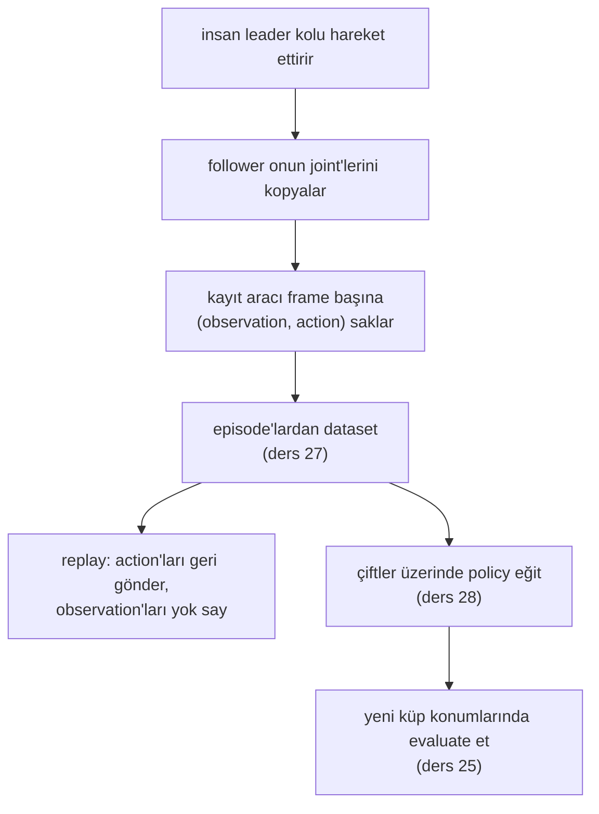

# 26 · Teleoperation, replay ve data collection

<!-- meta -->
| | |
|---|---|
| **Bölüm** | [7 · Learning from demonstration](README.md) |
| **Çalışma türü** | CPU · Mac ya da Colab CPU |
| **Önkoşul** | [16](../part-4-dynamics-and-control/16-grasping-and-pick-place.md), [25](25-evaluating-policies.md) |
| **Önce öğren** | yok |
| **Süre** | ~45 dk |
| **Kod** | [`experiments/26-teleop-replay-data/experiment.py`](../../experiments/26-teleop-replay-data/experiment.py) · [notebook](../../notebooks/26-teleop-replay-data.ipynb) |
| **Durum** | ✅ tam |
<!-- /meta -->

> Replay hareketi tekrarlar, görevi değil. Bir kayıt ancak robotun ne gördüğünü ne yaptığıyla eşleştirdiğinde işe yarar.

## Problem

LeRobot kaydedilmiş bir episode'u kolda tekrar oynatan bir komutla gelir: `lerobot-replay`, dataset'teki kayıtlı action'ları robota frame frame gönderir; dokümantasyon bunu robotun action'larının tekrarlanabilirliğini test etmenin bir yolu olarak sunar ([LeRobot · imitation learning on real robots](https://huggingface.co/docs/lerobot/il_robots)). Follower bir pick'i kusursuz tekrarlayınca robotun görevi öğrendiğini düşünmek kolaydır. Öğrenmemiştir: replay, küpe hiç bakmayan sabit bir joint hedefleri listesidir. Bu ders, replay edilen pick başarısız olmadan önce küpün ne kadar kayabileceğini ölçüyor, bunu bakan bir controller'la karşılaştırıyor ve ardından 27–29. derslerin öğreneceği demonstration'ları kaydediyor.

## Ana fikir

### Sade anlatımla

Bir masaüstü uygulamasındaki makro kaydedici, tıklamalarını sabit ekran koordinatlarında saklar ve sonra tekrar oynatır. Her pencere kayıt sırasında durduğu yerde durduğu sürece çalışır. Bir pencereyi kaydır, makro boşluğa tıklar. Önce ekrana bakan, düğmeyi bulan, sonra tıklayan bir script ise bu kaymadan sağ çıkar. Replay makrodur. Hareket etmeden önce küpün yerini okuyan bir controller ise script'tir.

Teleoperation, robot kayıtlarının yapılma biçimidir: bir insan robotu bir **leader kol** üzerinden sürer (kolun elle hareket ettirilen hafif, pasif bir kopyası) ve gerçek kol (**follower**) onun joint açılarını kopyalar. Kayıt sırasında ekrana bakan insandır. Böyle bir kayıttan sonradan öğrenebilmek için kayıt her anın iki yarısını da saklamalı: robotun ne gördüğünü (**observation**) ve ona ne yapmasının söylendiğini (**action**). Replay yalnız action'ları tutar, observation'ları çöpe atar.

### Demonstration'dan policy'ye



### Open loop ve closed loop, kod olarak

```python
# Replay = macro recorder: a fixed list indexed by time; the cube never enters the loop
def replay(actions):
    for a in actions:                # a = 6 joint targets recorded at one frame
        robot.apply(a)
        robot.step(1 / fps)          # hold it for one frame (zero-order hold)

# Closed loop = a program that looks at the screen before every move
def run(policy, T):
    for t in range(T):
        o = robot.observe()          # joints, jaw, cube position
        robot.apply(policy(o))       # decide from what is seen now
        robot.step(1 / fps)

# Recording a demonstration keeps both halves of each frame
episode = []
for t in range(T):
    o = robot.observe()              # what the robot sees
    a = leader.read_joints()         # what the human commands
    robot.apply(a)
    robot.step(1 / fps)
    episode.append((o, a))           # the pair a policy will learn from
```

| Mod | Formül |
|---|---|
| open loop (replay) | $u_t = u^{\text{rec}}_t$, sabit bir dizi $u_0, u_1, \dots$ |
| closed loop | $u_t = \pi(o_t)$ |
| kaydedilmiş bir episode | $\big\{(o_t, a_t)\big\}_{t=0}^{T-1}$ artı bir görev metni |
| zero-order hold | $k/f \le \tau < (k+1)/f$ için $a(\tau) = a_k$ |

Burada $u_t$ adım $t$'de gönderilen komut, $o_t$ o adımdaki observation (robot state'i, gerçek robotta artı görüntüler), $\pi$ bir observation'ı komuta eşleyen controller ya da policy, $a_t$ kaydedilen action ($t$ anında gönderilen joint hedefleri), $T$ bir episode'daki frame sayısı, $f$ Hz cinsinden kayıt hızı ve $\tau$ sürekli zamandır. 25 Hz'deki sim kaydımızda frame $k$, $t = k/25$ s'deki observation'ı ve expert'in sonraki 40 ms'nin sonunda komutladığı joint hedeflerini saklar.

### Loop'u kim kapatıyor

| Mod | Loop'u kim kapatıyor | Kaymış küpe genelleşir mi? |
|---|---|---|
| Kaydın replay'i | kimse | yalnız grasp toleransı içinde |
| Algıdan yeniden planlama | planlayıcı (ölçülen küp pozu üzerinde IK) | evet, algı doğruysa |
| Leader–follower teleoperation | insan, leader kol üzerinden | evet, insan uyum sağlar |
| Öğrenilmiş policy $\pi_\theta(o_t)$ | network | 28–29. derslerin ölçtüğü şey |

IK, inverse kinematics'tir: gripper'ı istenen bir poza götüren joint açıları ([ders 10](../part-3-kinematics/10-inverse-kinematics.md)).

<details>
<summary>Matematik ayrıntısı: open loop, closed loop ve bir kaydın içermesi gerekenler</summary>

**Tanımlar.** Open-loop bir controller önceden hesaplanmış bir komut dizisini $u_0, u_1, \dots$ sonucu ölçmeden uygular. Closed-loop (feedback) bir controller $u_t = \pi(o_t)$'yi o anki observation'dan hesaplar (Lynch & Park, *Modern Robotics*, bölüm 11). Replay tüm görev boyunca open loop'tur. [Ders 16](../part-4-dynamics-and-control/16-grasping-and-pick-place.md)'nın scripted pick'i görev seviyesinde closed loop'tur: küpün yerini okur, IK çözer ve algılanan bir çene koşulunu bekler. Her segmentin içinde servolar yine kendi pozisyon loop'larını çalıştırır; yani buradaki "open loop", görev seviyesinde açık demektir.

**Replay neden biraz da olsa tolere eder.** Kaydedilen çene açıklığı küpten geniştir. Küple çene arasındaki boşluktan küçük bir kayma yine küpü çenelerin arasında bırakır; daha büyüğü bırakmaz. Bu yüzden tolerans kaydın değil gripper geometrisinin bir özelliğidir ve yöne göre değişir (Boz).

**Kaydın tutması gerekenler.** Teleoperation sırasında insan $a_t = \pi_{\text{insan}}(o_t^{\text{insan}})$'yi gördüğünden hesaplar. Bir öğrenen bu eşlemeyi ancak dataset $o_t$'yi $a_t$'nin yanında, zamanda hizalı olarak saklıyorsa taklit edebilir. $a_{0:T}$'yi replay etmek $o_t$'yi ve onunla birlikte farklı bir başlangıç state'ine tepki verme şansını atar.

**Zero-order hold.** Frame'ler arasında son action sabit tutulur. Daha düşük bir frame hızı tutulan basamakları uzatır; kayıt, ancak bu basamaklar hareketin en hızlı segmentine (bizde çene rampası) göre kısa kaldıkça expert'in geçerli bir tarifi olarak kalır. C kısmı bunu 25 Hz için kontrol ediyor.

Daha derine: Lynch & Park, [*Modern Robotics*](https://hades.mech.northwestern.edu/index.php/Modern_Robotics), bölüm 11; LeRobot, [Imitation learning on real-world robots](https://huggingface.co/docs/lerobot/il_robots).

</details>

## Deney

Tam script: [`experiments/26-teleop-replay-data/experiment.py`](../../experiments/26-teleop-replay-data/experiment.py), çıktı: [`output.txt`](../../experiments/26-teleop-replay-data/output.txt). MuJoCo 3.17.0, NumPy 2.5.4, Apple Silicon Mac (Apple M5), deterministik. A kısmı önceki notebook'un ([`notebooks/26-teleop-replay-data.ipynb`](../../notebooks/26-teleop-replay-data.ipynb)) port'udur; sayıları birebir tekrarlandı.

**A. Replay ve yeniden planlama.** SO-101, (22, 0) cm'deki 3 cm'lik, 30 g'lık bir küpü sabit 4,5 s'lik bir zaman çizelgesiyle alıyor (bekle, üstüne, in, kapat, kaldır, tut). Her 2 ms'lik adımın 6 komutu kaydediliyor: 2250 × 6. Sonra küp 8 yönde 0,5–5 cm kaydırılıyor (artı kayıt noktası: 81 deneme). *Replay* listeyi değiştirmeden gönderir; *feedback* zaman çizelgesini korur ama üç IK pozunu (üstüne, in, kaldır) küpün gerçek yerinden yeniden çözer. Başarı fiziksel, weld yok: 4,5 s'de küpün altı zeminden ≥ 4 cm yukarıda ve iki çene de küpe değiyor.

```python
rec_ctrl, _ = plan_a(m, d, I, CUBE_HOME)        # record once
ok_r, kind_r, _ = run_a(xy, rec_ctrl)           # replay: same 2250 x 6 list
ctrl, _ = plan_a(m0, d0, ids(m0), xy)           # feedback: re-plan from the cube pose
ok_f, kind_f, _ = run_a(xy, ctrl)
```

*Tahmin et:* çeneler küpten daha geniş açılıyor, küçük kaymalar tolere edilmeli. Replay nerede çalışmayı bırakır?

| Küp kayması | Replay | Wilson %95 | Feedback | Replay başarısızlıkları |
|---|---|---|---|---|
| 0 cm | 1/1 | [0,21, 1,00] | 1/1 | – |
| 0,5 cm | 8/8 | [0,68, 1,00] | 8/8 | – |
| 1 cm | 7/8 | [0,53, 0,98] | 8/8 | itti 1 |
| 1,5 cm | 4/8 | [0,22, 0,78] | 8/8 | itti 4 |
| 2 cm | 3/8 | [0,14, 0,69] | 8/8 | itti 5 |
| 2,5 cm | 1/8 | [0,02, 0,47] | 8/8 | ıskaladı 2, itti 5 |
| 3 cm | 1/8 | [0,02, 0,47] | 8/8 | ıskaladı 2, itti 5 |
| 3,5 cm | 1/8 | [0,02, 0,47] | 8/8 | ıskaladı 6, itti 1 |
| 4 cm | 1/8 | [0,02, 0,47] | 8/8 | ıskaladı 6, itti 1 |
| 4,5 cm | 0/8 | [0,00, 0,32] | 8/8 | ıskaladı 6, itti 2 |
| 5 cm | 0/8 | [0,00, 0,32] | 8/8 | ıskaladı 7, itti 1 |
| **toplam** | **27/81** | | **81/81** | |

"İtti" = çeneler küpe değdi ama küp zeminde kaldı; "ıskaladı" = çeneler küpe hiç değmedi. Aralıklar [ders 25](25-evaluating-policies.md)'in Wilson formülüyle; satır başına 8 denemeyle geniş oldukları için tek tek satırları değil eğilimi okuyun.


**B. 27–29. dersler için demonstration'lar.** Ders 16'nın `scripted_pick`'i, x ∈ [16, 28] cm, y ∈ [−8, 8] cm içinde düzgün dağılımla çekilen 120 küp konumunda (seed 26), 25 Hz'de kaydediliyor:

```python
r = pick16.scripted_pick(scene.m, scene.d, cube_pos, record=True)   # 2 ms steps
obs.append(scene.obs_from_qpos(tr[k * K - 1][2]))  # o_k: 5 arm joints, jaw, cube xyz
act.append(tr[k * K + K - 1][3])                   # a_k: 6 joint targets [rad]
```

| Büyüklük | Değer |
|---|---|
| episode (fiziksel başarı) | 120/120 |
| episode başına frame | 114 (4,56 s) |
| toplam frame | 13680 |
| observation | 9: 5 kol joint'i, çene, küp x/y/z |
| action | 6 joint pozisyon hedefi |
| dosya | `demos.npz`, 0,47 MB |

Dosya ayrıca `episode_index`, `frame_index`, `timestamp`, frame başına expert'in fazını, episode başına küp konumunu ve başarı bayrağını, ve görev metnini saklıyor.

**C. Veri kendi içinde tutarlı mı?** İlk 20 episode'un kaydedilmiş 25 Hz action'larını replay etmek (zero-order hold, aynı küp konumu) 20/20 başarılı (Wilson %95 [0,84, 1,00]). 500 Hz komutlardan 25 Hz'e seyreltmek pick'i bozmadı; dataset, en azından kendi state'lerinde, expert'in geçerli bir tarifi.

## Boz

Bozan parametre küp kayması ve başarısızlık yöne bağlı:

| Yön | 0° (+x, ileri) | 45° | 90° (+y) | 135° | 180° | 225° | 270° (−y) | 315° |
|---|---|---|---|---|---|---|---|---|
| en uzak replay başarısı | 1 cm | 2 cm | 4 cm | 2 cm | 1,5 cm | 1 cm | 0,5 cm | 1 cm |

+y yönünde replay 4 cm'de hâlâ tutuyor; −y yönünde 1 cm'de zaten başarısız; ileri ve geri tolerans 1–1,5 cm. Mekanizma (bizim yorumumuz, burada contact'lar ölçülmedi): SO-101'de bir sabit çene ve kapanırken ona doğru süpüren bir hareketli çene var. Hareketli çeneye doğru kaymış bir küp sabit çeneye süpürülür; sabit çeneye doğru kaymış bir küpe ise sabit çene inerken çarpar ve onu iter. Yaklaşık 2 cm'ye kadar başarısızlıkların çoğu "itti"; 3,5 cm'den itibaren çoğu "ıskaladı": çeneler küpün eskiden durduğu boşlukta kapanıyor. Open-loop tolerans kaydın değil gripper geometrisinin bir özelliği.

## Gerçek robotta

- **LeRobot ile teleoperation ve kayıt** (prosedür; kendi kolumuzda henüz ölçülmedi). Follower ve leader'ı kalibre et (`lerobot-calibrate`), çifti `lerobot-teleoperate --robot.type=so101_follower --teleop.type=so101_leader ...` ile kontrol et, sonra `lerobot-record ... --dataset.num_episodes=... --dataset.single_task="..."` ile kaydet. Teleoperation, kayıt ve evaluation için aynı `--robot.id`'yi kullan, çünkü id kalibrasyon dosyasını seçer ([il_robots](https://huggingface.co/docs/lerobot/il_robots)).
- **Dokümantasyonun hız ve sayılar hakkında dediği.** Örnekler kameraları ve kontrol döngüsünü 30 fps'te çalıştırıyor. Varsayılanlar: episode başına 60 s, 60 s reset, 50 episode. Önerileri "en az 50 episode, konum başına 10 episode" kaydetmek, kameraları sabit ve grasp'i tutarlı tutmak, çeşitliliği yavaş yavaş eklemek ([il_robots](https://huggingface.co/docs/lerobot/il_robots)). Kayıt sırasında → episode'u erken bitirir, ← yeniden kaydeder, Esc durdurur.
- **Leader kol follower değildir.** Follower 1/345 dişlili 6 STS3215 servo kullanıyor; leader, kolay hareket etsin diye 1/191, 1/345 ve 1/147 dişlileri karıştırıyor ([SO-101 dokümantasyonu](https://huggingface.co/docs/lerobot/so101)). Kalibrasyon ikisini aynı joint değerlerine eşler; kalibrasyon hatası dataset'te action hatası olur.
- **Donanımda replay testi** (prosedür, ölçülmedi): bir pick kaydet, küp kayıt noktasındayken, sonra 8 yönde 0,5–3 cm kaydırılmışken `lerobot-replay --dataset.episode=0` çalıştır, her biri 1 deneme; mesafe başına k/n'yi Wilson aralıklarıyla raporla. Sim'den farklı bir tolerans bekle: gerçek sürtünme, çene pad'leri ve servo takibi Menagerie modelinden farklı.

## Kendini dene

1. **Kolay.** 1,5 cm'de replay 4/8 yaptı. Tabloya göre o kaymada gerçek oran 0,75 olabilir mi?
2. **Orta.** A kısmındaki feedback controller 81/81 yaptı. Simülasyonda bedavaya aldığı ve gerçek bir algı hattının ona vermeyeceği iki şeyi say.
3. **Zor.** B kısmında `FPS`'i 5 yap (her 100 ms'de bir frame) ve C kısmını yeniden çalıştır. Önce tahmin et: seyreltilmiş action'ları replay etmek küpü yine 20/20 alır mı?

### Cevaplar

1. Evet. 4/8 için Wilson %95 aralığı [0,22, 0,78] ve 0,75'i içeriyor.
2. Küpün tam konumu (kamera yok, gürültü yok, kalibrasyon hatası yok) ve bu konum hareketten önce bir kez, gecikmesiz okunuyor. Ayrıca kol modelinin servoları planı modellendiği gibi takip ediyor.
3. Burada hesaplanmadı; çalıştır. 100 ms'lik bir hold'un 0,3 s süren çene rampasına ne yaptığına bak.

## Akılda kalanlar ve kaynaklar

- Replay open loop'tur: tüm kaymalarda 27/81 başarı (küp gerçekten kaydırıldığında 26/80), ölçülen küp pozundan yeniden planlamada 81/81, simülasyonda.
- Open-loop toleransı gripper geometrisi belirler ve yöne bağlıdır: hareketli çeneye doğru 4 cm, sabit çeneye doğru 1 cm'nin altı.
- Bir demonstration dataset'i frame başına (observation, action) çiftleridir ve episode'lara gruplanır; 120 scripted demo'muz (25 Hz'de 13680 frame, 0,47 MB) kendi başlangıç state'lerinden 20/20 replay ediliyor.

Sonraki: [ders 27 · Robot dataset'leri](27-robot-datasets.md).

Kaynaklar:
- LeRobot, [Imitation learning on real-world robots](https://huggingface.co/docs/lerobot/il_robots) (teleoperate, record, replay, kayıt parametreleri, veri önerileri; okundu 2026-10-27).
- LeRobot, [SO-101](https://huggingface.co/docs/lerobot/so101) (motorlar, leader dişlileri, kalibrasyon; okundu 2026-10-27).
- Lynch & Park, [*Modern Robotics*](https://hades.mech.northwestern.edu/index.php/Modern_Robotics), bölüm 11.
- [MuJoCo Menagerie `robotstudio_so101`](https://github.com/google-deepmind/mujoco_menagerie/tree/main/robotstudio_so101) (Apache-2.0).
- Ölçülen tüm sayılar: [`experiments/26-teleop-replay-data/output.txt`](../../experiments/26-teleop-replay-data/output.txt).
