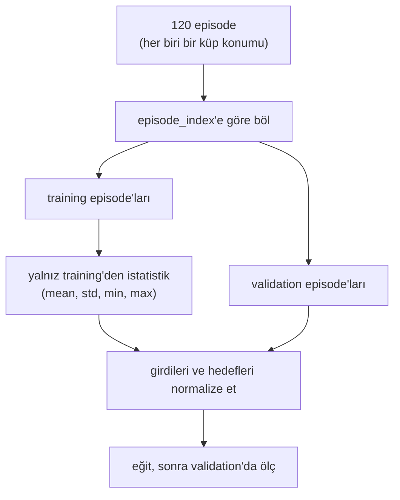

# 27 · Robot dataset'leri

<!-- meta -->
| | |
|---|---|
| **Bölüm** | [7 · Learning from demonstration](README.md) |
| **Çalışma türü** | CPU · Mac ya da Colab CPU |
| **Önkoşul** | [26](26-teleop-replay-data.md) |
| **Önce öğren** | yok |
| **Süre** | ~40 dk |
| **Kod** | [`experiments/27-robot-datasets/experiment.py`](../../experiments/27-robot-datasets/experiment.py) |
| **Durum** | ✅ tam |
<!-- /meta -->

> Bir robot dataset'i episode'lara bölünmüş bir zaman serisidir. Onun istatistikleriyle normalize et ve onu frame'e göre değil, her zaman episode'a göre böl.

## Problem

Ders 26, scripted SO-101 demonstration'larından 13680 frame üretti. Training sayılarının bir anlam taşıyıp taşımadığını üç karar belirler: her frame'in ne içerdiği ve episode'ların nerede başladığı, feature'ların nasıl ölçeklendiği ve verinin training ve validation'a nasıl bölündüğü. Sonuncusu yanlış yapması en kolay olanı: 40 ms arayla gelen frame'ler neredeyse aynıdır; rastgele frame seviyesi bir bölme iki tarafa da neredeyse kopyaları koyar ve validation hatası komşu frame'ler arasındaki interpolation'ı ölçer. Bu ders o yanılsamanın verimizde ne kadar büyük olduğunu ölçüyor.

## Ana fikir

### Sade anlatımla

Bir robot dataset'i, her frame için bir satır olan büyük bir tabloya benzer, ama aslında kısa kayıtlardan (**episode**'lardan) oluşan bir kümedir; her biri bir zaman serisidir. Bu tek gerçek iki kararı belirler.

**Satıra göre değil, episode'a göre böl.** Bir uygulamanın tıklama log'undan kurulan bir churn modeli aynı kullanıcının rastgele satırlarını hem training'de hem validation'da görmemeli: kalıbı öğrenmek yerine kullanıcıyı tanır; bu yüzden kullanıcıları bütün olarak dışarıda tutarsın. Bir episode'da 40 ms arayla gelen frame'ler, bir kullanıcının bir saniye arayla yaptığı iki tıklama kadar benzer; validation episode'ları bütün olarak dışarıda tutmalı, yoksa modelin gördüğü frame'ler arasındaki minik boşlukları doldurmasını ölçer.

**Training verisinin istatistikleriyle ölçekle.** Her girdi, training kümesinde hesaplanan sayılarla (ortalama ve yayılım ya da minimum ve maksimum) yeniden ölçeklenir ve bu sayılar eğitilmiş policy ile birlikte gider. O zaman birinin küpü metre mi milimetre mi logladığı önemini yitirir.

### Verinin yolu



### Bölme ve normalization, kod olarak

```python
f_train, f_val = split_rows(all_frames)                 # wrong: neighbours 40 ms apart on both sides
val = np.isin(episode_index, held_out_episodes)         # right: whole episodes, like whole users
train = ~val
x_norm = (x - x[train].mean(0)) / x[train].std(0)       # MEAN_STD with training statistics only
```

| Büyüklük | Formül |
|---|---|
| MEAN_STD | $\tilde x = \dfrac{x - \mu}{\sigma}$ |
| MIN_MAX | $\tilde x = 2\,\dfrac{x - x_{\min}}{x_{\max} - x_{\min}} - 1$ |
| bir frame'in global satırı | her episode $T$ frame ise `index` $= e \cdot T + t$ |
| episode bölmesi | validation = dışarıda tutulan episode'ların her frame'i |

Burada $x$ ham bir feature değeri, $\tilde x$ onun normalize edilmiş değeri, $\mu, \sigma, x_{\min}, x_{\max}$ o feature'ın training frame'leri üzerindeki ortalaması, standart sapması, minimumu ve maksimumu, $e$ episode id'si (`episode_index`), $t$ episode içindeki konum (`frame_index`) ve $T$ frame cinsinden episode uzunluğudur.

### Bir frame ne tutar

Bir dataset episode'lardan $e$ oluşan bir kümedir; her biri sabit hızda frame'lerden $t = 0 \dots T_e - 1$ oluşan bir dizidir:

| Sütun | Anlamı | Bizim veri |
|---|---|---|
| `observation.state` | propriosepsiyon (robotun kendi joint pozisyonlarını okuması), burada artı küp pozu | 9 float |
| `observation.images.*` | kamera frame'leri | yok (state tabanlı) |
| `action` | bu frame'de gönderilen komut | 6 joint hedefi |
| `timestamp` | episode başından beri saniye | $t/25$ |
| `frame_index`, `episode_index`, `index` | episode içindeki konum, episode id, global satır | int |
| `task_index` | hangi doğal dil görevi | 0: "pick up the cube" |

### LeRobot formatı (v3.0)

Dokümantasyonda ve kodda doğrulandı ([LeRobotDataset v3.0](https://huggingface.co/docs/lerobot/lerobot-dataset-v3); [`dataset_metadata.py`](https://github.com/huggingface/lerobot/blob/main/src/lerobot/datasets/dataset_metadata.py) içinde `CODEBASE_VERSION = "v3.0"`):

- `meta/info.json`: şema (feature adları, dtype'lar, shape'ler), fps, codebase sürümü, yol şablonları.
- `meta/stats.json`: normalization için feature başına istatistikler; kod min, max, mean, std, count ve 0,01, 0,10, 0,50, 0,90, 0,99 quantile'larını hesaplıyor ([`compute_stats.py`](https://github.com/huggingface/lerobot/blob/main/src/lerobot/datasets/compute_stats.py)).
- `meta/episodes/`: episode başına kayıtlar (uzunluk, görevler, ortak dosyalardaki offset'ler), parçalı Parquet olarak.
- `meta/tasks.parquet`: tamsayı id'lere eşlenmiş görev metinleri (dokümantasyon sayfası hâlâ `tasks.jsonl` diyor; kod onu eski yol olarak tutuyor, [`utils.py`](https://github.com/huggingface/lerobot/blob/main/src/lerobot/datasets/utils.py)).
- `data/chunk-000/file-000.parquet`: frame satırları, dosya başına birçok episode; `videos/<kamera>/chunk-000/file-000.mp4` de öyle.

`timestamp`, `frame_index`, `episode_index`, `index` ve `task_index` kullanıcı tarafından değil, kayıt aracı tarafından doldurulur ([`feature_utils.py`](https://github.com/huggingface/lerobot/blob/main/src/lerobot/datasets/feature_utils.py)). v3'te episode sınırları dosya adlarında değil, metadata'da yaşar.

<details>
<summary>Matematik ayrıntısı: frame bölmesi neden sızdırır ve istatistikler neden policy ile gider</summary>

**Bağımsız birim episode'dur.** Bir episode içinde komşu satırlar yumuşak bir hareketin 40 ms arayla iki anıdır ve güçlü biçimde korelelidir; episode'lar arasında ise küp konumu bağımsız çekilir. Bir validation kümesi *yeni, bağımsız* girdilerdeki hatayı tahmin eder; bu yüzden [ders 25](25-evaluating-policies.md)'teki evaluation'ın test konumlarını dışarıda tutması gibi episode'ları bütün olarak dışarıda tutmalı.

**Sızıntı veri büyüdükçe küçülür.** Çok episode'la training kümesi küp alanını sık kaplar; gerçekten yeni bir episode'un bile yakın komşuları olur ve iki tahmin birbirine yaklaşır. Az episode'la en çok ayrışırlar; robot dataset'leri ise genellikle küçüktür.

**Ölçek neden önemli.** Bir MLP'nin ilk katmanı girdilerinin ağırlıklı toplamlarını alır. Milimetre olarak loglanan küp değerleri 1000 kat büyür, joint açıları ise 1 rad mertebesinde kalır; toplamlara küp hâkim olur ve varsayılan başlangıç ağırlıkları ile learning rate'ler 1 mertebesinde girdiler varsayar. Her feature'ı ortak bir aralığa ölçeklemek birimlere bağımlılığı ortadan kaldırır.

**İstatistikler modele aittir.** $\mu, \sigma$ (ya da $x_{\min}, x_{\max}$) training verisine fit edilir ve policy'nin parçasıdır: farklı istatistiklerle evaluate edilince aynı ham observation farklı bir network girdisine dönüşür. Onları validation verisiyle birlikte hesaplamak ikinci, daha küçük bir sızıntıdır.

Daha derine: [Model Evaluation](https://aiengineeringfromscratch.com/lesson?path=phases/02-ml-fundamentals/09-model-evaluation); [LeRobotDataset v3.0](https://huggingface.co/docs/lerobot/lerobot-dataset-v3) ve [`compute_stats.py`](https://github.com/huggingface/lerobot/blob/main/src/lerobot/datasets/compute_stats.py).

</details>

## Sıfırdan yaz

Şimdi dataset tarafını ders 26'nın `demos.npz`'i üzerinde kendin yazacaksın: episode muhasebesi, istatistikler, iki split, normalization ve split sızıntısının modelsiz bir yoklaması, hepsi NumPy ile (Deney'in MLP'si PyTorch istiyor; yoklama istemiyor). Adımları kendi dosyana yaz ve her adımdan sonra çalıştır. Bitmiş fonksiyonlar [`physai/data.py`](../../physai/data.py) içinde; `uv run python experiments/27-robot-datasets/build.py` beş adımı kontrolleriyle birlikte koşturur (çıktı [`build_output.txt`](../../experiments/27-robot-datasets/build_output.txt) dosyasında).

### Adım 1 · Episode'lar ve global indeks

Satırlar episode'a göre sıralı; bir episode `episode_index`'in değiştiği yerde başlar:

```python
def episode_starts(episode_index):
    """Row of the first frame of every episode, for rows sorted by episode."""
    return np.flatnonzero(np.r_[True, episode_index[1:] != episode_index[:-1]])
```

```python
def global_index(episode_index, frame_index):
    """The dataset-wide row number `index` from (episode_index, frame_index)."""
    starts = episode_starts(episode_index)
    return starts[np.searchsorted(episode_index[starts], episode_index)] + frame_index
```

== Step 1. Episode boundaries and the global index ==
episodes 120 | starts [0, 114, 228, 342] ... 13566 | lengths 114-114
index == row number for all 13680 frames: True | episode 2, frame 5 -> index 233

A kısmının sınırları ve ilk alıştırmanın cevabı (233), episode'ların eşit uzunlukta olduğunu varsaymadan.

### Adım 2 · İstatistikler ve birleştirilmeleri

```python
def feature_stats(x):
    """Per-feature statistics as a dataset's stats file stores them."""
    return dict(mean=x.mean(0), std=x.std(0), min=x.min(0), max=x.max(0),
                q01=np.percentile(x, 1, axis=0), q99=np.percentile(x, 99, axis=0), count=len(x))
```

Bir kayıt aracı istatistikleri episode başına hesaplayıp birleştirir; böylece bütün frame'leri aynı anda bellekte tutması gerekmez. Ortalama, standart sapma, min ve max tam olarak birleşir (havuzlanmış varyans); quantile'lar birleşmez:

```python
def merge_stats(a, b):
    """Combine the mean/std/min/max/count of two disjoint sets of frames (pooled variance). Quantiles do not merge."""
    n = a["count"] + b["count"]
    mean = (a["count"] * a["mean"] + b["count"] * b["mean"]) / n
    m2 = (a["count"] * (a["std"] ** 2 + (a["mean"] - mean) ** 2) + b["count"] * (b["std"] ** 2 + (b["mean"] - mean) ** 2))
    return dict(mean=mean, std=np.sqrt(m2 / n), min=np.minimum(a["min"], b["min"]),
                max=np.maximum(a["max"], b["max"]), count=n)
```

== Step 2. Statistics (all frames) and merged per-episode statistics ==
       feature     mean      std      min      max      q01      q99
 shoulder_lift   -0.240    0.515   -1.200    0.702   -1.200    0.620
       gripper    0.731    0.505    0.141    1.200    0.162    1.200
        cube_x    0.222    0.037    0.160    0.332    0.161    0.321
120 per-episode stats merged vs computed on all frames: max |mean diff| 1.1e-15, max |std diff| 6.4e-15, min/max equal: True

A kısmındaki tablonun satırları; birleştirilmiş 120 episode bütün frame'lerin istatistiğiyle yuvarlama hatasına kadar örtüşüyor.

### Adım 3 · İki split

```python
def split_frames(rows, val_frac, rng):
    """Frame split (the wrong one for time series): shuffle the rows, the last val_frac go to validation."""
    perm = rng.permutation(rows)
    cut = int((1 - val_frac) * len(perm))
    return perm[:cut], perm[cut:]
```

```python
def split_episodes(episode_index, val_episodes):
    """Episode split: every frame of the held-out episodes goes to validation. Returns (train, val) masks."""
    val = np.isin(episode_index, val_episodes)
    return ~val, val
```

Deney'in generator'ı ve 10 episode'luk çekilişiyle:

== Step 3. 10 episodes, 80/20: frame split vs episode split ==
frame split:   912 / 228 frames, episodes on both sides 10/10, validation frames with a training neighbour 40 ms away 96.5%
episode split: 912 / 228 frames, episodes on both sides 0/10

Aynı boyutlar, çok farklı içerik. Frame split'te her episode iki tarafta da var ve validation frame'lerinin %96,5'inin aynı episode'da 40 ms ötede bir training frame'i var.

### Adım 4 · Training istatistikleriyle normalize et

```python
def normalize(x, s, mode="mean_std"):
    """MEAN_STD: (x - mean) / std. MIN_MAX: map [min, max] to [-1, 1]. s comes from the training frames."""
    if mode == "mean_std":
        return (x - s["mean"]) / (s["std"] + 1e-8)
    return 2 * (x - s["min"]) / (s["max"] - s["min"] + 1e-8) - 1
```

```python
def unnormalize(y, s, mode="mean_std"):
    """Inverse of normalize (for actions a policy outputs in normalized units)."""
    if mode == "mean_std":
        return y * (s["std"] + 1e-8) + s["mean"]
    return (y + 1) / 2 * (s["max"] - s["min"] + 1e-8) + s["min"]
```

== Step 4. Normalize with training statistics (episodes 0-79) ==
mean_std: train range [-3.57, 2.86] | round trip error 1.1e-16 | m vs mm after normalizing: 7.9e-07
 min_max: train range [-1.00, 1.00] | round trip error 4.4e-16 | m vs mm after normalizing: 2.0e-07

MIN_MAX training aralığını tam olarak [−1, 1]'e eşliyor; MEAN_STD sıfır ortalama ve birim yayılım veriyor (burada −3,57 ile 2,86 arası). Normalization'dan sonra metre ile milimetre yalnız 1e-7 düzeyinde farklı: 0,037 m'lik standart sapmaya göre `1e-8` bölme koruması. B kısmındaki m'de 0,264° ve mm'de 0,265° buradan.

### Adım 5 · Sızıntının modelsiz yoklaması

Akla gelebilecek en ucuz "policy": en yakın training frame'inin action'ını tahmin et.

```python
def nearest_neighbour(X_train, Y_train, X_query, chunk=1024):
    """1-nearest-neighbour regression: the target of the closest training row (L2), chunked to bound memory."""
    out, sq = [], (X_train ** 2).sum(1)
    for i in range(0, len(X_query), chunk):
        q = X_query[i:i + chunk]
        out.append(Y_train[np.argmin(sq[None] - 2 * q @ X_train.T, axis=1)])
    return np.vstack(out)
```

C kısmıyla aynı split'lerde, 100–119 numaralı 20 test episode'uyla:

== Step 5. 1-nearest-neighbour probe, MEAN_STD, the Experiment's splits; test = episodes 100-119 ==
 train eps    split  val RMSE deg  test RMSE deg  test / val
        10    frame         1.536          6.064        3.95
        10  episode         5.303          6.614        1.25
        30    frame         1.426          3.468        2.43
        30  episode         2.730          3.607        1.32
        90    frame         1.272          1.708        1.34
        90  episode         2.516          1.687        0.67

Hiç eğitim olmadan C kısmının deseni: frame split validation hatası sabit kalıyor (1,27–1,54°), test hatası ise 6,06°'den 1,71°'ye düşüyor; 10 episode'da frame split hatayı 3,95 kat küçük gösteriyor. Sayılar C kısmınınkinden farklı, çünkü model farklı: nearest neighbour MLP gibi yumuşakça interpolate etmek yerine 40 ms ötedeki bir frame'i kopyalıyor; validation hataları bu yüzden daha büyük, oranı da MLP'nin 6,33'ünden küçük.

### Elinde kalan

`physai.data` artık `episode_starts`, `global_index`, `feature_stats`, `merge_stats`, `split_frames`, `split_episodes`, `normalize`, `unnormalize` ve `nearest_neighbour`'ı da içeriyor. Sonraki öğrenme dersleri tam olarak bu parçalara ihtiyaç duyuyor: bir episode split'i ve training istatistikleri. [`tests/test_27_robot_datasets.py`](../../tests/test_27_robot_datasets.py) onları eşit olmayan oyuncak episode'larda, sızıntıyı da ders 26 verisinde kontrol ediyor; `uv run pytest tests/test_27_robot_datasets.py` çalıştır.

## Kütüphaneyle kullan

LeRobot (bu repoda kurulu değil; çağrılar [v3.0 dokümantasyonundan](https://huggingface.co/docs/lerobot/lerobot-dataset-v3)) Adım 1–2'nin muhasebesini senin yerine yapar:

```python
from lerobot.datasets import LeRobotDataset
dataset = LeRobotDataset(repo_id)                 # from the Hub, cached locally
frame = dataset[100]                              # dict: 'observation.state', 'action', 'timestamp', ...
stats = dataset.meta.stats                        # meta/stats.json: per-feature mean/std/min/max
dataset = LeRobotDataset(repo_id, delta_timestamps={"action": [0.0, 0.04, 0.08]})   # windows, in seconds
```

| | physai | LeRobot |
|---|---|---|
| episode sınırları | `episode_starts(episode_index)` | `meta/episodes/`: uzunluklar ve paylaşılan dosyalara offset'ler |
| istatistikler | `feature_stats`: mean, std, min, max, q01, q99, count | min, max, mean, std, count, quantile'lar 0,01–0,99 (Ana fikir) |
| normalization | `normalize(x, s, "mean_std" / "min_max")` | MIN_MAX, MEAN_STD, IDENTITY, QUANTILES, QUANTILE10 modları ([`types.py`](https://github.com/huggingface/lerobot/blob/main/src/lerobot/configs/types.py)); ACT state ve action için varsayılan olarak MEAN_STD, Diffusion Policy MIN_MAX kullanır ([ACT](https://github.com/huggingface/lerobot/blob/main/src/lerobot/policies/act/configuration_act.py), [Diffusion](https://github.com/huggingface/lerobot/blob/main/src/lerobot/policies/diffusion/configuration_diffusion.py)) |

Episode'a göre bölmek yine senin işin: Adım 3'teki gibi bütün `episode_index` değerlerini seç.

Tuzaklar:

- **İstatistikler yalnız training frame'lerinden.** Bütün frame'lerde hesaplanan istatistikler validation kümesinin bir kısmını girdilere sızdırır; ayrıca policy ile birlikte giderler ve kullanımda da aynı olmalıdırlar.
- **Diskte float32, istatistik için float64.** Dataset float32 saklıyor, yaklaşık 7 anlamlı basamak; Adım 2 istatistikleri hesaplamadan önce float64'e çeviriyor.
- **Frame değil saniye.** `delta_timestamps` offset'leri saniye cinsinden alır; 25 fps'te bir frame 0,04 s.

## Deney

Girdi: ders 26'dan [`demos.npz`](../../experiments/26-teleop-replay-data/demos.npz). Model: 9 state değerinden 6 action değerini tahmin eden bir MLP (2 × 256 ReLU, Adam, batch 256 ile 4000 adım), ders 28'in eğittiği network'ün aynısı, orada iki ek bileşenle (bkz. AIEFS: [Model Evaluation](https://aiengineeringfromscratch.com/lesson?path=phases/02-ml-fundamentals/09-model-evaluation)). Hata, derece cinsinden action RMSE'si (tahmin edilen ve kaydedilen joint hedefleri arasındaki farkın karesel ortalamasının kökü); open loop ölçülüyor: robotu koşmadan, kaydedilmiş frame'ler üzerinde. Tam script: [`experiments/27-robot-datasets/experiment.py`](../../experiments/27-robot-datasets/experiment.py), çıktı: [`output.txt`](../../experiments/27-robot-datasets/output.txt). NumPy 2.5.4, PyTorch 2.14.1 (CPU), Apple Silicon Mac (Apple M5), deterministik.

**A. Anatomi.** 120 episode, 13680 frame, 25 fps, 120'si de başarılı; episode sınırları 0, 114, 228, …, 13566. satırlarda. İstatistikler `stats.json`'ın tutacağı biçimde (alıntı; q01 ve q99, %1 ve %99 persentilleri):

| Feature | mean | std | min | max | q01 | q99 |
|---|---|---|---|---|---|---|
| shoulder_lift [rad] | −0,240 | 0,515 | −1,200 | 0,702 | −1,200 | 0,620 |
| gripper [rad] | 0,731 | 0,505 | 0,141 | 1,200 | 0,162 | 1,200 |
| cube_x [m] | 0,222 | 0,037 | 0,160 | 0,332 | 0,161 | 0,321 |
| cube_z [m] | 0,036 | 0,032 | 0,015 | 0,114 | 0,015 | 0,101 |
| action gripper [rad] | 0,561 | 0,674 | −0,170 | 1,200 | −0,170 | 1,200 |

İki ayrıntı yalnızca istatistiklerde görünüyor. Komutlanan gripper −0,170 rad'a (kapalı limit) iniyor, ölçülen çene ise hiç 0,141 rad'ın altına inmiyor: küp onu durduruyor ve servo sıkıyor. Ve küpler en fazla 0,28 m uzağa konduğu halde cube_x 0,332 m'ye ulaşıyor: en uzak episode'larda kaldırılan küp lift ve hold sırasında gripper'la birlikte dışarı doğru gidiyor (episode başına trajectory'leri kontrol ettik).

**B. Normalizasyon** (episode 0–79'da eğit, 80–99'da doğrula):

| Girdiler | normalizasyon | val RMSE [derece] | en kötü joint (RMSE) |
|---|---|---|---|
| küp m | yok | 0,306 | gripper (0,480) |
| küp mm | yok | 4,649 | gripper (8,164) |
| küp m | MEAN_STD | 0,264 | gripper (0,507) |
| küp mm | MEAN_STD | 0,265 | gripper (0,514) |
| küp m | MIN_MAX | 0,245 | gripper (0,448) |

Metre cinsinden ham feature'larımız zaten 0,01–1 mertebesinde; normalizasyon az kazandırıyor (0,306 → 0,264). Küpü milimetre olarak logla, normalize edilmemiş model 15 kat kötüleşiyor; normalize edilmiş olan değişmiyor. Normalizasyon modeli, loglarken birinin seçtiği birimlerden bağımsız yapar.

**C. Frame'e göre ve episode'a göre bölme.** *Tahmin et:* 10 episode'la hangi bölme daha düşük validation hatası raporlar ve hangisi doğrudur? İki bölme de 80/20: frame bölmesi $n$ episode'un tüm frame'lerini karıştırır, episode bölmesi episode'ların %80'inde (8, 24, 72) eğitir ve kalanında (2, 6, 18) doğrular. Test kümesi, hiçbir modelin görmediği 20 episode (100–119):

| Kullanılan episode | bölme | val RMSE [derece] | test RMSE [derece] | test / val |
|---|---|---|---|---|
| 10 | frame | 0,252 | 1,595 | 6,33 |
| 10 | episode | 0,640 | 1,804 | 2,82 |
| 30 | frame | 0,280 | 0,446 | 1,59 |
| 30 | episode | 0,544 | 0,479 | 0,88 |
| 90 | frame | 0,270 | 0,279 | 1,03 |
| 90 | episode | 0,343 | 0,323 | 0,94 |

Frame seviyesi validation hatası dataset büyüklüğü ne olursa olsun 0,25–0,28°'de kalıyor. Modelin zaten gördüğü frame'ler arasındaki 40 ms'lik boşlukları ne kadar iyi doldurduğunu ölçüyor ve 10 episode'la yeni küp konumlarındaki gerçek hatayı 6,33 kat küçük gösteriyor. Episode seviyesi sayı test hatasıyla birlikte hareket ediyor. Yalnız 2 validation episode'uyla (10 episode'luk satır) hâlâ iyimser, çünkü 2 episode küçük bir örneklem.


## Boz

Bozan parametre, frame bölmesi altında dataset büyüklüğü. 90 episode'la sızıntı neredeyse önemsiz (test/val 1,03), çünkü training episode'ları küp alanını zaten sık kaplıyor. 10 episode'la hatanın çoğunu gizliyor. Frame bölmesinin en çok zarar verdiği yer küçük dataset'ler ve robot dataset'leri küçüktür: LeRobot'un kendi rehberi 50 episode'dan başlıyor ([il_robots](https://huggingface.co/docs/lerobot/il_robots)). Aynı sızıntı `episode_index`'i yok sayan her frame başına karıştırmada ortaya çıkar: sızdıran bir validation kümesiyle yürüyen bir early-stopping kuralı ya da hyperparameter araması overfit olmuş modeller seçer.

## Gerçek robotta

- `lerobot-record` ile yapılmış gerçek bir SO-101 kaydı zaten `episode_index`, `frame_index`, `timestamp` ve `task_index` içerir; `meta/stats.json`'ını kayıt aracı yazar ([LeRobotDataset v3.0](https://huggingface.co/docs/lerobot/lerobot-dataset-v3)). `episode_index` ile böl; birkaç kayıt oturumu varsa bütün bir oturumu dışarıda tut, çünkü ışık, kalibrasyon ve operatör oturumlar arasında kayar.
- Gerçek gözlemler görüntü içerir ve onların istatistikleri kanal başınadır. Gerçek action'lar leader koldan gelir; bizim scripted olanlardan daha gürültülüdür ve iki operatör aynı görev için farklı action dağılımları üretir.
- Gerçek kolda henüz ölçülmedi: C kısmındaki frame-episode farkı, teleoperate edilmiş bir SO-101 dataset'inde. Prosedür: 50 episode kaydet, aynı MLP'yi state → action üzerinde eğit ve iki validation sayısını dışarıda tutulan 10 episode'la karşılaştır.

## Kendini dene

1. **Kolay.** Episode'larımızın hepsi 25 fps'te 114 frame. Her episode ne kadar sürüyor ve episode 2'nin frame 5'inin `index`'i ne?
2. **Orta.** Action −0,170 rad'a inerken ölçülen çene açısı neden hiç 0,141 rad'ın altına inmiyor? Yalnız `observation.state` üzerinde eğitilen bir policy bu fark hakkında ne öğrenmek zorunda?
3. **Zor.** 100 training episode'unu rastgele değil küp konumuna göre böl: y < 4 cm olan küplerde eğit, y ≥ 4 cm olanlarda doğrula. Validation hatasını rastgele episode bölmesine göre tahmin et, sonra çalıştır.

### Cevaplar

1. 114 / 25 = 4,56 s. `index` = 2 · 114 + 5 = 233.
2. Küp çeneyi durduruyor; komut kapalı limit olduğu için servo torque cap'ine kadar itiyor (ders 16). Policy, çeneyi küp genişliğinde durmuş gördüğünde −0,17 rad vermeli, yani hiçbir zaman state olarak gözlenmeyen bir komutu öğrenmeli.
3. Burada hesaplanmadı; çalıştır. Extrapolation bölmesi rastgele bir episode bölmesinden farklı bir soruyu test eder.

## Akılda kalanlar ve kaynaklar

- Bir robot dataset'i `episode_index` ile gruplanmış (observation, action, timestamp) frame'leridir; görev metinleri ve istatistikler metadata'dadır. LeRobot v3.0 Parquet/MP4 dosyası başına birçok episode saklar ve episode'ları `meta/episodes/` üzerinden çözer.
- Training kümesi istatistikleriyle normalize et: küpü mm olarak loglamak normalize edilmemiş hatayı 0,306°'den 4,649°'ye çıkardı, normalize edilmiş olan 0,265°'de kaldı.
- Episode'a göre böl: 10 episode'la frame bölmesi 0,252° raporladı, görülmemiş episode'larda gerçek hata 1,595°'ydi.

Sonraki: [ders 28 · Behavior cloning](28-behavior-cloning.md).

Kaynaklar:
- LeRobot, [LeRobotDataset v3.0](https://huggingface.co/docs/lerobot/lerobot-dataset-v3) (okundu 2026-10-27).
- LeRobot kaynak kodu (main, okundu 2026-10-27): [`datasets/utils.py`](https://github.com/huggingface/lerobot/blob/main/src/lerobot/datasets/utils.py), [`datasets/compute_stats.py`](https://github.com/huggingface/lerobot/blob/main/src/lerobot/datasets/compute_stats.py), [`datasets/feature_utils.py`](https://github.com/huggingface/lerobot/blob/main/src/lerobot/datasets/feature_utils.py), [`datasets/dataset_metadata.py`](https://github.com/huggingface/lerobot/blob/main/src/lerobot/datasets/dataset_metadata.py), [`configs/types.py`](https://github.com/huggingface/lerobot/blob/main/src/lerobot/configs/types.py), [ACT config](https://github.com/huggingface/lerobot/blob/main/src/lerobot/policies/act/configuration_act.py), [Diffusion config](https://github.com/huggingface/lerobot/blob/main/src/lerobot/policies/diffusion/configuration_diffusion.py).
- LeRobot, [Imitation learning on real-world robots](https://huggingface.co/docs/lerobot/il_robots).
- Ölçülen tüm sayılar: [`experiments/27-robot-datasets/output.txt`](../../experiments/27-robot-datasets/output.txt).
